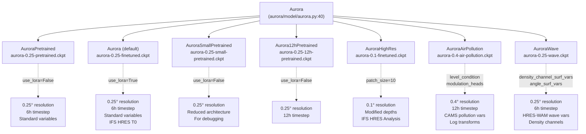
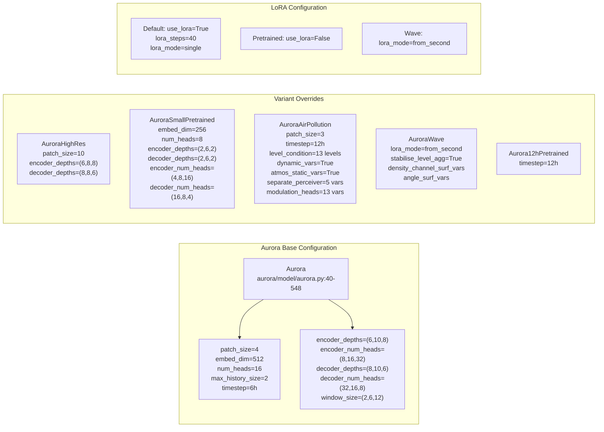
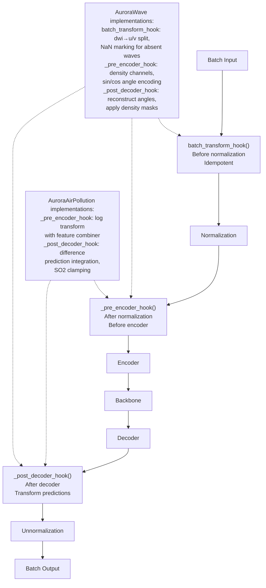
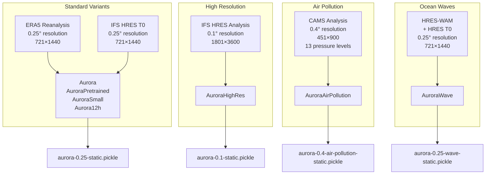

<!-- source: DeepWiki mcp.deepwiki.com · repo microsoft/aurora · page 8.1 Model Variants Specification · fetched 2026-10-26 -->

# Model Variants Specification

<details>
<summary>Relevant source files</summary>

The following files were used as context for generating this wiki page:

- [aurora/model/aurora.py](aurora/model/aurora.py)
- [docs/models.md](docs/models.md)

</details>


This page provides detailed technical specifications for each Aurora model variant, including required variables, pressure levels, resolutions, static variables, and configuration parameters. This is a reference document for understanding the exact requirements and characteristics of each model variant.

For practical usage examples of these variants, see [Usage Guide](#4). For fine-tuning procedures, see [Fine-tuning](#5). For known limitations of each variant, see [Caveats and Limitations](#8.2).

## Model Variant Class Hierarchy

The Aurora codebase provides seven distinct model variants, all derived from the base `Aurora` class. The following diagram illustrates the inheritance structure and default configurations:



**Sources:** [aurora/model/aurora.py:28-37](), [aurora/model/aurora.py:550-933]()

## Variable Requirements by Model Variant

Each model variant requires specific surface, atmospheric, and static variables. The following table summarizes these requirements:

### Standard Variants (Aurora, AuroraPretrained, AuroraSmall, Aurora12h)

| Model Class | Surface Variables | Atmospheric Variables | Static Variables | Resolution |
|------------|-------------------|----------------------|------------------|------------|
| `Aurora` | `2t`, `10u`, `10v`, `msl` | `z`, `u`, `v`, `t`, `q` | `lsm`, `z`, `slt` | 0.25° (721×1440) |
| `AuroraPretrained` | `2t`, `10u`, `10v`, `msl` | `z`, `u`, `v`, `t`, `q` | `lsm`, `z`, `slt` | 0.25° (721×1440) |
| `AuroraSmallPretrained` | `2t`, `10u`, `10v`, `msl` | `z`, `u`, `v`, `t`, `q` | `lsm`, `z`, `slt` | 0.25° (721×1440) |
| `Aurora12hPretrained` | `2t`, `10u`, `10v`, `msl` | `z`, `u`, `v`, `t`, `q` | `lsm`, `z`, `slt` | 0.25° (721×1440) |

**Pressure Levels (all standard variants):** 50, 100, 150, 200, 250, 300, 400, 500, 600, 700, 850, 925, 1000 hPa

**Static Variable Files:**
- `aurora-0.25-static.pickle` from HuggingFace repository

**Sources:** [aurora/model/aurora.py:58-60](), [aurora/model/aurora.py:550-621](), [docs/models.md:30-36](), [docs/models.md:89-94]()

### AuroraHighRes

| Property | Value |
|----------|-------|
| **Class** | `AuroraHighRes` |
| **Resolution** | 0.1° (1801×3600) |
| **Patch Size** | 10 (vs. 4 for standard) |
| **Surface Variables** | `2t`, `10u`, `10v`, `msl` |
| **Atmospheric Variables** | `z`, `u`, `v`, `t`, `q` |
| **Static Variables** | `lsm`, `z`, `slt` |
| **Pressure Levels** | 50, 100, 150, 200, 250, 300, 400, 500, 600, 700, 850, 925, 1000 hPa |
| **Encoder Depths** | (6, 8, 8) vs. (6, 10, 8) standard |
| **Decoder Depths** | (8, 8, 6) vs. (8, 10, 6) standard |
| **Timestep** | 6 hours |
| **LoRA** | Optional (use_lora parameter) |

**Static Variable Files:**
- `aurora-0.1-static.pickle` (recommended, exact training values)
- IFS HRES analysis static variables regridded to 0.1° (requires adjusted normalization)

**Normalization Adjustment for Manual Static Variables:**
```python
surf_stats={"z": (-3.270407e03, 6.540335e04)}
```

**Sources:** [aurora/model/aurora.py:624-643](), [docs/models.md:158-223]()

### AuroraAirPollution

| Property | Value |
|----------|-------|
| **Class** | `AuroraAirPollution` |
| **Resolution** | 0.4° (451×900) |
| **Patch Size** | 3 |
| **Timestep** | 12 hours |

**Surface Variables:**
- Standard: `2t`, `10u`, `10v`, `msl`
- Pollution: `pm1`, `pm2p5`, `pm10`, `tcco`, `tc_no`, `tcno2`, `gtco3`, `tcso2`

**Atmospheric Variables:**
- Standard: `z`, `u`, `v`, `t`, `q`
- Pollution: `co`, `no`, `no2`, `go3`, `so2`

**Static Variables:**
- Standard: `lsm`, `z`, `slt`
- Pollution-specific: `static_ammonia`, `static_ammonia_log`, `static_co`, `static_co_log`, `static_nox`, `static_nox_log`, `static_so2`, `static_so2_log`

**Pressure Levels:** 50, 100, 150, 200, 250, 300, 400, 500, 600, 700, 850, 925, 1000 hPa

**Special Features:**
- Level conditioning enabled: `level_condition=(50, 100, 150, 200, 250, 300, 400, 500, 600, 700, 850, 925, 1000)`
- Dynamic variables enabled: `dynamic_vars=True`
- Atmospheric static variables concatenation: `atmos_static_vars=True`
- Separate perceiver for pollution vars: `separate_perceiver=("co", "no", "no2", "go3", "so2")`
- Modulation heads for difference prediction
- Log-space transformations for pollution variables
- Positive variable clamping
- Indexing bug simulation: `simulate_indexing_bug=True`

**Static Variable Files:**
- `aurora-0.4-air-pollution-static.pickle` from HuggingFace repository

**Sources:** [aurora/model/aurora.py:646-801](), [docs/models.md:237-276]()

### AuroraWave

| Property | Value |
|----------|-------|
| **Class** | `AuroraWave` |
| **Resolution** | 0.25° (721×1440) |
| **Patch Size** | 4 |
| **Timestep** | 6 hours |
| **LoRA Mode** | `from_second` |
| **Level Aggregation** | Stabilized (`stabilise_level_agg=True`) |

**Surface Variables (input form):**
- Meteorological: `2t`, `10u`, `10v`, `msl`
- Wave parameters: `swh`, `mwd`, `mwp`, `pp1d`, `shww`, `mdww`, `mpww`, `shts`, `mdts`, `mpts`
- Wave components: `swh1`, `mwd1`, `mwp1`, `swh2`, `mwd2`, `mwp2`
- Wind: `wind`, `10u_wave`, `10v_wave` (or `dwi` which is converted)

**Surface Variables (internal representation after hooks):**
Wave angles are split into sine/cosine components, and density channels are added for sparse data:
- Angle variables become: `{var}_sin`, `{var}_cos` (for `mwd`, `mdww`, `mdts`, `mwd1`, `mwd2`)
- Wave variables get density channels: `{var}_density` (for most wave variables)

**Atmospheric Variables:**
- `z`, `u`, `v`, `t`, `q` (standard meteorological only)

**Static Variables:**
- Standard: `lsm`, `z`, `slt`
- Wave-specific: `wmb` (water mask binary), `lat_mask`

**Pressure Levels:** 50, 100, 150, 200, 250, 300, 400, 500, 600, 700, 850, 925, 1000 hPa

**Special Processing:**
- Density channel encoding for sparse ocean wave data
- Sine/cosine transformation for directional variables
- NaN handling for absent waves (magnitude < 1e-4)
- Wind direction (`dwi`) decomposition into u/v components

**Static Variable Files:**
- `aurora-0.25-wave-static.pickle` from HuggingFace repository

**Sources:** [aurora/model/aurora.py:804-933](), [docs/models.md:278-322]()

## Model Configuration Parameters

The following diagram maps each model variant to its key configuration parameters and specialized features:



**Sources:** [aurora/model/aurora.py:55-95](), [aurora/model/aurora.py:624-842]()

## Checkpoint and Revision Information

Each model variant has a default checkpoint file and Git revision hash for reproducibility:

| Model Class | Checkpoint File | Revision Hash | Repository |
|-------------|----------------|---------------|------------|
| `Aurora` (fine-tuned) | `aurora-0.25-finetuned.ckpt` | `0be7e57c685dac86b78c4a19a3ab149d13c6a3dd` | `microsoft/aurora` |
| `AuroraPretrained` | `aurora-0.25-pretrained.ckpt` | `0be7e57c685dac86b78c4a19a3ab149d13c6a3dd` | `microsoft/aurora` |
| `AuroraSmallPretrained` | `aurora-0.25-small-pretrained.ckpt` | `0be7e57c685dac86b78c4a19a3ab149d13c6a3dd` | `microsoft/aurora` |
| `Aurora12hPretrained` | `aurora-0.25-12h-pretrained.ckpt` | `15e76e47b65bf4b28fd2246b7b5b951d6e2443b9` | `microsoft/aurora` |
| `AuroraHighRes` | `aurora-0.1-finetuned.ckpt` | `0be7e57c685dac86b78c4a19a3ab149d13c6a3dd` | `microsoft/aurora` |
| `AuroraAirPollution` | `aurora-0.4-air-pollution.ckpt` | `1764d5630a53d3d7a7d169ca335236fc343e4bfc` | `microsoft/aurora` |
| `AuroraWave` | `aurora-0.25-wave.ckpt` | `74598e8c65d53a96077c08bb91acdfa5525340c9` | `microsoft/aurora` |

These values are accessible through class attributes:
- `default_checkpoint_repo`: Repository name (defaults to `"microsoft/aurora"`)
- `default_checkpoint_name`: Checkpoint filename
- `default_checkpoint_revision`: Git commit hash

**Sources:** [aurora/model/aurora.py:46-53](), [aurora/model/aurora.py:553-808]()

## Specialized Features by Variant

### Hook System Implementation

Aurora model variants implement specialized preprocessing and postprocessing through three hook methods:



**Sources:** [aurora/model/aurora.py:394-407](), [aurora/model/aurora.py:726-796](), [aurora/model/aurora.py:854-932]()

### AuroraAirPollution Specific Features

**Log Transform for Pollution Variables:**

The model applies a specialized log transform before the encoder for pollution variables to handle their spikey distribution:

```python
eps = 1e-4
divisor = -np.log(eps)
transform = feature_combiner([
    z.clamp(min=0, max=2.5),
    (log(z.clamp(min=eps)) - log(eps)) / divisor
])
```

This is implemented via `surf_feature_combiner` and `atmos_feature_combiner` (nn.ParameterDict with Linear layers).

**Difference Prediction:**

The model predicts differences relative to previous timesteps using modulation heads. The history dimension lookup is:

| Variable | History Index | Meaning |
|----------|---------------|---------|
| `pm1`, `pm2p5`, `pm10`, `no`, `tc_no`, `no2`, `tcno2` | 0 | t - 12h |
| `co`, `tcco`, `so2`, `tcso2`, `go3`, `gtco3` | 1 | t - 24h |

The reconstruction formula in `_post_decoder_hook`: 
```
output = prediction + (1 + modulation) * previous_timestep
```

**Positive Variable Clamping:**

Surface variables (`pm1`, `pm2p5`, `pm10`, `tcco`, `tc_no`, `tcno2`, `gtco3`, `tcso2`) and atmospheric variables (`co`, `no`, `no2`, `go3`, `so2`) are clamped to non-negative values.

**Sources:** [aurora/model/aurora.py:652-796]()

### AuroraWave Specific Features

**Density Channel Encoding:**

For sparse ocean wave data, density channels indicate data presence:
- `{var}_density = 1.0` where data exists
- `{var}_density = 0.0` where data is absent (NaN)
- During prediction, sigmoid transform applied: `density = sigmoid(predicted_density) * wmb_mask`
- Predictions masked where `density < 0.5`

**Angle Variable Processing:**

Directional variables (wave directions) are decomposed:
- Input: angle in degrees
- Pre-encoder: `{var}_sin = sin(deg2rad(angle))`, `{var}_cos = cos(deg2rad(angle))`
- Post-decoder: `angle = rad2deg(atan2(sin, cos)) % 360`

**Wind Direction Decomposition:**

If `dwi` (wind direction) and `wind` (magnitude) are present, they're converted to u/v components:
```python
10u_wave = -wind * sin(deg2rad(dwi))
10v_wave = -wind * cos(deg2rad(dwi))
```

**Absent Wave Marking:**

When wave height is below threshold (< 1e-4), all related wave components are marked as NaN to indicate absence.

**Sources:** [aurora/model/aurora.py:854-932]()

## Architecture Parameter Variations

The following table details how key architecture parameters differ between variants:

| Parameter | Standard | AuroraSmall | AuroraHighRes | AuroraAirPollution | AuroraWave |
|-----------|----------|-------------|---------------|-------------------|------------|
| `patch_size` | 4 | 4 | 10 | 3 | 4 |
| `embed_dim` | 512 | 256 | 512 | 512 | 512 |
| `num_heads` | 16 | 8 | 16 | 16 | 16 |
| `encoder_depths` | (6, 10, 8) | (2, 6, 2) | (6, 8, 8) | (6, 10, 8) | (6, 10, 8) |
| `encoder_num_heads` | (8, 16, 32) | (4, 8, 16) | (8, 16, 32) | (8, 16, 32) | (8, 16, 32) |
| `decoder_depths` | (8, 10, 6) | (2, 6, 2) | (8, 8, 6) | (8, 10, 6) | (8, 10, 6) |
| `decoder_num_heads` | (32, 16, 8) | (16, 8, 4) | (32, 16, 8) | (32, 16, 8) | (32, 16, 8) |
| `latent_levels` | 4 | 4 | 4 | 4 | 4 |
| `window_size` | (2, 6, 12) | (2, 6, 12) | (2, 6, 12) | (2, 6, 12) | (2, 6, 12) |
| `mlp_ratio` | 4.0 | 4.0 | 4.0 | 4.0 | 4.0 |
| `timestep` | 6h | 6h | 6h | 12h | 6h |
| `level_condition` | None | None | None | 13 levels | None |
| `dynamic_vars` | False | False | False | True | False |
| `atmos_static_vars` | False | False | False | True | False |
| `stabilise_level_agg` | False | False | False | False | True |

**Sources:** [aurora/model/aurora.py:55-95](), [aurora/model/aurora.py:577-842]()

## Checkpoint Adaptation

Each variant may require checkpoint adaptation when loading weights. The adaptation process is handled by `_adapt_checkpoint()` methods:

| Model Variant | Adaptation Function | Purpose |
|--------------|---------------------|---------|
| All standard variants | `_adapt_checkpoint_pretrained()` | Handles legacy patch size differences |
| `AuroraAirPollution` | `_adapt_checkpoint_air_pollution()` | Adds pollution-specific parameters |
| `AuroraWave` | `_adapt_checkpoint_wave()` | Adds wave-specific parameters |

The base adaptation in `_adapt_checkpoint_pretrained()` adjusts encoder patch embeddings when loading checkpoints with different patch sizes.

When loading checkpoints with different `max_history_size`, the method `adapt_checkpoint_max_history_size()` is automatically invoked to:
1. Check compatibility (can load smaller into larger, not vice versa)
2. Zero-pad new history dimensions
3. Copy existing weights

**Strict vs Non-Strict Loading:**
- `strict=True` (default): Requires exact parameter match
- `strict=False`: Allows missing/extra parameters (e.g., when disabling LoRA)

**Sources:** [aurora/model/aurora.py:409-467](), [aurora/model/aurora.py:798-801](), [aurora/model/aurora.py:849-852](), [aurora/model/compat.py]()

## Data Requirements Summary

The following diagram maps model variants to their data source requirements and expected input formats:



**Sources:** [docs/models.md:1-322]()

## Model Parameter Counts

The model parameter counts vary significantly between variants due to different architecture configurations:

| Model Variant | Approximate Parameters | Notes |
|--------------|----------------------|-------|
| `Aurora` (standard) | ~1.3B | Full configuration with embed_dim=512 |
| `AuroraPretrained` | ~1.3B | Same architecture as fine-tuned |
| `AuroraSmallPretrained` | ~100M | Reduced embed_dim=256, fewer layers |
| `Aurora12hPretrained` | ~1.3B | Same architecture, different timestep |
| `AuroraHighRes` | ~1.3B | Modified depths, different patch size |
| `AuroraAirPollution` | ~1.3B + pollution heads | Additional feature combiners and modulation heads |
| `AuroraWave` | ~1.3B | Standard architecture with specialized hooks |

The small pretrained variant is specifically designed for debugging and has significantly reduced capacity.

**Sources:** [aurora/model/aurora.py:41-44](), [aurora/model/aurora.py:577-598]()

---

