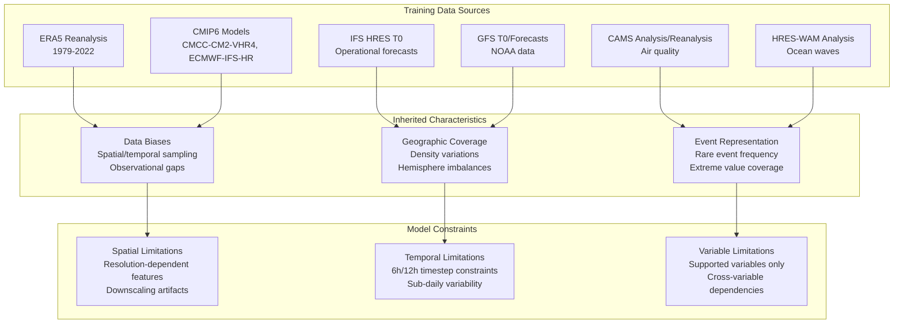
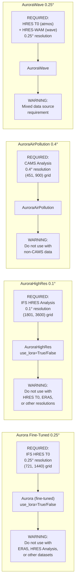
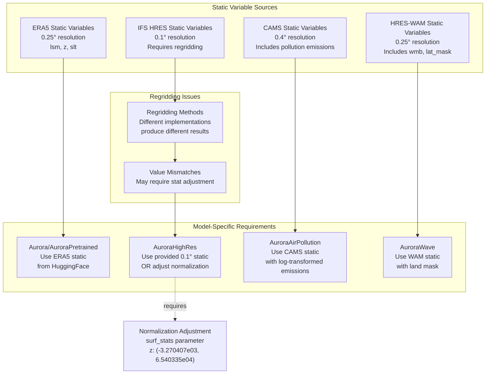
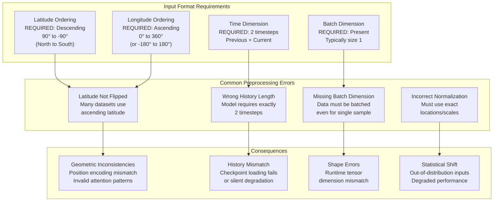
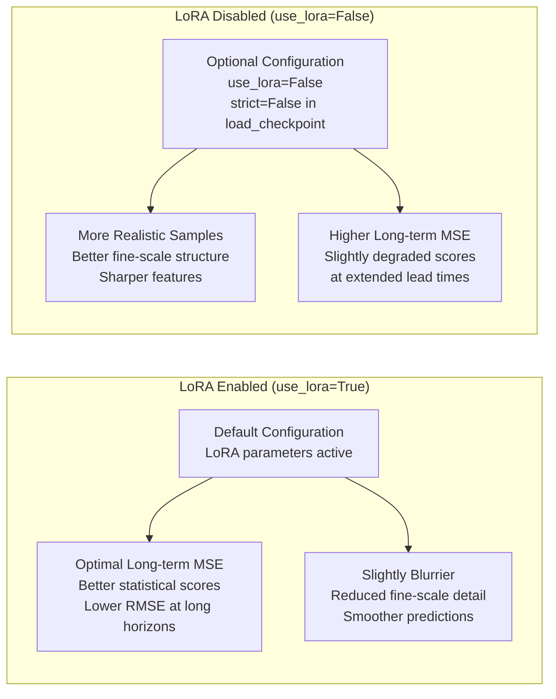

<!-- source: DeepWiki mcp.deepwiki.com · repo microsoft/aurora · page 8.2 Caveats and Limitations · fetched 2026-10-26 -->

# Caveats and Limitations

<details>
<summary>Relevant source files</summary>

The following files were used as context for generating this wiki page:

- [README.md](README.md)
- [docs/gifs/tc_tracks.gif](docs/gifs/tc_tracks.gif)
- [docs/intro.md](docs/intro.md)
- [docs/models.md](docs/models.md)
- [docs/usage.md](docs/usage.md)

</details>


This page documents known limitations, constraints, edge cases, and responsible AI considerations for the Aurora model family. Understanding these limitations is essential for proper model selection, deployment, and interpretation of results.

For technical specifications of each model variant, see [Model Variants Specification](#8.1). For fine-tuning considerations, see [Fine-tuning](#5). For responsible usage guidelines, refer to the Responsible AI section below.

---

## General Model Limitations

### Neural Network Characteristics

Aurora is based on neural networks, which means predictions lack strict mathematical guarantees of accuracy. The model exhibits the following fundamental characteristics:

**No Deterministic Guarantees**: Even on training set samples or with identical inputs, predictions may vary or degrade due to:
- Stochastic elements in the architecture
- Sensitivity to input perturbations
- Accumulation of errors in autoregressive rollouts
- Numerical precision effects

**Out-of-Distribution Behavior**: The model may produce arbitrarily poor predictions when:
- Input data differs significantly from training distribution
- Extreme weather events not well-represented in training data
- Geographic regions with limited training coverage
- Time periods with novel atmospheric conditions

**Autoregressive Error Accumulation**: During multi-step rollouts via [aurora/rollout.py](), prediction errors compound over time. This manifests as:
- Increasing MSE with lead time
- Potential drift from physical constraints
- Loss of small-scale features
- Reduced skill for rare events at longer horizons

Sources: [README.md:133-148](), [docs/intro.md:8-15]()

### Training Data Dependencies

Aurora's performance is fundamentally constrained by its training data:



**Potential Biases**: Aurora may inherit biases from training datasets including:
- Observational gaps in data-sparse regions (oceans, polar areas)
- Temporal sampling biases from reanalysis products
- Model biases from CMIP6 climate model outputs
- Assimilation artifacts in analysis products

**Version Differences**: The published models are streamlined versions of internal development models. While thoroughly validated, subtle unintended differences may exist that affect predictive performance.

Sources: [README.md:150-159](), [README.md:144-148]()

### Operational Deployment Constraints

Aurora outputs are **not meant for direct operational use** without additional verification:

| Requirement | Description | Implementation Status |
|-------------|-------------|----------------------|
| Calibration | Statistical post-processing for bias correction | Not included in base models |
| Ensemble Generation | Multiple forecasts for uncertainty quantification | Single deterministic forecast |
| Quality Control | Real-time data validation and error detection | User responsibility |
| Physical Constraints | Hard enforcement of conservation laws | Soft enforcement via training |
| Extreme Event Alerts | Automated detection and warning systems | Not included (TC tracking only) |
| Multi-model Consensus | Integration with other forecast systems | Requires external framework |

Aurora is a **single component** in a complete forecasting pipeline. Operational use requires:
- Integration with data assimilation systems
- Ensemble forecasting capabilities
- Statistical post-processing
- Human forecaster oversight
- Multi-model verification

Sources: [README.md:140-142]()

---

## Model Variant Constraints

### Dataset Specificity Requirements

Each Aurora variant is fine-tuned for specific datasets. Using a model on non-matching data significantly degrades performance:



**Critical Dataset-Model Pairings**:

| Model Class | Required Dataset | Resolution | Grid Dimensions | Consequences of Mismatch |
|-------------|-----------------|------------|-----------------|--------------------------|
| `Aurora` (fine-tuned) | IFS HRES T0 only | 0.25° | (721, 1440) | Suboptimal performance, MSE degradation |
| `AuroraHighRes` | IFS HRES Analysis only | 0.1° | (1801, 3600) | Significant performance degradation |
| `AuroraAirPollution` | CAMS Analysis only | 0.4° | (451, 900) | Invalid pollution predictions |
| `AuroraWave` | HRES T0 + HRES-WAM | 0.25° | (721, 1440) | Invalid wave predictions |
| `AuroraPretrained` | ERA5 or any 0.25° | 0.25° | (721, 1440) | General purpose, no specific constraint |

**Important Distinction**: IFS HRES T0 ≠ IFS HRES Analysis
- **T0**: Operational forecast initialized from T-0 time
- **Analysis**: Retrospective analysis with full data assimilation
- These are fundamentally different products and **not interchangeable**

Sources: [docs/models.md:77-85](), [docs/models.md:172-181](), [docs/models.md:254-260](), [docs/models.md:298-306]()

### Required Variables and Pressure Levels

Each model variant requires specific variables. Missing or substituting variables leads to degraded performance:

**Standard Weather Models** (`Aurora`, `AuroraPretrained`, `AuroraHighRes`, `Aurora12hPretrained`):

| Category | Required Variables | Atmospheric Levels (hPa) |
|----------|-------------------|-------------------------|
| Surface | `2t`, `10u`, `10v`, `msl` | N/A |
| Static | `lsm`, `slt`, `z` | N/A |
| Atmospheric | `t`, `u`, `v`, `q`, `z` | 50, 100, 150, 200, 250, 300, 400, 500, 600, 700, 850, 925, 1000 |

**Air Pollution Model** (`AuroraAirPollution`):

| Category | Required Variables | Atmospheric Levels (hPa) |
|----------|-------------------|-------------------------|
| Surface | Standard + `pm1`, `pm2p5`, `pm10`, `tcco`, `tc_no`, `tcno2`, `tcso2`, `gtco3` | N/A |
| Static | Standard + `static_ammonia`, `static_ammonia_log`, `static_co`, `static_co_log`, `static_nox`, `static_nox_log`, `static_so2`, `static_so2_log` | N/A |
| Atmospheric | Standard + `co`, `no`, `no2`, `so2`, `go3` | Same as standard |

**Wave Model** (`AuroraWave`):

| Category | Required Variables | Atmospheric Levels (hPa) |
|----------|-------------------|-------------------------|
| Surface | Standard + `swh`, `mwd`, `mwp`, `pp1d`, `shww`, `mdww`, `mpww`, `shts`, `mdts`, `mpts`, `swh1`, `mwd1`, `mwp1`, `swh2`, `mwd2`, `mwp2`, `10u_wave`, `10v_wave`, `wind` | N/A |
| Static | Standard + `wmb`, `lat_mask` | N/A |
| Atmospheric | Standard only | Same as standard |

Sources: [docs/models.md:28-36](), [docs/models.md:262-270](), [docs/models.md:308-316]()

### Static Variable Handling

Static variables exhibit model-specific requirements and potential sources of error:

**Resolution-Dependent Static Variables**:



**Critical Considerations**:

1. **Regridding Artifacts**: Different regridding implementations (e.g., bilinear, conservative) produce subtly different results. For `AuroraHighRes`, using self-regridded static variables requires normalization adjustment via `surf_stats` parameter.

2. **Recommended Approach**: Always use the exact static variables provided in the HuggingFace repository for the corresponding model:
   - `aurora-0.25-static.pickle` for 0.25° models
   - `aurora-0.1-static.pickle` for `AuroraHighRes`
   - `aurora-0.4-air-pollution-static.pickle` for `AuroraAirPollution`
   - `aurora-0.25-wave-static.pickle` for `AuroraWave`

3. **Normalization Mismatch**: Using static variables with different value ranges than training requires updating normalization statistics, otherwise the model will receive out-of-distribution inputs.

Sources: [docs/models.md:196-222](), [docs/models.md:272-275](), [docs/models.md:318-321]()

---

## Technical Limitations

### Computational Requirements

Aurora models have significant computational demands:

| Model Variant | GPU Memory (Inference) | GPU Memory (Training) | Typical Inference Time (Single Step) | Precision Support |
|---------------|------------------------|----------------------|--------------------------------------|-------------------|
| `AuroraSmallPretrained` | ~5 GB | ~15 GB | <1 second | FP32, BF16, FP16 |
| `AuroraPretrained` | ~20 GB | ~60 GB | ~2 seconds | FP32, BF16, FP16 |
| `Aurora` (0.25°) | ~40 GB | ~120 GB | ~3 seconds | FP32, BF16, FP16 |
| `AuroraHighRes` (0.1°) | ~80 GB | ~240 GB | ~15 seconds | BF16, FP16 (FP32 not recommended) |
| `AuroraAirPollution` | ~25 GB | ~70 GB | ~3 seconds | FP32, BF16, FP16 |
| `AuroraWave` | ~45 GB | ~130 GB | ~4 seconds | FP32, BF16, FP16 |

**Memory Optimization Strategies**:
- Use `torch.inference_mode()` to disable gradient computation
- Move predictions to CPU immediately in rollout loops: `pred.to("cpu")`
- Enable activation checkpointing during training (see [Fine-tuning](#5))
- Use mixed precision training with `torch.cuda.amp.autocast()`
- Reduce batch size (though models expect batch size 1 for inference)

**Hardware Requirements**:
- Minimum: NVIDIA GPU with 16 GB VRAM (for small model only)
- Recommended: NVIDIA A100 40GB/80GB for full-scale models
- High-resolution: Multiple A100 80GB GPUs or H100 for `AuroraHighRes`

Sources: [docs/usage.md:123-124]()

### Data Format Requirements

Aurora has strict requirements for input data format:



**Critical Format Requirements**:

1. **Latitude Ordering**: Must be strictly descending (90° to -90°). The model's positional encoding assumes North-to-South order. Ascending latitude will cause geometric inconsistencies.

2. **History Length**: Models require exactly 2 timesteps (previous and current). This is encoded in checkpoint weights. Using different history lengths requires:
   - Checkpoint adaptation with `strict=False`
   - Potential performance degradation
   - See [Checkpoint Management](#2.5)

3. **Batch Dimension**: Even single predictions require a batch dimension. Typical shape for surface variables: `(batch=1, time=2, lat, lon)`.

4. **Variable Shapes**:
   - Surface variables: `(batch, time=2, lat, lon)`
   - Atmospheric variables: `(batch, time=2, levels, lat, lon)`
   - Static variables: `(lat, lon)` (no batch or time dimension)

Sources: [docs/usage.md:47-66]()

### Numerical Precision Considerations

Aurora's numerical behavior varies with precision:

**Precision Modes**:

| Precision | Performance Impact | Accuracy Impact | Memory Impact | Recommended Use |
|-----------|-------------------|-----------------|---------------|-----------------|
| FP32 | Baseline (1.0x) | Reference accuracy | Baseline (1.0x) | Validation, debugging |
| BF16 | ~2x faster | Minimal degradation | ~0.5x memory | Training, inference |
| FP16 | ~2x faster | May cause instabilities | ~0.5x memory | Inference only (with caution) |

**Known Issues**:
- **FP16 Underflow**: Some operations in Swin3D attention may underflow with FP16
- **Gradient Accumulation**: Mixed precision training requires careful gradient scaling
- **Static Variable Precision**: Static variables should match model precision to avoid type mismatches

Sources: Based on general deep learning practices and model architecture

---

## Known Issues and Edge Cases

### LoRA Trade-offs

For fine-tuned models (`Aurora`, `AuroraHighRes`), LoRA adaptation presents a trade-off:



**Recommendation**: Use default LoRA-enabled configuration unless visual realism is critical and slight MSE increase is acceptable.

**Implementation**:
```python
# Disable LoRA for more realistic predictions
model = Aurora(use_lora=False)
model.load_checkpoint(strict=False)  # Required: checkpoint contains LoRA weights
```

Sources: [docs/models.md:104-121](), [docs/models.md:224-234]()

### HRES-WAM Specific Preprocessing

`AuroraWave` requires specific postprocessing of HRES-WAM data not documented in the main API:

**Requirements**:
1. **Density Channel Encoding**: Wave variables with sparse ocean coverage use density channels
2. **Combined Data Sources**: Meteorological variables from HRES T0, wave variables from HRES-WAM
3. **Masking**: Land areas must be properly masked with `lat_mask` static variable

**Critical Reference**: See Section C.5 of the [Supplementary Information](https://static-content.springer.com/esm/art%3A10.1038%2Fs41586-025-09005-y/MediaObjects/41586_2025_9005_MOESM1_ESM.pdf) for complete preprocessing details.

Sources: [docs/models.md:298-299]()

### Checkpoint Version Compatibility

The published models are streamlined versions of internal development models. While thoroughly tested, subtle differences may exist:

**Potential Issues**:
- Minor numerical differences in predictions
- Slight performance variations from paper results
- Checkpoint loading warnings (can often be ignored with `strict=False`)

**Mitigation**:
- Use official checkpoints from HuggingFace `microsoft/aurora`
- Follow exact model-checkpoint pairings documented in [Model Variants Specification](#8.1)
- Report unexpected behaviors via GitHub issues

Sources: [README.md:144-148]()

---

## Responsible AI Considerations

### Intended Use and Misuse

**Intended Use**:
- Research into atmospheric forecasting and foundation models
- Prototyping and development of weather prediction systems
- Educational purposes and weather prediction tutorials
- Non-operational forecasting experiments

**Explicitly Not Intended For**:
- Direct operational forecasting without verification
- Safety-critical decision making without human oversight
- Commercial applications without proper licensing (contact AIWeatherClimate@microsoft.com)
- Regions or conditions significantly outside training distribution

**Misuse Scenarios**:
- Using predictions for critical decisions (aviation, disaster response) without validation
- Deploying in production without proper testing infrastructure
- Ignoring dataset-model matching requirements
- Claiming operational readiness without verification tests

Sources: [README.md:127-131](), [README.md:140-142]()

### Bias and Fairness

Aurora may exhibit biases inherited from training data:

**Known Bias Sources**:
1. **Geographic Bias**: Training data over-represents Northern Hemisphere, densely observed regions
2. **Temporal Bias**: Limited extreme event examples, especially rare phenomena
3. **Reanalysis Bias**: ERA5 and other reanalyses contain model-dependent artifacts
4. **Observational Gaps**: Sparse data over oceans, polar regions, developing countries

**Impact on Predictions**:
- Potentially lower skill in under-represented regions
- May underpredict rare extreme events
- Could propagate historical observational biases
- Uncertain behavior for climate regimes outside training period

**Mitigation Strategies**:
- Validate predictions against independent data sources
- Apply region-specific calibration if deploying regionally
- Use ensemble methods to quantify uncertainty
- Compare against operational forecasts and observations

Sources: [README.md:138-142]()

### Verification and Validation Requirements

Before operational deployment, Aurora requires extensive verification:

| Verification Type | Description | Responsibility |
|-------------------|-------------|----------------|
| Hindcast Validation | Test on historical events not in training data | User |
| Real-time Monitoring | Compare against observations as they arrive | User |
| Multi-model Comparison | Benchmark against operational forecast systems | User |
| Extreme Event Testing | Validate on storms, heat waves, cold snaps | User |
| Regional Calibration | Statistical post-processing for local biases | User |
| Ensemble Validation | Uncertainty quantification and spread-skill | User |

**Published Evaluations**: The paper includes extensive evaluations on held-out data, including:
- Root mean square error and anomaly correlation coefficient
- Extreme event analysis (extreme heat, cold)
- Rare event case studies (Storm Ciarán 2023)
- Tropical cyclone track prediction accuracy

These evaluations are **necessary but not sufficient** for operational deployment. Additional domain-specific validation is required.

Sources: [README.md:160-165]()

---

## Summary of Critical Constraints

**Model-Dataset Matching**:
- `Aurora` → IFS HRES T0 only
- `AuroraHighRes` → IFS HRES Analysis only  
- `AuroraAirPollution` → CAMS Analysis only
- `AuroraWave` → HRES T0 (atmos) + HRES-WAM (wave)
- `AuroraPretrained` → General use, ERA5 compatible

**Data Format**:
- Latitude: Descending order (90° to -90°)
- History: Exactly 2 timesteps
- Batch dimension: Always required
- Static variables: Use HuggingFace provided versions

**Computational**:
- 40-80 GB GPU memory for full-scale models
- BF16 recommended for memory efficiency
- Use `torch.inference_mode()` for inference

**Operational**:
- Not ready for direct operational use
- Requires verification testing
- Single deterministic forecast (no ensemble)
- Human oversight essential

**Contact**:
- Commercial use: AIWeatherClimate@microsoft.com
- Technical issues: GitHub issues
- Research questions: Paper authors

Sources: [README.md:44-48](), [docs/models.md](), [docs/usage.md]()