# Page: Overview

# Overview

<details>
<summary>Relevant source files</summary>

The following files were used as context for generating this wiki page:

- [README.md](README.md)
- [aurora/__init__.py](aurora/__init__.py)
- [aurora/model/aurora.py](aurora/model/aurora.py)
- [docs/_toc.yml](docs/_toc.yml)
- [docs/ai_models_plugin.md](docs/ai_models_plugin.md)
- [docs/gifs/tc_tracks.gif](docs/gifs/tc_tracks.gif)
- [docs/intro.md](docs/intro.md)
- [docs/tracking.md](docs/tracking.md)
- [docs/usage.md](docs/usage.md)

</details>


This document introduces Aurora, a foundation model for atmospheric and environmental forecasting. Aurora is a deep learning system capable of predicting surface-level and atmospheric variables including temperature, wind, precipitation, air pollution concentrations, and ocean wave conditions. The model implements a hierarchical transformer architecture with multi-scale processing capabilities and supports various specialized prediction tasks through fine-tuned variants.

For detailed architecture documentation, see [Model Architecture](#2). For data preparation and batch construction, see [Data Handling](#3). For practical usage examples, see [Usage Guide](#4). For model training and adaptation, see [Fine-tuning](#5).

## Model Family

Aurora consists of a pretrained base model and multiple specialized variants optimized for different resolutions, temporal scales, and atmospheric domains. All variants share the same core architecture defined in [aurora/model/aurora.py:40-548]() but differ in configuration parameters, input/output variables, and checkpoint weights.

| Model Class | Resolution | Timestep | Primary Use Case | Checkpoint |
|------------|-----------|----------|------------------|------------|
| `AuroraPretrained` | 0.25° | 6h | General atmospheric forecasting (ERA5, CMIP6, GFS, HRES) | `aurora-0.25-pretrained.ckpt` |
| `Aurora` | 0.25° | 6h | Operational weather forecasting (IFS HRES T0) | `aurora-0.25-finetuned.ckpt` |
| `AuroraHighRes` | 0.1° | 6h | High-resolution weather analysis | `aurora-0.1-finetuned.ckpt` |
| `AuroraAirPollution` | 0.4° | 12h | Air quality forecasting (CAMS) | `aurora-0.4-air-pollution.ckpt` |
| `AuroraWave` | 0.25° | 6h | Ocean wave prediction (HRES-WAM) | `aurora-0.25-wave.ckpt` |
| `Aurora12hPretrained` | 0.25° | 12h | 12-hour timestep predictions | `aurora-0.25-12h-pretrained.ckpt` |
| `AuroraSmallPretrained` | 0.25° | 6h | Debugging and testing (reduced parameters) | `aurora-0.25-small-pretrained.ckpt` |

Sources: [aurora/model/aurora.py:28-37](), [aurora/model/aurora.py:550-851](), [README.md:52-59]()

## Model Class Hierarchy

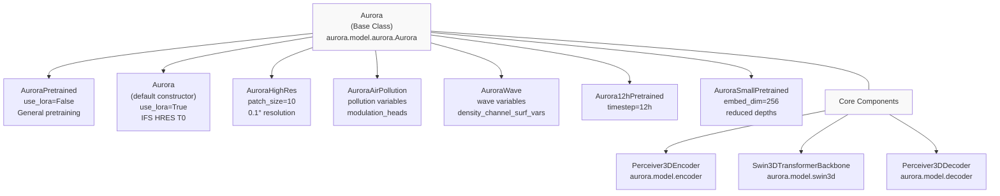

**Model Variant Specializations**: Each model variant inherits from the base `Aurora` class and customizes specific parameters:

- **AuroraHighRes** modifies `patch_size=10` and encoder/decoder depths for 0.1° resolution [aurora/model/aurora.py:624-643]()
- **AuroraAirPollution** extends `surf_vars` and `atmos_vars` with pollution species, uses `level_condition`, `dynamic_vars`, `separate_perceiver`, and `modulation_heads` for predicting concentration differences [aurora/model/aurora.py:646-801]()
- **AuroraWave** supplements wave variables with density channels and sine/cosine encoding for directional variables [aurora/model/aurora.py:804-851]()
- **AuroraSmall** reduces `embed_dim` and layer depths for faster testing [aurora/model/aurora.py:568-601]()

Sources: [aurora/model/aurora.py:40-851]()

## Core Architecture Components

Aurora implements a three-stage encoder-backbone-decoder architecture. The model processes heterogeneous multi-scale atmospheric data through variable-specific embeddings, hierarchical 3D attention, and specialized output heads.

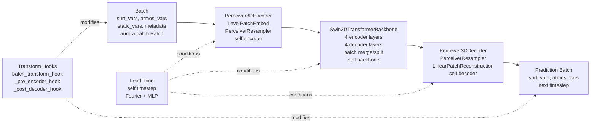

**Forward Pass Flow**: The model's forward method [aurora/model/aurora.py:265-392]() implements the following sequence:

1. **Batch Transformation** (`batch_transform_hook`): Domain-specific preprocessing (e.g., wave component splitting)
2. **Normalization** (`batch.normalise`): Apply variable-specific location/scale normalization with optional adjustments via `surf_stats`
3. **Spatial Cropping** (`batch.crop`): Adjust dimensions to be divisible by `patch_size`
4. **Static Variable Broadcasting**: Expand static variables to batch and history dimensions
5. **Positive Variable Clamping**: Apply lower bounds to concentration/magnitude variables if configured
6. **Pre-encoder Hook** (`_pre_encoder_hook`): Apply domain-specific transformations (e.g., log transforms for pollution)
7. **Encoding**: Process through `Perceiver3DEncoder` with lead time conditioning
8. **Backbone Processing**: Apply hierarchical `Swin3DTransformerBackbone` with optional autocast to bfloat16
9. **Decoding**: Reconstruct outputs via `Perceiver3DDecoder`
10. **Post-decoder Hook** (`_post_decoder_hook`): Apply output transformations (e.g., add back differences for pollution)
11. **Output Clamping**: Reapply positive constraints for autoregressive stability
12. **Unnormalization**: Restore original variable scales

Sources: [aurora/model/aurora.py:265-392](), [aurora/model/aurora.py:394-407]()

## Input and Output Specification

Aurora operates on structured atmospheric data encapsulated in the `Batch` dataclass, which contains three categories of variables and associated metadata.

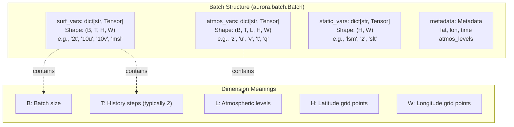

**Variable Categories**:

- **Surface Variables** (`surf_vars`): 2D fields at Earth's surface (temperature, wind components, pressure, concentrations)
- **Atmospheric Variables** (`atmos_vars`): 3D fields at pressure levels (geopotential, wind, temperature, humidity)
- **Static Variables** (`static_vars`): Time-invariant geographical properties (land-sea mask, orography, soil type)
- **Metadata** (`metadata`): Coordinate information including latitude/longitude grids, timestamps, and pressure level specifications

The model requires 2 historical timesteps (T=2) as input context and produces predictions for the next timestep. During autoregressive rollout via the `rollout` function [aurora/rollout.py](), predictions are concatenated with the most recent historical step to form new input batches.

Sources: [aurora/batch.py](), [aurora/model/aurora.py:55-104](), [docs/usage.md:42-66]()

## Execution Workflow

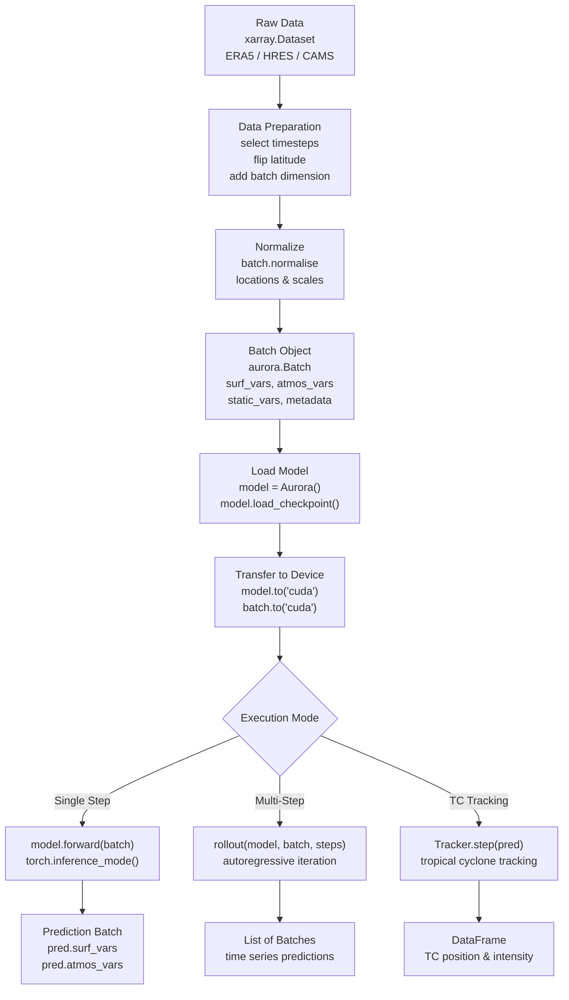

**Core Execution Functions**:

- **Model Construction**: Instantiate a model class (`Aurora`, `AuroraHighRes`, etc.) [aurora/model/aurora.py:40-95]()
- **Checkpoint Loading**: `model.load_checkpoint(repo, name, revision)` downloads from HuggingFace and loads weights [aurora/model/aurora.py:409-456]()
- **Single Prediction**: `model.forward(batch)` produces one timestep ahead [aurora/model/aurora.py:265-392]()
- **Autoregressive Rollout**: `rollout(model, batch, steps)` iteratively applies the model [aurora/rollout.py]()
- **Cyclone Tracking**: `Tracker(init_lat, init_lon, init_time)` with `tracker.step(pred)` [aurora/tracker.py]()

Sources: [aurora/model/aurora.py:409-456](), [aurora/rollout.py](), [aurora/tracker.py](), [docs/usage.md:33-142]()

## Deployment and Integration Options

Aurora supports three primary deployment modes serving different user communities and operational requirements.

| Mode | Entry Point | Use Case | Requirements |
|------|------------|----------|--------------|
| **Local Execution** | Direct Python import | Research, development, testing | PyTorch, GPU (40GB for 0.25° model) |
| **ECMWF ai-models** | `ai-models-aurora` plugin | Operational forecasting integration | ECMWF data access, ai-models framework |
| **Azure AI Foundry** | Foundry API client | Scalable cloud inference | Azure account, blob storage |

**Local Execution**: Install via pip (`pip install microsoft-aurora`) or conda (`mamba install microsoft-aurora -c conda-forge`), then import and use directly:

```python
from aurora import Aurora, Batch
model = Aurora()
model.load_checkpoint()
prediction = model.forward(batch)
```

**ECMWF Integration**: The `ai-models-aurora` plugin enables Aurora to participate in ECMWF operational workflows alongside other AI weather models. The plugin implements the ai-models interface and handles data format conversions.

**Cloud Deployment**: Azure AI Foundry provides REST API access for asynchronous job submission with results delivered via blob storage. This mode supports enterprise-scale inference with managed infrastructure.

Sources: [README.md:63-74](), [docs/usage.md:3-30](), [docs/ai_models_plugin.md](), [aurora/__init__.py:1-30]()

## Key Configuration Parameters

The `Aurora` constructor [aurora/model/aurora.py:55-95]() accepts numerous parameters controlling model architecture, training behavior, and domain-specific features:

**Architecture Parameters**:
- `encoder_depths`, `encoder_num_heads`: Control Swin3D encoder layers
- `decoder_depths`, `decoder_num_heads`: Control Swin3D decoder layers  
- `latent_levels`: Number of latent pressure levels in Perceiver aggregation
- `patch_size`: Spatial patch size for tokenization (4 for 0.25°, 10 for 0.1°)
- `embed_dim`: Base embedding dimensionality

**Variable Configuration**:
- `surf_vars`: Tuple of surface variable names (e.g., `("2t", "10u", "10v", "msl")`)
- `atmos_vars`: Tuple of atmospheric variable names (e.g., `("z", "u", "v", "t", "q")`)
- `static_vars`: Tuple of static variable names (e.g., `("lsm", "z", "slt")`)

**Operational Parameters**:
- `max_history_size`: Number of historical timesteps (default 2)
- `timestep`: Temporal resolution as `timedelta` (default 6 hours)
- `use_lora`: Enable Low-Rank Adaptation for efficient fine-tuning
- `lora_steps`, `lora_mode`: Control LoRA application strategy

**Domain-Specific Features**:
- `level_condition`: Enable pressure-level-dependent embeddings
- `dynamic_vars`: Generate time-dependent static variables (e.g., solar angle)
- `modulation_heads`: Variables requiring difference prediction heads
- `positive_surf_vars`, `positive_atmos_vars`: Variables constrained to non-negative values
- `separate_perceiver`: Use dedicated Perceiver blocks for specific variables

Sources: [aurora/model/aurora.py:55-178]()

## Checkpoint Management

Model weights are distributed via HuggingFace Hub under the `microsoft/aurora` repository. Each model variant specifies default checkpoint details as class attributes:

```python
class Aurora(torch.nn.Module):
    default_checkpoint_repo = "microsoft/aurora"
    default_checkpoint_name = "aurora-0.25-finetuned.ckpt"
    default_checkpoint_revision = "0be7e57c685dac86b78c4a19a3ab149d13c6a3dd"
```

The `load_checkpoint()` method [aurora/model/aurora.py:409-430]() uses `hf_hub_download` to retrieve checkpoints and applies compatibility adaptations via `_adapt_checkpoint()` [aurora/model/aurora.py:458-467](). Checkpoint adaptation handles:

- Version-specific parameter name changes
- History size mismatches via `adapt_checkpoint_max_history_size()` [aurora/model/aurora.py:469-504]()
- Domain-specific extensions for pollution and wave variants

Static geographical variables (land-sea mask, orography, soil type) are also stored in the HuggingFace repository as `.pickle` files, loaded separately and passed to the `Batch` constructor.

Sources: [aurora/model/aurora.py:46-53](), [aurora/model/aurora.py:409-504](), [aurora/model/compat.py]()

## Technical Requirements and Performance

**Hardware Requirements**:
- GPU memory: ~40 GB for Aurora 0.25° (full resolution global predictions)
- GPU memory: ~20 GB for AuroraSmall (testing/debugging)
- CPU execution supported but significantly slower

**Software Dependencies**:
- Python ≥ 3.10
- PyTorch with CUDA support
- Additional packages: `numpy`, `xarray`, `huggingface_hub`, `torch.distributed` for fine-tuning

**Throughput Characteristics**:
- Single forward pass: ~1 second on A100 GPU
- Autoregressive rollout (10 steps): ~10 seconds
- Fine-tuning: Requires activation checkpointing (`configure_activation_checkpointing()`) and automatic mixed precision to fit in memory

Sources: [aurora/model/aurora.py:506-547](), [docs/usage.md:123-124](), [setup.py or requirements files would provide dependency details]

---

# Page: Model Architecture

# Model Architecture

<details>
<summary>Relevant source files</summary>

The following files were used as context for generating this wiki page:

- [aurora/model/aurora.py](aurora/model/aurora.py)
- [aurora/model/decoder.py](aurora/model/decoder.py)
- [aurora/model/swin3d.py](aurora/model/swin3d.py)

</details>


Aurora implements a three-stage neural network architecture consisting of an encoder, backbone, and decoder. This page documents the architectural design, component interactions, and implementation details. For the main model class interface, see page 2.1. For backbone details, see page 2.2. For decoder specifics, see page 2.3. For model variants, see page 2.4.

## Architecture Overview

Aurora processes multi-variable atmospheric data through a three-stage pipeline: (1) the `Perceiver3DEncoder` aggregates heterogeneous inputs into a unified latent representation, (2) the `Swin3DTransformerBackbone` processes this representation through hierarchical 3D attention layers, and (3) the `Perceiver3DDecoder` reconstructs multi-scale predictions.

### High-Level Data Flow

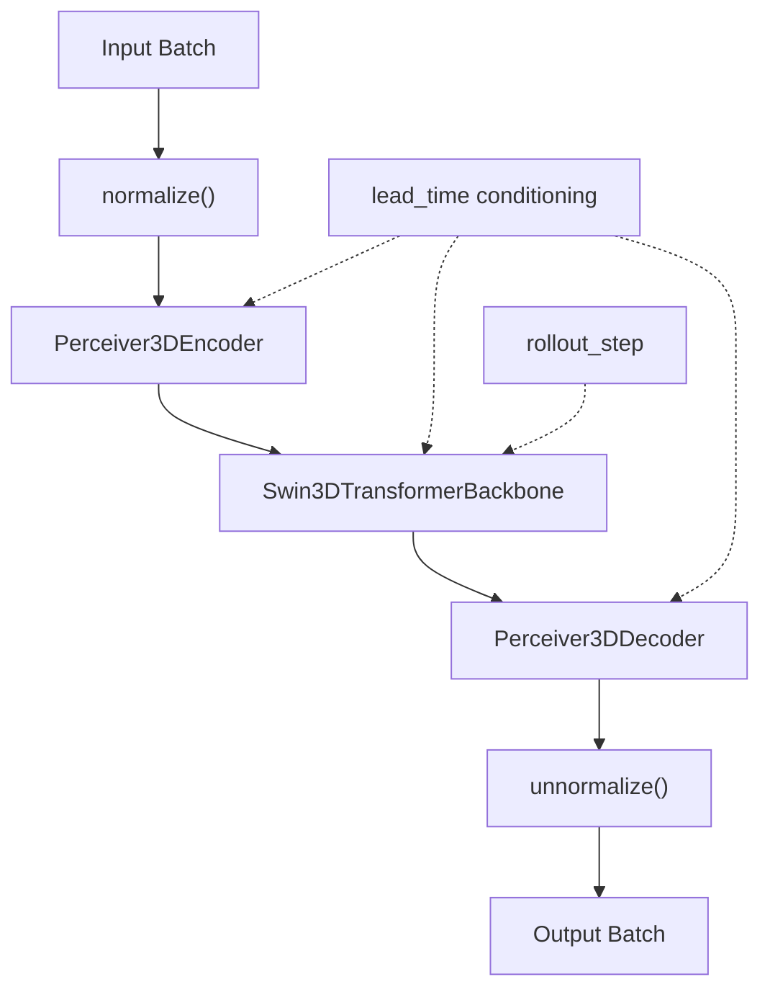

Sources: [aurora/model/aurora.py:265-392]()

### Architecture Components with Code Entities

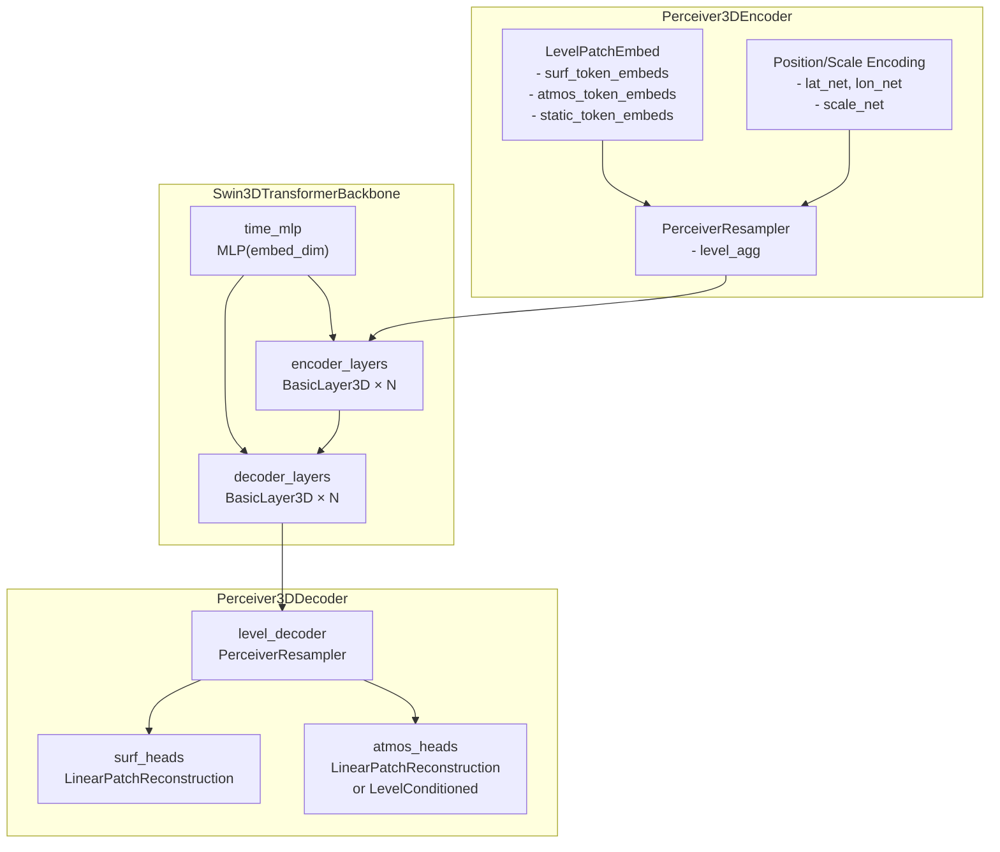

Sources: [aurora/model/aurora.py:199-252](), [aurora/model/swin3d.py:753-869](), [aurora/model/decoder.py:27-138]()
</old_str>
<new_str>
# Model Architecture

Aurora implements a three-stage neural network architecture consisting of an encoder, backbone, and decoder. This page documents the architectural design, component interactions, and implementation details. For the main `Aurora` model class interface, see page 2.1. For backbone details, see page 2.2. For decoder specifics, see page 2.3. For model variants, see page 2.4.

## Architecture Overview

Aurora processes multi-variable atmospheric data through a three-stage pipeline: (1) the `Perceiver3DEncoder` aggregates heterogeneous inputs into a unified latent representation, (2) the `Swin3DTransformerBackbone` processes this representation through hierarchical 3D attention layers, and (3) the `Perceiver3DDecoder` reconstructs multi-scale predictions.

### High-Level Data Flow

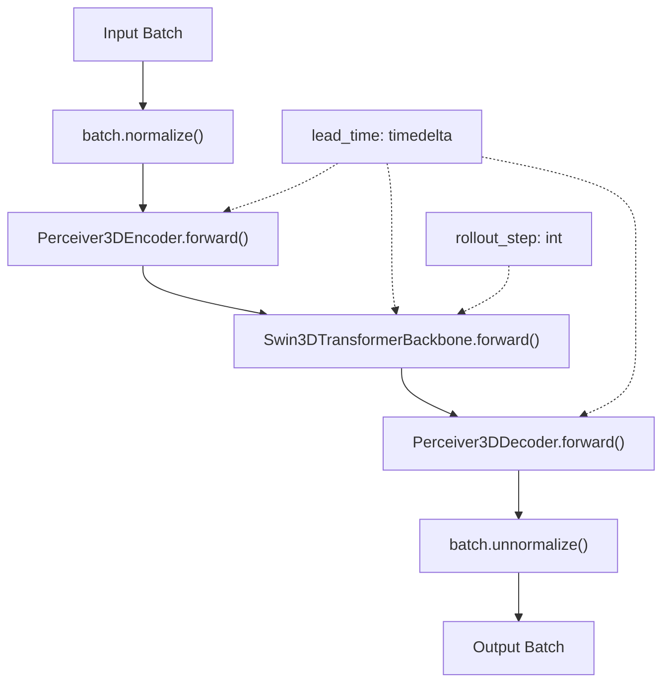

Sources: [aurora/model/aurora.py:265-392]()

### Architecture Components with Code Entities

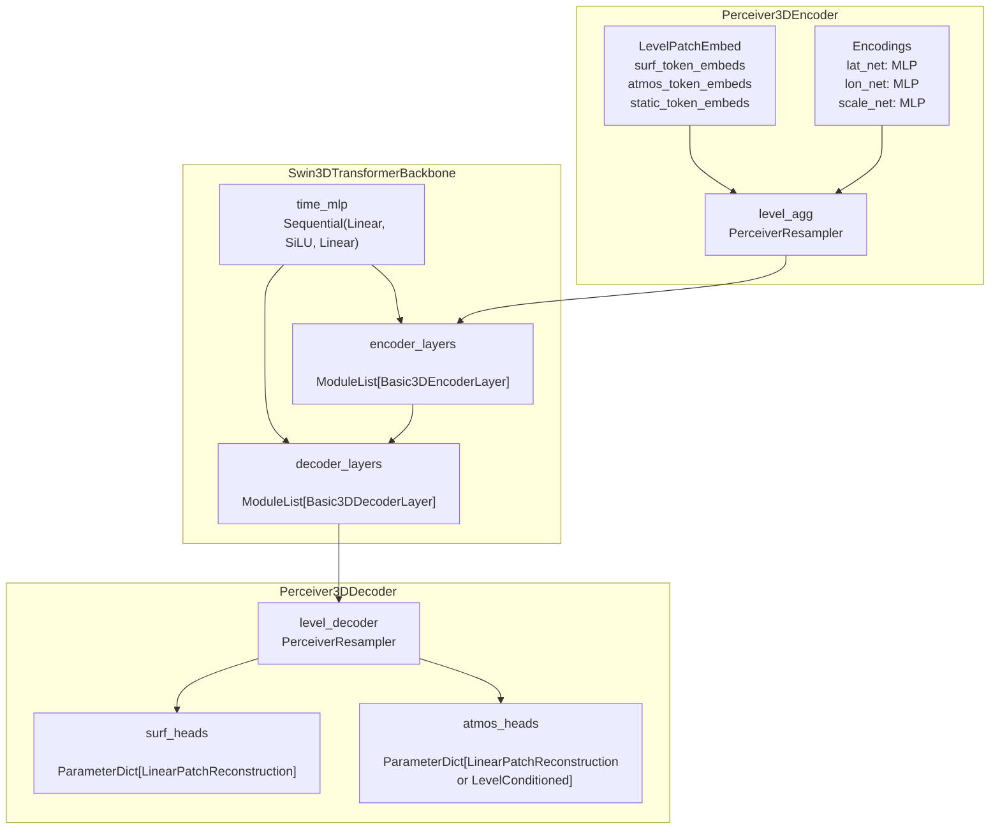

Sources: [aurora/model/aurora.py:199-252](), [aurora/model/swin3d.py:753-869](), [aurora/model/decoder.py:27-138]()

## Three-Stage Architecture

Aurora's architecture follows an encoder-backbone-decoder pattern, with each stage handling a specific aspect of the processing pipeline.

### Stage 1: Perceiver3D Encoder

The `Perceiver3DEncoder` converts heterogeneous multi-variable inputs into a unified latent representation suitable for transformer processing. The encoder handles three types of variables with different characteristics:

| Variable Type | Embedding Module | Dimensions | Aggregation |
|---------------|-----------------|------------|-------------|
| Surface variables | `surf_token_embeds` | `(B, T, H, W)` | → `latent_levels` |
| Atmospheric variables | `atmos_token_embeds` | `(B, T, C_atmos, H, W)` | → `latent_levels` |
| Static variables | `static_token_embeds` | `(H, W)` | → `latent_levels` |

**Key Operations:**

1. **Patch Embedding**: Each variable is embedded through `LevelPatchEmbed`, which applies 3D convolutions per variable to create patch tokens
2. **Position Encoding**: Fourier expansions of latitude, longitude, and scale are added via learned MLPs (`lat_net`, `lon_net`, `scale_net`)
3. **Level Aggregation**: The `PerceiverResampler` (in `level_agg`) compresses physical pressure levels into `latent_levels` (default: 4) latent levels through cross-attention

The encoder outputs a tensor of shape `(B, latent_levels * H_patch * W_patch, embed_dim)`.

Sources: [aurora/model/encoder.py:28-261](), [aurora/model/aurora.py:199-218]()

### Stage 2: Swin3D Transformer Backbone

The `Swin3DTransformerBackbone` implements a hierarchical U-Net-style architecture using 3D Swin Transformer blocks with shifted window attention. The backbone operates in two phases:

**Encoder Phase:**
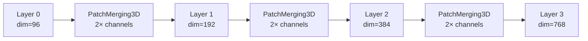

**Decoder Phase:**
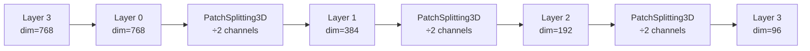

Each layer consists of multiple `Swin3DTransformerBlock` instances with alternating regular and shifted window attention. The backbone:

- Progressively halves spatial dimensions (H, W) while doubling channels in the encoder
- Reverses this in the decoder via `PatchSplitting3D`
- Uses U-Net-style skip connections: concatenation at the final layer, addition at intermediate layers
- Conditions all layers on lead time through `AdaptiveLayerNorm` with embeddings from `time_mlp`

Sources: [aurora/model/swin3d.py:753-939](), [aurora/model/aurora.py:220-234]()

### Stage 3: Perceiver3D Decoder

The `Perceiver3DDecoder` transforms the latent representation back into per-variable predictions at the original spatial resolution:

**Architecture:**

1. **Level De-aggregation**: The `level_decoder` (`PerceiverResampler`) expands the `latent_levels` back to physical pressure levels through cross-attention
2. **Variable-Specific Heads**: Separate prediction heads in `surf_heads` and `atmos_heads` produce per-variable outputs
   - Surface variables use `LinearPatchReconstruction` directly
   - Atmospheric variables optionally use `LevelConditioned` wrappers for level-specific parameters
3. **Unpatchification**: Patch predictions are assembled back into full spatial fields

For atmospheric variables, some model variants use `separate_perceiver` to run specific variables (e.g., pollution species) through an alternate decoder (`level_decoder_alternate`).

Sources: [aurora/model/decoder.py:27-276](), [aurora/model/aurora.py:236-252]()

## Hierarchical Multi-Scale Processing

The backbone's hierarchical structure enables efficient processing of atmospheric data at multiple scales:

### Resolution Stages

| Stage | Encoder Layer | Channel Dim | Spatial Dim | Decoder Layer |
|-------|---------------|-------------|-------------|---------------|
| 0 | `encoder_layers[0]` | `96` | `(C, H, W)` | `decoder_layers[3]` |
| 1 | `encoder_layers[1]` | `192` | `(C, H/2, W/2)` | `decoder_layers[2]` |
| 2 | `encoder_layers[2]` | `384` | `(C, H/4, W/4)` | `decoder_layers[1]` |
| 3 | `encoder_layers[3]` | `768` | `(C, H/8, W/8)` | `decoder_layers[0]` |

Where `(C, H, W)` is the patch resolution. The vertical dimension `C` (corresponding to `latent_levels`) remains constant throughout.

**Patch Merging/Splitting:**
- `PatchMerging3D`: Reduces spatial dimensions by 2× in H and W, concatenates 2×2 neighborhoods, then projects to 2× channels
- `PatchSplitting3D`: Reverses the operation, splitting channels to expand spatial dimensions

Sources: [aurora/model/swin3d.py:514-615](), [aurora/model/swin3d.py:871-885]()

### 3D Window Attention

Each `Swin3DTransformerBlock` applies window-based self-attention with the following mechanism:

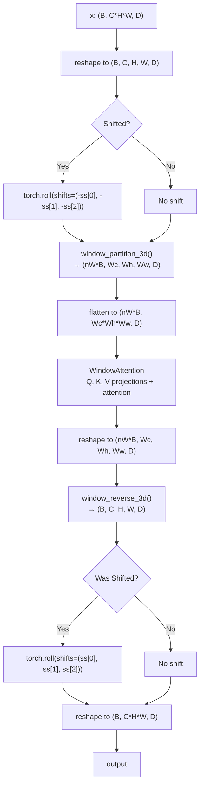

The window size `(Wc, Wh, Ww)` defaults to `(2, 6, 12)`. Consecutive blocks alternate between regular windows and shifted windows (shifted by half the window size) to enable cross-window communication.

Sources: [aurora/model/swin3d.py:365-512](), [aurora/model/swin3d.py:198-248]()

## Conditioning and Adaptation

### Lead Time Conditioning

All stages of the model are conditioned on the prediction lead time (forecast horizon):

1. **Time Embedding**: Lead time is converted to hours, then expanded to `embed_dim` dimensions via Fourier features: `lead_time_expansion(lead_hours, embed_dim)`
2. **Time MLP**: The expansion is passed through `time_mlp`, a 2-layer MLP with SiLU activation
3. **Adaptive Layer Normalization**: Each `Swin3DTransformerBlock` uses `AdaptiveLayerNorm` that modulates normalization based on the time embedding

This conditioning allows the model to adjust its predictions based on forecast horizon.

Sources: [aurora/model/swin3d.py:808-812](), [aurora/model/swin3d.py:915-917](), [aurora/model/film.py:1-87]()

### LoRA Adaptation

When `use_lora=True`, the backbone enables Low-Rank Adaptation for efficient fine-tuning:

- **LoRA Modules**: `WindowAttention` uses `LoRARollout` wrappers for `qkv` and `proj` layers
- **Rollout-Specific Adaptation**: The `lora_mode` parameter controls adaptation behavior:
  - `"single"`: Same LoRA parameters for all rollout steps
  - `"from_second"`: Separate LoRA for first step, shared for subsequent steps
  - `"all"`: Different LoRA for each rollout step up to `lora_steps`
- **Low-Rank Structure**: LoRA uses rank-`lora_r` (default: 8) matrices with scaling factor `lora_alpha`

Sources: [aurora/model/swin3d.py:125-134](), [aurora/model/lora.py:1-161]()

## Forward Pass Pipeline

The complete forward pass in `Aurora.forward()` follows this sequence:

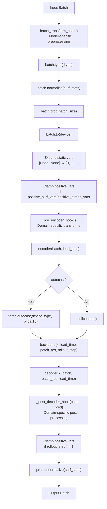

**Hooks** provide extension points for model variants:
- `batch_transform_hook()`: Pre-normalization transformations (e.g., `AuroraWave` splits wind direction)
- `_pre_encoder_hook()`: Post-normalization, pre-encoding (e.g., `AuroraAirPollution` applies log transforms)
- `_post_decoder_hook()`: Post-decoding (e.g., `AuroraAirPollution` adds difference predictions, `AuroraWave` reconstructs angles)

Sources: [aurora/model/aurora.py:265-392](), [aurora/model/aurora.py:394-407]()

## Implementation Details

### Variable Processing

Aurora handles three categories of variables, each with specific processing:

| Category | Default Variables | Shape | Processing Module |
|----------|------------------|-------|-------------------|
| Surface | `2t`, `10u`, `10v`, `msl` | `(B, T, H, W)` | `surf_token_embeds`, `surf_heads` |
| Static | `lsm`, `z`, `slt` | `(H, W)` | `static_token_embeds`, expanded to `(B, T, H, W)` |
| Atmospheric | `z`, `u`, `v`, `t`, `q` | `(B, T, C, H, W)` | `atmos_token_embeds`, `atmos_heads` |

Where `T = max_history_size` (default: 2), and `C = len(atmos_levels)` (default: 13 pressure levels).

Sources: [aurora/model/aurora.py:55-104](), [aurora/model/aurora.py:291-295]()

### Patch Embedding

The `LevelPatchEmbed` class creates patch embeddings via 3D convolutions:

- Each variable has its own convolutional embedding weights in `surf_token_embeds.weights` and `atmos_token_embeds.weights`
- Convolution: kernel size `(max_history_size, patch_size, patch_size)`, stride `(1, patch_size, patch_size)`
- Output: `(B, embed_dim, 1, H_patch, W_patch)` where `H_patch = H // patch_size`, `W_patch = W // patch_size`

Sources: [aurora/model/encoder.py:33-119]()

### Memory Optimization

**Activation Checkpointing:**

The `configure_activation_checkpointing()` method enables gradient checkpointing to reduce memory usage during training:

```python
model.configure_activation_checkpointing(
    module_names=(
        "Basic3DDecoderLayer",
        "Basic3DEncoderLayer", 
        "LinearPatchReconstruction",
        "Perceiver3DDecoder",
        "Perceiver3DEncoder",
        "Swin3DTransformerBackbone",
        "Swin3DTransformerBlock",
    )
)
```

This trades computation for memory by recomputing activations during the backward pass.

**Mixed Precision:**

Setting `autocast=True` wraps the backbone in `torch.autocast(device_type, dtype=torch.bfloat16)`, casting operations to bfloat16 for reduced memory usage. The encoder and decoder remain in full precision for numerical stability.

Sources: [aurora/model/aurora.py:506-547](), [aurora/model/aurora.py:327-336]()

## Configuration Parameters

The `Aurora` class initialization accepts numerous architectural parameters:

### Core Architecture Parameters

| Parameter | Type | Default | Description |
|-----------|------|---------|-------------|
| `window_size` | `tuple[int, int, int]` | `(2, 6, 12)` | Window size for 3D attention (depth, height, width) |
| `encoder_depths` | `tuple[int, ...]` | `(6, 10, 8)` | Number of blocks per encoder layer |
| `encoder_num_heads` | `tuple[int, ...]` | `(8, 16, 32)` | Attention heads per encoder layer |
| `decoder_depths` | `tuple[int, ...]` | `(8, 10, 6)` | Number of blocks per decoder layer |
| `decoder_num_heads` | `tuple[int, ...]` | `(32, 16, 8)` | Attention heads per decoder layer |
| `patch_size` | `int` | `4` | Spatial patch size |
| `embed_dim` | `int` | `512` | Embedding dimension (base dimension for stage 0) |
| `latent_levels` | `int` | `4` | Number of latent pressure levels |
| `num_heads` | `int` | `16` | Attention heads in Perceiver blocks |

### Perceiver Parameters

| Parameter | Type | Default | Description |
|-----------|------|---------|-------------|
| `enc_depth` | `int` | `1` | Perceiver blocks in encoder |
| `dec_depth` | `int` | `1` | Perceiver blocks in decoder |
| `dec_mlp_ratio` | `float` | `2.0` | MLP ratio in decoder Perceiver |
| `perceiver_ln_eps` | `float` | `1e-5` | Layer norm epsilon in Perceiver |

### Training and Adaptation

| Parameter | Type | Default | Description |
|-----------|------|---------|-------------|
| `use_lora` | `bool` | `True` | Enable LoRA adaptation |
| `lora_steps` | `int` | `40` | Max rollout steps with distinct LoRA |
| `lora_mode` | `LoRAMode` | `"single"` | LoRA application mode |
| `autocast` | `bool` | `False` | Use bfloat16 autocast for backbone |
| `max_history_size` | `int` | `2` | Maximum history timesteps |
| `timestep` | `timedelta` | `timedelta(hours=6)` | Prediction timestep |

Sources: [aurora/model/aurora.py:55-95]()

## Class Hierarchy

The core model classes and their relationships:

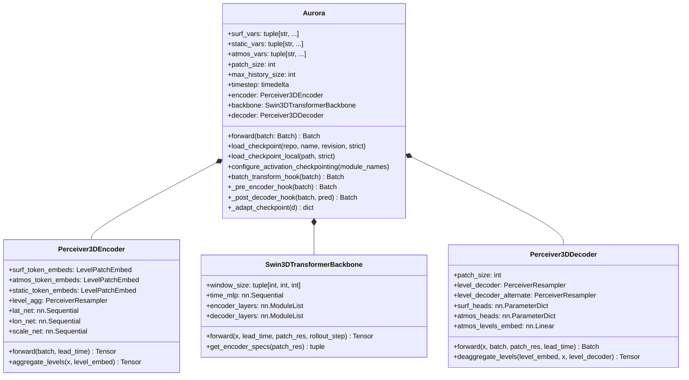

Sources: [aurora/model/aurora.py:40-407](), [aurora/model/encoder.py:28-261](), [aurora/model/swin3d.py:753-939](), [aurora/model/decoder.py:27-276]()

## Summary

The Core Aurora Model represents a sophisticated encoder-backbone-decoder architecture specifically designed for Earth system forecasting. Its unique combination of 3D Perceiver components and Swin Transformer technology enables it to effectively process complex meteorological data with different spatial and temporal characteristics.

The model handles both surface-level and atmospheric variables, with careful attention to proper normalization, spatial relationships, and pressure level aggregation. The architecture is designed to be flexible, with variants available for different computational requirements and resolution needs.

---

# Page: Aurora Model Class

# Aurora Model Class

<details>
<summary>Relevant source files</summary>

The following files were used as context for generating this wiki page:

- [aurora/model/aurora.py](aurora/model/aurora.py)

</details>


## Purpose and Scope

This page documents the `Aurora` class ([aurora/model/aurora.py:40-548]()), which is the main entry point for all Aurora model variants. It covers the class initialization parameters, the forward pass pipeline, the extensible hooks system, and checkpoint management functionality.

For detailed documentation of specific model variants (`AuroraPretrained`, `AuroraHighRes`, `AuroraAirPollution`, etc.), see [Model Variants](#2.4). For the internal architecture components (encoder, backbone, decoder), see [Swin3D Transformer Backbone](#2.2) and [Perceiver3D Decoder](#2.3).

## Class Overview

The `Aurora` class is a `torch.nn.Module` that orchestrates the complete prediction pipeline. It instantiates and manages three core architectural components:

| Component | Class | Purpose |
|-----------|-------|---------|
| Encoder | `Perceiver3DEncoder` | Multi-scale input processing and level aggregation |
| Backbone | `Swin3DTransformerBackbone` | Hierarchical 3D attention processing |
| Decoder | `Perceiver3DDecoder` | Level de-aggregation and output reconstruction |

The class provides a flexible initialization interface with 30+ configuration parameters, an extensible hooks system for variant-specific transformations, and utilities for checkpoint management.

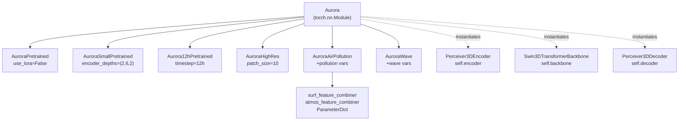

**Class Hierarchy**: All Aurora variants inherit from the base `Aurora` class, customizing initialization parameters and overriding hook methods to implement variant-specific behavior.

Sources: [aurora/model/aurora.py:40-852]()

## Initialization Parameters

The `Aurora.__init__` method ([aurora/model/aurora.py:55-264]()) accepts parameters organized into several functional groups:

### Variable Configuration

These parameters define what variables the model processes:

| Parameter | Type | Default | Description |
|-----------|------|---------|-------------|
| `surf_vars` | `tuple[str, ...]` | `("2t", "10u", "10v", "msl")` | Surface-level variables |
| `static_vars` | `tuple[str, ...]` | `("lsm", "z", "slt")` | Static variables (terrain, land-sea mask) |
| `atmos_vars` | `tuple[str, ...]` | `("z", "u", "v", "t", "q")` | Atmospheric variables at pressure levels |

### Architecture Configuration

Core architectural parameters:

| Parameter | Type | Default | Description |
|-----------|------|---------|-------------|
| `window_size` | `tuple[int, int, int]` | `(2, 6, 12)` | Vertical, height, width of Swin3D windows |
| `encoder_depths` | `tuple[int, ...]` | `(6, 10, 8)` | Number of blocks per encoder layer |
| `encoder_num_heads` | `tuple[int, ...]` | `(8, 16, 32)` | Attention heads per encoder layer |
| `decoder_depths` | `tuple[int, ...]` | `(8, 10, 6)` | Number of blocks per decoder layer |
| `decoder_num_heads` | `tuple[int, ...]` | `(32, 16, 8)` | Attention heads per decoder layer |
| `latent_levels` | `int` | `4` | Number of latent pressure levels |
| `patch_size` | `int` | `4` | Patch size for spatial discretization |
| `embed_dim` | `int` | `512` | Patch embedding dimension |

### Perceiver Configuration

Parameters for the Perceiver encoder/decoder blocks:

| Parameter | Type | Default | Description |
|-----------|------|---------|-------------|
| `num_heads` | `int` | `16` | Attention heads in aggregation/deaggregation |
| `enc_depth` | `int` | `1` | Number of Perceiver blocks in encoder |
| `dec_depth` | `int` | `1` | Number of Perceiver blocks in decoder |
| `perceiver_ln_eps` | `float` | `1e-5` | Layer norm epsilon for numerical stability |

### Fine-tuning and Adaptation

Parameters for model adaptation:

| Parameter | Type | Default | Description |
|-----------|------|---------|-------------|
| `use_lora` | `bool` | `True` | Enable LoRA adaptation |
| `lora_steps` | `int` | `40` | Use different LoRA for first N steps |
| `lora_mode` | `LoRAMode` | `"single"` | LoRA mode: `"single"`, `"from_second"`, or `"all"` |
| `max_history_size` | `int` | `2` | Maximum number of history timesteps |
| `timestep` | `timedelta` | `timedelta(hours=6)` | Model timestep duration |

### Variant-Specific Features

Parameters enabling specialized behavior:

| Parameter | Type | Default | Description |
|-----------|------|---------|-------------|
| `level_condition` | `tuple[int\|float, ...]` | `None` | Pressure levels for level-conditioned embeddings |
| `dynamic_vars` | `bool` | `False` | Use dynamic static variables (time of day) |
| `atmos_static_vars` | `bool` | `False` | Concatenate static vars to atmospheric vars |
| `separate_perceiver` | `tuple[str, ...]` | `()` | Variables using separate decoder Perceiver |
| `modulation_heads` | `tuple[str, ...]` | `()` | Variables with additional modulation heads |
| `positive_surf_vars` | `tuple[str, ...]` | `()` | Surface variables to clamp positive |
| `positive_atmos_vars` | `tuple[str, ...]` | `()` | Atmospheric variables to clamp positive |

Sources: [aurora/model/aurora.py:55-178]()

## Forward Pass Pipeline

The `forward` method ([aurora/model/aurora.py:265-392]()) implements a multi-stage processing pipeline:

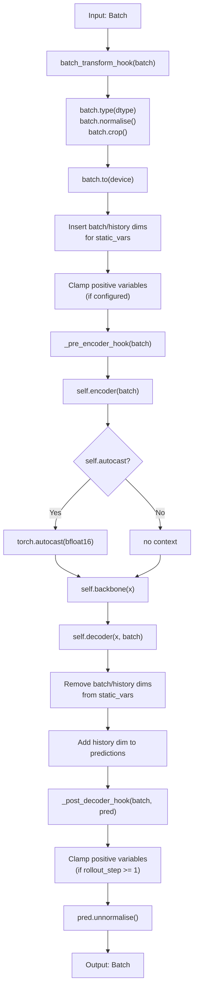

### Key Processing Steps

1. **Pre-processing** ([aurora/model/aurora.py:274-295]()):
   - Apply `batch_transform_hook` for variant-specific input transformations
   - Type conversion, normalization, spatial cropping, device placement
   - Insert batch and history dimensions for static variables

2. **Positive Variable Clamping** ([aurora/model/aurora.py:301-317]()):
   - Clamp variables in `positive_surf_vars` and `positive_atmos_vars` to be non-negative
   - Applied before encoder to prevent negative inputs

3. **Encoder Processing** ([aurora/model/aurora.py:319-325]()):
   - Apply `_pre_encoder_hook` for additional transformations
   - Pass through `Perceiver3DEncoder` with lead time conditioning

4. **Backbone Processing** ([aurora/model/aurora.py:327-343]()):
   - Optionally wrap in `torch.autocast` for BF16 memory optimization
   - Pass through `Swin3DTransformerBackbone` with rollout step tracking

5. **Decoder Processing** ([aurora/model/aurora.py:345-365]()):
   - Pass through `Perceiver3DDecoder` to reconstruct outputs
   - Remove batch/history dimensions from static variables
   - Add history dimension to predictions

6. **Post-processing** ([aurora/model/aurora.py:365-391]()):
   - Apply `_post_decoder_hook` for variant-specific output transformations
   - Clamp positive variables for autoregressive rollout (after first step)
   - Unnormalize predictions to original scale

Sources: [aurora/model/aurora.py:265-392]()

## Hooks System

The `Aurora` class provides three extensible hooks that subclasses can override to implement variant-specific behavior:

### batch_transform_hook

```python
def batch_transform_hook(self, batch: Batch) -> Batch:
```

**Location**: [aurora/model/aurora.py:394-399]()

**Called**: First step in `forward()`, before normalization

**Purpose**: Transform the raw input batch. This hook should be **idempotent** since it may be called multiple times during autoregressive rollout.

**Example Use Case**: `AuroraWave` uses this to split wind direction into u/v components and mark absent waves with NaNs ([aurora/model/aurora.py:854-890]()).

### _pre_encoder_hook

```python
def _pre_encoder_hook(self, batch: Batch) -> Batch:
```

**Location**: [aurora/model/aurora.py:401-403]()

**Called**: After normalization and clamping, immediately before encoder

**Purpose**: Apply transformations to normalized data before encoding. Unlike `batch_transform_hook`, this operates on normalized values.

**Example Use Cases**:
- `AuroraAirPollution`: Apply log-space transformations to pollution variables ([aurora/model/aurora.py:726-758]())
- `AuroraWave`: Create density channels for sparse data and sine/cosine for angles ([aurora/model/aurora.py:892-908]())

### _post_decoder_hook

```python
def _post_decoder_hook(self, batch: Batch, pred: Batch) -> Batch:
```

**Location**: [aurora/model/aurora.py:405-407]()

**Called**: After decoder, before final clamping and unnormalization

**Purpose**: Transform predictions, such as computing differences or applying domain-specific constraints.

**Example Use Cases**:
- `AuroraAirPollution`: Convert difference predictions to absolute values and clip SO2 ([aurora/model/aurora.py:760-796]())
- `AuroraWave`: Reconstruct angles from sine/cosine and apply density thresholds ([aurora/model/aurora.py:910-932]())

### Hook Execution Order

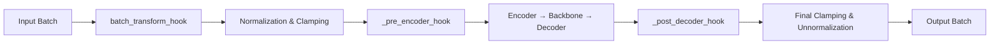

Sources: [aurora/model/aurora.py:394-407](), [aurora/model/aurora.py:726-932]()

## Checkpoint Management

### Loading from HuggingFace

```python
def load_checkpoint(
    self,
    repo: Optional[str] = None,
    name: Optional[str] = None,
    revision: Optional[str] = None,
    strict: bool = True,
) -> None:
```

**Location**: [aurora/model/aurora.py:409-430]()

Downloads and loads a checkpoint from HuggingFace Hub. Each model variant specifies default values:

| Attribute | Purpose |
|-----------|---------|
| `default_checkpoint_repo` | Repository name (e.g., `"microsoft/aurora"`) |
| `default_checkpoint_name` | Checkpoint filename (e.g., `"aurora-0.25-finetuned.ckpt"`) |
| `default_checkpoint_revision` | Git commit hash for version pinning |

**Usage**:
```python
model = Aurora()
model.load_checkpoint()  # Uses defaults
model.load_checkpoint(repo="custom/repo", name="custom.ckpt")  # Override
```

### Loading from Local File

```python
def load_checkpoint_local(self, path: str, strict: bool = True) -> None:
```

**Location**: [aurora/model/aurora.py:432-456]()

Loads a checkpoint directly from disk. Handles:
1. Device placement (CPU or GPU)
2. Checkpoint adaptation via `_adapt_checkpoint()`
3. History size compatibility checking
4. State dictionary loading

### Checkpoint Adaptation

```python
def _adapt_checkpoint(self, d: dict[str, torch.Tensor]) -> dict[str, torch.Tensor]:
```

**Location**: [aurora/model/aurora.py:458-467]()

Transforms checkpoint state dictionaries to ensure compatibility with the current model version. Each variant may override this:

- **Aurora (base)**: Applies `_adapt_checkpoint_pretrained()` for backward compatibility
- **AuroraAirPollution**: Additionally applies `_adapt_checkpoint_air_pollution()`
- **AuroraWave**: Additionally applies `_adapt_checkpoint_wave()`

These adaptation functions are defined in [aurora/model/compat.py]().

### History Size Adaptation

```python
def adapt_checkpoint_max_history_size(self, checkpoint: dict[str, torch.Tensor]) -> None:
```

**Location**: [aurora/model/aurora.py:469-504]()

Adapts checkpoints trained with smaller `max_history_size` to models with larger `max_history_size`. This is necessary because the patch embeddings have a history dimension.

**Mechanism**:
- Identifies patch embedding weights: `encoder.surf_token_embeds.weights.*` and `encoder.atmos_token_embeds.weights.*`
- Creates new weight tensors with the larger history dimension
- Copies existing weights and zero-pads the additional history slots
- **Cannot** load checkpoints with larger history size than the model (raises `AssertionError`)

**Shape Transformation**:
```
Original: (C, 1, H_old, h, w)
New:      (C, 1, H_new, h, w)  where H_new > H_old
```

Sources: [aurora/model/aurora.py:409-504](), [aurora/model/compat.py]()

## Activation Checkpointing

```python
def configure_activation_checkpointing(
    self,
    module_names: tuple[str, ...] = (
        "Basic3DDecoderLayer",
        "Basic3DEncoderLayer",
        "LinearPatchReconstruction",
        "Perceiver3DDecoder",
        "Perceiver3DEncoder",
        "Swin3DTransformerBackbone",
        "Swin3DTransformerBlock",
    ),
) -> None:
```

**Location**: [aurora/model/aurora.py:506-547]()

Enables gradient checkpointing to reduce memory usage during training/fine-tuning. This is **critical** for fine-tuning Aurora models without running out of memory.

**How It Works**:
- Uses PyTorch's `apply_activation_checkpointing` from the distributed package
- Applies checkpointing to specific module classes by name
- Trades compute for memory by recomputing activations during backward pass

**Default Checkpointed Modules**:
- All encoder and decoder layers
- Swin3D transformer blocks
- Perceiver components
- Patch reconstruction heads

**Error Handling**: Raises `RuntimeError` if any specified module name is not found in the model.

**Usage**:
```python
model = Aurora()
model.configure_activation_checkpointing()  # Use defaults
model.configure_activation_checkpointing(module_names=("Swin3DTransformerBlock",))  # Custom
```

Sources: [aurora/model/aurora.py:506-547]()

## Model Variants Summary

The `aurora/model/aurora.py` file defines seven model variants, each inheriting from `Aurora`:

| Class | Checkpoint | Key Differences |
|-------|-----------|-----------------|
| `Aurora` | `aurora-0.25-finetuned.ckpt` | Base 1.3B parameter model, `use_lora=True` |
| `AuroraPretrained` | `aurora-0.25-pretrained.ckpt` | Pretrained base, `use_lora=False` |
| `AuroraSmallPretrained` | `aurora-0.25-small-pretrained.ckpt` | Smaller architecture for debugging |
| `Aurora12hPretrained` | `aurora-0.25-12h-pretrained.ckpt` | 12-hour timestep variant |
| `AuroraHighRes` | `aurora-0.1-finetuned.ckpt` | 0.1° resolution, `patch_size=10` |
| `AuroraAirPollution` | `aurora-0.4-air-pollution.ckpt` | Pollution variables, log transforms, modulation heads |
| `AuroraWave` | `aurora-0.25-wave.ckpt` | Ocean wave variables, density channels, angle encoding |

Each variant:
1. Overrides default checkpoint attributes
2. Customizes `__init__` parameters
3. May override hooks for variant-specific transformations
4. May add additional learnable parameters (e.g., `AuroraAirPollution.surf_feature_combiner`)

For detailed documentation of each variant's behavior, variables, and use cases, see [Model Variants](#2.4).

Sources: [aurora/model/aurora.py:550-852]()

---

# Page: Swin3D Transformer Backbone

# Swin3D Transformer Backbone

<details>
<summary>Relevant source files</summary>

The following files were used as context for generating this wiki page:

- [aurora/model/aurora.py](aurora/model/aurora.py)
- [aurora/model/swin3d.py](aurora/model/swin3d.py)

</details>


## Purpose and Scope

The Swin3D Transformer Backbone is the core processing component of Aurora's neural network architecture. It implements a hierarchical encoder-decoder structure with 3D shifted-window attention, operating on patch embeddings produced by the Perceiver3D Encoder and outputting features for the Perceiver3D Decoder to reconstruct. This document covers the backbone's internal architecture, attention mechanisms, multi-scale processing, and conditioning strategies.

For information about the encoder that feeds into this backbone, see [Perceiver3D Encoder](#2.1). For details about the decoder that processes the backbone's output, see [Perceiver3D Decoder](#2.3). For the overall model structure, see [Aurora Model Class](#2.1).

## Architecture Overview

The Swin3D Transformer Backbone consists of encoder layers that progressively reduce spatial resolution while increasing feature dimensionality, followed by decoder layers that reverse this process. The backbone operates on tokenized 3D data with dimensions `(B, L, D)` where `B` is batch size, `L` is the number of tokens (levels × height × width), and `D` is the embedding dimension.

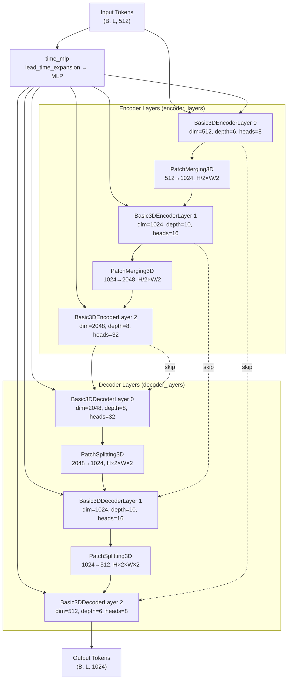

**Sources:** [aurora/model/swin3d.py:753-939](), [aurora/model/aurora.py:220-234]()

## Class Hierarchy and Components

The backbone is composed of several key classes that work together to implement the hierarchical transformer architecture.

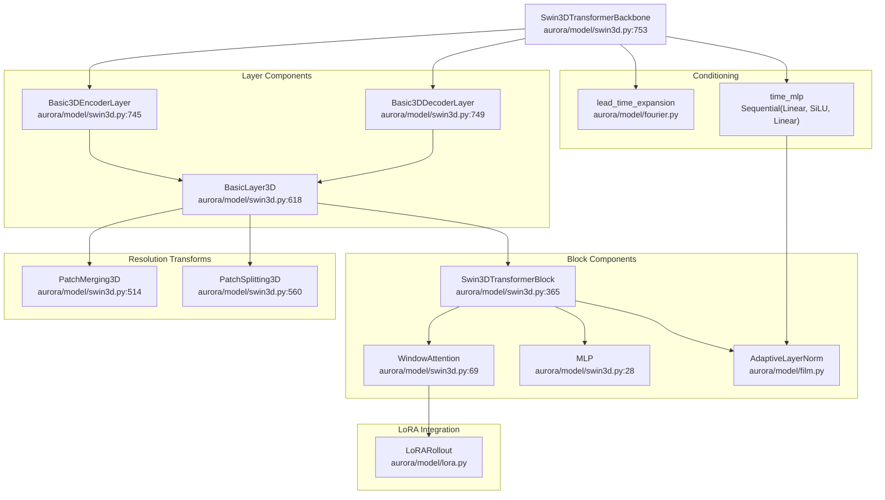

**Sources:** [aurora/model/swin3d.py:753-939](), [aurora/model/swin3d.py:618-742](), [aurora/model/swin3d.py:365-511]()

## Hierarchical Encoder-Decoder Structure

The backbone uses a 4-stage hierarchical structure (default configuration uses 3 encoder + 3 decoder layers). Each encoder stage reduces spatial resolution by 2× in both horizontal dimensions while doubling the feature dimensionality. Decoder stages reverse this process.

| Stage | Type | Dimensions | Depth | Heads | Resolution |
|-------|------|------------|-------|-------|------------|
| 0 | Encoder | 512 | 6 | 8 | L × H × W |
| 1 | Encoder | 1024 | 10 | 16 | L × H/2 × W/2 |
| 2 | Encoder | 2048 | 8 | 32 | L × H/4 × W/4 |
| 3 | Decoder | 2048 | 8 | 32 | L × H/4 × W/4 |
| 4 | Decoder | 1024 | 10 | 16 | L × H/2 × W/2 |
| 5 | Decoder | 512 | 6 | 8 | L × H × W |

The vertical (level) dimension `L` remains constant throughout the backbone as it is already small (typically 4 latent levels).

**Configuration Parameters:**

```python
# From aurora/model/aurora.py:220-234
backbone = Swin3DTransformerBackbone(
    window_size=(2, 6, 12),           # (Wc, Wh, Ww)
    encoder_depths=(6, 10, 8),        # Blocks per encoder layer
    encoder_num_heads=(8, 16, 32),    # Attention heads per layer
    decoder_depths=(8, 10, 6),        # Blocks per decoder layer
    decoder_num_heads=(32, 16, 8),    # Attention heads per layer
    embed_dim=512,                     # Base embedding dimension
    mlp_ratio=4.0,                     # Hidden/input ratio for MLPs
    drop_path_rate=0.0,                # Stochastic depth rate
    use_lora=True,                     # Enable LoRA adaptation
    lora_steps=40,                     # Number of LoRA rollout steps
    lora_mode="single",                # LoRA mode
)
```

**Sources:** [aurora/model/swin3d.py:756-798](), [aurora/model/aurora.py:220-234]()

## 3D Window Attention Mechanism

The core innovation of Swin3D is the use of 3D shifted-window attention, which divides the input into non-overlapping 3D windows and computes self-attention within each window. Consecutive blocks alternate between regular and shifted windows to enable cross-window connections.

### Window Partitioning and Shifting

The attention mechanism operates on 3D windows defined by `window_size = (Wc, Wh, Ww)`:
- `Wc`: Window size in the vertical (level) dimension
- `Wh`: Window size in the height dimension  
- `Ww`: Window size in the width dimension

For shifted windows, the shift is half the window size: `shift_size = (Wc//2, Wh//2, Ww//2)`.

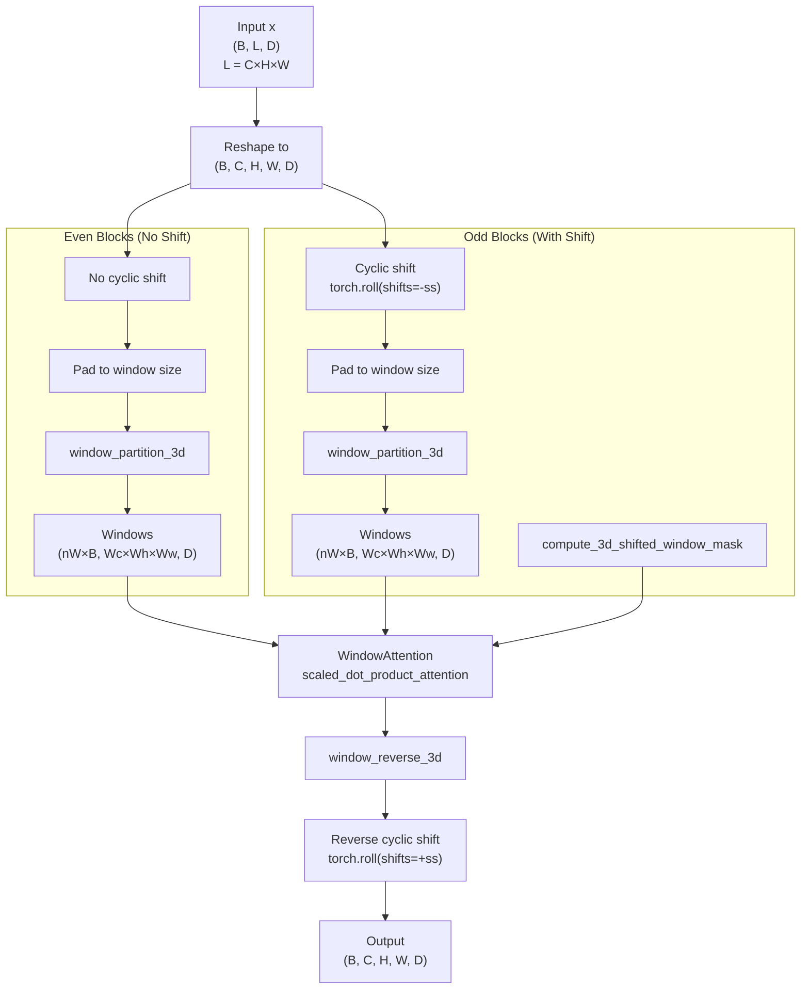

**Sources:** [aurora/model/swin3d.py:442-511](), [aurora/model/swin3d.py:198-248]()

### Window Attention Implementation

The `WindowAttention` class [aurora/model/swin3d.py:69-176]() implements multi-head self-attention within windows:

```python
# Simplified forward pass from aurora/model/swin3d.py:136-172
def forward(x, mask=None, rollout_step=0):
    # Compute Q, K, V with optional LoRA adaptation
    qkv = self.qkv(x) + self.lora_qkv(x, rollout_step)
    qkv = rearrange(qkv, "B N (qkv H D) -> qkv B H N D", H=num_heads, qkv=3)
    q, k, v = qkv[0], qkv[1], qkv[2]
    
    # Apply attention with mask (for shifted windows)
    if mask is not None:
        x = F.scaled_dot_product_attention(q, k, v, attn_mask=mask, dropout_p=attn_dropout)
    else:
        x = F.scaled_dot_product_attention(q, k, v, dropout_p=attn_dropout)
    
    # Project output with optional LoRA adaptation
    x = rearrange(x, "B H N D -> B N (H D)")
    x = self.proj(x) + self.lora_proj(x, rollout_step)
    return x
```

### Shifted Window Masking

For shifted windows, an attention mask is computed to prevent communication between patches that should not interact [aurora/model/swin3d.py:304-362](). The mask handles:
- **Cyclic boundaries**: Left and right edges are treated as connected (warped mode)
- **Padding**: Padded regions are assigned to a separate communication group
- **Merge groups**: Patches at edges that wrap around are merged into the same communication group

**Sources:** [aurora/model/swin3d.py:69-176](), [aurora/model/swin3d.py:304-362](), [aurora/model/swin3d.py:442-511]()

## Patch Merging and Splitting

The backbone uses patch merging to downsample and patch splitting to upsample spatial dimensions, similar to pooling/unpooling in CNNs but with learned transformations.

### PatchMerging3D

`PatchMerging3D` [aurora/model/swin3d.py:514-557]() reduces spatial resolution by 2× in both height and width dimensions:

1. Reshape input from `(B, C*H*W, D)` to `(B, C, H, W, D)`
2. Pad height and width to multiples of 2
3. Combine neighboring 2×2 patches: `(C, H, W, D)` → `(C, H/2, W/2, 4D)`
4. Apply layer normalization
5. Project with linear layer: `4D` → `2D`

The level dimension `C` is never reduced as it is already small.

### PatchSplitting3D

`PatchSplitting3D` [aurora/model/swin3d.py:560-615]() increases spatial resolution by 2× in both dimensions:

1. Apply linear projection: `D` → `2D`
2. Reshape to split each token: `(B, C*H*W, 2D)` → `(B, C, H, W, 2, 2, D/2)`
3. Rearrange: `(B, C, H, W, 2, 2, D/2)` → `(B, C, 2H, 2W, D/2)`
4. Crop to undo padding from corresponding `PatchMerging`
5. Apply layer normalization
6. Apply linear projection: `D/2` → `D/2`

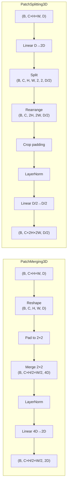

**Sources:** [aurora/model/swin3d.py:514-557](), [aurora/model/swin3d.py:560-615]()

## Lead Time Conditioning

The backbone is conditioned on the forecast lead time (prediction horizon) using Feature-wise Linear Modulation (FiLM). This allows the model to adapt its processing based on how far into the future it is predicting.

### Lead Time Embedding

Lead time is converted from a `timedelta` to hours and then expanded using Fourier features:

```python
# From aurora/model/swin3d.py:915-917
lead_hours = lead_time / timedelta(hours=1)
lead_times = lead_hours * torch.ones(x.shape[0], dtype=torch.float32, device=x.device)
c = self.time_mlp(lead_time_expansion(lead_times, self.embed_dim).to(dtype=x.dtype))
```

The `time_mlp` [aurora/model/swin3d.py:808-812]() is a small feedforward network:

```python
self.time_mlp = nn.Sequential(
    nn.Linear(embed_dim, embed_dim, bias=True),
    nn.SiLU(),
    nn.Linear(embed_dim, embed_dim, bias=True),
)
```

### Adaptive Layer Normalization

The lead time embedding `c` is passed to `AdaptiveLayerNorm` layers in each `Swin3DTransformerBlock`. These layers modulate the normalization statistics based on the lead time:

```python
# From aurora/model/swin3d.py:509-510
x = shortcut + self.drop_path(self.norm1(x, c))
x = x + self.drop_path(self.norm2(self.mlp(x), c))
```

The `AdaptiveLayerNorm` computes scale and shift parameters from the conditioning context `c` and applies them to the normalized features.

**Sources:** [aurora/model/swin3d.py:808-812](), [aurora/model/swin3d.py:915-917](), [aurora/model/swin3d.py:419](), [aurora/model/swin3d.py:433](), [aurora/model/swin3d.py:509-510]()

## LoRA Adaptation

Low-Rank Adaptation (LoRA) enables efficient fine-tuning by adding trainable low-rank matrices to the attention projection layers while keeping the original weights frozen.

### LoRA Integration in WindowAttention

The `WindowAttention` class includes optional LoRA layers for both the QKV projection and the output projection:

```python
# From aurora/model/swin3d.py:125-134
if use_lora:
    self.lora_proj = LoRARollout(
        dim, dim, lora_r, lora_alpha, lora_dropout, lora_steps, lora_mode
    )
    self.lora_qkv = LoRARollout(
        dim, dim * 3, lora_r, lora_alpha, lora_dropout, lora_steps, lora_mode
    )
else:
    self.lora_proj = lambda *args, **kwargs: 0
    self.lora_qkv = lambda *args, **kwargs: 0
```

During the forward pass, LoRA outputs are added to the main projections:

```python
# From aurora/model/swin3d.py:154, 170
qkv = self.qkv(x) + self.lora_qkv(x, rollout_step)
# ...
x = self.proj(x) + self.lora_proj(x, rollout_step)
```

### LoRA Modes

The backbone supports three LoRA modes controlled by `lora_mode`:

| Mode | Description | Use Case |
|------|-------------|----------|
| `"single"` | Same LoRA weights for all rollout steps | Uniform adaptation across predictions |
| `"from_second"` | One LoRA for first step, another for all subsequent steps | Handle initial condition differently |
| `"all"` | Separate LoRA weights for each rollout step up to `lora_steps` | Maximum flexibility per step |

The `rollout_step` parameter passed through the forward pass determines which LoRA weights to use.

**Sources:** [aurora/model/swin3d.py:125-134](), [aurora/model/swin3d.py:154](), [aurora/model/swin3d.py:170](), [aurora/model/lora.py]()

## Skip Connections

The backbone implements U-Net style skip connections between encoder and decoder layers at matching resolutions. This preserves fine-grained spatial information that might be lost during downsampling.

### Skip Connection Strategy

```python
# From aurora/model/swin3d.py:919-938
skips = []
for i, layer in enumerate(self.encoder_layers):
    x, x_unscaled = layer(x, c, all_enc_res[i], rollout_step=rollout_step)
    skips.append(x_unscaled)  # Save pre-downsampling features

for i, layer in enumerate(self.decoder_layers):
    index = self.num_decoder_layers - i - 1
    x, _ = layer(x, c, all_enc_res[index], padded_outs[index - 1], rollout_step=rollout_step)
    
    if 0 < i < self.num_decoder_layers - 1:
        # Intermediate stages: additive skip connections
        x = x + skips[index - 1]
    elif i == self.num_decoder_layers - 1:
        # Last stage: concatenation
        x = torch.cat([x, skips[0]], dim=-1)
```

### Skip Connection Types

- **Intermediate decoder layers**: Use additive skip connections (`x = x + skip`)
- **Final decoder layer**: Uses concatenation (`x = torch.cat([x, skip], dim=-1)`)

The concatenation at the final layer doubles the dimensionality from `embed_dim` to `2*embed_dim`, which is why the decoder is initialized with `embed_dim * 2` [aurora/model/aurora.py:241]().

**Sources:** [aurora/model/swin3d.py:919-938](), [aurora/model/aurora.py:236-252]()

## Forward Pass Data Flow

The complete forward pass through the backbone follows this sequence:

```mermaid
graph TB
    Start["forward(x, lead_time, rollout_step, patch_res)"]
    
    subgraph "Initialization"
        Check["Assert input shape matches patch_res"]
        LeadTime["Compute lead time embedding<br/>lead_time_expansion + time_mlp"]
        EncSpecs["Get encoder resolutions<br/>get_encoder_specs(patch_res)"]
    end
    
    subgraph "Encoder Pass"
        Enc0["encoder_layers[0]<br/>depth=6, dim=512"]
        Skip0["Save skip[0]"]
        Down1["PatchMerging3D<br/>512→1024, H/2×W/2"]
        
        Enc1["encoder_layers[1]<br/>depth=10, dim=1024"]
        Skip1["Save skip[1]"]
        Down2["PatchMerging3D<br/>1024→2048, H/2×W/2"]
        
        Enc2["encoder_layers[2]<br/>depth=8, dim=2048"]
        Skip2["Save skip[2]"]
    end
    
    subgraph "Decoder Pass"
        Dec0["decoder_layers[0]<br/>depth=8, dim=2048"]
        Add0["x + skip[1]"]
        Up1["PatchSplitting3D<br/>2048→1024, H×2×W×2"]
        
        Dec1["decoder_layers[1]<br/>depth=10, dim=1024"]
        Add1["x + skip[0]"]
        Up2["PatchSplitting3D<br/>1024→512, H×2×W×2"]
        
        Dec2["decoder_layers[2]<br/>depth=6, dim=512"]
        Concat["torch.cat([x, skip[0]], dim=-1)"]
    end
    
    Output["Return x<br/>(B, L, 1024)"]
    
    Start --> Check
    Check --> LeadTime
    Check --> EncSpecs
    
    LeadTime --> Enc0
    EncSpecs --> Enc0
    
    Enc0 --> Skip0
    Enc0 --> Down1
    Down1 --> Enc1
    
    Enc1 --> Skip1
    Enc1 --> Down2
    Down2 --> Enc2
    
    Enc2 --> Skip2
    Enc2 --> Dec0
    
    Dec0 --> Add0
    Skip1 --> Add0
    Add0 --> Up1
    Up1 --> Dec1
    
    Dec1 --> Add1
    Skip0 --> Add1
    Add1 --> Up2
    Up2 --> Dec2
    
    Dec2 --> Concat
    Skip0 --> Concat
    Concat --> Output
```

**Key Parameters:**

- **Input**: `x` of shape `(B, L, D)` where `L = C*H*W` (tokens), `D = embed_dim`
- **lead_time**: `timedelta` representing forecast horizon
- **rollout_step**: Integer indicating autoregressive step (for LoRA)
- **patch_res**: Tuple `(C, H, W)` specifying token layout
- **Output**: `x` of shape `(B, L, 2*D)` (doubled due to concatenation)

**Sources:** [aurora/model/swin3d.py:887-939]()

## Configuration Examples

### Default Aurora Model (1.3B parameters)

```python
# From aurora/model/aurora.py:61-68
backbone = Swin3DTransformerBackbone(
    window_size=(2, 6, 12),
    encoder_depths=(6, 10, 8),
    encoder_num_heads=(8, 16, 32),
    decoder_depths=(8, 10, 6),
    decoder_num_heads=(32, 16, 8),
    embed_dim=512,
    mlp_ratio=4.0,
)
```

### AuroraSmall Model (for debugging)

```python
# From aurora/model/aurora.py:580-598
backbone = Swin3DTransformerBackbone(
    window_size=(2, 6, 12),
    encoder_depths=(2, 6, 2),        # Fewer blocks
    encoder_num_heads=(4, 8, 16),    # Fewer heads
    decoder_depths=(2, 6, 2),
    decoder_num_heads=(16, 8, 4),
    embed_dim=256,                    # Smaller embedding
    mlp_ratio=4.0,
)
```

### AuroraHighRes Model (0.1° resolution)

```python
# From aurora/model/aurora.py:634-642
backbone = Swin3DTransformerBackbone(
    window_size=(2, 6, 12),
    encoder_depths=(6, 8, 8),        # Modified depths
    encoder_num_heads=(8, 16, 32),
    decoder_depths=(8, 8, 6),
    decoder_num_heads=(32, 16, 8),
    embed_dim=512,
    mlp_ratio=4.0,
)
```

**Sources:** [aurora/model/aurora.py:55-95](), [aurora/model/aurora.py:568-598](), [aurora/model/aurora.py:624-643]()

## Performance Considerations

### Memory Optimization

The backbone can be run with automatic mixed precision (AMP) to reduce memory usage:

```python
# From aurora/model/aurora.py:327-336
if self.autocast:
    device_type = "cuda" if torch.cuda.is_available() else "cpu"
    context = torch.autocast(device_type=device_type, dtype=torch.bfloat16)
else:
    context = contextlib.nullcontext()
    
with context:
    x = self.backbone(x, lead_time=self.timestep, patch_res=patch_res, rollout_step=rollout_step)
```

### Activation Checkpointing

For training and fine-tuning, activation checkpointing can be enabled on the backbone to trade computation for memory:

```python
# From aurora/model/aurora.py:506-547
model.configure_activation_checkpointing(
    module_names=(
        "Swin3DTransformerBackbone",
        "Swin3DTransformerBlock",
        # ... other modules
    )
)
```

**Sources:** [aurora/model/aurora.py:327-343](), [aurora/model/aurora.py:506-547]()

---

# Page: Perceiver3D Decoder

# Perceiver3D Decoder

<details>
<summary>Relevant source files</summary>

The following files were used as context for generating this wiki page:

- [aurora/model/aurora.py](aurora/model/aurora.py)
- [aurora/model/decoder.py](aurora/model/decoder.py)

</details>


## Purpose and Scope

The Perceiver3D Decoder is the final stage of the Aurora model architecture responsible for reconstructing multi-scale, multi-variable atmospheric predictions from the compressed backbone representation. It transforms the hierarchical latent representation from the Swin3D Transformer backbone back into physical space predictions for surface-level and atmospheric variables at their original spatial resolutions.

For information about the encoder that feeds into the backbone, see [Perceiver3D Encoder](#2.1). For details on the backbone transformer that processes the encoded representation, see [Swin3D Transformer Backbone](#2.2). For the overall model integration, see [Aurora Model Class](#2.1).

**Sources**: [aurora/model/decoder.py:1-277]()

---

## Architecture Overview

The `Perceiver3DDecoder` class implements a multi-scale decoder using Perceiver cross-attention to transform the backbone's compressed latent representation into per-variable predictions.

```mermaid
graph TB
    BackboneOut["Backbone Output<br/>(B, L, D)<br/>L = latent_levels × H × W"]
    
    subgraph "Perceiver3DDecoder"
        Unwrap["Unwrap Latent Levels<br/>rearrange to (B, H×W, C, D)<br/>C = latent_levels"]
        
        subgraph "Surface Variable Path"
            SurfSlice["Extract First Level<br/>x[..., :1, :]"]
            SurfHeads["surf_heads<br/>LinearPatchReconstruction<br/>per variable"]
            SurfUnpatch["Unpatchify<br/>patch_size×patch_size → H×W"]
        end
        
        subgraph "Atmospheric Variable Path"
            LevelEmbed["Atmospheric Level Embedding<br/>levels_expansion + atmos_levels_embed"]
            LevelDeagg["Level De-aggregation<br/>level_decoder (PerceiverResampler)"]
            AtmosSlice["Extract Levels 1+<br/>x[..., 1:, :]"]
            AtmosHeads["atmos_heads<br/>LinearPatchReconstruction or LevelConditioned<br/>per variable"]
            AtmosUnpatch["Unpatchify<br/>patch_size×patch_size → H×W"]
        end
        
        subgraph "Optional: Separate Perceiver"
            LevelDeaggAlt["level_decoder_alternate<br/>For specific variables<br/>(e.g., pollution gases)"]
        end
    end
    
    PredBatch["Prediction Batch<br/>surf_vars: (B, V_S, H, W)<br/>atmos_vars: (B, V_A, C_A, H, W)"]
    
    BackboneOut --> Unwrap
    
    Unwrap --> SurfSlice
    SurfSlice --> SurfHeads
    SurfHeads --> SurfUnpatch
    
    Unwrap --> AtmosSlice
    AtmosSlice --> LevelDeagg
    LevelEmbed --> LevelDeagg
    LevelDeagg --> AtmosHeads
    
    AtmosSlice -.specific vars.-> LevelDeaggAlt
    LevelEmbed -.specific vars.-> LevelDeaggAlt
    LevelDeaggAlt -.specific vars.-> AtmosHeads
    
    AtmosHeads --> AtmosUnpatch
    
    SurfUnpatch --> PredBatch
    AtmosUnpatch --> PredBatch
```

**Diagram: Perceiver3D Decoder Architecture**

The decoder performs three main operations:
1. **Unwrapping**: Reshapes the flattened backbone output back into spatial and level dimensions
2. **Surface Decoding**: Extracts the first latent level and reconstructs surface variables
3. **Atmospheric Decoding**: De-aggregates latent levels into physical pressure levels and reconstructs atmospheric variables

**Sources**: [aurora/model/decoder.py:27-139](), [aurora/model/decoder.py:168-276]()

---

## Initialization Parameters

The decoder is initialized with configuration parameters that determine its architecture and supported variables.

| Parameter | Type | Purpose | Default |
|-----------|------|---------|---------|
| `surf_vars` | `tuple[str, ...]` | Surface-level variable names | Required |
| `atmos_vars` | `tuple[str, ...]` | Atmospheric variable names | Required |
| `patch_size` | `int` | Patch size for unpatchifying | 4 |
| `embed_dim` | `int` | Embedding dimensionality (doubled from backbone) | 1024 |
| `depth` | `int` | Number of Perceiver blocks | 1 |
| `head_dim` | `int` | Dimension per attention head | 64 |
| `num_heads` | `int` | Number of attention heads | 8 |
| `mlp_ratio` | `float` | MLP hidden dim / embed dim ratio | 4.0 |
| `perceiver_ln_eps` | `float` | Layer norm epsilon | 1e-5 |
| `level_condition` | `Optional[tuple]` | Pressure levels for conditioning | `None` |
| `separate_perceiver` | `tuple[str, ...]` | Variables using alternate Perceiver | `()` |
| `modulation_heads` | `tuple[str, ...]` | Variables with difference prediction heads | `()` |

**Note**: The `embed_dim` passed to the decoder is typically double the encoder's embedding dimension due to U-Net skip connections concatenating encoder and decoder features in the backbone.

**Sources**: [aurora/model/decoder.py:30-75](), [aurora/model/aurora.py:236-252]()

---

## Component Structure

### Core Components Mapping

```mermaid
graph LR
    subgraph "Class: Perceiver3DDecoder"
        LevelDecoder["level_decoder<br/>PerceiverResampler<br/>Cross-attention for de-aggregation"]
        LevelDecoderAlt["level_decoder_alternate<br/>PerceiverResampler<br/>Optional, for specific variables"]
        SurfHeads["surf_heads<br/>nn.ParameterDict<br/>{var: LinearPatchReconstruction}"]
        AtmosHeads["atmos_heads<br/>nn.ParameterDict<br/>{var: LinearPatchReconstruction<br/>or LevelConditioned}"]
        AtmosLevelEmbed["atmos_levels_embed<br/>nn.Linear<br/>Projects level embeddings"]
    end
    
    subgraph "Helper Classes"
        LinearPatch["LinearPatchReconstruction<br/>extends nn.Linear<br/>Reconstructs patch_size² values"]
        LevelCond["LevelConditioned<br/>Per-level parameter instances"]
    end
    
    LevelDecoder -.uses.-> LinearPatch
    AtmosHeads -.may use.-> LevelCond
```

**Diagram: Decoder Component Classes**

**Sources**: [aurora/model/decoder.py:93-138](), [aurora/model/decoder.py:23-24]()

---

## Level De-aggregation

The decoder must reverse the level aggregation performed by the encoder. The backbone processes a compressed representation with `latent_levels` (typically 4) channels, but predictions must be made at the original atmospheric pressure levels (typically 13 levels).

### De-aggregation Process

The `deaggregate_levels()` method uses Perceiver cross-attention to map from latent levels to physical levels:

```mermaid
graph TB
    Input["Input:<br/>x: (B, H×W, latent_levels, D)<br/>level_embed: (B, H×W, C_A, D)<br/>C_A = # physical levels"]
    
    Flatten["Flatten batch and spatial:<br/>(B×H×W, latent_levels, D)<br/>(B×H×W, C_A, D)"]
    
    Perceiver["PerceiverResampler<br/>Cross-attention:<br/>queries = level_embed<br/>context = x<br/>Output: (B×H×W, C_A, D)"]
    
    Reshape["Reshape back:<br/>(B, H×W, C_A, D)"]
    
    Output["Output:<br/>De-aggregated representation<br/>at physical pressure levels"]
    
    Input --> Flatten
    Flatten --> Perceiver
    Perceiver --> Reshape
    Reshape --> Output
```

**Diagram: Level De-aggregation Flow**

The level embeddings are created using Fourier expansion of the physical pressure level values, providing the decoder with information about which pressure level to reconstruct at each position.

**Sources**: [aurora/model/decoder.py:140-166](), [aurora/model/decoder.py:220-231]()

---

## Surface Variable Reconstruction

Surface variables are simpler to reconstruct as they exist at a single vertical level. The decoder extracts the first latent level and applies variable-specific linear heads.

### Surface Reconstruction Pipeline

```mermaid
graph LR
    X["x: (B, H×W, latent_levels, D)"]
    Extract["Extract first level:<br/>x[..., :1, :]<br/>(B, H×W, 1, D)"]
    Heads["Apply surf_heads[var]<br/>for each variable<br/>LinearPatchReconstruction:<br/>D → patch_size²"]
    Stack["Stack variables:<br/>(B, H×W, 1, V_S×p²)"]
    Unpatch["Unpatchify:<br/>(B, V_S, H, W)"]
    
    X --> Extract
    Extract --> Heads
    Heads --> Stack
    Stack --> Unpatch
```

**Diagram: Surface Variable Reconstruction**

Each surface variable has its own `LinearPatchReconstruction` layer stored in the `surf_heads` parameter dictionary. This allows the model to learn variable-specific output transformations.

**Sources**: [aurora/model/decoder.py:213-217]()

---

## Atmospheric Variable Reconstruction

Atmospheric variables require more complex processing due to their vertical structure across pressure levels. The decoder supports two modes: standard reconstruction and level-conditioned reconstruction.

### Standard Reconstruction

```mermaid
graph TB
    X["x: (B, H×W, latent_levels, D)"]
    AtmosSlice["Extract levels 1+:<br/>x[..., 1:, :]"]
    
    LevelEncode["Encode atmospheric levels:<br/>levels_expansion(atmos_levels)<br/>→ (C_A, D)"]
    LevelEmbed["atmos_levels_embed<br/>→ (C_A, D)"]
    
    Deagg["deaggregate_levels()<br/>level_decoder<br/>→ (B, H×W, C_A, D)"]
    
    Heads["Apply atmos_heads[var]<br/>for each variable<br/>→ (B, H×W, C_A, p²)"]
    
    Stack["Stack variables:<br/>(B, H×W, C_A, V_A×p²)"]
    
    Unpatch["Unpatchify:<br/>(B, V_A, C_A, H, W)"]
    
    X --> AtmosSlice
    LevelEncode --> LevelEmbed
    AtmosSlice --> Deagg
    LevelEmbed --> Deagg
    Deagg --> Heads
    Heads --> Stack
    Stack --> Unpatch
```

**Diagram: Atmospheric Variable Reconstruction (Standard Mode)**

### Level-Conditioned Reconstruction

When `level_condition` is provided during initialization, each atmospheric variable head is wrapped in a `LevelConditioned` module that maintains separate parameters for each pressure level.

```python
# Standard mode (level_condition=None)
atmos_heads = {
    name: LinearPatchReconstruction(embed_dim, patch_size**2)
    for name in atmos_vars
}

# Level-conditioned mode
atmos_heads = {
    name: LevelConditioned(
        lambda: LinearPatchReconstruction(embed_dim, patch_size**2),
        levels=level_condition,
        levels_dim=-2,
    )
    for name in atmos_vars
}
```

This allows the model to learn level-specific behavior for each atmospheric variable, which is particularly useful for variables with different characteristics at different altitudes (e.g., pollution concentrations).

**Sources**: [aurora/model/decoder.py:219-264](), [aurora/model/decoder.py:120-134]()

---

## Special Features

### Modulation Heads

Modulation heads enable the decoder to predict variable differences rather than absolute values. This is particularly useful for air pollution modeling where changes are often more predictable than absolute concentrations.

When `modulation_heads` is specified, the decoder creates additional reconstruction heads with the suffix `_mod`:

```mermaid
graph TB
    ModHeads["modulation_heads = ('pm1', 'pm2p5', 'co', ...)"]
    
    AddVars["Augment variable lists:<br/>surf_vars += ('pm1_mod', 'pm2p5_mod', ...)<br/>atmos_vars += ('co_mod', 'no_mod', ...)"]
    
    CreateHeads["Create heads:<br/>surf_heads['pm1']<br/>surf_heads['pm1_mod']<br/>atmos_heads['co']<br/>atmos_heads['co_mod']"]
    
    Decode["Decoder outputs both:<br/>pred['pm1'] (base prediction)<br/>pred['pm1_mod'] (modulation)"]
    
    PostHook["Post-decoder hook:<br/>final = base + (1 + modulation) × history"]
    
    ModHeads --> AddVars
    AddVars --> CreateHeads
    CreateHeads --> Decode
    Decode --> PostHook
```

**Diagram: Modulation Head Workflow**

The actual combination of base and modulation predictions occurs in the model's `_post_decoder_hook()` method, not in the decoder itself.

**Sources**: [aurora/model/decoder.py:78-84](), [aurora/model/decoder.py:190-193](), [aurora/model/aurora.py:760-796]()

### Separate Perceiver for Specific Variables

Some variables exhibit significantly different behavior and benefit from having their own Perceiver de-aggregation path. This is specified via the `separate_perceiver` parameter:

| Model Variant | Separate Perceiver Variables | Rationale |
|---------------|------------------------------|-----------|
| AuroraAirPollution | `('co', 'no', 'no2', 'go3', 'so2')` | Pollution gases have different vertical distribution patterns than standard meteorological variables |

When `separate_perceiver` is non-empty, the decoder maintains two parallel de-aggregation paths:

1. **Main path**: `level_decoder` for standard atmospheric variables
2. **Alternate path**: `level_decoder_alternate` for specified variables

Both Perceivers have identical architecture but independent parameters, allowing them to learn different vertical aggregation patterns.

**Sources**: [aurora/model/decoder.py:104-115](), [aurora/model/decoder.py:232-241](), [aurora/model/decoder.py:244-261](), [aurora/model/aurora.py:690]()

---

## Forward Pass Details

The `forward()` method orchestrates the complete decoding process:

### Input and Output Specifications

**Input:**
- `x`: Backbone output tensor `(B, L, D)` where `L = latent_levels × (H/patch_size) × (W/patch_size)`
- `batch`: Input batch containing variable dictionaries and metadata
- `patch_res`: Tuple `(latent_levels, H/patch_size, W/patch_size)`
- `lead_time`: Forecast lead time (used for metadata)

**Output:**
- `Batch` object with:
  - `surf_vars`: Dictionary `{var: (B, H, W)}`
  - `atmos_vars`: Dictionary `{var: (B, C_A, H, W)}`
  - `static_vars`: Copied from input
  - `metadata`: Updated with new time and incremented rollout step

### Processing Steps

```mermaid
graph TB
    Input["Input: x (B, L, D)"]
    
    Step1["1. Unwrap latent dimension<br/>rearrange to (B, H×W, C, D)"]
    
    Step2A["2a. Surface decoding<br/>Extract level 0<br/>Apply surf_heads<br/>Unpatchify"]
    
    Step2B["2b. Atmospheric decoding<br/>Embed pressure levels<br/>De-aggregate levels<br/>Apply atmos_heads<br/>Unpatchify"]
    
    Step3["3. Construct output Batch<br/>Update metadata.time<br/>Increment rollout_step"]
    
    Output["Output: Prediction Batch"]
    
    Input --> Step1
    Step1 --> Step2A
    Step1 --> Step2B
    Step2A --> Step3
    Step2B --> Step3
    Step3 --> Output
```

**Diagram: Forward Pass Pipeline**

### Shape Transformations

| Stage | Shape | Description |
|-------|-------|-------------|
| Backbone output | `(B, L, D)` | Flattened spatial-level representation |
| After unwrap | `(B, H×W, C, D)` | Separated spatial and level dimensions |
| Surface extraction | `(B, H×W, 1, D)` | First level only |
| Surface heads | `(B, H×W, 1, V_S×p²)` | Per-variable patch values |
| Surface unpatchify | `(B, V_S, H, W)` | Final surface predictions |
| Atmos extraction | `(B, H×W, C-1, D)` | Levels 1+ (latent levels) |
| Level de-aggregation | `(B, H×W, C_A, D)` | Physical pressure levels |
| Atmos heads | `(B, H×W, C_A, V_A×p²)` | Per-variable patch values |
| Atmos unpatchify | `(B, V_A, C_A, H, W)` | Final atmospheric predictions |

**Sources**: [aurora/model/decoder.py:168-276]()

---

## Integration with Aurora Model

The decoder is the final stage of the Aurora model's forward pass and is tightly integrated with the model's hook system.

### Instantiation in Aurora

```python
# In Aurora.__init__() at aurora/model/aurora.py:236-252
self.decoder = Perceiver3DDecoder(
    surf_vars=surf_vars,
    atmos_vars=atmos_vars,
    patch_size=patch_size,
    embed_dim=embed_dim * 2,  # Doubled due to U-Net concatenation
    head_dim=embed_dim * 2 // num_heads,
    num_heads=num_heads,
    depth=dec_depth,
    mlp_ratio=dec_mlp_ratio,
    perceiver_ln_eps=perceiver_ln_eps,
    level_condition=level_condition,
    separate_perceiver=separate_perceiver,
    modulation_heads=modulation_heads,
)
```

### Usage in Forward Pass

```mermaid
graph TB
    BatchIn["Input Batch"]
    
    Encoder["Encoder<br/>Perceiver3DEncoder"]
    
    Backbone["Backbone<br/>Swin3DTransformerBackbone<br/>with autocast context"]
    
    Decoder["Decoder<br/>Perceiver3DDecoder"]
    
    PostHook["Post-Decoder Hook<br/>_post_decoder_hook()"]
    
    Clamp["Clamp Positive Variables<br/>if rollout_step >= 1"]
    
    Unnorm["Unnormalize<br/>batch.unnormalise()"]
    
    Output["Prediction Batch"]
    
    BatchIn --> Encoder
    Encoder --> Backbone
    Backbone --> Decoder
    Decoder --> PostHook
    PostHook --> Clamp
    Clamp --> Unnorm
    Unnorm --> Output
```

**Diagram: Decoder Integration in Aurora Forward Pass**

The decoder receives the backbone output after autocast processing and returns a prediction batch that is then post-processed through hooks, clamping, and unnormalization.

**Sources**: [aurora/model/aurora.py:236-252](), [aurora/model/aurora.py:345-392]()

### Checkpoint Compatibility

The decoder's state is saved as part of the full Aurora checkpoint. Parameter names follow the pattern:
- `decoder.level_decoder.*` - Main Perceiver de-aggregation
- `decoder.level_decoder_alternate.*` - Alternate Perceiver (if used)
- `decoder.surf_heads.<var>.*` - Surface variable heads
- `decoder.atmos_heads.<var>.*` - Atmospheric variable heads
- `decoder.atmos_levels_embed.*` - Level embedding projection

When loading checkpoints with different variable sets or features, the decoder can be loaded with `strict=False` to allow partial weight loading.

**Sources**: [aurora/model/aurora.py:432-456]()

---

## Model Variant Configurations

Different Aurora model variants use different decoder configurations:

| Variant | Distinct Features |
|---------|------------------|
| **Aurora / AuroraPretrained** | Standard configuration with no special features |
| **AuroraHighRes** | Same decoder architecture, different patch size (10 vs 4) |
| **AuroraAirPollution** | `level_condition` enabled<br/>`separate_perceiver` for pollution gases<br/>`modulation_heads` for all pollution variables |
| **AuroraWave** | Standard configuration, post-processing in hooks |
| **AuroraSmall** | Reduced `embed_dim` (256 vs 512), affects decoder dimensionality |

The decoder's flexibility through its initialization parameters allows it to adapt to different modeling requirements without architectural changes.

**Sources**: [aurora/model/aurora.py:550-933]()

---

# Page: Model Variants

# Model Variants

<details>
<summary>Relevant source files</summary>

The following files were used as context for generating this wiki page:

- [aurora/__init__.py](aurora/__init__.py)
- [aurora/model/aurora.py](aurora/model/aurora.py)
- [docs/models.md](docs/models.md)
- [docs/tracking.md](docs/tracking.md)

</details>


This page documents all Aurora model variants, their inheritance relationships, configuration differences, and specialized capabilities. Each variant is designed for specific data sources and prediction tasks, extending the base `Aurora` class with domain-specific adaptations.

For information about the base `Aurora` class architecture and initialization parameters, see [Aurora Model Class](#2.1). For detailed technical specifications including exact variable lists and pressure levels, see [Model Variants Specification](#8.1). For checkpoint loading mechanics, see [Checkpoint Management](#2.5).

---

## Overview

Aurora provides seven model variants that share the same core architecture but differ in resolution, timestep, supported variables, and domain-specific processing. All variants inherit from the base `Aurora` class defined in [aurora/model/aurora.py:40-548]().

```mermaid
graph TB
    Aurora["Aurora<br/>(Base Class)<br/>0.25° Fine-Tuned"]
    
    AuroraPretrained["AuroraPretrained<br/>0.25° Pretrained<br/>use_lora=False"]
    AuroraSmallPretrained["AuroraSmallPretrained<br/>0.25° Small<br/>Debugging Only"]
    Aurora12hPretrained["Aurora12hPretrained<br/>0.25° 12-hour<br/>timestep=12h"]
    AuroraHighRes["AuroraHighRes<br/>0.1° High-Res<br/>patch_size=10"]
    AuroraAirPollution["AuroraAirPollution<br/>0.4° Air Pollution<br/>+pollution vars"]
    AuroraWave["AuroraWave<br/>0.25° Ocean Waves<br/>+wave vars"]
    
    Aurora -.inherits.-> AuroraPretrained
    Aurora -.inherits.-> AuroraSmallPretrained
    Aurora -.inherits.-> Aurora12hPretrained
    Aurora -.inherits.-> AuroraHighRes
    Aurora -.inherits.-> AuroraAirPollution
    Aurora -.inherits.-> AuroraWave
    
    AuroraPretrained -.foundation for.-> Aurora
    AuroraPretrained -.foundation for.-> AuroraHighRes
    AuroraPretrained -.foundation for.-> AuroraAirPollution
    AuroraPretrained -.foundation for.-> AuroraWave
```

**Sources:** [aurora/model/aurora.py:28-37](), [aurora/model/aurora.py:550-933]()

---

## Variant Classification

Model variants can be classified along three dimensions: resolution, domain specialization, and training stage.

| Variant | Resolution | Grid Size | Patch Size | Domain | Training Stage | Use LoRA |
|---------|-----------|-----------|------------|---------|----------------|----------|
| `Aurora` | 0.25° | 721×1440 | 4 | General Weather | Fine-tuned on IFS HRES T0 | Yes (default) |
| `AuroraPretrained` | 0.25° | 721×1440 | 4 | General Weather | Pretrained only | No |
| `AuroraSmallPretrained` | 0.25° | 721×1440 | 4 | Debug | Pretrained only | No |
| `Aurora12hPretrained` | 0.25° | 721×1440 | 4 | General Weather | Pretrained only | No |
| `AuroraHighRes` | 0.1° | 1801×3600 | 10 | General Weather | Fine-tuned on IFS HRES Analysis | Yes (default) |
| `AuroraAirPollution` | 0.4° | 451×900 | 3 | Air Quality | Fine-tuned on CAMS | Yes (default) |
| `AuroraWave` | 0.25° | 721×1440 | 4 | Ocean Waves | Fine-tuned on HRES-WAM | Yes |

**Sources:** [aurora/model/aurora.py:40-933](), [docs/models.md:1-322]()

---

## Base Variant: Aurora

The default `Aurora` class represents the 0.25° fine-tuned version trained on IFS HRES T0 data. This is the recommended variant for operational weather forecasting.

### Configuration

```python
class Aurora(torch.nn.Module):
    default_checkpoint_repo = "microsoft/aurora"
    default_checkpoint_name = "aurora-0.25-finetuned.ckpt"
    default_checkpoint_revision = "0be7e57c685dac86b78c4a19a3ab149d13c6a3dd"
```

### Key Parameters

- **surf_vars:** `("2t", "10u", "10v", "msl")` - Standard meteorological surface variables
- **static_vars:** `("lsm", "z", "slt")` - Land-sea mask, geopotential, soil type
- **atmos_vars:** `("z", "u", "v", "t", "q")` - Geopotential, wind components, temperature, specific humidity
- **patch_size:** `4` - Spatial patch size for tokenization
- **timestep:** `timedelta(hours=6)` - Prediction timestep
- **use_lora:** `True` - LoRA adaptation enabled by default

### LoRA Configuration

The base variant supports LoRA (Low-Rank Adaptation) for efficient fine-tuning and improved long-term accuracy. Users can disable LoRA for more realistic (but slightly higher MSE) predictions:

```python
model = Aurora(use_lora=False)
model.load_checkpoint(strict=False)
```

**Sources:** [aurora/model/aurora.py:40-95](), [aurora/model/aurora.py:46-53](), [docs/models.md:64-122]()

---

## AuroraPretrained

Pretrained foundation model trained on diverse datasets (ERA5, CMIP6, GFS, HRES) without fine-tuning on specific operational data.

### Usage

```python
from aurora import AuroraPretrained

model = AuroraPretrained()
model.load_checkpoint()
```

### Configuration Differences

```python
class AuroraPretrained(Aurora):
    default_checkpoint_name = "aurora-0.25-pretrained.ckpt"
    default_checkpoint_revision = "0be7e57c685dac86b78c4a19a3ab149d13c6a3dd"
    
    def __init__(self, *, use_lora: bool = False, **kw_args):
        super().__init__(use_lora=use_lora, **kw_args)
```

**Key difference:** `use_lora=False` by default, as LoRA is only applicable after fine-tuning.

### Recommended Use

- Predictions on ERA5 data at 0.25° resolution
- Starting point for fine-tuning on custom datasets
- Use when no domain-specific fine-tuned variant exists

**Sources:** [aurora/model/aurora.py:550-566](), [docs/models.md:6-43]()

---

## AuroraSmallPretrained

Smaller architecture variant designed exclusively for debugging and testing.

### Configuration Differences

```python
class AuroraSmallPretrained(Aurora):
    default_checkpoint_name = "aurora-0.25-small-pretrained.ckpt"
    
    def __init__(
        self,
        *,
        encoder_depths: tuple[int, ...] = (2, 6, 2),    # vs (6, 10, 8)
        encoder_num_heads: tuple[int, ...] = (4, 8, 16), # vs (8, 16, 32)
        decoder_depths: tuple[int, ...] = (2, 6, 2),    # vs (8, 10, 6)
        decoder_num_heads: tuple[int, ...] = (16, 8, 4), # vs (32, 16, 8)
        embed_dim: int = 256,                           # vs 512
        num_heads: int = 8,                             # vs 16
        use_lora: bool = False,
        **kw_args,
    ):
        super().__init__(...)
```

### Parameter Comparison

| Parameter | AuroraSmall | Aurora (Full) |
|-----------|-------------|---------------|
| `encoder_depths` | (2, 6, 2) | (6, 10, 8) |
| `encoder_num_heads` | (4, 8, 16) | (8, 16, 32) |
| `decoder_depths` | (2, 6, 2) | (8, 10, 6) |
| `decoder_num_heads` | (16, 8, 4) | (32, 16, 8) |
| `embed_dim` | 256 | 512 |
| `num_heads` | 8 | 16 |

**Not recommended for production use.**

**Sources:** [aurora/model/aurora.py:568-601](), [docs/models.md:46-61]()

---

## Aurora12hPretrained

Variant with 12-hour prediction timestep instead of the standard 6-hour timestep.

### Configuration

```python
class Aurora12hPretrained(Aurora):
    default_checkpoint_name = "aurora-0.25-12h-pretrained.ckpt"
    default_checkpoint_revision = "15e76e47b65bf4b28fd2246b7b5b951d6e2443b9"
    
    def __init__(
        self,
        *,
        timestep: timedelta = timedelta(hours=12),  # vs timedelta(hours=6)
        use_lora: bool = False,
        **kw_args,
    ):
        super().__init__(timestep=timestep, use_lora=use_lora, **kw_args)
```

**Key difference:** `timestep=timedelta(hours=12)` changes the temporal resolution of predictions. All other parameters remain identical to `AuroraPretrained`.

**Sources:** [aurora/model/aurora.py:604-622](), [docs/models.md:123-156]()

---

## AuroraHighRes

High-resolution variant operating at 0.1° spatial resolution for IFS HRES analysis data.

### Configuration

```python
class AuroraHighRes(Aurora):
    default_checkpoint_name = "aurora-0.1-finetuned.ckpt"
    
    def __init__(
        self,
        *,
        patch_size: int = 10,                      # vs 4
        encoder_depths: tuple[int, ...] = (6, 8, 8), # vs (6, 10, 8)
        decoder_depths: tuple[int, ...] = (8, 8, 6), # vs (8, 10, 6)
        **kw_args,
    ):
        super().__init__(
            patch_size=patch_size,
            encoder_depths=encoder_depths,
            decoder_depths=decoder_depths,
            **kw_args,
        )
```

### Resolution Requirements

- **Input dimensions:** 1801×3600 (0.1° resolution)
- **Patch size:** 10 (larger to compensate for higher resolution)
- **Encoder/decoder depths:** Modified for high-resolution processing

### Static Variable Handling

Due to regridding sensitivities, `AuroraHighRes` requires specific static variables and may need adjusted normalization:

```python
model = AuroraHighRes(
    surf_stats={"z": (-3.270407e03, 6.540335e04)}  # Adjusted normalization for geopotential
)
```

**Sources:** [aurora/model/aurora.py:624-644](), [docs/models.md:158-234]()

---

## AuroraAirPollution

Specialized variant for air quality forecasting using CAMS data, extended with pollution-specific variables and processing hooks.

### Configuration

```python
class AuroraAirPollution(Aurora):
    default_checkpoint_name = "aurora-0.4-air-pollution.ckpt"
    default_checkpoint_revision = "1764d5630a53d3d7a7d169ca335236fc343e4bfc"
```

### Extended Variables

```python
surf_vars = (
    ("2t", "10u", "10v", "msl")  # Meteorological
    + ("pm1", "pm2p5", "pm10", "tcco", "tc_no", "tcno2", "gtco3", "tcso2")  # Pollution
)

static_vars = (
    ("lsm", "z", "slt")  # Standard
    + ("static_ammonia", "static_ammonia_log", "static_co", "static_co_log")
    + ("static_nox", "static_nox_log", "static_so2", "static_so2_log")  # Emission sources
)

atmos_vars = (
    "z", "u", "v", "t", "q",  # Meteorological
    "co", "no", "no2", "go3", "so2"  # Atmospheric pollutants
)
```

### Specialized Configuration Parameters

```python
def __init__(
    self,
    *,
    patch_size: int = 3,                           # Smaller patch size for 0.4° data
    timestep: timedelta = timedelta(hours=12),     # 12-hour timestep
    level_condition: tuple = (50, 100, 150, ..., 1000),  # Pressure-level conditioning
    dynamic_vars: bool = True,                     # Time-of-day variables
    atmos_static_vars: bool = True,                # Concat static vars to atmos
    separate_perceiver: tuple = ("co", "no", "no2", "go3", "so2"),  # Separate decoding
    modulation_heads: tuple = (...),               # Difference prediction heads
    positive_surf_vars: tuple = ("pm1", "pm2p5", "pm10", ...),  # Enforce positivity
    positive_atmos_vars: tuple = ("co", "no", "no2", "go3", "so2"),
    simulate_indexing_bug: bool = True,            # Backwards compatibility
    **kw_args,
):
```

### Hook System

`AuroraAirPollution` implements custom pre-encoder and post-decoder hooks for pollution-specific transformations:

```mermaid
graph LR
    Input["Input Batch<br/>CAMS Data"]
    PreHook["_pre_encoder_hook<br/>Log-transform spikey vars"]
    Encoder["Perceiver3D Encoder"]
    Backbone["Swin3D Backbone"]
    Decoder["Perceiver3D Decoder<br/>+modulation heads"]
    PostHook["_post_decoder_hook<br/>Predict difference<br/>Clip SO2"]
    Output["Output Batch<br/>Predictions"]
    
    Input --> PreHook
    PreHook --> Encoder
    Encoder --> Backbone
    Backbone --> Decoder
    Decoder --> PostHook
    PostHook --> Output
```

#### Pre-Encoder Hook: Log-Transform

Applies a specialized log-transform to pollution variables to handle their spikey distributions:

```python
def _pre_encoder_hook(self, batch: Batch) -> Batch:
    eps = 1e-4
    divisor = -np.log(eps)
    
    def _transform(z: torch.Tensor, feature_combiner: nn.Module) -> torch.Tensor:
        return feature_combiner(
            torch.stack([
                z.clamp(min=0, max=2.5),
                (torch.log(z.clamp(min=eps)) - np.log(eps)) / divisor,
            ], dim=-1)
        )[..., 0]
    
    # Apply to positive surface and atmospheric variables
```

#### Post-Decoder Hook: Difference Prediction

Predicts changes relative to previous timesteps instead of absolute values:

```python
def _post_decoder_hook(self, batch: Batch, pred: Batch) -> Batch:
    # For variables in _predict_difference_history_dim_lookup:
    # prediction = model_output + (1 + modulation) * previous_value
    
    # Example: "pm1" uses history dimension 0 (12h ago)
    #          "co" uses history dimension 1 (24h ago)
```

**Sources:** [aurora/model/aurora.py:646-802](), [docs/models.md:237-276]()

---

## AuroraWave

Specialized variant for ocean wave forecasting using HRES-WAM data, with density channel encoding for sparse observations.

### Configuration

```python
class AuroraWave(Aurora):
    default_checkpoint_name = "aurora-0.25-wave.ckpt"
    default_checkpoint_revision = "74598e8c65d53a96077c08bb91acdfa5525340c9"
```

### Extended Variables

```python
surf_vars = (
    ("2t", "10u", "10v", "msl")  # Meteorological from HRES T0
    + ("swh", "mwd", "mwp", "pp1d", "shww", "mdww", "mpww", 
       "shts", "mdts", "mpts")  # Total wave parameters
    + ("swh1", "mwd1", "mwp1", "swh2", "mwd2", "mwp2")  # Swell components
    + ("wind", "10u_wave", "10v_wave")  # Wave-specific wind
)

static_vars = ("lsm", "z", "slt", "wmb", "lat_mask")  # +wave mask, latitude mask
```

### Specialized Configuration

```python
def __init__(
    self,
    *,
    lora_mode: LoRAMode = "from_second",           # LoRA from 2nd rollout step
    stabilise_level_agg: bool = True,              # Extra layer norm
    density_channel_surf_vars: tuple = (...),      # Variables needing density channels
    angle_surf_vars: tuple = ("mwd", "mdww", "mdts", "mwd1", "mwd2"),  # Direction vars
    **kw_args,
):
```

### Variable Augmentation Strategy

Wave variables are augmented with additional channels to handle sparse observations and directional data:

| Original Variable | Augmented Channels | Purpose |
|-------------------|-------------------|---------|
| `swh` | `swh`, `swh_density` | Wave height + observation density |
| `mwd` | `mwd_sin`, `mwd_cos`, `mwd_density` | Direction as sin/cos + density |
| `wind` + `dwi` | `10u_wave`, `10v_wave`, `wind_density` | Wind components + density |

### Hook Processing Pipeline

```mermaid
graph TB
    Input["Input Batch<br/>HRES-WAM + HRES T0"]
    
    subgraph "batch_transform_hook"
        SplitWind["Split wind into<br/>10u_wave, 10v_wave<br/>from wind + dwi"]
        MarkNaN["Mark absent waves<br/>as NaN where swh < 1e-4"]
    end
    
    subgraph "_pre_encoder_hook"
        Density["Create density channels<br/>density = ~isnan(x)"]
        FillNaN["Fill NaN with 0"]
        SinCos["Convert angles to<br/>sin/cos components"]
    end
    
    Encoder["Perceiver3D Encoder"]
    Backbone["Swin3D Backbone"]
    Decoder["Perceiver3D Decoder"]
    
    subgraph "_post_decoder_hook"
        Angles["Reconstruct angles<br/>from sin/cos via atan2"]
        UndoDensity["Remove density channels<br/>Mark low-density as NaN"]
    end
    
    Output["Output Batch<br/>Wave Predictions"]
    
    Input --> SplitWind
    SplitWind --> MarkNaN
    MarkNaN --> Density
    Density --> FillNaN
    FillNaN --> SinCos
    SinCos --> Encoder
    Encoder --> Backbone
    Backbone --> Decoder
    Decoder --> Angles
    Angles --> UndoDensity
    UndoDensity --> Output
```

### Density Channel Mechanism

The density channel approach handles sparse wave observations:

1. **Pre-encoding:** Convert NaN values to explicit density channels
   ```python
   density = (~torch.isnan(x)).float()
   data = x.nan_to_num(0)
   ```

2. **Model processes:** Both data and density channels through encoder-backbone-decoder

3. **Post-decoding:** Reconstruct sparsity from predicted density
   ```python
   density = torch.sigmoid(density_pred) * wmb_mask
   data[density < 0.5] = np.nan  # Below threshold = no observation
   ```

**Sources:** [aurora/model/aurora.py:804-933](), [docs/models.md:278-322]()

---

## Checkpoint Management

All variants define default checkpoint locations in the HuggingFace repository:

| Variant | Checkpoint Name | Commit Revision |
|---------|----------------|----------------|
| `Aurora` | `aurora-0.25-finetuned.ckpt` | `0be7e57c685dac86b78c4a19a3ab149d13c6a3dd` |
| `AuroraPretrained` | `aurora-0.25-pretrained.ckpt` | `0be7e57c685dac86b78c4a19a3ab149d13c6a3dd` |
| `AuroraSmallPretrained` | `aurora-0.25-small-pretrained.ckpt` | `0be7e57c685dac86b78c4a19a3ab149d13c6a3dd` |
| `Aurora12hPretrained` | `aurora-0.25-12h-pretrained.ckpt` | `15e76e47b65bf4b28fd2246b7b5b951d6e2443b9` |
| `AuroraHighRes` | `aurora-0.1-finetuned.ckpt` | `0be7e57c685dac86b78c4a19a3ab149d13c6a3dd` |
| `AuroraAirPollution` | `aurora-0.4-air-pollution.ckpt` | `1764d5630a53d3d7a7d169ca335236fc343e4bfc` |
| `AuroraWave` | `aurora-0.25-wave.ckpt` | `74598e8c65d53a96077c08bb91acdfa5525340c9` |

### Checkpoint Adaptation

Specialized variants override `_adapt_checkpoint()` to transform loaded checkpoints:

```python
# AuroraAirPollution
def _adapt_checkpoint(self, d: dict[str, torch.Tensor]) -> dict[str, torch.Tensor]:
    d = Aurora._adapt_checkpoint(self, d)
    d = _adapt_checkpoint_air_pollution(self.patch_size, d)
    return d

# AuroraWave
def _adapt_checkpoint(self, d: dict[str, torch.Tensor]) -> dict[str, torch.Tensor]:
    d = Aurora._adapt_checkpoint(self, d)
    d = _adapt_checkpoint_wave(self.patch_size, d)
    return d
```

See [Checkpoint Management](#2.5) for details on adaptation functions and strict/non-strict loading.

**Sources:** [aurora/model/aurora.py:46-53](), [aurora/model/aurora.py:409-467](), [aurora/model/aurora.py:798-801](), [aurora/model/aurora.py:849-852]()

---

## Variable Extension Pattern

Specialized variants extend the base variable set using a consistent pattern:

```mermaid
graph LR
    BaseVars["Base Variables<br/>2t, 10u, 10v, msl<br/>z, u, v, t, q<br/>lsm, z, slt"]
    
    subgraph AuroraAirPollution
        PollutionVars["+ Pollution Vars<br/>pm1, pm2p5, pm10<br/>co, no, no2, go3, so2<br/>+ emission sources"]
    end
    
    subgraph AuroraWave
        WaveVars["+ Wave Vars<br/>swh, mwd, mwp<br/>+ swell components<br/>+ wave wind"]
        Augmented["Augmented Channels<br/>_sin, _cos<br/>_density"]
    end
    
    BaseVars --> PollutionVars
    BaseVars --> WaveVars
    WaveVars --> Augmented
```

### Extension Mechanisms

1. **Direct extension** (AuroraAirPollution):
   - Add new variables to `surf_vars`, `atmos_vars`, `static_vars` tuples
   - Encoder/decoder automatically adapt to new variable count

2. **Augmented channels** (AuroraWave):
   - Transform single variables into multiple channels via hooks
   - Example: `mwd` → `mwd_sin`, `mwd_cos`, `mwd_density`
   - Hooks reverse transformation during output

**Sources:** [aurora/model/aurora.py:670-698](), [aurora/model/aurora.py:810-848]()

---

## Comparison Matrix

### Architectural Differences

| Feature | Aurora | AuroraHighRes | AuroraAirPollution | AuroraWave |
|---------|--------|---------------|-------------------|------------|
| Patch size | 4 | 10 | 3 | 4 |
| Encoder depths | (6,10,8) | (6,8,8) | (6,10,8) | (6,10,8) |
| Decoder depths | (8,10,6) | (8,8,6) | (8,10,6) | (8,10,6) |
| LoRA mode | single | single | single | from_second |
| Level conditioning | None | None | (50,...,1000) | None |
| Dynamic vars | False | False | True | False |
| Atmos static vars | False | False | True | False |
| Separate perceiver | () | () | (co,no,no2,go3,so2) | () |
| Stabilise level agg | False | False | False | True |

### Hook Implementation

| Variant | `batch_transform_hook` | `_pre_encoder_hook` | `_post_decoder_hook` |
|---------|------------------------|---------------------|---------------------|
| `Aurora` | Pass-through | Pass-through | Pass-through |
| `AuroraPretrained` | Pass-through | Pass-through | Pass-through |
| `AuroraAirPollution` | Pass-through | Log-transform pollution vars | Predict differences, clip SO2 |
| `AuroraWave` | Split wind components, mark NaN | Create density channels, sin/cos angles | Reconstruct angles, undo density |

**Sources:** [aurora/model/aurora.py:40-933]()

---

## Variant Selection Guide

```mermaid
graph TB
    Start{What data source?}
    
    Start -->|ERA5 0.25°| ERA5Choice{Fine-tuning?}
    Start -->|IFS HRES T0| HRST0[Use Aurora<br/>0.25° Fine-Tuned]
    Start -->|IFS HRES Analysis 0.1°| HRESAnalysis[Use AuroraHighRes<br/>0.1° Fine-Tuned]
    Start -->|CAMS Air Quality 0.4°| CAMS[Use AuroraAirPollution<br/>0.4° Air Pollution]
    Start -->|HRES-WAM Waves| WAM[Use AuroraWave<br/>0.25° Wave]
    Start -->|Custom Dataset| Custom{What resolution?}
    
    ERA5Choice -->|No fine-tuning| ERA5Pretrained[Use AuroraPretrained<br/>0.25° Pretrained]
    ERA5Choice -->|Fine-tune| ERA5FT[Start from AuroraPretrained<br/>then fine-tune]
    
    Custom -->|0.25° or different| CustomPretrained[Start from AuroraPretrained<br/>then fine-tune]
    Custom -->|Different resolution| CustomHighRes[Start from AuroraPretrained<br/>adjust patch_size<br/>then fine-tune]
    
    Debug{Debugging?}
    Debug -->|Yes| SmallModel[Use AuroraSmallPretrained<br/>for fast iteration]
    Debug -->|No| Start
    
    Timestep{Need 12h timestep?}
    Timestep -->|Yes| T12[Use Aurora12hPretrained<br/>12-hour timestep]
    Timestep -->|No| Start
```

**Sources:** [docs/models.md:1-322]()

---

# Page: Checkpoint Management

# Checkpoint Management

<details>
<summary>Relevant source files</summary>

The following files were used as context for generating this wiki page:

- [aurora/model/aurora.py](aurora/model/aurora.py)
- [aurora/model/compat.py](aurora/model/compat.py)
- [aurora/model/levelcond.py](aurora/model/levelcond.py)

</details>


This document describes Aurora's checkpoint management system, which handles loading pre-trained model weights from HuggingFace or local files, adapting checkpoints across model versions, and resolving parameter incompatibilities. Checkpoint management enables loading weights trained with different configurations into the current model architecture.

For information about how to use loaded models for inference, see [Getting Started](#4.1). For details on fine-tuning models from checkpoints, see [Fine-tuning](#5).

---

## Overview

Aurora's checkpoint management system consists of three main components:

1. **Loading**: Retrieving checkpoints from HuggingFace Hub or local filesystem
2. **Adaptation**: Converting checkpoint structure to match current model architecture
3. **Validation**: Ensuring parameter compatibility and handling mismatches

The system supports both strict loading (requiring exact parameter match) and non-strict loading (allowing parameter mismatches), and can adapt checkpoints with different history sizes or variable sets.

---

## Checkpoint Loading Architecture

```mermaid
graph TB
    subgraph "Entry Points"
        LoadCkpt["load_checkpoint()"]
        LoadLocal["load_checkpoint_local()"]
    end
    
    subgraph "Source Resolution"
        HFHub["HuggingFace Hub<br/>repo_id, filename, revision"]
        LocalFile["Local File System<br/>path"]
        DefaultConfig["Default Config<br/>default_checkpoint_repo<br/>default_checkpoint_name<br/>default_checkpoint_revision"]
    end
    
    subgraph "Loading Process"
        Download["hf_hub_download()<br/>Downloads .ckpt file"]
        TorchLoad["torch.load()<br/>map_location=device<br/>weights_only=True"]
    end
    
    subgraph "Adaptation Layer"
        AdaptMain["_adapt_checkpoint()"]
        AdaptPretrained["_adapt_checkpoint_pretrained()"]
        AdaptAirPollution["_adapt_checkpoint_air_pollution()"]
        AdaptWave["_adapt_checkpoint_wave()"]
    end
    
    subgraph "History Size Handling"
        CheckHistory["Check History Size<br/>encoder.surf_token_embeds.weights.2t[2]"]
        AdaptHistory["adapt_checkpoint_max_history_size()<br/>Expand or reject"]
    end
    
    subgraph "Final Loading"
        LoadState["load_state_dict()<br/>strict=True/False"]
        Model["Aurora Model<br/>Parameters loaded"]
    end
    
    LoadCkpt --> DefaultConfig
    DefaultConfig --> HFHub
    HFHub --> Download
    Download --> LocalFile
    
    LoadLocal --> LocalFile
    LocalFile --> TorchLoad
    
    TorchLoad --> AdaptMain
    AdaptMain --> AdaptPretrained
    AdaptMain --> AdaptAirPollution
    AdaptMain --> AdaptWave
    
    AdaptPretrained --> CheckHistory
    AdaptAirPollution --> CheckHistory
    AdaptWave --> CheckHistory
    
    CheckHistory --> AdaptHistory
    AdaptHistory --> LoadState
    LoadState --> Model
    
    style AdaptMain fill:#f9f9f9
    style LoadState fill:#f9f9f9
```

**Checkpoint Loading Flow**: The system provides two entry points for loading checkpoints, with automatic adaptation and history size handling before final parameter loading.

Sources: [aurora/model/aurora.py:409-456]()

---

## HuggingFace Checkpoint Loading

The primary method for loading checkpoints is from HuggingFace Hub using `load_checkpoint()`.

### Default Checkpoints by Model Variant

Each Aurora model variant has default checkpoint configuration:

| Model Class | Default Checkpoint | Revision Hash | Repository |
|------------|-------------------|--------------|------------|
| `Aurora` (fine-tuned) | `aurora-0.25-finetuned.ckpt` | `0be7e57c685dac86b78c4a19a3ab149d13c6a3dd` | `microsoft/aurora` |
| `AuroraPretrained` | `aurora-0.25-pretrained.ckpt` | `0be7e57c685dac86b78c4a19a3ab149d13c6a3dd` | `microsoft/aurora` |
| `AuroraSmallPretrained` | `aurora-0.25-small-pretrained.ckpt` | `0be7e57c685dac86b78c4a19a3ab149d13c6a3dd` | `microsoft/aurora` |
| `Aurora12hPretrained` | `aurora-0.25-12h-pretrained.ckpt` | `15e76e47b65bf4b28fd2246b7b5b951d6e2443b9` | `microsoft/aurora` |
| `AuroraHighRes` | `aurora-0.1-finetuned.ckpt` | `0be7e57c685dac86b78c4a19a3ab149d13c6a3dd` | `microsoft/aurora` |
| `AuroraAirPollution` | `aurora-0.4-air-pollution.ckpt` | `1764d5630a53d3d7a7d169ca335236fc343e4bfc` | `microsoft/aurora` |
| `AuroraWave` | `aurora-0.25-wave.ckpt` | `74598e8c65d53a96077c08bb91acdfa5525340c9` | `microsoft/aurora` |

### Loading Methods

```python
# Load default checkpoint for model variant
model.load_checkpoint()

# Load specific checkpoint
model.load_checkpoint(
    repo="microsoft/aurora",
    name="aurora-0.25-pretrained.ckpt",
    revision="0be7e57c685dac86b78c4a19a3ab149d13c6a3dd"
)

# Load from local file
model.load_checkpoint_local(path="/path/to/checkpoint.ckpt")
```

The `load_checkpoint()` method [aurora/model/aurora.py:409-430]():
- Uses `hf_hub_download()` to retrieve checkpoint from HuggingFace
- Defaults to class-defined `default_checkpoint_repo`, `default_checkpoint_name`, and `default_checkpoint_revision`
- Delegates to `load_checkpoint_local()` for actual loading

The `load_checkpoint_local()` method [aurora/model/aurora.py:432-456]():
- Uses `torch.load()` with `weights_only=True` for security
- Maps checkpoint to current device (CPU/GPU)
- Applies checkpoint adaptation
- Validates and adapts history size
- Calls `load_state_dict()` with specified strictness

Sources: [aurora/model/aurora.py:40-54](), [aurora/model/aurora.py:409-456](), [aurora/model/aurora.py:550-644](), [aurora/model/aurora.py:646-714](), [aurora/model/aurora.py:804-852]()

---

## Checkpoint Adaptation System

Checkpoint adaptation ensures compatibility between checkpoint structure and current model architecture. Different model variants require different adaptation strategies.

```mermaid
graph TB
    subgraph "Adaptation Entry"
        AdaptCkpt["_adapt_checkpoint(d)"]
    end
    
    subgraph "Base Aurora"
        AuroraAdapt["Aurora._adapt_checkpoint()"]
        CallPretrained["_adapt_checkpoint_pretrained(patch_size, d)"]
    end
    
    subgraph "AuroraAirPollution"
        APAdapt["AuroraAirPollution._adapt_checkpoint()"]
        CallBase["Aurora._adapt_checkpoint(self, d)"]
        CallAP["_adapt_checkpoint_air_pollution(patch_size, d)"]
    end
    
    subgraph "AuroraWave"
        WaveAdapt["AuroraWave._adapt_checkpoint()"]
        CallBase2["Aurora._adapt_checkpoint(self, d)"]
        CallWave["_adapt_checkpoint_wave(patch_size, d)"]
    end
    
    subgraph "Adaptation Functions"
        direction TB
        PrefixRemoval["Remove 'net.' prefix"]
        IDToName["Convert ID-based to name-based<br/>parametrization"]
        SurfEmbed["Restructure surface embeddings"]
        AtmosEmbed["Restructure atmospheric embeddings"]
        DecHeads["Restructure decoder heads"]
        LayerNorm["Rename layer norm layers"]
    end
    
    AdaptCkpt --> AuroraAdapt
    AdaptCkpt --> APAdapt
    AdaptCkpt --> WaveAdapt
    
    AuroraAdapt --> CallPretrained
    APAdapt --> CallBase
    APAdapt --> CallAP
    WaveAdapt --> CallBase2
    WaveAdapt --> CallWave
    
    CallPretrained --> PrefixRemoval
    CallPretrained --> IDToName
    CallPretrained --> SurfEmbed
    CallPretrained --> AtmosEmbed
    CallPretrained --> DecHeads
    
    CallAP --> SurfEmbed
    CallAP --> AtmosEmbed
    CallAP --> DecHeads
    
    CallWave --> LayerNorm
    
    style AdaptCkpt fill:#f9f9f9
    style CallPretrained fill:#f9f9f9
    style CallAP fill:#f9f9f9
    style CallWave fill:#f9f9f9
```

**Checkpoint Adaptation Strategy**: Each model variant overrides `_adapt_checkpoint()` to apply appropriate transformations, with specialized functions handling different parameter restructuring needs.

Sources: [aurora/model/aurora.py:458-467](), [aurora/model/aurora.py:798-801](), [aurora/model/aurora.py:849-852](), [aurora/model/compat.py:1-285]()

---

## Pretrained Checkpoint Adaptation

The `_adapt_checkpoint_pretrained()` function [aurora/model/compat.py:18-75]() transforms older checkpoint formats to the current architecture:

### Transformations Applied

**1. Prefix Removal**
```python
# Remove "net." prefix from all keys
"net.encoder.surf_token_embeds.weight" → "encoder.surf_token_embeds.weight"
```

**2. ID-Based to Name-Based Parametrization**

The older checkpoint format used integer indices for variables; the current format uses variable names.

**Surface Variables:**
```python
# Old format: encoder.surf_token_embeds.weight with shape [*, 4+3]
# New format: encoder.surf_token_embeds.weights.{name} for each variable
encoder.surf_token_embeds.weights.2t     # Temperature at 2m
encoder.surf_token_embeds.weights.10u    # U-component wind at 10m
encoder.surf_token_embeds.weights.10v    # V-component wind at 10m
encoder.surf_token_embeds.weights.msl    # Mean sea level pressure
encoder.surf_token_embeds.weights.lsm    # Land-sea mask (static)
encoder.surf_token_embeds.weights.z      # Geopotential (static)
encoder.surf_token_embeds.weights.slt    # Soil type (static)
```

**Atmospheric Variables:**
```python
# Old format: encoder.atmos_token_embeds.weight with shape [*, 5]
# New format: encoder.atmos_token_embeds.weights.{name}
encoder.atmos_token_embeds.weights.z     # Geopotential
encoder.atmos_token_embeds.weights.u     # U-component wind
encoder.atmos_token_embeds.weights.v     # V-component wind
encoder.atmos_token_embeds.weights.t     # Temperature
encoder.atmos_token_embeds.weights.q     # Specific humidity
```

**Decoder Heads:**
```python
# Old format: decoder.surf_head.weight with shape [4*patch_size^2, *]
# New format: decoder.surf_heads.{name}.weight/bias
decoder.surf_heads.2t.weight
decoder.surf_heads.10u.weight
decoder.surf_heads.10v.weight
decoder.surf_heads.msl.weight

# Old format: decoder.atmos_head.weight with shape [5*patch_size^2, *]
# New format: decoder.atmos_heads.{name}.weight/bias
decoder.atmos_heads.z.weight
decoder.atmos_heads.u.weight
decoder.atmos_heads.v.weight
decoder.atmos_heads.t.weight
decoder.atmos_heads.q.weight
```

Sources: [aurora/model/compat.py:18-75]()

---

## Air Pollution Checkpoint Adaptation

The `_adapt_checkpoint_air_pollution()` function [aurora/model/compat.py:78-270]() handles additional complexity due to extended variable sets and separate Perceivers.

### Key Transformations

**1. Extended Surface Variables**

Adds pollution-specific and static emission variables:

```python
# New surface variables (weight_new)
encoder.surf_token_embeds.weights.pm1
encoder.surf_token_embeds.weights.pm2p5
encoder.surf_token_embeds.weights.pm10
encoder.surf_token_embeds.weights.tcco
encoder.surf_token_embeds.weights.tc_no
encoder.surf_token_embeds.weights.tcno2
encoder.surf_token_embeds.weights.gtco3
encoder.surf_token_embeds.weights.tcso2

# Static emission variables
encoder.surf_token_embeds.weights.static_ammonia
encoder.surf_token_embeds.weights.static_ammonia_log
encoder.surf_token_embeds.weights.static_co
encoder.surf_token_embeds.weights.static_co_log
encoder.surf_token_embeds.weights.static_nox
encoder.surf_token_embeds.weights.static_nox_log
encoder.surf_token_embeds.weights.static_so2
encoder.surf_token_embeds.weights.static_so2_log

# Dynamic time variables
encoder.surf_token_embeds.weights.tod_cos    # Time of day
encoder.surf_token_embeds.weights.tod_sin
encoder.surf_token_embeds.weights.dow_cos    # Day of week
encoder.surf_token_embeds.weights.dow_sin
encoder.surf_token_embeds.weights.doy_cos    # Day of year
encoder.surf_token_embeds.weights.doy_sin
```

**2. Level-Conditioned Atmospheric Embeddings**

Air pollution uses pressure-level-specific embeddings. For each pressure level (50, 100, 150, 200, 250, 300, 400, 500, 600, 700, 850, 925, 1000 hPa):

```python
# Standard meteorological variables
encoder.atmos_token_embeds.layers.{level}.weights.z
encoder.atmos_token_embeds.layers.{level}.weights.u
encoder.atmos_token_embeds.layers.{level}.weights.v
encoder.atmos_token_embeds.layers.{level}.weights.t
encoder.atmos_token_embeds.layers.{level}.weights.q

# Pollution variables
encoder.atmos_token_embeds.layers.{level}.weights.co
encoder.atmos_token_embeds.layers.{level}.weights.no
encoder.atmos_token_embeds.layers.{level}.weights.no2
encoder.atmos_token_embeds.layers.{level}.weights.go3
encoder.atmos_token_embeds.layers.{level}.weights.so2

# Static variables repeated at each level
encoder.atmos_token_embeds.layers.{level}.weights.static_lsm
encoder.atmos_token_embeds.layers.{level}.weights.static_z
encoder.atmos_token_embeds.layers.{level}.weights.static_slt
# ... and all static emission and time variables
```

**3. Indexing Bug Simulation**

The checkpoint includes a workaround for a historical indexing bug [aurora/model/aurora.py:94]():

```python
# Geopotential 'z' incorrectly uses 'static_z' embedding
encoder.atmos_token_embeds.layers.{level}.weights.z = 
    encoder.atmos_token_embeds.layers.{level}.weights.static_z
```

This is controlled by `simulate_indexing_bug=True` parameter.

**4. Separate Perceiver Renaming**

```python
# Old name
decoder.level_decoder_new.*

# New name
decoder.level_decoder_alternate.*
```

**5. Modulation Heads**

The air pollution model predicts differences for certain variables, requiring modulation heads:

```python
decoder.surf_heads.pm1_mod.weight
decoder.surf_heads.pm2p5_mod.weight
# ... for all variables in _predict_difference_history_dim_lookup

decoder.atmos_heads.co_mod.layers.{level}.weight
decoder.atmos_heads.no_mod.layers.{level}.weight
# ... for atmospheric pollution variables
```

Sources: [aurora/model/compat.py:78-270](), [aurora/model/aurora.py:646-801]()

---

## Wave Checkpoint Adaptation

The `_adapt_checkpoint_wave()` function [aurora/model/compat.py:273-284]() performs simpler transformations specific to the wave model.

### Layer Norm Renaming

The wave checkpoint uses different naming for layer normalization in the level aggregation module:

```python
# Old names
.k_ln.    # Key layer norm
.q_ln.    # Query layer norm

# New names
.ln_k.    # Layer norm for keys
.ln_q.    # Layer norm for queries
```

This renaming is applied to all matching keys in the checkpoint dictionary, typically affecting:
- `encoder.level_agg.k_ln.*` → `encoder.level_agg.ln_k.*`
- `encoder.level_agg.q_ln.*` → `encoder.level_agg.ln_q.*`

Sources: [aurora/model/compat.py:273-284](), [aurora/model/aurora.py:804-852]()

---

## History Size Adaptation

Aurora models track multiple historical timesteps. Checkpoints trained with different `max_history_size` can be adapted to models with larger history sizes.

```mermaid
graph TB
    subgraph "History Size Check"
        LoadCkpt["Loaded Checkpoint<br/>checkpoint_history_size"]
        ModelConfig["Model Configuration<br/>self.max_history_size"]
        Compare{Compare Sizes}
    end
    
    subgraph "Adaptation Logic"
        Equal["checkpoint_history_size == model_history_size"]
        Larger["checkpoint_history_size > model_history_size"]
        Smaller["checkpoint_history_size < model_history_size"]
    end
    
    subgraph "Actions"
        NoAction["No Action<br/>Direct load"]
        RaiseError["AssertionError<br/>Cannot load larger checkpoint"]
        Adapt["adapt_checkpoint_max_history_size()<br/>Expand weights"]
    end
    
    subgraph "Weight Expansion"
        Identify["Identify Patch Embeddings<br/>encoder.surf_token_embeds.weights.*<br/>encoder.atmos_token_embeds.weights.*"]
        Create["Create New Tensor<br/>shape[2] = self.max_history_size"]
        Copy["Copy Original Weights<br/>new_weight[:, :, :checkpoint_size] = weight"]
        ZeroFill["Zero-Fill Remaining<br/>new_weight[:, :, checkpoint_size:] = 0"]
    end
    
    LoadCkpt --> Compare
    ModelConfig --> Compare
    
    Compare --> Equal
    Compare --> Larger
    Compare --> Smaller
    
    Equal --> NoAction
    Larger --> RaiseError
    Smaller --> Adapt
    
    Adapt --> Identify
    Identify --> Create
    Create --> Copy
    Copy --> ZeroFill
    
    style Adapt fill:#f9f9f9
    style RaiseError fill:#ffeeee
```

**History Size Adaptation Flow**: The system checks history size compatibility and either loads directly, raises an error, or expands weights with zero-padding.

Sources: [aurora/model/aurora.py:446-454](), [aurora/model/aurora.py:469-504]()

---

## History Size Expansion Process

The `adapt_checkpoint_max_history_size()` method [aurora/model/aurora.py:469-504]() handles weight expansion when loading a checkpoint with smaller history size.

### Weight Shape Transformation

Patch embedding weights have shape:
```
[out_channels, 1, history_size, height, width]
```

When expanding history size from 2 to 4:

```python
# Original checkpoint weight
checkpoint_weight.shape = [512, 1, 2, 4, 4]  # max_history_size=2

# Target model weight
new_weight.shape = [512, 1, 4, 4, 4]  # max_history_size=4

# Expansion strategy
new_weight[:, :, 0:2] = checkpoint_weight  # Copy existing
new_weight[:, :, 2:4] = 0                  # Zero-fill new positions
```

### Affected Parameters

Only patch embeddings are affected:
- `encoder.surf_token_embeds.weights.{var_name}` for all surface variables
- `encoder.atmos_token_embeds.weights.{var_name}` for all atmospheric variables

Decoder heads and other parameters are **not** affected because they operate on the output of the encoder, which has already aggregated history information.

### Restrictions

The system enforces a one-directional adaptation:
- ✅ **Allowed**: Loading checkpoint with `max_history_size=2` into model with `max_history_size=4`
- ❌ **Rejected**: Loading checkpoint with `max_history_size=4` into model with `max_history_size=2`

This prevents loading checkpoints that would require discarding learned history dependencies, which could degrade performance significantly.

Sources: [aurora/model/aurora.py:469-504]()

---

## Strict vs Non-Strict Loading

The `strict` parameter controls parameter matching behavior during checkpoint loading.

### Strict Loading (`strict=True`)

**Default behavior**. Requires exact parameter match:

```python
model.load_checkpoint(strict=True)
```

**Behavior:**
- All parameters in checkpoint must exist in model
- All parameters in model must exist in checkpoint
- Shapes must match exactly
- Raises `RuntimeError` on any mismatch

**Use cases:**
- Loading official checkpoints for standard model configurations
- Ensuring complete parameter initialization
- Validating checkpoint compatibility

### Non-Strict Loading (`strict=False`)

**Flexible loading**. Allows parameter mismatches:

```python
model.load_checkpoint(strict=False)
```

**Behavior:**
- Missing parameters in checkpoint are initialized randomly (or with existing values)
- Extra parameters in checkpoint are ignored
- Shape mismatches still raise errors (handled by PyTorch)
- Returns tuple of `(missing_keys, unexpected_keys)`

**Use cases:**
- Fine-tuning with additional variables (e.g., adding new decoder heads)
- Loading partial checkpoints for transfer learning
- Adapting checkpoints to modified architectures
- Debug and experimentation

### Example Scenarios

**Scenario 1: Adding New Variables**

```python
# Checkpoint has: 2t, 10u, 10v, msl
# Model expects: 2t, 10u, 10v, msl, precipitation

model = Aurora(surf_vars=("2t", "10u", "10v", "msl", "precipitation"))
model.load_checkpoint(strict=False)  # Works - precipitation head randomly initialized
```

**Scenario 2: Removing LoRA Weights**

```python
# Checkpoint has LoRA weights from fine-tuning
# Model has use_lora=False

model = Aurora(use_lora=False)
model.load_checkpoint(strict=False)  # Works - LoRA weights ignored
```

**Scenario 3: Incompatible Configuration**

```python
# Checkpoint: patch_size=4
# Model: patch_size=8

model = Aurora(patch_size=8)
model.load_checkpoint(strict=True)   # Fails - shape mismatch
model.load_checkpoint(strict=False)  # Also fails - shapes incompatible
```

Sources: [aurora/model/aurora.py:414](), [aurora/model/aurora.py:424](), [aurora/model/aurora.py:437-438](), [aurora/model/aurora.py:456]()

---

## Checkpoint Loading Safety

The checkpoint loading system includes several safety measures:

### 1. Weights-Only Loading

```python
torch.load(path, map_location=device, weights_only=True)
```

The `weights_only=True` flag [aurora/model/aurora.py:442]() prevents arbitrary code execution from malicious checkpoints by only loading tensor data.

### 2. Device Mapping

```python
device = next(self.parameters()).device
torch.load(path, map_location=device)
```

Checkpoints are loaded directly to the device where model parameters reside (CPU/GPU/XPU), avoiding unnecessary transfers.

### 3. Version Compatibility Warnings

```python
if self.surf_stats:
    warnings.warn(
        f"The normalisation statics for the following surface-level variables "
        f"are manually adjusted: {', '.join(sorted(self.surf_stats.keys()))}. "
        f"Please ensure that this is right!",
        stacklevel=2,
    )
```

The model warns when non-standard normalization statistics are used [aurora/model/aurora.py:191-197](), which can affect checkpoint compatibility.

### 4. History Size Validation

```python
if self.max_history_size < current_history_size:
    raise AssertionError(
        f"Cannot load checkpoint with `max_history_size` {current_history_size} "
        f"into model with `max_history_size` {self.max_history_size}."
    )
```

Prevents loading incompatible checkpoints [aurora/model/aurora.py:451-454]().

Sources: [aurora/model/aurora.py:442](), [aurora/model/aurora.py:191-197](), [aurora/model/aurora.py:451-454](), [aurora/model/aurora.py:488-492]()

---

## Checkpoint Structure

Understanding checkpoint structure helps debug loading issues.

### Standard Checkpoint Format

```python
checkpoint = {
    # Encoder patch embeddings (name-based)
    "encoder.surf_token_embeds.weights.2t": Tensor[out_channels, 1, history, h, w],
    "encoder.surf_token_embeds.weights.10u": Tensor[...],
    "encoder.atmos_token_embeds.weights.z": Tensor[...],
    
    # Backbone Swin3D transformer
    "backbone.encoder_layers.0.blocks.0.norm1.weight": Tensor[...],
    "backbone.encoder_layers.0.blocks.0.attn.relative_position_bias_table": Tensor[...],
    
    # Optional LoRA weights
    "backbone.encoder_layers.0.blocks.0.attn.lora_A.0": Tensor[...],
    "backbone.encoder_layers.0.blocks.0.attn.lora_B.0": Tensor[...],
    
    # Decoder heads (name-based)
    "decoder.surf_heads.2t.weight": Tensor[patch_size^2, embed_dim],
    "decoder.surf_heads.2t.bias": Tensor[patch_size^2],
    "decoder.atmos_heads.z.weight": Tensor[patch_size^2, embed_dim],
    
    # Optional modulation heads (air pollution)
    "decoder.surf_heads.pm1_mod.weight": Tensor[...],
    "decoder.atmos_heads.co_mod.layers.850.weight": Tensor[...],
}
```

### Level-Conditioned Format (Air Pollution)

```python
checkpoint = {
    # Level-specific embeddings
    "encoder.atmos_token_embeds.layers.50.weights.z": Tensor[...],
    "encoder.atmos_token_embeds.layers.50.weights.co": Tensor[...],
    "encoder.atmos_token_embeds.layers.50.bias": Tensor[...],
    # ... repeated for each pressure level
    
    # Level-specific decoder heads
    "decoder.atmos_heads.z.layers.50.weight": Tensor[...],
    "decoder.atmos_heads.co.layers.50.weight": Tensor[...],
    # ... repeated for each pressure level and variable
}
```

### Supplemented Variables Format (Wave)

```python
checkpoint = {
    # Angle variables split into sin/cos
    "encoder.surf_token_embeds.weights.mwd_sin": Tensor[...],
    "encoder.surf_token_embeds.weights.mwd_cos": Tensor[...],
    
    # Density channels
    "encoder.surf_token_embeds.weights.swh_density": Tensor[...],
    
    # Standard wave variables
    "encoder.surf_token_embeds.weights.swh": Tensor[...],
}
```

Sources: [aurora/model/compat.py:29-73](), [aurora/model/compat.py:82-269](), [aurora/model/compat.py:273-284]()

---

## Summary Table

| Aspect | Details |
|--------|---------|
| **Loading Methods** | `load_checkpoint()` (HuggingFace), `load_checkpoint_local()` (local file) |
| **Default Repository** | `microsoft/aurora` |
| **Adaptation Functions** | `_adapt_checkpoint_pretrained()`, `_adapt_checkpoint_air_pollution()`, `_adapt_checkpoint_wave()` |
| **History Size Support** | Can load smaller history size into larger; cannot load larger into smaller |
| **Strict Loading** | Default `strict=True`; use `strict=False` for partial loading |
| **Safety Features** | `weights_only=True`, device mapping, validation checks |
| **Key Transformations** | Prefix removal, ID→name conversion, level conditioning, modulation heads |
| **Affected Parameters** | Encoder embeddings, decoder heads, backbone LoRA (if present) |

Sources: [aurora/model/aurora.py:409-504](), [aurora/model/compat.py:1-285]()

---

# Page: Data Handling

# Data Structures

<details>
<summary>Relevant source files</summary>

The following files were used as context for generating this wiki page:

- [README.md](README.md)
- [aurora/model/patchembed.py](aurora/model/patchembed.py)
- [aurora/model/posencoding.py](aurora/model/posencoding.py)
- [docs/example_cams.ipynb](docs/example_cams.ipynb)
- [docs/example_wave.ipynb](docs/example_wave.ipynb)
- [docs/gifs/tc_tracks.gif](docs/gifs/tc_tracks.gif)
- [docs/intro.md](docs/intro.md)
- [docs/usage.md](docs/usage.md)
- [pyproject.toml](pyproject.toml)

</details>


This document details the fundamental data structures used in the Aurora system for Earth system forecasting. It focuses primarily on the `Batch` and `Metadata` classes, which are the core data containers that hold and organize meteorological data for processing by the Aurora model. For information about the normalization functions that operate on these data structures, see [Normalization](#3.1).

## Overview

Aurora operates on meteorological data organized in specific formats that facilitate efficient processing. The `Batch` class serves as the primary data container throughout the system, carrying both input data to the model and output predictions from the model.

Sources: [aurora/batch.py:71-292](aurora/batch.py:71-292), [docs/batch.md:1-5](docs/batch.md:1-5)

## Core Data Structures

### Batch and Metadata Structure

The diagram below illustrates the structure of the `Batch` class and its relationship with the `Metadata` class.

```mermaid
classDiagram
    class Batch {
        +dict[str, Tensor] surf_vars
        +dict[str, Tensor] static_vars
        +dict[str, Tensor] atmos_vars
        +Metadata metadata
        +spatial_shape() tuple[int, int]
        +normalise(surf_stats) Batch
        +unnormalise(surf_stats) Batch
        +crop(patch_size) Batch
        +to(device) Batch
        +type(t) Batch
        +regrid(res) Batch
        +to_netcdf(path) None
        +from_netcdf(path) Batch
    }
    class Metadata {
        +Tensor lat
        +Tensor lon
        +tuple[datetime, ...] time
        +tuple[int|float, ...] atmos_levels
        +int rollout_step
    }
    Batch --> Metadata : contains
```

Sources: [aurora/batch.py:23-70](aurora/batch.py:23-70), [aurora/batch.py:71-292](aurora/batch.py:71-292)

### Metadata Class

The `Metadata` class contains geographical and temporal information about the data in a batch:

- `lat`: Latitudes in the range [-90, 90], must be strictly decreasing
- `lon`: Longitudes in the range [0, 360), must be strictly increasing
- `time`: Tuple of datetime objects representing the time of each batch element
- `atmos_levels`: Tuple of pressure levels (in hPa) for atmospheric variables
- `rollout_step`: Integer indicating how many roll-out steps were used to produce this data

The `Metadata` class performs validation during initialization to ensure correctness of the spatial coordinates.

Sources: [aurora/batch.py:23-70](aurora/batch.py:23-70), [docs/batch.md:96-119](docs/batch.md:96-119)

### Batch Class

The `Batch` class is the primary data container in Aurora, holding:

1. Surface-level variables (`surf_vars`)
2. Static variables (`static_vars`)
3. Atmospheric variables (`atmos_vars`)
4. Associated metadata (`metadata`)

All variables in a `Batch` are unnormalized; normalization happens internally within the model.

Sources: [aurora/batch.py:71-140](aurora/batch.py:71-140), [docs/batch.md:8-16](docs/batch.md:8-16)

## Data Flow in Aurora

The following diagram illustrates how `Batch` objects flow through the Aurora system:

```mermaid
flowchart LR
    InputData["Input Data\n(NetCDF, Arrays)"] --> |"Batch.from_netcdf()\nor manual creation"| RawBatch["Raw Batch\n(Unnormalized)"]
    RawBatch --> |"batch.normalise()"| NormBatch["Normalized Batch"]
    NormBatch --> AuroraModel["Aurora Model\nforward()"]
    AuroraModel --> |"Returns normalized\nprediction batch"| PredBatch["Prediction Batch\n(Normalized)"]
    PredBatch --> |"batch.unnormalise()"| OutputBatch["Output Batch\n(Unnormalized)"]
    OutputBatch --> |"batch.to_netcdf()"| OutputData["Output Data\n(NetCDF)"]
    
    subgraph BatchOperations["Batch Operations"]
        direction TB
        Regrid["batch.regrid()"] 
        Crop["batch.crop()"]
        Device["batch.to()"]
        TypeConv["batch.type()"]
    end
    
    RawBatch --> BatchOperations
    OutputBatch --> BatchOperations
```

Sources: [aurora/batch.py:94-140](aurora/batch.py:94-140), [aurora/batch.py:224-292](aurora/batch.py:224-292)

## Batch Components

### Surface Variables (surf_vars)

Surface variables are stored as tensors with shape `(b, t, h, w)` where:
- `b`: batch size
- `t`: history dimension (t=2 for Aurora, representing current and previous timestep)
- `h`: number of latitudes
- `w`: number of longitudes

| Name | Description | Units |
|------|-------------|-------|
| `2t` | Two-meter temperature | K |
| `10u` | Ten-meter eastward wind speed | m/s |
| `10v` | Ten-meter southward wind speed | m/s |
| `msl` | Mean sea-level pressure | Pa |

Sources: [docs/batch.md:41-60](docs/batch.md:41-60)

### Static Variables (static_vars)

Static variables are stored as tensors with shape `(h, w)` where:
- `h`: number of latitudes
- `w`: number of longitudes

| Name | Description |
|------|-------------|
| `lsm` | Land-sea mask |
| `slt` | Soil type |
| `z` | Surface-level geopotential (m²/s²) |

Sources: [docs/batch.md:62-76](docs/batch.md:62-76)

### Atmospheric Variables (atmos_vars)

Atmospheric variables are stored as tensors with shape `(b, t, c, h, w)` where:
- `b`: batch size
- `t`: history dimension
- `c`: number of pressure levels
- `h`: number of latitudes
- `w`: number of longitudes

| Name | Description | Units |
|------|-------------|-------|
| `t` | Temperature | K |
| `u` | Eastward wind speed | m/s |
| `v` | Southward wind speed | m/s |
| `q` | Specific humidity | kg/kg |
| `z` | Geopotential | m²/s² |

Sources: [docs/batch.md:77-95](docs/batch.md:77-95)

## Batch Operations

The `Batch` class provides several methods for manipulating the data:

### Normalization and Unnormalization

```mermaid
flowchart LR
    subgraph "batch.normalise(surf_stats)"
        direction TB
        NormSurf["normalise_surf_var()"] --> NormStatic["normalise_surf_var()"]
        NormStatic --> NormAtmos["normalise_atmos_var()"]
    end
    
    subgraph "batch.unnormalise(surf_stats)"
        direction TB
        UnnormSurf["unnormalise_surf_var()"] --> UnnormStatic["unnormalise_surf_var()"]
        UnnormStatic --> UnnormAtmos["unnormalise_atmos_var()"]
    end
    
    RawBatch["Raw Batch"] --> |"normalise()"| batch.normalise
    batch.normalise --> NormBatch["Normalized Batch"]
    NormBatch --> |"unnormalise()"| batch.unnormalise
    batch.unnormalise --> UnnormBatch["Unnormalized Batch"]
```

The `normalise()` method applies appropriate normalization to each variable type:
- `normalise_surf_var()` for surface variables
- `normalise_surf_var()` for static variables (using the same function as surface variables)
- `normalise_atmos_var()` for atmospheric variables

The `unnormalise()` method reverses this process.

Sources: [aurora/batch.py:94-140](aurora/batch.py:94-140)

### Spatial Operations

- `crop(patch_size)`: Crops the spatial dimensions to be divisible by `patch_size`
- `regrid(res)`: Interpolates the data to a new resolution in degrees
- `to(device)`: Moves the batch to a specified device (CPU/GPU)
- `type(t)`: Converts the batch to a specified data type

Sources: [aurora/batch.py:142-222](aurora/batch.py:142-222)

### IO Operations

- `to_netcdf(path)`: Saves the batch to a NetCDF file
- `from_netcdf(path)`: Static method to load a batch from a NetCDF file

These methods provide convenient serialization and deserialization of `Batch` objects.

Sources: [aurora/batch.py:224-292](aurora/batch.py:224-292), [tests/test_batch.py:42-59](tests/test_batch.py:42-59)

## Example Batch Construction

Below is a diagram showing the structure of a typical `Batch` object with expected tensor shapes:

```mermaid
graph TD
    subgraph "Batch Structure Example"
        subgraph "surf_vars" 
            TwoT["2t: Tensor[1, 2, 17, 32]"]
            TenU["10u: Tensor[1, 2, 17, 32]"]
            TenV["10v: Tensor[1, 2, 17, 32]"]
            Msl["msl: Tensor[1, 2, 17, 32]"]
        end
        
        subgraph "static_vars"
            Lsm["lsm: Tensor[17, 32]"]
            Z["z: Tensor[17, 32]"]
            Slt["slt: Tensor[17, 32]"]
        end
        
        subgraph "atmos_vars"
            AtmosZ["z: Tensor[1, 2, 4, 17, 32]"]
            AtmosU["u: Tensor[1, 2, 4, 17, 32]"]
            AtmosV["v: Tensor[1, 2, 4, 17, 32]"]
            AtmosT["t: Tensor[1, 2, 4, 17, 32]"]
            AtmosQ["q: Tensor[1, 2, 4, 17, 32]"]
        end
        
        subgraph "metadata"
            Lat["lat: Tensor[17]"]
            Lon["lon: Tensor[32]"]
            Time["time: tuple[datetime]"]
            Levels["atmos_levels: tuple[float, ...]"]
        end
    end
```

Sources: [docs/batch.md:19-39](docs/batch.md:19-39)

## Important Considerations

1. **Temporal Dimensions**: 
   - For input batches, `surf_vars[:, 1, :, :]` corresponds to the current timestep.
   - `surf_vars[:, 0, :, :]` corresponds to the previous timestep.
   - The `time` field in metadata corresponds to the current timestep.

2. **Coordinate Requirements**:
   - Latitudes must be strictly decreasing from 90° to -90°.
   - Longitudes must be strictly increasing from 0° to 360° (exclusive).
   - For curvilinear grids, these requirements apply to columns (lat) and rows (lon).

3. **Model Output**:
   - The output from Aurora will also be a `Batch` object.
   - The only difference is that the history dimension will have size one.

Sources: [docs/batch.md:120-125](docs/batch.md:120-125), [docs/batch.md:50-51](docs/batch.md:50-51), [docs/batch.md:100-110](docs/batch.md:100-110)

---

# Page: Batch Interface

# Batch Interface

<details>
<summary>Relevant source files</summary>

The following files were used as context for generating this wiki page:

- [.pre-commit-config.yaml](.pre-commit-config.yaml)
- [README.md](README.md)
- [docs/example_cams.ipynb](docs/example_cams.ipynb)
- [docs/example_hres_0.1.ipynb](docs/example_hres_0.1.ipynb)
- [docs/example_wave.ipynb](docs/example_wave.ipynb)
- [docs/gifs/tc_tracks.gif](docs/gifs/tc_tracks.gif)
- [docs/intro.md](docs/intro.md)
- [docs/usage.md](docs/usage.md)

</details>


## Purpose and Scope

The Batch interface defines the standardized data structure used to pass atmospheric data into Aurora models. This page documents the `Batch` and `Metadata` classes, their required fields, tensor shapes, and construction patterns. For information about normalization of variables within batches, see [Normalization System](#3.2). For details on how batches are transformed into model inputs, see [Input Processing](#3.3).

## Overview

The Batch interface serves as the unified data model throughout Aurora's inference pipeline. Whether loading ERA5 reanalysis data, IFS HRES forecasts, CAMS air quality data, or HRES-WAM wave data, all inputs must be converted into an `aurora.Batch` object before model execution.

```mermaid
graph TB
    RawData["Raw Data Sources<br/>(xarray, GRIB, NetCDF)"]
    
    subgraph "Batch Construction"
        SurfVars["surf_vars<br/>Dict[str, Tensor]<br/>Surface variables"]
        AtmosVars["atmos_vars<br/>Dict[str, Tensor]<br/>Atmospheric variables"]
        StaticVars["static_vars<br/>Dict[str, Tensor]<br/>Static variables"]
        Meta["metadata<br/>Metadata object<br/>(lat, lon, time, atmos_levels)"]
    end
    
    BatchObj["Batch Object"]
    Model["Aurora Model<br/>forward()"]
    
    RawData --> SurfVars
    RawData --> AtmosVars
    RawData --> StaticVars
    RawData --> Meta
    
    SurfVars --> BatchObj
    AtmosVars --> BatchObj
    StaticVars --> BatchObj
    Meta --> BatchObj
    
    BatchObj --> Model
```

**Sources:** [Diagram 1](), [Diagram 4](), [docs/usage.md:40-65]()

## Batch Class Structure

The `Batch` class contains four primary components:

| Component | Type | Description |
|-----------|------|-------------|
| `surf_vars` | `Dict[str, torch.Tensor]` | Surface-level meteorological variables |
| `atmos_vars` | `Dict[str, torch.Tensor]` | Atmospheric variables at pressure levels |
| `static_vars` | `Dict[str, torch.Tensor]` | Time-invariant geographical variables |
| `metadata` | `Metadata` | Spatial coordinates, timestamps, and level information |

```mermaid
classDiagram
    class Batch {
        +Dict~str,Tensor~ surf_vars
        +Dict~str,Tensor~ atmos_vars
        +Dict~str,Tensor~ static_vars
        +Metadata metadata
        +regrid(res)
        +to(device)
    }
    
    class Metadata {
        +Tensor lat
        +Tensor lon
        +Tuple~datetime~ time
        +Tuple~int~ atmos_levels
    }
    
    Batch --> Metadata
```

**Sources:** [README.md:87-97](), [docs/usage.md:48-66]()

## Surface Variables (surf_vars)

Surface variables are 4-dimensional tensors with shape `(batch, time, lat, lon)`, where:
- `batch`: Batch dimension (typically 1 for inference)
- `time`: Historical timesteps (typically 2: current and previous)
- `lat`: Number of latitude points
- `lon`: Number of longitude points

### Required Surface Variables

The following table shows standard surface variables expected by Aurora models:

| Variable Key | Full Name | Units | Source Example |
|--------------|-----------|-------|----------------|
| `2t` | 2-meter temperature | K | `surf_vars_ds["2m_temperature"]` |
| `10u` | 10-meter U wind component | m/s | `surf_vars_ds["10m_u_component_of_wind"]` |
| `10v` | 10-meter V wind component | m/s | `surf_vars_ds["10m_v_component_of_wind"]` |
| `msl` | Mean sea level pressure | Pa | `surf_vars_ds["mean_sea_level_pressure"]` |

**Sources:** [README.md:88](), [docs/example_wave.ipynb:290-294]()

### Domain-Specific Surface Variables

Different Aurora model variants require additional surface variables:

**AuroraWave** (ocean waves):
- `swh`, `mwd`, `mwp`, `pp1d`: Wave height, direction, and period variables
- `shww`, `mdww`, `mpww`: Wind wave statistics
- `shts`, `mdts`, `mpts`: Total swell statistics
- `swh1`, `mwd1`, `mwp1`, `swh2`, `mwd2`, `mwp2`: Swell partitions
- `wind`, `dwi`: Wind speed and direction

**AuroraAirPollution** (air quality):
- `pm1`, `pm2p5`, `pm10`: Particulate matter concentrations
- `tcco`: Total column carbon monoxide
- `tc_no`, `tcno2`: Nitrogen oxide columns
- `gtco3`: Total column ozone
- `tcso2`: Sulphur dioxide column

**Sources:** [docs/example_wave.ipynb:290-314](), [docs/example_cams.ipynb:195-209]()

## Atmospheric Variables (atmos_vars)

Atmospheric variables are 5-dimensional tensors with shape `(batch, time, levels, lat, lon)`:
- `batch`: Batch dimension
- `time`: Historical timesteps (typically 2)
- `levels`: Number of pressure levels
- `lat`: Number of latitude points
- `lon`: Number of longitude points

### Required Atmospheric Variables

| Variable Key | Full Name | Units | Source Example |
|--------------|-----------|-------|----------------|
| `z` | Geopotential | m²/s² | `atmos_vars_ds["geopotential"]` |
| `u` | U wind component | m/s | `atmos_vars_ds["u_component_of_wind"]` |
| `v` | V wind component | m/s | `atmos_vars_ds["v_component_of_wind"]` |
| `t` | Temperature | K | `atmos_vars_ds["temperature"]` |
| `q` | Specific humidity | kg/kg | `atmos_vars_ds["specific_humidity"]` |

### Pressure Levels

Standard pressure levels (in hPa): `(50, 100, 150, 200, 250, 300, 400, 500, 600, 700, 850, 925, 1000)`

For air pollution models, atmospheric pollutant concentrations are also included:
- `co`: Carbon monoxide
- `no`, `no2`: Nitrogen oxides
- `go3`: Ozone
- `so2`: Sulphur dioxide

**Sources:** [README.md:90](), [docs/example_hres_0.1.ipynb:154](), [docs/example_cams.ipynb:212-219]()

## Static Variables (static_vars)

Static variables are 2-dimensional tensors with shape `(lat, lon)` and do not vary with time:

| Variable Key | Full Name | Description |
|--------------|-----------|-------------|
| `lsm` | Land-sea mask | 0 for ocean, 1 for land |
| `z` | Geopotential at surface | Surface elevation information |
| `slt` | Soil type | Soil classification |

Static variables must be downloaded from HuggingFace for each resolution:
```python
from huggingface_hub import hf_hub_download

static_path = hf_hub_download(
    repo_id="microsoft/aurora",
    filename="aurora-0.25-static.pickle",
)
```

**Sources:** [README.md:89](), [docs/example_wave.ipynb:204-211](), [docs/example_hres_0.1.ipynb:121-128]()

## Metadata Class

The `Metadata` class contains spatial and temporal coordinate information:

```mermaid
classDiagram
    class Metadata {
        +Tensor lat
        +Tensor lon
        +Tuple~datetime~ time
        +Tuple~int~ atmos_levels
    }
    
    note for Metadata "Coordinates must match tensor dimensions<br/>lat must be in descending order (90 to -90)<br/>lon typically [0, 360)<br/>time tuple has one entry per batch element"
```

### Metadata Fields

| Field | Type | Description | Example |
|-------|------|-------------|---------|
| `lat` | `torch.Tensor` | 1D tensor of latitude values (°N, descending) | `torch.linspace(90, -90, 721)` |
| `lon` | `torch.Tensor` | 1D tensor of longitude values (°E) | `torch.linspace(0, 360, 1440 + 1)[:-1]` |
| `time` | `Tuple[datetime]` | Tuple of datetime objects for each batch element | `(datetime(2022, 6, 1, 12, 0),)` |
| `atmos_levels` | `Tuple[int]` | Tuple of pressure levels in hPa | `(50, 100, 150, ..., 1000)` |

**Important Conventions:**
- Latitudes must be in **descending order** (North to South: 90° to -90°)
- Longitude range typically `[0, 360)` degrees East
- Time tuple contains one datetime per batch element
- Pressure levels in hectoPascals (hPa or mb)

**Sources:** [README.md:92-96](), [docs/example_wave.ipynb:323-333]()

## Tensor Shapes and Data Types

### Dimension Ordering Summary

```mermaid
graph LR
    subgraph "Surface Variables"
        S1["(batch, time, lat, lon)"]
    end
    
    subgraph "Atmospheric Variables"
        A1["(batch, time, levels, lat, lon)"]
    end
    
    subgraph "Static Variables"
        St1["(lat, lon)"]
    end
    
    subgraph "Metadata Arrays"
        M1["lat: (lat,)"]
        M2["lon: (lon,)"]
        M3["time: tuple of datetime"]
        M4["atmos_levels: tuple of int"]
    end
```

### Data Type Requirements

All tensor variables must be:
- **Type:** `torch.Tensor` (typically `torch.float32`)
- **Device:** Can be CPU or CUDA (use `.to(device)` method on batch)
- **Contiguous:** Memory must be contiguous (use `.copy()` when converting from NumPy with non-standard strides)

**Sources:** [docs/example_wave.ipynb:267-277](), [README.md:87-97]()

## Constructing a Batch

### Basic Construction Pattern

```python
from datetime import datetime
import torch
from aurora import Batch, Metadata

batch = Batch(
    surf_vars={
        "2t": torch.randn(1, 2, 721, 1440),
        "10u": torch.randn(1, 2, 721, 1440),
        "10v": torch.randn(1, 2, 721, 1440),
        "msl": torch.randn(1, 2, 721, 1440),
    },
    static_vars={
        "lsm": torch.randn(721, 1440),
        "z": torch.randn(721, 1440),
        "slt": torch.randn(721, 1440),
    },
    atmos_vars={
        "z": torch.randn(1, 2, 13, 721, 1440),
        "u": torch.randn(1, 2, 13, 721, 1440),
        "v": torch.randn(1, 2, 13, 721, 1440),
        "t": torch.randn(1, 2, 13, 721, 1440),
        "q": torch.randn(1, 2, 13, 721, 1440),
    },
    metadata=Metadata(
        lat=torch.linspace(90, -90, 721),
        lon=torch.linspace(0, 360, 1440 + 1)[:-1],
        time=(datetime(2022, 6, 1, 12, 0),),
        atmos_levels=(50, 100, 150, 200, 250, 300, 400, 500, 600, 700, 850, 925, 1000),
    ),
)
```

**Sources:** [README.md:87-97]()

### Loading from Real Data

When loading from actual data sources (e.g., GRIB, NetCDF), several preprocessing steps are required:

```mermaid
graph TB
    RawData["Raw xarray.Dataset"]
    
    SelectTime["Select 2 timesteps<br/>(t-6h and t)"]
    AddBatch["Add batch dimension<br/>data[None]"]
    FlipLat["Flip latitude to descending<br/>data[..., ::-1, :]"]
    Copy["Make contiguous copy<br/>.copy()"]
    ToTorch["Convert to torch<br/>torch.from_numpy()"]
    
    AddDict["Construct variable dicts"]
    CreateMeta["Create Metadata object"]
    
    FinalBatch["Batch object"]
    
    RawData --> SelectTime
    SelectTime --> AddBatch
    AddBatch --> FlipLat
    FlipLat --> Copy
    Copy --> ToTorch
    ToTorch --> AddDict
    AddDict --> FinalBatch
    
    RawData --> CreateMeta
    CreateMeta --> FinalBatch
```

#### Example: Preprocessing Helper Functions

From the high-resolution HRES example:

```python
def load_surf(v: str, v_in_file: str) -> torch.Tensor:
    """Load surface-level variable for hours 00 and 06."""
    ds = xr.open_dataset(path, engine="cfgrib")
    data = ds[v_in_file].values[:2]  # Select 2 timesteps
    data = data[None]  # Insert batch dimension
    return torch.from_numpy(data)

def load_atmos(v: str) -> torch.Tensor:
    """Load atmospheric variable for hours 00 and 06."""
    ds_00 = xr.open_dataset(path_00, engine="cfgrib")
    ds_06 = xr.open_dataset(path_06, engine="cfgrib")
    ds_00 = ds_00[v].sel(isobaricInhPa=list(levels))
    ds_06 = ds_06[v].sel(isobaricInhPa=list(levels))
    data = np.stack((ds_00.values, ds_06.values), axis=0)
    data = data[None]  # Insert batch dimension
    return torch.from_numpy(data)
```

**Sources:** [docs/example_hres_0.1.ipynb:157-178]()

#### Example: HRES-WAM Wave Data with Latitude Flipping

From the ocean wave example:

```python
def _prepare_hres(x: np.ndarray) -> torch.Tensor:
    """Prepare HRES variable from WeatherBench2.
    
    - Select first two time steps: 00:00 and 06:00
    - Insert batch dimension with [None]
    - Flip latitude axis to ensure descending order
    - Copy data to ensure contiguity
    - Convert to PyTorch
    """
    return torch.from_numpy(x[:2][None][..., ::-1, :].copy())

def _prepare_wave(x: np.ndarray) -> torch.Tensor:
    """Prepare wave variable (already in correct lat order)."""
    return torch.from_numpy(x[:2][None])

batch = Batch(
    surf_vars={
        "2t": _prepare_hres(surf_vars_ds["2m_temperature"].values),
        "10u": _prepare_hres(surf_vars_ds["10m_u_component_of_wind"].values),
        "swh": _prepare_wave(wave_vars_ds["swh"].values),
        # ... more variables
    },
    metadata=Metadata(
        # Flip latitudes from WeatherBench2
        lat=torch.from_numpy(surf_vars_ds.latitude.values[::-1].copy()),
        lon=torch.from_numpy(surf_vars_ds.longitude.values),
        time=(surf_vars_ds.time.values.astype("datetime64[s]").tolist()[1],),
        atmos_levels=tuple(int(level) for level in atmos_vars_ds.level.values),
    ),
)
```

**Sources:** [docs/example_wave.ipynb:267-335]()

#### Example: CAMS Air Quality Data

From the air pollution example:

```python
# Load pickled static variables from HuggingFace
with open(static_path, "rb") as f:
    static_vars = pickle.load(f)

# Open NetCDF datasets
surf_vars_ds = xr.open_dataset(surf_path, engine="netcdf4", decode_timedelta=True)
atmos_vars_ds = xr.open_dataset(atmos_path, engine="netcdf4", decode_timedelta=True)

# Select zero-hour forecast to get analysis product
surf_vars_ds = surf_vars_ds.isel(forecast_period=0)
atmos_vars_ds = atmos_vars_ds.isel(forecast_period=0)

batch = Batch(
    surf_vars={
        # [None] inserts a batch dimension of size one
        "2t": torch.from_numpy(surf_vars_ds["t2m"].values[None]),
        "pm1": torch.from_numpy(surf_vars_ds["pm1"].values[None]),
        # ... more variables
    },
    static_vars={k: torch.from_numpy(v) for k, v in static_vars.items()},
    atmos_vars={
        "t": torch.from_numpy(atmos_vars_ds["t"].values[None]),
        "co": torch.from_numpy(atmos_vars_ds["co"].values[None]),
        # ... more variables
    },
    metadata=Metadata(
        lat=torch.from_numpy(atmos_vars_ds.latitude.values),
        lon=torch.from_numpy(atmos_vars_ds.longitude.values),
        time=(atmos_vars_ds.valid_time.values.astype("datetime64[s]").tolist()[-1],),
        atmos_levels=tuple(int(level) for level in atmos_vars_ds.pressure_level.values),
    ),
)
```

**Sources:** [docs/example_cams.ipynb:172-232]()

## Common Preprocessing Steps

### 1. Time Selection
Always select **two consecutive timesteps** (typically 6 hours apart) to provide the model with historical context:
```python
data = ds.values[:2]  # Select timesteps 0 and 1
```

### 2. Batch Dimension
Insert a batch dimension at position 0:
```python
data = data[None]  # Equivalent to data[np.newaxis]
```

### 3. Latitude Ordering
Aurora requires latitudes in **descending order** (90° to -90°, North to South). WeatherBench2 data often needs flipping:
```python
data = data[..., ::-1, :]  # Flip latitude dimension
lat = lat[::-1]
```

### 4. Memory Contiguity
When using non-standard indexing or slicing, ensure memory is contiguous:
```python
data = data.copy()  # NumPy
# or
data = data.contiguous()  # PyTorch
```

### 5. Type Conversion
Convert from NumPy to PyTorch:
```python
tensor = torch.from_numpy(data)
```

### 6. Datetime Formatting
Convert timestamps to Python datetime objects:
```python
time = ds.time.values.astype("datetime64[s]").tolist()
```

**Sources:** [docs/example_wave.ipynb:267-288](), [docs/example_hres_0.1.ipynb:157-178]()

## Batch Operations

### Device Transfer
Move an entire batch to GPU or CPU:
```python
batch = batch.to("cuda")  # Move to GPU
batch = batch.to("cpu")   # Move back to CPU
```

### Regridding
The `Batch` class provides a convenience method for regridding to different resolutions:
```python
# Regrid to 0.1 degree resolution
batch = batch.regrid(res=0.1)
```

**Note:** This is a convenience function not optimized for speed or accuracy. Use at your own risk for production workloads.

**Sources:** [docs/example_hres_0.1.ipynb:217-221](), [docs/usage.md:114]()

## Model Input and Output

Once constructed, batches are passed directly to Aurora models:

```mermaid
graph LR
    Input["Input Batch<br/>(t-6h, t)"]
    Model["model.forward()"]
    Output["Output Batch<br/>(t+6h)"]
    
    Input --> Model
    Model --> Output
    
    Rollout["aurora.rollout()<br/>Autoregressive predictions"]
    Output --> Rollout
    Rollout --> Output
```

```python
# Single-step prediction
model.eval()
model = model.to("cuda")
with torch.inference_mode():
    prediction = model.forward(batch)

# Multi-step rollout
from aurora import rollout
with torch.inference_mode():
    predictions = [pred.to("cpu") for pred in rollout(model, batch, steps=10)]
```

The model returns predictions as `Batch` objects with the same structure as the input. For a 6-hour timestep model, each prediction advances time by 6 hours.

**Sources:** [docs/usage.md:110-142](), [docs/example_wave.ipynb:369-382]()

## Summary

The Batch interface provides a standardized, type-safe container for atmospheric data in Aurora. Key requirements:
- **Surface variables:** Shape `(batch, time, lat, lon)`, 4 standard meteorological variables minimum
- **Atmospheric variables:** Shape `(batch, time, levels, lat, lon)`, 5 standard variables on 13 pressure levels
- **Static variables:** Shape `(lat, lon)`, 3 geographical variables
- **Metadata:** Spatial coordinates (descending latitude!), timestamps, and pressure levels
- **Preprocessing:** Select 2 timesteps, add batch dimension, flip latitude, ensure contiguity

All data preprocessing pipelines must produce `Batch` objects conforming to these specifications before model inference.

**Sources:** [README.md:87-102](), [docs/usage.md:40-66](), [Diagram 1](), [Diagram 4]()

---

# Page: Normalization System

# Normalization

<details>
<summary>Relevant source files</summary>

The following files were used as context for generating this wiki page:

- [aurora/foundry/common/model.py](aurora/foundry/common/model.py)
- [aurora/normalisation.py](aurora/normalisation.py)
- [docs/example_cams.ipynb](docs/example_cams.ipynb)
- [docs/example_wave.ipynb](docs/example_wave.ipynb)

</details>


This document describes the normalization system used in Aurora, a foundation model for Earth system forecasting. Normalization is a critical preprocessing step that standardizes input data and re-scales output predictions, ensuring the model can effectively learn from and generate weather variables across different scales and units.

## Purpose and Scope

The normalization system in Aurora handles the standardization of various meteorological variables, including:
- Surface-level variables (temperature, wind, pressure)
- Atmospheric variables at different pressure levels
- Static geographical variables

This page focuses specifically on the normalization functionality. For information about the core Aurora model architecture, see [Core Aurora Model](#2).

## Overview

Aurora's normalization system standardizes input data using a mean-subtraction and scaling approach. This is crucial because weather variables operate at vastly different scales (e.g., temperature in Kelvin vs. humidity in kg/kg). Normalized values typically range around zero with a standard deviation of approximately one, which helps the neural network learn efficiently.

**Important**: Normalization is handled internally by the Aurora model. Users typically do not need to call normalization functions directly when using the standard inference workflow. The functions described here are primarily used within the model's forward pass and are exposed for advanced use cases.

Normalization Data Flow

```mermaid
flowchart TB
    subgraph Input["User Input"]
        batch["Batch Object<br/>(surf_vars, atmos_vars, static_vars)"]
    end

    subgraph ModelInternal["Aurora Model Internal Processing"]
        direction TB
        norm_surf["normalise_surf_var()"]
        norm_atmos["normalise_atmos_var()"]
        encoder["Perceiver3D Encoder"]
        backbone["Swin3D Backbone"]
        decoder["Perceiver3D Decoder"]
        unnorm_surf["unnormalise_surf_var()"]
        unnorm_atmos["unnormalise_atmos_var()"]
        
        norm_surf --> encoder
        norm_atmos --> encoder
        encoder --> backbone
        backbone --> decoder
        decoder --> unnorm_surf
        decoder --> unnorm_atmos
    end

    subgraph Output["Model Output"]
        pred["Batch Object<br/>(physical units)"]
    end

    batch --> norm_surf
    batch --> norm_atmos
    unnorm_surf --> pred
    unnorm_atmos --> pred
```

Sources: [aurora/normalisation.py:1-74]()

## Normalization Functions

Core Normalization API

```mermaid
classDiagram
    class level_to_str {
        +level_to_str(level: float) str
    }
    
    class normalise_surf_var {
        +x: torch.Tensor
        +name: str
        +stats: Optional[dict]
        +unnormalise: bool
        returns: torch.Tensor
    }
    
    class normalise_atmos_var {
        +x: torch.Tensor
        +name: str
        +atmos_levels: tuple
        +unnormalise: bool
        returns: torch.Tensor
    }
    
    class unnormalise_surf_var {
        partial(normalise_surf_var, unnormalise=True)
    }
    
    class unnormalise_atmos_var {
        partial(normalise_atmos_var, unnormalise=True)
    }
    
    normalise_surf_var ..> locations : uses
    normalise_surf_var ..> scales : uses
    normalise_atmos_var ..> locations : uses
    normalise_atmos_var ..> scales : uses
    normalise_atmos_var ..> level_to_str : uses
    
    unnormalise_surf_var --|> normalise_surf_var : wraps
    unnormalise_atmos_var --|> normalise_atmos_var : wraps
```

Aurora provides the following normalization functions:

| Function | Purpose | Formula | Location |
|----------|---------|---------|----------|
| `level_to_str()` | Converts pressure level to consistent string format | Handles decimal formatting | [aurora/normalisation.py:17-31]() |
| `normalise_surf_var()` | Normalizes surface-level variables | `(x - location) / scale` | [aurora/normalisation.py:34-50]() |
| `normalise_atmos_var()` | Normalizes atmospheric variables across pressure levels | `(x - location[level]) / scale[level]` | [aurora/normalisation.py:53-71]() |
| `unnormalise_surf_var()` | Reverses normalization for surface variables | `x * scale + location` | [aurora/normalisation.py:73]() |
| `unnormalise_atmos_var()` | Reverses normalization for atmospheric variables | `x * scale[level] + location[level]` | [aurora/normalisation.py:74]() |

Sources: [aurora/normalisation.py:17-74]()

## Normalization Parameters

The normalization system uses two dictionaries of predefined parameters defined in [aurora/normalisation.py:77-457]():

- **`locations`**: Mean values for each variable (the "center" from which data is offset)
- **`scales`**: Scale factors for each variable (determines normalization magnitude)

Parameter Dictionary Structure

```mermaid
graph TB
    subgraph locations["locations dict"]
        direction TB
        surf_loc["Surface Variables<br/>2t, 10u, 10v, msl"]
        static_loc["Static Variables<br/>z, lsm, slt"]
        atmos_loc["Atmospheric Variables<br/>z_50...z_1000<br/>u_50...u_1000<br/>v_50...v_1000<br/>t_50...t_1000<br/>q_50...q_1000<br/>w_50...w_1000"]
        wave_loc["Wave Variables<br/>swh, pp1d, mwd, mwp<br/>shww, mdww, mpww<br/>shts, mdts, mpts<br/>swh1, mwd1, mwp1<br/>swh2, mwd2, mwp2<br/>wind, dwi, 10u_wave, 10v_wave"]
        poll_loc["Pollution Variables<br/>co_*, no2_*, no_*, go3_*, so2_*<br/>pm10, pm1, pm2p5<br/>tcco, tcno2, tc_no, gtco3, tcso2<br/>static_co, static_so2, etc."]
    end
    
    subgraph scales["scales dict"]
        direction TB
        surf_sc["Surface Variables<br/>2t, 10u, 10v, msl"]
        static_sc["Static Variables<br/>z, lsm, slt"]
        atmos_sc["Atmospheric Variables<br/>z_50...z_1000<br/>u_50...u_1000<br/>v_50...v_1000<br/>t_50...t_1000<br/>q_50...q_1000<br/>w_50...w_1000"]
        wave_sc["Wave Variables<br/>swh, pp1d, mwd, mwp<br/>shww, mdww, mpww<br/>shts, mdts, mpts<br/>swh1, mwd1, mwp1<br/>swh2, mwd2, mwp2<br/>wind, dwi, 10u_wave, 10v_wave"]
        poll_sc["Pollution Variables<br/>co_*, no2_*, no_*, go3_*, so2_*<br/>pm10, pm1, pm2p5<br/>tcco, tcno2, tc_no, gtco3, tcso2<br/>static_co, static_so2, etc."]
    end
```

### Variable Categories

The normalization parameters support multiple domains and model variants:

**Standard Meteorological Variables**
- Surface: `z`, `lsm`, `slt`, `2t`, `10u`, `10v`, `msl`
- Atmospheric (13 pressure levels): `z`, `u`, `v`, `t`, `q`, `w`
  - Levels: 50, 100, 150, 200, 250, 300, 400, 500, 600, 700, 850, 925, 1000 hPa

**Wave Variables** (for AuroraWave model)
- Significant wave height: `swh`, `swh1`, `swh2`
- Wave direction: `mwd`, `mdww`, `mdts`, `mwd1`, `mwd2`
- Wave period: `pp1d`, `mwp`, `mpww`, `mpts`, `mwp1`, `mwp2`
- Wind-wave components: `shww`, `shts`
- Wind variables: `wind`, `dwi`, `10u_wave`, `10v_wave`

**Air Pollution Variables** (for AuroraAirPollution model)
- Atmospheric composition at 13 levels: `co`, `no2`, `no`, `go3`, `so2`
- Surface particulates: `pm10`, `pm1`, `pm2p5`
- Total column values: `tcco`, `tcno2`, `tc_no`, `gtco3`, `tcso2`
- Static emission maps: `static_co`, `static_so2`, `static_ammonia`, `static_nox` (and log variants)

**Other Variables**
- `wmb`: Water mask binary
- `lat_mask`: Latitude mask

### Example Parameters

For surface temperature (`2t`):
- Location: `2.785140e02` (≈278.5 K)
- Scale: `2.122036e01` (≈21.2 K)

For geopotential at 500 hPa (`z_500`):
- Location: `5.411537e04` (≈54115 m²/s²)
- Scale: `3.353187e03` (≈3353 m²/s²)

Sources: [aurora/normalisation.py:77-457]()

## Implementation Details

### Helper Function: `level_to_str()`

The `level_to_str()` function provides consistent string formatting for pressure levels, which is essential for looking up normalization parameters in the dictionaries.

Processing Flow

```mermaid
flowchart LR
    input["Pressure Level<br/>(float)"]
    round["Round to 3 decimals<br/>Handle floating point errors"]
    check{"Is integer value?"}
    intconv["Convert to int"]
    replace["Replace '.' with '_'"]
    output["String key<br/>(e.g., 'z_500' or 'z_137_5')"]
    
    input --> round
    round --> check
    check -->|"Yes"| intconv
    check -->|"No"| replace
    intconv --> output
    replace --> output
```

Sources: [aurora/normalisation.py:17-31]()

### Surface Variable Normalization

The `normalise_surf_var()` function normalizes single surface-level variables:

Surface Variable Normalization Logic

```mermaid
flowchart TD
    start["normalise_surf_var(x, name, stats, unnormalise)"]
    check_stats{"stats provided<br/>and name in stats?"}
    use_stats["location, scale = stats[name]"]
    use_default["location = locations[name]<br/>scale = scales[name]"]
    check_mode{"unnormalise == True?"}
    denorm["return x * scale + location"]
    norm["return (x - location) / scale"]
    
    start --> check_stats
    check_stats -->|"Yes"| use_stats
    check_stats -->|"No"| use_default
    use_stats --> check_mode
    use_default --> check_mode
    check_mode -->|"Yes"| denorm
    check_mode -->|"No"| norm
```

**Key Features:**
- Supports custom statistics via `stats` parameter
- Falls back to global `locations` and `scales` dictionaries
- Single bidirectional function controlled by `unnormalise` flag

Sources: [aurora/normalisation.py:34-50]()

### Atmospheric Variable Normalization

The `normalise_atmos_var()` function handles normalization across multiple pressure levels simultaneously:

Atmospheric Variable Normalization Logic

```mermaid
flowchart TD
    start["normalise_atmos_var(x, name, atmos_levels, unnormalise)"]
    init["level_locations = []<br/>level_scales = []"]
    loop["For each level in atmos_levels"]
    convert["level_str = level_to_str(level)"]
    lookup["Append locations[name + '_' + level_str]<br/>Append scales[name + '_' + level_str]"]
    tensor["Convert lists to tensors<br/>on device with correct dtype"]
    broadcast["Add singleton dims [..., None, None]<br/>for lat/lon broadcasting"]
    check_mode{"unnormalise == True?"}
    denorm["return x * scale[..., None, None]<br/>+ location[..., None, None]"]
    norm["return (x - location[..., None, None])<br/>/ scale[..., None, None]"]
    
    start --> init
    init --> loop
    loop --> convert
    convert --> lookup
    lookup --> tensor
    tensor --> broadcast
    broadcast --> check_mode
    check_mode -->|"Yes"| denorm
    check_mode -->|"No"| norm
```

**Key Features:**
- Constructs level-specific parameter tensors from pressure level tuple
- Uses `level_to_str()` to generate dictionary keys
- Applies broadcasting for efficient batch operations across lat/lon dimensions
- Preserves device and dtype of input tensor

Sources: [aurora/normalisation.py:53-71]()

## Handling Surface vs. Atmospheric Variables

The normalization system distinguishes between surface and atmospheric variables due to their different characteristics:

Comparison of Normalization Approaches

| Aspect | Surface Variables | Atmospheric Variables |
|--------|------------------|----------------------|
| Function | `normalise_surf_var()` | `normalise_atmos_var()` |
| Parameters | Single location, scale pair | Level-specific location, scale pairs |
| Tensor shape | `[batch, time, lat, lon]` | `[batch, time, level, lat, lon]` |
| Broadcasting | Applied directly | Broadcasts over level dimension |
| Example key | `"2t"` → `locations["2t"]` | `"t"` + level → `locations["t_500"]` |

**Why the distinction?**
- Atmospheric variables vary significantly with pressure level (e.g., temperature at 50 hPa vs. 1000 hPa)
- Each level requires independent normalization parameters
- The level-specific approach preserves vertical structure information

Sources: [aurora/normalisation.py:34-71]()

## Custom Normalization Parameters

While normalization is typically handled internally, Aurora supports custom normalization parameters through the `stats` parameter in `normalise_surf_var()`. This is useful when:
- Using different datasets with different statistics
- Fine-tuning models on domain-specific data
- Working with manually prepared static variables

Example use case from high-resolution model configuration:

```python
# Custom normalization for static orography when using
# manually downloaded static variables
model = AuroraHighRes(
    surf_stats={"z": (-3.270407e03, 6.540335e04)},
)
```

The custom statistics take precedence over the default global parameters.

Sources: [aurora/normalisation.py:34-50]()

## Integration with Aurora Models

Normalization is deeply integrated into Aurora's model architecture and happens automatically during the forward pass. Users typically interact with physical units when constructing `Batch` objects and receive predictions in physical units.

Model-Level Normalization Flow

```mermaid
flowchart TB
    subgraph UserSpace["User Space (Physical Units)"]
        input_batch["Batch(surf_vars, atmos_vars, static_vars, metadata)"]
        output_batch["Batch (predictions in physical units)"]
    end
    
    subgraph AuroraModel["Aurora Model Forward Pass"]
        direction TB
        
        subgraph Encoder["Perceiver3D Encoder"]
            patch_embed["LevelPatchEmbed<br/>(normalizes inputs)"]
        end
        
        subgraph Backbone["Swin3D Backbone"]
            transformer["3D Attention Layers<br/>(operates on normalized values)"]
        end
        
        subgraph Decoder["Perceiver3D Decoder"]
            heads["Prediction Heads<br/>(output normalized predictions)"]
            unnorm_step["Unnormalization<br/>(converts to physical units)"]
        end
        
        patch_embed --> transformer
        transformer --> heads
        heads --> unnorm_step
    end
    
    input_batch --> patch_embed
    unnorm_step --> output_batch
```

**Normalization happens at two key stages:**

1. **Encoding** (via `LevelPatchEmbed` or similar components): Raw physical values are normalized before being processed by the neural network
2. **Decoding** (in prediction heads): Normalized predictions are unnormalized back to physical units before returning to the user

Sources: [aurora/normalisation.py:1-74](), [aurora/foundry/common/model.py:50-72]()

## Required Variables and Their Normalization

For optimal performance, Aurora models require specific variables to be normalized. The tables below list these variables and indicate that they all undergo normalization:

### Surface Variables

| Variable | Description | Normalized |
|----------|-------------|------------|
| `2t` | 2-meter temperature | Yes |
| `10u` | 10-meter U-component of wind | Yes |
| `10v` | 10-meter V-component of wind | Yes |
| `msl` | Mean sea level pressure | Yes |

### Static Variables

| Variable | Description | Normalized |
|----------|-------------|------------|
| `lsm` | Land-sea mask | Yes |
| `slt` | Soil type | Yes |
| `z` | Surface orography | Yes |

### Atmospheric Variables

| Variable | Description | Normalized |
|----------|-------------|------------|
| `t` | Temperature | Yes |
| `u` | U-component of wind | Yes |
| `v` | V-component of wind | Yes |
| `q` | Specific humidity | Yes |
| `z` | Geopotential | Yes |

All atmospheric variables are normalized at 13 standard pressure levels: 50, 100, 150, 200, 250, 300, 400, 500, 600, 700, 850, 925, and 1000 hPa.

Sources: [docs/models.md:30-35](), [docs/models.md:89-94](), [docs/models.md:149-155]()

## Model-Specific Normalization Considerations

Different Aurora model variants may require specific normalization approaches:

### Aurora 0.25° Variants

Both pretrained and fine-tuned 0.25° models use the default normalization parameters for data at 0.25° resolution (dimensions 721×1440).

### Aurora 0.1° Fine-Tuned

The high-resolution model (dimensions 1801×3600) may require adjusted normalization statistics for static variables, particularly when using manually downloaded data instead of the provided static variables.

The recommendation is to:
1. Use the provided static variables from the HuggingFace repository when possible
2. When using manually downloaded static variables, adjust the normalization parameters as shown in the customization example above

Sources: [docs/models.md:160-188]()

## Utility Functions

For convenience, the normalization module provides aliases for unnormalization functions:

- `unnormalise_surf_var`: A partial function of `normalise_surf_var` with `unnormalise=True`
- `unnormalise_atmos_var`: A partial function of `normalise_atmos_var` with `unnormalise=True`

These simplify the code when reverting normalized data back to its original scale.

Sources: [aurora/normalisation.py:55-56]()

---

# Page: Input Processing

# Input Processing

<details>
<summary>Relevant source files</summary>

The following files were used as context for generating this wiki page:

- [aurora/model/aurora.py](aurora/model/aurora.py)
- [aurora/model/patchembed.py](aurora/model/patchembed.py)
- [aurora/model/posencoding.py](aurora/model/posencoding.py)
- [pyproject.toml](pyproject.toml)

</details>


Input processing transforms raw atmospheric data from the `Batch` interface into embeddings suitable for the Swin3D Transformer backbone. This includes patch embedding, positional encoding, scale encoding, and domain-specific transformations. For information about the `Batch` data structure itself, see [Batch Interface](#3.1). For information about how data is normalized, see [Normalization System](#3.2).

---

## Input Processing Pipeline

The input processing pipeline transforms a `Batch` object through multiple stages before feeding it to the encoder. The main sequence occurs in the `Aurora.forward` method.

```mermaid
graph TB
    Input["Input Batch<br/>(unnormalized, original device/dtype)"]
    
    BatchTransform["batch_transform_hook()<br/>Domain-specific pre-processing"]
    TypeConv["Type Conversion<br/>batch.type(model_dtype)"]
    Norm["Normalization<br/>batch.normalise(surf_stats)"]
    Crop["Spatial Cropping<br/>batch.crop(patch_size)"]
    Device["Device Transfer<br/>batch.to(device)"]
    StaticExpand["Expand Static Variables<br/>Add batch & history dims"]
    Clamp["Clamp Positive Variables<br/>positive_surf_vars, positive_atmos_vars"]
    PreHook["_pre_encoder_hook()<br/>Domain-specific transforms"]
    
    Encoder["Perceiver3DEncoder"]
    PatchEmbed["LevelPatchEmbed<br/>Per-variable 3D convolution"]
    PosScale["Position & Scale Encoding<br/>Fourier expansions"]
    LevelAgg["Level Aggregation<br/>PerceiverResampler"]
    
    Input --> BatchTransform
    BatchTransform --> TypeConv
    TypeConv --> Norm
    Norm --> Crop
    Crop --> Device
    Device --> StaticExpand
    StaticExpand --> Clamp
    Clamp --> PreHook
    
    PreHook --> Encoder
    Encoder --> PatchEmbed
    Encoder --> PosScale
    PatchEmbed --> LevelAgg
    PosScale --> LevelAgg
    
    style Encoder fill:#f9f9f9
    style PatchEmbed fill:#e8e8e8
```

**Sources:** [aurora/model/aurora.py:265-325]()

### Transformation Stages

| Stage | Purpose | Location |
|-------|---------|----------|
| `batch_transform_hook()` | Domain-specific preprocessing (e.g., wind component splitting for waves) | [aurora/model/aurora.py:394-399]() |
| Type conversion | Convert to model dtype | [aurora/model/aurora.py:278]() |
| Normalization | Apply variable-specific normalization | [aurora/model/aurora.py:279]() |
| Cropping | Ensure spatial dimensions are divisible by patch size | [aurora/model/aurora.py:280]() |
| Device transfer | Move data to GPU/CPU | [aurora/model/aurora.py:281]() |
| Static variable expansion | Add batch and history dimensions to static variables | [aurora/model/aurora.py:290-295]() |
| Positive clamping | Clamp variables that must be non-negative | [aurora/model/aurora.py:302-317]() |
| `_pre_encoder_hook()` | Additional domain-specific transforms (e.g., log transforms, density channels) | [aurora/model/aurora.py:401-403]() |

**Sources:** [aurora/model/aurora.py:265-325]()

---

## Patch Embedding

The `LevelPatchEmbed` module converts raw spatial-temporal data into patch embeddings through per-variable 3D convolutions. Each variable is embedded separately before being combined.

```mermaid
graph TB
    subgraph Input["Input Tensor"]
        InputShape["Shape: (B, V, T, H, W)<br/>B=batch, V=variables<br/>T=history, H×W=spatial"]
    end
    
    subgraph Weights["Per-Variable Weights"]
        Weight1["weights['2t']<br/>(embed_dim, 1, T, patch_size, patch_size)"]
        Weight2["weights['10u']<br/>(embed_dim, 1, T, patch_size, patch_size)"]
        WeightN["weights[var_n]<br/>(embed_dim, 1, T, patch_size, patch_size)"]
    end
    
    Concat["Concatenate Weights<br/>along C_in dimension"]
    Conv3D["3D Convolution<br/>F.conv3d(x, weight, bias, stride)"]
    
    subgraph Output["Output Tensor"]
        UnflatShape["Unflattened:<br/>(B, embed_dim, 1, H/P, W/P)"]
        FlatShape["Flattened:<br/>(B, L, embed_dim)<br/>L = H×W / P²"]
    end
    
    InputShape --> Conv3D
    Weight1 --> Concat
    Weight2 --> Concat
    WeightN --> Concat
    Concat --> Conv3D
    Conv3D --> UnflatShape
    UnflatShape --> FlatShape
```

**Sources:** [aurora/model/patchembed.py:14-119]()

### LevelPatchEmbed Implementation

The `LevelPatchEmbed` class implements variable-specific patch embedding:

**Key parameters:**
- `var_names`: Tuple of variable names to embed (e.g., `("2t", "10u", "10v", "msl")`)
- `patch_size`: Spatial patch size (typically 4 for 0.25° resolution, 10 for 0.1° resolution)
- `embed_dim`: Embedding dimensionality (default 512)
- `history_size`: Maximum number of history timesteps (default 2)
- `flatten`: Whether to flatten spatial dimensions into a sequence

**Forward pass:**
1. Select weights for variables present in the batch: [aurora/model/patchembed.py:100-107]()
2. Perform 3D convolution with stride `(T, patch_size, patch_size)`: [aurora/model/patchembed.py:112]()
3. Optionally flatten spatial dimensions: [aurora/model/patchembed.py:113-115]()

**Weight initialization:**
- Weights use Kaiming uniform initialization: [aurora/model/patchembed.py:68]()
- Bias follows PyTorch Conv3d default: [aurora/model/patchembed.py:74-77]()

**Sources:** [aurora/model/patchembed.py:14-119]()

### History Dimension Handling

The patch embedding adapts to variable history sizes:

```python
# From aurora/model/patchembed.py:100-109
weight = torch.cat(
    [
        self.weights[name][:, :, :T, ...]  # Select only T history steps
        for name in var_names
    ],
    dim=1,
)
stride = (T,) + self.kernel_size[1:]  # Adjust stride to match history size
```

This allows the model to handle batches with fewer history steps than `max_history_size` without retraining.

**Sources:** [aurora/model/patchembed.py:99-110]()

---

## Positional and Scale Encoding

Aurora uses Fourier expansions to encode spatial position and patch scale, providing the model with information about where each patch is located and how large it is.

```mermaid
graph TB
    subgraph Input["Coordinate Inputs"]
        Lat["Latitude Vector<br/>(H,)"]
        Lon["Longitude Vector<br/>(W,)"]
    end
    
    Meshgrid["lat_lon_meshgrid()<br/>Create 2D coordinate grid<br/>(2, H, W)"]
    
    subgraph Pooling["Patch-Level Statistics"]
        AvgLat["Avg Pool Latitude<br/>F.avg_pool2d(grid[0], patch_dims)"]
        AvgLon["Avg Pool Longitude<br/>F.avg_pool2d(grid[1], patch_dims)"]
        MaxLat["Max Pool Latitude<br/>For area calculation"]
        MinLat["Min Pool Latitude<br/>For area calculation"]
        MaxLon["Max Pool Longitude<br/>For area calculation"]
        MinLon["Min Pool Longitude<br/>For area calculation"]
    end
    
    Area["patch_root_area()<br/>Compute sqrt(patch_area)<br/>Using spherical geometry"]
    
    subgraph Fourier["Fourier Expansions"]
        PosExpand["pos_expansion(lat/lon)<br/>Sine/cosine features"]
        ScaleExpand["scale_expansion(area)<br/>Sine/cosine features"]
    end
    
    subgraph Output["Encoded Features"]
        PosEnc["Position Encoding<br/>(L, encode_dim)"]
        ScaleEnc["Scale Encoding<br/>(L, encode_dim)"]
    end
    
    Lat --> Meshgrid
    Lon --> Meshgrid
    Meshgrid --> AvgLat
    Meshgrid --> AvgLon
    Meshgrid --> MaxLat
    Meshgrid --> MinLat
    Meshgrid --> MaxLon
    Meshgrid --> MinLon
    
    AvgLat --> PosExpand
    AvgLon --> PosExpand
    MaxLat --> Area
    MinLat --> Area
    MaxLon --> Area
    MinLon --> Area
    Area --> ScaleExpand
    
    PosExpand --> PosEnc
    ScaleExpand --> ScaleEnc
```

**Sources:** [aurora/model/posencoding.py:1-193]()

### Position Encoding

Position encoding captures the latitude and longitude of each patch:

1. **Meshgrid construction:** Convert 1D lat/lon vectors to 2D grid: [aurora/model/posencoding.py:116-143]()
2. **Average pooling:** Compute patch centers using 2D average pooling: [aurora/model/posencoding.py:92-93]()
3. **Fourier expansion:** Apply sine/cosine transformations to lat/lon values: [aurora/model/posencoding.py:106-108]()

**Output shape:** `(L, encode_dim)` where `L = (H/patch_size) × (W/patch_size)`

**Sources:** [aurora/model/posencoding.py:61-114]()

### Scale Encoding

Scale encoding captures the physical size of each patch, accounting for spherical geometry:

1. **Patch boundary extraction:** Use max/min pooling to find patch edges: [aurora/model/posencoding.py:97-100]()
2. **Area calculation:** Compute patch area using spherical geometry formula: [aurora/model/posencoding.py:17-58]()

   ```
   area = R² × π × (sin(φ_max) - sin(φ_min)) × (θ_max - θ_min)
   ```
   where R = 6371 km (Earth's radius)

3. **Square root:** Take square root to keep units in km: [aurora/model/posencoding.py:58]()
4. **Fourier expansion:** Apply sine/cosine transformations: [aurora/model/posencoding.py:111]()

**Purpose:** Patches near the poles are smaller in absolute area than equatorial patches. Scale encoding allows the model to understand this variation.

**Sources:** [aurora/model/posencoding.py:17-58](), [aurora/model/posencoding.py:61-114]()

### Fourier Expansion

Both position and scale encodings use `FourierExpansion` objects to convert scalar values into high-dimensional features through sine and cosine transformations. This is a standard technique in transformer models to provide smooth, periodic representations.

**Sources:** [aurora/model/posencoding.py:106-111]()

---

## Domain-Specific Transformations

Aurora models can apply specialized transformations before and after encoding through hook methods. These hooks enable domain-specific data handling without modifying the core architecture.

### Hook System Architecture

```mermaid
graph LR
    Input["Input Batch"]
    
    BTH["batch_transform_hook()<br/>Before normalization"]
    PEH["_pre_encoder_hook()<br/>After normalization"]
    
    Encoder["Perceiver3DEncoder"]
    Backbone["Swin3D Backbone"]
    Decoder["Perceiver3D Decoder"]
    
    PDH["_post_decoder_hook()<br/>After decoding"]
    
    Output["Output Batch"]
    
    Input --> BTH
    BTH --> PEH
    PEH --> Encoder
    Encoder --> Backbone
    Backbone --> Decoder
    Decoder --> PDH
    PDH --> Output
```

**Sources:** [aurora/model/aurora.py:265-407]()

### batch_transform_hook

Called immediately after receiving input, before normalization. Used for preprocessing that should be idempotent.

**Example: AuroraWave wind component splitting**

```mermaid
graph TB
    Input["Input:<br/>dwi (wind direction)<br/>wind (wind magnitude)"]
    
    Split["Convert to U/V components:<br/>u = -wind × sin(deg2rad(dwi))<br/>v = -wind × cos(deg2rad(dwi))"]
    
    Output["Output:<br/>10u_wave, 10v_wave<br/>(dwi removed)"]
    
    Input --> Split
    Split --> Output
```

**Sources:** [aurora/model/aurora.py:854-890]()

### _pre_encoder_hook

Called after normalization, before the encoder. Used for transformations that depend on normalized values.

**Example: AuroraAirPollution log transforms**

Air pollution variables are transformed using a learned combination of linear and logarithmic features:

```python
# From aurora/model/aurora.py:733-742
eps = 1e-4
divisor = -np.log(eps)

def _transform(z, feature_combiner):
    return feature_combiner(
        torch.stack([
            z.clamp(min=0, max=2.5),                           # Linear component
            (torch.log(z.clamp(min=eps)) - np.log(eps)) / divisor  # Log component
        ], dim=-1)
    )[..., 0]
```

This handles the highly skewed distribution of pollution variables.

**Sources:** [aurora/model/aurora.py:726-758]()

**Example: AuroraWave density channels**

For sparse wave data, density channels indicate where data is present:

```python
# From aurora/model/aurora.py:896-899
if name in density_channel_surf_vars:
    batch.surf_vars[f"{name}_density"] = (~torch.isnan(x)).float()
    batch.surf_vars[name] = x.nan_to_num(0)
```

**Sources:** [aurora/model/aurora.py:892-908]()

### _post_decoder_hook

Called after the decoder, before unnormalization. Used for output transformations.

**Example: AuroraAirPollution difference prediction**

The air pollution model predicts differences rather than absolute values:

```python
# From aurora/model/aurora.py:772-773
if name in dim_lookup:
    return model[name] + (1 + model[f"{name}_mod"]) * prev[name][:, dim_lookup[name]]
```

**Sources:** [aurora/model/aurora.py:760-796]()

---

## Encoder Input Format

After all transformations, the encoder receives data in this format:

**Batch structure:**
- `surf_vars`: Dict of surface variables, each with shape `(B, T, H, W)`
- `atmos_vars`: Dict of atmospheric variables, each with shape `(B, T, L, H, W)`
- `static_vars`: Dict of static variables, each with shape `(B, T, H, W)`

**Processing by encoder:**
1. Each variable passes through `LevelPatchEmbed` separately
2. Patch embeddings are combined with position and scale encodings
3. Level aggregation collapses atmospheric levels into latent levels
4. Output: `(B, latent_levels, H/P, W/P, embed_dim)` ready for the backbone

**Sources:** [aurora/model/aurora.py:199-218](), [aurora/model/aurora.py:322-325]()

---

# Page: Usage Guide

# Usage Guide

<details>
<summary>Relevant source files</summary>

The following files were used as context for generating this wiki page:

- [README.md](README.md)
- [docs/gifs/tc_tracks.gif](docs/gifs/tc_tracks.gif)
- [docs/intro.md](docs/intro.md)
- [docs/models.md](docs/models.md)
- [docs/usage.md](docs/usage.md)

</details>


## Purpose and Scope

This page provides a comprehensive overview of how to use Aurora models for atmospheric and environmental predictions. It covers the core workflow patterns, model selection, data preparation concepts, inference execution, and output handling.

For installation instructions and basic setup, see [Getting Started](#4.1). For detailed examples with specific datasets, see the example pages for [ERA5 data](#4.2), [HRES T0 data](#4.3), [high-resolution data](#4.4), [air pollution](#4.5), and [ocean waves](#4.6). For specialized tracking capabilities, see [Tropical Cyclone Tracking](#4.7). For information about the data structures and preprocessing, see [Data Handling](#3). For fine-tuning Aurora models, see [Fine-tuning](#5).

---

## Core Usage Workflow

The following diagram shows the essential code constructs and their relationships in a typical Aurora usage workflow:

**Diagram: Aurora Usage Workflow with Code Constructs**

```mermaid
graph TB
    subgraph "1. Model Selection"
        SelectModel["Choose model class:<br/>Aurora, AuroraPretrained,<br/>AuroraHighRes, AuroraAirPollution,<br/>AuroraWave, AuroraSmallPretrained"]
        InitModel["model = ModelClass()"]
        LoadCkpt["model.load_checkpoint()"]
        SetMode["model.eval()"]
        
        SelectModel --> InitModel
        InitModel --> LoadCkpt
        LoadCkpt --> SetMode
    end
    
    subgraph "2. Data Preparation"
        RawData["Raw data<br/>xarray.Dataset"]
        PrepBatch["Construct Batch object"]
        SurfVars["batch.surf_vars<br/>dict[str, torch.Tensor]"]
        AtmosVars["batch.atmos_vars<br/>dict[str, torch.Tensor]"]
        StaticVars["batch.static_vars<br/>dict[str, torch.Tensor]"]
        Meta["batch.metadata<br/>Metadata object"]
        
        RawData --> PrepBatch
        PrepBatch --> SurfVars
        PrepBatch --> AtmosVars
        PrepBatch --> StaticVars
        PrepBatch --> Meta
    end
    
    subgraph "3. Inference Execution"
        MoveGPU["model.to('cuda')"]
        InfMode["torch.inference_mode()"]
        Choice{Choose pattern}
        
        SingleStep["model.forward(batch)<br/>→ Batch"]
        Rollout["rollout(model, batch, steps=N)<br/>→ Iterator[Batch]"]
        
        MoveGPU --> InfMode
        InfMode --> Choice
        Choice -->|"Single-step"| SingleStep
        Choice -->|"Multi-step"| Rollout
    end
    
    subgraph "4. Output Processing"
        PredBatch["Prediction: Batch object"]
        AccessVars["pred.surf_vars['2t']<br/>pred.atmos_vars['z']"]
        Unnorm["Unnormalize if needed"]
        Export["Save to NetCDF/Zarr<br/>or visualize"]
        
        PredBatch --> AccessVars
        AccessVars --> Unnorm
        Unnorm --> Export
    end
    
    SetMode --> MoveGPU
    SurfVars --> SingleStep
    AtmosVars --> SingleStep
    StaticVars --> SingleStep
    Meta --> SingleStep
    
    SurfVars --> Rollout
    AtmosVars --> Rollout
    StaticVars --> Rollout
    Meta --> Rollout
    
    SingleStep --> PredBatch
    Rollout --> PredBatch
    
    style SelectModel fill:#f9f9f9
    style PrepBatch fill:#f9f9f9
    style Choice fill:#f9f9f9
    style PredBatch fill:#f9f9f9
```

**Sources:** [README.md:77-102](), [docs/usage.md:32-143]()

---

## Model Selection

Aurora provides multiple model variants optimized for different resolutions, datasets, and prediction tasks. The following table summarizes the available models and their typical use cases:

| Model Class | Resolution | Primary Dataset | Use Case | Checkpoint Method |
|-------------|-----------|----------------|----------|-------------------|
| `AuroraPretrained` | 0.25° | ERA5, CMIP6, GFS, HRES | General-purpose forecasting, fine-tuning base | `model.load_checkpoint()` |
| `Aurora` | 0.25° | IFS HRES T0 | Operational weather forecasting | `model.load_checkpoint()` |
| `AuroraHighRes` | 0.1° | IFS HRES Analysis | High-resolution weather forecasting | `model.load_checkpoint()` |
| `AuroraAirPollution` | 0.4° | CAMS Analysis | Air quality forecasting | `model.load_checkpoint()` |
| `AuroraWave` | 0.25° | HRES-WAM + HRES T0 | Ocean wave forecasting | `model.load_checkpoint()` |
| `Aurora12hPretrained` | 0.25° | ERA5, CMIP6, GFS, HRES | 12-hour timestep predictions | `model.load_checkpoint()` |
| `AuroraSmallPretrained` | 0.25° | ERA5, CMIP6, GFS, HRES | Debugging and testing | `model.load_checkpoint()` |

### Basic Model Loading Pattern

All model variants follow the same instantiation and checkpoint loading pattern:

```python
from aurora import Aurora  # Or any other model class

# Initialize model
model = Aurora()

# Load checkpoint from HuggingFace
model.load_checkpoint()

# Set to evaluation mode
model.eval()

# Move to GPU (optional but recommended)
model = model.to("cuda")
```

### Model-Specific Configuration

Some models support additional configuration options during initialization:

| Option | Applicable Models | Description | Example |
|--------|------------------|-------------|---------|
| `use_lora` | `Aurora`, `AuroraHighRes` | Enable/disable LoRA adaptation | `Aurora(use_lora=False)` |
| `surf_stats` | `AuroraHighRes` | Override normalization statistics | `AuroraHighRes(surf_stats={"z": (...)})` |
| `strict` | All | Strict checkpoint loading | `model.load_checkpoint(strict=False)` |

**Sources:** [docs/models.md:6-322](), [README.md:77-102](), [docs/usage.md:70-109]()

---

## Data Preparation Overview

Aurora requires input data structured as `Batch` objects, which encapsulate surface variables, atmospheric variables, static variables, and metadata.

**Diagram: Batch Construction Components**

```mermaid
graph LR
    subgraph "Required Components"
        SV["surf_vars: dict[str, Tensor]<br/>Shape: (B, T, H, W)"]
        AV["atmos_vars: dict[str, Tensor]<br/>Shape: (B, T, L, H, W)"]
        StV["static_vars: dict[str, Tensor]<br/>Shape: (H, W)"]
        Meta["metadata: Metadata"]
    end
    
    subgraph "Metadata Fields"
        Lat["lat: Tensor<br/>Descending order"]
        Lon["lon: Tensor<br/>0 to 360"]
        Time["time: tuple[datetime, ...]"]
        Levels["atmos_levels: tuple[int, ...]<br/>Pressure levels in hPa"]
    end
    
    SV --> Batch["Batch(surf_vars, atmos_vars,<br/>static_vars, metadata)"]
    AV --> Batch
    StV --> Batch
    Meta --> Batch
    
    Lat --> Meta
    Lon --> Meta
    Time --> Meta
    Levels --> Meta
    
    style Batch fill:#f9f9f9
```

### Tensor Shape Requirements

The following table describes the shape conventions for input tensors:

| Variable Type | Shape | Dimensions | Description |
|--------------|-------|------------|-------------|
| Surface variables | `(B, T, H, W)` | Batch, Time, Height, Width | 2D spatial fields over time |
| Atmospheric variables | `(B, T, L, H, W)` | Batch, Time, Levels, Height, Width | 3D spatial fields over pressure levels |
| Static variables | `(H, W)` | Height, Width | Time-invariant 2D spatial fields |

where:
- `B`: Batch size (typically 1 for inference)
- `T`: History length (typically 2, representing current and previous timestep)
- `L`: Number of atmospheric pressure levels
- `H`, `W`: Spatial dimensions (latitude and longitude)

### Critical Data Conventions

Aurora expects data to follow specific conventions:

1. **Latitude ordering**: Descending from North to South (90° to -90°)
2. **Longitude range**: 0° to 360° (not -180° to 180°)
3. **History requirement**: Two consecutive timesteps (current and previous)
4. **Normalization**: Variables should be normalized using the model's location and scale statistics

For detailed information on constructing batches, see [Batch Interface](#3.1). For normalization details, see [Normalization System](#3.2).

**Sources:** [docs/usage.md:42-66](), [README.md:87-97]()

---

## Inference Patterns

Aurora supports two primary inference patterns: single-step predictions and autoregressive rollouts.

### Single-Step Prediction

Single-step prediction generates one forecast step (typically 6 hours ahead):

```python
with torch.inference_mode():
    prediction = model.forward(batch)
```

The `forward` method:
- Input: `Batch` object with 2-timestep history
- Output: `Batch` object representing the next timestep
- Lead time: Determined by model training (typically 6 hours, 12 hours for `Aurora12hPretrained`)

### Autoregressive Rollout

For multi-step forecasts, use the `rollout` function, which applies the model autoregressively:

```python
from aurora import rollout

with torch.inference_mode():
    predictions = [pred.to("cpu") for pred in rollout(model, batch, steps=10)]
```

The `rollout` function:
- Takes a model, initial batch, and number of steps
- Returns an iterator yielding `Batch` objects for each forecast step
- Each prediction becomes the input for the next step
- Recommendation: Move predictions to CPU immediately to prevent GPU memory buildup

**Diagram: Autoregressive Rollout Process**

```mermaid
graph LR
    subgraph "Initial State"
        B0["batch<br/>t-6h and t"]
    end
    
    subgraph "rollout() Iterator"
        R["rollout(model, batch, steps=N)"]
    end
    
    subgraph "Autoregressive Steps"
        P1["Step 1: model.forward(batch)<br/>→ pred at t+6h"]
        P2["Step 2: model.forward([t, t+6h])<br/>→ pred at t+12h"]
        P3["Step 3: model.forward([t+6h, t+12h])<br/>→ pred at t+18h"]
        PN["Step N: ...<br/>→ pred at t+N×6h"]
    end
    
    B0 --> R
    R --> P1
    P1 --> P2
    P2 --> P3
    P3 --> PN
    
    style R fill:#f9f9f9
```

### Memory Management During Rollout

For long rollouts, memory management is critical:

```python
# Good: Move to CPU after each step
predictions = [pred.to("cpu") for pred in rollout(model, batch, steps=100)]

# Bad: Keep all predictions on GPU
predictions = list(rollout(model, batch, steps=100))  # May cause OOM
```

**Sources:** [docs/usage.md:112-143](), [README.md:99-102]()

---

## Execution Modes

Aurora supports three execution modes depending on deployment requirements:

**Diagram: Execution Mode Selection**

```mermaid
graph TB
    Start["Choose Execution Mode"]
    
    Local["Local Execution<br/>Direct Python API"]
    AIModels["ai-models Integration<br/>ECMWF Plugin"]
    Foundry["Azure AI Foundry<br/>Cloud Deployment"]
    
    Start --> Local
    Start --> AIModels
    Start --> Foundry
    
    subgraph "Local Execution Pattern"
        L1["Import model class"]
        L2["model.load_checkpoint()"]
        L3["model.to('cuda')"]
        L4["torch.inference_mode()"]
        L5["model.forward() or rollout()"]
        
        L1 --> L2
        L2 --> L3
        L3 --> L4
        L4 --> L5
    end
    
    subgraph "ai-models Pattern"
        A1["Install ai-models-aurora"]
        A2["Configure input files"]
        A3["ai-models --model aurora"]
        A4["Output to specified format"]
        
        A1 --> A2
        A2 --> A3
        A3 --> A4
    end
    
    subgraph "Foundry Pattern"
        F1["Initialize FoundryClient"]
        F2["Upload data to blob storage"]
        F3["Submit inference job"]
        F4["Poll for completion"]
        F5["Download results"]
        
        F1 --> F2
        F2 --> F3
        F3 --> F4
        F4 --> F5
    end
    
    Local --> L1
    AIModels --> A1
    Foundry --> F1
    
    style Start fill:#f9f9f9
```

### Mode Comparison

| Mode | Use Case | Setup Complexity | Scalability | Control |
|------|----------|------------------|-------------|---------|
| Local | Research, development, custom workflows | Low | Limited by local hardware | Full |
| ai-models | ECMWF operational integration | Medium | ECMWF infrastructure | Standardized |
| Foundry | Enterprise cloud deployment | High | High (cloud-based) | API-based |

### Local Execution

Best for research and development. Requires:
- Python environment with PyTorch and CUDA
- Sufficient GPU memory (typically 40 GB for full resolution)
- Direct access to input data

### ai-models Integration

Enables Aurora to work within ECMWF's operational forecasting framework. See [ECMWF ai-models Plugin](#6.2) for details.

### Azure AI Foundry

Provides cloud-based inference with job submission and asynchronous execution. See [Azure AI Foundry](#6.1) for details.

**Sources:** [README.md:61-107](), [docs/usage.md:32-143]()

---

## Output Processing

Predictions from Aurora are returned as `Batch` objects with the same structure as input batches.

### Accessing Predictions

```python
# Single-step prediction
prediction = model.forward(batch)

# Access surface variables
temperature = prediction.surf_vars["2t"]  # Shape: (B, 1, H, W)
wind_u = prediction.surf_vars["10u"]

# Access atmospheric variables
geopotential = prediction.atmos_vars["z"]  # Shape: (B, 1, L, H, W)
temperature_profile = prediction.atmos_vars["t"]

# Access metadata
forecast_time = prediction.metadata.time[0]
```

### Common Post-Processing Operations

| Operation | Purpose | Implementation |
|-----------|---------|----------------|
| Unnormalization | Convert to physical units | Apply reverse of normalization statistics |
| Subsetting | Extract specific region | Index spatial dimensions |
| Variable extraction | Get specific variables | Access dictionary keys |
| Format conversion | Export to NetCDF/Zarr | Use xarray integration |
| Tropical cyclone tracking | Extract cyclone paths | Use `Tracker` component |

### Handling Multiple Rollout Steps

```python
predictions = [pred.to("cpu") for pred in rollout(model, batch, steps=10)]

# Access temperature at each timestep
temperatures = [pred.surf_vars["2t"] for pred in predictions]

# Stack into single tensor
temperature_sequence = torch.stack(temperatures, dim=1)  # (B, Steps, H, W)
```

### Tropical Cyclone Tracking

Aurora includes specialized tracking capabilities for tropical cyclones. See [Tropical Cyclone Tracking](#4.7) for detailed usage.

**Sources:** [docs/usage.md:112-143](), [README.md:99-102]()

---

## GPU Memory Requirements

The following table provides approximate GPU memory requirements for different models and resolutions:

| Model | Resolution | Grid Size | Approximate GPU Memory |
|-------|-----------|-----------|----------------------|
| `AuroraSmallPretrained` | 0.25° | 721 × 1440 | ~8 GB |
| `AuroraPretrained` / `Aurora` | 0.25° | 721 × 1440 | ~40 GB |
| `AuroraHighRes` | 0.1° | 1801 × 3600 | ~60 GB |
| `AuroraAirPollution` | 0.4° | 451 × 900 | ~35 GB |
| `AuroraWave` | 0.25° | 721 × 1440 | ~40 GB |

**Note**: Memory requirements may vary based on batch size and rollout length. For long rollouts, move predictions to CPU after each step to prevent memory buildup.

**Sources:** [docs/usage.md:112-124]()

---

## Error Handling and Common Issues

### Checkpoint Loading Issues

```python
# Issue: LoRA weights not found when loading with use_lora=False
model = Aurora(use_lora=False)
model.load_checkpoint(strict=False)  # Use non-strict loading
```

### Data Shape Mismatches

Common causes:
- Incorrect latitude ordering (should be descending)
- Wrong longitude range (should be 0-360°)
- Missing history dimension (need 2 timesteps)
- Incorrect number of atmospheric levels

### Memory Issues

Mitigation strategies:
- Use `torch.inference_mode()` instead of `torch.no_grad()`
- Move predictions to CPU during rollout
- Reduce batch size
- Use gradient checkpointing for fine-tuning

**Sources:** [docs/usage.md:88-101](), [docs/models.md:104-122]()

---

## Next Steps

For practical, end-to-end examples with specific datasets:

- **[Getting Started](#4.1)**: Installation, environment setup, and first predictions
- **[Example: ERA5 Data](#4.2)**: Working with ERA5 reanalysis data
- **[Example: HRES T0 Data](#4.3)**: Operational forecasting with IFS HRES T0
- **[Example: High-Resolution Data](#4.4)**: 0.1° resolution predictions
- **[Example: Air Pollution](#4.5)**: CAMS air quality forecasting
- **[Example: Ocean Waves](#4.6)**: HRES-WAM wave predictions
- **[Tropical Cyclone Tracking](#4.7)**: Specialized tracking workflows

For deeper understanding of the system:

- **[Data Handling](#3)**: Detailed information on data structures and preprocessing
- **[Model Architecture](#2)**: Understanding Aurora's neural network design
- **[Fine-tuning](#5)**: Adapting Aurora for custom applications
- **[Integration Systems](#6)**: Deployment options and external integrations

**Sources:** [README.md:1-200](), [docs/intro.md:1-38](), [docs/usage.md:1-143]()

---

# Page: Getting Started

# Getting Started

<details>
<summary>Relevant source files</summary>

The following files were used as context for generating this wiki page:

- [README.md](README.md)
- [aurora/__init__.py](aurora/__init__.py)
- [docs/gifs/tc_tracks.gif](docs/gifs/tc_tracks.gif)
- [docs/intro.md](docs/intro.md)
- [docs/models.md](docs/models.md)
- [docs/tracking.md](docs/tracking.md)
- [docs/usage.md](docs/usage.md)

</details>


This page provides a practical introduction to using Aurora for atmospheric prediction. It covers installation, basic model loading, checkpoint management, making single-step predictions, and running multi-step autoregressive forecasts.

For fine-tuning Aurora models, see [Fine-tuning](#5). For specific data source examples (ERA5, HRES T0, CAMS, etc.), see pages [4.2](#4.2) through [4.6](#4.6). For tropical cyclone tracking, see [Tropical Cyclone Tracking](#4.7).

## Installation

Aurora can be installed via pip or conda/mamba.

### PyPI Installation

```bash
pip install microsoft-aurora
```

This installs the latest stable release from PyPI. The package includes all core dependencies for running inference with pretrained models.

**Sources:** [README.md:63-67](), [docs/usage.md:5-9]()

### Conda Installation

```bash
mamba install microsoft-aurora -c conda-forge
```

Or using conda:

```bash
conda install microsoft-aurora -c conda-forge
```

**Sources:** [README.md:69-73](), [docs/usage.md:11-15]()

### Development Installation

For development or if you want the latest code from GitHub:

```bash
git clone https://github.com/microsoft/aurora.git
cd aurora
virtualenv venv -p python3.10
source venv/bin/activate
make install
```

The `make install` command sets up the package in editable mode and installs pre-commit hooks for code quality.

**Sources:** [docs/usage.md:17-30](), [README.md:179-183]()

## Quick Start Example

Here is a minimal example that loads a small pretrained Aurora model and runs a prediction on random data:

```python
from datetime import datetime
import torch
from aurora import AuroraSmallPretrained, Batch, Metadata

# Load model and checkpoint
model = AuroraSmallPretrained()
model.load_checkpoint()

# Construct a batch with random data
batch = Batch(
    surf_vars={k: torch.randn(1, 2, 17, 32) for k in ("2t", "10u", "10v", "msl")},
    static_vars={k: torch.randn(17, 32) for k in ("lsm", "z", "slt")},
    atmos_vars={k: torch.randn(1, 2, 4, 17, 32) for k in ("z", "u", "v", "t", "q")},
    metadata=Metadata(
        lat=torch.linspace(90, -90, 17),
        lon=torch.linspace(0, 360, 32 + 1)[:-1],
        time=(datetime(2020, 6, 1, 12, 0),),
        atmos_levels=(100, 250, 500, 850),
    ),
)

# Run prediction
prediction = model.forward(batch)
print(prediction.surf_vars["2t"])
```

This example downloads approximately 500 MB for the checkpoint and static variables on first run.

**Sources:** [README.md:77-102](), [docs/usage.md:48-66]()

## Basic Workflow

The following diagram illustrates the complete workflow for making predictions with Aurora:

**Figure 1: Aurora Prediction Workflow**

```mermaid
graph TB
    Install["pip install microsoft-aurora"]
    
    subgraph "Model Setup"
        SelectModel["Select Model Class<br/>Aurora, AuroraSmall,<br/>AuroraHighRes, etc."]
        Construct["model = ModelClass()"]
        LoadCkpt["model.load_checkpoint()"]
        ToDevice["model.to('cuda')"]
        EvalMode["model.eval()"]
    end
    
    subgraph "Data Preparation"
        PrepSurf["Prepare surf_vars dict<br/>'2t', '10u', '10v', 'msl'"]
        PrepAtmos["Prepare atmos_vars dict<br/>'z', 'u', 'v', 't', 'q'"]
        PrepStatic["Prepare static_vars dict<br/>'lsm', 'z', 'slt'"]
        PrepMeta["Create Metadata<br/>lat, lon, time, atmos_levels"]
        CreateBatch["batch = Batch(...)"]
        
        PrepSurf --> CreateBatch
        PrepAtmos --> CreateBatch
        PrepStatic --> CreateBatch
        PrepMeta --> CreateBatch
    end
    
    subgraph "Inference"
        InferMode["torch.inference_mode()"]
        Forward["pred = model.forward(batch)"]
        Extract["pred.surf_vars['2t']<br/>pred.atmos_vars['z']"]
    end
    
    subgraph "Multi-Step"
        UseRollout["preds = rollout(model, batch, steps=N)"]
        Iterate["for pred in preds:<br/>  process(pred)"]
    end
    
    Install --> SelectModel
    SelectModel --> Construct
    Construct --> LoadCkpt
    LoadCkpt --> EvalMode
    EvalMode --> ToDevice
    
    CreateBatch --> InferMode
    ToDevice --> InferMode
    InferMode --> Forward
    Forward --> Extract
    
    CreateBatch --> UseRollout
    ToDevice --> UseRollout
    UseRollout --> Iterate
    
    style Install fill:#f9f9f9
    style Forward fill:#f9f9f9
    style UseRollout fill:#f9f9f9
```

**Sources:** [docs/usage.md:32-43](), [README.md:77-102]()

## Model Classes and Selection

Aurora provides multiple model variants optimized for different resolutions, data sources, and use cases. All model classes are imported from the `aurora` package.

**Figure 2: Aurora Model Class Hierarchy**

```mermaid
graph TB
    Aurora_Base["Aurora<br/>(base class)"]
    
    Aurora_Base --> AuroraPretrained["AuroraPretrained<br/>0.25° pretrained"]
    Aurora_Base --> Aurora["Aurora<br/>0.25° fine-tuned on HRES T0"]
    Aurora_Base --> AuroraHighRes["AuroraHighRes<br/>0.1° fine-tuned on HRES analysis"]
    Aurora_Base --> AuroraSmallPretrained["AuroraSmallPretrained<br/>0.25° small for debugging"]
    Aurora_Base --> AuroraSmall["AuroraSmall<br/>small variant"]
    Aurora_Base --> Aurora12hPretrained["Aurora12hPretrained<br/>12-hour timestep"]
    Aurora_Base --> AuroraAirPollution["AuroraAirPollution<br/>0.4° CAMS air quality"]
    Aurora_Base --> AuroraWave["AuroraWave<br/>0.25° HRES-WAM ocean waves"]
    
    style Aurora fill:#f9f9f9
    style AuroraHighRes fill:#f9f9f9
    style AuroraAirPollution fill:#f9f9f9
    style AuroraWave fill:#f9f9f9
```

### Model Selection Guide

| Model Class | Resolution | Use Case | Checkpoint Size |
|------------|-----------|----------|----------------|
| `Aurora` | 0.25° (721×1440) | IFS HRES T0 operational forecasts | ~1.2 GB |
| `AuroraPretrained` | 0.25° (721×1440) | ERA5 or general weather prediction | ~1.2 GB |
| `AuroraHighRes` | 0.1° (1801×3600) | High-resolution IFS HRES analysis | ~1.2 GB |
| `AuroraSmallPretrained` | 0.25° (varies) | Debugging and testing | ~500 MB |
| `Aurora12hPretrained` | 0.25° (721×1440) | 12-hour timestep predictions | ~1.2 GB |
| `AuroraAirPollution` | 0.4° (451×900) | CAMS air quality forecasts | ~1.3 GB |
| `AuroraWave` | 0.25° (721×1440) | Ocean wave forecasts with HRES-WAM | ~1.3 GB |

### Importing Model Classes

All model classes are available from the main `aurora` package:

```python
from aurora import (
    Aurora,
    AuroraPretrained,
    AuroraHighRes,
    AuroraSmallPretrained,
    Aurora12hPretrained,
    AuroraAirPollution,
    AuroraWave,
)
```

**Sources:** [aurora/__init__.py:3-13](), [docs/models.md:1-322](), [docs/usage.md:70-86]()

## Loading Models and Checkpoints

### Basic Model Construction

Constructing a model instance is straightforward:

```python
from aurora import Aurora

model = Aurora()
```

At this stage, the model has random weights and is not yet ready for inference.

### Loading Checkpoints

Checkpoints are stored on HuggingFace and automatically downloaded on first use:

```python
model.load_checkpoint()
```

This loads the default checkpoint for the model class from the `microsoft/aurora` repository. The checkpoint file and static variables are cached locally (typically in `~/.cache/huggingface/hub/`).

**Sources:** [docs/usage.md:88-92](), [README.md:85-86]()

### Loading Specific Checkpoints

You can specify a different checkpoint explicitly:

```python
model.load_checkpoint("microsoft/aurora", "aurora-0.25-pretrained.ckpt")
```

The first argument is the HuggingFace repository, and the second is the checkpoint filename.

**Sources:** [docs/usage.md:94-101]()

### Strict vs Non-Strict Loading

By default, checkpoint loading is strict, meaning all weights must match exactly. When using LoRA configurations, you may need non-strict loading:

```python
from aurora import Aurora

model = Aurora(use_lora=False)
model.load_checkpoint(strict=False)
```

The `strict=False` argument allows loading checkpoints even when some parameters don't match (e.g., when disabling LoRA).

**Sources:** [docs/models.md:114-122]()

### Evaluation Mode

Always set the model to evaluation mode before inference to disable dropout and other training-specific behavior:

```python
model.eval()
```

**Sources:** [docs/usage.md:103-107]()

## Batch Construction

Aurora requires input data in the form of `Batch` objects. A batch contains:
- **surf_vars**: Surface-level variables (dict of tensors)
- **atmos_vars**: Atmospheric variables at pressure levels (dict of tensors)
- **static_vars**: Time-invariant geographical variables (dict of tensors)
- **metadata**: Coordinate and time information (`Metadata` object)

**Figure 3: Batch Structure and Tensor Shapes**

```mermaid
graph TB
    Batch["Batch object"]
    
    subgraph "Variable Dictionaries"
        SurfVars["surf_vars: Dict[str, Tensor]<br/>Shape: (B, T, H, W)"]
        AtmosVars["atmos_vars: Dict[str, Tensor]<br/>Shape: (B, T, L, H, W)"]
        StaticVars["static_vars: Dict[str, Tensor]<br/>Shape: (H, W)"]
    end
    
    subgraph "Metadata"
        Lat["lat: Tensor<br/>Shape: (H,)"]
        Lon["lon: Tensor<br/>Shape: (W,)"]
        Time["time: Tuple[datetime]<br/>Length: B"]
        Levels["atmos_levels: Tuple[int]<br/>Length: L"]
        MetaObj["Metadata(lat, lon, time, atmos_levels)"]
        
        Lat --> MetaObj
        Lon --> MetaObj
        Time --> MetaObj
        Levels --> MetaObj
    end
    
    Batch --> SurfVars
    Batch --> AtmosVars
    Batch --> StaticVars
    Batch --> MetaObj
    
    Note1["B = batch size<br/>T = time history (typically 2)<br/>H = height (latitude)<br/>W = width (longitude)<br/>L = number of pressure levels"]
    
    style Batch fill:#f9f9f9
    style MetaObj fill:#f9f9f9
```

### Minimal Example

```python
from datetime import datetime
import torch
from aurora import Batch, Metadata

batch = Batch(
    # Surface variables: (batch, time, height, width)
    surf_vars={
        "2t": torch.randn(1, 2, 721, 1440),    # 2-meter temperature
        "10u": torch.randn(1, 2, 721, 1440),   # 10-meter u-wind
        "10v": torch.randn(1, 2, 721, 1440),   # 10-meter v-wind
        "msl": torch.randn(1, 2, 721, 1440),   # Mean sea level pressure
    },
    # Static variables: (height, width)
    static_vars={
        "lsm": torch.randn(721, 1440),  # Land-sea mask
        "z": torch.randn(721, 1440),    # Surface geopotential
        "slt": torch.randn(721, 1440),  # Soil type
    },
    # Atmospheric variables: (batch, time, levels, height, width)
    atmos_vars={
        "z": torch.randn(1, 2, 13, 721, 1440),   # Geopotential
        "u": torch.randn(1, 2, 13, 721, 1440),   # u-wind component
        "v": torch.randn(1, 2, 13, 721, 1440),   # v-wind component
        "t": torch.randn(1, 2, 13, 721, 1440),   # Temperature
        "q": torch.randn(1, 2, 13, 721, 1440),   # Specific humidity
    },
    # Metadata
    metadata=Metadata(
        lat=torch.linspace(90, -90, 721),  # Descending order
        lon=torch.linspace(0, 360, 1440 + 1)[:-1],  # Exclude 360
        time=(datetime(2020, 6, 1, 12, 0),),  # Single timestamp
        atmos_levels=(50, 100, 150, 200, 250, 300, 400, 500, 600, 700, 850, 925, 1000),  # hPa
    ),
)
```

### Key Requirements

| Aspect | Requirement |
|--------|------------|
| **Latitude ordering** | Descending (90 to -90) |
| **Longitude range** | 0 to 360 (exclusive of 360) |
| **Time history** | Typically 2 timesteps (current and previous) |
| **Batch dimension** | Usually 1 for inference |
| **Resolution matching** | Must match model's expected resolution |

For detailed information on batch construction and normalization, see [Batch Interface](#3.1) and [Normalization System](#3.2).

**Sources:** [README.md:87-97](), [docs/usage.md:42-66]()

## Single-Step Predictions

Once you have a model and batch, making a single prediction is straightforward.

### Basic Inference Pattern

```python
import torch

# Move model to GPU
model = model.to("cuda")

# Move batch to GPU (if not already)
batch = batch.to("cuda")

# Run inference
with torch.inference_mode():
    prediction = model.forward(batch)
```

The `torch.inference_mode()` context manager disables gradient computation and reduces memory usage.

**Sources:** [docs/usage.md:111-122]()

### GPU Memory Requirements

| Model | Resolution | Approximate GPU Memory |
|-------|-----------|----------------------|
| Aurora / AuroraPretrained | 0.25° | ~40 GB |
| AuroraHighRes | 0.1° | ~80+ GB |
| AuroraSmallPretrained | 0.25° (reduced) | ~10 GB |

For the full-size models at 0.25°, you need approximately 40 GB of GPU memory. The small model can run on GPUs with ~10 GB.

**Sources:** [docs/usage.md:123-124]()

### Accessing Predictions

The output `prediction` is also a `Batch` object with the same structure as the input:

```python
# Access surface predictions
temp_2m = prediction.surf_vars["2t"]  # Shape: (1, 1, 721, 1440)
u_10m = prediction.surf_vars["10u"]
v_10m = prediction.surf_vars["10v"]
msl = prediction.surf_vars["msl"]

# Access atmospheric predictions
geopotential = prediction.atmos_vars["z"]  # Shape: (1, 1, 13, 721, 1440)
u_wind = prediction.atmos_vars["u"]
v_wind = prediction.atmos_vars["v"]
temperature = prediction.atmos_vars["t"]
humidity = prediction.atmos_vars["q"]
```

Note that predictions have a time dimension of 1 (single timestep ahead), while input typically has time dimension of 2 (history).

**Sources:** [docs/usage.md:120-122]()

## Autoregressive Rollout

For multi-step forecasts, Aurora uses autoregressive rollout where each prediction becomes the input for the next step.

**Figure 4: Autoregressive Rollout Execution**

```mermaid
graph LR
    subgraph "Initial State"
        Batch0["Initial Batch<br/>time: t-6h, t"]
    end
    
    subgraph "Step 1"
        Model1["model.forward()"]
        Pred1["Prediction<br/>time: t+6h"]
        Update1["Update history:<br/>t, t+6h"]
    end
    
    subgraph "Step 2"
        Model2["model.forward()"]
        Pred2["Prediction<br/>time: t+12h"]
        Update2["Update history:<br/>t+6h, t+12h"]
    end
    
    subgraph "Step N"
        ModelN["model.forward()"]
        PredN["Prediction<br/>time: t+N*6h"]
    end
    
    Batch0 --> Model1
    Model1 --> Pred1
    Pred1 --> Update1
    Update1 --> Model2
    Model2 --> Pred2
    Pred2 --> Update2
    Update2 --> ModelN
    ModelN --> PredN
    
    style Model1 fill:#f9f9f9
    style Model2 fill:#f9f9f9
    style ModelN fill:#f9f9f9
```

### Using the rollout Function

The `rollout` function handles autoregressive iteration automatically:

```python
from aurora import rollout
import torch

model = model.to("cuda")

with torch.inference_mode():
    preds = [pred.to("cpu") for pred in rollout(model, batch, steps=10)]
```

This generates 10 six-hour forecasts (60 hours total for a 6-hour timestep model).

**Key points:**
- Each prediction is moved to CPU immediately to avoid GPU memory buildup
- The `rollout` function is a generator yielding `Batch` objects
- The initial `batch` must have 2 timesteps of history

**Sources:** [docs/usage.md:126-143](), [aurora/__init__.py:14]()

### Processing Rollout Results

```python
from aurora import rollout

preds = []
with torch.inference_mode():
    for i, pred in enumerate(rollout(model, batch, steps=20)):
        # Move to CPU to save GPU memory
        pred = pred.to("cpu")
        
        # Extract and process predictions
        temp_forecast = pred.surf_vars["2t"]
        
        # Store or analyze
        preds.append(pred)
        
        print(f"Step {i+1}: forecasted for {pred.metadata.time[0]}")
```

Each `pred` in the rollout is a `Batch` with:
- Time dimension of 1 (single prediction timestep)
- Same spatial dimensions as input
- Updated `metadata.time` reflecting the forecast time

**Sources:** [docs/usage.md:136-143]()

## Device Management

### Moving Models Between Devices

```python
# Move to GPU
model = model.to("cuda")

# Move back to CPU
model = model.to("cpu")

# Specify GPU device
model = model.to("cuda:0")
```

### Moving Batches Between Devices

```python
# Original batch on CPU
batch_cpu = Batch(...)

# Move to GPU
batch_gpu = batch_cpu.to("cuda")

# Move predictions back to CPU
with torch.inference_mode():
    pred = model.forward(batch_gpu)
    pred_cpu = pred.to("cpu")
```

The `Batch.to()` method handles moving all tensors (surf_vars, atmos_vars, static_vars, and metadata tensors) to the specified device.

**Sources:** [docs/usage.md:114](), [docs/tracking.md:34]()

## Complete Example

Here is a complete example putting all pieces together:

```python
from datetime import datetime
import torch
from aurora import Aurora, Batch, Metadata, rollout

# 1. Load model and checkpoint
model = Aurora()
model.load_checkpoint()
model.eval()
model = model.to("cuda")

# 2. Construct batch (with real data or placeholders)
batch = Batch(
    surf_vars={
        "2t": torch.randn(1, 2, 721, 1440),
        "10u": torch.randn(1, 2, 721, 1440),
        "10v": torch.randn(1, 2, 721, 1440),
        "msl": torch.randn(1, 2, 721, 1440),
    },
    static_vars={
        "lsm": torch.randn(721, 1440),
        "z": torch.randn(721, 1440),
        "slt": torch.randn(721, 1440),
    },
    atmos_vars={
        "z": torch.randn(1, 2, 13, 721, 1440),
        "u": torch.randn(1, 2, 13, 721, 1440),
        "v": torch.randn(1, 2, 13, 721, 1440),
        "t": torch.randn(1, 2, 13, 721, 1440),
        "q": torch.randn(1, 2, 13, 721, 1440),
    },
    metadata=Metadata(
        lat=torch.linspace(90, -90, 721),
        lon=torch.linspace(0, 360, 1441)[:-1],
        time=(datetime(2020, 6, 1, 12, 0),),
        atmos_levels=(50, 100, 150, 200, 250, 300, 400, 500, 600, 700, 850, 925, 1000),
    ),
)

# 3. Single-step prediction
with torch.inference_mode():
    prediction = model.forward(batch)
    print(f"Single prediction shape: {prediction.surf_vars['2t'].shape}")

# 4. Multi-step rollout
with torch.inference_mode():
    preds = [pred.to("cpu") for pred in rollout(model, batch, steps=8)]
    print(f"Generated {len(preds)} predictions (48 hours)")

# 5. Clean up
model = model.to("cpu")
```

**Sources:** [README.md:77-102](), [docs/usage.md:32-143]()

## Next Steps

After getting started with basic predictions:

- **[Example: ERA5 Data](#4.2)** - Learn how to load and predict with ERA5 reanalysis data
- **[Example: HRES T0 Data](#4.3)** - Work with operational IFS HRES forecast data
- **[Example: High-Resolution Data](#4.4)** - Use AuroraHighRes for 0.1° predictions
- **[Example: Air Pollution](#4.5)** - Forecast air quality with CAMS data
- **[Example: Ocean Waves](#4.6)** - Predict ocean wave conditions
- **[Tropical Cyclone Tracking](#4.7)** - Track tropical cyclones through predictions
- **[Batch Interface](#3.1)** - Detailed documentation on batch construction
- **[Normalization System](#3.2)** - Understanding data normalization
- **[Model Variants](#2.4)** - Comprehensive guide to all Aurora variants

**Sources:** [docs/usage.md:1-143](), [docs/intro.md:1-38]()

---

# Page: Example: ERA5 Data

# Example: ERA5 Data

<details>
<summary>Relevant source files</summary>

The following files were used as context for generating this wiki page:

- [README.md](README.md)
- [docs/example_era5.ipynb](docs/example_era5.ipynb)
- [docs/gifs/tc_tracks.gif](docs/gifs/tc_tracks.gif)
- [docs/intro.md](docs/intro.md)
- [docs/usage.md](docs/usage.md)

</details>


## Purpose

This page demonstrates how to use Aurora with ERA5 reanalysis data, covering the complete workflow from data acquisition through prediction generation. ERA5 provides global atmospheric reanalysis at 0.25° resolution, making it suitable for the pretrained Aurora base model. For working with operational IFS HRES T0 data, see [Example: HRES T0 Data](#4.3). For high-resolution predictions at 0.1°, see [Example: High-Resolution Data](#4.4).

## Overview

The ERA5 workflow consists of three main phases: registering with the Copernicus Climate Data Store (CDS), downloading the required atmospheric variables, and constructing an Aurora batch for prediction. Unlike the fine-tuned Aurora model which works with IFS HRES T0 data, the pretrained version is used for ERA5 data.

**Sources:** [docs/example_era5.ipynb:8-10]()

## Prerequisites

### CDS Account Registration

To download ERA5 data, you must register an account with the [Climate Data Store](https://cds.climate.copernicus.eu/) and configure API access:

1. Create an account on the CDS website
2. Accept the terms of use on the [ERA5 dataset page](https://cds.climate.copernicus.eu/datasets/reanalysis-era5-single-levels?tab=download)
3. Create `$HOME/.cdsapirc` with your API credentials:

```
url: https://cds.climate.copernicus.eu/api
key: <API key>
```

The API key is available on your CDS account page.

**Required Python packages:**
- `cdsapi` for data download
- `matplotlib` for visualization (optional)

Install with: `pip install cdsapi matplotlib`

**Sources:** [docs/example_era5.ipynb:18-29]()

## Data Requirements

### Variable Categories

Aurora requires three categories of variables from ERA5:

| Category | Variables | Source Dataset | Temporal Resolution |
|----------|-----------|----------------|---------------------|
| **Static** | `z` (geopotential), `lsm` (land-sea mask), `slt` (soil type) | reanalysis-era5-single-levels | Single time point |
| **Surface-level** | `2t` (2m temperature), `10u` (10m u-wind), `10v` (10m v-wind), `msl` (mean sea level pressure) | reanalysis-era5-single-levels | 6-hourly |
| **Atmospheric** | `t` (temperature), `u` (u-wind), `v` (v-wind), `q` (specific humidity), `z` (geopotential) | reanalysis-era5-pressure-levels | 6-hourly |

### Pressure Levels

Atmospheric variables must be retrieved at the following 13 pressure levels (hPa):

```
50, 100, 150, 200, 250, 300, 400, 500, 600, 700, 850, 925, 1000
```

**Sources:** [docs/example_era5.ipynb:71-150]()

## Data Download Workflow

```mermaid
graph TB
    subgraph "CDS Registration"
        Register["User Registration<br/>cds.climate.copernicus.eu"]
        APIKey["API Key Configuration<br/>~/.cdsapirc"]
        Terms["Accept Dataset Terms"]
    end
    
    subgraph "Data Download via cdsapi"
        Client["cdsapi.Client()"]
        
        StaticReq["Static Variables Request<br/>reanalysis-era5-single-levels<br/>z, lsm, slt"]
        SurfReq["Surface Variables Request<br/>reanalysis-era5-single-levels<br/>2t, 10u, 10v, msl"]
        AtmosReq["Atmospheric Variables Request<br/>reanalysis-era5-pressure-levels<br/>t, u, v, q, z<br/>13 pressure levels"]
        
        StaticNC["static.nc"]
        SurfNC["2023-01-01-surface-level.nc"]
        AtmosNC["2023-01-01-atmospheric.nc"]
    end
    
    subgraph "Local Storage"
        DownloadPath["~/downloads/era5/<br/>NetCDF files"]
    end
    
    Register --> APIKey
    APIKey --> Terms
    Terms --> Client
    
    Client --> StaticReq
    Client --> SurfReq
    Client --> AtmosReq
    
    StaticReq --> StaticNC
    SurfReq --> SurfNC
    AtmosReq --> AtmosNC
    
    StaticNC --> DownloadPath
    SurfNC --> DownloadPath
    AtmosNC --> DownloadPath
```

**Sources:** [docs/example_era5.ipynb:58-150]()

### Download Implementation

The download process uses the `cdsapi` client to retrieve data from the CDS:

```python
from pathlib import Path
import cdsapi

download_path = Path("~/downloads/era5").expanduser()
download_path.mkdir(parents=True, exist_ok=True)

c = cdsapi.Client()

# Static variables (time-invariant)
c.retrieve(
    "reanalysis-era5-single-levels",
    {
        "product_type": "reanalysis",
        "variable": ["geopotential", "land_sea_mask", "soil_type"],
        "year": "2023",
        "month": "01",
        "day": "01",
        "time": "00:00",
        "format": "netcdf",
    },
    str(download_path / "static.nc"),
)
```

Surface and atmospheric variables require 6-hourly time points. For two timesteps of history (required by Aurora), download times `["00:00", "06:00"]` plus additional times for validation. The notebook downloads four times `["00:00", "06:00", "12:00", "18:00"]` to demonstrate predictions for 12:00 and 18:00.

**Sources:** [docs/example_era5.ipynb:66-150]()

## Batch Construction

### ERA5 to Aurora Variable Mapping

Aurora uses specific variable names that differ from ERA5 conventions:

```mermaid
graph LR
    subgraph "ERA5 NetCDF Variables"
        E_t2m["t2m"]
        E_u10["u10"]
        E_v10["v10"]
        E_msl["msl"]
        E_z_surf["z (surface)"]
        E_slt["slt"]
        E_lsm["lsm"]
        E_t["t"]
        E_u["u"]
        E_v["v"]
        E_q["q"]
        E_z_atm["z (pressure)"]
    end
    
    subgraph "Aurora Batch surf_vars"
        A_2t["2t"]
        A_10u["10u"]
        A_10v["10v"]
        A_msl["msl"]
    end
    
    subgraph "Aurora Batch static_vars"
        A_z_static["z"]
        A_slt["slt"]
        A_lsm["lsm"]
    end
    
    subgraph "Aurora Batch atmos_vars"
        A_t["t"]
        A_u["u"]
        A_v["v"]
        A_q["q"]
        A_z_atmos["z"]
    end
    
    E_t2m --> A_2t
    E_u10 --> A_10u
    E_v10 --> A_10v
    E_msl --> A_msl
    E_z_surf --> A_z_static
    E_slt --> A_slt
    E_lsm --> A_lsm
    E_t --> A_t
    E_u --> A_u
    E_v --> A_v
    E_q --> A_q
    E_z_atm --> A_z_atmos
```

**Sources:** [docs/example_era5.ipynb:164-212]()

### Construction Process

The batch construction involves loading NetCDF files as xarray datasets and converting them to PyTorch tensors:

```python
import torch
import xarray as xr
from aurora import Batch, Metadata

# Load NetCDF files
static_vars_ds = xr.open_dataset(download_path / "static.nc", engine="netcdf4")
surf_vars_ds = xr.open_dataset(download_path / "2023-01-01-surface-level.nc", engine="netcdf4")
atmos_vars_ds = xr.open_dataset(download_path / "2023-01-01-atmospheric.nc", engine="netcdf4")

batch = Batch(
    surf_vars={
        # Select first two time points (00:00 and 06:00), add batch dimension [None]
        "2t": torch.from_numpy(surf_vars_ds["t2m"].values[:2][None]),
        "10u": torch.from_numpy(surf_vars_ds["u10"].values[:2][None]),
        "10v": torch.from_numpy(surf_vars_ds["v10"].values[:2][None]),
        "msl": torch.from_numpy(surf_vars_ds["msl"].values[:2][None]),
    },
    static_vars={
        # Static variables: select first time point only
        "z": torch.from_numpy(static_vars_ds["z"].values[0]),
        "slt": torch.from_numpy(static_vars_ds["slt"].values[0]),
        "lsm": torch.from_numpy(static_vars_ds["lsm"].values[0]),
    },
    atmos_vars={
        # Atmospheric variables: first two time points, all pressure levels
        "t": torch.from_numpy(atmos_vars_ds["t"].values[:2][None]),
        "u": torch.from_numpy(atmos_vars_ds["u"].values[:2][None]),
        "v": torch.from_numpy(atmos_vars_ds["v"].values[:2][None]),
        "q": torch.from_numpy(atmos_vars_ds["q"].values[:2][None]),
        "z": torch.from_numpy(atmos_vars_ds["z"].values[:2][None]),
    },
    metadata=Metadata(
        lat=torch.from_numpy(surf_vars_ds.latitude.values),
        lon=torch.from_numpy(surf_vars_ds.longitude.values),
        # Convert to datetime.datetime, select timestep 1 (06:00)
        time=(surf_vars_ds.valid_time.values.astype("datetime64[s]").tolist()[1],),
        atmos_levels=tuple(int(level) for level in atmos_vars_ds.pressure_level.values),
    ),
)
```

**Key points:**
- Surface and atmospheric variables require shape `(batch, time, [levels,] lat, lon)`
- Static variables have shape `(lat, lon)` without time or batch dimensions
- `[None]` indexing adds the batch dimension
- `[:2]` selects the first two time points (required history)
- `metadata.time` represents the **current time** (the second timestep), stored as a tuple for batching

**Sources:** [docs/example_era5.ipynb:164-212]()

## Running Predictions

### Local Execution

For local GPU execution, use the pretrained Aurora model (without LoRA fine-tuning for HRES T0):

```python
from aurora import Aurora, rollout

model = Aurora(use_lora=False)  # Pretrained version does not use LoRA
model.load_checkpoint("microsoft/aurora", "aurora-0.25-pretrained.ckpt")

model.eval()
model = model.to("cuda")

with torch.inference_mode():
    preds = [pred.to("cpu") for pred in rollout(model, batch, steps=2)]

model = model.to("cpu")  # Free GPU memory
```

This performs a 2-step rollout, generating predictions for 12:00 and 18:00 given initial conditions at 00:00 and 06:00.

**Memory requirements:** Approximately 40 GB GPU memory for 0.25° global data.

**Sources:** [docs/example_era5.ipynb:240-257]()

### Azure AI Foundry Execution

For cloud-based execution, Aurora can run on Azure AI Foundry. This requires environment variables:
- `FOUNDRY_ENDPOINT`: Foundry service endpoint URL
- `FOUNDRY_TOKEN`: Authentication token
- `BLOB_URL_WITH_SAS`: Azure Blob Storage URL with SAS token

```python
import os
from aurora.foundry import BlobStorageChannel, FoundryClient, submit

foundry_client = FoundryClient(
    endpoint=os.environ["FOUNDRY_ENDPOINT"],
    token=os.environ["FOUNDRY_TOKEN"],
)
channel = BlobStorageChannel(os.environ["BLOB_URL_WITH_SAS"])

predictions = list(
    submit(
        batch,
        model_name="aurora-0.25-pretrained",
        num_steps=2,
        foundry_client=foundry_client,
        channel=channel,
    )
)
```

The `submit` function handles uploading data to blob storage, submitting the inference job, polling for completion, and downloading results. For details on Foundry deployment, see [Azure AI Foundry](#6.1).

**Sources:** [docs/example_era5.ipynb:267-296]()

## Prediction Workflow

```mermaid
graph TB
    subgraph "Data Preparation"
        ERA5["ERA5 NetCDF Files<br/>static.nc, surface.nc, atmospheric.nc"]
        XArray["xarray.open_dataset()"]
        Convert["torch.from_numpy()<br/>NumPy to PyTorch"]
        BatchObj["aurora.Batch<br/>surf_vars, static_vars,<br/>atmos_vars, metadata"]
    end
    
    subgraph "Model Selection"
        ModelChoice{"Execution<br/>Environment?"}
        LocalModel["Aurora(use_lora=False)<br/>aurora-0.25-pretrained.ckpt"]
        FoundryModel["model_name='aurora-0.25-pretrained'"]
    end
    
    subgraph "Local Execution"
        GPU["model.to('cuda')"]
        Inference["torch.inference_mode()"]
        Rollout["rollout(model, batch, steps=2)"]
        LocalPreds["List[Batch] predictions"]
    end
    
    subgraph "Foundry Execution"
        FoundryClient["FoundryClient<br/>endpoint, token"]
        BlobChannel["BlobStorageChannel<br/>blob_url_with_sas"]
        Submit["submit(batch, model_name,<br/>num_steps, client, channel)"]
        FoundryPreds["Iterator[Batch] predictions"]
    end
    
    subgraph "Output"
        Results["Predictions at t+6h, t+12h<br/>surf_vars['2t'], etc."]
    end
    
    ERA5 --> XArray
    XArray --> Convert
    Convert --> BatchObj
    
    BatchObj --> ModelChoice
    
    ModelChoice -->|"Local"| LocalModel
    ModelChoice -->|"Foundry"| FoundryModel
    
    LocalModel --> GPU
    GPU --> Inference
    Inference --> Rollout
    Rollout --> LocalPreds
    
    FoundryModel --> FoundryClient
    FoundryClient --> BlobChannel
    BlobChannel --> Submit
    Submit --> FoundryPreds
    
    LocalPreds --> Results
    FoundryPreds --> Results
```

**Sources:** [docs/example_era5.ipynb:158-296]()

## Data Dimensions

Understanding the tensor shapes at each stage:

| Variable Type | xarray Shape | PyTorch Shape After Conversion | Notes |
|---------------|--------------|-------------------------------|-------|
| Surface (single) | `(time, lat, lon)` | `(1, 2, 721, 1440)` | Added batch dim with `[None]`, selected 2 times with `[:2]` |
| Static | `(lat, lon)` | `(721, 1440)` | No time or batch dimension |
| Atmospheric | `(time, level, lat, lon)` | `(1, 2, 13, 721, 1440)` | 13 pressure levels |

For 0.25° global data:
- Latitude points: 721 (90° to -90° inclusive)
- Longitude points: 1440 (0° to 359.75°)
- Batch size: 1 (single forecast)
- History length: 2 timesteps (required by Aurora)

**Sources:** [docs/example_era5.ipynb:180-201]()

## Key Considerations

### Time Alignment

Aurora requires two consecutive timesteps as input history. The `metadata.time` field specifies the **current time** (the second timestep), not the initial time:

```python
# If downloading 00:00 and 06:00:
#   - Input history: 00:00 (t-6h), 06:00 (t)
#   - metadata.time = 06:00
#   - First prediction: 12:00 (t+6h)
```

**Sources:** [docs/example_era5.ipynb:206-209]()

### Pressure Level Ordering

ERA5 NetCDF files store pressure levels in ascending order (50, 100, ..., 1000 hPa). Aurora expects this same ordering. No reordering is necessary when constructing the batch.

**Sources:** [docs/example_era5.ipynb:127-141]()

### Coordinate System

ERA5 uses:
- Latitude: 90° to -90° (North to South)
- Longitude: 0° to 360° (East)

Aurora expects latitudes in descending order (90° to -90°), which matches ERA5's default ordering.

**Sources:** [docs/example_era5.ipynb:203-204]()

## Output Format

Predictions are returned as `aurora.Batch` objects with the same structure as inputs:

```python
# Access predicted surface temperature at t+6h
pred_temp = preds[0].surf_vars["2t"]  # Shape: (1, 1, 721, 1440)

# Access predicted atmospheric temperature at 500 hPa
pred_atmos_temp = preds[0].atmos_vars["t"]  # Shape: (1, 1, 13, 721, 1440)
# Index to 500 hPa (level index 7): pred_atmos_temp[0, 0, 7, :, :]
```

Each prediction contains:
- `surf_vars`: Dictionary of surface variables
- `atmos_vars`: Dictionary of atmospheric variables
- `metadata`: Updated with new prediction time

For visualization and further analysis, convert tensors back to NumPy arrays or xarray datasets.

**Sources:** [README.md:101](), [docs/usage.md:121]()

---

# Page: Example: HRES T0 Data

# Example: HRES T0 Data

<details>
<summary>Relevant source files</summary>

The following files were used as context for generating this wiki page:

- [docs/example_cams.ipynb](docs/example_cams.ipynb)
- [docs/example_hres_t0.ipynb](docs/example_hres_t0.ipynb)
- [docs/example_wave.ipynb](docs/example_wave.ipynb)
- [docs/models.md](docs/models.md)

</details>


This page demonstrates using Aurora 0.25° Fine-Tuned with IFS HRES T0 operational forecast data from WeatherBench2. For ERA5 data usage, see [Example: ERA5 Data](#4.2). For high-resolution 0.1° analysis data, see [Example: High-Resolution Data](#4.4).

**Key Point:** Aurora 0.25° Fine-Tuned (`Aurora` class) is specifically fine-tuned on IFS HRES T0 data and delivers optimal performance only with this dataset. HRES T0 (operational forecast) differs from HRES analysis data.

---

## Overview

This example covers the complete workflow:

1. Downloading HRES T0 data from WeatherBench2 at 0.25° resolution
2. Obtaining ERA5 static variables
3. Constructing a `Batch` object with proper preprocessing
4. Loading and executing the fine-tuned Aurora model
5. Running predictions locally or on Azure AI Foundry

Sources: [docs/example_hres_t0.ipynb:1-38](), [docs/models.md:63-103]()

---

## HRES T0 Dataset Characteristics

**Data Source:** WeatherBench2 hosts IFS HRES T0 forecasts in Zarr format on Google Cloud Storage.

**Resolution:** 0.25° spatial resolution (1440×721 grid)

**Variables Required:**
- Surface: `2t`, `10u`, `10v`, `msl`
- Atmospheric: `t`, `u`, `v`, `q`, `z` at 13 pressure levels (50, 100, 150, 200, 250, 300, 400, 500, 600, 700, 850, 925, 1000 hPa)
- Static: `lsm`, `slt`, `z` (from ERA5)

```mermaid
graph TB
    subgraph "Data Sources"
        WB2["WeatherBench2<br/>gs://weatherbench2/datasets/<br/>hres_t0/2016-2022-6h-1440x721.zarr"]
        CDS["Copernicus CDS<br/>ERA5 Static Variables"]
    end
    
    subgraph "Downloaded Files"
        SurfFile["YYYY-MM-DD-surface-level.nc<br/>2t, 10u, 10v, msl"]
        AtmosFile["YYYY-MM-DD-atmospheric.nc<br/>t, u, v, q, z @ 13 levels"]
        StaticFile["static.nc<br/>z, lsm, slt"]
    end
    
    subgraph "Required Variables"
        SurfVars["Surface Variables<br/>4 variables × 721 × 1440"]
        AtmosVars["Atmospheric Variables<br/>5 variables × 13 levels × 721 × 1440"]
        StaticVars["Static Variables<br/>3 variables × 721 × 1440"]
    end
    
    WB2 -->|"xr.open_zarr<br/>fsspec.get_mapper"| SurfFile
    WB2 -->|"xr.open_zarr<br/>fsspec.get_mapper"| AtmosFile
    CDS -->|"cdsapi.Client<br/>retrieve"| StaticFile
    
    SurfFile --> SurfVars
    AtmosFile --> AtmosVars
    StaticFile --> StaticVars
    
    style WB2 fill:#f9f9f9
    style CDS fill:#f9f9f9
```

Sources: [docs/example_hres_t0.ipynb:38-81](), [docs/models.md:87-95]()

---

## Data Acquisition

### WeatherBench2 HRES T0 Data

```python
import fsspec
import xarray as xr

url = "gs://weatherbench2/datasets/hres_t0/2016-2022-6h-1440x721.zarr"
ds = xr.open_zarr(fsspec.get_mapper(url), chunks=None)

day = "2022-05-11"

# Surface variables
surface_vars = ["10m_u_component_of_wind", "10m_v_component_of_wind", 
                "2m_temperature", "mean_sea_level_pressure"]
ds_surf = ds[surface_vars].sel(time=day).compute()

# Atmospheric variables
atmos_vars = ["temperature", "u_component_of_wind", "v_component_of_wind",
              "specific_humidity", "geopotential"]
ds_atmos = ds[atmos_vars].sel(time=day).compute()
```

**Key Details:**
- Uses `fsspec` to access Google Cloud Storage
- Data dimensions: `(time: 4, latitude: 721, longitude: 1440, level: 13)`
- Latitude ordering: **North to South** (90° to -90°)
- Time steps: 6-hourly (00:00, 06:00, 12:00, 18:00)

Sources: [docs/example_hres_t0.ipynb:38-81]()

### ERA5 Static Variables

Static variables must be obtained from ERA5 using the Copernicus Climate Data Store API:

```python
import cdsapi

c = cdsapi.Client()
c.retrieve(
    "reanalysis-era5-single-levels",
    {
        "product_type": "reanalysis",
        "variable": ["geopotential", "land_sea_mask", "soil_type"],
        "year": "2023",
        "month": "01",
        "day": "01",
        "time": "00:00",
        "format": "netcdf",
    },
    "static.nc",
)
```

**Important:** Pre-downloaded static variables are available on HuggingFace: `aurora-0.25-static.pickle`

Sources: [docs/example_hres_t0.ipynb:84-151](), [docs/models.md:97-102]()

---

## Batch Preparation Pipeline

### Data Preprocessing Function

The preprocessing function `_prepare()` performs critical transformations:

```mermaid
graph LR
    Raw["Raw Data<br/>shape: (4, 721, 1440)"]
    Select["Select Times<br/>[:2]<br/>shape: (2, 721, 1440)"]
    AddBatch["Add Batch Dim<br/>[None]<br/>shape: (1, 2, 721, 1440)"]
    FlipLat["Flip Latitude<br/>[..., ::-1, :]<br/>North→South becomes<br/>South→North"]
    Copy["Copy<br/>.copy()<br/>Ensure contiguity"]
    Torch["To PyTorch<br/>torch.from_numpy"]
    
    Raw --> Select
    Select --> AddBatch
    AddBatch --> FlipLat
    FlipLat --> Copy
    Copy --> Torch
    
    style FlipLat fill:#fff9e6
```

**Critical:** WeatherBench2 data has descending latitudes (90° to -90°), but Aurora expects ascending order (-90° to 90°). The flip operation `[..., ::-1, :]` corrects this.

Sources: [docs/example_hres_t0.ipynb:169-192]()

### Batch Construction

```mermaid
graph TB
    subgraph "Input Data Files"
        SF["surf_vars_ds<br/>2022-05-11-surface-level.nc"]
        AF["atmos_vars_ds<br/>2022-05-11-atmospheric.nc"]
        STF["static_vars_ds<br/>static.nc"]
    end
    
    subgraph "Preprocessing"
        PrepSurf["_prepare()<br/>• Select [:2] timesteps<br/>• Add batch dim<br/>• Flip latitude<br/>• Copy & convert"]
        PrepAtmos["_prepare()<br/>Same operations"]
        PrepStatic["torch.from_numpy<br/>No flip needed"]
    end
    
    subgraph "Batch Components"
        SurfVars["surf_vars dict<br/>2t, 10u, 10v, msl<br/>shape: (1, 2, 721, 1440)"]
        AtmosVars["atmos_vars dict<br/>t, u, v, q, z<br/>shape: (1, 2, 13, 721, 1440)"]
        StaticVars["static_vars dict<br/>z, slt, lsm<br/>shape: (721, 1440)"]
        Meta["Metadata<br/>lat: (721,)<br/>lon: (1440,)<br/>time: (datetime,)<br/>atmos_levels: (13,)"]
    end
    
    BatchObj["Batch Object<br/>Ready for model input"]
    
    SF --> PrepSurf
    AF --> PrepAtmos
    STF --> PrepStatic
    
    PrepSurf --> SurfVars
    PrepAtmos --> AtmosVars
    PrepStatic --> StaticVars
    
    SurfVars --> BatchObj
    AtmosVars --> BatchObj
    StaticVars --> BatchObj
    Meta --> BatchObj
```

**Key Implementation:**

```python
from aurora import Batch, Metadata

batch = Batch(
    surf_vars={
        "2t": _prepare(surf_vars_ds["2m_temperature"].values),
        "10u": _prepare(surf_vars_ds["10m_u_component_of_wind"].values),
        "10v": _prepare(surf_vars_ds["10m_v_component_of_wind"].values),
        "msl": _prepare(surf_vars_ds["mean_sea_level_pressure"].values),
    },
    static_vars={
        "z": torch.from_numpy(static_vars_ds["z"].values[0]),
        "slt": torch.from_numpy(static_vars_ds["slt"].values[0]),
        "lsm": torch.from_numpy(static_vars_ds["lsm"].values[0]),
    },
    atmos_vars={
        "t": _prepare(atmos_vars_ds["temperature"].values),
        "u": _prepare(atmos_vars_ds["u_component_of_wind"].values),
        "v": _prepare(atmos_vars_ds["v_component_of_wind"].values),
        "q": _prepare(atmos_vars_ds["specific_humidity"].values),
        "z": _prepare(atmos_vars_ds["geopotential"].values),
    },
    metadata=Metadata(
        lat=torch.from_numpy(surf_vars_ds.latitude.values[::-1].copy()),
        lon=torch.from_numpy(surf_vars_ds.longitude.values),
        time=(surf_vars_ds.time.values.astype("datetime64[s]").tolist()[1],),
        atmos_levels=tuple(int(level) for level in atmos_vars_ds.level.values),
    ),
)
```

**Metadata Requirements:**
- `lat`: Must be flipped to ascending order
- `time`: Tuple containing datetime for second timestep (06:00)
- `atmos_levels`: Tuple of pressure levels as integers

Sources: [docs/example_hres_t0.ipynb:158-229]()

---

## Model Loading and Execution

### Model Configuration

```mermaid
graph TB
    subgraph "Model Selection"
        Choice{"Aurora Variant?"}
        Choice -->|"HRES T0 0.25°"| Aurora["Aurora<br/>Fine-tuned model"]
        Choice -->|"ERA5 0.25°"| AuroraPre["AuroraPretrained<br/>Base model"]
        Choice -->|"HRES Analysis 0.1°"| AuroraHR["AuroraHighRes<br/>High-res model"]
    end
    
    subgraph "Checkpoint Loading"
        Aurora --> LoadCkpt["model.load_checkpoint()<br/>Repo: microsoft/aurora<br/>File: aurora-0.25-finetuned.ckpt"]
    end
    
    subgraph "Model Properties"
        LoadCkpt --> Props["use_lora: True (default)<br/>Optimal MSE<br/>Slightly blurrier"]
        LoadCkpt --> AltProps["use_lora: False<br/>More realistic<br/>Higher long-term MSE"]
    end
    
    subgraph "Deployment Target"
        Props --> LocalExec["Local Execution<br/>model.to('cuda')<br/>torch.inference_mode()"]
        Props --> FoundryExec["Azure AI Foundry<br/>submit() function"]
    end
    
    style Aurora fill:#ffe6e6
```

Sources: [docs/example_hres_t0.ipynb:236-274](), [docs/models.md:63-122]()

### Local Execution

```python
from aurora import Aurora, rollout

# Load model
model = Aurora()
model.load_checkpoint("microsoft/aurora", "aurora-0.25-finetuned.ckpt")

# Prepare for inference
model.eval()
model = model.to("cuda")

# Run rollout
with torch.inference_mode():
    predictions = [pred.to("cpu") for pred in rollout(model, batch, steps=2)]

model = model.to("cpu")
```

**Execution Flow:**
1. `Aurora()` instantiates the fine-tuned model class
2. `load_checkpoint()` loads weights from HuggingFace
3. `model.eval()` sets model to evaluation mode
4. `model.to("cuda")` moves model to GPU
5. `rollout(model, batch, steps=2)` performs 2-step autoregressive prediction
6. Results moved back to CPU for processing

Sources: [docs/example_hres_t0.ipynb:255-274]()

### Azure AI Foundry Execution

```python
from aurora.foundry import BlobStorageChannel, FoundryClient, submit
import os

# Configure clients
foundry_client = FoundryClient(
    endpoint=os.environ["FOUNDRY_ENDPOINT"],
    token=os.environ["FOUNDRY_TOKEN"],
)
channel = BlobStorageChannel(os.environ["BLOB_URL_WITH_SAS"])

# Submit job
predictions = list(
    submit(
        batch,
        model_name="aurora-0.25-finetuned",
        num_steps=2,
        foundry_client=foundry_client,
        channel=channel,
    )
)
```

**Architecture:**

```mermaid
graph LR
    Client["Client Code<br/>submit()"]
    Blob["Azure Blob Storage<br/>Upload Batch"]
    Foundry["Foundry Endpoint<br/>Submit Job"]
    Poll["Poll Status<br/>Await Completion"]
    Download["Download Results<br/>from Blob"]
    Results["Predictions List<br/>Batch objects"]
    
    Client -->|"BlobStorageChannel<br/>upload"| Blob
    Client -->|"FoundryClient<br/>job request"| Foundry
    Foundry --> Poll
    Poll -->|"Complete"| Download
    Download --> Results
```

**Environment Variables:**
- `FOUNDRY_ENDPOINT`: Azure Foundry endpoint URL
- `FOUNDRY_TOKEN`: Authentication token
- `BLOB_URL_WITH_SAS`: Azure Blob Storage URL with SAS token

Sources: [docs/example_hres_t0.ipynb:277-312]()

---

## Rollout Mechanics

The `rollout()` function performs autoregressive predictions:

```mermaid
graph TB
    Input["Input Batch<br/>Times: t-6h, t"]
    
    Step1["Step 1: model(batch)<br/>Predict: t+6h"]
    Out1["Output Batch 1<br/>Times: t, t+6h"]
    
    Step2["Step 2: model(out1)<br/>Predict: t+12h"]
    Out2["Output Batch 2<br/>Times: t+6h, t+12h"]
    
    Input --> Step1
    Step1 --> Out1
    Out1 --> Step2
    Step2 --> Out2
    
    Note["Each output becomes<br/>input for next step<br/><br/>For N steps:<br/>Produces N output batches<br/>Final prediction: t + N×6h"]
    
    Out2 -.-> Note
```

**Input:** 
- Initial batch with 2 timesteps (t-6h, t)

**Output:** 
- Generator yielding `steps` batches
- Each batch contains predictions for the next 6-hour window
- For `steps=2`: produces predictions at t+6h and t+12h

Sources: [docs/example_hres_t0.ipynb:255-274]()

---

## Variable Naming Mappings

Aurora uses short variable names internally. The mapping from WeatherBench2 names:

| WeatherBench2 Name | Aurora Name | Description |
|---|---|---|
| `2m_temperature` | `2t` | 2-meter temperature |
| `10m_u_component_of_wind` | `10u` | 10-meter U wind component |
| `10m_v_component_of_wind` | `10v` | 10-meter V wind component |
| `mean_sea_level_pressure` | `msl` | Mean sea level pressure |
| `temperature` | `t` | Temperature (atmospheric) |
| `u_component_of_wind` | `u` | U wind component (atmospheric) |
| `v_component_of_wind` | `v` | V wind component (atmospheric) |
| `specific_humidity` | `q` | Specific humidity |
| `geopotential` | `z` | Geopotential (atmospheric) |
| `geopotential` (static) | `z` | Geopotential (static) |
| `land_sea_mask` | `lsm` | Land-sea mask |
| `soil_type` | `slt` | Soil type |

Sources: [docs/example_hres_t0.ipynb:194-228]()

---

## Complete Workflow Diagram

```mermaid
graph TB
    subgraph "Step 1: Data Acquisition"
        WB2Fetch["WeatherBench2 Download<br/>xr.open_zarr + fsspec"]
        CDSFetch["ERA5 Static Download<br/>cdsapi.Client"]
    end
    
    subgraph "Step 2: File Storage"
        Files["Local NetCDF Files<br/>surface-level.nc<br/>atmospheric.nc<br/>static.nc"]
    end
    
    subgraph "Step 3: Load to xarray"
        XRLoad["xr.open_dataset<br/>engine='netcdf4'"]
        Datasets["xarray.Dataset objects<br/>surf_vars_ds<br/>atmos_vars_ds<br/>static_vars_ds"]
    end
    
    subgraph "Step 4: Preprocessing"
        Prep["_prepare() function<br/>• Select 2 timesteps<br/>• Add batch dimension<br/>• Flip latitude<br/>• Copy + to_numpy<br/>• torch.from_numpy"]
    end
    
    subgraph "Step 5: Batch Construction"
        BatchCreate["Batch()<br/>surf_vars dict<br/>atmos_vars dict<br/>static_vars dict<br/>Metadata"]
    end
    
    subgraph "Step 6: Model Execution"
        ModelLoad["Aurora()<br/>load_checkpoint()"]
        Execute["rollout(model, batch, steps=2)"]
    end
    
    subgraph "Step 7: Output"
        Predictions["List of Batch objects<br/>Predictions at t+6h, t+12h"]
    end
    
    WB2Fetch --> Files
    CDSFetch --> Files
    Files --> XRLoad
    XRLoad --> Datasets
    Datasets --> Prep
    Prep --> BatchCreate
    BatchCreate --> Execute
    ModelLoad --> Execute
    Execute --> Predictions
```

Sources: [docs/example_hres_t0.ipynb:1-312]()

---

## Common Issues and Solutions

### Latitude Order Mismatch

**Problem:** WeatherBench2 uses descending latitude order (90° to -90°), but Aurora expects ascending (-90° to 90°).

**Solution:** Apply `[::-1]` flip during preprocessing and metadata construction:
```python
torch.from_numpy(x[:2][None][..., ::-1, :].copy())  # Data
torch.from_numpy(surf_vars_ds.latitude.values[::-1].copy())  # Metadata
```

### Non-Contiguous Arrays

**Problem:** NumPy arrays must be contiguous for PyTorch conversion.

**Solution:** Call `.copy()` after flipping operations to ensure contiguity.

### Time Metadata Format

**Problem:** Metadata requires specific datetime format.

**Solution:** Convert to `datetime64[s]` and extract as Python datetime:
```python
time=(surf_vars_ds.time.values.astype("datetime64[s]").tolist()[1],)
```

### Wrong Model Variant

**Problem:** Using `AuroraPretrained` instead of `Aurora` for HRES T0 data.

**Solution:** Use `Aurora()` class specifically for HRES T0 fine-tuned model.

Sources: [docs/example_hres_t0.ipynb:169-229](), [docs/models.md:77-85]()

---

## Performance Considerations

### LoRA Configuration

Aurora 0.25° Fine-Tuned supports two modes via the `use_lora` parameter:

| Configuration | MSE Performance | Visual Quality | Use Case |
|---|---|---|---|
| `use_lora=True` (default) | Optimal long-term MSE | Slightly blurrier | Minimizing forecast error |
| `use_lora=False` | Higher long-term MSE | More realistic | Qualitative analysis |

To disable LoRA:
```python
model = Aurora(use_lora=False)
model.load_checkpoint(strict=False)
```

Sources: [docs/models.md:104-122]()

### Dataset Specificity

Aurora 0.25° Fine-Tuned is optimized exclusively for IFS HRES T0 data. Using it with other datasets (ERA5, HRES analysis) will produce suboptimal results. For other datasets:
- ERA5: Use `AuroraPretrained` ([Section 4.2](#4.2))
- HRES Analysis 0.1°: Use `AuroraHighRes` ([Section 4.4](#4.4))

Sources: [docs/models.md:77-85]()

---

## Code Entity Reference

**Key Classes:**
- `Aurora`: Fine-tuned model class for HRES T0 [aurora/model.py]()
- `Batch`: Data container class [aurora/batch.py]()
- `Metadata`: Metadata container [aurora/batch.py]()

**Key Functions:**
- `rollout(model, batch, steps)`: Autoregressive prediction [aurora/rollout.py]()
- `load_checkpoint(repo_id, filename)`: Checkpoint loading [aurora/model.py]()
- `submit(batch, model_name, num_steps, ...)`: Foundry submission [aurora/foundry/submit.py]()

**Model Checkpoint:**
- HuggingFace repo: `microsoft/aurora`
- Checkpoint file: `aurora-0.25-finetuned.ckpt`
- Static variables: `aurora-0.25-static.pickle`

Sources: [docs/example_hres_t0.ipynb:1-312](), [docs/models.md:63-103]()

---

# Page: Example: High-Resolution Data

# Example: High-Resolution Data

<details>
<summary>Relevant source files</summary>

The following files were used as context for generating this wiki page:

- [.pre-commit-config.yaml](.pre-commit-config.yaml)
- [docs/example_hres_0.1.ipynb](docs/example_hres_0.1.ipynb)
- [docs/models.md](docs/models.md)

</details>


This document demonstrates using `AuroraHighRes` for high-resolution (0.1°) weather predictions with IFS HRES analysis data. The 0.1° resolution provides approximately 6.25× more spatial detail than the standard 0.25° resolution, with grid dimensions of `(1801, 3600)` versus `(721, 1440)`.

**Important:** `AuroraHighRes` is fine-tuned specifically for IFS HRES analysis data at 0.1° resolution. This is different from IFS HRES T0 data (which is used by the standard `Aurora` model). Using this model with other data sources may impact performance.

## Model: AuroraHighRes

The `AuroraHighRes` class provides high-resolution forecasting capabilities through fine-tuning of the base Aurora architecture on IFS HRES analysis data.

Diagram: AuroraHighRes Model Configuration

```mermaid
graph TB
    subgraph "AuroraHighRes_Model"
        Model["aurora.AuroraHighRes"]
        
        Model --> Config["Configuration"]
        Model --> Checkpoint["Checkpoint Loading"]
        
        Config --> Resolution["Resolution: 0.1°"]
        Config --> PatchSize["patch_size: (2, 4, 4)"]
        Config --> LoRA["use_lora: True/False"]
        
        Checkpoint --> HF["HuggingFace:<br/>microsoft/aurora"]
        Checkpoint --> File["aurora-0.1-finetuned.ckpt"]
    end
    
    subgraph "Required_Data"
        SurfVars["Surface Variables:<br/>2t, 10u, 10v, msl"]
        AtmosVars["Atmospheric Variables:<br/>z, t, u, v, q<br/>at 13 pressure levels"]
        StaticVars["Static Variables:<br/>lsm, slt, z"]
    end
    
    Model --> SurfVars
    Model --> AtmosVars
    Model --> StaticVars
```

Sources: [docs/models.md:158-234](), [docs/example_hres_0.1.ipynb:262-277]()

### Key Configuration Options

| Parameter | Purpose | Options |
|-----------|---------|---------|
| `use_lora` | LoRA adaptation mode | `True` (optimal long-term MSE), `False` (more realistic predictions) |
| `surf_stats` | Surface variable normalization | Default or custom `{"z": (location, scale)}` for manually regridded static variables |
| `patch_size` | Encoder patch dimensions | `(2, 4, 4)` for high-resolution |

Sources: [docs/models.md:224-234](), [docs/models.md:206-223]()

## Data Requirements

### IFS HRES Analysis Data (0.1°)

The model requires IFS HRES analysis data at 0.1° resolution from the [NCAR Research Data Archive (RDA) dataset ds113.1](https://rda.ucar.edu/datasets/d113001/).

Required variables at 0.1° resolution (1801×3600 grid):

| Category | Variables | Pressure Levels (hPa) |
|----------|-----------|----------------------|
| Surface | `2t`, `10u`, `10v`, `msl` | N/A |
| Atmospheric | `z`, `t`, `u`, `v`, `q` | 50, 100, 150, 200, 250, 300, 400, 500, 600, 700, 850, 925, 1000 |
| Static | `lsm`, `slt`, `z` | N/A |

Sources: [docs/models.md:183-191](), [docs/example_hres_0.1.ipynb:53-82]()

### Static Variables

Use the pre-processed static variables from HuggingFace to ensure correct normalization:

```python
from huggingface_hub import hf_hub_download

static_path = hf_hub_download(
    repo_id="microsoft/aurora",
    filename="aurora-0.1-static.pickle",
)
```

**Important:** Due to differences in regridding implementations, using the exact static variables from HuggingFace is recommended. If you manually regrid static variables from RDA, adjust the normalization statistics using the `surf_stats` parameter when initializing `AuroraHighRes`.

Sources: [docs/models.md:194-223](), [docs/example_hres_0.1.ipynb:120-129]()

## Workflow: Loading Data and Making Predictions

The complete workflow involves downloading data, constructing a `Batch`, loading the model, and running predictions.

Diagram: High-Resolution Data Processing Workflow

```mermaid
flowchart TB
    subgraph "Data_Acquisition"
        RDA["NCAR RDA<br/>ds113.1"]
        HF["HuggingFace<br/>microsoft/aurora"]
        
        RDA --> SurfData["Surface GRIB files<br/>2t, 10u, 10v, msl"]
        RDA --> AtmosData["Atmospheric GRIB files<br/>z, t, u, v, q"]
        RDA --> StaticRDA["Static GRIB files<br/>lsm, slt, z"]
        HF --> StaticHF["aurora-0.1-static.pickle"]
    end
    
    subgraph "Batch_Construction"
        LoadGRIB["xr.open_dataset()<br/>engine=cfgrib"]
        CreateBatch["Batch()<br/>surf_vars, atmos_vars,<br/>static_vars, metadata"]
        Regrid["batch.regrid(res=0.1)"]
        
        SurfData --> LoadGRIB
        AtmosData --> LoadGRIB
        LoadGRIB --> CreateBatch
        CreateBatch --> Regrid
        StaticHF --> CreateBatch
    end
    
    subgraph "Prediction"
        LoadModel["AuroraHighRes()<br/>load_checkpoint()"]
        Rollout["rollout(model, batch,<br/>steps=N)"]
        
        Regrid --> Rollout
        LoadModel --> Rollout
    end
```

Sources: [docs/example_hres_0.1.ipynb:38-227]()

### Step 1: Download Data from RDA

Download surface and atmospheric variables from the Research Data Archive for your target date:

```python
from datetime import datetime
from pathlib import Path
import requests

download_path = Path("~/downloads/hres_0.1").expanduser()
date = datetime(2022, 5, 11)

# Variable numbers for RDA API
var_nums = {
    "2t": "167", "10u": "165", "10v": "166", "msl": "151",
    "t": "130", "u": "131", "v": "132", "q": "133", "z": "129",
    "slt": "043", "lsm": "172",
}

# Download surface variables
for v in ["2t", "10u", "10v", "msl", "z", "slt", "lsm"]:
    url = (
        f"https://data.rda.ucar.edu/d113001/"
        f"ec.oper.an.sfc/{date.year}{date.month:02d}/"
        f"ec.oper.an.sfc.128_{var_nums[v]}_{v}."
        f"regn1280sc.{date.year}{date.month:02d}{date.day:02d}.grb"
    )
    # Download logic...

# Download atmospheric variables at each analysis time
for v in ["z", "t", "u", "v", "q"]:
    for hour in [0, 6, 12, 18]:
        url = (
            f"https://data.rda.ucar.edu/d113001/"
            f"ec.oper.an.pl/{date.year}{date.month:02d}/"
            f"ec.oper.an.pl.128_{var_nums[v]}_{v}."
            f"regn1280{prefix}.{date.year}{date.month:02d}{date.day:02d}{hour:02d}.grb"
        )
        # Download logic...
```

Sources: [docs/example_hres_0.1.ipynb:38-94]()

### Step 2: Download Static Variables

Download the pre-processed static variables from HuggingFace:

```python
from huggingface_hub import hf_hub_download

static_path = hf_hub_download(
    repo_id="microsoft/aurora",
    filename="aurora-0.1-static.pickle",
)
```

Sources: [docs/example_hres_0.1.ipynb:120-129]()

### Step 3: Construct the Batch

Load the GRIB files and construct a `Batch` object with the required two-timestep history:

```python
import numpy as np
import torch
import xarray as xr
from aurora import Batch, Metadata

# Define pressure levels
levels = (1000, 925, 850, 700, 600, 500, 400, 300, 250, 200, 150, 100, 50)

def load_surf(v: str, v_in_file: str) -> torch.Tensor:
    """Load surface variable for hours 00 and 06."""
    ds = xr.open_dataset(
        download_path / date.strftime(f"surf_{v}_%Y-%m-%d.grib"),
        engine="cfgrib"
    )
    data = ds[v_in_file].values[:2]  # First two timesteps
    data = data[None]  # Add batch dimension
    return torch.from_numpy(data)

def load_atmos(v: str) -> torch.Tensor:
    """Load atmospheric variable for hours 00 and 06."""
    ds_00 = xr.open_dataset(
        download_path / date.strftime(f"atmos_{v}_%Y-%m-%d_00.grib"),
        engine="cfgrib"
    )
    ds_06 = xr.open_dataset(
        download_path / date.strftime(f"atmos_{v}_%Y-%m-%d_06.grib"),
        engine="cfgrib"
    )
    # Select pressure levels
    ds_00 = ds_00[v].sel(isobaricInhPa=list(levels))
    ds_06 = ds_06[v].sel(isobaricInhPa=list(levels))
    data = np.stack((ds_00.values, ds_06.values), axis=0)
    data = data[None]  # Add batch dimension
    return torch.from_numpy(data)

# Extract latitude/longitude from downloaded data
ds = xr.open_dataset(next(iter(downloads.keys())), engine="cfgrib")

batch = Batch(
    surf_vars={
        "2t": load_surf("2t", "t2m"),
        "10u": load_surf("10u", "u10"),
        "10v": load_surf("10v", "v10"),
        "msl": load_surf("msl", "msl"),
    },
    static_vars={},  # Will be set after regridding
    atmos_vars={
        "t": load_atmos("t"),
        "u": load_atmos("u"),
        "v": load_atmos("v"),
        "q": load_atmos("q"),
        "z": load_atmos("z"),
    },
    metadata=Metadata(
        lat=torch.from_numpy(ds.latitude.values),
        lon=torch.from_numpy(ds.longitude.values),
        time=(date.replace(hour=6),),
        atmos_levels=levels,
    ),
)
```

Sources: [docs/example_hres_0.1.ipynb:142-208]()

### Step 4: Regrid and Add Static Variables

Regrid the batch to exactly 0.1° resolution and load the static variables:

```python
import pickle

# Regrid to 0.1 degrees
batch = batch.regrid(res=0.1)

# Load and add static variables
with open(static_path, "rb") as f:
    static_vars = pickle.load(f)
batch.static_vars = {k: torch.from_numpy(v) for k, v in static_vars.items()}
```

**Note:** The `batch.regrid()` function is a convenience method that may not be optimized for speed or accuracy. It is provided for demonstration purposes.

Sources: [docs/example_hres_0.1.ipynb:216-227]()

### Step 5: Load Model and Run Predictions

Load the `AuroraHighRes` model and generate predictions:

```python
from aurora import AuroraHighRes, rollout

# Initialize model
model = AuroraHighRes()
model.load_checkpoint("microsoft/aurora", "aurora-0.1-finetuned.ckpt")

# Set to evaluation mode and move to GPU
model.eval()
model = model.to("cuda")

# Generate predictions
with torch.inference_mode():
    preds = [pred.to("cpu") for pred in rollout(model, batch, steps=2)]

# Move model back to CPU
model = model.to("cpu")
```

This generates predictions at 12:00 and 18:00 (two 6-hour steps forward).

Sources: [docs/example_hres_0.1.ipynb:254-277]()

### Optional: Disable LoRA for More Realistic Predictions

For more realistic predictions at the expense of slightly higher long-term MSE:

```python
model = AuroraHighRes(use_lora=False)
model.load_checkpoint("microsoft/aurora", "aurora-0.1-finetuned.ckpt", strict=False)
```

Sources: [docs/models.md:224-234]()

## Technical Considerations

### Memory Requirements

High-resolution data processing requires significant computational resources:

| Consideration | Standard Resolution (0.25°) | High Resolution (0.1°) | Impact |
|---------------|----------------------------|------------------------|--------|
| Grid points | ~1 million (721×1440) | ~6.5 million (1801×3600) | ~6.25× memory requirement |
| Model parameters | Base configuration | Optimized for high-res | Potentially larger model |
| Processing time | Baseline | 3-5× longer | Increased computation time |
| Storage requirements | Baseline | ~6.25× larger files | More storage needed |

### Optimization Strategies

When working with high-resolution data, consider these optimization approaches:

1. **Memory Management**:
   - Process smaller geographic regions if global processing exceeds resources
   - Reduce the number of time steps processed simultaneously

2. **Computational Efficiency**:
   - Use GPU acceleration (16GB+ VRAM recommended)
   - Consider mixed precision to reduce memory usage

3. **I/O Optimization**:
   - Use chunked reading for efficient data loading
   - Implement parallel processing where appropriate

## Complete Example Workflow

Below is a complete example workflow for using Aurora with high-resolution HRES data:

```python
import torch
import xarray as xr
from aurora.model import aurora
from aurora.batch import Batch

# 1. Initialize the high-resolution model
model = aurora.AuroraHighRes()
model.eval()  # Set to evaluation mode

# 2. Load high-resolution HRES data
ds_highres = xr.open_dataset("path/to/hres_01deg_data.nc")

# 3. Create batch with appropriate variable structure
batch = Batch.from_xarray(
    ds_highres,
    surface=["2t", "10u", "10v", "msl"],
    pressure_level=["z", "t", "u", "v", "q"],
    static=["lsm", "z", "slt"],
    metadata=["lat", "lon"]
)

# 4. Normalize the batch
batch.normalize()

# 5. Process through model (with appropriate memory handling)
with torch.no_grad():  # Disable gradient calculation for inference
    output_batch = model(batch)

# 6. Unnormalize the results
output_batch.unnormalize()

# 7. Convert to xarray for analysis and visualization
result_ds = output_batch.to_xarray()

# 8. Save or visualize results
result_ds.to_netcdf("highres_forecast_output.nc")
```

## Conclusion

Working with high-resolution (0.1°) HRES data in Aurora provides more detailed weather forecasts but requires additional computational resources and the specialized `AuroraHighRes` model variant. By following the workflow described in this document, you can effectively process high-resolution HRES data to produce detailed weather forecasts.

For information about using Aurora with standard resolution HRES data, see [Example: HRES T0 Data](#4.2). For information about using Aurora with ERA5 reanalysis data, see [Example: ERA5 Data](#4.1).

---

# Page: Example: Air Pollution

# Example: Air Pollution

<details>
<summary>Relevant source files</summary>

The following files were used as context for generating this wiki page:

- [aurora/model/aurora.py](aurora/model/aurora.py)
- [docs/example_cams.ipynb](docs/example_cams.ipynb)
- [docs/example_wave.ipynb](docs/example_wave.ipynb)
- [docs/models.md](docs/models.md)

</details>


## Purpose and Scope

This page demonstrates how to use `AuroraAirPollution` to produce air quality forecasts using CAMS (Copernicus Atmosphere Monitoring Service) analysis data. This model extends the base Aurora architecture with pollution-specific variables, transformations, and prediction mechanisms. For general information about Aurora model variants, see [Model Variants](#2.4). For fine-tuning Aurora models, see [Fine-tuning](#5).

---

## Overview of CAMS and Aurora Air Pollution

The Copernicus Atmosphere Monitoring Service (CAMS) provides global atmospheric composition forecasts, including concentrations of various pollutants. Aurora 0.4° Air Pollution is Aurora 0.25° Pretrained fine-tuned specifically on CAMS analysis data at 0.4° resolution (dimensions: 451 × 900).

**Key characteristics:**
- **Resolution:** 0.4° (coarser than standard Aurora models)
- **Timestep:** 12 hours (unlike the standard 6-hour timestep)
- **Domain:** Air quality prediction with atmospheric chemistry variables
- **Base architecture:** Extends Aurora with pollution-specific processing

**Sources:** [aurora/model/aurora.py:646-714](), [docs/models.md:236-276]()

---

## Model Architecture and Special Features

```mermaid
graph TB
    subgraph "Input Variables"
        MetVars["Meteorological Variables<br/>2t, 10u, 10v, msl"]
        PollSurf["Pollution Surface Vars<br/>pm1, pm2p5, pm10<br/>tcco, tc_no, tcno2<br/>gtco3, tcso2"]
        PollAtmos["Pollution Atmospheric Vars<br/>co, no, no2, go3, so2"]
        StaticPoll["Pollution Static Vars<br/>static_ammonia[_log]<br/>static_co[_log]<br/>static_nox[_log]<br/>static_so2[_log]"]
        MetStatic["Standard Static Vars<br/>lsm, z, slt"]
    end
    
    subgraph "Pre-Encoder Processing"
        Clamp["Clamp Positive Variables<br/>positive_surf_vars<br/>positive_atmos_vars"]
        LogTransform["Log Transform<br/>surf_feature_combiner<br/>atmos_feature_combiner"]
        LogTransform2["Combines linear + log features<br/>z → [z.clamp, log(z)]"]
    end
    
    subgraph "Core Architecture"
        Encoder["Perceiver3D Encoder<br/>patch_size=3<br/>dynamic_vars=True<br/>atmos_static_vars=True<br/>level_condition=True"]
        Backbone["Swin3D Transformer<br/>with LoRA"]
        Decoder["Perceiver3D Decoder<br/>separate_perceiver for<br/>co, no, no2, go3, so2"]
        ModHeads["Modulation Heads<br/>For difference prediction<br/>pm1, pm2p5, pm10, co, tcco<br/>no, tc_no, no2, tcno2<br/>so2, tcso2, go3, gtco3"]
    end
    
    subgraph "Post-Decoder Processing"
        DiffPred["Difference Prediction<br/>pred = diff + (1+mod)*prev"]
        SO2Clip["SO2 Clipping<br/>Lower levels clamped<br/>for LoRA stability"]
        Unclamp["Re-clamp Positive Vars<br/>At rollout steps > 0"]
    end
    
    MetVars --> Clamp
    PollSurf --> Clamp
    PollAtmos --> Clamp
    
    Clamp --> LogTransform
    LogTransform --> LogTransform2
    
    LogTransform2 --> Encoder
    StaticPoll --> Encoder
    MetStatic --> Encoder
    
    Encoder --> Backbone
    Backbone --> Decoder
    Decoder --> ModHeads
    ModHeads --> DiffPred
    DiffPred --> SO2Clip
    SO2Clip --> Unclamp
    
    style LogTransform fill:#ffe1e1
    style DiffPred fill:#e1ffe1
    style ModHeads fill:#e1f5ff
```

**Aurora Air Pollution Architecture**

The model introduces several specialized components:

| Component | Purpose | Location |
|-----------|---------|----------|
| `surf_feature_combiner` | Combines linear and log-transformed pollution variables | [aurora/model/aurora.py:716-718]() |
| `atmos_feature_combiner` | Combines linear and log-transformed atmospheric pollution | [aurora/model/aurora.py:719-721]() |
| `_pre_encoder_hook` | Applies log transformation before encoding | [aurora/model/aurora.py:726-758]() |
| `_post_decoder_hook` | Applies difference prediction and SO2 clipping | [aurora/model/aurora.py:760-796]() |
| `modulation_heads` | Enables prediction of differences rather than absolute values | [aurora/model/aurora.py:691]() |
| `separate_perceiver` | Dedicated decoder path for pollution variables | [aurora/model/aurora.py:690]() |

**Sources:** [aurora/model/aurora.py:646-802](), [docs/models.md:262-276]()

---

## Data Requirements

Aurora 0.4° Air Pollution requires a specific set of variables and static fields:

### Required Variables Table

| Category | Variables | Details |
|----------|-----------|---------|
| **Surface (Meteorological)** | `2t`, `10u`, `10v`, `msl` | Standard meteorological variables |
| **Surface (Pollution)** | `pm1`, `pm2p5`, `pm10` | Particulate matter concentrations |
| | `tcco`, `tc_no`, `tcno2` | Total column concentrations |
| | `tcso2`, `gtco3` | Sulfur dioxide and ozone total columns |
| **Atmospheric (Meteorological)** | `z`, `u`, `v`, `t`, `q` | Standard atmospheric variables |
| **Atmospheric (Pollution)** | `co`, `no`, `no2`, `so2`, `go3` | 3D pollution concentrations |
| **Static (Standard)** | `lsm`, `z`, `slt` | Land-sea mask, orography, soil type |
| **Static (Pollution)** | `static_ammonia`, `static_ammonia_log` | Ammonia emission statistics |
| | `static_co`, `static_co_log` | Carbon monoxide emission statistics |
| | `static_nox`, `static_nox_log` | Nitrogen oxides emission statistics |
| | `static_so2`, `static_so2_log` | Sulfur dioxide emission statistics |

### Pressure Levels

The model requires data at 13 pressure levels (hPa):
```
50, 100, 150, 200, 250, 300, 400, 500, 600, 700, 850, 925, 1000
```

### Resolution

- **Spatial:** 0.4° (451 latitude × 900 longitude)
- **Temporal:** 12-hour timestep
- **History:** 2 timesteps (current and previous)

**Sources:** [aurora/model/aurora.py:670-682](), [docs/models.md:262-276]()

---

## Data Preparation Workflow

```mermaid
graph LR
    subgraph "Data Sources"
        CAMS["CAMS Analysis<br/>Copernicus ADS"]
        Static["Static Variables<br/>HuggingFace"]
    end
    
    subgraph "Preprocessing Steps"
        Download["Download Data<br/>cdsapi or direct"]
        Select["Select Timesteps<br/>2 consecutive 12h steps"]
        Regrid["Check Resolution<br/>Must be 0.4° (451×900)"]
        Flip["Flip Latitude<br/>Descending order"]
        Convert["Convert to Torch<br/>Add batch dimension"]
    end
    
    subgraph "Batch Construction"
        MetDict["surf_vars dict<br/>Meteorological"]
        PollDict["surf_vars dict<br/>Pollution surface"]
        AtmosDict["atmos_vars dict<br/>3D pollution + met"]
        StaticDict["static_vars dict<br/>From HuggingFace"]
        Meta["Metadata<br/>lat, lon, time<br/>atmos_levels"]
    end
    
    BatchObj["Batch Object"]
    
    CAMS --> Download
    Static --> StaticDict
    
    Download --> Select
    Select --> Regrid
    Regrid --> Flip
    Flip --> Convert
    
    Convert --> MetDict
    Convert --> PollDict
    Convert --> AtmosDict
    
    MetDict --> BatchObj
    PollDict --> BatchObj
    AtmosDict --> BatchObj
    StaticDict --> BatchObj
    Meta --> BatchObj
    
    style BatchObj fill:#99ccff
```

**Data Preparation Pipeline**

### Step 1: Download CAMS Data

CAMS data can be obtained from the [Copernicus Atmosphere Data Store](https://ads.atmosphere.copernicus.eu/datasets/cams-global-atmospheric-composition-forecasts). You'll need to register and set up API credentials.

### Step 2: Prepare Variables

The data must be preprocessed to match Aurora's expectations:

1. **Select two consecutive 12-hour timesteps** (e.g., 00:00 and 12:00)
2. **Ensure 0.4° resolution** (451 × 900 grid)
3. **Flip latitude to descending order** (North to South)
4. **Convert to PyTorch tensors** with batch dimension

Example structure:
```python
# Shape: [batch=1, time=2, lat=451, lon=900]
surf_var = torch.from_numpy(data[:2][None][..., ::-1, :].copy())

# Shape: [batch=1, time=2, levels=13, lat=451, lon=900]
atmos_var = torch.from_numpy(data[:2][None][..., ::-1, :].copy())
```

### Step 3: Load Static Variables

Static variables must be downloaded from HuggingFace:

```python
from huggingface_hub import hf_hub_download
import pickle

static_path = hf_hub_download(
    repo_id="microsoft/aurora",
    filename="aurora-0.4-air-pollution-static.pickle",
)

with open(static_path, "rb") as f:
    static_vars = pickle.load(f)
```

### Step 4: Construct Batch

```python
from aurora import Batch, Metadata

batch = Batch(
    surf_vars={
        # Meteorological
        "2t": surf_2t,
        "10u": surf_10u,
        "10v": surf_10v,
        "msl": surf_msl,
        # Pollution
        "pm1": surf_pm1,
        "pm2p5": surf_pm2p5,
        "pm10": surf_pm10,
        "tcco": surf_tcco,
        "tc_no": surf_tc_no,
        "tcno2": surf_tcno2,
        "tcso2": surf_tcso2,
        "gtco3": surf_gtco3,
    },
    atmos_vars={
        # Meteorological
        "z": atmos_z,
        "u": atmos_u,
        "v": atmos_v,
        "t": atmos_t,
        "q": atmos_q,
        # Pollution
        "co": atmos_co,
        "no": atmos_no,
        "no2": atmos_no2,
        "so2": atmos_so2,
        "go3": atmos_go3,
    },
    static_vars={k: torch.from_numpy(v) for k, v in static_vars.items()},
    metadata=Metadata(
        lat=torch.from_numpy(lat_array[::-1].copy()),
        lon=torch.from_numpy(lon_array),
        time=(time_at_index_1,),  # Second timestep
        atmos_levels=(50, 100, 150, 200, 250, 300, 400, 500, 600, 700, 850, 925, 1000),
    ),
)
```

**Sources:** [aurora/batch.py](), [docs/models.md:272-276]()

---

## Log Transformation Details

A critical preprocessing step for pollution variables involves a specialized log transformation. This addresses the "spiky" nature of pollution concentrations that can span several orders of magnitude.

### Transformation Function

The transformation combines a clamped linear component with a log component:

```
For each pollution variable z:
1. Linear component: z.clamp(min=0, max=2.5)
2. Log component: (log(z.clamp(min=ε)) - log(ε)) / (-log(ε))
   where ε = 1e-4
3. Combine: feature_combiner([linear, log])
```

The `feature_combiner` is a learned linear layer (initialized with weights=0.5) that blends these two representations. This allows the model to handle both typical and extreme pollution values effectively.

### Applied Variables

| Surface Variables | Atmospheric Variables |
|-------------------|----------------------|
| `pm1`, `pm2p5`, `pm10` | `co`, `no`, `no2` |
| `tcco`, `tc_no`, `tcno2` | `so2`, `go3` |
| `tcso2`, `gtco3` | |

**Sources:** [aurora/model/aurora.py:726-758]()

---

## Difference Prediction Mechanism

Unlike standard Aurora models that predict absolute values, Aurora Air Pollution uses **difference prediction** for pollution variables. This improves stability and captures the temporal evolution of pollutant concentrations.

### How It Works

For each pollution variable with a modulation head:

```
prediction = difference + (1 + modulation) * previous_value
```

Where:
- `difference`: The base prediction from the decoder
- `modulation`: Additional learned adjustment from the modulation head
- `previous_value`: Value from the appropriate history timestep

### History Dimension Lookup

Different variables reference different history timesteps:

| Variable | History Index | Time Reference |
|----------|---------------|----------------|
| `pm1`, `pm2p5`, `pm10` | 0 | 12 hours ago |
| `no`, `tc_no`, `no2`, `tcno2` | 0 | 12 hours ago |
| `co`, `tcco` | 1 | 24 hours ago |
| `so2`, `tcso2` | 1 | 24 hours ago |
| `go3`, `gtco3` | 1 | 24 hours ago |

This asymmetry reflects the different persistence timescales of various pollutants.

**Sources:** [aurora/model/aurora.py:652-668](), [aurora/model/aurora.py:760-783]()

---

## Running Predictions

### Local Execution

```python
from aurora import AuroraAirPollution, rollout
import torch

# Load model
model = AuroraAirPollution()
model.load_checkpoint()

# Move to GPU
model.eval()
model = model.to("cuda")

# Run prediction
with torch.inference_mode():
    predictions = [pred.to("cpu") for pred in rollout(model, batch, steps=4)]

# Move model back to CPU
model = model.to("cpu")
```

### Azure AI Foundry Execution

```python
import os
from aurora.foundry import BlobStorageChannel, FoundryClient, submit

foundry_client = FoundryClient(
    endpoint=os.environ["FOUNDRY_ENDPOINT"],
    token=os.environ["FOUNDRY_TOKEN"],
)
channel = BlobStorageChannel(os.environ["BLOB_URL_WITH_SAS"])

predictions = list(
    submit(
        batch,
        model_name="aurora-0.4-air-pollution",
        num_steps=4,
        foundry_client=foundry_client,
        channel=channel,
    )
)
```

**Sources:** [aurora/model/aurora.py:646-714](), [docs/example_wave.ipynb:370-421]()

---

## Understanding Predictions and Special Behaviors

### Output Structure

Each prediction in the rollout sequence is a `Batch` object containing:

```python
# Access surface pollution variables
pm1_forecast = predictions[0].surf_vars["pm1"]  # Shape: [1, 1, 451, 900]
pm2p5_forecast = predictions[0].surf_vars["pm2p5"]

# Access atmospheric pollution variables (3D)
co_forecast = predictions[0].atmos_vars["co"]  # Shape: [1, 1, 13, 451, 900]
no2_forecast = predictions[0].atmos_vars["no2"]
```

### Positive Variable Clamping

All pollution variables are constrained to be non-negative. After the first rollout step, the model automatically clamps:

- **Surface:** `pm1`, `pm2p5`, `pm10`, `tcco`, `tc_no`, `tcno2`, `gtco3`, `tcso2`
- **Atmospheric:** `co`, `no`, `no2`, `go3`, `so2`

This is handled automatically by the forward pass at rollout steps ≥ 1.

**Sources:** [aurora/model/aurora.py:692-695](), [aurora/model/aurora.py:367-388]()

### SO2 Special Handling

When using LoRA, lower atmospheric levels of SO2 can become unstable. The model applies aggressive clipping:

```python
# For atmospheric SO2 at levels >= 850 hPa
if level >= 850:
    so2_value = so2_value.clamp(max=1)
```

This prevents blow-up in the boundary layer where SO2 concentrations are typically higher and more variable.

**Sources:** [aurora/model/aurora.py:786-794]()

---

## Complete Example

```mermaid
graph TB
    Start["Prepare CAMS Batch<br/>2 timesteps at 0.4°"]
    
    Load["Load AuroraAirPollution<br/>model.load_checkpoint()"]
    
    GPU["model.to('cuda')<br/>model.eval()"]
    
    Roll["rollout(model, batch, steps=N)<br/>Autoregressive prediction"]
    
    subgraph "Each Rollout Step"
        Enc["Log transform + Encode"]
        Back["Swin3D Backbone"]
        Dec["Decode with separate<br/>perceiver for pollution"]
        Diff["Apply difference prediction<br/>+ modulation heads"]
        Clip["Clamp positive vars<br/>+ SO2 special handling"]
    end
    
    Results["List of Batch objects<br/>Each with t+12h forecast"]
    
    Viz["Visualize or save<br/>pollution forecasts"]
    
    Start --> Load
    Load --> GPU
    GPU --> Roll
    
    Roll --> Enc
    Enc --> Back
    Back --> Dec
    Dec --> Diff
    Diff --> Clip
    Clip --> Results
    
    Results --> Viz
    
    style Results fill:#99ccff
```

**End-to-End Workflow**

This example demonstrates the complete workflow from data preparation through prediction:

```python
import torch
from aurora import AuroraAirPollution, rollout, Batch, Metadata
from huggingface_hub import hf_hub_download
import pickle

# 1. Load static variables
static_path = hf_hub_download(
    repo_id="microsoft/aurora",
    filename="aurora-0.4-air-pollution-static.pickle",
)
with open(static_path, "rb") as f:
    static_vars = pickle.load(f)

# 2. Prepare batch from CAMS data
# (Assuming you have loaded and preprocessed CAMS data)
batch = Batch(
    surf_vars={...},  # All meteorological + pollution surface vars
    atmos_vars={...},  # All meteorological + pollution 3D vars
    static_vars={k: torch.from_numpy(v) for k, v in static_vars.items()},
    metadata=Metadata(
        lat=lat_tensor,
        lon=lon_tensor,
        time=(current_time,),
        atmos_levels=(50, 100, 150, 200, 250, 300, 400, 500, 600, 700, 850, 925, 1000),
    ),
)

# 3. Load and run model
model = AuroraAirPollution()
model.load_checkpoint()
model.eval()
model = model.to("cuda")

with torch.inference_mode():
    # Produces predictions at t+12h, t+24h, t+36h, t+48h
    predictions = [pred.to("cpu") for pred in rollout(model, batch, steps=4)]

# 4. Extract results
pm2p5_12h = predictions[0].surf_vars["pm2p5"][0, 0]  # Shape: [451, 900]
pm2p5_24h = predictions[1].surf_vars["pm2p5"][0, 0]
```

**Sources:** [aurora/model/aurora.py:646-802](), [aurora/rollout.py](), [docs/models.md:236-276]()

---

## Key Considerations

### Performance Optimization

1. **Use only CAMS analysis data** - The model is specifically tuned for CAMS. Using other data sources will degrade performance.
2. **Respect the 0.4° resolution** - Do not interpolate to other resolutions.
3. **Maintain 12-hour timestep** - The model expects 12-hour intervals between history steps and predictions.

### Model Limitations

1. **Domain specificity** - Predictions outside CAMS analysis conditions may be unreliable.
2. **SO2 instability** - Lower atmospheric SO2 requires special clamping when using LoRA.
3. **Difference prediction** - The model predicts changes rather than absolute values for pollution variables.

### Debugging Tips

If predictions seem incorrect:
- Verify input data is at exactly 0.4° resolution (451 × 900)
- Check that latitude is in descending order (North to South)
- Ensure static variables match those from HuggingFace
- Confirm all required pollution variables are present
- Verify timestep is 12 hours, not 6

**Sources:** [aurora/model/aurora.py:646-802](), [docs/models.md:257-261]()

---

# Page: Example: Ocean Waves

# Example: Ocean Waves

<details>
<summary>Relevant source files</summary>

The following files were used as context for generating this wiki page:

- [aurora/model/aurora.py](aurora/model/aurora.py)
- [docs/example_cams.ipynb](docs/example_cams.ipynb)
- [docs/example_wave.ipynb](docs/example_wave.ipynb)
- [docs/models.md](docs/models.md)

</details>


## Purpose and Scope

This guide demonstrates how to use **AuroraWave** (Aurora 0.25° Wave) for ocean wave forecasting with HRES-WAM data. AuroraWave is a specialized variant of Aurora fine-tuned on ECMWF's HRES-WAM ocean wave model data, supplemented with meteorological variables from IFS HRES T0.

This page covers:
- Data acquisition from HRES-WAM and HRES T0
- Wave-specific data preprocessing (density channels and angle encoding)
- Model configuration and execution
- Understanding wave-specific transformations

For general Aurora usage patterns, see [Getting Started](#4.1). For other model variants, see [Model Variants](#2.4).

**Sources:** [aurora/model/aurora.py:804-933](), [docs/example_wave.ipynb:1-435](), [docs/models.md:277-322]()

---

## Data Requirements

AuroraWave requires a combination of ocean wave variables from HRES-WAM and meteorological variables from IFS HRES T0.

### Required Variables

| Variable Type | Variables |
|--------------|-----------|
| **Surface (HRES T0)** | `2t`, `10u`, `10v`, `msl` |
| **Surface (HRES-WAM)** | `swh`, `mwd`, `mwp`, `pp1d`, `shww`, `mdww`, `mpww`, `shts`, `mdts`, `mpts`, `swh1`, `mwd1`, `mwp1`, `swh2`, `mwd2`, `mwp2`, `wind`, `dwi` |
| **Atmospheric (HRES T0)** | `z`, `u`, `v`, `t`, `q` at 13 pressure levels |
| **Static** | `lsm`, `z`, `slt`, `wmb`, `lat_mask` |

### Pressure Levels

```
50, 100, 150, 200, 250, 300, 400, 500, 600, 700, 850, 925, 1000 hPa
```

### Wave Variable Definitions

| Variable | Description | Type |
|----------|-------------|------|
| `swh` | Significant wave height | Height |
| `mwd` | Mean wave direction | Angle (degrees) |
| `mwp` | Mean wave period | Period |
| `pp1d` | Peak wave period | Period |
| `shww` | Significant height of wind waves | Height |
| `mdww` | Mean direction of wind waves | Angle (degrees) |
| `mpww` | Mean period of wind waves | Period |
| `shts` | Significant height of total swell | Height |
| `mdts` | Mean direction of total swell | Angle (degrees) |
| `mpts` | Mean period of total swell | Period |
| `swh1`, `swh2` | Significant height of first/second swell | Height |
| `mwd1`, `mwd2` | Mean direction of first/second swell | Angle (degrees) |
| `mwp1`, `mwp2` | Mean period of first/second swell | Period |
| `wind` | 10m neutral wind speed | Speed |
| `dwi` | 10m neutral wind direction | Angle (degrees) |

**Sources:** [aurora/model/aurora.py:813-824](), [docs/example_wave.ipynb:74-93](), [docs/models.md:310-315]()

---

## Data Acquisition

### HRES-WAM from MARS

HRES-WAM data must be downloaded from ECMWF's MARS archive using the `ecmwfapi` package:

```mermaid
graph LR
    MARS["ECMWF MARS<br/>Archive"]
    API["ecmwfapi.ECMWFService"]
    GRIB["GRIB File<br/>(wave variables)"]
    
    MARS -->|API request| API
    API -->|download| GRIB
```

**Diagram: HRES-WAM Data Acquisition**

The download process retrieves wave variables using MARS parameter codes (e.g., `140229` for `swh`). See [docs/example_wave.ipynb:59-118]() for the complete download script.

### HRES T0 from WeatherBench2

Meteorological variables are obtained from the WeatherBench2 dataset on Google Cloud Storage:

```mermaid
graph LR
    WB2["WeatherBench2<br/>gs://weatherbench2"]
    ZARR["Zarr Store<br/>hres_t0"]
    NC1["NetCDF<br/>(surface vars)"]
    NC2["NetCDF<br/>(atmospheric vars)"]
    
    WB2 -->|fsspec.get_mapper| ZARR
    ZARR -->|xr.open_zarr| NC1
    ZARR -->|xr.open_zarr| NC2
```

**Diagram: HRES T0 Data Acquisition**

### Static Variables

Wave-specific static variables must be downloaded from HuggingFace:

```python
from huggingface_hub import hf_hub_download

static_path = hf_hub_download(
    repo_id="microsoft/aurora",
    filename="aurora-0.25-wave-static.pickle",
)
```

The static variables include:
- Standard variables: `lsm`, `z`, `slt`
- Wave-specific: `wmb` (wave model bathymetry), `lat_mask` (latitude mask)

**Sources:** [docs/example_wave.ipynb:119-212](), [docs/models.md:318-321]()

---

## Model Initialization and Configuration

### AuroraWave Class

The `AuroraWave` class extends the base `Aurora` model with wave-specific functionality:

```mermaid
graph TB
    Aurora["Aurora<br/>(Base Model)"]
    AuroraWave["AuroraWave"]
    
    Config["Configuration"]
    DensityVars["density_channel_surf_vars"]
    AngleVars["angle_surf_vars"]
    
    Aurora -->|extends| AuroraWave
    Config -->|"lora_mode='from_second'"| AuroraWave
    Config -->|"stabilise_level_agg=True"| AuroraWave
    DensityVars -->|wave variables| AuroraWave
    AngleVars -->|directional variables| AuroraWave
```

**Diagram: AuroraWave Model Configuration**

### Key Configuration Parameters

The `AuroraWave` initialization sets several wave-specific parameters:

| Parameter | Value | Purpose |
|-----------|-------|---------|
| `lora_mode` | `"from_second"` | Different LoRA from second rollout step onward |
| `stabilise_level_agg` | `True` | Additional layer normalization for stability |
| `density_channel_surf_vars` | 18 wave variables | Variables requiring density channels for sparse data |
| `angle_surf_vars` | 5 direction variables | Variables encoded as sin/cos components |

**Sources:** [aurora/model/aurora.py:804-848]()

---

## Wave-Specific Preprocessing

AuroraWave applies specialized transformations to handle the unique characteristics of ocean wave data.

### Preprocessing Pipeline

```mermaid
graph TB
    Raw["Raw Batch<br/>(wind, dwi, wave vars)"]
    Transform["batch_transform_hook"]
    PreEnc["_pre_encoder_hook"]
    Encoder["Perceiver3D Encoder"]
    
    Raw -->|"1. Wind decomposition"| Transform
    Transform -->|"2. Absence marking"| Transform
    Transform -->|"3. Density channels"| PreEnc
    PreEnc -->|"4. Angle encoding"| PreEnc
    PreEnc -->|Normalized batch| Encoder
    
    Wind["wind + dwi → 10u_wave, 10v_wave"]
    Absent["swh < 1e-4 → NaN"]
    Density["Add *_density channels"]
    Angle["mwd → mwd_sin, mwd_cos"]
    
    Transform -.step 1.-> Wind
    Transform -.step 2.-> Absent
    PreEnc -.step 3.-> Density
    PreEnc -.step 4.-> Angle
```

**Diagram: Wave Data Preprocessing Flow**

### Step 1: Wind Decomposition

The `batch_transform_hook` method converts wind speed and direction into u/v components:

```python
# dwi: wind direction (degrees from)
# wind: wind speed
u_wave = -wind * sin(dwi)  # u-component
v_wave = -wind * cos(dwi)  # v-component
```

This conversion happens in [aurora/model/aurora.py:860-868]() and is applied **before normalization**.

### Step 2: Absence Marking

Ocean waves are spatially sparse (absent over land and in calm seas). When wave height is below threshold, all related variables are marked as NaN:

```python
# For each wave system (primary, wind waves, swell, etc.)
if swh < 1e-4:
    swh, mwd, mwp, pp1d = NaN, NaN, NaN, NaN
```

This occurs only when `rollout_step == 0` (input data, not predictions) at [aurora/model/aurora.py:872-889]().

### Step 3: Density Channels

The `_pre_encoder_hook` creates a density channel for each wave variable to indicate data presence:

```python
for each wave variable x:
    x_density = (~isnan(x)).float()  # 1 if present, 0 if absent
    x = nan_to_num(x, 0)             # Replace NaN with 0
```

This doubles the number of wave-related surface variables. Implemented at [aurora/model/aurora.py:892-900]().

### Step 4: Angle Encoding

Wave directions (angles) are encoded as sine/cosine pairs to handle the 0°/360° boundary:

```python
for each directional variable (mwd, mdww, mdts, mwd1, mwd2):
    angle_sin = sin(angle_degrees)
    angle_cos = cos(angle_degrees)
    # Original angle variable is removed
```

This transformation occurs at [aurora/model/aurora.py:901-906]().

**Sources:** [aurora/model/aurora.py:854-909]()

---

## Wave-Specific Postprocessing

After the decoder produces predictions, AuroraWave applies reverse transformations to obtain physical wave variables.

### Postprocessing Pipeline

```mermaid
graph TB
    Decoder["Perceiver3D Decoder"]
    PostDec["_post_decoder_hook"]
    Output["Final Predictions<br/>(physical wave vars)"]
    
    Decoder -->|"1. Angle reconstruction"| PostDec
    PostDec -->|"2. Density thresholding"| PostDec
    PostDec -->|Physical variables| Output
    
    SinCos["mwd_sin, mwd_cos → mwd"]
    Density["density < 0.5 → NaN"]
    WMB["Apply wmb mask"]
    
    PostDec -.step 1.-> SinCos
    PostDec -.step 2.-> Density
    PostDec -.step 2.-> WMB
```

**Diagram: Wave Data Postprocessing Flow**

### Step 1: Angle Reconstruction

Sine/cosine pairs are converted back to directional angles:

```python
for each angle variable:
    angle_degrees = rad2deg(atan2(sin, cos)) % 360
```

This occurs at [aurora/model/aurora.py:914-920]().

### Step 2: Density Thresholding

The density channel predictions are converted to presence/absence masks:

```python
density = sigmoid(density_raw) * wmb_mask
data = data * wmb_mask
data[density < 0.5] = NaN
```

The `wmb` (wave model bathymetry) mask ensures predictions are only over ocean regions. The sigmoid activation converts raw predictions to probabilities. Implemented at [aurora/model/aurora.py:922-930]().

**Sources:** [aurora/model/aurora.py:910-932]()

---

## Batch Preparation

The `Batch` object combines HRES-WAM and HRES T0 data with appropriate preprocessing:

```mermaid
graph TB
    HRES_SURF["HRES T0 Surface<br/>(2t, 10u, 10v, msl)"]
    HRES_ATMOS["HRES T0 Atmospheric<br/>(z, u, v, t, q)"]
    WAM["HRES-WAM<br/>(wave variables)"]
    STATIC["Static Variables<br/>(lsm, z, slt, wmb, lat_mask)"]
    
    PrepHRES["_prepare_hres<br/>flip latitude"]
    PrepWave["_prepare_wave<br/>no flip needed"]
    
    BATCH["Batch Object"]
    
    HRES_SURF -->|flip lat| PrepHRES
    HRES_ATMOS -->|flip lat| PrepHRES
    WAM --> PrepWave
    STATIC --> BATCH
    
    PrepHRES -->|surf_vars| BATCH
    PrepHRES -->|atmos_vars| BATCH
    PrepWave -->|surf_vars| BATCH
```

**Diagram: Batch Construction Process**

### Preparation Functions

Two helper functions prepare the data:

**`_prepare_hres`** (lines 267-277):
- Selects first two timesteps (history)
- Adds batch dimension
- **Flips latitude axis** (HRES uses ascending latitudes, Aurora requires descending)
- Converts to PyTorch tensor

**`_prepare_wave`** (lines 280-287):
- Selects first two timesteps
- Adds batch dimension
- No latitude flip (HRES-WAM already in correct order)
- Converts to PyTorch tensor

### Complete Batch Example

```python
batch = Batch(
    surf_vars={
        # HRES T0 meteorological (4 variables)
        "2t": _prepare_hres(surf_vars_ds["2m_temperature"].values),
        "10u": _prepare_hres(surf_vars_ds["10m_u_component_of_wind"].values),
        "10v": _prepare_hres(surf_vars_ds["10m_v_component_of_wind"].values),
        "msl": _prepare_hres(surf_vars_ds["mean_sea_level_pressure"].values),
        
        # HRES-WAM waves (18 variables including wind/dwi)
        "swh": _prepare_wave(wave_vars_ds["swh"].values),
        "mwd": _prepare_wave(wave_vars_ds["mwd"].values),
        # ... (16 more wave variables)
    },
    atmos_vars={
        # HRES T0 atmospheric (5 variables × 13 levels)
        "z": _prepare_hres(atmos_vars_ds["geopotential"].values),
        "u": _prepare_hres(atmos_vars_ds["u_component_of_wind"].values),
        "v": _prepare_hres(atmos_vars_ds["v_component_of_wind"].values),
        "t": _prepare_hres(atmos_vars_ds["temperature"].values),
        "q": _prepare_hres(atmos_vars_ds["specific_humidity"].values),
    },
    static_vars={
        # Static variables from pickle file
        k: torch.from_numpy(v) for k, v in static_vars.items()
    },
    metadata=Metadata(
        lat=torch.from_numpy(surf_vars_ds.latitude.values[::-1].copy()),
        lon=torch.from_numpy(surf_vars_ds.longitude.values),
        time=(surf_vars_ds.time.values.astype("datetime64[s]").tolist()[1],),
        atmos_levels=tuple(int(level) for level in atmos_vars_ds.level.values),
    ),
)
```

**Sources:** [docs/example_wave.ipynb:219-336]()

---

## Running Predictions

### Local Execution

```python
from aurora import AuroraWave, rollout

# Load model
model = AuroraWave()
model.load_checkpoint()

# Move to GPU and set evaluation mode
model.eval()
model = model.to("cuda")

# Run autoregressive rollout
with torch.inference_mode():
    predictions = [pred.to("cpu") for pred in rollout(model, batch, steps=2)]
```

### Execution Flow

```mermaid
graph TB
    Batch["Input Batch<br/>(t=0h, t=6h)"]
    Model["AuroraWave"]
    Hook1["batch_transform_hook"]
    Hook2["_pre_encoder_hook"]
    Forward["forward()"]
    Hook3["_post_decoder_hook"]
    Pred1["Prediction 1<br/>(t=12h)"]
    Pred2["Prediction 2<br/>(t=18h)"]
    
    Batch -->|rollout step 0| Hook1
    Hook1 -->|wind decomposition| Hook2
    Hook2 -->|density + angle encoding| Forward
    Forward -->|raw output| Hook3
    Hook3 -->|angle + density decoding| Pred1
    
    Pred1 -->|rollout step 1| Hook1
    Hook1 --> Hook2
    Hook2 --> Forward
    Forward --> Hook3
    Hook3 --> Pred2
    
    Model -.contains.-> Hook1
    Model -.contains.-> Hook2
    Model -.contains.-> Hook3
```

**Diagram: Autoregressive Rollout Execution**

Each prediction step:
1. Applies `batch_transform_hook` (wind decomposition, absence marking)
2. Normalizes and applies `_pre_encoder_hook` (density channels, angle encoding)
3. Runs through encoder → backbone → decoder
4. Applies `_post_decoder_hook` (angle reconstruction, density thresholding)
5. Uses output as input for next step

**Sources:** [docs/example_wave.ipynb:358-382](), [aurora/model/aurora.py:265-392]()

---

## Understanding the Transformations

### Why Density Channels?

Ocean wave data is fundamentally sparse—waves do not exist over land or in completely calm conditions. Standard neural networks struggle with this sparsity. Density channels provide an explicit signal:

```mermaid
graph LR
    subgraph "Without Density Channel"
        X1["Wave height = 0"]
        Ambig["Ambiguous:<br/>Calm sea or land?"]
    end
    
    subgraph "With Density Channel"
        X2["Wave height = 0"]
        D2["Density = 0"]
        Clear["Clear: Data absent<br/>(land or no wave)"]
    end
    
    X1 -.-> Ambig
    X2 --> Clear
    D2 --> Clear
```

**Diagram: Density Channel Motivation**

The model learns to:
- Predict both the wave variable **and** its density
- Use density to gate the wave prediction
- Distinguish between "zero" (calm) and "absent" (land/missing)

### Why Sine/Cosine Encoding?

Wave directions are circular: 359° and 1° are nearly identical, but numerically distant. Standard encoding fails:

| Scenario | Without Encoding | With Sin/Cos Encoding |
|----------|------------------|----------------------|
| 359° and 1° | Distance = 358 | Distance = √[(sin(359°)-sin(1°))² + (cos(359°)-cos(1°))²] ≈ 0.035 |
| Averaging 10° and 350° | (10+350)/2 = 180° ❌ | atan2(sin average, cos average) ≈ 0° ✓ |

The sine/cosine representation ensures the model respects circular topology.

### Why Different Wind Variables?

HRES-WAM provides `wind` (speed) and `dwi` (direction) for the 10m neutral wind at wave points. These differ from HRES T0's `10u` and `10v` because:
- HRES-WAM uses **neutral** stability (not actual atmospheric stability)
- Wave points have different spatial coverage than meteorological grid points

The `batch_transform_hook` converts `(wind, dwi)` → `(10u_wave, 10v_wave)` to create consistent u/v components for the model.

**Sources:** [aurora/model/aurora.py:821-837](), [docs/models.md:298-300]()

---

## Output Format

### Prediction Structure

Each prediction in the rollout is a `Batch` object with:

```python
prediction = Batch(
    surf_vars={
        # Meteorological (4)
        "2t": Tensor[B, T, H, W],
        "10u": Tensor[B, T, H, W],
        "10v": Tensor[B, T, H, W],
        "msl": Tensor[B, T, H, W],
        
        # Wave heights/periods (13)
        "swh": Tensor[B, T, H, W],  # May contain NaN where absent
        "mwp": Tensor[B, T, H, W],
        # ... other wave variables
        
        # Wave directions (5)
        "mwd": Tensor[B, T, H, W],  # Degrees, 0-360
        "mdww": Tensor[B, T, H, W],
        # ... other directions
        
        # Wind components (3)
        "10u_wave": Tensor[B, T, H, W],
        "10v_wave": Tensor[B, T, H, W],
        "wind": Tensor[B, T, H, W],
    },
    atmos_vars={
        # Atmospheric variables (5 × 13 levels)
        "z": Tensor[B, T, L, H, W],
        # ...
    },
    static_vars={
        # Static fields (no batch/time dimensions)
        "lsm": Tensor[H, W],
        "wmb": Tensor[H, W],
        # ...
    },
    metadata=Metadata(
        lat=Tensor[H],
        lon=Tensor[W],
        time=tuple[datetime],
        atmos_levels=tuple[int],
        rollout_step=int,
    ),
)
```

Where:
- `B` = batch size (typically 1)
- `T` = time dimension (typically 1 for predictions)
- `H` = 721 (latitude dimension)
- `W` = 1440 (longitude dimension)
- `L` = 13 (pressure levels)

### NaN Handling

Wave variables contain NaN values where data is absent (over land or in regions without waves). This is **intentional** and reflects physical reality. When analyzing predictions:

```python
# Count valid wave predictions
valid_mask = ~torch.isnan(prediction.surf_vars["swh"])
num_valid = valid_mask.sum()

# Compute statistics only over valid regions
mean_wave_height = prediction.surf_vars["swh"][valid_mask].mean()
```

**Sources:** [aurora/model/aurora.py:359-392](), [docs/example_wave.ipynb:290-335]()

---

## Model Checkpoints and Versioning

### Default Checkpoint

```python
AuroraWave.default_checkpoint_name = "aurora-0.25-wave.ckpt"
AuroraWave.default_checkpoint_revision = "74598e8c65d53a96077c08bb91acdfa5525340c9"
```

This checkpoint is automatically downloaded from HuggingFace repository `microsoft/aurora` when calling:

```python
model.load_checkpoint()
```

### Checkpoint Adaptation

The `_adapt_checkpoint` method applies wave-specific transformations when loading weights:

```mermaid
graph TB
    Raw["Raw Checkpoint<br/>(from file)"]
    Adapt1["_adapt_checkpoint_pretrained"]
    Adapt2["_adapt_checkpoint_wave"]
    Model["AuroraWave Model"]
    
    Raw -->|patch size adjustment| Adapt1
    Adapt1 -->|wave-specific params| Adapt2
    Adapt2 -->|load_state_dict| Model
```

**Diagram: Checkpoint Loading Pipeline**

The adaptation process (at [aurora/model/aurora.py:849-852]()):
1. Calls base Aurora checkpoint adaptation
2. Applies wave-specific parameter transformations via `_adapt_checkpoint_wave`

**Sources:** [aurora/model/aurora.py:804-852](), [aurora/model/compat.py]()

---

## Complete Example Summary

### Minimal Working Example

```python
import torch
from aurora import AuroraWave, Batch, Metadata, rollout

# 1. Load model
model = AuroraWave()
model.load_checkpoint()
model.eval()
model = model.to("cuda")

# 2. Prepare batch (assuming data is already loaded)
batch = Batch(
    surf_vars=surf_vars_dict,  # 22 variables (4 met + 18 wave)
    atmos_vars=atmos_vars_dict,  # 5 variables × 13 levels
    static_vars=static_vars_dict,  # 5 static fields
    metadata=metadata,
)

# 3. Run predictions
with torch.inference_mode():
    predictions = [pred.to("cpu") for pred in rollout(model, batch, steps=4)]

# 4. Extract results
for i, pred in enumerate(predictions):
    # Wave heights at step i (may contain NaN)
    swh = pred.surf_vars["swh"]
    
    # Wave direction (0-360 degrees)
    mwd = pred.surf_vars["mwd"]
    
    # Valid data mask
    valid = ~torch.isnan(swh)
```

### Key Considerations

1. **Data Consistency**: Always combine HRES-WAM wave data with HRES T0 meteorological data
2. **NaN Values**: Wave predictions contain NaN over land/absent regions—this is correct behavior
3. **Angle Variables**: Directions are in degrees (0-360), properly handled by sin/cos encoding internally
4. **Wind Components**: Model outputs both `10u_wave`/`10v_wave` and reconstructed `wind` speed
5. **Static Variables**: Must include wave-specific `wmb` and `lat_mask` from HuggingFace

**Sources:** [docs/example_wave.ipynb:358-435](), [aurora/model/aurora.py:804-933]()

---

# Page: Tropical Cyclone Tracking

# Tropical Cyclone Tracking

<details>
<summary>Relevant source files</summary>

The following files were used as context for generating this wiki page:

- [README.md](README.md)
- [aurora/__init__.py](aurora/__init__.py)
- [docs/gifs/tc_tracks.gif](docs/gifs/tc_tracks.gif)
- [docs/intro.md](docs/intro.md)
- [docs/tracking.md](docs/tracking.md)
- [docs/usage.md](docs/usage.md)

</details>


## Purpose and Scope

This page documents Aurora's tropical cyclone (TC) tracking capability, which enables automated tracking of cyclone positions, intensities, and characteristics across multi-step predictions. The tracking system integrates with Aurora's autoregressive rollout mechanism to follow tropical cyclones through time as the model generates forecasts.

For general model usage and single-step predictions, see [Getting Started](#4.1). For information about autoregressive multi-step forecasting, see [Getting Started](#4.1) section on rollouts. For specific examples using different model variants, see [Example: ERA5 Data](#4.2), [Example: HRES T0 Data](#4.3), and [Example: High-Resolution Data](#4.4).

## Overview

Aurora can track tropical cyclones through its predictions by monitoring surface-level meteorological variables to identify and follow cyclone centers. The tracking functionality is implemented in the `Tracker` class, which processes prediction batches at each timestep to update cyclone position, intensity estimates, and other characteristics.

The tracker is designed to work with the `rollout` function for autoregressive forecasting and produces structured results as a pandas DataFrame for analysis and visualization. Aurora 0.25° Fine-Tuned is the recommended model variant for tropical cyclone tracking.

**Key Components:**
- `aurora.Tracker` - Main tracking class
- `aurora.rollout` - Autoregressive prediction generator
- `aurora.Batch` - Input/output data structure containing meteorological fields

Sources: [docs/tracking.md:1-44](), [aurora/__init__.py:15](), [README.md:1]()

## The Tracker Class

### Initialization Parameters

The `Tracker` class must be initialized with the current position and time of the tropical cyclone being tracked:

| Parameter | Type | Description |
|-----------|------|-------------|
| `init_lat` | float | Initial latitude of the cyclone center (degrees) |
| `init_lon` | float | Initial longitude of the cyclone center (degrees) |
| `init_time` | datetime | Initial timestamp matching the model's initial condition |

The initialization timestamp must correspond to the time of the initial condition `Batch` that will be passed to the model.

```python
from datetime import datetime
from aurora import Tracker

tracker = Tracker(
    init_lat=25.0,      # e.g., 25°N
    init_lon=140.0,     # e.g., 140°E
    init_time=datetime(2022, 9, 17, 0, 0)
)
```

Sources: [docs/tracking.md:22-24]()

### Core Methods

#### `step(pred: Batch) -> None`

The `step` method processes a single prediction batch to update the tracked cyclone's position and characteristics. This method should be called for each prediction generated during rollout.

**Parameters:**
- `pred` - A `Batch` object containing model predictions for the next timestep

**Behavior:**
- Analyzes surface variables (particularly mean sea level pressure and wind fields) to locate cyclone center
- Updates internal state with new position, time, and intensity estimates
- Accumulates tracking history for the entire forecast period

#### `results() -> pandas.DataFrame`

Extracts the complete tracking history as a structured DataFrame containing the cyclone's trajectory and characteristics at each timestep.

**Returns:** A pandas DataFrame with columns typically including:
- Time information
- Latitude/longitude positions
- Intensity metrics
- Other cyclone characteristics

Sources: [docs/tracking.md:31-41]()

## Usage Workflow

The following diagram illustrates the complete workflow for tropical cyclone tracking with Aurora:

```mermaid
graph TB
    subgraph "1. Initialization"
        IC["Initial Condition<br/>(Batch)"]
        Model["Aurora Model<br/>.load_checkpoint()<br/>.eval()"]
        Tracker["Tracker<br/>(init_lat, init_lon, init_time)"]
    end
    
    subgraph "2. Rollout and Tracking"
        Rollout["rollout(model, batch, steps=N)"]
        Step1["Prediction t+6h<br/>(Batch)"]
        Track1["tracker.step(pred)"]
        Step2["Prediction t+12h<br/>(Batch)"]
        Track2["tracker.step(pred)"]
        StepN["Prediction t+N×6h<br/>(Batch)"]
        TrackN["tracker.step(pred)"]
    end
    
    subgraph "3. Results Extraction"
        Results["tracker.results()"]
        DF["pandas.DataFrame<br/>time, lat, lon, intensity, ..."]
    end
    
    IC --> Rollout
    Model --> Rollout
    Tracker -.initialized.-> Track1
    
    Rollout --> Step1
    Step1 --> Track1
    Track1 --> Step2
    Step2 --> Track2
    Track2 --> StepN
    StepN --> TrackN
    
    TrackN --> Results
    Results --> DF
```

**Workflow: Tropical Cyclone Tracking with Aurora**

Sources: [docs/tracking.md:8-44]()

## Integration with Rollout

The tracker integrates seamlessly with Aurora's autoregressive prediction mechanism. The `rollout` function generates predictions step-by-step, and the tracker processes each prediction to update the cyclone track.

```mermaid
graph LR
    subgraph "Model Components"
        Model["Aurora<br/>Fine-Tuned 0.25°"]
        Batch["Initial Batch<br/>surf_vars, atmos_vars,<br/>static_vars, metadata"]
    end
    
    subgraph "Rollout Iterator"
        R["rollout(model, batch, steps)"]
        P1["Batch t₁"]
        P2["Batch t₂"]
        PN["Batch tₙ"]
    end
    
    subgraph "Tracking System"
        T["Tracker"]
        S1["tracker.step(pred₁)"]
        S2["tracker.step(pred₂)"]
        SN["tracker.step(predₙ)"]
        State["Internal State:<br/>positions, times,<br/>intensities"]
    end
    
    Model --> R
    Batch --> R
    
    R --> P1
    R --> P2
    R --> PN
    
    P1 --> S1
    P2 --> S2
    PN --> SN
    
    S1 --> State
    S2 --> State
    SN --> State
    
    T -.maintains.-> State
```

**Integration: Tracker with Rollout Iterator**

The typical pattern uses a loop over the rollout generator:

```python
with torch.inference_mode():
    for pred in rollout(model, initial_condition, steps=8):
        tracker.step(pred)
```

Each prediction `Batch` is passed to `tracker.step()`, allowing the tracker to build a complete trajectory over the forecast period.

Sources: [docs/tracking.md:6-33]()

## Recommended Configuration

### Model Selection

**Aurora 0.25° Fine-Tuned** is the recommended model variant for tropical cyclone tracking. This model provides:
- Fine-tuned performance on IFS HRES T0 operational forecast data
- 0.25° spatial resolution suitable for capturing cyclone-scale features
- Optimal balance between resolution and computational requirements

```python
from aurora import Aurora

model = Aurora(use_lora=True)  # Fine-tuned variant
model.load_checkpoint("microsoft/aurora", "aurora-0.25-finetuned.ckpt")
```

### Forecast Duration

Tropical cyclone tracking typically uses forecast periods of 1-5 days:
- **Short-range (1-2 days):** 4-8 steps of 6-hour predictions
- **Medium-range (3-5 days):** 12-20 steps of 6-hour predictions

Sources: [docs/tracking.md:3-4]()

## Complete Example

The following example demonstrates the complete workflow for tracking a tropical cyclone:

```python
from datetime import datetime
import torch
from aurora import Aurora, Batch, Tracker, rollout

# 1. Initialize model
model = Aurora()
model.load_checkpoint()
model.eval()
model = model.to("cuda")

# 2. Prepare initial condition (load actual data for the cyclone time)
initial_condition = Batch(
    surf_vars={...},     # Surface variables at cyclone time
    atmos_vars={...},    # Atmospheric variables
    static_vars={...},   # Static geographical data
    metadata=Metadata(
        lat=...,
        lon=...,
        time=(datetime(2022, 9, 17, 0, 0),),
        atmos_levels=(...)
    )
)

# 3. Initialize tracker with cyclone's current position
tracker = Tracker(
    init_lat=25.0,              # Current latitude
    init_lon=140.0,             # Current longitude  
    init_time=datetime(2022, 9, 17, 0, 0)  # Current time
)

# 4. Run tracking through rollout (2 days = 8 six-hour steps)
with torch.inference_mode():
    for pred in rollout(model, initial_condition, steps=8):
        tracker.step(pred)

model = model.to("cpu")

# 5. Extract and analyze results
track_df = tracker.results()
print(track_df)
# DataFrame with columns: time, lat, lon, intensity, ...
```

This pattern is demonstrated in full detail in a complete example that tracks Typhoon Nanmadol (2022).

Sources: [docs/tracking.md:10-44]()

## Data Flow Architecture

The following diagram shows how data flows through the tracking system:

```mermaid
graph TB
    subgraph "Input Data"
        IC["Initial Condition Batch<br/>time t₀"]
        InitPos["Initial Cyclone Position<br/>lat₀, lon₀, t₀"]
    end
    
    subgraph "Model Prediction Loop"
        M["Aurora Model<br/>forward()"]
        P1["Prediction Batch t₁<br/>surf_vars: msl, 10u, 10v, 2t<br/>atmos_vars: z, u, v, t, q"]
        P2["Prediction Batch t₂<br/>surf_vars + atmos_vars"]
        PN["Prediction Batch tₙ<br/>surf_vars + atmos_vars"]
    end
    
    subgraph "Tracker Processing"
        direction TB
        A1["Analyze Surface Fields<br/>MSL pressure minimum<br/>Wind field circulation"]
        L1["Locate Cyclone Center<br/>lat₁, lon₁"]
        E1["Extract Characteristics<br/>intensity, size"]
        
        A2["Analyze Surface Fields"]
        L2["Locate Center<br/>lat₂, lon₂"]
        E2["Extract Characteristics"]
        
        AN["Analyze Surface Fields"]
        LN["Locate Center<br/>latₙ, lonₙ"]
        EN["Extract Characteristics"]
    end
    
    subgraph "Output"
        Hist["Track History<br/>(accumulated)"]
        DF["DataFrame<br/>time | lat | lon | intensity | ..."]
    end
    
    IC --> M
    InitPos --> Hist
    
    M --> P1
    P1 --> P2
    P2 --> PN
    
    P1 --> A1
    A1 --> L1
    L1 --> E1
    E1 --> Hist
    
    P2 --> A2
    A2 --> L2
    L2 --> E2
    E2 --> Hist
    
    PN --> AN
    AN --> LN
    LN --> EN
    EN --> Hist
    
    Hist --> DF
```

**Data Flow: Tropical Cyclone Tracking System**

The tracker analyzes surface-level meteorological fields in each prediction batch to identify the cyclone center. Key variables used for tracking include:
- Mean sea level pressure (`msl`) - identifies pressure minimum
- 10-meter u-wind component (`10u`) - circulation pattern
- 10-meter v-wind component (`10v`) - circulation pattern
- 2-meter temperature (`2t`) - warm core structure

Sources: [docs/tracking.md:1-44](), [aurora/__init__.py:1-30]()

## Output Format

The `tracker.results()` method returns a pandas DataFrame where each row represents the cyclone's state at one timestep. This structured format facilitates:
- Trajectory visualization and plotting
- Comparison with observation data or other forecasts
- Statistical analysis of track and intensity errors
- Export to standard formats for meteorological analysis tools

The DataFrame provides a time-indexed record of the complete cyclone evolution through the forecast period.

Sources: [docs/tracking.md:37-41]()

---

# Page: Fine-tuning

# Fine-tuning

<details>
<summary>Relevant source files</summary>

The following files were used as context for generating this wiki page:

- [aurora/model/aurora.py](aurora/model/aurora.py)
- [docs/finetuning.md](docs/finetuning.md)
- [finetuning/Dockerfile](finetuning/Dockerfile)
- [finetuning/finetune.py](finetuning/finetune.py)

</details>


This document explains how to fine-tune the Aurora model for specialized Earth system forecasting tasks. Fine-tuning allows you to adapt the pretrained model for specific applications, datasets, or domains. This page covers the complete fine-tuning process from initialization through training, memory optimization techniques, handling training challenges, and extending the model with new variables.

## Getting Started with Fine-tuning

The basic approach for fine-tuning Aurora is to start with the pretrained model as your foundation. A typical fine-tuning setup begins with loading the pretrained checkpoint:

```python
from aurora import Aurora

model = Aurora(use_lora=False)  # Model is not fine-tuned
model.load_checkpoint("microsoft/aurora", "aurora-0.25-pretrained.ckpt")
```

Sources: [docs/finetuning.md:3-11]()

## Fine-tuning Process Overview

The diagram below illustrates the complete fine-tuning workflow including initialization, memory optimization, and the training loop:

```mermaid
flowchart TD
    subgraph "Initialization"
        PTModel["Aurora(use_lora=False, autocast=True)"]
        LoadCkpt["model.load_checkpoint('microsoft/aurora', 'aurora-0.25-pretrained.ckpt')"]
        MemOpt["model.configure_activation_checkpointing()"]
    end
    
    subgraph "TrainingLoop"
        Forward["model.forward(batch)"]
        Loss["loss = criterion(pred, target)"]
        Backward["loss.backward()"]
        GradClip["torch.nn.utils.clip_grad_norm_(model.parameters(), max_norm)"]
        OptStep["optimizer.step()"]
    end
    
    Initialization --> TrainingLoop
    TrainingLoop --> FTModel["Fine-tuned Aurora Model"]
```

Sources: [docs/finetuning.md:3-38]()

## Computing Gradients and Memory Management

Fine-tuning Aurora has significant hardware requirements and memory optimization needs:

### Hardware Requirements
- A100 GPU with 80GB of memory is recommended

### Memory Optimization Techniques
- PyTorch Automatic Mixed Precision (AMP) via `autocast=True`
- Gradient checkpointing via `model.configure_activation_checkpointing()`

Here's a code example configuring Aurora for efficient gradient computation:

```python
from aurora import Aurora

model = Aurora(
    use_lora=False,  # Model was not fine-tuned
    autocast=True,   # Use AMP
)
model.load_checkpoint("microsoft/aurora", "aurora-0.25-pretrained.ckpt")

batch = ...  # Load some data

model = model.cuda()
model.train()
model.configure_activation_checkpointing()

pred = model.forward(batch)
loss = ...
loss.backward()
```

Sources: [docs/finetuning.md:14-38]()

## Handling Training Challenges

### Exploding Gradients

Exploding gradients are a common challenge when fine-tuning large models like Aurora. Here are strategies for managing this issue:

```mermaid
flowchart LR
    subgraph "GradientChallenges"
        ExpGrads["Exploding Gradients"]
        MemUsage["High Memory Usage"]
    end
    
    subgraph "Solutions"
        StabilizeLvlAgg["stabilise_level_agg=True"]
        CheckActScales["Check activation scales"]
        GradClip["Gradient clipping"]
        ActivCheckpt["model.configure_activation_checkpointing()"]
        UseAMP["autocast=True (AMP)"]
    end
    
    ExpGrads --> StabilizeLvlAgg
    ExpGrads --> CheckActScales
    ExpGrads --> GradClip
    
    MemUsage --> ActivCheckpt
    MemUsage --> UseAMP
```

Exploding gradients may not immediately lead to abnormal model outputs due to Aurora's gradient clipping and internal layer normalization, but they will eventually cause training to fail. Monitor gradient values carefully during training.

#### Stabilizing Level Aggregation

The level aggregation component in Aurora has been identified as a potential weak point susceptible to exploding gradients. You can stabilize this part of the model using the `stabilise_level_agg=True` parameter:

```python
from aurora import Aurora

model = Aurora(
    use_lora=False,
    stabilise_level_agg=True,  # Insert extra layer norm to mitigate exploding gradients
)
model.load_checkpoint("microsoft/aurora", "aurora-0.25-pretrained.ckpt", strict=False)
```

**Important note**: Setting `stabilise_level_agg=True` significantly alters the model's behavior, requiring additional fine-tuning to achieve desired performance.

Sources: [docs/finetuning.md:40-69]()

## Extending Aurora with New Variables

Aurora's variable set can be extended beyond the default variables. The diagram below illustrates the extension points and configuration requirements:

```mermaid
flowchart TD
    subgraph "AuroraArchitecture"
        ENC["Perceiver3DEncoder"]
        BB["Swin3DTransformerBackbone"]
        DEC["Perceiver3DDecoder"]
        
        ENC --> BB
        BB --> DEC
    end
    
    subgraph "ExtensionPoints"
        SurfVars["surf_vars parameter"]
        AtmosVars["atmos_vars parameter"]
        StaticVars["static_vars parameter"]
        
        NormMeans["locations dictionary"]
        NormScales["scales dictionary"]
        
        EmbedWeights["encoder.surf_token_embeds.weights
        encoder.atmos_token_embeds.weights"]
    end
    
    SurfVars -.-> ENC
    AtmosVars -.-> ENC
    StaticVars -.-> ENC
    
    NormMeans -.-> ENC
    NormScales -.-> ENC
    
    ENC -.-> EmbedWeights
```

### Adding New Variables

To add new variables to Aurora, adjust the `surf_vars`, `static_vars`, and `atmos_vars` parameters and set appropriate normalization statistics:

```python
from aurora import Aurora
from aurora.normalisation import locations, scales

model = Aurora(
    use_lora=False,
    surf_vars=("2t", "10u", "10v", "msl", "new_surf_var"),
    static_vars=("lsm", "z", "slt", "new_static_var"),
    atmos_vars=("z", "u", "v", "t", "q", "new_atmos_var"),
)
model.load_checkpoint("microsoft/aurora", "aurora-0.25-pretrained.ckpt", strict=False)

# Normalization means:
locations["new_surf_var"] = 0.0
locations["new_static_var"] = 0.0
locations["new_atmos_var"] = 0.0

# Normalization standard deviations:
scales["new_surf_var"] = 1.0
scales["new_static_var"] = 1.0
scales["new_atmos_var"] = 1.0
```

### Learning Rate Configuration

When adding new variables, it's recommended to use different learning rates for different parts of the model:

| Component | Recommended Learning Rate |
|-----------|---------------------------|
| New variable patch embeddings | 1e-3 |
| Existing model parameters | 3e-4 |

### Patch Embedding Initialization

By default, patch embeddings for new variables are initialized randomly, which can affect predictions for existing variables. To prevent this, you can initialize new patch embeddings to zero in the relevant parameter dictionaries:
- `model.encoder.surf_token_embeds.weights`
- `model.encoder.atmos_token_embeds.weights`

Sources: [docs/finetuning.md:71-111]()

## Other Model Extensions

Beyond adding variables, you can extend the Aurora model in various ways. When adding or removing parameters, use `strict=False` when loading checkpoints to ignore parameter mismatches:

```python
from aurora import Aurora

model = Aurora(...)

... # Modify model

model.load_checkpoint("microsoft/aurora", "aurora-0.25-pretrained.ckpt", strict=False)
```

Sources: [docs/finetuning.md:112-128]()

## Data Preparation Best Practices

Proper data preparation is crucial for successful fine-tuning. Here are key considerations:

| Consideration | Description | 
|---------------|-------------|
| Normalization statistics | Verify that existing/new normalization statistics are appropriate for your data |
| Missing data | Check for and handle any missing data points |
| Zeros/NaNs | Identify and address zeros or NaNs that might affect training |
| Outliers | Detect and handle outliers that could interfere with training |

Sources: [docs/finetuning.md:129-142]()

---

# Page: Integration Systems

# Integration Systems

<details>
<summary>Relevant source files</summary>

The following files were used as context for generating this wiki page:

- [aurora/foundry/common/model.py](aurora/foundry/common/model.py)
- [aurora/normalisation.py](aurora/normalisation.py)
- [docs/_toc.yml](docs/_toc.yml)
- [docs/ai_models_plugin.md](docs/ai_models_plugin.md)
- [docs/foundry/intro.md](docs/foundry/intro.md)

</details>


Aurora provides two primary integration paths for operational deployment: Azure AI Foundry for cloud-based inference and the ECMWF `ai-models` framework for meteorological workflows. This page provides an overview of both integration systems.

For detailed implementation instructions, see [Azure AI Foundry](#6.1) and [ECMWF ai-models Plugin](#6.2).

## Integration Options Overview

Aurora supports two external integration systems beyond direct Python usage:

| Integration Path | Purpose | Key Components | Distribution |
|-----------------|---------|----------------|--------------|
| Azure AI Foundry | Cloud-based scalable inference | `aurora.foundry.client`, `aurora.foundry.common.model`, `aurora.foundry.common.channel` | Azure AI platform |
| ECMWF ai-models | Operational meteorological workflows | `ai-models-aurora` plugin package | PyPI (`pip install ai-models-aurora`) |

**Integration Architecture Overview**

```mermaid
graph TB
    subgraph "Aurora Core"
        Aurora["aurora.model.Aurora"]
        Batch["aurora.Batch"]
        rollout["aurora.rollout"]
    end
    
    subgraph "Azure AI Foundry"
        FoundryClient["aurora.foundry.client"]
        Model["aurora.foundry.common.model.Model"]
        Channel["aurora.foundry.common.channel.BlobStorageChannel"]
        MLflow["MLFLOW_ARTIFACTS dict"]
        
        FoundryClient --> Channel
        FoundryClient --> Model
        Model --> MLflow
    end
    
    subgraph "ECMWF Integration"
        Plugin["ai-models-aurora plugin"]
        AIModels["ai-models framework"]
        
        Plugin --> AIModels
    end
    
    Aurora --> Model
    Aurora --> Plugin
    Batch --> Model
    Batch --> Plugin
    rollout --> Model
```

Sources: [docs/ai_models_plugin.md](), [docs/_toc.yml](), [aurora/foundry/common/model.py:1-151]()

## Azure AI Foundry Integration

Aurora is available as a model on the Azure AI Foundry platform for cloud-based inference. The integration consists of server-side model hosting and client-side submission tools.

### Foundry Model Classes

The Foundry integration provides model wrapper classes in [aurora/foundry/common/model.py:21-151]() that handle model initialization and inference on Azure infrastructure:

```mermaid
graph TB
    subgraph "Foundry Model Hierarchy"
        Model["Model (abstract base)"]
        
        Model --> AuroraFineTuned["AuroraFineTuned"]
        Model --> AuroraPretrained["AuroraPretrained"]
        Model --> AuroraSmallPretrained["AuroraSmallPretrained"]
        Model --> Aurora12hPretrained["Aurora12hPretrained"]
        Model --> AuroraHighRes["AuroraHighRes"]
        Model --> AuroraAirPollution["AuroraAirPollution"]
        Model --> AuroraWave["AuroraWave"]
    end
    
    subgraph "Model Base Functionality"
        create_model["create_model() -> aurora.Aurora"]
        run["run(batch, num_steps) -> Generator[Batch]"]
        target_device["target_device: torch.device"]
        
        Model --> create_model
        Model --> run
        Model --> target_device
    end
    
    subgraph "Checkpoint Loading"
        MLFLOW_ARTIFACTS["MLFLOW_ARTIFACTS dict"]
        load_checkpoint_local["model.load_checkpoint_local()"]
        
        create_model --> MLFLOW_ARTIFACTS
        create_model --> load_checkpoint_local
    end
```

The `Model` base class in [aurora/foundry/common/model.py:21-72]() implements:
- `__init__()`: Creates model via `create_model()`, sets to eval mode, detects target device (CUDA/XPU/CPU)
- `run(batch, num_steps)`: Performs autoregressive inference using `aurora.rollout`, moving data to/from target device
- `create_model()`: Abstract method implemented by subclasses to instantiate specific Aurora variants

Each model subclass (e.g., `AuroraFineTuned` at [aurora/foundry/common/model.py:74-81]()) specifies:
- `name`: Model identifier string (e.g., `"aurora-0.25-finetuned"`)
- `create_model()`: Instantiates the corresponding Aurora variant and loads checkpoint from `MLFLOW_ARTIFACTS[self.name]`

The `models` dictionary at [aurora/foundry/common/model.py:144-150]() auto-registers all `Model` subclasses by name for runtime lookup.

### Client-Side Integration

The client-side Foundry integration requires three environment variables for authentication and data transfer:

| Environment Variable | Purpose |
|---------------------|---------|
| `FOUNDRY_ENDPOINT` | Azure AI Foundry endpoint URL |
| `FOUNDRY_TOKEN` | Endpoint access token |
| `BLOB_URL_WITH_SAS` | Azure Blob Storage URL with SAS token for read/write access |

These credentials enable the Foundry client (in `aurora.foundry.client`) to submit inference jobs and retrieve results via Azure Blob Storage. See [docs/foundry/intro.md:6-39]() for credential management details.

**Foundry Execution Flow**

```mermaid
sequenceDiagram
    participant User
    participant Client as "aurora.foundry.client"
    participant Blob as "Azure Blob Storage"
    participant Endpoint as "Foundry Endpoint"
    participant Model as "Model.run()"
    participant rollout as "aurora.rollout"
    
    User->>Client: "Submit prediction request"
    Client->>Blob: "Upload Batch to blob storage"
    Client->>Endpoint: "POST inference job"
    Endpoint->>Blob: "Read Batch from storage"
    Endpoint->>Model: "model.run(batch, num_steps)"
    Model->>rollout: "rollout(model, batch, steps)"
    rollout-->>Model: "Yield prediction Batches"
    Model->>Blob: "Write predictions to storage"
    Model-->>Endpoint: "Job complete"
    Client->>Blob: "Poll and download results"
    Client-->>User: "Return prediction Batches"
```

Sources: [aurora/foundry/common/model.py:1-151](), [docs/foundry/intro.md:1-40](), [docs/_toc.yml:23-28]()

### Device Selection and Memory Management

The `Model.__init__()` method at [aurora/foundry/common/model.py:24-40]() automatically detects and selects the optimal compute device:

1. **CUDA GPU**: Preferred if `torch.cuda.is_available()` returns `True`
2. **Intel XPU**: Selected if `torch.xpu.is_available()` returns `True` 
3. **CPU**: Fallback if no accelerators are available

The `Model.run()` method at [aurora/foundry/common/model.py:50-71]() implements efficient memory management:
- Moves model and batch to target device before inference (lines 62-63)
- Uses `torch.inference_mode` context manager to disable gradient computation (line 50)
- Yields predictions immediately moved to CPU to free device memory (line 67)
- Moves model and batch back to CPU after inference to release device resources (lines 70-71)

This pattern ensures minimal memory footprint on compute devices while maximizing throughput.

Sources: [aurora/foundry/common/model.py:21-72]()

## ECMWF ai-models Plugin

Aurora integrates with the ECMWF `ai-models` framework through the external plugin package `ai-models-aurora`. This integration enables Aurora to participate in operational meteorological workflows alongside other AI weather models.

### Installation

The plugin is distributed separately via PyPI:

```bash
pip install ai-models-aurora
```

The plugin package is maintained at https://github.com/ecmwf-lab/ai-models-aurora and provides a bridge between the `ai-models` framework interface and Aurora's `Batch` data structure and model API.

### Integration Architecture

The `ai-models-aurora` plugin implements the plugin interface required by the `ai-models` framework, handling:
- Data conversion from `ai-models` standard formats to Aurora's `Batch` structure
- Model instantiation and checkpoint loading
- Autoregressive inference via `aurora.rollout`
- Output conversion back to `ai-models` format conventions

**ECMWF ai-models Integration Structure**

```mermaid
graph TB
    subgraph "ai-models Framework"
        aimodels_cli["ai-models CLI"]
        aimodels_runner["ai-models Runner"]
        aimodels_interface["Plugin Interface"]
    end
    
    subgraph "ai-models-aurora Plugin"
        plugin["Plugin Implementation"]
        adapter["Aurora Adapter"]
        data_converter["Data Converter"]
    end
    
    subgraph "Aurora Core"
        Aurora["aurora.Aurora"]
        Batch["aurora.Batch"]
        rollout["aurora.rollout"]
        normalisation["aurora.normalisation"]
    end
    
    aimodels_cli --> aimodels_runner
    aimodels_runner --> aimodels_interface
    aimodels_interface --> plugin
    plugin --> adapter
    adapter --> data_converter
    data_converter --> Batch
    adapter --> Aurora
    adapter --> rollout
    data_converter --> normalisation
```

The plugin architecture ensures that Aurora can be invoked using standard `ai-models` workflows and data conventions, making it compatible with existing ECMWF operational pipelines and tooling.

For detailed usage instructions, see the `ai-models` framework documentation at https://github.com/ecmwf-lab/ai-models and the plugin documentation at https://github.com/ecmwf-lab/ai-models-aurora.

Sources: [docs/ai_models_plugin.md:1-18]()

## Common Integration Patterns

### Cloud-based Deployment with Azure AI Foundry

For large-scale, production-level deployments, integrating Aurora with Azure AI Foundry provides scalability and reliability:

1. Create a Foundry service instance
2. Use the `FoundryClient` to connect to your service
3. Upload your data through the `BlobStorageChannel`
4. Execute predictions and retrieve results

### Meteorological Workflows with ECMWF ai-models

For users already working within the ECMWF ecosystem, the `ai-models-aurora` plugin provides a seamless integration:

1. Install the `ai-models-aurora` plugin
2. Configure your data sources through the `ai-models` interface
3. Execute Aurora predictions using the standard `ai-models` workflows
4. Process and analyze results using ECMWF tools

### Hybrid Approach

For complex workflows, you can combine multiple integration approaches:

1. Use the ECMWF plugin for data preparation and meteorological-specific preprocessing
2. Deploy the model using Azure AI Foundry for scalable inference
3. Post-process and analyze results using your preferred tools

This hybrid approach leverages the strengths of each integration path while accommodating specialized workflow requirements.

Sources: [docs/ai_models_plugin.md](), [docs/_toc.yml]()

---

# Page: Azure AI Foundry

# Azure AI Foundry

<details>
<summary>Relevant source files</summary>

The following files were used as context for generating this wiki page:

- [aurora/foundry/common/model.py](aurora/foundry/common/model.py)
- [aurora/normalisation.py](aurora/normalisation.py)
- [docs/foundry/intro.md](docs/foundry/intro.md)

</details>


## Purpose and Scope

This document explains deploying and using Aurora models on Azure AI Foundry, Microsoft's AI model deployment platform. The integration provides endpoint configuration, blob storage-based data transfer, and job submission for cloud-based weather forecasting. For general Aurora usage, see [Usage Guide](#4), and for ECMWF integration, see [ECMWF ai-models Plugin](#6.2).

## Overview

Azure AI Foundry is Microsoft's AI model deployment platform that allows access to various AI models through standardized APIs. Aurora is available in the Azure AI Foundry model catalog, enabling users to create endpoints that serve Aurora predictions.

```mermaid
flowchart TD
    User["User Application"] --> Client["FoundryClient"]
    Client --> Endpoint["Azure AI Foundry Endpoint"]
    Endpoint --> AuroraModel["Aurora Model"]
    
    User <--> Storage["BlobStorageChannel"]
    Endpoint <--> Storage
    
    subgraph "Data Flow"
        direction LR
        InputData["Input Weather Data"]
        OutputPredictions["Forecast Predictions"]
    end
    
    InputData --> Storage
    Storage --> OutputPredictions
```

Sources: [docs/foundry/intro.md:1-5]()

The integration consists of three main client-side components:

1. **FoundryClient** ([aurora/foundry/client/foundry.py:14-70]()): HTTP client for endpoint communication
2. **BlobStorageChannel** ([aurora/foundry/client/storage.py]()): Data transfer via Azure Blob Storage
3. **submit()** ([aurora/foundry/client/api.py:38-126]()): Orchestrates the prediction process

And server-side model infrastructure:

1. **Model** base class ([aurora/foundry/common/model.py:21-72]()): Abstract model interface
2. **models** registry ([aurora/foundry/common/model.py:144-150]()): Available model implementations
3. **MLFLOW_ARTIFACTS** ([aurora/foundry/common/model.py:18]()): Checkpoint path mapping

## Setup Process

### 1. Deploy an Aurora Endpoint

Aurora is available in the Azure AI Foundry model catalog and can be deployed as follows:

1. Navigate to the [Azure AI Foundry model catalog](https://ai.azure.com/explore/models)
2. Locate the Aurora model
3. Click "Deploy" and follow the instructions to create an endpoint
4. Once deployed, note the endpoint URL and access token

Sources: [docs/foundry/submission.md:1-9]()

### 2. Create a Blob Storage Container

Communication between your client and the Aurora endpoint happens through Azure Blob Storage:

1. Create an Azure Blob Storage container in your subscription
2. Generate a SAS token for the container with **both read and write permissions**
3. Note the container URL with the SAS token appended

```mermaid
flowchart LR
    subgraph "Azure"
        subgraph "Your Resources"
            BS["Blob Storage Container"]
        end
        
        subgraph "Azure AI Foundry"
            EP["Aurora Endpoint"]
        end
        
        BS <--> EP
    end
    
    Client["Client Application"] --> EP
    Client <--> BS
```

Sources: [docs/foundry/submission.md:20-41]()

### 3. Configure the Client Libraries

Initialize the client components to interact with the Aurora endpoint:

```python
from aurora.foundry import FoundryClient, BlobStorageChannel

# Create client to communicate with the endpoint
foundry_client = FoundryClient(
    endpoint="https://your-endpoint-url/",
    token="YOUR_ACCESS_TOKEN"
)

# Create channel for data transfer via blob storage
channel = BlobStorageChannel(
    "https://your-storage-account.blob.core.windows.net/container/folder?SAS_TOKEN"
)
```

The `FoundryClient` ([aurora/foundry/client/foundry.py:14-70]()) uses `endpoint` and `token` to authenticate HTTP requests. The `BlobStorageChannel` uses the `storage_url` with SAS token to upload/download `Batch` objects as NetCDF files.

For secure credential management, store these values in environment variables `FOUNDRY_ENDPOINT`, `FOUNDRY_TOKEN`, and `BLOB_URL_WITH_SAS` as described in [docs/foundry/intro.md:6-39]().

Sources: [docs/foundry/submission.md:10-31](), [aurora/foundry/client/foundry.py:14-24](), [docs/foundry/intro.md:6-39]()

## Submission Process

The Aurora Foundry integration uses the `submit()` function to manage the entire prediction process, from sending the initial condition to retrieving the forecast results.

```mermaid
sequenceDiagram
    participant Client as "Client Application"
    participant FC as "FoundryClient"
    participant BS as "BlobStorageChannel"
    participant EP as "Azure AI Foundry Endpoint"
    
    Client->>FC: "submit_task(model_name, num_steps)"
    FC->>EP: "Create prediction task"
    EP-->>FC: "Return task_id"
    
    Client->>BS: "Upload initial condition"
    BS->>BS: "Store data as input.nc"
    
    FC->>EP: "Check task progress"
    EP->>BS: "Read initial condition"
    EP->>BS: "Write acknowledgement (input.nc.ack)"
    BS-->>Client: "Read acknowledgement"
    
    EP->>EP: "Run Aurora model"
    EP->>BS: "Write prediction results"
    
    FC->>EP: "Check task completion"
    EP-->>FC: "Task completed"
    
    Client->>BS: "Retrieve predictions"
    BS-->>Client: "Return Batch objects"
```

Sources: [aurora/foundry/client/api.py:38-126]()

### Using the Submit Function

The `submit()` function handles the entire process of sending initial conditions, monitoring progress, and retrieving predictions:

```python
from aurora import Batch, Metadata
from aurora.foundry import submit
import torch
from datetime import datetime

# Create initial condition
initial_condition = Batch(
    surf_vars={k: torch.randn(1, 2, 17, 32) for k in ("2t", "10u", "10v", "msl")},
    static_vars={k: torch.randn(17, 32) for k in ("lsm", "z", "slt")},
    atmos_vars={k: torch.randn(1, 2, 4, 17, 32) for k in ("z", "u", "v", "t", "q")},
    metadata=Metadata(
        lat=torch.linspace(90, -90, 17),
        lon=torch.linspace(0, 360, 32 + 1)[:-1],
        time=(datetime(2020, 6, 1, 12, 0),),
        atmos_levels=(100, 250, 500, 850),
    ),
)

# Submit prediction request
for prediction in submit(
    batch=initial_condition,
    model_name="aurora-0.25-finetuned",  # Use the fine-tuned model
    num_steps=4,  # Generate 4 prediction steps
    foundry_client=foundry_client,
    channel=channel,
):
    # Process each prediction step
    print(f"Received prediction for time: {prediction.metadata.time[0]}")
```

Sources: [docs/foundry/submission.md:42-79]()

## Available Models

Aurora models available on Azure AI Foundry are defined in [aurora/foundry/common/model.py:74-142](). Each model extends the `Model` base class and implements `create_model()`:

| Model Name | Class | Resolution | Description |
|------------|-------|------------|-------------|
| `aurora-0.25-pretrained` | `AuroraPretrained` | 0.25° | Base pretrained model |
| `aurora-0.25-finetuned` | `AuroraFineTuned` | 0.25° | Fine-tuned on IFS HRES T0 |
| `aurora-0.25-small-pretrained` | `AuroraSmallPretrained` | 0.25° | Small variant for testing |
| `aurora-0.25-12h-pretrained` | `Aurora12hPretrained` | 0.25° | 12-hour timestep model |
| `aurora-0.1-finetuned` | `AuroraHighRes` | 0.1° | High-resolution fine-tuned |
| `aurora-0.4-air-pollution` | `AuroraAirPollution` | 0.4° | CAMS air quality predictions |
| `aurora-0.25-wave` | `AuroraWave` | 0.25° | HRES-WAM ocean wave predictions |

The `models` dictionary at [aurora/foundry/common/model.py:144-150]() maintains the registry of available models. Each model loads its checkpoint from `MLFLOW_ARTIFACTS[self.name]`.

Production use should employ the fine-tuned model (`aurora-0.25-finetuned`) with proper initial conditions from HRES T0 data.

Sources: [aurora/foundry/common/model.py:74-150]()

## Code Architecture

### Component Architecture

The Azure AI Foundry integration consists of client-side and server-side components:

```mermaid
graph TB
    subgraph "Client Side"
        submit["submit()"]
        FoundryClient["FoundryClient"]
        BlobStorageChannel["BlobStorageChannel"]
        Batch["Batch"]
    end
    
    subgraph "Azure AI Foundry"
        Endpoint["Foundry Endpoint"]
        ModelRegistry["models dict"]
        ModelBase["Model base class"]
        ModelImpls["AuroraFineTuned<br/>AuroraHighRes<br/>AuroraAirPollution<br/>etc."]
        MLFLOW["MLFLOW_ARTIFACTS dict"]
    end
    
    subgraph "Azure Storage"
        BlobStorage["Blob Storage Container"]
    end
    
    submit --> FoundryClient
    submit --> BlobStorageChannel
    submit --> Batch
    
    FoundryClient --> Endpoint
    BlobStorageChannel --> BlobStorage
    Endpoint --> BlobStorage
    
    Endpoint --> ModelRegistry
    ModelRegistry --> ModelImpls
    ModelImpls --> ModelBase
    ModelBase --> MLFLOW
    
    ModelBase -.loads.-> aurora.Aurora
```

**Diagram: Azure AI Foundry Component Architecture**

Sources: [aurora/foundry/__init__.py:1-12](), [aurora/foundry/client/foundry.py:1-70](), [aurora/foundry/client/api.py:1-126](), [aurora/foundry/common/model.py:1-151]()

### Server-Side Model Loading

The server-side `Model` base class ([aurora/foundry/common/model.py:21-72]()) implements the model lifecycle:

```mermaid
flowchart TD
    Init["Model.__init__()"] --> CreateModel["create_model()"]
    CreateModel --> LoadCkpt["load_checkpoint_local()"]
    LoadCkpt --> SetEval["model.eval()"]
    SetEval --> DetectDevice["Detect GPU/XPU/CPU"]
    
    Run["Model.run()"] --> ToDevice["model.to(target_device)"]
    ToDevice --> RolloutLoop["rollout(model, batch, steps)"]
    RolloutLoop --> ToCPU["pred.to('cpu')"]
    ToCPU --> Yield["yield pred"]
```

**Diagram: Server-Side Model Initialization and Execution**

The `Model.run()` method ([aurora/foundry/common/model.py:50-71]()) performs the following:
1. Moves model and batch to target device (GPU/XPU/CPU)
2. Executes `rollout()` for autoregressive predictions
3. Yields predictions to CPU for transfer back to client
4. Moves model back to CPU after completion

Sources: [aurora/foundry/common/model.py:21-72]()

### Client-Side Classes

```mermaid
classDiagram
    class FoundryClient {
        +endpoint: str
        +token: str
        +submit_task(data: dict) dict
        +get_progress(task_id: str) dict
    }
    
    class BlobStorageChannel {
        +storage_url: str
        +send(batch: Batch, task_id: str, filename: str)
        +receive(task_id: str, filename: str) Batch
        +read(task_id: str, filename: str, timeout: int) Batch
        +to_spec() dict
    }
    
    class submit {
        <<function>>
        batch: Batch
        model_name: str
        num_steps: int
        channel: CommunicationChannel
        foundry_client: FoundryClient
    }
    
    class Batch {
        +surf_vars: dict
        +static_vars: dict
        +atmos_vars: dict
        +metadata: Metadata
        +to(device) Batch
    }
    
    submit --> FoundryClient
    submit --> BlobStorageChannel
    submit ..> Batch
```

**Diagram: Client-Side Class Structure**

Sources: [aurora/foundry/__init__.py:1-12](), [aurora/foundry/client/foundry.py:1-70](), [aurora/foundry/client/api.py:1-126]()

## Workflow Details

The `submit()` function ([aurora/foundry/client/api.py:38-126]()) orchestrates the full prediction workflow:

### Step-by-Step Process

1. **Task Creation**: `foundry_client.submit_task()` creates a task on the endpoint with `model_name` and `num_steps`
2. **Upload Initial Condition**: `channel.send()` uploads the `Batch` object to blob storage as `input.nc`
3. **Acknowledgement**: Endpoint reads initial condition and writes `input.nc.ack` to signal readiness
4. **Model Execution**: Server-side `Model.run()` method executes `rollout()` for autoregressive predictions
5. **Result Upload**: Each prediction step is written to blob storage (e.g., `output-0.nc`, `output-1.nc`)
6. **Download Results**: Client polls blob storage and yields `Batch` objects as they become available

### Timeout and Polling

The `submit()` function uses timeouts to handle various stages:
- **Acknowledgement timeout**: Default 10 minutes to read `input.nc.ack`
- **Prediction timeout**: Default 10 minutes per prediction step
- **Polling interval**: Configurable interval for checking task progress

These parameters ensure robust operation even with network latency or computational delays.

Sources: [aurora/foundry/client/api.py:38-126]()

## Troubleshooting

Common issues when using the Azure AI Foundry integration:

| Issue | Possible Cause | Solution |
|-------|----------------|----------|
| `SubmissionError: Failed to create task` | Invalid endpoint URL or token | Verify endpoint URL and token |
| `SubmissionError: Could not read acknowledgement` | Blob storage SAS token without read/write permissions | Regenerate SAS token with both read and write permissions |
| `KeyError: Model is not a valid model` | Specified model name doesn't exist | Use one of the available model names (e.g., `aurora-0.25-finetuned`) |
| Task fails to complete | Issues with input data format | Ensure initial condition conforms to expected format |

Sources: [aurora/foundry/client/api.py:60-105]()

## Summary

The Azure AI Foundry integration provides a scalable, managed solution for generating Aurora weather forecasts without the need for local high-performance computing resources. By deploying an Aurora endpoint and configuring the client libraries, you can submit prediction requests and receive forecasts through a streamlined API.

For production use, it's recommended to use the fine-tuned model with proper initial conditions from real weather data, as shown in the [Example: HRES T0 Data](#4.2) guide.

---

# Page: ECMWF ai-models Plugin

# ECMWF ai-models Plugin

<details>
<summary>Relevant source files</summary>

The following files were used as context for generating this wiki page:

- [README.md](README.md)
- [docs/_toc.yml](docs/_toc.yml)
- [docs/ai_models_plugin.md](docs/ai_models_plugin.md)
- [docs/gifs/tc_tracks.gif](docs/gifs/tc_tracks.gif)
- [docs/intro.md](docs/intro.md)
- [docs/usage.md](docs/usage.md)

</details>


The `ai-models-aurora` plugin integrates Aurora into ECMWF's operational forecasting infrastructure through the `ai-models` framework. This plugin enables users to run Aurora models using ECMWF's standardized data formats and interfaces, primarily targeting operational weather forecasting workflows.

For cloud-based deployment, see [Azure AI Foundry Integration](#6.1).

## Overview

The `ai-models` framework ([github.com/ecmwf-lab/ai-models](https://github.com/ecmwf-lab/ai-models)) is ECMWF's standardized interface for AI-based weather models. The `ai-models-aurora` plugin ([github.com/ecmwf-lab/ai-models-aurora](https://github.com/ecmwf-lab/ai-models-aurora)) provides Aurora-specific adapters that handle:

- Data format conversion between ECMWF GRIB/NetCDF formats and Aurora's `Batch` structure
- Model instantiation and checkpoint loading for supported Aurora variants
- Autoregressive rollout execution using `aurora.rollout`
- Output conversion back to ECMWF-compatible formats

This allows Aurora to participate in ECMWF workflows alongside other AI models (Pangu-Weather, FourCastNet, GraphCast, etc.).

Sources: [docs/ai_models_plugin.md:1-17](), [README.md:50-60]()

## Installation

Install the plugin via pip:

```bash
pip install ai-models-aurora
```

This automatically installs the base `microsoft-aurora` package as a dependency. The plugin package is separate from the main Aurora codebase and maintained in the ECMWF Lab organization.

Sources: [docs/ai_models_plugin.md:8-10](), [README.md:63-67]()

## Plugin Architecture

### Data Flow Pipeline

The following diagram shows the complete data transformation pipeline from ECMWF formats to Aurora predictions:

```mermaid
graph TB
    subgraph "ECMWF Data Sources"
        MARS["ECMWF MARS Archive<br/>GRIB2 Format"]
        HRES["IFS HRES T0<br/>Operational Forecasts"]
        ERA5["ERA5 Reanalysis<br/>NetCDF/Zarr"]
    end
    
    subgraph "ai-models Framework"
        AIModelsAPI["ai-models CLI/API"]
        DataReader["GRIB/NetCDF Reader"]
        ModelRegistry["Model Registry"]
    end
    
    subgraph "ai-models-aurora Plugin"
        AuroraAdapter["AuroraAdapter Class"]
        FieldConverter["Field Converter<br/>ECMWF → Aurora variables"]
        BatchBuilder["Batch Constructor<br/>surf_vars, atmos_vars, static_vars"]
    end
    
    subgraph "Aurora Core"
        AuroraModel["Aurora / AuroraHighRes<br/>model.forward()"]
        Batch["aurora.Batch<br/>Metadata"]
        Rollout["aurora.rollout()<br/>Autoregressive execution"]
        Norm["aurora.normalisation<br/>locations & scales"]
    end
    
    subgraph "Output Processing"
        PredBatch["Prediction Batch"]
        OutputConverter["ECMWF Format Writer<br/>GRIB2/NetCDF"]
        ECMWFOutput["ECMWF-Compatible Output"]
    end
    
    MARS --> DataReader
    HRES --> DataReader
    ERA5 --> DataReader
    
    AIModelsAPI --> ModelRegistry
    ModelRegistry --> AuroraAdapter
    DataReader --> FieldConverter
    
    FieldConverter --> BatchBuilder
    BatchBuilder --> Batch
    
    Batch --> AuroraModel
    Norm <--> AuroraModel
    AuroraModel --> Rollout
    
    Rollout --> PredBatch
    PredBatch --> OutputConverter
    OutputConverter --> ECMWFOutput
    
    style Batch fill:#e8e8e8
    style AuroraModel fill:#e8e8e8
    style Rollout fill:#e8e8e8
```

Sources: [docs/ai_models_plugin.md:1-17](), [README.md:50-60]()

The plugin acts as a bridge layer, performing:

1. **Variable Mapping**: Maps ECMWF variable names (e.g., `t2m`, `u10`, `v10`) to Aurora's naming convention (`2t`, `10u`, `10v`)
2. **Level Selection**: Extracts required atmospheric pressure levels for `atmos_vars` (13 levels for base model, 4 levels for small)
3. **Spatial Resampling**: Handles resolution differences between input data and model requirements (0.25° for base, 0.1° for high-res)
4. **Batch Construction**: Builds `aurora.Batch` objects with proper `Metadata` (lat, lon, time, atmos_levels)
5. **Static Variable Loading**: Downloads and caches static variables (lsm, z, slt) from HuggingFace
6. **Normalization Application**: Applies variable-specific normalization using Aurora's `locations` and `scales` dictionaries

Sources: [docs/ai_models_plugin.md:1-17]()

## Supported Model Variants

The plugin supports multiple Aurora model variants through the `ai-models` model selection interface:

| Model Identifier | Aurora Class | Resolution | Checkpoint | Use Case |
|-----------------|--------------|------------|------------|----------|
| `aurora` | `Aurora` | 0.25° | `aurora-0.25-finetuned.ckpt` | Standard weather forecasting with IFS HRES T0 |
| `aurora-0.1` | `AuroraHighRes` | 0.1° | `aurora-0.1-finetuned.ckpt` | High-resolution weather forecasting |

The plugin automatically:
- Instantiates the appropriate model class based on user selection
- Downloads the corresponding checkpoint from HuggingFace (`microsoft/aurora` repository)
- Loads resolution-specific static variables
- Configures appropriate pressure levels and variable sets

Sources: [docs/ai_models_plugin.md:1-17](), [README.md:50-60]()

## Code-Level Integration

### Aurora Core Components Used by Plugin

```mermaid
graph TB
    subgraph "Plugin Instantiation"
        PluginInit["Plugin Initialization"]
        ModelSelect["Model Selection<br/>'aurora' or 'aurora-0.1'"]
    end
    
    subgraph "Aurora Model Classes"
        Aurora["aurora.model.aurora.Aurora"]
        AuroraHighRes["aurora.model.aurora.AuroraHighRes"]
        LoadCkpt["model.load_checkpoint()<br/>HuggingFace download"]
    end
    
    subgraph "Data Structures"
        Batch["aurora.batch.Batch"]
        Metadata["aurora.batch.Metadata<br/>lat, lon, time, atmos_levels"]
        SurfVars["surf_vars: dict[str, Tensor]<br/>2t, 10u, 10v, msl, ..."]
        AtmosVars["atmos_vars: dict[str, Tensor]<br/>z, u, v, t, q"]
        StaticVars["static_vars: dict[str, Tensor]<br/>lsm, z, slt"]
    end
    
    subgraph "Execution Functions"
        Forward["model.forward(batch)<br/>Single timestep"]
        Rollout["aurora.rollout(model, batch, steps)<br/>Multi-step autoregressive"]
    end
    
    subgraph "Normalization"
        Locations["aurora.normalisation.locations"]
        Scales["aurora.normalisation.scales"]
        Normalize["Variable-specific normalization"]
    end
    
    PluginInit --> ModelSelect
    ModelSelect --> Aurora
    ModelSelect --> AuroraHighRes
    Aurora --> LoadCkpt
    AuroraHighRes --> LoadCkpt
    
    LoadCkpt --> Forward
    
    SurfVars --> Batch
    AtmosVars --> Batch
    StaticVars --> Batch
    Metadata --> Batch
    
    Batch --> Forward
    Batch --> Rollout
    
    Locations --> Normalize
    Scales --> Normalize
    Normalize --> Forward
    
    Forward --> Rollout
    
    style Batch fill:#e8e8e8
    style Forward fill:#e8e8e8
    style Rollout fill:#e8e8e8
```

Sources: [docs/ai_models_plugin.md:1-17](), [docs/usage.md:1-143](), [README.md:77-102]()

The plugin interacts with Aurora through:

- **Model Instantiation**: Calls constructors for `Aurora` or `AuroraHighRes` classes
- **Checkpoint Loading**: Uses `model.load_checkpoint()` to download from HuggingFace
- **Batch Construction**: Creates `Batch` objects with proper dict structures for `surf_vars`, `atmos_vars`, `static_vars`
- **Metadata Population**: Constructs `Metadata` with latitude/longitude arrays, timestamps, and pressure levels
- **Inference Execution**: Calls `model.forward()` for single-step or `rollout()` for multi-step predictions
- **Normalization Access**: Uses `aurora.normalisation.locations` and `aurora.normalisation.scales` for variable transforms

Sources: [docs/usage.md:33-143](), [README.md:77-102]()

## Benefits of Using the Plugin

Using Aurora through the ECMWF ai-models framework offers several advantages:

1. **Standardized Interface**: Access Aurora using the same interface as other ECMWF AI models
2. **Simplified Data Handling**: Automatic conversion between ECMWF data formats and Aurora's requirements
3. **Ecosystem Integration**: Seamless integration with other ECMWF tools and workflows
4. **Operational Readiness**: Deployment path for operational weather forecasting contexts

## Documentation Resources

For detailed information about how to use Aurora through the ai-models framework, including code examples and API documentation, refer to:

- [ECMWF ai-models documentation](https://github.com/ecmwf-lab/ai-models)
- [ai-models-aurora plugin documentation](https://github.com/ecmwf-lab/ai-models-aurora)

Sources: [docs/ai_models_plugin.md:12-17]()

---

# Page: Development

# Development

<details>
<summary>Relevant source files</summary>

The following files were used as context for generating this wiki page:

- [.pre-commit-config.yaml](.pre-commit-config.yaml)
- [README.md](README.md)
- [docs/example_hres_0.1.ipynb](docs/example_hres_0.1.ipynb)
- [docs/gifs/tc_tracks.gif](docs/gifs/tc_tracks.gif)
- [docs/intro.md](docs/intro.md)
- [docs/usage.md](docs/usage.md)
- [tests/test_model.py](tests/test_model.py)

</details>


This guide provides information for developers who want to contribute to or modify the Aurora codebase. It covers development environment setup, testing procedures, code quality standards, and contribution workflows.

For detailed information about testing procedures, see [Testing](#7.1). For code quality standards and pre-commit hooks, see [Code Quality](#7.2).

## Overview

Aurora is developed as a Python package with a focus on code quality, reproducibility, and maintainability. The development infrastructure includes automated testing, linting, type checking, and documentation generation. The codebase follows modern Python development practices with continuous integration through GitHub Actions.

**Sources:** [README.md:108-200]()

## Development Environment Setup

### Prerequisites

Aurora requires Python 3.10 or later. The development environment uses standard Python tooling including `virtualenv`, `pip`, and `make` for common tasks.

### Initial Setup

Clone the repository and set up the development environment:

```bash
git clone https://github.com/microsoft/aurora.git
cd aurora
```

Create and activate a virtual environment:

```bash
virtualenv venv -p python3.10
source venv/bin/activate  # On Windows: venv\Scripts\activate
```

Install the package in editable mode with development dependencies and set up pre-commit hooks:

```bash
make install
```

This command installs Aurora in editable mode, allowing you to modify the code and see changes immediately without reinstalling. It also configures pre-commit hooks that automatically check code quality before each commit.

**Sources:** [README.md:177-183]()

## Development Commands

The repository provides a `Makefile` with common development commands:

```mermaid
graph TB
    subgraph "Development Commands"
        Install["make install"]
        Test["make test"]
        Docs["make docs"]
    end
    
    subgraph "Actions"
        Install --> InstallPkg["Install package in editable mode"]
        Install --> SetupHooks["Configure pre-commit hooks"]
        
        Test --> RunTests["Execute pytest test suite"]
        Test --> Coverage["Generate coverage report"]
        Test --> HTMLCov["Create htmlcov/index.html"]
        
        Docs --> BuildDocs["Build Jupyter Book documentation"]
        Docs --> DocsOutput["Generate docs/_build/"]
    end
    
    subgraph "Outputs"
        HTMLCov --> Browser["Open htmlcov/index.html in browser"]
        DocsOutput --> ViewDocs["Open docs/_build/index.html"]
    end
```

| Command | Purpose | Output |
|---------|---------|--------|
| `make install` | Install package and setup development tools | Package installed in editable mode, pre-commit hooks configured |
| `make test` | Run test suite with coverage | Test results and coverage report in `htmlcov/` |
| `make docs` | Build documentation | Documentation in `docs/_build/` |

**Sources:** [README.md:177-199]()

## Project Structure

The Aurora repository follows a standard Python package structure:

```mermaid
graph TB
    subgraph "Repository Root"
        Aurora["aurora/"]
        Tests["tests/"]
        Docs["docs/"]
        Config["Configuration Files"]
    end
    
    subgraph "aurora/ Package"
        Models["model.py<br/>Model definitions"]
        Batch["batch.py<br/>Batch interface"]
        Rollout["rollout.py<br/>Autoregressive execution"]
        Init["__init__.py<br/>Package exports"]
    end
    
    subgraph "tests/ Directory"
        TestModel["test_model.py<br/>Model correctness tests"]
        Conftest["conftest.py<br/>Test fixtures"]
        TestData["Test data artifacts"]
    end
    
    subgraph "docs/ Directory"
        Examples["*.ipynb<br/>Usage examples"]
        DocsConfig["_config.yml<br/>Jupyter Book config"]
        DocsMD["*.md<br/>Documentation pages"]
    end
    
    subgraph "Configuration Files"
        PreCommit[".pre-commit-config.yaml<br/>Code quality hooks"]
        PyProject["pyproject.toml<br/>Package metadata"]
        Makefile["Makefile<br/>Common commands"]
    end
    
    Aurora --> Models
    Aurora --> Batch
    Aurora --> Rollout
    Aurora --> Init
    
    Tests --> TestModel
    Tests --> Conftest
    Tests --> TestData
    
    Docs --> Examples
    Docs --> DocsConfig
    Docs --> DocsMD
    
    Config --> PreCommit
    Config --> PyProject
    Config --> Makefile
```

**Sources:** Repository structure inferred from file paths

## Testing

Aurora includes a comprehensive test suite to ensure model correctness and reproducibility. Tests are written using `pytest` and include validation of model outputs against reference data.

### Running Tests

Execute the full test suite:

```bash
make test
```

This runs all tests with coverage reporting. The coverage report is generated in `htmlcov/index.html` and can be opened in a browser to view detailed coverage statistics.

### Test Structure

The test suite includes:

- **Model correctness tests**: Validate model predictions against saved reference outputs
- **Distributed training tests**: Test DDP (DistributedDataParallel) functionality
- **Numerical stability tests**: Ensure predictions remain consistent across different configurations
- **Initialization tests**: Verify proper weight and bias initialization

For detailed information about the test suite, fixtures, and validation procedures, see [Testing](#7.1).

**Sources:** [README.md:185-191](), [tests/test_model.py:1-206]()

### Key Test Components

```mermaid
graph TB
    subgraph "Test Infrastructure"
        Pytest["pytest Framework"]
        Fixtures["Fixtures<br/>conftest.py"]
        TestData["Saved Reference Data"]
    end
    
    subgraph "Test Categories"
        ModelTests["Model Tests<br/>test_model.py"]
        
        ModelTests --> Correctness["test_aurora_small()<br/>Validate predictions"]
        ModelTests --> DDP["test_aurora_small_ddp()<br/>Distributed training"]
        ModelTests --> Init["test_aurora_small_decoder_init()<br/>Weight initialization"]
        ModelTests --> LatLon["test_aurora_small_lat_lon_matrices()<br/>Coordinate handling"]
        ModelTests --> Flags["test_aurora_small_flags()<br/>Configuration options"]
    end
    
    subgraph "Test Fixtures"
        Fixtures --> AuroraSmall["aurora_small<br/>Pretrained model fixture"]
        Fixtures --> TestInputOutput["test_input_output<br/>Batch and reference output"]
    end
    
    Pytest --> ModelTests
    Fixtures --> ModelTests
    TestData --> Fixtures
```

**Sources:** [tests/test_model.py:18-206]()

## Code Quality

Aurora enforces code quality through automated tools configured via pre-commit hooks. The project uses:

- **Ruff**: Fast Python linter and formatter
- **mypy**: Static type checker
- **Pre-commit hooks**: Various file and formatting checks

### Pre-commit Hooks

When you run `make install`, pre-commit hooks are automatically configured. These hooks run before each commit to ensure code meets quality standards:

```mermaid
graph LR
    subgraph "Pre-commit Hook Execution"
        Commit["git commit"]
        
        Commit --> Check1["check-added-large-files<br/>Max 2MB files"]
        Commit --> Check2["check-yaml<br/>YAML syntax"]
        Commit --> Check3["trailing-whitespace<br/>Remove trailing spaces"]
        
        Commit --> Ruff["ruff<br/>Linting"]
        Commit --> RuffFormat["ruff-format<br/>Code formatting"]
        Commit --> Mypy["mypy<br/>Type checking"]
        
        Check1 --> Pass{All checks pass?}
        Check2 --> Pass
        Check3 --> Pass
        Ruff --> Pass
        RuffFormat --> Pass
        Mypy --> Pass
        
        Pass -->|Yes| Success["Commit succeeds"]
        Pass -->|No| Fail["Commit blocked<br/>Fix issues and retry"]
    end
```

### Configured Hooks

| Hook | Purpose | Auto-fix |
|------|---------|----------|
| `check-added-large-files` | Prevent files >2MB from being committed | No |
| `check-case-conflict` | Detect case-insensitive filename conflicts | No |
| `check-merge-conflict` | Detect merge conflict markers | No |
| `check-yaml` | Validate YAML syntax | No |
| `debug-statements` | Detect leftover debug statements | No |
| `end-of-file-fixer` | Ensure files end with newline | Yes |
| `mixed-line-ending` | Standardize line endings | Yes |
| `trailing-whitespace` | Remove trailing whitespace | Yes |
| `ruff` | Lint Python code | Yes (some issues) |
| `ruff-format` | Format Python code | Yes |
| `mypy` | Type check Python code | No |

For detailed information about code quality standards and tools, see [Code Quality](#7.2).

**Sources:** [.pre-commit-config.yaml:1-45]()

## Documentation

Aurora uses Jupyter Book to generate documentation from Markdown files and Jupyter notebooks. The documentation includes:

- API reference
- Usage examples with executable notebooks
- Model descriptions
- Integration guides

### Building Documentation

Build the documentation locally:

```bash
make docs
```

View the generated documentation by opening `docs/_build/index.html` in your browser.

The documentation automatically includes:
- Markdown pages from `docs/*.md`
- Jupyter notebooks from `docs/*.ipynb`
- Configuration from `docs/_config.yml`

**Sources:** [README.md:193-199]()

## Continuous Integration

Aurora uses GitHub Actions for continuous integration. The CI pipeline runs on every push and pull request.

```mermaid
graph TB
    subgraph "GitHub Actions CI"
        Push["Push/Pull Request"]
        
        Push --> Workflow["CI Workflow<br/>.github/workflows/ci.yaml"]
        
        Workflow --> Tests["Run Test Suite"]
        Workflow --> Lint["Run Linters"]
        Workflow --> TypeCheck["Type Checking"]
        
        Tests --> Results{All pass?}
        Lint --> Results
        TypeCheck --> Results
        
        Results -->|Yes| Badge["Update CI Badge<br/>✓ Passing"]
        Results -->|No| Fail["CI Fails<br/>✗ Failing"]
        
        Badge --> Merge["Allow merge"]
        Fail --> Block["Block merge"]
    end
```

The CI badge is displayed in the README and indicates the current build status.

**Sources:** [README.md:5]()

## Contribution Workflow

### Standard Workflow

1. **Fork and clone** the repository
2. **Create a branch** for your changes
3. **Make changes** following code quality standards
4. **Run tests** locally: `make test`
5. **Build docs** if documentation changed: `make docs`
6. **Commit changes**: Pre-commit hooks run automatically
7. **Push** to your fork
8. **Open a pull request** to the main repository

### Code Standards

- All code must pass pre-commit hooks (ruff, mypy)
- New features should include tests
- Maintain or improve test coverage
- Update documentation for user-facing changes
- Follow existing code style and patterns

### Test Requirements

Before submitting a pull request:

- All existing tests must pass
- Add tests for new functionality
- Ensure numerical stability tests pass
- Verify DDP tests pass (unless on Windows where they may be skipped)

**Sources:** [README.md:108-110](), [tests/test_model.py:89-95]()

## Development Best Practices

### Model Development

When modifying or extending models:

1. **Preserve numerical consistency**: Model changes should maintain backward compatibility with checkpoints where possible
2. **Test initialization**: Verify weight and bias initialization is correct
3. **Validate against reference data**: Compare outputs with saved reference predictions
4. **Consider memory requirements**: Test on appropriate hardware configurations

### Testing Strategy

- Use fixtures from `conftest.py` for consistent test data
- Test edge cases and different batch sizes
- Validate coordinate handling (latitude/longitude matrices vs. vectors)
- Test configuration flags independently

**Sources:** [tests/test_model.py:113-206]()

## Common Development Tasks

### Adding a New Model Variant

1. Define model class inheriting from `Aurora`
2. Implement checkpoint loading logic
3. Add model-specific preprocessing hooks
4. Create tests with reference data
5. Update documentation with usage examples

### Modifying Model Architecture

1. Make changes to model components
2. Run tests to check for breaking changes
3. Update or regenerate reference test data if needed
4. Verify memory requirements haven't increased significantly
5. Document architectural changes

### Extending Test Coverage

1. Add test cases to `tests/test_model.py`
2. Create fixtures in `conftest.py` if needed
3. Generate reference data with known-good model version
4. Ensure tests run in CI pipeline

**Sources:** [tests/test_model.py:1-206]()

---

This development guide provides the foundation for contributing to Aurora. For specific details on testing procedures and code quality enforcement, refer to the child pages [Testing](#7.1) and [Code Quality](#7.2).

---

# Page: Testing

# Testing

<details>
<summary>Relevant source files</summary>

The following files were used as context for generating this wiki page:

- [README.md](README.md)
- [docs/gifs/tc_tracks.gif](docs/gifs/tc_tracks.gif)
- [docs/intro.md](docs/intro.md)
- [docs/usage.md](docs/usage.md)
- [tests/test_model.py](tests/test_model.py)

</details>


This page documents Aurora's test suite, including how to run tests, the test framework structure, validation procedures for model correctness, and specialized testing for distributed training. For information about code quality tools (linting, type checking, formatting), see [Code Quality](#7.2).

## Overview

Aurora uses `pytest` as its testing framework with a focus on validating model correctness through numerical regression tests. The test suite ensures that model predictions match reference outputs within specified tolerances, validates proper initialization of components, and verifies compatibility with distributed training systems. Tests are executed through both local development workflows and continuous integration via GitHub Actions.

**Sources:** [README.md:5](), [README.md:185-189]()

---

## Test Framework Architecture

```mermaid
graph TB
    subgraph "Test Entry Points"
        Make["make test<br/>Command"]
        Pytest["pytest<br/>Test Runner"]
        CI["GitHub Actions CI<br/>.github/workflows/ci.yaml"]
    end
    
    subgraph "Test Infrastructure"
        Conftest["tests/conftest.py<br/>Shared fixtures"]
        TestModel["tests/test_model.py<br/>Model validation tests"]
        Fixtures["Test Fixtures<br/>aurora_small, test_input_output"]
    end
    
    subgraph "Test Artifacts"
        RefData["SavedBatch<br/>Reference outputs"]
        Coverage["Coverage Reports<br/>htmlcov/index.html"]
    end
    
    subgraph "Validation Types"
        Numerical["Numerical Regression<br/>Tolerance-based assertions"]
        Init["Initialization Validation<br/>Decoder heads, biases"]
        DDP["Distributed Training<br/>DDP execution test"]
        Config["Configuration Testing<br/>Model flags"]
    end
    
    Make --> Pytest
    CI --> Pytest
    
    Pytest --> Conftest
    Pytest --> TestModel
    
    Conftest --> Fixtures
    Fixtures --> TestModel
    
    TestModel --> Numerical
    TestModel --> Init
    TestModel --> DDP
    TestModel --> Config
    
    TestModel --> RefData
    Pytest --> Coverage
    
    style Pytest fill:#f9f9f9
    style TestModel fill:#f9f9f9
    style Coverage fill:#f9f9f9
```

**Test Framework Structure:** Aurora's testing infrastructure centers on `pytest` as the test runner, orchestrated through a `Makefile` for local development and GitHub Actions for continuous integration. The `tests/conftest.py` file provides shared fixtures that are consumed by test modules. The primary test module `tests/test_model.py` validates model behavior through multiple test categories: numerical regression against reference outputs, initialization correctness, distributed training compatibility, and configuration flag handling.

**Sources:** [README.md:185-189](), [tests/test_model.py:1-206]()

---

## Running Tests

### Local Test Execution

To run the complete test suite with coverage reporting:

```bash
make test
```

This command executes all tests and generates an HTML coverage report in `htmlcov/index.html` that can be viewed in a browser.

**Sources:** [README.md:185-191]()

### Continuous Integration

The repository includes a GitHub Actions CI workflow that automatically runs tests on pull requests and commits. The CI status is tracked via a badge in the README:

[](https://github.com/microsoft/Aurora/actions/workflows/ci.yaml)

**Sources:** [README.md:5]()

---

## Test Fixtures

```mermaid
graph LR
    subgraph "Fixture Scope"
        Session["session scope<br/>Loaded once"]
        Function["function scope<br/>Per test"]
    end
    
    subgraph "Model Fixtures"
        AuroraSmall["aurora_small<br/>session fixture"]
    end
    
    subgraph "Data Fixtures"
        TestIO["test_input_output<br/>tuple[Batch, SavedBatch]"]
        InputBatch["Batch<br/>Input data"]
        RefOutput["SavedBatch<br/>Reference predictions"]
    end
    
    Session --> AuroraSmall
    Function --> TestIO
    
    TestIO --> InputBatch
    TestIO --> RefOutput
    
    AuroraSmall --> Tests["Test Functions"]
    TestIO --> Tests
    
    style AuroraSmall fill:#f9f9f9
    style TestIO fill:#f9f9f9
```

**Fixture System:** Aurora uses pytest's fixture system for efficient test setup. The `aurora_small` fixture is scoped to the session level, meaning the model is loaded once and reused across all tests, reducing overhead. The `test_input_output` fixture provides paired input batches and reference outputs for validation tests.

**Sources:** [tests/test_model.py:18-24]()

### aurora_small Fixture

The `aurora_small` fixture provides a pretrained small model instance for testing:

[tests/test_model.py:18-24]()

Key characteristics:
- **Session scope**: Loaded once per test session for efficiency
- **LoRA enabled**: Configured with `use_lora=True`
- **Non-strict loading**: Uses `strict=False` as LoRA parameters aren't available in checkpoints
- **Double precision**: Converted to `torch.double` for numerical accuracy in tests
- **Evaluation mode**: Set to `eval()` to disable dropout and training behavior

**Sources:** [tests/test_model.py:18-24]()

### test_input_output Fixture

Provides paired input and reference output data for regression testing. The fixture returns a tuple containing:
- `Batch`: Input batch with surface, atmospheric, and static variables
- `SavedBatch`: Dictionary containing reference predictions

This fixture is defined in `tests/conftest.py` (not shown in provided files).

**Sources:** [tests/test_model.py:13](), [tests/test_model.py:27-28]()

---

## Model Validation Tests

### Numerical Regression Test

The `test_aurora_small` function validates model predictions against reference outputs:

[tests/test_model.py:27-87]()

#### Test Procedure

| Step | Action | Purpose |
|------|--------|---------|
| 1 | Duplicate batch to size 2 | Validate batch processing |
| 2 | Run forward pass | Generate predictions |
| 3 | Compare against reference | Numerical accuracy validation |
| 4 | Validate metadata | Check coordinate preservation |

**Variable-Specific Tolerances:** The test uses different tolerance thresholds for different variables due to varying numerical stability:

| Variable | Tolerance | Reason |
|----------|-----------|---------|
| `2t` (2m temperature) | 0.01% | Stable variable |
| `msl` (mean sea level pressure) | 0.01% | Stable variable |
| `t` (temperature) | 0.01% | Stable variable |
| `10u`, `10v` (wind components) | 0.5% | More numerically unstable |
| `u`, `v` (atmospheric wind) | 0.5% | More numerically unstable |
| `q` (specific humidity) | 0.5% | More numerically unstable |

**Assertion Logic:** The test uses relative error checking:

```
error = |prediction - reference|.mean()
magnitude = |reference|.mean()
assert error / magnitude <= tolerance
```

This approach ensures that errors are evaluated relative to the variable's typical magnitude.

**Sources:** [tests/test_model.py:27-87](), [tests/test_model.py:45-61]()

---

## Distributed Training Validation

```mermaid
graph TB
    subgraph "DDP Test Setup"
        Check["Check dist.is_initialized()"]
        Init["Initialize process group<br/>gloo backend, rank=0"]
        Wrap["Wrap model in DDP<br/>torch.nn.parallel.DistributedDataParallel"]
    end
    
    subgraph "Execution"
        Forward["Run forward pass<br/>torch.inference_mode()"]
        Validate["Validate execution completes"]
    end
    
    subgraph "Platform Handling"
        Platform{"Platform?"}
        Windows["Skip on Windows<br/>RuntimeError with gloo"]
        Unix["Execute test"]
    end
    
    Platform --> Windows
    Platform --> Unix
    
    Unix --> Check
    Check --> Init
    Init --> Wrap
    Wrap --> Forward
    Forward --> Validate
    
    style Wrap fill:#f9f9f9
    style Forward fill:#f9f9f9
```

**DDP Test Strategy:** The `test_aurora_small_ddp` function validates that Aurora is compatible with PyTorch's Distributed Data Parallel (DDP) wrapper for multi-GPU training.

**Sources:** [tests/test_model.py:89-110]()

### Test Implementation

[tests/test_model.py:96-110]()

**Key Aspects:**
- **Process group initialization**: Sets up a single-process DDP group with the `gloo` backend
- **Environment variables**: Configures `MASTER_ADDR=localhost` and `MASTER_PORT=12355`
- **Smoke test**: Only validates that the forward pass executes without errors
- **Windows skip**: Test is skipped on Windows due to a `RuntimeError: makeDeviceForHostname(): unsupported gloo device` issue

**Sources:** [tests/test_model.py:89-110]()

---

## Initialization Validation

The `test_aurora_small_decoder_init` function validates proper initialization of decoder output heads:

[tests/test_model.py:113-123]()

### Validation Criteria

| Component | Expected State |
|-----------|----------------|
| Surface head weights | Non-zero (randomly initialized) |
| Surface head biases | Zero |
| Atmospheric head weights | Non-zero (randomly initialized) |
| Atmospheric head biases | Zero |

**Purpose:** Zero-bias initialization is a common neural network practice that prevents initial predictions from being biased. The test ensures this convention is followed while confirming that weights are properly initialized to non-zero values.

**Decoder Heads Tested:**
- `aurora_small.decoder.surf_heads`: Dictionary of surface variable prediction heads
- `aurora_small.decoder.atmos_heads`: Dictionary of atmospheric variable prediction heads

**Sources:** [tests/test_model.py:113-123]()

---

## Input Format Tests

### Latitude-Longitude Matrix Handling

```mermaid
graph TB
    subgraph "Input Formats"
        Vector["Vector Format<br/>lat: [n_lat]<br/>lon: [n_lon]"]
        Matrix["Matrix Format<br/>lat: [n_lat, n_lon]<br/>lon: [n_lat, n_lon]"]
    end
    
    subgraph "Test Process"
        Pred1["Forward pass with vectors"]
        Transform["Expand to matrices<br/>lat[:, None].expand()<br/>lon[None, :].expand()"]
        Pred2["Forward pass with matrices"]
        Compare["Assert predictions match<br/>rtol=1e-5"]
    end
    
    Vector --> Pred1
    Pred1 --> Transform
    Matrix --> Pred2
    Transform --> Pred2
    Pred2 --> Compare
    
    style Transform fill:#f9f9f9
    style Compare fill:#f9f9f9
```

**Matrix Format Test:** The `test_aurora_small_lat_lon_matrices` function validates that Aurora produces identical predictions regardless of whether latitude/longitude are provided as 1D vectors or 2D matrices.

**Sources:** [tests/test_model.py:126-161]()

### Implementation

[tests/test_model.py:126-161]()

**Test Logic:**
1. Run model with standard vector format: `lat` shape `[n_lat]`, `lon` shape `[n_lon]`
2. Transform vectors to matrices by broadcasting
3. Run model with matrix format: both `lat` and `lon` have shape `[n_lat, n_lon]`
4. Assert predictions are numerically identical (relative tolerance 1e-5)

**Tested Variables:**
- All surface variables in `pred.surf_vars`
- All static variables in `pred.static_vars`
- All atmospheric variables in `pred.atmos_vars`

**Sources:** [tests/test_model.py:126-161]()

---

## Configuration Flag Testing

The `test_aurora_small_flags` function validates that different model configurations produce distinct predictions:

[tests/test_model.py:163-206]()

### Tested Configurations

| Configuration | Flag | Purpose |
|---------------|------|---------|
| Default | `{}` | Baseline configuration |
| Gradient stabilization | `{"stabilise_level_agg": True}` | Numerical stability for level aggregation |
| 12-hour timestep | `{"timestep": timedelta(hours=12)}` | Alternative temporal resolution |

### Test Procedure

```mermaid
graph TB
    subgraph "Configuration Loop"
        Config1["Default flags"]
        Config2["stabilise_level_agg=True"]
        Config3["timestep=12h"]
    end
    
    subgraph "Per Configuration"
        Load["Load model<br/>AuroraSmallPretrained(**flags)"]
        Checkpoint["Load checkpoint<br/>strict=False"]
        SetupModel["Convert to double<br/>Set eval mode"]
        Predict["Forward pass<br/>Normalize output"]
    end
    
    subgraph "Validation"
        Compare["Assert all predictions differ<br/>rtol=5e-2"]
        Static["Assert static vars identical"]
    end
    
    Config1 --> Load
    Config2 --> Load
    Config3 --> Load
    
    Load --> Checkpoint
    Checkpoint --> SetupModel
    SetupModel --> Predict
    
    Predict --> Compare
    Predict --> Static
    
    style Predict fill:#f9f9f9
    style Compare fill:#f9f9f9
```

**Validation Strategy:** The test ensures that:
1. Different configurations produce different predictions (5% relative tolerance check ensures they're not accidentally similar)
2. Static variables remain identical across configurations (they shouldn't change)
3. Surface and atmospheric predictions differ for each configuration

**Output Normalization:** Predictions are normalized using `model.surf_stats` before comparison to ensure fair evaluation.

**Sources:** [tests/test_model.py:163-206]()

---

## Coverage Reporting

```mermaid
graph TB
    subgraph "Coverage Generation"
        Pytest["pytest execution<br/>with coverage plugin"]
        Collect["Collect coverage data<br/>.coverage file"]
    end
    
    subgraph "Report Formats"
        Terminal["Terminal output<br/>Coverage percentages"]
        HTML["HTML report<br/>htmlcov/index.html"]
    end
    
    subgraph "Report Contents"
        FileCov["Per-file coverage<br/>Percentage & missing lines"]
        LineCov["Line-by-line highlighting<br/>Executed vs missed"]
    end
    
    Pytest --> Collect
    Collect --> Terminal
    Collect --> HTML
    
    HTML --> FileCov
    HTML --> LineCov
    
    style HTML fill:#f9f9f9
    style LineCov fill:#f9f9f9
```

**Coverage Workflow:** Running `make test` automatically generates both terminal and HTML coverage reports. The HTML report provides detailed line-by-line coverage information for all source files.

**Viewing Coverage:**
1. Execute `make test` to run tests and generate coverage
2. Open `htmlcov/index.html` in a web browser
3. Browse per-file coverage with highlighted source code

**Sources:** [README.md:185-191]()

---

## Development Workflow

### Setting Up for Testing

For local development, first install the repository in editable mode with pre-commit hooks:

```bash
make install
```

Then run the test suite:

```bash
make test
```

**Sources:** [README.md:177-189]()

### Test Organization

The test suite follows pytest conventions:

| Directory/File | Contents |
|----------------|----------|
| `tests/` | Test module root directory |
| `tests/conftest.py` | Shared fixtures and test configuration |
| `tests/test_model.py` | Model validation tests |

**Test Discovery:** Pytest automatically discovers test files matching the pattern `test_*.py` and test functions matching `test_*`.

**Sources:** [tests/test_model.py:1]()

---

## Test Data Management

### SavedBatch Structure

Reference outputs are stored in the `SavedBatch` type, which is a dictionary containing:

| Key | Type | Contents |
|-----|------|----------|
| `"surf_vars"` | `dict[str, np.ndarray]` | Surface variable predictions |
| `"atmos_vars"` | `dict[str, np.ndarray]` | Atmospheric variable predictions |
| `"metadata"` | `dict` | Coordinate and time information |

The `SavedBatch` structure mirrors the `Batch` object but uses NumPy arrays instead of PyTorch tensors.

**Sources:** [tests/test_model.py:13](), [tests/test_model.py:36-40]()

### Test Batch Manipulation

For tests requiring multiple batch sizes, the test suite uses `dataclasses.replace` to duplicate batch dimensions:

[tests/test_model.py:31-40]()

This pattern allows testing batch processing without creating entirely new data structures.

**Sources:** [tests/test_model.py:31-40]()

---

**Sources for entire page:** [README.md:1-200](), [tests/test_model.py:1-206](), [tests/conftest.py (referenced but not provided)]()

---

# Page: Code Quality

# Code Quality

<details>
<summary>Relevant source files</summary>

The following files were used as context for generating this wiki page:

- [.pre-commit-config.yaml](.pre-commit-config.yaml)
- [aurora/model/patchembed.py](aurora/model/patchembed.py)
- [aurora/model/posencoding.py](aurora/model/posencoding.py)
- [docs/example_hres_0.1.ipynb](docs/example_hres_0.1.ipynb)
- [pyproject.toml](pyproject.toml)

</details>


This page documents the code quality standards, tooling, and automation used in the Aurora codebase. It covers linting, type checking, code formatting, and pre-commit hooks that enforce these standards.

For information about running tests and test infrastructure, see [Testing](#7.1). For information about setting up the development environment for fine-tuning, see [Fine-tuning](#5).

## Overview

Aurora maintains code quality through a combination of automated tooling and pre-commit hooks. The primary tools are:

- **ruff**: Fast Python linter and formatter
- **mypy**: Static type checker
- **pre-commit**: Framework for managing pre-commit hooks
- **pytest**: Testing framework with coverage reporting

All tools are configured in [pyproject.toml]() and [.pre-commit-config.yaml](), and are automatically installed when using the `dev` optional dependencies.

## Pre-commit Hooks

### Hook Configuration

The pre-commit hooks are defined in [.pre-commit-config.yaml:1-45]() and run automatically before each commit to enforce code quality standards.

```mermaid
graph TB
    Commit["git commit"]
    
    subgraph "Pre-commit Hooks"
        Meta["meta hooks<br/>check-useless-excludes"]
        Validate["validate-pyproject<br/>Validate pyproject.toml"]
        Standard["pre-commit-hooks<br/>Standard checks"]
        Ruff["ruff-pre-commit<br/>Linting & Formatting"]
        MyPy["mypy<br/>Type Checking"]
    end
    
    Pass["Commit Successful"]
    Fail["Commit Blocked<br/>Fix Issues"]
    
    Commit --> Meta
    Meta --> Validate
    Validate --> Standard
    Standard --> Ruff
    Ruff --> MyPy
    MyPy --> Pass
    
    Meta -.-> Fail
    Validate -.-> Fail
    Standard -.-> Fail
    Ruff -.-> Fail
    MyPy -.-> Fail
```

**Pre-commit Hook Stages**

Sources: [.pre-commit-config.yaml:1-45]()

### Standard Checks

The standard pre-commit hooks from `pre-commit-hooks` repository [.pre-commit-config.yaml:15-26]() perform the following validations:

| Hook | Purpose | Configuration |
|------|---------|---------------|
| `check-added-large-files` | Prevents commits of files larger than 2MB | `--maxkb=2000` |
| `check-case-conflict` | Detects files with case-only naming conflicts | None |
| `check-merge-conflict` | Ensures no merge conflict markers remain | None |
| `check-yaml` | Validates YAML syntax | None |
| `debug-statements` | Detects leftover debug statements | None |
| `end-of-file-fixer` | Ensures files end with newline | None |
| `mixed-line-ending` | Detects mixed line endings | None |
| `trailing-whitespace` | Removes trailing whitespace | None |

Sources: [.pre-commit-config.yaml:15-26]()

### Installation and Usage

Install pre-commit hooks:

```bash
pip install -e ".[dev]"
pre-commit install
```

The hooks run automatically on `git commit`. To run manually:

```bash
# Run on all files
pre-commit run --all-files

# Run on staged files only
pre-commit run

# Update hook versions
pre-commit autoupdate
```

Sources: [pyproject.toml:50-62](), [.pre-commit-config.yaml:1-45]()

## Linting with Ruff

### Ruff Configuration

Ruff is a fast Python linter and formatter written in Rust. The configuration is specified in [pyproject.toml:90-113]().

```mermaid
graph LR
    subgraph "Ruff Configuration"
        Source["src = ['aurora']"]
        Target["target-version = 'py38'"]
        LineLength["line-length = 100"]
        Extend["extend-include = ['*.ipynb']"]
    end
    
    subgraph "Linting Rules"
        B["B: flake8-bugbear<br/>Bug and design problems"]
        D["D410: Docstring checks"]
        EW["E, W: pycodestyle<br/>Style guide enforcement"]
        F["F: Pyflakes<br/>Logic errors"]
        I["I: isort<br/>Import sorting"]
        SIM["SIM: flake8-simplify<br/>Code simplification"]
        UP["UP: pyupgrade<br/>Modern syntax"]
    end
    
    Ignore["Ignored Rules<br/>F811: Redefinition<br/>B018: Useless expression"]
    
    Source --> B
    Source --> D
    Source --> EW
    Source --> F
    Source --> I
    Source --> SIM
    Source --> UP
```

**Ruff Linting Architecture**

Sources: [pyproject.toml:90-113]()

### Selected Rules

The following rule categories are enabled [pyproject.toml:97-105]():

- **B** (`flake8-bugbear`): Catches common bugs and design problems
- **D410**: Specific docstring formatting checks
- **E, W** (`pycodestyle`): PEP 8 style guide enforcement
- **F** (`Pyflakes`): Detects various Python errors
- **I** (`isort`): Ensures imports are properly sorted
- **SIM** (`flake8-simplify`): Suggests simpler code alternatives
- **UP** (`pyupgrade`): Upgrades syntax for newer Python versions

Ignored rules [pyproject.toml:106]():
- **F811**: Redefinition of unused name (common in test fixtures)
- **B018**: Useless expression (sometimes needed for type hints)

### Code Formatting

Ruff also handles code formatting [pyproject.toml:111-112]():

- **Line length**: Maximum 100 characters
- **Docstring code formatting**: Enabled for code blocks in docstrings
- **Target**: Python 3.8+ syntax
- **Jupyter notebooks**: Formatting extends to `.ipynb` files

Sources: [pyproject.toml:90-113](), [.pre-commit-config.yaml:28-37]()

### Usage

```bash
# Run linter with auto-fix
ruff check . --fix

# Run formatter
ruff format .

# Check specific file
ruff check aurora/model/patchembed.py
```

In pre-commit, ruff runs with the `--fix` and `--show-fixes` flags [.pre-commit-config.yaml:34]() to automatically fix issues where possible.

Sources: [.pre-commit-config.yaml:28-37](), [pyproject.toml:90-113]()

## Type Checking with Mypy

### Mypy Configuration

Mypy performs static type checking to catch type-related errors before runtime. It is configured in the pre-commit hooks [.pre-commit-config.yaml:39-44]().

```mermaid
graph TB
    Code["Python Source Files<br/>aurora/**/*.py"]
    
    subgraph "Type Checking Process"
        MyPy["mypy<br/>v1.11.0"]
        TypeDeps["Additional Dependencies<br/>types-requests"]
    end
    
    subgraph "Type Annotations"
        Func["Function Signatures<br/>def forward(x: torch.Tensor) -> torch.Tensor"]
        Var["Variable Types<br/>var_names: tuple[str, ...]"]
        Ret["Return Types<br/>-> torch.Tensor"]
        Optional["Optional Types<br/>norm_layer: Optional[nn.Module]"]
    end
    
    Pass["Type Check Passed"]
    Fail["Type Errors Found"]
    
    Code --> MyPy
    TypeDeps --> MyPy
    
    MyPy --> Func
    MyPy --> Var
    MyPy --> Ret
    MyPy --> Optional
    
    Func --> Pass
    Var --> Pass
    Ret --> Pass
    Optional --> Pass
    
    Func -.-> Fail
    Var -.-> Fail
    Ret -.-> Fail
    Optional -.-> Fail
```

**Mypy Type Checking Flow**

Sources: [.pre-commit-config.yaml:39-44]()

### Type Annotation Examples

The codebase uses comprehensive type annotations. Example from [aurora/model/patchembed.py:18-38]():

```python
def __init__(
    self,
    var_names: tuple[str, ...],
    patch_size: int,
    embed_dim: int,
    history_size: int = 1,
    norm_layer: Optional[nn.Module] = None,
    flatten: bool = True,
) -> None:
```

Return type annotations from [aurora/model/patchembed.py:79-90]():

```python
def forward(self, x: torch.Tensor, var_names: tuple[str, ...]) -> torch.Tensor:
    """Run the embedding.
    
    Args:
        x (:class:`torch.Tensor`): Tensor to embed of a shape of `(B, V, T, H, W)`.
        var_names (tuple[str, ...]): Names of the variables in `x`.
    
    Returns:
        :class:`torch.Tensor`: Embedded tensor a shape of `(B, L, D])`.
    """
```

Complex type annotations from [aurora/model/posencoding.py:61-67]():

```python
def pos_scale_enc_grid(
    encode_dim: int,
    grid: torch.Tensor,
    patch_dims: tuple,
    pos_expansion: FourierExpansion,
    scale_expansion: FourierExpansion,
) -> tuple[torch.Tensor, torch.Tensor]:
```

Sources: [aurora/model/patchembed.py:18-90](), [aurora/model/posencoding.py:61-67]()

### Running Mypy

```bash
# Run mypy manually
mypy aurora/

# Run through pre-commit
pre-commit run mypy --all-files
```

Mypy requires the `types-requests` package for type stubs [.pre-commit-config.yaml:44](), which is automatically included in the pre-commit configuration.

Sources: [.pre-commit-config.yaml:39-44]()

## Code Style Standards

### Import Organization

Imports are organized using `isort` through ruff [pyproject.toml:108-109]():

```python
# Standard library
import math
from typing import Optional

# Third-party packages
import torch
import torch.nn as nn
import torch.nn.functional as F
from timm.layers import to_2tuple

# Local imports (aurora package)
from aurora.model.fourier import FourierExpansion
```

The `known-local-folder` setting [pyproject.toml:109]() ensures `aurora` imports are properly categorized.

Sources: [aurora/model/patchembed.py:1-12](), [aurora/model/posencoding.py:1-12](), [pyproject.toml:108-109]()

### Docstring Conventions

All public APIs use comprehensive docstrings with Args, Returns, and optionally Raises sections:

```python
def forward(self, x: torch.Tensor, var_names: tuple[str, ...]) -> torch.Tensor:
    """Run the embedding.

    Args:
        x (:class:`torch.Tensor`): Tensor to embed of a shape of `(B, V, T, H, W)`.
        var_names (tuple[str, ...]): Names of the variables in `x`. The length should be equal
            to `V`.

    Returns:
        :class:`torch.Tensor`: Embedded tensor a shape of `(B, L, D]) if flattened,
            where `L = H * W / P^2`. Otherwise, the shape is `(B, D, H', W')`.
    """
```

Docstrings include:
- Clear description of functionality
- Type hints in docstring format (`:class:`torch.Tensor``)
- Detailed shape information for tensors
- Default values and optional behaviors

Sources: [aurora/model/patchembed.py:79-90](), [aurora/model/posencoding.py:22-35]()

### Module-Level Documentation

Each module includes copyright and attribution information [aurora/model/patchembed.py:1]():

```python
"""Copyright (c) Microsoft Corporation. Licensed under the MIT license."""
```

When code is inspired by external sources, attribution is provided [aurora/model/posencoding.py:1-6]():

```python
"""Copyright (c) Microsoft Corporation. Licensed under the MIT license.

Parts of this code are inspired by

    https://github.com/microsoft/ClimaX/blob/6d5d354ffb4b91bb684f430b98e8f6f8af7c7f7c/src/climax/utils/pos_embed.py
"""
```

Sources: [aurora/model/patchembed.py:1](), [aurora/model/posencoding.py:1-6]()

## Development Workflow

### Setting Up Development Environment

```bash
# Clone repository
git clone https://github.com/microsoft/aurora
cd aurora

# Install with development dependencies
pip install -e ".[dev]"

# Install pre-commit hooks
pre-commit install
```

The `dev` optional dependencies [pyproject.toml:50-62]() include all necessary tooling:

| Package | Purpose |
|---------|---------|
| `pytest` | Testing framework |
| `pytest-cov` | Coverage reporting |
| `mypy` | Type checking |
| `ruff==0.4.1` | Linting and formatting |
| `pre-commit` | Pre-commit hook management |
| `requests_mock` | HTTP request mocking for tests |
| `jupyter-book` | Documentation generation |
| `mlflow` | Experiment tracking |

Sources: [pyproject.toml:50-62]()

### Quality Check Commands

```mermaid
graph TB
    subgraph "Manual Quality Checks"
        Lint["ruff check . --fix<br/>Run linter with auto-fix"]
        Format["ruff format .<br/>Format all code"]
        Type["mypy aurora/<br/>Type check codebase"]
        Test["pytest<br/>Run test suite"]
        PreCommit["pre-commit run --all-files<br/>Run all hooks"]
    end
    
    subgraph "Automated Checks"
        GitCommit["git commit<br/>Triggers pre-commit"]
        CI["CI Pipeline<br/>Runs on pull requests"]
    end
    
    Dev["Developer"]
    
    Dev --> Lint
    Dev --> Format
    Dev --> Type
    Dev --> Test
    Dev --> PreCommit
    Dev --> GitCommit
    
    GitCommit --> PreCommit
    CI --> PreCommit
    CI --> Test
```

**Code Quality Check Workflow**

Sources: [pyproject.toml:50-62](), [.pre-commit-config.yaml:1-45]()

### Continuous Integration

The pre-commit configuration [.pre-commit-config.yaml:1-3]() includes CI-specific settings:

```yaml
ci:
  autoupdate_commit_msg: "chore: Update pre-commit hooks"
  autofix_commit_msg: "style: Pre-commit fixes"
```

This enables automatic updates and fixes when using pre-commit CI services.

Sources: [.pre-commit-config.yaml:1-3]()

## Python Version and Dependencies

### Version Requirements

The project requires Python 3.10+ [pyproject.toml:35]():

```toml
requires-python = ">=3.10"
```

However, ruff is configured to target Python 3.8+ syntax [pyproject.toml:92]() for broader compatibility:

```toml
target-version = "py38"
```

### Core Dependencies

Runtime dependencies [pyproject.toml:36-47]() include:

- `numpy`: Numerical computations
- `scipy`: Scientific computing
- `torch`: Deep learning framework
- `einops`: Tensor operations
- `timm`: PyTorch image models
- `huggingface-hub`: Model checkpoint management
- `pydantic`: Data validation
- `xarray`: Labeled multi-dimensional arrays
- `netcdf4`: NetCDF file handling
- `azure-storage-blob`: Azure Blob Storage integration

Sources: [pyproject.toml:35-47]()

## Jupyter Notebook Quality

### Notebook Linting

Ruff extends to Jupyter notebooks through the `extend-include` configuration [pyproject.toml:94]():

```toml
extend-include = ["*.ipynb"]
```

This ensures that code in example notebooks (e.g., [docs/example_hres_0.1.ipynb]()) follows the same quality standards as the main codebase.

The pre-commit ruff hooks explicitly handle notebooks [.pre-commit-config.yaml:33-37]():

```yaml
- id: ruff
  types_or: [python, pyi, jupyter]
  args: ["--fix", "--show-fixes"]
- id: ruff-format
  types_or: [python, pyi, jupyter]
```

Sources: [pyproject.toml:94](), [.pre-commit-config.yaml:28-37]()

### Notebook Best Practices

Example notebooks demonstrate:
- Clear markdown documentation
- Executable code cells with outputs
- Proper error handling
- Integration with Aurora's API

Sources: [docs/example_hres_0.1.ipynb]()

## Configuration Files Summary

```mermaid
graph TB
    subgraph "Configuration Files"
        PyProject["pyproject.toml<br/>- Project metadata<br/>- Dependencies<br/>- Tool configurations"]
        PreCommit[".pre-commit-config.yaml<br/>- Hook definitions<br/>- Tool versions<br/>- CI settings"]
    end
    
    subgraph "Tools Configured"
        Ruff["ruff<br/>Linting & Formatting"]
        MyPy["mypy<br/>Type Checking"]
        Pytest["pytest<br/>Testing"]
        Coverage["coverage<br/>Coverage Reporting"]
        Hatch["hatch<br/>Build Backend"]
    end
    
    PyProject --> Ruff
    PyProject --> MyPy
    PyProject --> Pytest
    PyProject --> Coverage
    PyProject --> Hatch
    
    PreCommit --> Ruff
    PreCommit --> MyPy
```

**Configuration File Structure**

Sources: [pyproject.toml:1-113](), [.pre-commit-config.yaml:1-45]()

### pyproject.toml Sections

| Section | Purpose | Lines |
|---------|---------|-------|
| `[build-system]` | Build backend configuration (hatchling) | [1-3]() |
| `[project]` | Package metadata, dependencies | [5-65]() |
| `[tool.hatch.*]` | Build and version configuration | [67-74]() |
| `[tool.coverage.run]` | Test coverage settings | [76-79]() |
| `[tool.pytest.ini_options]` | Pytest configuration | [81-88]() |
| `[tool.ruff]` | Ruff linter configuration | [90-94]() |
| `[tool.ruff.lint]` | Linting rules selection | [96-106]() |
| `[tool.ruff.lint.isort]` | Import sorting configuration | [108-109]() |
| `[tool.ruff.format]` | Code formatting settings | [111-112]() |

Sources: [pyproject.toml:1-113]()

---

# Page: Reference

# Reference

<details>
<summary>Relevant source files</summary>

The following files were used as context for generating this wiki page:

- [README.md](README.md)
- [docs/gifs/tc_tracks.gif](docs/gifs/tc_tracks.gif)
- [docs/intro.md](docs/intro.md)
- [docs/models.md](docs/models.md)
- [docs/usage.md](docs/usage.md)

</details>


This section provides technical reference documentation for Aurora, including detailed specifications of model variants, their data requirements, and known limitations. This material is intended for users who need precise technical details for implementation, troubleshooting, or understanding model behavior.

For step-by-step usage instructions, see [Getting Started](#4.1). For architectural details, see [Model Architecture](#2). For specific implementation examples, see the Usage Guide pages under section [4](#4).

## Overview

The Reference section contains:

- **[Model Variants Specification](#8.1)**: Complete technical specifications for each model variant, including required variables, pressure levels, resolutions, checkpoint files, and static variable requirements
- **[Caveats and Limitations](#8.2)**: Known limitations, edge cases, dataset-specific performance characteristics, and responsible AI considerations

## Model Family Structure

Aurora consists of a base pretrained model and several specialized variants. The following diagram shows the relationship between model classes, their training progression, and key configuration parameters.

**Diagram: Aurora Model Variants and Specialization Hierarchy**

```mermaid
graph TB
    Base["AuroraPretrained<br/>Base: 0.25° resolution<br/>Checkpoint: aurora-0.25-pretrained.ckpt"]
    
    Base --> FT["Aurora<br/>Fine-tuned: IFS HRES T0<br/>Checkpoint: aurora-0.25-finetuned.ckpt<br/>use_lora: True/False"]
    
    Base --> HR["AuroraHighRes<br/>Fine-tuned: IFS HRES Analysis<br/>Resolution: 0.1° (1801×3600)<br/>Checkpoint: aurora-0.1-finetuned.ckpt<br/>Patch size: 4<br/>use_lora: True/False"]
    
    Base --> AP["AuroraAirPollution<br/>Fine-tuned: CAMS Analysis<br/>Resolution: 0.4° (451×900)<br/>Checkpoint: aurora-0.4-air-pollution.ckpt<br/>Extended variables: pollution"]
    
    Base --> Wave["AuroraWave<br/>Fine-tuned: HRES-WAM<br/>Resolution: 0.25° (721×1440)<br/>Checkpoint: aurora-0.25-wave.ckpt<br/>Extended variables: wave"]
    
    Base --> T12["Aurora12hPretrained<br/>12-hour timestep<br/>Checkpoint: aurora-0.25-12h-pretrained.ckpt"]
    
    Base --> Small["AuroraSmallPretrained<br/>Reduced model size<br/>Checkpoint: aurora-0.25-small-pretrained.ckpt<br/>Use: Debugging only"]
    
    subgraph "Base Variables"
        BV["Surface: 2t, 10u, 10v, msl<br/>Atmospheric: z, u, v, t, q<br/>Static: lsm, z, slt<br/>Levels: 13 pressure levels"]
    end
    
    subgraph "Extended Variables"
        EV1["AirPollution adds:<br/>pm1, pm2p5, pm10, tcco,<br/>tc_no, tcno2, tcso2, gtco3<br/>co, no, no2, so2, go3"]
        EV2["Wave adds:<br/>swh, mwd, mwp, pp1d, shww,<br/>mdww, mpww, shts, mdts, mpts,<br/>swh1-2, mwd1-2, mwp1-2,<br/>10u_wave, 10v_wave, wind"]
    end
    
    Base -.requires.-> BV
    AP -.extends.-> EV1
    Wave -.extends.-> EV2
```

**Sources:** [docs/models.md:1-322](), [README.md:50-60]()

## Model Variant Quick Reference

The following table provides a quick comparison of all available Aurora model variants:

| Model Class | Resolution | Grid Size | Target Dataset | LoRA Support | Checkpoint File | Static Variables File |
|------------|------------|-----------|----------------|--------------|-----------------|----------------------|
| `AuroraPretrained` | 0.25° | 721×1440 | ERA5, various | N/A | `aurora-0.25-pretrained.ckpt` | `aurora-0.25-static.pickle` |
| `Aurora` | 0.25° | 721×1440 | IFS HRES T0 | Yes | `aurora-0.25-finetuned.ckpt` | `aurora-0.25-static.pickle` |
| `AuroraHighRes` | 0.1° | 1801×3600 | IFS HRES Analysis | Yes | `aurora-0.1-finetuned.ckpt` | `aurora-0.1-static.pickle` |
| `AuroraAirPollution` | 0.4° | 451×900 | CAMS Analysis | No | `aurora-0.4-air-pollution.ckpt` | `aurora-0.4-air-pollution-static.pickle` |
| `AuroraWave` | 0.25° | 721×1440 | HRES-WAM + HRES T0 | No | `aurora-0.25-wave.ckpt` | `aurora-0.25-wave-static.pickle` |
| `Aurora12hPretrained` | 0.25° | 721×1440 | ERA5, various | N/A | `aurora-0.25-12h-pretrained.ckpt` | `aurora-0.25-static.pickle` |
| `AuroraSmallPretrained` | 0.25° | 721×1440 | ERA5, various | N/A | `aurora-0.25-small-pretrained.ckpt` | `aurora-0.25-static.pickle` |

**Sources:** [docs/models.md:1-322]()

## Data Requirements Across Variants

The following diagram shows the data requirements for each model variant, distinguishing between base requirements and extended requirements for specialized models.

**Diagram: Variable Requirements by Model Variant**

```mermaid
graph LR
    subgraph "Base Weather Variables"
        BaseSurf["Surface Variables<br/>2t, 10u, 10v, msl"]
        BaseAtmos["Atmospheric Variables<br/>z, u, v, t, q<br/>13 pressure levels"]
        BaseStatic["Static Variables<br/>lsm, z, slt"]
    end
    
    subgraph "Model Variants"
        Pretrained["AuroraPretrained<br/>Aurora<br/>AuroraHighRes<br/>Aurora12hPretrained"]
        
        AirPoll["AuroraAirPollution"]
        Wave["AuroraWave"]
    end
    
    BaseSurf --> Pretrained
    BaseAtmos --> Pretrained
    BaseStatic --> Pretrained
    
    BaseSurf --> AirPoll
    BaseAtmos --> AirPoll
    BaseStatic --> AirPoll
    
    BaseSurf --> Wave
    BaseAtmos --> Wave
    BaseStatic --> Wave
    
    subgraph "Air Pollution Extensions"
        PollSurf["Surface: pm1, pm2p5, pm10,<br/>tcco, tc_no, tcno2, tcso2, gtco3"]
        PollAtmos["Atmospheric: co, no, no2, so2, go3"]
        PollStatic["Static: static_ammonia,<br/>static_ammonia_log, static_co,<br/>static_co_log, static_nox,<br/>static_nox_log, static_so2,<br/>static_so2_log"]
    end
    
    PollSurf --> AirPoll
    PollAtmos --> AirPoll
    PollStatic --> AirPoll
    
    subgraph "Wave Extensions"
        WaveSurf["Surface: swh, mwd, mwp, pp1d,<br/>shww, mdww, mpww, shts, mdts,<br/>mpts, swh1, mwd1, mwp1, swh2,<br/>mwd2, mwp2, 10u_wave,<br/>10v_wave, wind"]
        WaveStatic["Static: wmb, lat_mask"]
    end
    
    WaveSurf --> Wave
    WaveStatic --> Wave
```

**Sources:** [docs/models.md:28-316]()

## Pressure Levels

All Aurora model variants use the same 13 standard pressure levels for atmospheric variables:

| Level | Pressure (hPa) |
|-------|---------------|
| 1 | 50 |
| 2 | 100 |
| 3 | 150 |
| 4 | 200 |
| 5 | 250 |
| 6 | 300 |
| 7 | 400 |
| 8 | 500 |
| 9 | 600 |
| 10 | 700 |
| 11 | 850 |
| 12 | 925 |
| 13 | 1000 |

**Sources:** [docs/models.md:35-35](), [docs/models.md:94-94](), [docs/models.md:147-147](), [docs/models.md:190-190](), [docs/models.md:269-269](), [docs/models.md:315-315]()

## Checkpoint and Static Variable Locations

All model checkpoints and static variables are distributed via the HuggingFace repository `microsoft/aurora`. The following diagram shows the mapping between model classes and their required files.

**Diagram: Model Files and HuggingFace Repository Structure**

```mermaid
graph TB
    HF["HuggingFace Repository<br/>microsoft/aurora"]
    
    HF --> CP1["aurora-0.25-pretrained.ckpt"]
    HF --> CP2["aurora-0.25-finetuned.ckpt"]
    HF --> CP3["aurora-0.1-finetuned.ckpt"]
    HF --> CP4["aurora-0.4-air-pollution.ckpt"]
    HF --> CP5["aurora-0.25-wave.ckpt"]
    HF --> CP6["aurora-0.25-12h-pretrained.ckpt"]
    HF --> CP7["aurora-0.25-small-pretrained.ckpt"]
    
    HF --> SV1["aurora-0.25-static.pickle"]
    HF --> SV2["aurora-0.1-static.pickle"]
    HF --> SV3["aurora-0.4-air-pollution-static.pickle"]
    HF --> SV4["aurora-0.25-wave-static.pickle"]
    
    CP1 -.loaded by.-> M1["AuroraPretrained"]
    CP2 -.loaded by.-> M2["Aurora"]
    CP3 -.loaded by.-> M3["AuroraHighRes"]
    CP4 -.loaded by.-> M4["AuroraAirPollution"]
    CP5 -.loaded by.-> M5["AuroraWave"]
    CP6 -.loaded by.-> M6["Aurora12hPretrained"]
    CP7 -.loaded by.-> M7["AuroraSmallPretrained"]
    
    SV1 -.required by.-> M1
    SV1 -.required by.-> M2
    SV1 -.required by.-> M6
    SV1 -.required by.-> M7
    SV2 -.required by.-> M3
    SV3 -.required by.-> M4
    SV4 -.required by.-> M5
```

**Sources:** [docs/models.md:43-43](), [docs/models.md:102-102](), [docs/models.md:155-155](), [docs/models.md:197-197](), [docs/models.md:275-275](), [docs/models.md:321-321]()

## Model Loading Patterns

Aurora models follow a consistent loading pattern:

```python
from aurora import ModelClass

# Initialize model
model = ModelClass()

# Load checkpoint (downloads automatically from HuggingFace)
model.load_checkpoint()

# Set to evaluation mode
model.eval()

# Optional: Move to GPU
model = model.to("cuda")
```

For models with LoRA support (`Aurora`, `AuroraHighRes`), LoRA can be disabled:

```python
from aurora import Aurora

# Disable LoRA for more realistic samples at the expense of slightly higher MSE
model = Aurora(use_lora=False)
model.load_checkpoint(strict=False)  # Use strict=False when disabling LoRA
```

**Sources:** [docs/models.md:12-17](), [docs/models.md:70-74](), [docs/models.md:114-122](), [docs/models.md:228-234]()

## Input and Output Shape Conventions

Aurora expects inputs in the `Batch` format with specific tensor shapes:

| Variable Type | Shape | Description |
|--------------|-------|-------------|
| Surface variables | `(B, H, lat, lon)` | B=batch size, H=2 (history length) |
| Atmospheric variables | `(B, H, L, lat, lon)` | L=number of pressure levels (13) |
| Static variables | `(lat, lon)` | No batch or history dimension |
| Metadata latitude | `(lat,)` | Descending order (90° to -90°) |
| Metadata longitude | `(lon,)` | Ascending order (0° to 360°) |
| Metadata time | `(B,)` | Tuple of `datetime` objects |
| Metadata atmos_levels | `(L,)` | Tuple of pressure levels in hPa |

The model outputs predictions for the next timestep in the same `Batch` format.

**Sources:** [docs/usage.md:46-66]()

## Hardware Requirements

Running Aurora models requires significant computational resources:

| Model Variant | Minimum GPU Memory | Recommended Use Case |
|--------------|-------------------|---------------------|
| `AuroraSmallPretrained` | ~5 GB | Debugging, testing |
| `AuroraPretrained` | ~40 GB | Global 0.25° predictions |
| `Aurora` | ~40 GB | Global 0.25° predictions |
| `AuroraHighRes` | ~100+ GB | Global 0.1° predictions |
| `AuroraAirPollution` | ~25 GB | Global 0.4° predictions |
| `AuroraWave` | ~40 GB | Global 0.25° predictions |

These estimates are for inference with `torch.inference_mode()`. Training and fine-tuning require significantly more memory and benefit from activation checkpointing and automatic mixed precision.

**Sources:** [docs/usage.md:123-124]()

## Related Documentation

For detailed information on specific topics:

- **Complete model specifications**: See [Model Variants Specification](#8.1) for exhaustive lists of required variables and configurations
- **Known issues and limitations**: See [Caveats and Limitations](#8.2) for responsible AI considerations and dataset-specific behaviors
- **Usage examples**: See [Getting Started](#4.1) and related usage guides
- **Architecture details**: See [Model Architecture](#2) and its subsections

**Sources:** [README.md:1-200](), [docs/intro.md:1-38](), [docs/models.md:1-322]()

---

# Page: Model Variants Specification

# Model Variants Specification

<details>
<summary>Relevant source files</summary>

The following files were used as context for generating this wiki page:

- [aurora/model/aurora.py](aurora/model/aurora.py)
- [docs/models.md](docs/models.md)

</details>


This page provides detailed technical specifications for each Aurora model variant, including required variables, pressure levels, resolutions, static variables, and configuration parameters. This is a reference document for understanding the exact requirements and characteristics of each model variant.

For practical usage examples of these variants, see [Usage Guide](#4). For fine-tuning procedures, see [Fine-tuning](#5). For known limitations of each variant, see [Caveats and Limitations](#8.2).

## Model Variant Class Hierarchy

The Aurora codebase provides seven distinct model variants, all derived from the base `Aurora` class. The following diagram illustrates the inheritance structure and default configurations:

```mermaid
graph TB
    Base["Aurora<br/>(aurora/model/aurora.py:40)"]
    
    Base --> Pretrained["AuroraPretrained<br/>aurora-0.25-pretrained.ckpt"]
    Base --> FineTuned["Aurora (default)<br/>aurora-0.25-finetuned.ckpt"]
    Base --> SmallPretrained["AuroraSmallPretrained<br/>aurora-0.25-small-pretrained.ckpt"]
    Base --> Time12h["Aurora12hPretrained<br/>aurora-0.25-12h-pretrained.ckpt"]
    Base --> HighRes["AuroraHighRes<br/>aurora-0.1-finetuned.ckpt"]
    Base --> AirPollution["AuroraAirPollution<br/>aurora-0.4-air-pollution.ckpt"]
    Base --> Wave["AuroraWave<br/>aurora-0.25-wave.ckpt"]
    
    Pretrained -.->|use_lora=False| PretrainedConfig["0.25° resolution<br/>6h timestep<br/>Standard variables"]
    FineTuned -.->|use_lora=True| FineTunedConfig["0.25° resolution<br/>6h timestep<br/>Standard variables<br/>IFS HRES T0"]
    SmallPretrained -.->|use_lora=False| SmallConfig["0.25° resolution<br/>Reduced architecture<br/>For debugging"]
    Time12h -.->|use_lora=False| Time12hConfig["0.25° resolution<br/>12h timestep"]
    HighRes -.->|patch_size=10| HighResConfig["0.1° resolution<br/>Modified depths<br/>IFS HRES Analysis"]
    AirPollution -.->|level_condition<br/>modulation_heads| AirConfig["0.4° resolution<br/>12h timestep<br/>CAMS pollution vars<br/>Log transforms"]
    Wave -.->|density_channel_surf_vars<br/>angle_surf_vars| WaveConfig["0.25° resolution<br/>6h timestep<br/>HRES-WAM wave vars<br/>Density channels"]
```

**Sources:** [aurora/model/aurora.py:28-37](), [aurora/model/aurora.py:550-933]()

## Variable Requirements by Model Variant

Each model variant requires specific surface, atmospheric, and static variables. The following table summarizes these requirements:

### Standard Variants (Aurora, AuroraPretrained, AuroraSmall, Aurora12h)

| Model Class | Surface Variables | Atmospheric Variables | Static Variables | Resolution |
|------------|-------------------|----------------------|------------------|------------|
| `Aurora` | `2t`, `10u`, `10v`, `msl` | `z`, `u`, `v`, `t`, `q` | `lsm`, `z`, `slt` | 0.25° (721×1440) |
| `AuroraPretrained` | `2t`, `10u`, `10v`, `msl` | `z`, `u`, `v`, `t`, `q` | `lsm`, `z`, `slt` | 0.25° (721×1440) |
| `AuroraSmallPretrained` | `2t`, `10u`, `10v`, `msl` | `z`, `u`, `v`, `t`, `q` | `lsm`, `z`, `slt` | 0.25° (721×1440) |
| `Aurora12hPretrained` | `2t`, `10u`, `10v`, `msl` | `z`, `u`, `v`, `t`, `q` | `lsm`, `z`, `slt` | 0.25° (721×1440) |

**Pressure Levels (all standard variants):** 50, 100, 150, 200, 250, 300, 400, 500, 600, 700, 850, 925, 1000 hPa

**Static Variable Files:**
- `aurora-0.25-static.pickle` from HuggingFace repository

**Sources:** [aurora/model/aurora.py:58-60](), [aurora/model/aurora.py:550-621](), [docs/models.md:30-36](), [docs/models.md:89-94]()

### AuroraHighRes

| Property | Value |
|----------|-------|
| **Class** | `AuroraHighRes` |
| **Resolution** | 0.1° (1801×3600) |
| **Patch Size** | 10 (vs. 4 for standard) |
| **Surface Variables** | `2t`, `10u`, `10v`, `msl` |
| **Atmospheric Variables** | `z`, `u`, `v`, `t`, `q` |
| **Static Variables** | `lsm`, `z`, `slt` |
| **Pressure Levels** | 50, 100, 150, 200, 250, 300, 400, 500, 600, 700, 850, 925, 1000 hPa |
| **Encoder Depths** | (6, 8, 8) vs. (6, 10, 8) standard |
| **Decoder Depths** | (8, 8, 6) vs. (8, 10, 6) standard |
| **Timestep** | 6 hours |
| **LoRA** | Optional (use_lora parameter) |

**Static Variable Files:**
- `aurora-0.1-static.pickle` (recommended, exact training values)
- IFS HRES analysis static variables regridded to 0.1° (requires adjusted normalization)

**Normalization Adjustment for Manual Static Variables:**
```python
surf_stats={"z": (-3.270407e03, 6.540335e04)}
```

**Sources:** [aurora/model/aurora.py:624-643](), [docs/models.md:158-223]()

### AuroraAirPollution

| Property | Value |
|----------|-------|
| **Class** | `AuroraAirPollution` |
| **Resolution** | 0.4° (451×900) |
| **Patch Size** | 3 |
| **Timestep** | 12 hours |

**Surface Variables:**
- Standard: `2t`, `10u`, `10v`, `msl`
- Pollution: `pm1`, `pm2p5`, `pm10`, `tcco`, `tc_no`, `tcno2`, `gtco3`, `tcso2`

**Atmospheric Variables:**
- Standard: `z`, `u`, `v`, `t`, `q`
- Pollution: `co`, `no`, `no2`, `go3`, `so2`

**Static Variables:**
- Standard: `lsm`, `z`, `slt`
- Pollution-specific: `static_ammonia`, `static_ammonia_log`, `static_co`, `static_co_log`, `static_nox`, `static_nox_log`, `static_so2`, `static_so2_log`

**Pressure Levels:** 50, 100, 150, 200, 250, 300, 400, 500, 600, 700, 850, 925, 1000 hPa

**Special Features:**
- Level conditioning enabled: `level_condition=(50, 100, 150, 200, 250, 300, 400, 500, 600, 700, 850, 925, 1000)`
- Dynamic variables enabled: `dynamic_vars=True`
- Atmospheric static variables concatenation: `atmos_static_vars=True`
- Separate perceiver for pollution vars: `separate_perceiver=("co", "no", "no2", "go3", "so2")`
- Modulation heads for difference prediction
- Log-space transformations for pollution variables
- Positive variable clamping
- Indexing bug simulation: `simulate_indexing_bug=True`

**Static Variable Files:**
- `aurora-0.4-air-pollution-static.pickle` from HuggingFace repository

**Sources:** [aurora/model/aurora.py:646-801](), [docs/models.md:237-276]()

### AuroraWave

| Property | Value |
|----------|-------|
| **Class** | `AuroraWave` |
| **Resolution** | 0.25° (721×1440) |
| **Patch Size** | 4 |
| **Timestep** | 6 hours |
| **LoRA Mode** | `from_second` |
| **Level Aggregation** | Stabilized (`stabilise_level_agg=True`) |

**Surface Variables (input form):**
- Meteorological: `2t`, `10u`, `10v`, `msl`
- Wave parameters: `swh`, `mwd`, `mwp`, `pp1d`, `shww`, `mdww`, `mpww`, `shts`, `mdts`, `mpts`
- Wave components: `swh1`, `mwd1`, `mwp1`, `swh2`, `mwd2`, `mwp2`
- Wind: `wind`, `10u_wave`, `10v_wave` (or `dwi` which is converted)

**Surface Variables (internal representation after hooks):**
Wave angles are split into sine/cosine components, and density channels are added for sparse data:
- Angle variables become: `{var}_sin`, `{var}_cos` (for `mwd`, `mdww`, `mdts`, `mwd1`, `mwd2`)
- Wave variables get density channels: `{var}_density` (for most wave variables)

**Atmospheric Variables:**
- `z`, `u`, `v`, `t`, `q` (standard meteorological only)

**Static Variables:**
- Standard: `lsm`, `z`, `slt`
- Wave-specific: `wmb` (water mask binary), `lat_mask`

**Pressure Levels:** 50, 100, 150, 200, 250, 300, 400, 500, 600, 700, 850, 925, 1000 hPa

**Special Processing:**
- Density channel encoding for sparse ocean wave data
- Sine/cosine transformation for directional variables
- NaN handling for absent waves (magnitude < 1e-4)
- Wind direction (`dwi`) decomposition into u/v components

**Static Variable Files:**
- `aurora-0.25-wave-static.pickle` from HuggingFace repository

**Sources:** [aurora/model/aurora.py:804-933](), [docs/models.md:278-322]()

## Model Configuration Parameters

The following diagram maps each model variant to its key configuration parameters and specialized features:

```mermaid
graph LR
    subgraph "Aurora Base Configuration"
        AuroraBase["Aurora<br/>aurora/model/aurora.py:40-548"]
        
        AuroraBase --> BaseParams["patch_size=4<br/>embed_dim=512<br/>num_heads=16<br/>max_history_size=2<br/>timestep=6h"]
        AuroraBase --> BaseArch["encoder_depths=(6,10,8)<br/>encoder_num_heads=(8,16,32)<br/>decoder_depths=(8,10,6)<br/>decoder_num_heads=(32,16,8)<br/>window_size=(2,6,12)"]
    end
    
    subgraph "Variant Overrides"
        HighResParams["AuroraHighRes<br/>patch_size=10<br/>encoder_depths=(6,8,8)<br/>decoder_depths=(8,8,6)"]
        
        SmallParams["AuroraSmallPretrained<br/>embed_dim=256<br/>num_heads=8<br/>encoder_depths=(2,6,2)<br/>decoder_depths=(2,6,2)<br/>encoder_num_heads=(4,8,16)<br/>decoder_num_heads=(16,8,4)"]
        
        AirParams["AuroraAirPollution<br/>patch_size=3<br/>timestep=12h<br/>level_condition=13 levels<br/>dynamic_vars=True<br/>atmos_static_vars=True<br/>separate_perceiver=5 vars<br/>modulation_heads=13 vars"]
        
        WaveParams["AuroraWave<br/>lora_mode=from_second<br/>stabilise_level_agg=True<br/>density_channel_surf_vars<br/>angle_surf_vars"]
        
        Time12hParams["Aurora12hPretrained<br/>timestep=12h"]
    end
    
    subgraph "LoRA Configuration"
        LoRADefault["Default: use_lora=True<br/>lora_steps=40<br/>lora_mode=single"]
        LoRAOff["Pretrained: use_lora=False"]
        LoRAWave["Wave: lora_mode=from_second"]
    end
```

**Sources:** [aurora/model/aurora.py:55-95](), [aurora/model/aurora.py:624-842]()

## Checkpoint and Revision Information

Each model variant has a default checkpoint file and Git revision hash for reproducibility:

| Model Class | Checkpoint File | Revision Hash | Repository |
|-------------|----------------|---------------|------------|
| `Aurora` (fine-tuned) | `aurora-0.25-finetuned.ckpt` | `0be7e57c685dac86b78c4a19a3ab149d13c6a3dd` | `microsoft/aurora` |
| `AuroraPretrained` | `aurora-0.25-pretrained.ckpt` | `0be7e57c685dac86b78c4a19a3ab149d13c6a3dd` | `microsoft/aurora` |
| `AuroraSmallPretrained` | `aurora-0.25-small-pretrained.ckpt` | `0be7e57c685dac86b78c4a19a3ab149d13c6a3dd` | `microsoft/aurora` |
| `Aurora12hPretrained` | `aurora-0.25-12h-pretrained.ckpt` | `15e76e47b65bf4b28fd2246b7b5b951d6e2443b9` | `microsoft/aurora` |
| `AuroraHighRes` | `aurora-0.1-finetuned.ckpt` | `0be7e57c685dac86b78c4a19a3ab149d13c6a3dd` | `microsoft/aurora` |
| `AuroraAirPollution` | `aurora-0.4-air-pollution.ckpt` | `1764d5630a53d3d7a7d169ca335236fc343e4bfc` | `microsoft/aurora` |
| `AuroraWave` | `aurora-0.25-wave.ckpt` | `74598e8c65d53a96077c08bb91acdfa5525340c9` | `microsoft/aurora` |

These values are accessible through class attributes:
- `default_checkpoint_repo`: Repository name (defaults to `"microsoft/aurora"`)
- `default_checkpoint_name`: Checkpoint filename
- `default_checkpoint_revision`: Git commit hash

**Sources:** [aurora/model/aurora.py:46-53](), [aurora/model/aurora.py:553-808]()

## Specialized Features by Variant

### Hook System Implementation

Aurora model variants implement specialized preprocessing and postprocessing through three hook methods:

```mermaid
graph TB
    Input["Batch Input"]
    
    Input --> Hook1["batch_transform_hook()<br/>Before normalization<br/>Idempotent"]
    Hook1 --> Norm["Normalization"]
    Norm --> Hook2["_pre_encoder_hook()<br/>After normalization<br/>Before encoder"]
    Hook2 --> Encoder["Encoder"]
    Encoder --> Backbone["Backbone"]
    Backbone --> Decoder["Decoder"]
    Decoder --> Hook3["_post_decoder_hook()<br/>After decoder<br/>Transform predictions"]
    Hook3 --> Unnorm["Unnormalization"]
    Unnorm --> Output["Batch Output"]
    
    WaveImpl["AuroraWave implementations:<br/>batch_transform_hook: dwi→u/v split,<br/>NaN marking for absent waves<br/>_pre_encoder_hook: density channels,<br/>sin/cos angle encoding<br/>_post_decoder_hook: reconstruct angles,<br/>apply density masks"]
    
    AirImpl["AuroraAirPollution implementations:<br/>_pre_encoder_hook: log transform<br/>with feature combiner<br/>_post_decoder_hook: difference<br/>prediction integration,<br/>SO2 clamping"]
    
    WaveImpl -.-> Hook1
    WaveImpl -.-> Hook2
    WaveImpl -.-> Hook3
    
    AirImpl -.-> Hook2
    AirImpl -.-> Hook3
```

**Sources:** [aurora/model/aurora.py:394-407](), [aurora/model/aurora.py:726-796](), [aurora/model/aurora.py:854-932]()

### AuroraAirPollution Specific Features

**Log Transform for Pollution Variables:**

The model applies a specialized log transform before the encoder for pollution variables to handle their spikey distribution:

```python
eps = 1e-4
divisor = -np.log(eps)
transform = feature_combiner([
    z.clamp(min=0, max=2.5),
    (log(z.clamp(min=eps)) - log(eps)) / divisor
])
```

This is implemented via `surf_feature_combiner` and `atmos_feature_combiner` (nn.ParameterDict with Linear layers).

**Difference Prediction:**

The model predicts differences relative to previous timesteps using modulation heads. The history dimension lookup is:

| Variable | History Index | Meaning |
|----------|---------------|---------|
| `pm1`, `pm2p5`, `pm10`, `no`, `tc_no`, `no2`, `tcno2` | 0 | t - 12h |
| `co`, `tcco`, `so2`, `tcso2`, `go3`, `gtco3` | 1 | t - 24h |

The reconstruction formula in `_post_decoder_hook`: 
```
output = prediction + (1 + modulation) * previous_timestep
```

**Positive Variable Clamping:**

Surface variables (`pm1`, `pm2p5`, `pm10`, `tcco`, `tc_no`, `tcno2`, `gtco3`, `tcso2`) and atmospheric variables (`co`, `no`, `no2`, `go3`, `so2`) are clamped to non-negative values.

**Sources:** [aurora/model/aurora.py:652-796]()

### AuroraWave Specific Features

**Density Channel Encoding:**

For sparse ocean wave data, density channels indicate data presence:
- `{var}_density = 1.0` where data exists
- `{var}_density = 0.0` where data is absent (NaN)
- During prediction, sigmoid transform applied: `density = sigmoid(predicted_density) * wmb_mask`
- Predictions masked where `density < 0.5`

**Angle Variable Processing:**

Directional variables (wave directions) are decomposed:
- Input: angle in degrees
- Pre-encoder: `{var}_sin = sin(deg2rad(angle))`, `{var}_cos = cos(deg2rad(angle))`
- Post-decoder: `angle = rad2deg(atan2(sin, cos)) % 360`

**Wind Direction Decomposition:**

If `dwi` (wind direction) and `wind` (magnitude) are present, they're converted to u/v components:
```python
10u_wave = -wind * sin(deg2rad(dwi))
10v_wave = -wind * cos(deg2rad(dwi))
```

**Absent Wave Marking:**

When wave height is below threshold (< 1e-4), all related wave components are marked as NaN to indicate absence.

**Sources:** [aurora/model/aurora.py:854-932]()

## Architecture Parameter Variations

The following table details how key architecture parameters differ between variants:

| Parameter | Standard | AuroraSmall | AuroraHighRes | AuroraAirPollution | AuroraWave |
|-----------|----------|-------------|---------------|-------------------|------------|
| `patch_size` | 4 | 4 | 10 | 3 | 4 |
| `embed_dim` | 512 | 256 | 512 | 512 | 512 |
| `num_heads` | 16 | 8 | 16 | 16 | 16 |
| `encoder_depths` | (6, 10, 8) | (2, 6, 2) | (6, 8, 8) | (6, 10, 8) | (6, 10, 8) |
| `encoder_num_heads` | (8, 16, 32) | (4, 8, 16) | (8, 16, 32) | (8, 16, 32) | (8, 16, 32) |
| `decoder_depths` | (8, 10, 6) | (2, 6, 2) | (8, 8, 6) | (8, 10, 6) | (8, 10, 6) |
| `decoder_num_heads` | (32, 16, 8) | (16, 8, 4) | (32, 16, 8) | (32, 16, 8) | (32, 16, 8) |
| `latent_levels` | 4 | 4 | 4 | 4 | 4 |
| `window_size` | (2, 6, 12) | (2, 6, 12) | (2, 6, 12) | (2, 6, 12) | (2, 6, 12) |
| `mlp_ratio` | 4.0 | 4.0 | 4.0 | 4.0 | 4.0 |
| `timestep` | 6h | 6h | 6h | 12h | 6h |
| `level_condition` | None | None | None | 13 levels | None |
| `dynamic_vars` | False | False | False | True | False |
| `atmos_static_vars` | False | False | False | True | False |
| `stabilise_level_agg` | False | False | False | False | True |

**Sources:** [aurora/model/aurora.py:55-95](), [aurora/model/aurora.py:577-842]()

## Checkpoint Adaptation

Each variant may require checkpoint adaptation when loading weights. The adaptation process is handled by `_adapt_checkpoint()` methods:

| Model Variant | Adaptation Function | Purpose |
|--------------|---------------------|---------|
| All standard variants | `_adapt_checkpoint_pretrained()` | Handles legacy patch size differences |
| `AuroraAirPollution` | `_adapt_checkpoint_air_pollution()` | Adds pollution-specific parameters |
| `AuroraWave` | `_adapt_checkpoint_wave()` | Adds wave-specific parameters |

The base adaptation in `_adapt_checkpoint_pretrained()` adjusts encoder patch embeddings when loading checkpoints with different patch sizes.

When loading checkpoints with different `max_history_size`, the method `adapt_checkpoint_max_history_size()` is automatically invoked to:
1. Check compatibility (can load smaller into larger, not vice versa)
2. Zero-pad new history dimensions
3. Copy existing weights

**Strict vs Non-Strict Loading:**
- `strict=True` (default): Requires exact parameter match
- `strict=False`: Allows missing/extra parameters (e.g., when disabling LoRA)

**Sources:** [aurora/model/aurora.py:409-467](), [aurora/model/aurora.py:798-801](), [aurora/model/aurora.py:849-852](), [aurora/model/compat.py]()

## Data Requirements Summary

The following diagram maps model variants to their data source requirements and expected input formats:

```mermaid
graph TB
    subgraph "Standard Variants"
        ERA5["ERA5 Reanalysis<br/>0.25° resolution<br/>721×1440"]
        HREST0["IFS HRES T0<br/>0.25° resolution<br/>721×1440"]
        
        ERA5 --> Aurora["Aurora<br/>AuroraPretrained<br/>AuroraSmall<br/>Aurora12h"]
        HREST0 --> Aurora
    end
    
    subgraph "High Resolution"
        HRESAnalysis["IFS HRES Analysis<br/>0.1° resolution<br/>1801×3600"]
        
        HRESAnalysis --> HighRes["AuroraHighRes"]
    end
    
    subgraph "Air Pollution"
        CAMS["CAMS Analysis<br/>0.4° resolution<br/>451×900<br/>13 pressure levels"]
        
        CAMS --> AirPoll["AuroraAirPollution"]
    end
    
    subgraph "Ocean Waves"
        HRESWAM["HRES-WAM<br/>+ HRES T0<br/>0.25° resolution<br/>721×1440"]
        
        HRESWAM --> Wave["AuroraWave"]
    end
    
    Aurora --> StaticVars1["aurora-0.25-static.pickle"]
    HighRes --> StaticVars2["aurora-0.1-static.pickle"]
    AirPoll --> StaticVars3["aurora-0.4-air-pollution-static.pickle"]
    Wave --> StaticVars4["aurora-0.25-wave-static.pickle"]
```

**Sources:** [docs/models.md:1-322]()

## Model Parameter Counts

The model parameter counts vary significantly between variants due to different architecture configurations:

| Model Variant | Approximate Parameters | Notes |
|--------------|----------------------|-------|
| `Aurora` (standard) | ~1.3B | Full configuration with embed_dim=512 |
| `AuroraPretrained` | ~1.3B | Same architecture as fine-tuned |
| `AuroraSmallPretrained` | ~100M | Reduced embed_dim=256, fewer layers |
| `Aurora12hPretrained` | ~1.3B | Same architecture, different timestep |
| `AuroraHighRes` | ~1.3B | Modified depths, different patch size |
| `AuroraAirPollution` | ~1.3B + pollution heads | Additional feature combiners and modulation heads |
| `AuroraWave` | ~1.3B | Standard architecture with specialized hooks |

The small pretrained variant is specifically designed for debugging and has significantly reduced capacity.

**Sources:** [aurora/model/aurora.py:41-44](), [aurora/model/aurora.py:577-598]()

---

# Page: Caveats and Limitations

# Caveats and Limitations

<details>
<summary>Relevant source files</summary>

The following files were used as context for generating this wiki page:

- [README.md](README.md)
- [docs/gifs/tc_tracks.gif](docs/gifs/tc_tracks.gif)
- [docs/intro.md](docs/intro.md)
- [docs/models.md](docs/models.md)
- [docs/usage.md](docs/usage.md)

</details>


This page documents known limitations, constraints, edge cases, and responsible AI considerations for the Aurora model family. Understanding these limitations is essential for proper model selection, deployment, and interpretation of results.

For technical specifications of each model variant, see [Model Variants Specification](#8.1). For fine-tuning considerations, see [Fine-tuning](#5). For responsible usage guidelines, refer to the Responsible AI section below.

---

## General Model Limitations

### Neural Network Characteristics

Aurora is based on neural networks, which means predictions lack strict mathematical guarantees of accuracy. The model exhibits the following fundamental characteristics:

**No Deterministic Guarantees**: Even on training set samples or with identical inputs, predictions may vary or degrade due to:
- Stochastic elements in the architecture
- Sensitivity to input perturbations
- Accumulation of errors in autoregressive rollouts
- Numerical precision effects

**Out-of-Distribution Behavior**: The model may produce arbitrarily poor predictions when:
- Input data differs significantly from training distribution
- Extreme weather events not well-represented in training data
- Geographic regions with limited training coverage
- Time periods with novel atmospheric conditions

**Autoregressive Error Accumulation**: During multi-step rollouts via [aurora/rollout.py](), prediction errors compound over time. This manifests as:
- Increasing MSE with lead time
- Potential drift from physical constraints
- Loss of small-scale features
- Reduced skill for rare events at longer horizons

Sources: [README.md:133-148](), [docs/intro.md:8-15]()

### Training Data Dependencies

Aurora's performance is fundamentally constrained by its training data:

```mermaid
graph TB
    subgraph "Training Data Sources"
        ERA5["ERA5 Reanalysis<br/>1979-2022"]
        CMIP6["CMIP6 Models<br/>CMCC-CM2-VHR4, ECMWF-IFS-HR"]
        HRES_T0["IFS HRES T0<br/>Operational forecasts"]
        GFS["GFS T0/Forecasts<br/>NOAA data"]
        CAMS["CAMS Analysis/Reanalysis<br/>Air quality"]
        WAM["HRES-WAM Analysis<br/>Ocean waves"]
    end
    
    subgraph "Inherited Characteristics"
        Bias["Data Biases<br/>Spatial/temporal sampling<br/>Observational gaps"]
        Coverage["Geographic Coverage<br/>Density variations<br/>Hemisphere imbalances"]
        Events["Event Representation<br/>Rare event frequency<br/>Extreme value coverage"]
    end
    
    subgraph "Model Constraints"
        Spatial["Spatial Limitations<br/>Resolution-dependent features<br/>Downscaling artifacts"]
        Temporal["Temporal Limitations<br/>6h/12h timestep constraints<br/>Sub-daily variability"]
        Variables["Variable Limitations<br/>Supported variables only<br/>Cross-variable dependencies"]
    end
    
    ERA5 --> Bias
    CMIP6 --> Bias
    HRES_T0 --> Coverage
    GFS --> Coverage
    CAMS --> Events
    WAM --> Events
    
    Bias --> Spatial
    Coverage --> Temporal
    Events --> Variables
```

**Potential Biases**: Aurora may inherit biases from training datasets including:
- Observational gaps in data-sparse regions (oceans, polar areas)
- Temporal sampling biases from reanalysis products
- Model biases from CMIP6 climate model outputs
- Assimilation artifacts in analysis products

**Version Differences**: The published models are streamlined versions of internal development models. While thoroughly validated, subtle unintended differences may exist that affect predictive performance.

Sources: [README.md:150-159](), [README.md:144-148]()

### Operational Deployment Constraints

Aurora outputs are **not meant for direct operational use** without additional verification:

| Requirement | Description | Implementation Status |
|-------------|-------------|----------------------|
| Calibration | Statistical post-processing for bias correction | Not included in base models |
| Ensemble Generation | Multiple forecasts for uncertainty quantification | Single deterministic forecast |
| Quality Control | Real-time data validation and error detection | User responsibility |
| Physical Constraints | Hard enforcement of conservation laws | Soft enforcement via training |
| Extreme Event Alerts | Automated detection and warning systems | Not included (TC tracking only) |
| Multi-model Consensus | Integration with other forecast systems | Requires external framework |

Aurora is a **single component** in a complete forecasting pipeline. Operational use requires:
- Integration with data assimilation systems
- Ensemble forecasting capabilities
- Statistical post-processing
- Human forecaster oversight
- Multi-model verification

Sources: [README.md:140-142]()

---

## Model Variant Constraints

### Dataset Specificity Requirements

Each Aurora variant is fine-tuned for specific datasets. Using a model on non-matching data significantly degrades performance:

```mermaid
graph LR
    subgraph "Aurora Fine-Tuned 0.25°"
        FT["Aurora (fine-tuned)<br/>use_lora=True/False"]
        FT_Data["REQUIRED:<br/>IFS HRES T0<br/>0.25° resolution<br/>(721, 1440) grid"]
        FT_Warning["WARNING:<br/>Do not use with<br/>ERA5, HRES Analysis,<br/>or other datasets"]
    end
    
    subgraph "AuroraHighRes 0.1°"
        HR["AuroraHighRes<br/>use_lora=True/False"]
        HR_Data["REQUIRED:<br/>IFS HRES Analysis<br/>0.1° resolution<br/>(1801, 3600) grid"]
        HR_Warning["WARNING:<br/>Do not use with<br/>HRES T0, ERA5,<br/>or other resolutions"]
    end
    
    subgraph "AuroraAirPollution 0.4°"
        AP["AuroraAirPollution"]
        AP_Data["REQUIRED:<br/>CAMS Analysis<br/>0.4° resolution<br/>(451, 900) grid"]
        AP_Warning["WARNING:<br/>Do not use with<br/>non-CAMS data"]
    end
    
    subgraph "AuroraWave 0.25°"
        Wave["AuroraWave"]
        Wave_Data["REQUIRED:<br/>HRES T0 (atmos)<br/>+ HRES-WAM (wave)<br/>0.25° resolution"]
        Wave_Warning["WARNING:<br/>Mixed data source<br/>requirement"]
    end
    
    FT_Data --> FT
    FT --> FT_Warning
    
    HR_Data --> HR
    HR --> HR_Warning
    
    AP_Data --> AP
    AP --> AP_Warning
    
    Wave_Data --> Wave
    Wave --> Wave_Warning
```

**Critical Dataset-Model Pairings**:

| Model Class | Required Dataset | Resolution | Grid Dimensions | Consequences of Mismatch |
|-------------|-----------------|------------|-----------------|--------------------------|
| `Aurora` (fine-tuned) | IFS HRES T0 only | 0.25° | (721, 1440) | Suboptimal performance, MSE degradation |
| `AuroraHighRes` | IFS HRES Analysis only | 0.1° | (1801, 3600) | Significant performance degradation |
| `AuroraAirPollution` | CAMS Analysis only | 0.4° | (451, 900) | Invalid pollution predictions |
| `AuroraWave` | HRES T0 + HRES-WAM | 0.25° | (721, 1440) | Invalid wave predictions |
| `AuroraPretrained` | ERA5 or any 0.25° | 0.25° | (721, 1440) | General purpose, no specific constraint |

**Important Distinction**: IFS HRES T0 ≠ IFS HRES Analysis
- **T0**: Operational forecast initialized from T-0 time
- **Analysis**: Retrospective analysis with full data assimilation
- These are fundamentally different products and **not interchangeable**

Sources: [docs/models.md:77-85](), [docs/models.md:172-181](), [docs/models.md:254-260](), [docs/models.md:298-306]()

### Required Variables and Pressure Levels

Each model variant requires specific variables. Missing or substituting variables leads to degraded performance:

**Standard Weather Models** (`Aurora`, `AuroraPretrained`, `AuroraHighRes`, `Aurora12hPretrained`):

| Category | Required Variables | Atmospheric Levels (hPa) |
|----------|-------------------|-------------------------|
| Surface | `2t`, `10u`, `10v`, `msl` | N/A |
| Static | `lsm`, `slt`, `z` | N/A |
| Atmospheric | `t`, `u`, `v`, `q`, `z` | 50, 100, 150, 200, 250, 300, 400, 500, 600, 700, 850, 925, 1000 |

**Air Pollution Model** (`AuroraAirPollution`):

| Category | Required Variables | Atmospheric Levels (hPa) |
|----------|-------------------|-------------------------|
| Surface | Standard + `pm1`, `pm2p5`, `pm10`, `tcco`, `tc_no`, `tcno2`, `tcso2`, `gtco3` | N/A |
| Static | Standard + `static_ammonia`, `static_ammonia_log`, `static_co`, `static_co_log`, `static_nox`, `static_nox_log`, `static_so2`, `static_so2_log` | N/A |
| Atmospheric | Standard + `co`, `no`, `no2`, `so2`, `go3` | Same as standard |

**Wave Model** (`AuroraWave`):

| Category | Required Variables | Atmospheric Levels (hPa) |
|----------|-------------------|-------------------------|
| Surface | Standard + `swh`, `mwd`, `mwp`, `pp1d`, `shww`, `mdww`, `mpww`, `shts`, `mdts`, `mpts`, `swh1`, `mwd1`, `mwp1`, `swh2`, `mwd2`, `mwp2`, `10u_wave`, `10v_wave`, `wind` | N/A |
| Static | Standard + `wmb`, `lat_mask` | N/A |
| Atmospheric | Standard only | Same as standard |

Sources: [docs/models.md:28-36](), [docs/models.md:262-270](), [docs/models.md:308-316]()

### Static Variable Handling

Static variables exhibit model-specific requirements and potential sources of error:

**Resolution-Dependent Static Variables**:

```mermaid
graph TB
    subgraph "Static Variable Sources"
        ERA5_Static["ERA5 Static Variables<br/>0.25° resolution<br/>lsm, z, slt"]
        HRES_Static["IFS HRES Static Variables<br/>0.1° resolution<br/>Requires regridding"]
        CAMS_Static["CAMS Static Variables<br/>0.4° resolution<br/>Includes pollution emissions"]
        WAM_Static["HRES-WAM Static Variables<br/>0.25° resolution<br/>Includes wmb, lat_mask"]
    end
    
    subgraph "Regridding Issues"
        Regrid["Regridding Methods<br/>Different implementations<br/>produce different results"]
        Mismatch["Value Mismatches<br/>May require stat adjustment"]
    end
    
    subgraph "Model-Specific Requirements"
        Aurora025["Aurora/AuroraPretrained<br/>Use ERA5 static<br/>from HuggingFace"]
        Aurora01["AuroraHighRes<br/>Use provided 0.1° static<br/>OR adjust normalization"]
        Aurora04["AuroraAirPollution<br/>Use CAMS static<br/>with log-transformed emissions"]
        AuroraW["AuroraWave<br/>Use WAM static<br/>with land mask"]
    end
    
    ERA5_Static --> Aurora025
    
    HRES_Static --> Regrid
    Regrid --> Mismatch
    Mismatch --> Aurora01
    
    CAMS_Static --> Aurora04
    WAM_Static --> AuroraW
    
    Aurora01 -.requires.-> Norm["Normalization Adjustment<br/>surf_stats parameter<br/>z: (-3.270407e03, 6.540335e04)"]
```

**Critical Considerations**:

1. **Regridding Artifacts**: Different regridding implementations (e.g., bilinear, conservative) produce subtly different results. For `AuroraHighRes`, using self-regridded static variables requires normalization adjustment via `surf_stats` parameter.

2. **Recommended Approach**: Always use the exact static variables provided in the HuggingFace repository for the corresponding model:
   - `aurora-0.25-static.pickle` for 0.25° models
   - `aurora-0.1-static.pickle` for `AuroraHighRes`
   - `aurora-0.4-air-pollution-static.pickle` for `AuroraAirPollution`
   - `aurora-0.25-wave-static.pickle` for `AuroraWave`

3. **Normalization Mismatch**: Using static variables with different value ranges than training requires updating normalization statistics, otherwise the model will receive out-of-distribution inputs.

Sources: [docs/models.md:196-222](), [docs/models.md:272-275](), [docs/models.md:318-321]()

---

## Technical Limitations

### Computational Requirements

Aurora models have significant computational demands:

| Model Variant | GPU Memory (Inference) | GPU Memory (Training) | Typical Inference Time (Single Step) | Precision Support |
|---------------|------------------------|----------------------|--------------------------------------|-------------------|
| `AuroraSmallPretrained` | ~5 GB | ~15 GB | <1 second | FP32, BF16, FP16 |
| `AuroraPretrained` | ~20 GB | ~60 GB | ~2 seconds | FP32, BF16, FP16 |
| `Aurora` (0.25°) | ~40 GB | ~120 GB | ~3 seconds | FP32, BF16, FP16 |
| `AuroraHighRes` (0.1°) | ~80 GB | ~240 GB | ~15 seconds | BF16, FP16 (FP32 not recommended) |
| `AuroraAirPollution` | ~25 GB | ~70 GB | ~3 seconds | FP32, BF16, FP16 |
| `AuroraWave` | ~45 GB | ~130 GB | ~4 seconds | FP32, BF16, FP16 |

**Memory Optimization Strategies**:
- Use `torch.inference_mode()` to disable gradient computation
- Move predictions to CPU immediately in rollout loops: `pred.to("cpu")`
- Enable activation checkpointing during training (see [Fine-tuning](#5))
- Use mixed precision training with `torch.cuda.amp.autocast()`
- Reduce batch size (though models expect batch size 1 for inference)

**Hardware Requirements**:
- Minimum: NVIDIA GPU with 16 GB VRAM (for small model only)
- Recommended: NVIDIA A100 40GB/80GB for full-scale models
- High-resolution: Multiple A100 80GB GPUs or H100 for `AuroraHighRes`

Sources: [docs/usage.md:123-124]()

### Data Format Requirements

Aurora has strict requirements for input data format:

```mermaid
graph TB
    subgraph "Input Format Requirements"
        LatOrder["Latitude Ordering<br/>REQUIRED: Descending<br/>90° to -90°<br/>(North to South)"]
        LonOrder["Longitude Ordering<br/>REQUIRED: Ascending<br/>0° to 360°<br/>(or -180° to 180°)"]
        TimeDim["Time Dimension<br/>REQUIRED: 2 timesteps<br/>Previous + Current"]
        BatchDim["Batch Dimension<br/>REQUIRED: Present<br/>Typically size 1"]
    end
    
    subgraph "Common Preprocessing Errors"
        LatFlip["Latitude Not Flipped<br/>Many datasets use<br/>ascending latitude"]
        TimeWrong["Wrong History Length<br/>Model requires exactly<br/>2 timesteps"]
        MissingBatch["Missing Batch Dimension<br/>Data must be batched<br/>even for single sample"]
        NormWrong["Incorrect Normalization<br/>Must use exact<br/>locations/scales"]
    end
    
    subgraph "Consequences"
        GeomError["Geometric Inconsistencies<br/>Position encoding mismatch<br/>Invalid attention patterns"]
        HistError["History Mismatch<br/>Checkpoint loading fails<br/>or silent degradation"]
        ShapeError["Shape Errors<br/>Runtime tensor<br/>dimension mismatch"]
        StatError["Statistical Shift<br/>Out-of-distribution inputs<br/>Degraded performance"]
    end
    
    LatOrder --> LatFlip
    LonOrder --> LatFlip
    TimeDim --> TimeWrong
    BatchDim --> MissingBatch
    
    LatFlip --> GeomError
    TimeWrong --> HistError
    MissingBatch --> ShapeError
    NormWrong --> StatError
```

**Critical Format Requirements**:

1. **Latitude Ordering**: Must be strictly descending (90° to -90°). The model's positional encoding assumes North-to-South order. Ascending latitude will cause geometric inconsistencies.

2. **History Length**: Models require exactly 2 timesteps (previous and current). This is encoded in checkpoint weights. Using different history lengths requires:
   - Checkpoint adaptation with `strict=False`
   - Potential performance degradation
   - See [Checkpoint Management](#2.5)

3. **Batch Dimension**: Even single predictions require a batch dimension. Typical shape for surface variables: `(batch=1, time=2, lat, lon)`.

4. **Variable Shapes**:
   - Surface variables: `(batch, time=2, lat, lon)`
   - Atmospheric variables: `(batch, time=2, levels, lat, lon)`
   - Static variables: `(lat, lon)` (no batch or time dimension)

Sources: [docs/usage.md:47-66]()

### Numerical Precision Considerations

Aurora's numerical behavior varies with precision:

**Precision Modes**:

| Precision | Performance Impact | Accuracy Impact | Memory Impact | Recommended Use |
|-----------|-------------------|-----------------|---------------|-----------------|
| FP32 | Baseline (1.0x) | Reference accuracy | Baseline (1.0x) | Validation, debugging |
| BF16 | ~2x faster | Minimal degradation | ~0.5x memory | Training, inference |
| FP16 | ~2x faster | May cause instabilities | ~0.5x memory | Inference only (with caution) |

**Known Issues**:
- **FP16 Underflow**: Some operations in Swin3D attention may underflow with FP16
- **Gradient Accumulation**: Mixed precision training requires careful gradient scaling
- **Static Variable Precision**: Static variables should match model precision to avoid type mismatches

Sources: Based on general deep learning practices and model architecture

---

## Known Issues and Edge Cases

### LoRA Trade-offs

For fine-tuned models (`Aurora`, `AuroraHighRes`), LoRA adaptation presents a trade-off:

```mermaid
graph LR
    subgraph "LoRA Enabled (use_lora=True)"
        LoRA_On["Default Configuration<br/>LoRA parameters active"]
        LoRA_Benefit["Optimal Long-term MSE<br/>Better statistical scores<br/>Lower RMSE at long horizons"]
        LoRA_Cost["Slightly Blurrier<br/>Reduced fine-scale detail<br/>Smoother predictions"]
    end
    
    subgraph "LoRA Disabled (use_lora=False)"
        LoRA_Off["Optional Configuration<br/>use_lora=False<br/>strict=False in load_checkpoint"]
        LoRA_Benefit2["More Realistic Samples<br/>Better fine-scale structure<br/>Sharper features"]
        LoRA_Cost2["Higher Long-term MSE<br/>Slightly degraded scores<br/>at extended lead times"]
    end
    
    LoRA_On --> LoRA_Benefit
    LoRA_On --> LoRA_Cost
    
    LoRA_Off --> LoRA_Benefit2
    LoRA_Off --> LoRA_Cost2
```

**Recommendation**: Use default LoRA-enabled configuration unless visual realism is critical and slight MSE increase is acceptable.

**Implementation**:
```python
# Disable LoRA for more realistic predictions
model = Aurora(use_lora=False)
model.load_checkpoint(strict=False)  # Required: checkpoint contains LoRA weights
```

Sources: [docs/models.md:104-121](), [docs/models.md:224-234]()

### HRES-WAM Specific Preprocessing

`AuroraWave` requires specific postprocessing of HRES-WAM data not documented in the main API:

**Requirements**:
1. **Density Channel Encoding**: Wave variables with sparse ocean coverage use density channels
2. **Combined Data Sources**: Meteorological variables from HRES T0, wave variables from HRES-WAM
3. **Masking**: Land areas must be properly masked with `lat_mask` static variable

**Critical Reference**: See Section C.5 of the [Supplementary Information](https://static-content.springer.com/esm/art%3A10.1038%2Fs41586-025-09005-y/MediaObjects/41586_2025_9005_MOESM1_ESM.pdf) for complete preprocessing details.

Sources: [docs/models.md:298-299]()

### Checkpoint Version Compatibility

The published models are streamlined versions of internal development models. While thoroughly tested, subtle differences may exist:

**Potential Issues**:
- Minor numerical differences in predictions
- Slight performance variations from paper results
- Checkpoint loading warnings (can often be ignored with `strict=False`)

**Mitigation**:
- Use official checkpoints from HuggingFace `microsoft/aurora`
- Follow exact model-checkpoint pairings documented in [Model Variants Specification](#8.1)
- Report unexpected behaviors via GitHub issues

Sources: [README.md:144-148]()

---

## Responsible AI Considerations

### Intended Use and Misuse

**Intended Use**:
- Research into atmospheric forecasting and foundation models
- Prototyping and development of weather prediction systems
- Educational purposes and weather prediction tutorials
- Non-operational forecasting experiments

**Explicitly Not Intended For**:
- Direct operational forecasting without verification
- Safety-critical decision making without human oversight
- Commercial applications without proper licensing (contact AIWeatherClimate@microsoft.com)
- Regions or conditions significantly outside training distribution

**Misuse Scenarios**:
- Using predictions for critical decisions (aviation, disaster response) without validation
- Deploying in production without proper testing infrastructure
- Ignoring dataset-model matching requirements
- Claiming operational readiness without verification tests

Sources: [README.md:127-131](), [README.md:140-142]()

### Bias and Fairness

Aurora may exhibit biases inherited from training data:

**Known Bias Sources**:
1. **Geographic Bias**: Training data over-represents Northern Hemisphere, densely observed regions
2. **Temporal Bias**: Limited extreme event examples, especially rare phenomena
3. **Reanalysis Bias**: ERA5 and other reanalyses contain model-dependent artifacts
4. **Observational Gaps**: Sparse data over oceans, polar regions, developing countries

**Impact on Predictions**:
- Potentially lower skill in under-represented regions
- May underpredict rare extreme events
- Could propagate historical observational biases
- Uncertain behavior for climate regimes outside training period

**Mitigation Strategies**:
- Validate predictions against independent data sources
- Apply region-specific calibration if deploying regionally
- Use ensemble methods to quantify uncertainty
- Compare against operational forecasts and observations

Sources: [README.md:138-142]()

### Verification and Validation Requirements

Before operational deployment, Aurora requires extensive verification:

| Verification Type | Description | Responsibility |
|-------------------|-------------|----------------|
| Hindcast Validation | Test on historical events not in training data | User |
| Real-time Monitoring | Compare against observations as they arrive | User |
| Multi-model Comparison | Benchmark against operational forecast systems | User |
| Extreme Event Testing | Validate on storms, heat waves, cold snaps | User |
| Regional Calibration | Statistical post-processing for local biases | User |
| Ensemble Validation | Uncertainty quantification and spread-skill | User |

**Published Evaluations**: The paper includes extensive evaluations on held-out data, including:
- Root mean square error and anomaly correlation coefficient
- Extreme event analysis (extreme heat, cold)
- Rare event case studies (Storm Ciarán 2023)
- Tropical cyclone track prediction accuracy

These evaluations are **necessary but not sufficient** for operational deployment. Additional domain-specific validation is required.

Sources: [README.md:160-165]()

---

## Summary of Critical Constraints

**Model-Dataset Matching**:
- `Aurora` → IFS HRES T0 only
- `AuroraHighRes` → IFS HRES Analysis only  
- `AuroraAirPollution` → CAMS Analysis only
- `AuroraWave` → HRES T0 (atmos) + HRES-WAM (wave)
- `AuroraPretrained` → General use, ERA5 compatible

**Data Format**:
- Latitude: Descending order (90° to -90°)
- History: Exactly 2 timesteps
- Batch dimension: Always required
- Static variables: Use HuggingFace provided versions

**Computational**:
- 40-80 GB GPU memory for full-scale models
- BF16 recommended for memory efficiency
- Use `torch.inference_mode()` for inference

**Operational**:
- Not ready for direct operational use
- Requires verification testing
- Single deterministic forecast (no ensemble)
- Human oversight essential

**Contact**:
- Commercial use: AIWeatherClimate@microsoft.com
- Technical issues: GitHub issues
- Research questions: Paper authors

Sources: [README.md:44-48](), [docs/models.md](), [docs/usage.md]()