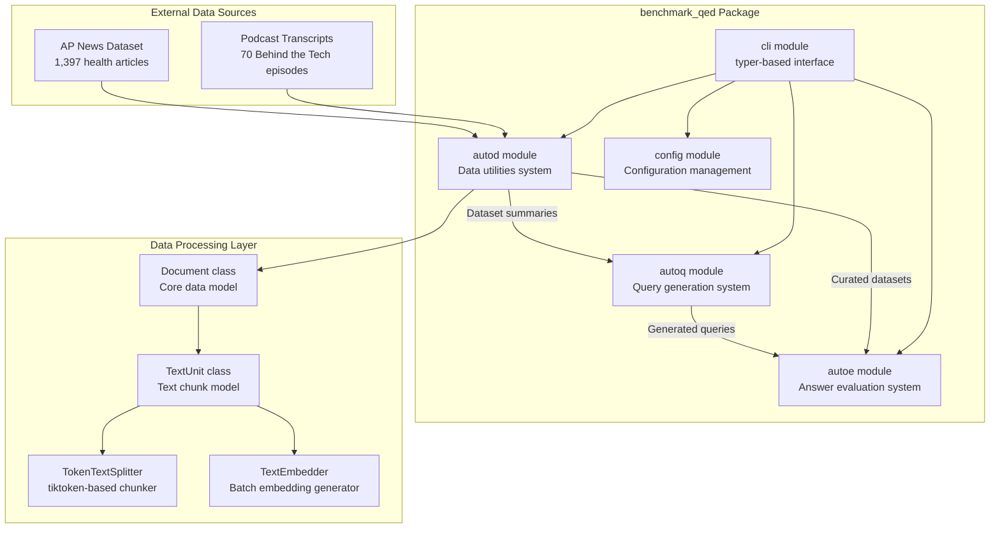

<!-- source: DeepWiki mcp.deepwiki.com · repo microsoft/benchmark-qed · page 1 Overview · fetched 2026-10-26 -->

# Overview

Relevant source files

The following files were used as context for generating this wiki page:

- [README.md](README.md)
- [TRANSPARENCY.md](TRANSPARENCY.md)

## Purpose and Scope

This document provides a high-level architectural overview of the BenchmarkQED repository, explaining its purpose as a comprehensive suite of tools for automated benchmarking of retrieval-augmented generation (RAG) systems. BenchmarkQED enables researchers to systematically evaluate RAG technologies through automated query generation, comparative evaluation, and dataset preparation utilities.

For detailed information about specific components, see the [Core Application](#2) section. For development and deployment infrastructure, see [Development Infrastructure](#3). For project governance and legal framework, see [Project Governance](#5).

## System Architecture

BenchmarkQED is structured as a modular Python package with three primary components that work together to provide comprehensive RAG evaluation capabilities. The system processes datasets through a sophisticated pipeline to generate synthetic queries and evaluate RAG system performance using LLM-as-a-Judge methodologies.

### Core Component Architecture

**Sources:** [README.md:20-41](), [benchmark_qed/__init__.py](), [benchmark_qed/cli.py]()

### Data Flow and Processing Pipeline

```mermaid
graph LR
    subgraph "Input Processing"
        RawData["Raw Dataset<br/>.jsonl files"]
        DocumentLoader["load_documents()<br/>Data ingestion"]
        Documents["Document instances<br/>with metadata"]
    end
    
    subgraph "Text Processing"
        TextSplitter["TokenTextSplitter<br/>CHUNK_SIZE config"]
        TextUnits["TextUnit instances<br/>chunked text"]
        EmbeddingGen["TextEmbedder<br/>EMBEDDING_BATCH_SIZE"]
        EmbeddedUnits["TextUnit with<br/>embeddings"]
    end
    
    subgraph "Analysis Components"
        DataSampling["AutoD sampling<br/>dataset curation"]
        QueryGen["AutoQ synthesis<br/>local-to-global queries"]
        Evaluation["AutoE comparison<br/>LLM-as-a-Judge"]
    end
    
    RawData --> DocumentLoader
    DocumentLoader --> Documents
    Documents --> TextSplitter
    TextSplitter --> TextUnits
    TextUnits --> EmbeddingGen
    EmbeddingGen --> EmbeddedUnits
    
    EmbeddedUnits --> DataSampling
    DataSampling --> QueryGen
    QueryGen --> Evaluation
    DataSampling --> Evaluation
```

**Sources:** [benchmark_qed/data/models.py](), [benchmark_qed/data/processing.py](), [benchmark_qed/config/defaults.py]()

## Core Components

### AutoQ - Query Generation System

AutoQ generates four classes of synthetic queries with variable data scope, ranging from local queries (answered using small text regions) to global queries (requiring reasoning over large dataset portions). The system uses LLM synthesis to create evaluation-appropriate queries based on dataset summaries.

**Key Capabilities:**
- Local-to-global query spectrum generation
- Dataset-aware query synthesis
- Configurable query complexity and scope

### AutoE - Answer Evaluation System  

AutoE evaluates RAG answers through side-by-side comparison on key metrics including relevance, comprehensiveness, diversity, and empowerment. The system employs LLM-as-a-Judge methodology and can assess correctness and completeness when ground truth is available.

**Key Capabilities:**
- Comparative answer evaluation 
- Multi-metric assessment framework
- Ground truth validation support
- Custom metric extensibility

### AutoD - Data Utilities System

AutoD provides essential data utilities for sampling and summarizing datasets, ensuring consistent inputs for query synthesis and evaluation processes. It handles dataset curation and preprocessing to optimize evaluation workflows.

**Key Capabilities:**
- Dataset sampling and curation
- Data summarization for query context
- Preprocessing pipeline management
- Metadata extraction and organization

**Sources:** [README.md:38-40](), [TRANSPARENCY.md:13-19]()

## Data Assets

BenchmarkQED includes two curated datasets specifically designed for RAG system evaluation:

| Dataset | Description | Size | Domain |
|---------|-------------|------|---------|
| **Podcast Transcripts** | Behind the Tech podcast episodes | 70 episodes | Technology interviews |
| **AP News** | Associated Press health articles | 1,397 articles | Health journalism |

These datasets serve as reference implementations and benchmarking targets, providing diverse content types and complexity levels for comprehensive RAG evaluation.

**Sources:** [README.md:42-45](), [TRANSPARENCY.md:49-56]()

## Technical Implementation

The system is implemented as a Python package with a command-line interface built using `typer`. The architecture emphasizes modularity, extensibility, and reproducibility:

### Package Structure
- **CLI Interface:** `benchmark_qed.cli` module providing command-line access
- **Core Modules:** Separate modules for each component (autoq, autoe, autod)
- **Data Models:** Extensible class hierarchy with `Identified`, `Document`, and `TextUnit`
- **Configuration:** Centralized configuration management with sensible defaults

### Key Design Principles
- **Modularity:** Each component operates independently while supporting integration
- **Extensibility:** Abstract base classes and interfaces support custom implementations  
- **Reproducibility:** Deterministic processing with configurable parameters
- **Scalability:** Batch processing and efficient text handling for large datasets

**Sources:** [benchmark_qed/cli.py](), [benchmark_qed/data/models.py](), [benchmark_qed/config/defaults.py]()

## Research Context

BenchmarkQED builds upon research presented in the GraphRAG paper (https://arxiv.org/abs/2404.16130) and provides practical tooling for the broader RAG research community. The system addresses the need for systematic, reproducible evaluation methodologies in retrieval-augmented generation applications.

The evaluation approach emphasizes domain expertise and human oversight, positioning BenchmarkQED as a research tool rather than a production system. Users are expected to be domain experts capable of independently evaluating output quality before acting on system recommendations.

**Sources:** [TRANSPARENCY.md:21-29](), [TRANSPARENCY.md:83-99]()

---

