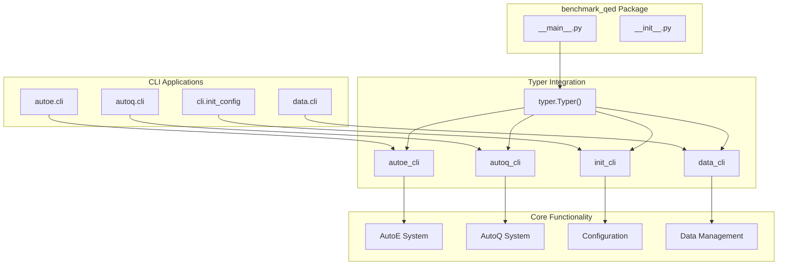
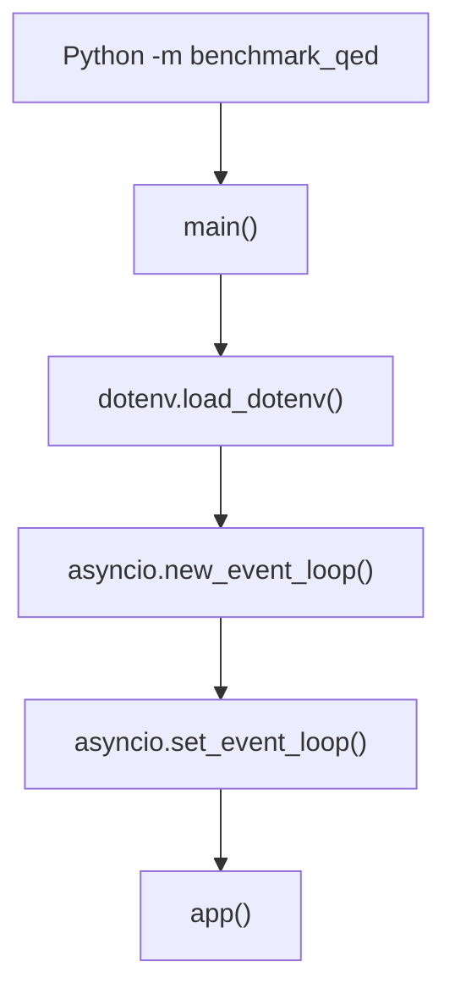
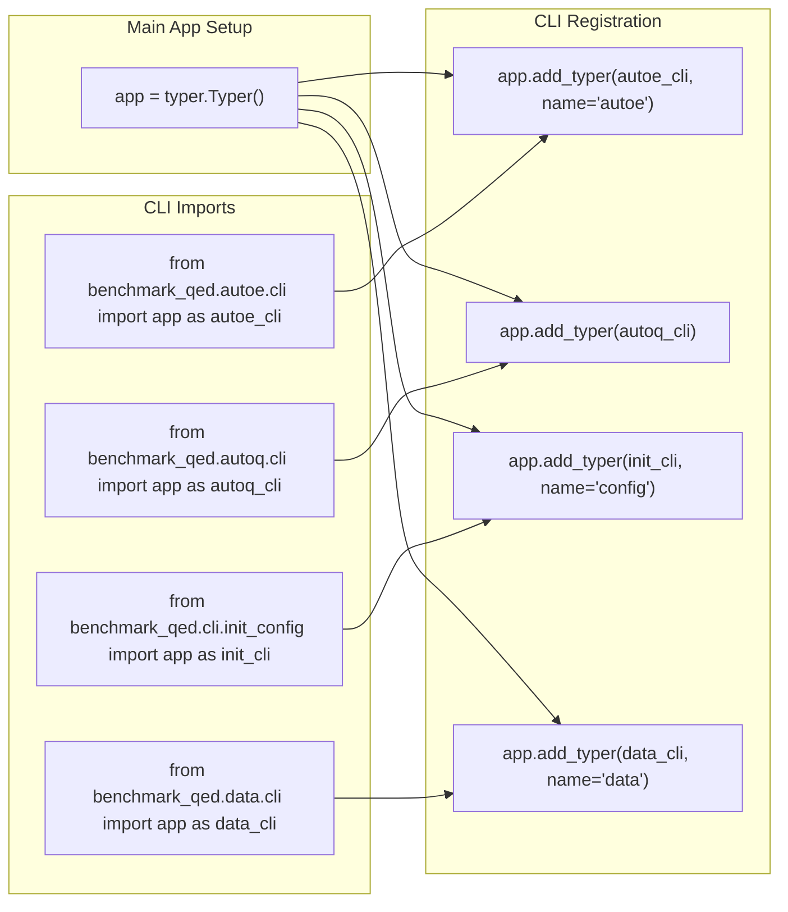
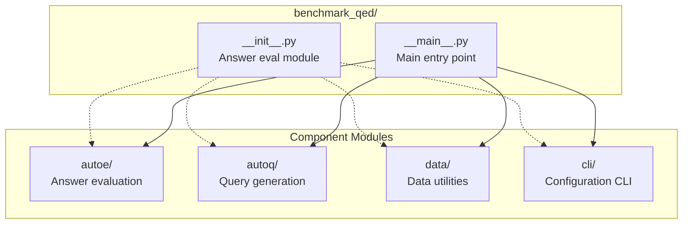

<!-- source: DeepWiki mcp.deepwiki.com · repo microsoft/benchmark-qed · page 2 Core Application · fetched 2026-10-26 -->

# Core Application

Relevant source files

The following files were used as context for generating this wiki page:

- [README.md](README.md)
- [benchmark_qed/__init__.py](benchmark_qed/__init__.py)
- [benchmark_qed/__main__.py](benchmark_qed/__main__.py)

## Purpose and Scope

This document covers the main `benchmark_qed` Python package, its internal structure, and primary functionality as the central application framework. This includes the package entry point, CLI integration, and how the core components (AutoQ, AutoE, AutoD) are orchestrated through the main application interface.

For specific details about the command-line interface usage, see [Command Line Interface](#2.1). For information about the individual AutoD, AutoQ, and AutoE subsystems, see [AutoD System](#2.2).

## Package Structure Overview

The `benchmark_qed` package serves as the central orchestration layer that integrates the three main components of the BenchmarkQED system. The package follows a modular architecture where each major component has its own CLI interface that gets integrated into a unified command-line application.

### Main Application Architecture

Sources: [benchmark_qed/__main__.py:1-32](), [benchmark_qed/__init__.py:1-3]()

## Main Application Entry Point

The package entry point is implemented in `__main__.py` and provides the central coordination for all CLI functionality. The main application uses the `typer` library to create a unified command-line interface.

### Application Initialization

The main application follows this initialization pattern:

The `main()` function handles:
- Environment variable loading via `dotenv.load_dotenv()`
- Async event loop setup for async operations
- CLI application execution through the typer framework

Sources: [benchmark_qed/__main__.py:22-31]()

## CLI Component Integration

The main typer application integrates four distinct CLI applications using the `add_typer()` method. Each component provides specialized functionality within the BenchmarkQED ecosystem.

### CLI Command Structure

| Command | Source Module | CLI Variable | Description |
|---------|---------------|--------------|-------------|
| `autoe` | `benchmark_qed.autoe.cli` | `autoe_cli` | Relative scores CLI |
| `autoq` | `benchmark_qed.autoq.cli` | `autoq_cli` | Question generation CLI |
| `config` | `benchmark_qed.cli.init_config` | `init_cli` | Configuration initialization CLI |
| `data` | `benchmark_qed.data.cli` | `data_cli` | Dataset downloader CLI |

### Integration Flow

The main application is configured with `pretty_exceptions_show_locals=False` to provide clean error output in production usage.

Sources: [benchmark_qed/__main__.py:9-19]()

## Module Organization

The core application serves as an orchestration layer that delegates functionality to specialized subsystems. The package structure reflects this separation of concerns:

### Package Hierarchy

The `__init__.py` file identifies the package as an "Answer eval module," indicating that answer evaluation is considered the primary function, with query generation and data utilities serving as supporting components.

Sources: [benchmark_qed/__init__.py:1-3](), [benchmark_qed/__main__.py:9-12]()

## Runtime Configuration

The application handles runtime environment setup through several mechanisms:

- **Environment Variables**: Loaded automatically via `dotenv.load_dotenv()`
- **Async Support**: Event loop configuration for async operations across components
- **CLI Context**: Typer provides argument parsing and command routing
- **Exception Handling**: Configured for production use with `pretty_exceptions_show_locals=False`

This design allows each component (AutoE, AutoQ, AutoD) to operate independently while sharing common runtime configuration and environment setup.

Sources: [benchmark_qed/__main__.py:14-28]()

---

