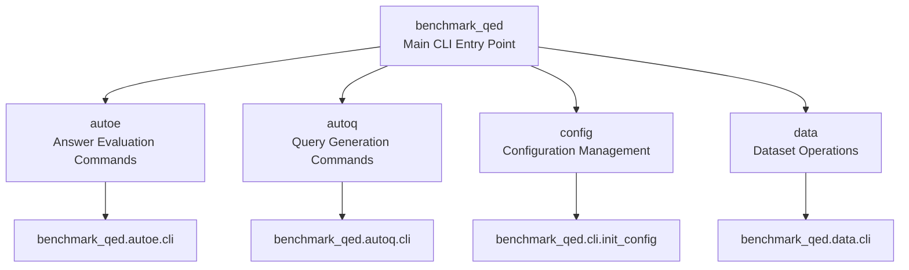
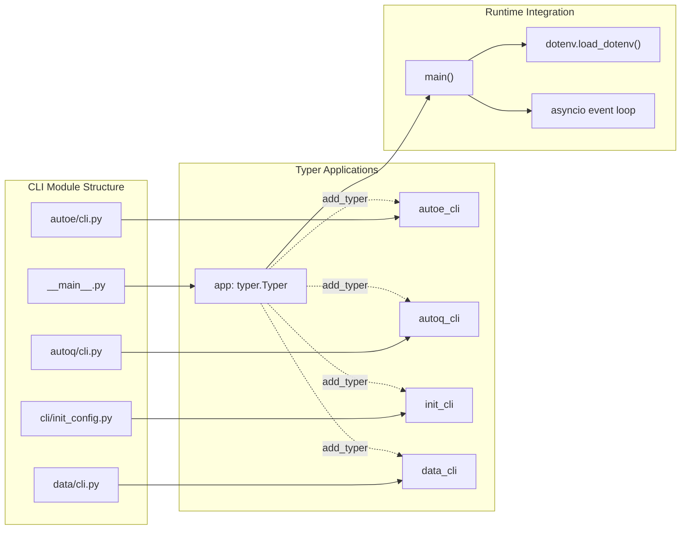
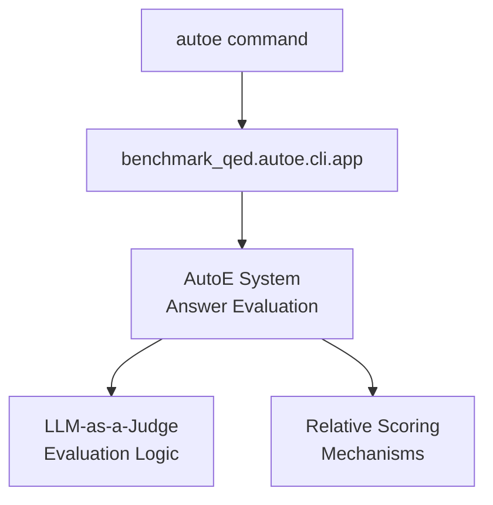
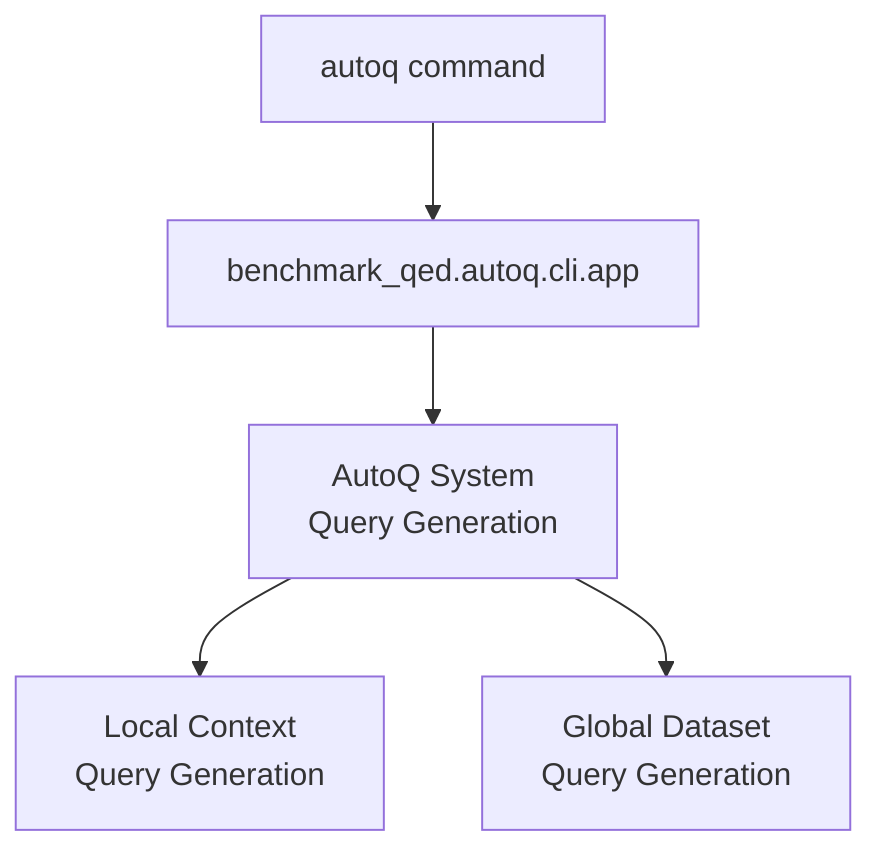
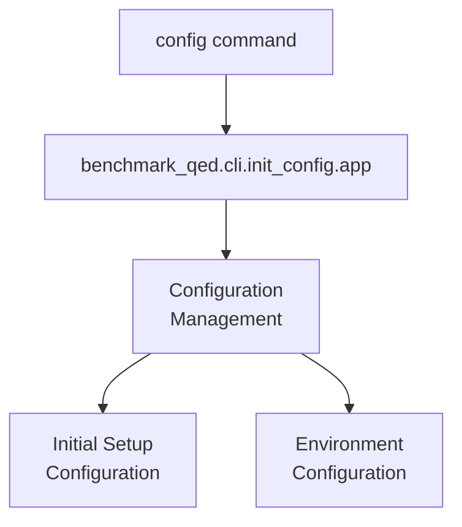
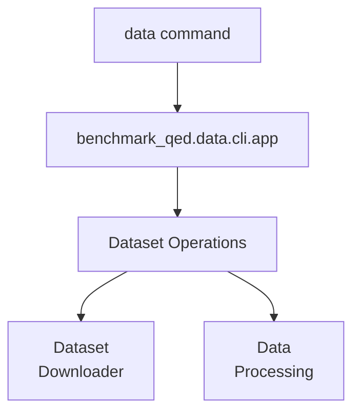
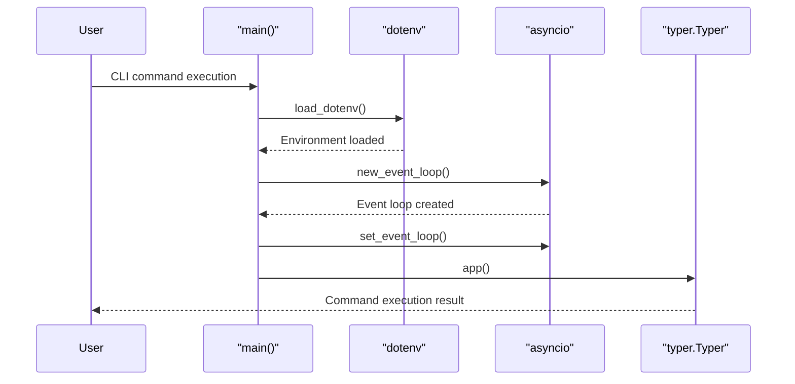

<!-- source: DeepWiki mcp.deepwiki.com · repo microsoft/benchmark-qed · page 2.1 Command Line Interface · fetched 2026-10-26 -->

# Command Line Interface

Relevant source files

The following files were used as context for generating this wiki page:

- [benchmark_qed/__main__.py](benchmark_qed/__main__.py)

The Command Line Interface (CLI) serves as the primary entry point for interacting with the BenchmarkQED system. It provides a unified command structure that exposes the core functionality of AutoQ (query generation), AutoE (answer evaluation), and AutoD (data utilities) through a typer-based interface. The CLI also includes configuration management and dataset downloading capabilities.

For information about the specific AutoD data processing components, see [AutoD System](#2.2). For details about the development infrastructure supporting the CLI, see [Development Infrastructure](#3).

## CLI Architecture Overview

The BenchmarkQED CLI is implemented as a main typer application that aggregates four specialized sub-applications, each handling a distinct aspect of the system's functionality.

### CLI Command Structure

**Sources:** [benchmark_qed/__main__.py:1-32]()

### Code Entity Mapping

**Sources:** [benchmark_qed/__main__.py:9-19]()

## Main CLI Application

The main CLI application is defined in the `__main__.py` module and serves as the central coordinator for all command-line functionality.

### Application Configuration

| Component | Implementation | Purpose |
|-----------|---------------|---------|
| Base Application | `typer.Typer(pretty_exceptions_show_locals=False)` | Main CLI app with simplified error display |
| Environment Loading | `dotenv.load_dotenv()` | Loads configuration from .env files |
| Async Support | `asyncio.new_event_loop()` | Provides async context for CLI operations |

The main application uses the `add_typer()` method to register sub-applications with specific command names and help descriptions:

- `autoe_cli` → `autoe` command with "Relative scores CLI" description
- `autoq_cli` → `autoq` command with "Question generation CLI" description  
- `init_cli` → `config` command with "Configuration initialization CLI" description
- `data_cli` → `data` command with "Dataset downloader CLI" description

**Sources:** [benchmark_qed/__main__.py:14-19]()

## Command Groups

### AutoE Command Group

The `autoe` command group handles answer evaluation functionality, implementing the "LLM-as-a-Judge" evaluation approach for assessing generated responses.

**Sources:** [benchmark_qed/__main__.py:16]()

### AutoQ Command Group

The `autoq` command group provides query generation capabilities, enabling the creation of evaluation questions from local document contexts to global dataset understanding.

**Sources:** [benchmark_qed/__main__.py:17]()

### Configuration Command Group

The `config` command group manages system configuration initialization and setup tasks.

**Sources:** [benchmark_qed/__main__.py:18]()

### Data Command Group

The `data` command group handles dataset operations including downloading and preprocessing of benchmark datasets.

**Sources:** [benchmark_qed/__main__.py:19]()

## Runtime Execution Flow

The CLI execution follows a structured initialization pattern that ensures proper environment setup and async context management.

### Execution Sequence

**Sources:** [benchmark_qed/__main__.py:22-27]()

### Entry Point Configuration

The module is configured as both a package entry point and direct execution target:

- Package execution: `python -m benchmark_qed`
- Direct execution: `python benchmark_qed/__main__.py`

Both execution methods invoke the `main()` function, which handles the complete initialization sequence before delegating to the appropriate typer sub-application.

**Sources:** [benchmark_qed/__main__.py:30-31]()

## Integration with Core Systems

The CLI serves as the interface layer between user commands and the core BenchmarkQED systems (AutoQ, AutoE, AutoD), providing a consistent command-line experience while maintaining separation of concerns between interface and implementation logic.

Each command group is implemented in its respective module, allowing for:
- Modular development and testing
- Clear separation between CLI interface and core functionality  
- Independent evolution of command interfaces
- Consistent help documentation and error handling

**Sources:** [benchmark_qed/__main__.py:9-12]()

---

