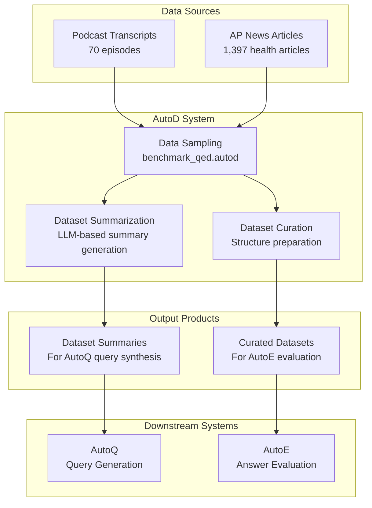
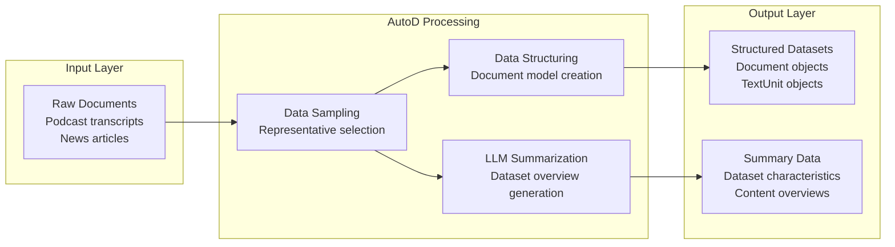
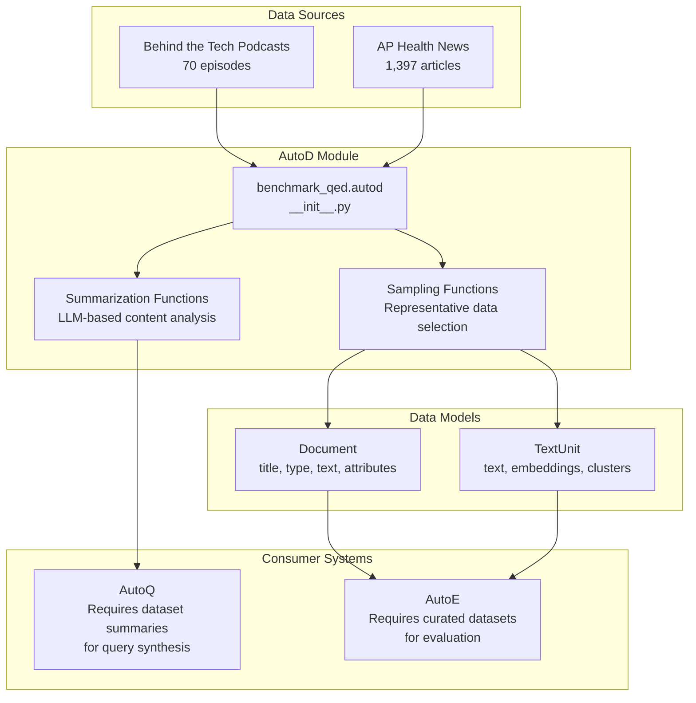
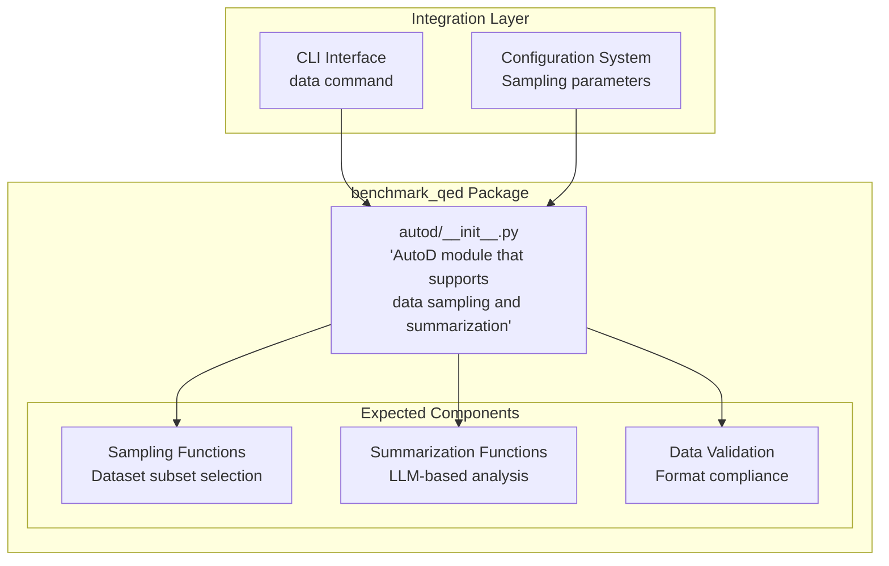

<!-- source: DeepWiki mcp.deepwiki.com · repo microsoft/benchmark-qed · page 2.2 AutoD System · fetched 2026-10-26 -->

# AutoD System

Relevant source files

The following files were used as context for generating this wiki page:

- [README.md](README.md)
- [benchmark_qed/autod/__init__.py](benchmark_qed/autod/__init__.py)

## Purpose and Scope

The AutoD system is responsible for data utilities that support sampling and summarization of datasets within the BenchmarkQED platform. This document covers the AutoD component's role in data preprocessing, dataset curation, and its integration with the AutoQ and AutoE systems. For information about the data models that AutoD works with, see [Data Models](#2.2.1). For details about the underlying data processing pipeline, see [Data Processing Pipeline](#2.2.2).

Sources: [README.md:25-27](), [benchmark_qed/autod/__init__.py:1-3]()

## System Overview

AutoD serves as the data foundation layer for the BenchmarkQED platform, providing curated datasets and dataset summaries to support automated query generation and evaluation. The system processes raw data sources and transforms them into structured formats suitable for RAG system benchmarking.

### AutoD in the BenchmarkQED Architecture

Sources: [README.md:22-34](), [README.md:40]()

## Data Processing Flow

AutoD manages the transformation of raw data sources through a structured processing pipeline that prepares data for both query generation and evaluation workflows.

### Data Transformation Pipeline

Sources: [README.md:40]()

## Integration Points

AutoD acts as the central data preparation hub, interfacing with both upstream data sources and downstream processing systems.

### System Integration Architecture

Sources: [benchmark_qed/autod/__init__.py:2](), [README.md:44-45]()

## Key Responsibilities

The AutoD system fulfills several critical functions within the BenchmarkQED platform:

| Responsibility | Description | Output |
|---|---|---|
| **Data Sampling** | Selects representative subsets from large datasets | Manageable dataset portions |
| **Dataset Summarization** | Generates LLM-based summaries of dataset content and characteristics | Summary documents for AutoQ |
| **Data Curation** | Structures raw data into consistent formats for evaluation | Curated datasets for AutoE |
| **Quality Assurance** | Ensures data consistency and format compliance | Validated data structures |

### Primary Functions

1. **Sampling Strategy**: AutoD implements sampling techniques to create representative subsets of large datasets, ensuring that benchmarking remains computationally feasible while maintaining statistical validity.

2. **LLM-Powered Summarization**: The system leverages large language models to generate comprehensive summaries of dataset content, capturing key themes, topics, and characteristics that inform query generation.

3. **Data Structure Consistency**: AutoD ensures that all processed data conforms to the expected data model structures, facilitating seamless integration with downstream systems.

4. **Metadata Preservation**: Throughout the processing pipeline, AutoD maintains important metadata about source documents, processing steps, and data lineage.

Sources: [README.md:40](), [README.md:25-27]()

## Technical Architecture

AutoD is implemented as a Python module within the broader `benchmark_qed` package, providing a clean interface for data processing operations.

### Module Structure

The AutoD system is designed to operate as a standalone module while maintaining tight integration with the broader BenchmarkQED ecosystem, ensuring consistent data preparation across all evaluation workflows.

Sources: [benchmark_qed/autod/__init__.py:1-3]()

---

