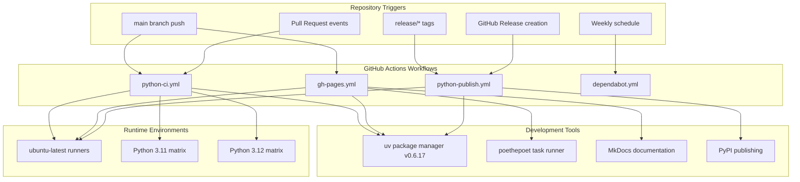

<!-- source: DeepWiki mcp.deepwiki.com · repo microsoft/benchmark-qed · page 3 Development Infrastructure · fetched 2026-10-26 -->

# Development Infrastructure

Relevant source files

The following files were used as context for generating this wiki page:

- [.github/dependabot.yml](.github/dependabot.yml)
- [.github/workflows/gh-pages.yml](.github/workflows/gh-pages.yml)
- [.github/workflows/python-ci.yml](.github/workflows/python-ci.yml)
- [.github/workflows/python-publish.yml](.github/workflows/python-publish.yml)

This document provides an overview of the comprehensive development infrastructure that supports the BenchmarkQED project. The infrastructure encompasses automated testing, continuous integration pipelines, release management, documentation generation, and dependency management systems that ensure code quality and streamline the development workflow.

For detailed information about specific aspects of the infrastructure, see [Continuous Integration](#3.1), [Release Pipeline](#3.2), [Documentation Generation](#3.3), and [Dependency Management](#3.4).

## Infrastructure Overview

The BenchmarkQED development infrastructure is built around GitHub Actions workflows that automate critical development processes. The system uses modern tooling including the `uv` package manager (version 0.6.17) and `poethepoet` task runner to provide fast, reliable automation across multiple Python versions and deployment targets.

The infrastructure operates through four primary automation pipelines that handle different aspects of the development lifecycle:

| Pipeline | Trigger | Purpose | Target Environment |
|----------|---------|---------|-------------------|
| `python-ci.yml` | Push/PR to main | Testing and quality checks | Python 3.11, 3.12 matrix |
| `gh-pages.yml` | Push to main | Documentation deployment | GitHub Pages |
| `python-publish.yml` | Release tags/creation | Package publishing | PyPI |
| `dependabot.yml` | Weekly schedule | Dependency updates | Repository |

## CI/CD Pipeline Architecture

**Sources:** [.github/workflows/python-ci.yml](), [.github/workflows/gh-pages.yml](), [.github/workflows/python-publish.yml](), [.github/dependabot.yml]()

## Workflow Configuration Details

```mermaid
graph LR
    subgraph python_ci_workflow["python-ci.yml Workflow"]
        ci_triggers["Triggers: push/PR to main"]
        ci_matrix["Matrix: python-version 3.11, 3.12"]
        ci_steps["Steps: checkout → setup-python → install uv → sync deps → poe check"]
        ci_concurrency["Concurrency: cancel-in-progress"]
    end
    
    subgraph gh_pages_workflow["gh-pages.yml Workflow"]
        pages_trigger["Trigger: push to main"]
        pages_python["Python: 3.12 fixed"]
        pages_steps["Steps: checkout → setup-python → install uv → sync → poe build_docs → deploy"]
        pages_permissions["Permissions: contents write"]
    end
    
    subgraph publish_workflow["python-publish.yml Workflow"]
        publish_triggers["Triggers: release creation, release/* tags"]
        publish_python["Python: 3.12 fixed"]
        publish_steps["Steps: checkout → setup-python → install uv → uv build → pypi publish"]
        publish_environment["Environment: pypi with id-token write"]
    end
    
    subgraph dependabot_config["dependabot.yml Configuration"]
        dep_ecosystems["Ecosystems: pip, github-actions"]
        dep_directory["Directory: / (root)"]
        dep_schedule["Schedule: weekly interval"]
    end
    
    ci_triggers --> ci_matrix
    ci_matrix --> ci_steps
    ci_steps --> ci_concurrency
    
    pages_trigger --> pages_python
    pages_python --> pages_steps
    pages_steps --> pages_permissions
    
    publish_triggers --> publish_python
    publish_python --> publish_steps
    publish_steps --> publish_environment
    
    dep_ecosystems --> dep_directory
    dep_directory --> dep_schedule
```

**Sources:** [.github/workflows/python-ci.yml:24-27](), [.github/workflows/gh-pages.yml:15-16](), [.github/workflows/python-publish.yml:11-12](), [.github/dependabot.yml:7-15]()

## Pipeline Execution Flow

The CI pipeline implements sophisticated triggering and concurrency controls:

### Python CI Workflow
- **Triggers**: Push to `main` or `**/main` branches, and pull request events [`opened`, `reopened`, `synchronize`, `ready_for_review`]
- **Path Filtering**: Ignores `**/*.md` files and `.semversioner/**` directory changes
- **Concurrency**: Uses `cancel-in-progress: true` to terminate outdated runs
- **Matrix Strategy**: Tests against Python 3.11 and 3.12 simultaneously
- **Key Steps**: Executes `uv sync --locked --all-packages` followed by `uv run poe check`

### Documentation Pipeline  
- **Trigger**: Push events to `main` branch only
- **Build Process**: Uses `uv run poe build_docs` to generate MkDocs site
- **Deployment**: Employs `JamesIves/github-pages-deploy-action@v4.6.4` to publish to `gh-pages` branch
- **Output Verification**: Includes `find site` step to list generated documentation contents

### Publishing Pipeline
- **Dual Triggers**: GitHub release creation events and `release/*` tag pushes  
- **Environment**: Uses PyPI environment with trusted publishing via `id-token: write` permissions
- **Build Process**: Executes `uv build` to create distribution packages
- **Publishing**: Uses `pypa/gh-action-pypi-publish@release/v1` with `skip-existing: true` for idempotent deployments

### Dependency Management
- **Automation**: Weekly updates for both `pip` ecosystem and `github-actions` packages
- **Scope**: Monitors root directory (`/`) for package manifests and workflow files
- **Integration**: Updates trigger CI pipeline for validation before merge

**Sources:** [.github/workflows/python-ci.yml:2-18](), [.github/workflows/gh-pages.yml:2-5](), [.github/workflows/python-publish.yml:2-8](), [.github/dependabot.yml:6-15]()

---

