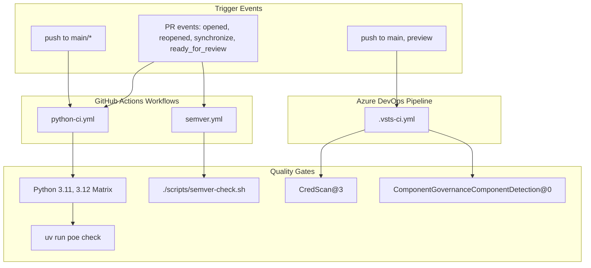
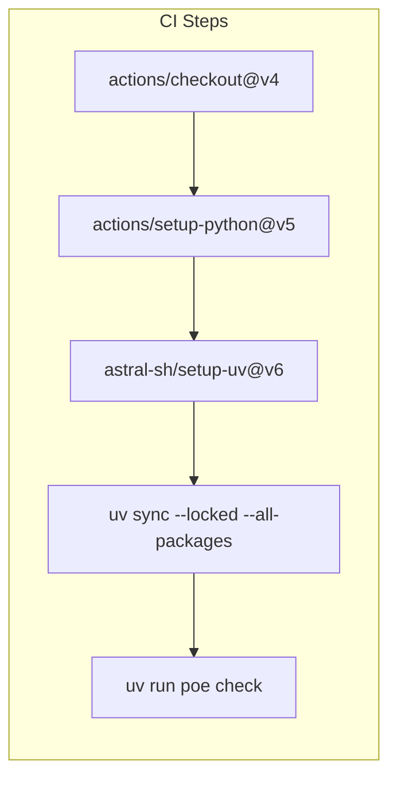
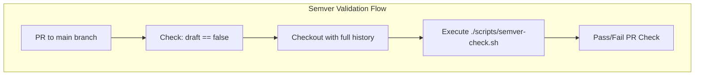

<!-- source: DeepWiki mcp.deepwiki.com · repo microsoft/benchmark-qed · page 3.1 Continuous Integration · fetched 2026-10-26 -->

# Continuous Integration

Relevant source files

The following files were used as context for generating this wiki page:

- [.github/workflows/python-ci.yml](.github/workflows/python-ci.yml)
- [.github/workflows/semver.yml](.github/workflows/semver.yml)
- [.vsts-ci.yml](.vsts-ci.yml)

This document covers the continuous integration system for BenchmarkQED, including testing pipelines, quality checks, and semantic versioning enforcement. The CI system ensures code quality and maintainability through automated testing across multiple Python versions and comprehensive compliance checking.

For information about automated package publishing, see [Release Pipeline](#3.2). For documentation building automation, see [Documentation Generation](#3.3). For automated dependency updates, see [Dependency Management](#3.4).

## CI Pipeline Architecture

The continuous integration system consists of three primary pipelines that run in parallel to validate code changes and maintain project standards.

### CI Workflow Overview

Sources: [.github/workflows/python-ci.yml:1-57](), [.github/workflows/semver.yml:1-22](), [.vsts-ci.yml:1-35]()

## Python CI Pipeline

The primary testing pipeline validates code quality across multiple Python versions using the `uv` package manager and `poethepoet` task runner.

### Build Configuration

| Component | Configuration |
|-----------|--------------|
| **Operating System** | `ubuntu-latest` |
| **Python Versions** | `3.11`, `3.12` |
| **Package Manager** | `uv` version `0.6.17` |
| **Task Runner** | `poethepoet` via `poe` command |

The pipeline uses a build matrix strategy to test against multiple Python versions simultaneously, ensuring compatibility across the supported version range.

### Trigger Conditions

The `python-ci.yml` workflow activates on:

- Push events to `main` branch or branches matching `**/main` pattern
- Pull request events: `opened`, `reopened`, `synchronize`, `ready_for_review`
- Excludes changes to `**/*.md` files and `.semversioner/**` directory

Concurrency controls prevent multiple workflow runs from the same pull request or branch, automatically canceling previous runs when new commits are pushed.

### Quality Check Process

The `poe check` command orchestrates multiple quality checks including linting, type checking, and testing through the poethepoet task runner configuration.

Sources: [.github/workflows/python-ci.yml:29-57]()

## Semantic Version Enforcement

The `semver.yml` workflow enforces semantic versioning standards on pull requests to maintain consistent release management.

### Semver Check Configuration

The workflow includes specific filtering logic to optimize execution:

- **Draft PR Filtering**: Skips execution for draft pull requests using condition `github.event.pull_request.draft == false`
- **Branch Targeting**: Only runs on PRs targeting the `main` branch
- **Deep History**: Uses `fetch-depth: 0` to access full Git history for version comparison

The semver check delegates to a shell script that validates version changes according to semantic versioning principles.

Sources: [.github/workflows/semver.yml:1-22]()

## Compliance Pipeline

The Azure DevOps pipeline handles security and governance compliance through specialized scanning tools.

### Compliance Stage Architecture

The `.vsts-ci.yml` pipeline runs independently from GitHub Actions, providing enterprise-grade security scanning:

| Tool | Purpose | Configuration |
|------|---------|---------------|
| **CredScan@3** | Credential scanning | SARIF output format, debug mode disabled |
| **ComponentGovernanceComponentDetection@0** | Dependency vulnerability scanning | Register scan type, verbose logging, high alert threshold |
| **PublishSecurityAnalysisLogs@3** | Artifact publishing | Container artifact type |

### Platform Requirements

The compliance pipeline uses `windows-latest` virtual machines to support Microsoft security tooling requirements, distinct from the Ubuntu-based Python CI pipeline.

### Trigger Strategy

Compliance scans activate on pushes to:
- `main` branch
- `preview` branch

The pipeline uses batch triggering to consolidate multiple rapid commits into single compliance runs, optimizing resource usage.

Sources: [.vsts-ci.yml:1-35]()

## Integration with Development Workflow

The CI system integrates with the broader development infrastructure through several key touchpoints:

### Permission Model

GitHub Actions workflows operate with minimal required permissions:
- `contents: read` - Access repository content
- `pull-requests: read` - Read PR metadata for filtering and status updates

### Concurrency Management

The CI system uses GitHub's concurrency controls to prevent resource conflicts and ensure efficient pipeline execution. Each workflow group cancels previous runs when new commits arrive, maintaining fast feedback loops.

### Quality Gate Integration

All pipelines function as required status checks, preventing merge operations until all validations pass. This enforces code quality standards and maintains the integrity of the main branch.

Sources: [.github/workflows/python-ci.yml:20-27](), [.github/workflows/semver.yml:12-14](), [.vsts-ci.yml:5-11]()

---

