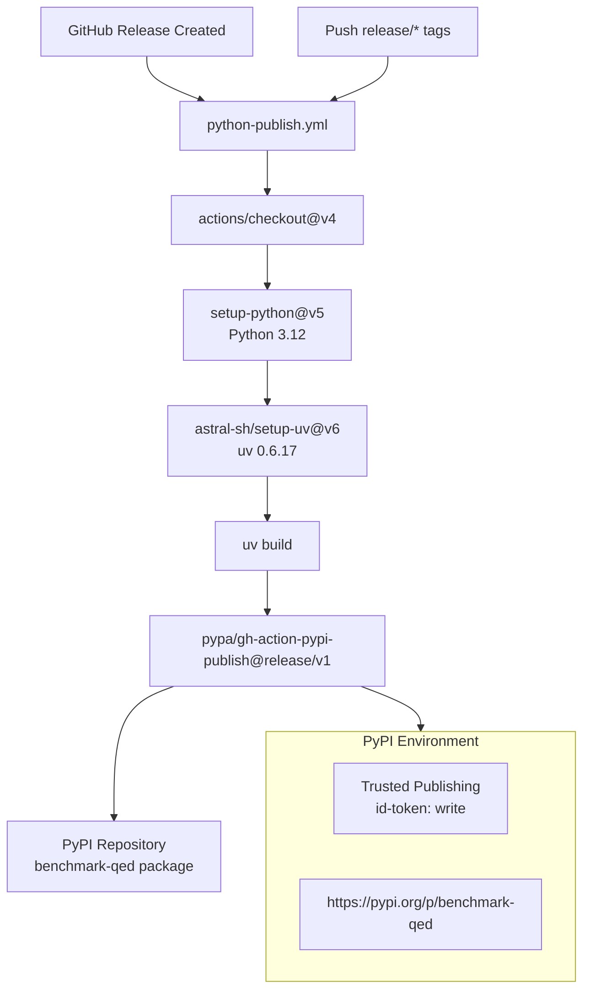
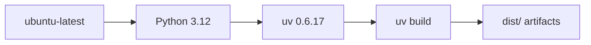
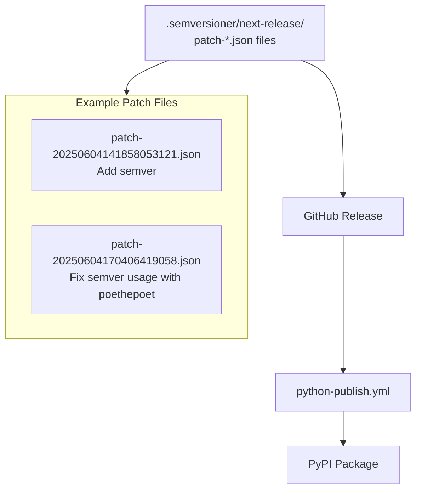

<!-- source: DeepWiki mcp.deepwiki.com · repo microsoft/benchmark-qed · page 3.2 Release Pipeline · fetched 2026-10-26 -->

# Release Pipeline

Relevant source files

The following files were used as context for generating this wiki page:

- [.github/workflows/python-publish.yml](.github/workflows/python-publish.yml)
- [.semversioner/next-release/patch-20250604141858053121.json](.semversioner/next-release/patch-20250604141858053121.json)
- [.semversioner/next-release/patch-20250604170406419058.json](.semversioner/next-release/patch-20250604170406419058.json)

This document covers the automated release pipeline that publishes BenchmarkQED packages to PyPI. The pipeline handles building and distributing Python packages when new releases are created or tagged. For information about continuous integration testing, see [Continuous Integration](#3.1). For details about the semversioner system that manages version tracking, see [Release History](#4).

## Pipeline Overview

The release pipeline is implemented as a GitHub Actions workflow that automatically builds and publishes the `benchmark-qed` Python package to PyPI. The pipeline is triggered by GitHub release events and release tags, ensuring that new versions are immediately available for installation via `pip`.

### Release Pipeline Flow

Sources: [.github/workflows/python-publish.yml:1-49]()

## Trigger Configuration

The release pipeline activates under two conditions:

| Trigger Type | Configuration | Description |
|--------------|---------------|-------------|
| GitHub Releases | `types: [created]` | Activates when a new GitHub release is published |
| Tag Push | `tags: ["release/*"]` | Activates when tags matching `release/*` pattern are pushed |

This dual trigger approach ensures flexibility in release management, supporting both manual GitHub release creation and automated tag-based releases.

Sources: [.github/workflows/python-publish.yml:2-8]()

## Build Process

The pipeline uses modern Python tooling for efficient package building:

### Build Environment Configuration

The build process leverages `uv` as the package manager and build tool, which provides faster dependency resolution and package building compared to traditional `pip` and `setuptools` workflows.

**Environment Variables:**
- `UV_VERSION: 0.6.17` - Specifies the uv package manager version
- `PYTHON_VERSION: 3.12` - Defines the Python runtime version

Sources: [.github/workflows/python-publish.yml:10-12](), [.github/workflows/python-publish.yml:35-42]()

## Publishing Configuration

The pipeline uses PyPI's trusted publishing mechanism for secure package deployment:

### Security and Permissions

| Setting | Value | Purpose |
|---------|--------|---------|
| `id-token: write` | Required | Enables OIDC trusted publishing |
| `skip-existing: true` | Enabled | Prevents duplicate uploads |
| `verbose: true` | Enabled | Provides detailed publishing logs |

The trusted publishing approach eliminates the need for API tokens by using GitHub's OIDC provider to authenticate with PyPI.

### PyPI Environment Protection

The workflow includes environment protection configured for the `pypi` environment:
- **Name:** `pypi`
- **URL:** `https://pypi.org/p/benchmark-qed`
- **Purpose:** Provides deployment protection and audit trail

Sources: [.github/workflows/python-publish.yml:19-24](), [.github/workflows/python-publish.yml:44-48]()

## Integration with Release Management

The release pipeline integrates with the semversioner system for automated version management:

### Semversioner Integration

The semversioner tracks individual changes in JSON files within the `next-release` directory. These changes are consolidated when creating releases, which then trigger the publishing pipeline.

**Semversioner File Structure:**
- **Type:** `patch`, `minor`, or `major`
- **Description:** Human-readable change description
- **Location:** `.semversioner/next-release/`

Sources: [.semversioner/next-release/patch-20250604141858053121.json:1-4](), [.semversioner/next-release/patch-20250604170406419058.json:1-4]()

## Pipeline Execution Steps

The complete pipeline execution follows this sequence:

1. **Code Checkout** - Fetches repository with full history (`fetch-depth: 0`)
2. **Python Setup** - Installs Python 3.12 runtime
3. **Tool Installation** - Sets up uv package manager
4. **Package Build** - Generates distribution artifacts using `uv build`
5. **PyPI Publication** - Uploads packages using trusted publishing

The pipeline runs on `ubuntu-latest` runners and typically completes within minutes, providing rapid availability of new package versions.

Sources: [.github/workflows/python-publish.yml:25-48]()

---

