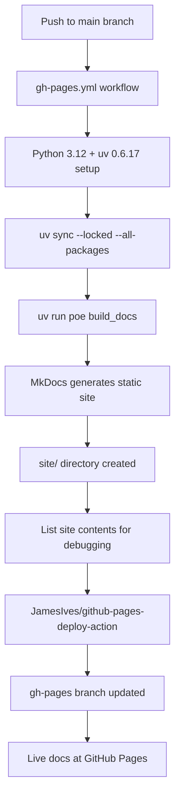
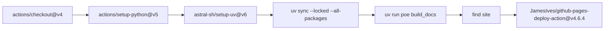
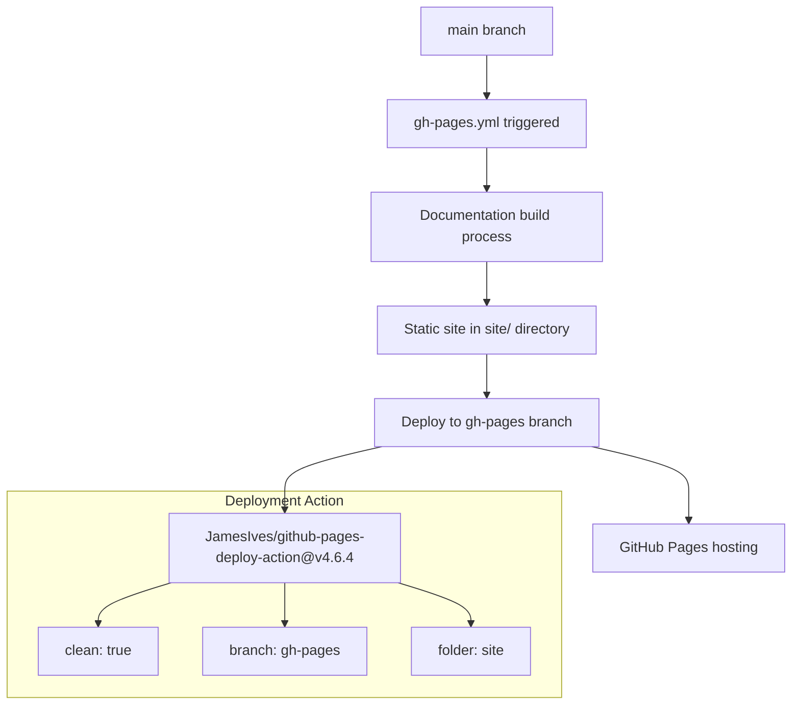

<!-- source: DeepWiki mcp.deepwiki.com · repo microsoft/benchmark-qed · page 3.3 Documentation Generation · fetched 2026-10-26 -->

# Documentation Generation

Relevant source files

The following files were used as context for generating this wiki page:

- [.github/workflows/gh-pages.yml](.github/workflows/gh-pages.yml)

This document covers the automated documentation generation and deployment system in BenchmarkQED. The system automatically builds and publishes documentation to GitHub Pages whenever changes are pushed to the main branch, ensuring that project documentation stays current with code changes.

For information about the broader CI/CD infrastructure, see [Continuous Integration](#3.1) and [Release Pipeline](#3.2).

## Documentation Architecture Overview

The BenchmarkQED documentation system uses MkDocs for static site generation with automated deployment to GitHub Pages. The system integrates with the project's task runner (`poethepoet`) and package manager (`uv`) to provide a seamless documentation workflow.

### Documentation Generation Flow

Sources: [.github/workflows/gh-pages.yml:1-46]()

## GitHub Pages Workflow Implementation

The documentation deployment is handled by the `gh-pages` workflow, which executes on every push to the main branch. The workflow ensures consistent documentation builds using locked dependency versions and provides debugging capabilities through content listing.

### Workflow Configuration

| Component | Configuration | Purpose |
|-----------|--------------|---------|
| Trigger | `push` to `main` branch | Automatic updates on code changes |
| Runner | `ubuntu-latest` | Consistent Linux environment |
| Python Version | `3.12` | Matches development standards |
| UV Version | `0.6.17` | Locked package manager version |
| Permissions | `contents: write` | Enables GitHub Pages deployment |

### Build Process Steps

The workflow uses the `poe build_docs` task, which indicates integration with the `poethepoet` task runner system. This provides a standardized interface for documentation building across different development environments.

Sources: [.github/workflows/gh-pages.yml:18-46]()

## Integration with Development Infrastructure

The documentation generation system integrates seamlessly with BenchmarkQED's development infrastructure through several key mechanisms:

### Dependency Management Integration

The workflow uses `uv sync --locked --all-packages` to ensure reproducible builds with the same dependency versions used in development and testing. This approach eliminates documentation build failures due to dependency conflicts.

### Task Runner Integration

The build process delegates to `uv run poe build_docs`, leveraging the project's `poethepoet` configuration. This ensures that documentation builds use the same commands and configurations as local development.

### Deployment Strategy

The deployment uses the `JamesIves/github-pages-deploy-action` with `clean: true` to ensure that obsolete files are removed from the published site, preventing stale content issues.

Sources: [.github/workflows/gh-pages.yml:34-46]()

## Technical Implementation Details

### Environment Configuration

The workflow defines specific environment variables to ensure consistent builds:

- `UV_VERSION: 0.6.17` - Pins the package manager version
- `PYTHON_VERSION: '3.12'` - Specifies Python runtime version

### Build Debugging

The workflow includes a debugging step using `find site` to list all generated files. This provides visibility into the build output and helps troubleshoot deployment issues.

### Security and Permissions

The workflow requires `contents: write` permissions to deploy to the `gh-pages` branch. The deployment action is configured to completely replace the target branch content (`clean: true`) to prevent accumulation of obsolete files.

### Deployment Reliability

The system uses a mature, well-maintained deployment action (`JamesIves/github-pages-deploy-action@v4.6.4`) that handles GitHub Pages deployment complexities including:

- Automatic `gh-pages` branch creation
- Clean deployment with old file removal  
- Proper GitHub Pages configuration
- Error handling and status reporting

Sources: [.github/workflows/gh-pages.yml:6-46]()

---

