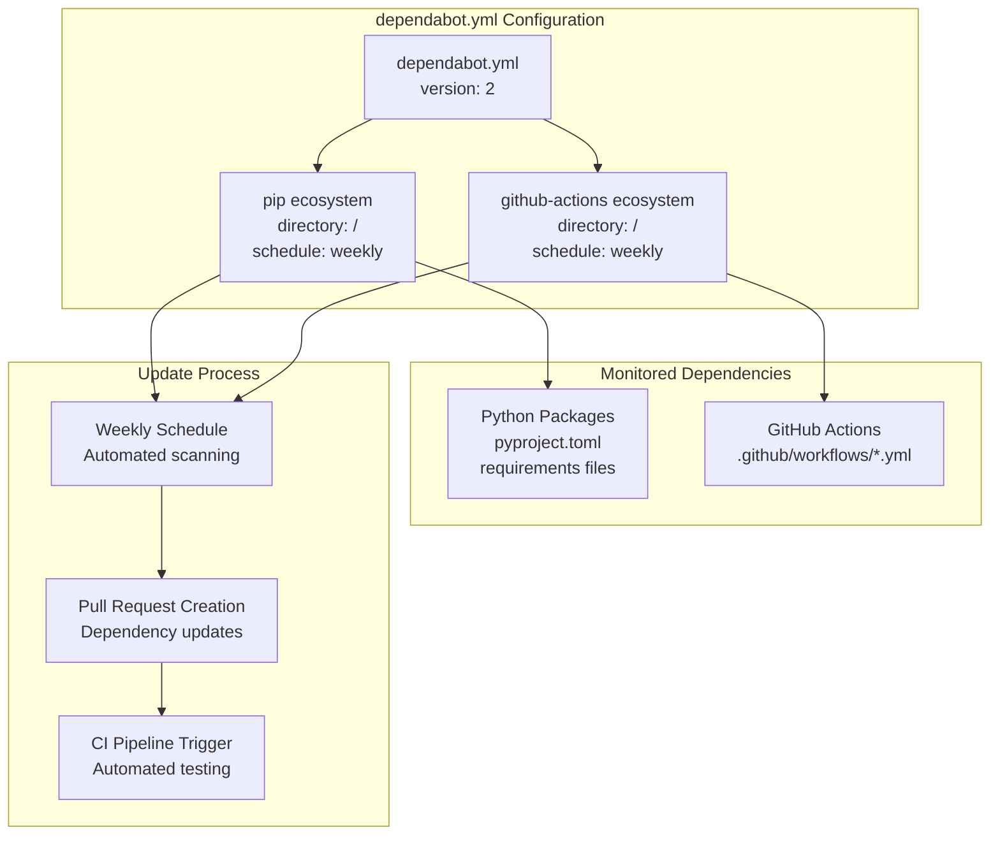
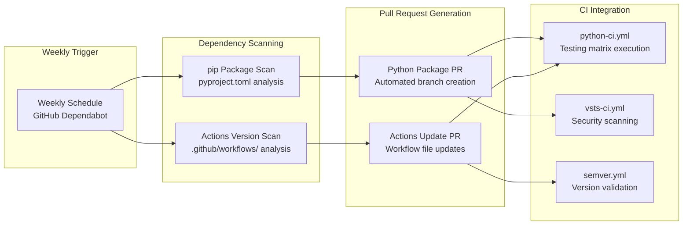
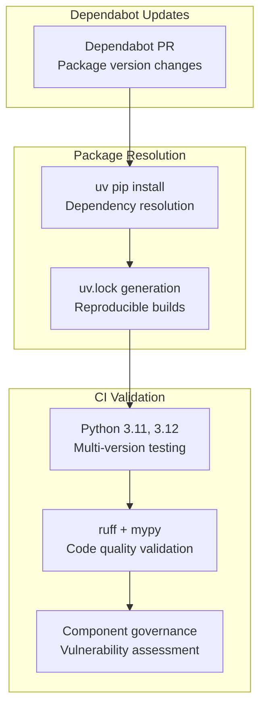

<!-- source: DeepWiki mcp.deepwiki.com · repo microsoft/benchmark-qed · page 3.4 Dependency Management · fetched 2026-10-26 -->

# Dependency Management

Relevant source files

The following files were used as context for generating this wiki page:

- [.github/dependabot.yml](.github/dependabot.yml)

This document covers the automated dependency management system implemented in the BenchmarkQED repository. The system uses GitHub's Dependabot service to automatically monitor, update, and maintain both Python package dependencies and GitHub Actions workflow dependencies.

For information about the broader CI/CD infrastructure that processes these dependency updates, see [Continuous Integration](#3.1).

## Overview

The BenchmarkQED repository implements a comprehensive automated dependency management strategy that ensures security patches, bug fixes, and compatible feature updates are regularly integrated while maintaining system stability through automated testing pipelines.

Sources: [.github/dependabot.yml:1-15]()

## Dependabot Configuration

The dependency management system is configured through the `dependabot.yml` file, which defines the automated update behavior for multiple package ecosystems.

### Configuration Structure

The configuration specifies two distinct update streams with identical scheduling but different target ecosystems.

Sources: [.github/dependabot.yml:5-15]()

### Package Ecosystem Management

The system monitors two primary package ecosystems:

| Ecosystem | Directory | Update Frequency | Target Files |
|-----------|-----------|------------------|--------------|
| `pip` | `/` | Weekly | Python package manifests |
| `github-actions` | `/` | Weekly | Workflow YAML files |

**Python Package Ecosystem**
- Monitors the root directory (`/`) for Python package manifests
- Includes `pyproject.toml`, `requirements.txt`, and similar dependency files
- Generates pull requests for package version updates, security patches, and compatibility improvements

**GitHub Actions Ecosystem**  
- Scans `.github/workflows/` directory for action version references
- Updates action versions in workflow files like `python-ci.yml`, `gh-pages.yml`, and `python-publish.yml`
- Ensures workflow actions remain current with security and feature updates

Sources: [.github/dependabot.yml:7-15]()

## Update Processing Flow

The dependency update process integrates with the existing CI/CD infrastructure to ensure automated updates maintain system stability.

Each dependency update triggers the complete CI/CD validation pipeline, ensuring compatibility and maintaining code quality standards.

Sources: [.github/dependabot.yml:9-15]()

## Integration with Package Management

The dependency updates interact with the project's package management tooling, particularly the `uv` package manager used throughout the CI/CD pipelines.

### Package Manager Coordination

The `uv` package manager handles dependency resolution and lock file generation for all Dependabot-initiated updates, ensuring consistent environments across development and CI systems.

Sources: [.github/dependabot.yml:7-10]()

## Security and Compliance Impact

Dependency updates automatically trigger security compliance workflows to validate that new package versions maintain the project's security posture.

### Compliance Workflow Integration

The `vsts-ci.yml` compliance pipeline processes every dependency update to scan for:
- Credential exposure through CredScan analysis
- Component governance policy compliance  
- Vulnerability assessment of new package versions
- License compatibility verification

This ensures that automated dependency updates cannot introduce security regressions or policy violations into the codebase.

Sources: [.github/dependabot.yml:1-15]()

---

