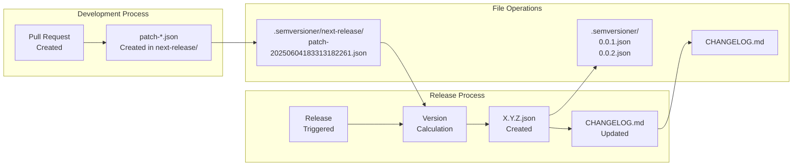

<!-- source: DeepWiki mcp.deepwiki.com · repo microsoft/benchmark-qed · page 4 Release History · fetched 2026-10-26 -->

# Release History

Relevant source files

The following files were used as context for generating this wiki page:

- [.semversioner/0.0.1.json](.semversioner/0.0.1.json)
- [.semversioner/0.0.2.json](.semversioner/0.0.2.json)
- [.semversioner/next-release/patch-20250604183313182261.json](.semversioner/next-release/patch-20250604183313182261.json)
- [CHANGELOG.md](CHANGELOG.md)

This document covers the BenchmarkQED project's release management system and version history. The project uses a semversioner-based approach for tracking changes and managing semantic versioning through structured JSON files and automated changelog generation.

For information about the actual release pipeline and CI/CD processes, see [Release Pipeline](#3.2). For project governance and development standards, see [Project Governance](#5).

## Semversioner System Overview

The BenchmarkQED project employs a semversioner system that manages semantic versioning through a collection of JSON files stored in the `.semversioner/` directory. This system provides structured change tracking and automated version management.

### Semversioner Architecture

```mermaid
graph TB
    subgraph ".semversioner Directory Structure"
        SemRoot[".semversioner/"]
        CurrentVersions["0.0.1.json<br/>0.0.2.json"]
        NextRelease["next-release/<br/>patch-*.json"]
    end
    
    subgraph "Change Types"
        PatchChanges["patch<br/>Bug fixes, docs"]
        MinorChanges["minor<br/>New features"]
        MajorChanges["major<br/>Breaking changes"]
    end
    
    subgraph "Generated Artifacts"
        ChangelogMd["CHANGELOG.md"]
        VersionBumping["Semantic Version<br/>Calculation"]
    end
    
    SemRoot --> CurrentVersions
    SemRoot --> NextRelease
    
    NextRelease --> PatchChanges
    NextRelease --> MinorChanges
    NextRelease --> MajorChanges
    
    CurrentVersions --> VersionBumping
    NextRelease --> VersionBumping
    VersionBumping --> ChangelogMd
    
    PatchChanges --> ChangelogMd
    MinorChanges --> ChangelogMd
    MajorChanges --> ChangelogMd
```

Sources: [.semversioner/0.0.1.json:1-10](), [.semversioner/0.0.2.json:1-10](), [.semversioner/next-release/patch-20250604183313182261.json:1-4](), [CHANGELOG.md:1-11]()

### Version File Structure

Each release is documented in a JSON file following this structure:

| Field | Type | Description |
|-------|------|-------------|
| `version` | string | Semantic version number (e.g., "0.0.1") |
| `created_at` | string | ISO 8601 timestamp of release creation |
| `changes` | array | Array of change objects |
| `changes[].description` | string | Human-readable change description |
| `changes[].type` | string | Change type: "patch", "minor", or "major" |

Sources: [.semversioner/0.0.1.json:1-10](), [.semversioner/0.0.2.json:1-10]()

## Release Tracking Mechanism

The semversioner system manages releases through a two-stage process: pending changes in `next-release/` and finalized releases as individual JSON files.

### Change Flow Process

Sources: [.semversioner/next-release/patch-20250604183313182261.json:1-4](), [.semversioner/0.0.1.json:1-10](), [.semversioner/0.0.2.json:1-10](), [CHANGELOG.md:1-11]()

### Pending Changes

The `next-release/` directory contains JSON files for changes awaiting the next release. Each file follows the naming pattern `{type}-{timestamp}.json` and contains:

- `type`: The semantic version change type
- `description`: Human-readable change description

The current pending change is documented in `patch-20250604183313182261.json` with the description "Update docs".

Sources: [.semversioner/next-release/patch-20250604183313182261.json:1-4]()

## Current Release History

The BenchmarkQED project has released two versions in the 0.x.y range, with a note that releases in this range may introduce breaking changes.

### Version 0.0.2

- **Release Date**: 2025-06-04T14:18:13+00:00
- **Change Type**: patch
- **Description**: Download bug fixes + Docs

This release addressed download functionality issues and improved documentation.

Sources: [.semversioner/0.0.2.json:1-10](), [CHANGELOG.md:4-6]()

### Version 0.0.1

- **Release Date**: 2025-06-04T14:17:23+00:00
- **Change Type**: patch  
- **Description**: Initial Release

This was the initial public release of the BenchmarkQED project.

Sources: [.semversioner/0.0.1.json:1-10](), [CHANGELOG.md:8-10]()

### Release Timeline

| Version | Date | Type | Description |
|---------|------|------|-------------|
| 0.0.1 | 2025-06-04 | patch | Initial Release |
| 0.0.2 | 2025-06-04 | patch | Download bug fixes + Docs |
| Next | TBD | patch | Update docs (pending) |

Sources: [CHANGELOG.md:1-11](), [.semversioner/0.0.1.json:1-10](), [.semversioner/0.0.2.json:1-10](), [.semversioner/next-release/patch-20250604183313182261.json:1-4]()

## Change Management Process

The semversioner system integrates with the project's CI/CD infrastructure to ensure proper semantic versioning and change tracking.

### Breaking Change Policy

The `CHANGELOG.md` includes an important note: "version releases in the 0.x.y range may introduce breaking changes." This indicates the project is in early development phase where the API may not be stable.

### Automated Changelog Generation

The `CHANGELOG.md` file is automatically maintained through the semversioner system, with each release section containing:

- Version number as header
- List of changes with their types (patch, minor, major)
- Change descriptions from the corresponding JSON files

Sources: [CHANGELOG.md:1-11]()

---

