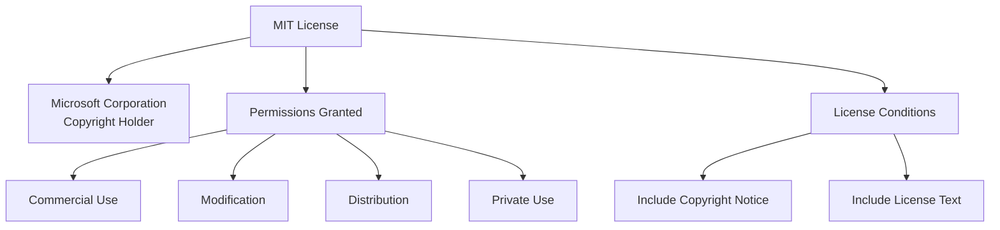
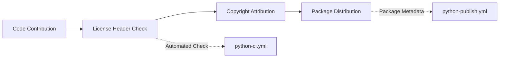
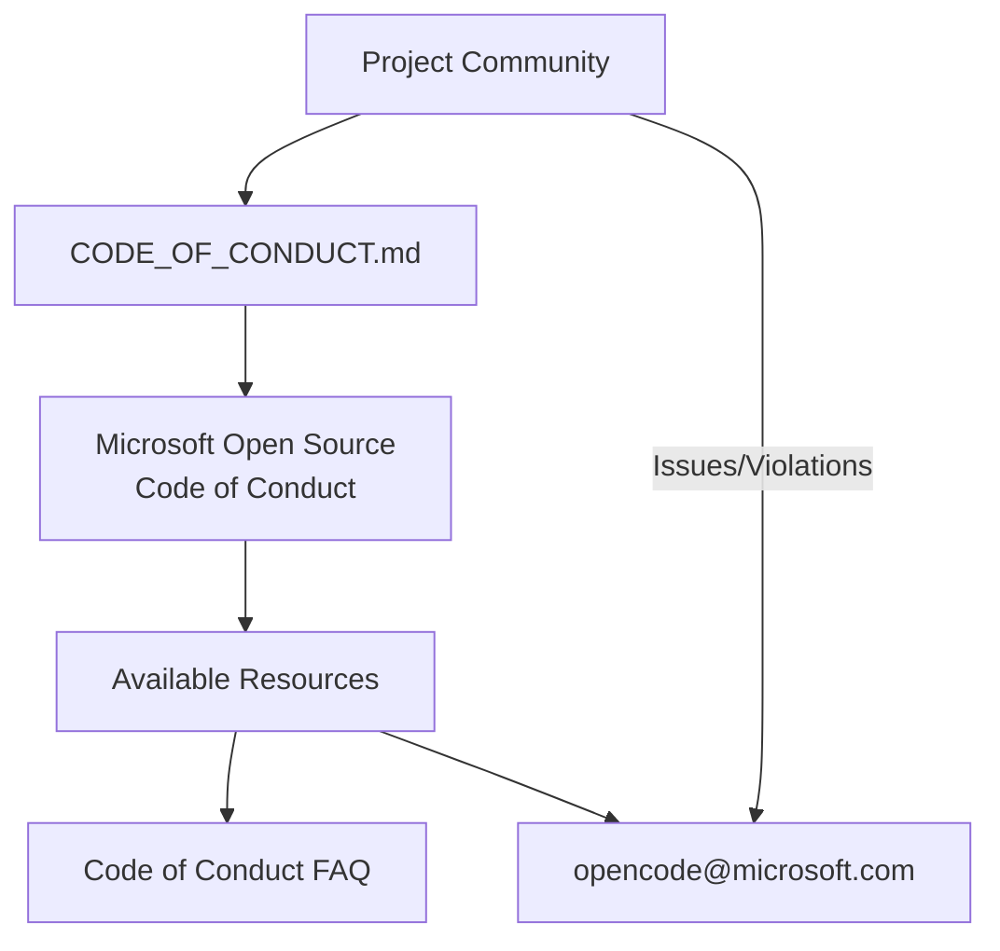
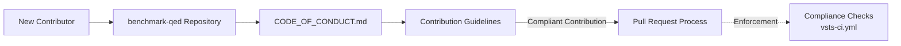
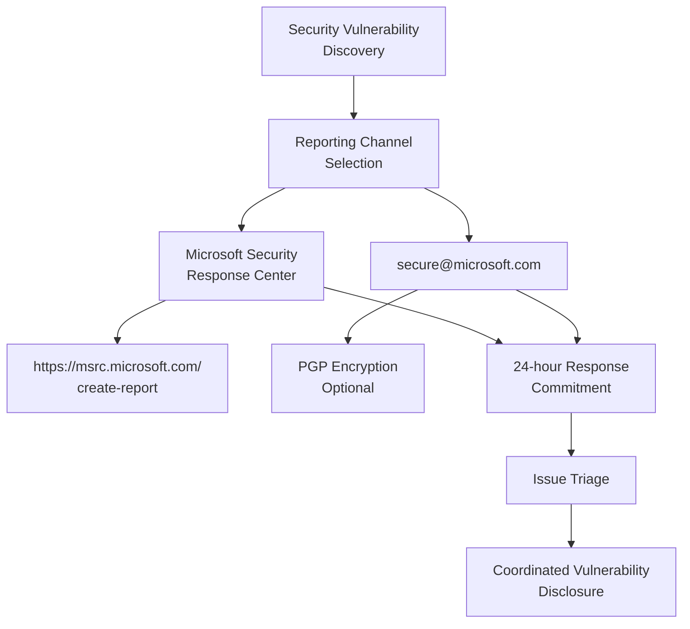
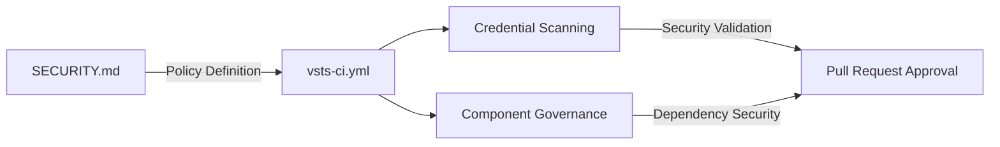
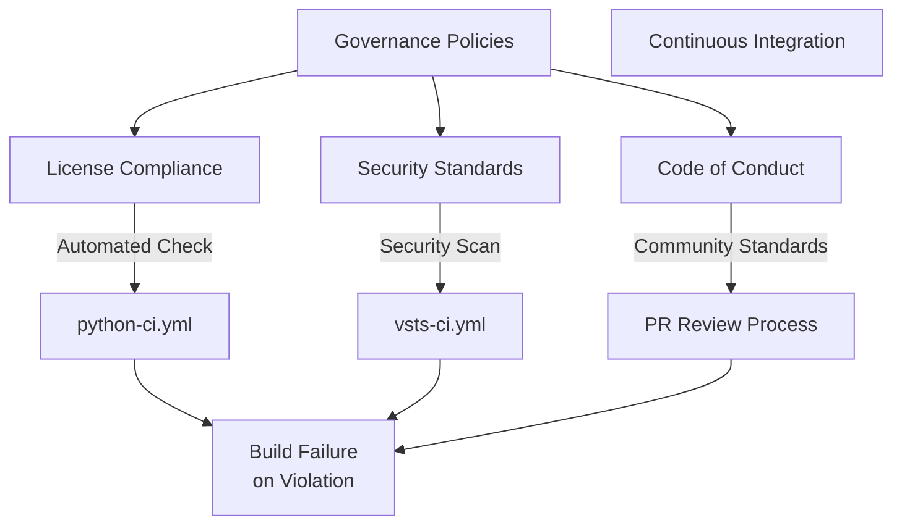
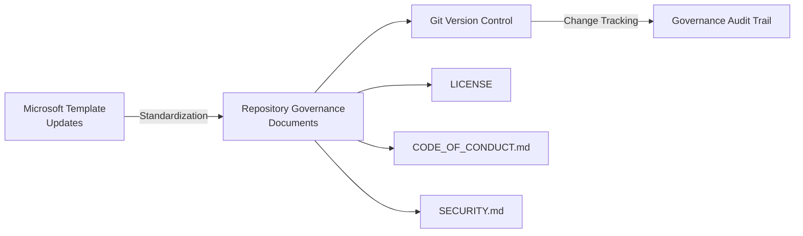
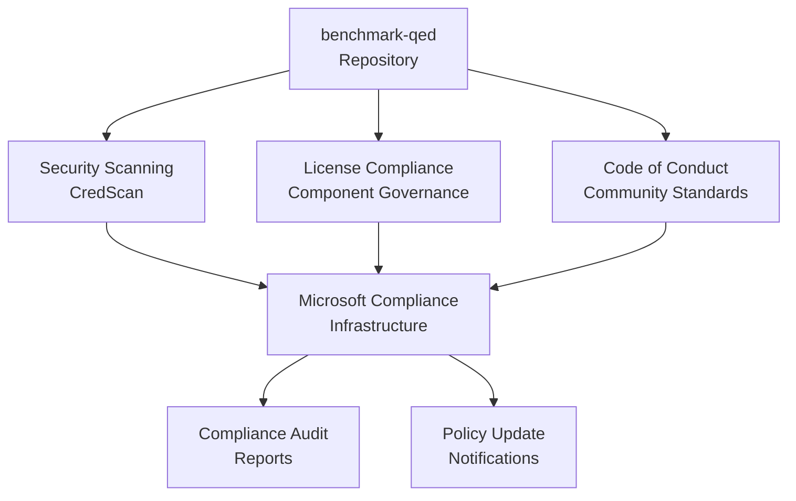

<!-- source: DeepWiki mcp.deepwiki.com · repo microsoft/benchmark-qed · page 5 Project Governance · fetched 2026-10-26 -->

# Project Governance

Relevant source files

The following files were used as context for generating this wiki page:

- [CODE_OF_CONDUCT.md](CODE_OF_CONDUCT.md)
- [LICENSE](LICENSE)
- [SECURITY.md](SECURITY.md)

## Purpose and Scope

This document covers the governance framework, policies, and standards that govern the BenchmarkQED project. It provides an overview of the legal, security, and community standards that guide project development and contributions. 

For detailed information about specific legal policies and compliance requirements, see [Legal and Compliance](#5.1). For development-specific configuration and tooling standards, see [Development Configuration](#5.2).

## Governance Framework

The BenchmarkQED project operates under Microsoft's open source governance model, incorporating industry-standard policies for community collaboration, security reporting, and legal compliance. The governance structure ensures consistent development practices while maintaining compliance with Microsoft's open source standards.

### Core Governance Documents

The project governance is defined through three primary policy documents located in the repository root:

| Document | Purpose | Scope |
|----------|---------|--------|
| `LICENSE` | Legal rights and obligations | Code usage, distribution, modification |
| `CODE_OF_CONDUCT.md` | Community behavior standards | Contributor interactions, reporting |
| `SECURITY.md` | Vulnerability reporting process | Security issue handling, disclosure |

## Legal and Licensing Framework

### License Structure

The project operates under the MIT License with Microsoft Corporation as the copyright holder. The license grants broad permissions for software usage while maintaining attribution requirements.

**Governance Workflow for License Compliance**

Sources: [LICENSE:1-22]()

## Community Standards and Code of Conduct

### Microsoft Open Source Code of Conduct

The project adopts Microsoft's standardized code of conduct framework, providing clear guidelines for community interaction and conflict resolution.

**Code of Conduct Enforcement Structure**

**Community Governance Integration**

Sources: [CODE_OF_CONDUCT.md:1-10]()

## Security Governance

### Microsoft Security Response Center (MSRC) Integration

The project implements Microsoft's standardized security vulnerability reporting and response process through the Microsoft Security Response Center.

**Security Reporting Workflow**

**Security Integration with Development Pipeline**

### Security Policy Requirements

The security policy mandates specific information for vulnerability reports:

| Requirement Category | Details |
|---------------------|---------|
| Issue Classification | Type identification (buffer overflow, injection, XSS) |
| Source Code Context | Full file paths, affected locations, commit references |
| Reproduction Steps | Configuration requirements, step-by-step instructions |
| Impact Assessment | Exploitation potential, proof-of-concept code |

Sources: [SECURITY.md:1-42]()

## Governance Enforcement Mechanisms

### Automated Policy Enforcement

The governance framework integrates with the development pipeline through automated enforcement mechanisms embedded in the CI/CD system.

**Policy Enforcement Pipeline Integration**

### Governance Document Maintenance

Sources: [CODE_OF_CONDUCT.md:1-10](), [LICENSE:1-22](), [SECURITY.md:1-42]()

## Compliance and Audit Framework

The governance structure provides comprehensive audit trails and compliance mechanisms through integration with Microsoft's enterprise governance systems.

**Compliance Verification System**

This governance framework ensures that the BenchmarkQED project maintains compliance with Microsoft's open source standards while providing clear guidelines for community participation and security issue resolution.

Sources: [LICENSE:1-22](), [CODE_OF_CONDUCT.md:1-10](), [SECURITY.md:1-42]()

---

