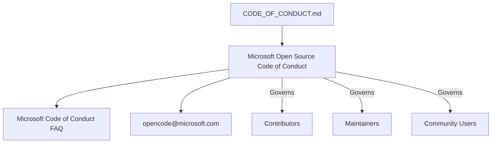
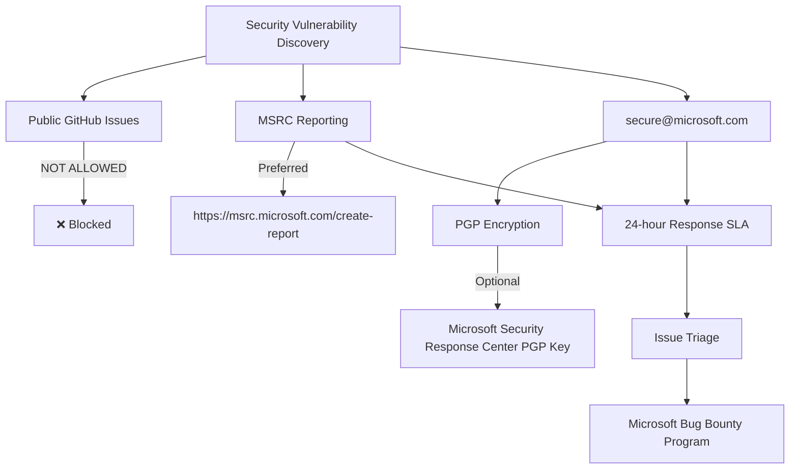
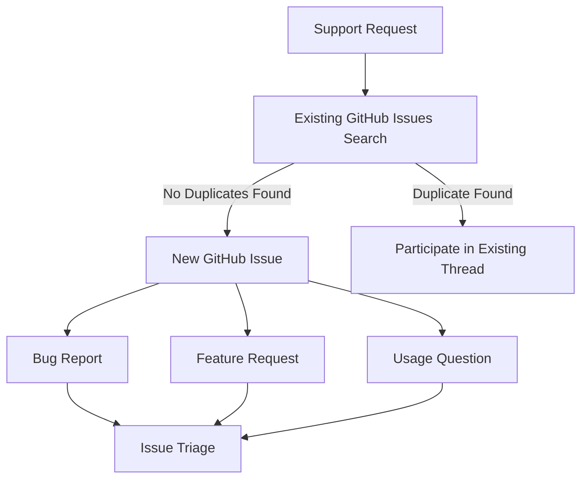
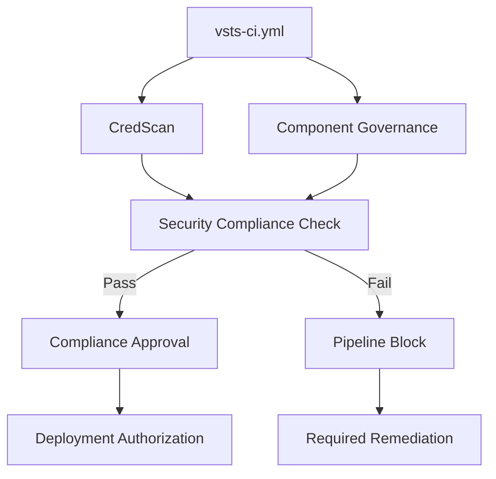

<!-- source: DeepWiki mcp.deepwiki.com · repo microsoft/benchmark-qed · page 5.1 Legal and Compliance · fetched 2026-10-26 -->

# Legal and Compliance

Relevant source files

The following files were used as context for generating this wiki page:

- [CODE_OF_CONDUCT.md](CODE_OF_CONDUCT.md)
- [LICENSE](LICENSE)
- [SECURITY.md](SECURITY.md)
- [SUPPORT.md](SUPPORT.md)

This document outlines the legal framework, compliance policies, and governance structures that govern the BenchmarkQED project. It covers licensing terms, code of conduct requirements, security vulnerability reporting procedures, and automated compliance verification processes.

For information about development standards and configuration, see [Development Configuration](#5.2).

## Legal Framework

The BenchmarkQED project operates under a comprehensive legal framework that establishes clear terms for usage, contribution, and distribution.

### MIT License

The project is licensed under the MIT License with Microsoft Corporation as the copyright holder. This permissive open-source license allows unrestricted use, modification, and distribution of the software.

| License Component | Details |
|------------------|---------|
| **License Type** | MIT License |
| **Copyright Holder** | Microsoft Corporation |
| **Permissions** | Use, modify, publish, distribute, sublicense, sell |
| **Conditions** | Include copyright notice and license text |
| **Limitations** | No warranty, no liability |

The license grants broad permissions while requiring minimal obligations from users and contributors. The software is provided "as is" without any warranties regarding functionality, merchantability, or fitness for purpose.

**Sources:** [LICENSE:1-22]()

### Intellectual Property Rights

The MIT License framework ensures that:
- Users can incorporate the software into both open-source and proprietary projects
- Commercial use is explicitly permitted without royalty obligations
- Derivative works can be distributed under different license terms
- The original copyright notice must be preserved in all substantial portions

## Code of Conduct Framework

The project enforces behavioral standards through the Microsoft Open Source Code of Conduct, establishing community guidelines for all participants.

### Enforcement Mechanism

The code of conduct provides multiple resources for community members:

| Resource | Purpose | Contact Method |
|----------|---------|----------------|
| **Code of Conduct** | Primary behavioral guidelines | [Microsoft Open Source Code of Conduct](https://opensource.microsoft.com/codeofconduct/) |
| **FAQ** | Common questions and clarifications | [Microsoft Code of Conduct FAQ](https://opensource.microsoft.com/codeofconduct/faq/) |
| **Reporting** | Questions or concerns | opencode@microsoft.com |

**Sources:** [CODE_OF_CONDUCT.md:1-10]()

## Security Vulnerability Management

The project implements a structured security vulnerability disclosure process aligned with Microsoft Security Response Center (MSRC) protocols.

### Vulnerability Reporting Requirements

Security vulnerabilities must be reported through designated channels with specific information requirements:

| Information Category | Required Details |
|---------------------|------------------|
| **Issue Classification** | Type (buffer overflow, SQL injection, XSS, etc.) |
| **Source Location** | Full paths of affected source files |
| **Code Reference** | Tag/branch/commit or direct URL |
| **Reproduction** | Special configuration requirements |
| **Exploit Steps** | Step-by-step reproduction instructions |
| **Impact Assessment** | Potential attack vectors and exploitation methods |

The reporting process follows Coordinated Vulnerability Disclosure principles, ensuring responsible handling of security issues.

**Sources:** [SECURITY.md:1-42]()

## Support Infrastructure

The project provides structured support channels for users and contributors through GitHub-based issue tracking.

### Support Channel Architecture

### Support Policy Framework

| Support Category | Channel | Response Expectations |
|-----------------|---------|----------------------|
| **Bug Reports** | GitHub Issues | Community-driven resolution |
| **Feature Requests** | GitHub Issues | Evaluation by maintainers |
| **Usage Questions** | GitHub Issues | Community and maintainer support |
| **Duplicate Issues** | Search existing issues first | Avoid redundant submissions |

The support model relies on community participation with limited formal support commitments from Microsoft.

**Sources:** [SUPPORT.md:1-14]()

## Automated Compliance Verification

The project implements automated compliance checking through CI/CD pipeline integration to ensure ongoing adherence to security and governance standards.

### Compliance Automation Components

The compliance verification system includes multiple automated checks:

| Tool | Purpose | Scope |
|------|---------|-------|
| **CredScan** | Credential detection | Source code scanning for exposed secrets |
| **Component Governance** | Dependency verification | Third-party component license and security validation |
| **Security Compliance** | Overall security posture | Comprehensive security policy enforcement |

This automated verification ensures that all code changes undergo security and compliance validation before integration into the main codebase.

**Sources:** Based on CI/CD pipeline architecture mentioned in system overview

## Compliance Documentation Requirements

All compliance-related documentation must be maintained in the repository root directory with standardized naming conventions:

| Document | File Path | Purpose |
|----------|-----------|---------|
| **License** | `LICENSE` | Software licensing terms |
| **Code of Conduct** | `CODE_OF_CONDUCT.md` | Community behavioral standards |
| **Security Policy** | `SECURITY.md` | Vulnerability reporting procedures |
| **Support Guidelines** | `SUPPORT.md` | User support channel definitions |

These documents form the foundation of the project's legal and compliance framework, ensuring clear communication of policies to all stakeholders.

**Sources:** [LICENSE:1-22](), [CODE_OF_CONDUCT.md:1-10](), [SECURITY.md:1-42](), [SUPPORT.md:1-14]()

---

