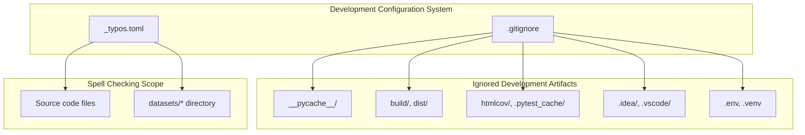
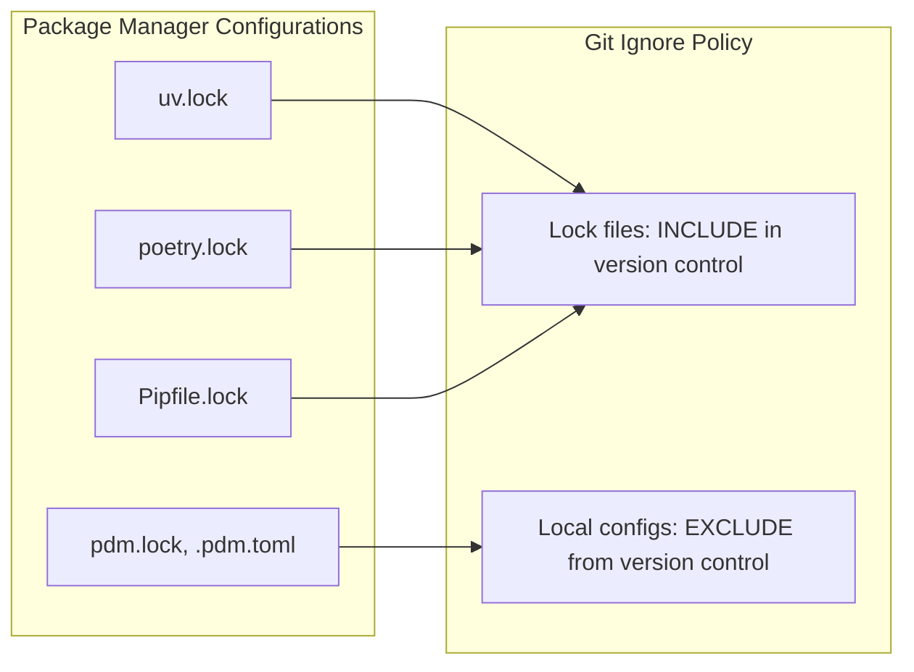
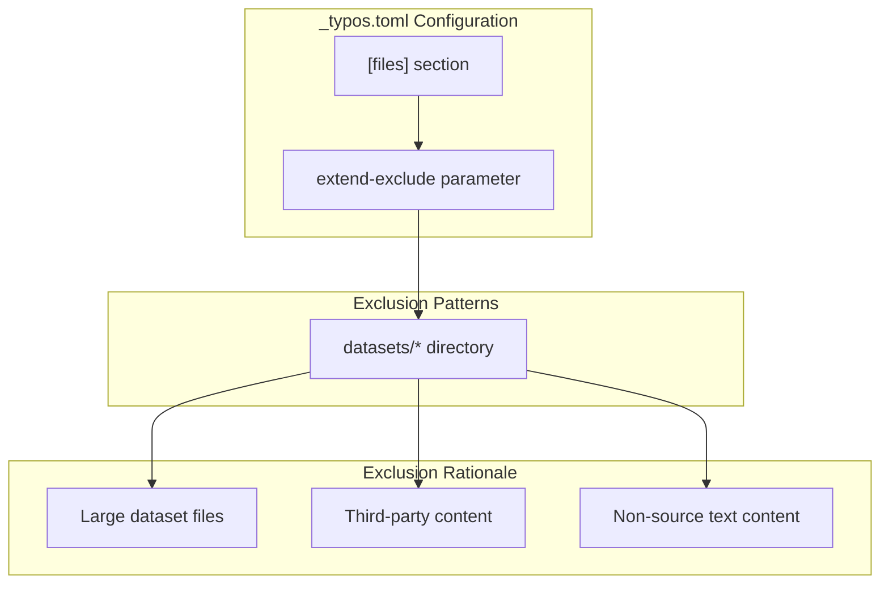
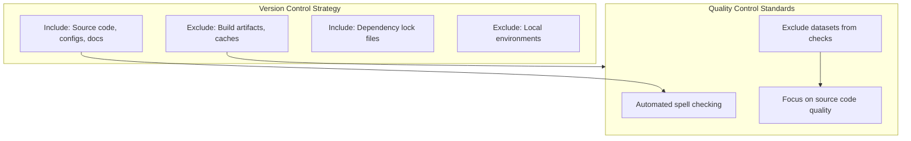

<!-- source: DeepWiki mcp.deepwiki.com · repo microsoft/benchmark-qed · page 5.2 Development Configuration · fetched 2026-10-26 -->

# Development Configuration

Relevant source files

The following files were used as context for generating this wiki page:

- [.gitignore](.gitignore)
- [_typos.toml](_typos.toml)

This document covers the development configuration setup for the BenchmarkQED project, including version control patterns, spell checking configuration, and development environment specifications. This page focuses on the technical configuration files that control development workflows and code quality standards.

For information about CI/CD pipeline configuration, see [Continuous Integration](#3.1). For legal and compliance policies, see [Legal and Compliance](#5.1).

## Configuration Overview

The BenchmarkQED project uses several configuration files to establish development standards and automate quality checks during the development process.

**Sources:** [.gitignore:1-181](), [_typos.toml:1-2]()

## Git Version Control Configuration

The project uses a comprehensive `.gitignore` file that excludes development artifacts, build outputs, and environment-specific files from version control.

### Python-Specific Exclusions

The configuration excludes standard Python development artifacts:

| Category | Patterns | Purpose |
|----------|----------|---------|
| Compiled Code | `__pycache__/`, `*.py[cod]`, `*$py.class` | Prevent bytecode from being committed |
| Distribution | `build/`, `dist/`, `*.egg-info/`, `wheels/` | Exclude packaging artifacts |
| Testing | `.pytest_cache/`, `htmlcov/`, `.coverage*` | Keep test outputs local |
| Virtual Environments | `.venv`, `venv/`, `env/` | Prevent environment directories from being tracked |

**Sources:** [.gitignore:1-27](), [.gitignore:39-52](), [.gitignore:130-137]()

### Package Manager Support

The configuration includes modern Python package manager patterns:

The project follows modern Python packaging best practices by including lock files in version control for reproducible builds while excluding local configuration files.

**Sources:** [.gitignore:97-118]()

### Development Tool Exclusions

The configuration excludes artifacts from various development tools:

| Tool Category | Excluded Patterns | Line Numbers |
|---------------|-------------------|--------------|
| Documentation | `docs/_build/`, `/site` | [.gitignore:72](), [.gitignore:147]() |
| Code Quality | `.ruff_cache/`, `.mypy_cache/` | [.gitignore:177](), [.gitignore:156]() |
| Test Outputs | `output/`, `local/` | [.gitignore:150](), [.gitignore:153]() |
| IDE Settings | `.idea/`, `.spyderproject` | [.gitignore:174](), [.gitignore:140-141]() |

**Sources:** [.gitignore:72](), [.gitignore:140-174](), [.gitignore:177]()

## Spell Checking Configuration

The project uses the `typos` tool for automated spell checking with specific exclusions configured in `_typos.toml`.

### Typos Configuration Structure

The configuration excludes the `datasets/*` directory from spell checking, which is appropriate since this directory likely contains large data files, third-party content, or text that doesn't follow standard spelling conventions.

**Sources:** [_typos.toml:1-2]()

### Spell Check Scope

The spell checking system applies to all files in the repository except those explicitly excluded:

| Included | Excluded |
|----------|----------|
| Source code files (`.py`, `.md`, `.toml`, etc.) | `datasets/*` directory |
| Documentation files | Files matching `.gitignore` patterns |
| Configuration files | Binary files |

**Sources:** [_typos.toml:2]()

## Development Environment Standards

The configuration files establish several development environment standards:

### File Organization Principles

**Sources:** [.gitignore:1-181](), [_typos.toml:1-2]()

### Tool Integration Requirements

The development configuration supports multiple development scenarios:

| Development Scenario | Supported Tools | Configuration Impact |
|---------------------|----------------|---------------------|
| Package Management | uv, poetry, pipenv, pdm | Lock files committed, local configs ignored |
| Testing | pytest, coverage, hypothesis | Test outputs excluded from VCS |
| Documentation | mkdocs, sphinx | Build artifacts excluded |
| Code Quality | ruff, mypy, typos | Tool caches excluded, spell check configured |

**Sources:** [.gitignore:97-118](), [.gitignore:156-177](), [_typos.toml:1-2]()

This development configuration establishes a clean, professional development environment that maintains code quality while avoiding repository pollution with build artifacts and environment-specific files.