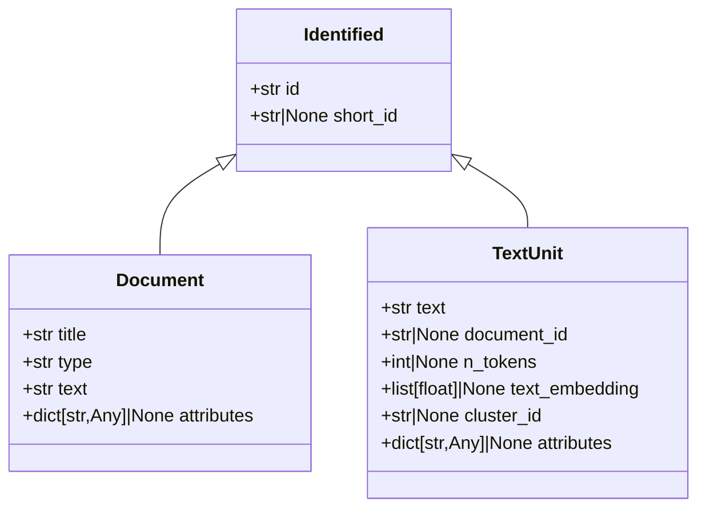

<!-- source: DeepWiki mcp.deepwiki.com · repo microsoft/benchmark-qed · extra page Data Models · fetched 2026-10-26 -->

# Data Models

<details>
<summary>Relevant source files</summary>

The following files were used as context for generating this wiki page:

- [benchmark_qed/autod/data_model/__init__.py](benchmark_qed/autod/data_model/__init__.py)
- [benchmark_qed/autod/data_model/document.py](benchmark_qed/autod/data_model/document.py)
- [benchmark_qed/autod/data_model/identified.py](benchmark_qed/autod/data_model/identified.py)
- [benchmark_qed/autod/data_model/text_unit.py](benchmark_qed/autod/data_model/text_unit.py)

</details>


This document covers the core data models used within the AutoD system for representing documents, text units, and their relationships. These models form the foundation for data processing operations including text chunking, embedding generation, and clustering within BenchmarkQED.

For information about the data processing pipeline that operates on these models, see [Data Processing Pipeline](#2.2.2).

## Core Data Model Hierarchy

The AutoD system uses three primary data model classes that form an inheritance hierarchy. All models inherit from a common base class that provides identification capabilities.

### Class Inheritance Structure



Sources: [benchmark_qed/autod/data_model/identified.py:7-16](), [benchmark_qed/autod/data_model/document.py:10-24](), [benchmark_qed/autod/data_model/text_unit.py:10-30]()

## Identified Base Class

The `Identified` class serves as the foundation for all data models in the system, providing consistent identification mechanisms across different entity types.

| Field | Type | Purpose |
|-------|------|---------|
| `id` | `str` | Unique identifier for the entity |
| `short_id` | `str \| None` | Human-readable identifier for display purposes |

The `short_id` field is specifically designed for use in prompts and user-facing text, such as in report generation where readable references are preferred over system-generated IDs.

Sources: [benchmark_qed/autod/data_model/identified.py:7-16]()

## Document Class

The `Document` class represents source documents that are processed by the system. It extends `Identified` with document-specific fields.

| Field | Type | Default | Purpose |
|-------|------|---------|---------|
| `title` | `str` | Required | Document title |
| `type` | `str` | `"text"` | Document type classification |
| `text` | `str` | `""` | Raw text content |
| `attributes` | `dict[str, Any] \| None` | `None` | Structured metadata (author, date, etc.) |

The `attributes` field provides extensibility for storing document metadata such as authorship, publication date, source information, or any other structured properties relevant to the specific document type.

Sources: [benchmark_qed/autod/data_model/document.py:10-24]()

## TextUnit Class

The `TextUnit` class represents processed text chunks derived from documents. It contains fields for embedding data, clustering information, and traceability back to source documents.

| Field | Type | Default | Purpose |
|-------|------|---------|---------|
| `text` | `str` | Required | Text content of the unit |
| `document_id` | `str \| None` | `None` | Reference to source document |
| `n_tokens` | `int \| None` | `None` | Token count for the text |
| `text_embedding` | `list[float] \| None` | `None` | Vector embedding representation |
| `cluster_id` | `str \| None` | `None` | Cluster assignment identifier |
| `attributes` | `dict[str, Any] \| None` | `None` | Additional processing metadata |

The `TextUnit` model supports both the text processing pipeline (through `n_tokens` and `text_embedding`) and downstream analysis operations (through `cluster_id` and `attributes`).

Sources: [benchmark_qed/autod/data_model/text_unit.py:10-30]()

## Data Model Usage Flow

The following diagram illustrates how these data models flow through the AutoD processing pipeline:

```mermaid
flowchart TD
    RawData["Raw Data Sources"] --> Document["Document"]
    Document --> Processing["Text Processing Pipeline"]
    Processing --> TextUnit["TextUnit"]
    
    subgraph DocumentFields["Document Fields"]
        DocTitle["title: str"]
        DocType["type: str"]
        DocText["text: str"]
        DocAttribs["attributes: dict"]
    end
    
    subgraph TextUnitFields["TextUnit Fields"] 
        TuText["text: str"]
        TuDocId["document_id: str"]
        TuTokens["n_tokens: int"]
        TuEmbedding["text_embedding: list[float]"]
        TuCluster["cluster_id: str"]
        TuAttribs["attributes: dict"]
    end
    
    subgraph IdentifiedBase["Identified (Base Class)"]
        BaseId["id: str"]
        BaseShortId["short_id: str"]
    end
    
    Document --> DocumentFields
    TextUnit --> TextUnitFields
    DocumentFields --> IdentifiedBase
    TextUnitFields --> IdentifiedBase
    
    TextUnit --> EmbeddingSystem["Embedding Generation"]
    TextUnit --> ClusteringSystem["Clustering Analysis"]
```

Sources: [benchmark_qed/autod/data_model/document.py:10-24](), [benchmark_qed/autod/data_model/text_unit.py:10-30](), [benchmark_qed/autod/data_model/identified.py:7-16]()

## Module Structure

The data models are organized within the `benchmark_qed.autod.data_model` package:

```
benchmark_qed/autod/data_model/
├── __init__.py          # Module initialization
├── identified.py        # Identified base class
├── document.py         # Document model
└── text_unit.py        # TextUnit model
```

Each model is defined as a Python dataclass using the `@dataclass` decorator, providing automatic generation of initialization methods and other standard object behaviors.

Sources: [benchmark_qed/autod/data_model/__init__.py:1-3](), [benchmark_qed/autod/data_model/identified.py:1-16](), [benchmark_qed/autod/data_model/document.py:1-25](), [benchmark_qed/autod/data_model/text_unit.py:1-31]()

---

