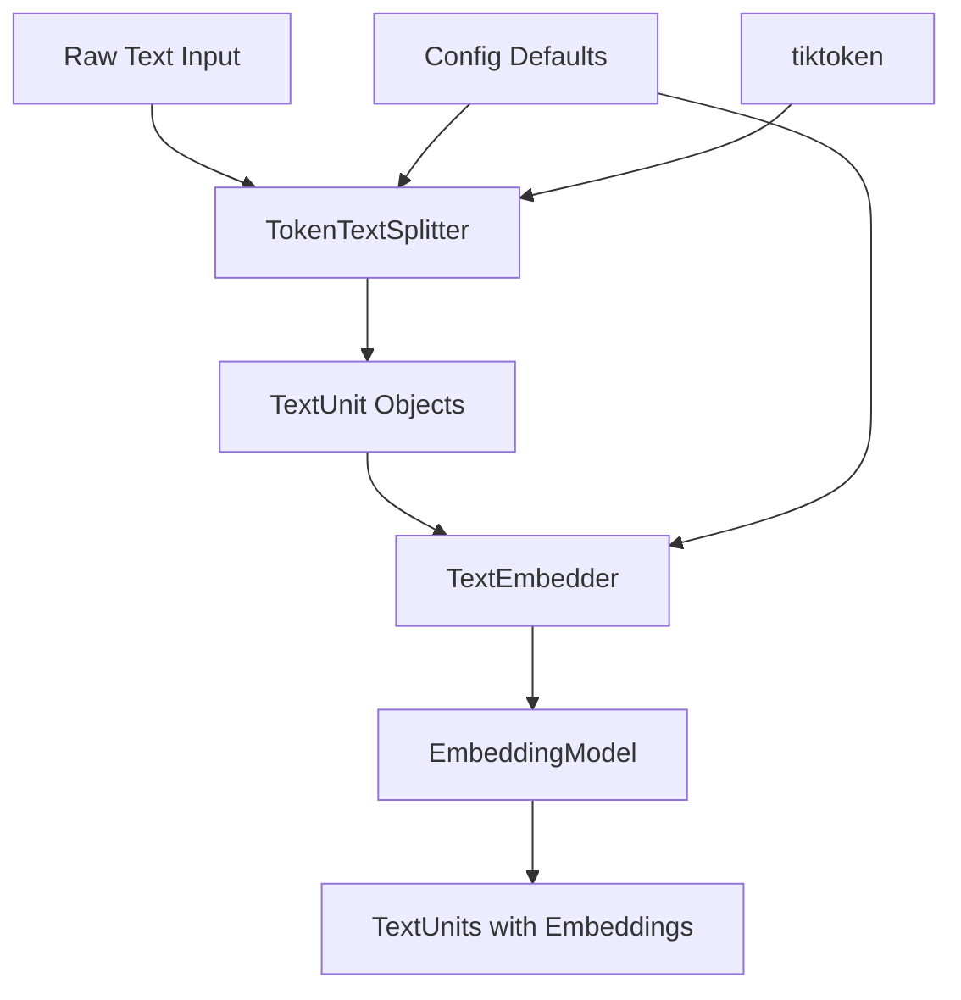
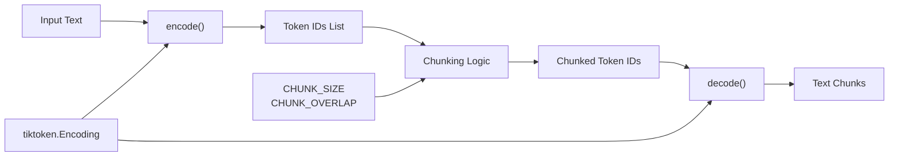
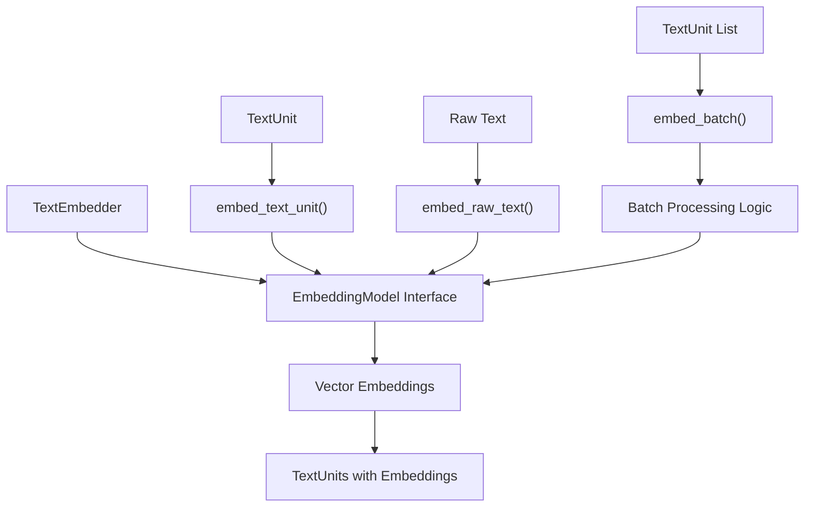
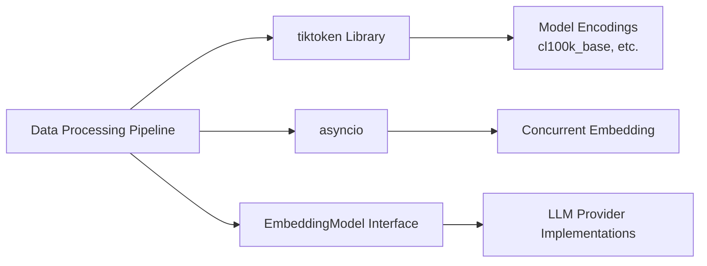
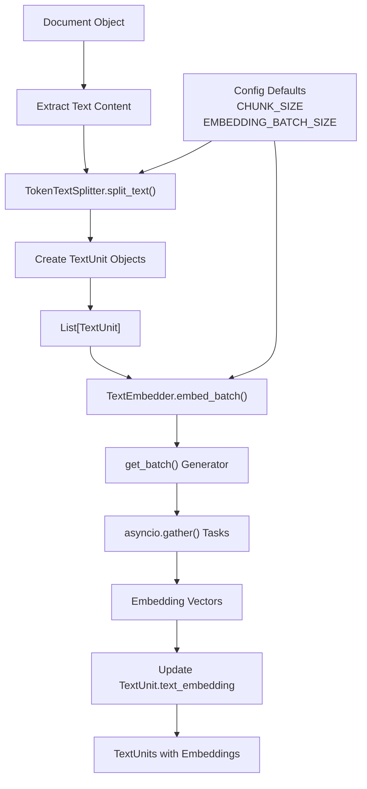

<!-- source: DeepWiki mcp.deepwiki.com · repo microsoft/benchmark-qed · extra page Data Processing Pipeline · fetched 2026-10-26 -->

# Data Processing Pipeline

Relevant source files

The following files were used as context for generating this wiki page:

- [benchmark_qed/autod/data_processor/__init__.py](benchmark_qed/autod/data_processor/__init__.py)
- [benchmark_qed/autod/data_processor/embedding.py](benchmark_qed/autod/data_processor/embedding.py)
- [benchmark_qed/autod/data_processor/text_splitting.py](benchmark_qed/autod/data_processor/text_splitting.py)

This document covers the data processing pipeline within the AutoD system, which transforms raw text content into structured, embeddable units for downstream analysis. The pipeline handles text chunking, tokenization, and embedding generation for document processing workflows.

For information about the underlying data structures processed by this pipeline, see [Data Models](#2.2.1). For broader AutoD system context, see [AutoD System](#2.2).

## Overview

The data processing pipeline consists of two primary subsystems that work together to prepare text for analysis:

1. **Text Splitting System** - Chunks large text documents into manageable units using token-based splitting
2. **Embedding Generation System** - Converts text chunks into vector embeddings using language models

**Sources:** [benchmark_qed/autod/data_processor/text_splitting.py:1-140](), [benchmark_qed/autod/data_processor/embedding.py:1-108]()

## Text Splitting System

The text splitting system is built around the `TokenTextSplitter` class, which inherits from the abstract `TextSplitter` base class. It uses tiktoken-based tokenization to create semantically coherent text chunks.

### Core Components

| Component | Purpose | Key Methods |
|-----------|---------|-------------|
| `TextSplitter` | Abstract base class for text splitting | `split_text()`, `get_size()` |
| `TokenTextSplitter` | Token-based text splitting implementation | `encode()`, `split_text()` |
| `Tokenizer` | Dataclass containing tokenization functions | `encode`, `decode` functions |

### Tokenization Architecture

**Sources:** [benchmark_qed/autod/data_processor/text_splitting.py:22-34](), [benchmark_qed/autod/data_processor/text_splitting.py:63-118]()

### Text Splitting Process

The `TokenTextSplitter` implements a sophisticated chunking algorithm through the `split_single_text_on_tokens()` function:

1. **Tokenization** - Convert input text to token IDs using tiktoken
2. **Chunking** - Split tokens into overlapping chunks based on `CHUNK_SIZE` and `CHUNK_OVERLAP`
3. **Decoding** - Convert token chunks back to text strings

The splitting process maintains semantic coherence by working at the token level rather than character level, ensuring chunks respect word boundaries and linguistic structure.

**Sources:** [benchmark_qed/autod/data_processor/text_splitting.py:121-139]()

## Embedding Generation System

The embedding system centers around the `TextEmbedder` class, which provides both individual and batch processing capabilities for generating text embeddings.

### TextEmbedder Architecture

**Sources:** [benchmark_qed/autod/data_processor/embedding.py:13-27](), [benchmark_qed/autod/data_processor/embedding.py:43-107]()

### Embedding Processing Methods

The `TextEmbedder` class provides three primary processing methods:

#### Individual Processing
- `embed_raw_text()` - Embeds a single text string
- `embed_text_unit()` - Embeds a `TextUnit` object and updates its `text_embedding` property

#### Batch Processing
- `embed_batch()` - Processes multiple `TextUnit` objects efficiently using configurable batch sizes

The batch processing method uses asynchronous processing with `asyncio.gather()` to parallelize embedding generation across batches, significantly improving performance for large document collections.

**Sources:** [benchmark_qed/autod/data_processor/embedding.py:29-41](), [benchmark_qed/autod/data_processor/embedding.py:58-107]()

## Configuration and Integration

The pipeline integrates with the system's configuration defaults and external dependencies:

### Configuration Dependencies

| Configuration | Default Source | Purpose |
|---------------|----------------|---------|
| `CHUNK_SIZE` | `benchmark_qed.config.defaults` | Maximum tokens per chunk |
| `CHUNK_OVERLAP` | `benchmark_qed.config.defaults` | Token overlap between chunks |
| `EMBEDDING_BATCH_SIZE` | `benchmark_qed.config.defaults` | Batch size for embedding processing |
| `ENCODING_MODEL` | `benchmark_qed.config.defaults` | Default tiktoken encoding model |

### External Dependencies

**Sources:** [benchmark_qed/autod/data_processor/text_splitting.py:10-12](), [benchmark_qed/autod/data_processor/embedding.py:9-10]()

## Complete Processing Flow

The complete data processing pipeline transforms raw documents through the following stages:

This pipeline enables the AutoD system to process large document collections efficiently, creating structured, embeddable text units that support downstream query generation and evaluation workflows.

**Sources:** [benchmark_qed/autod/data_processor/text_splitting.py:103-117](), [benchmark_qed/autod/data_processor/embedding.py:58-107]()

---

