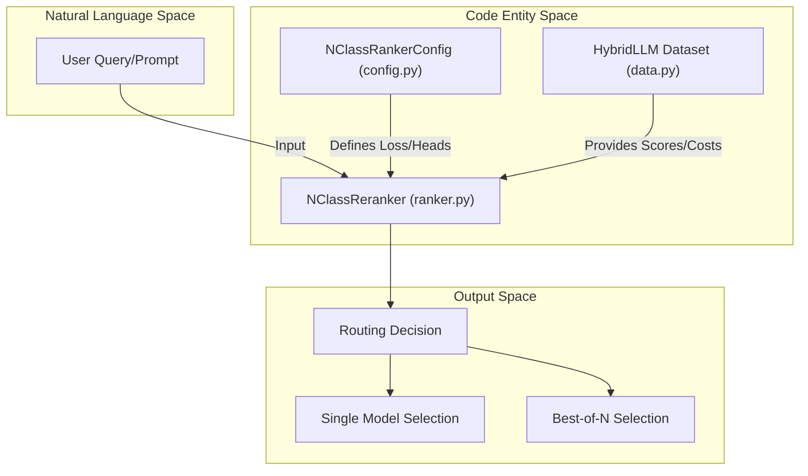
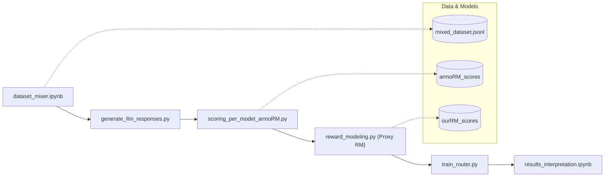

<!-- source: DeepWiki mcp.deepwiki.com · repo microsoft/best-route-llm · page 1 Overview · fetched 2026-10-26 -->

# Overview

Relevant source files

The following files were used as context for generating this wiki page:

- [README.md](README.md)
- [figures/bestroute.png](figures/bestroute.png)
- [figures/hybridllm.png](figures/hybridllm.png)

The **Adaptive LLM Routing Strategies** project provides a framework for optimizing the performance-cost trade-offs of Large Language Models (LLMs). As LLMs range from expensive, high-capability models (e.g., GPT-4o) to smaller, cost-effective models (e.g., Phi-3, Llama-3.1-8B), this project implements intelligent routers that decide which model—or sampling strategy—to use for a given query.

The codebase supports two primary routing paradigms:
1.  **HybridLLM**: Routing a query to a single model selected from a pool of candidates to balance cost and quality [README.md:19-20]().
2.  **BEST-Route**: Routing a query to a small model and dynamically deciding the number of samples ($N$) to generate for Best-of-N sampling, optimizing test-time compute [README.md:21-22]().

### Core Routing Strategies

The project centers on moving beyond a "one-size-fits-all" approach to LLM inference. By using a router, the system can send simple queries to cheap models and reserve expensive models (or multiple samples) for complex tasks.

*   **HybridLLM**: Focuses on selecting the best single model for a prompt. For more details, see [Routing Strategies: HybridLLM and BEST-Route](#1.1).
*   **BEST-Route**: Focuses on "Test-Time Optimal Compute," where the router predicts if generating multiple responses from a small model will likely yield a high-quality result that surpasses a single expensive model call. For more details, see [Routing Strategies: HybridLLM and BEST-Route](#1.1).

### System Architecture

The following diagram illustrates how the high-level routing concepts map to specific code entities and data structures within the repository.

**Diagram: Routing Conceptual Map to Code Entities**

**Sources:** [hybrid_llm/pair_ranker/ranker.py:23-45](), [hybrid_llm/pair_ranker/config.py:10-30](), [hybrid_llm/pair_ranker/data.py:102-120]()

### The End-to-End Pipeline

The project follows a structured pipeline from raw data collection to a deployed router. This process involves multiple stages of data preparation, reward modeling (using both "Oracle" and "Proxy" models), and router training.

1.  **Data Preparation**: Mixing datasets and generating responses from various LLMs [README.md:31-55]().
2.  **Reward Modeling**: Scoring responses using an Oracle (ArmoRM) and training a local Proxy Reward Model (ourRM) [README.md:57-119]().
3.  **Router Training**: Training the `NClassReranker` to predict the best routing path based on predicted quality and cost [README.md:121-140]().

For a detailed walkthrough of these steps, see [End-to-End Pipeline Overview](#1.2).

**Diagram: Pipeline Execution Flow**

**Sources:** [README.md:31-140](), [notebooks/reward_modeling.py:89-111](), [train_router.py:126-140]()

### Key Components

| Component | Responsibility | Key File(s) |
| :--- | :--- | :--- |
| **Data Preparation** | Merging prompts, sampling LLM responses, and counting tokens. | `dataset_mixer.ipynb`, `generate_llm_responses.py` |
| **Reward Modeling** | Scoring LLM outputs using Oracle (ArmoRM) and training a Proxy RM. | `scoring_per_model_armoRM.py`, `reward_modeling.py` |
| **Router Model** | The `NClassReranker` class that performs the actual routing logic. | [hybrid_llm/pair_ranker/ranker.py]() |
| **Training Engine** | Orchestrates the training of routers using various loss functions. | `train_router.py`, `hybrid_llm/pair_ranker/trainer.py` |
| **Evaluation** | Visualizing the performance-cost curve. | `results_interpretation.ipynb` |

**Sources:** [README.md:1-140](), [hybrid_llm/pair_ranker/ranker.py:23-45]()

---
**Child Pages:**
*   [Routing Strategies: HybridLLM and BEST-Route](#1.1)
*   [End-to-End Pipeline Overview](#1.2)

---

