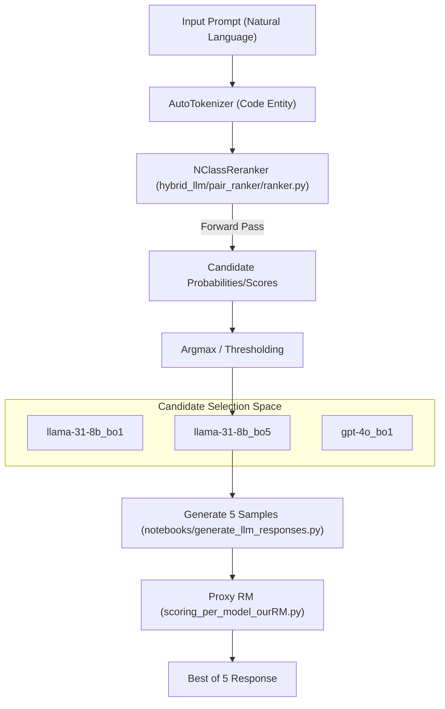

<!-- source: DeepWiki mcp.deepwiki.com · repo microsoft/best-route-llm · page 1.1 Routing Strategies: HybridLLM and BEST-Route · fetched 2026-10-26 -->

# Routing Strategies: HybridLLM and BEST-Route

<details>
<summary>Relevant source files</summary>

The following files were used as context for generating this wiki page:

- [README.md](README.md)
- [figures/bestroute.png](figures/bestroute.png)
- [figures/hybridllm.png](figures/hybridllm.png)

</details>


This page details the two core routing paradigms supported by the codebase: **HybridLLM** and **BEST-Route**. These strategies address the fundamental trade-off between inference cost and response quality by intelligently distributing queries across a portfolio of Large Language Models (LLMs).

## Overview of Routing Paradigms

The repository implements two distinct approaches to adaptive computation:

1.  **HybridLLM**: A cost-efficient routing strategy that selects a single model (typically either a "Small" or "Large" model) to generate a single response for a given prompt.
2.  **BEST-Route**: An advanced routing strategy that leverages **Best-of-N (BoN)** sampling. It decides whether to sample multiple responses from a smaller model and select the best one using a reward model, or to route the query to a more expensive, high-performing model.

| Feature | HybridLLM | BEST-Route |
| :--- | :--- | :--- |
| **Primary Goal** | Single-sample cost/quality trade-off | Test-time optimal compute via BoN |
| **Decision Space** | Select Model $M_i$ | Select (Model $M_i$, Sample Count $N_j$) |
| **Inference Cost** | Fixed per model | Variable based on $N$ |
| **Code Implementation** | `HybridLLM` mapping in data prep | `NClassReranker` with multiple labels |

Sources: [README.md:9-22](), [README.md:126-134]()

---

## HybridLLM: Cost-Quality Trade-off

HybridLLM focuses on the observation that not all tasks require the reasoning capabilities of frontier models like GPT-4. Many queries can be answered adequately by smaller models (e.g., Phi-3, Llama-3-8B), significantly reducing costs.

### Data Flow and Logic
In the HybridLLM setup, the router acts as a classifier that predicts which model in a set of candidates $\{M_1, M_2, ... M_k\}$ will provide the best utility (a function of reward and cost).

**Key Components:**
*   **Dataset Mapping**: The script `data_preparation_hybridllm_mapping.ipynb` transforms raw LLM responses into a format where each prompt is associated with the performance of specific candidate models.
*   **Cost Modeling**: Uses `model2prompt_cost` and `model2output_cost` defined in `hybrid_llm/pair_ranker/data.py` to calculate the theoretical cost of routing to a specific model based on token counts.

### Implementation Details
The training data for HybridLLM is prepared by comparing the scores of different models (e.g., `gpt-4o` vs `llama-31-8b`) and assigning labels based on which model achieved a higher reward relative to its cost.

Sources: [README.md:19-20](), [README.md:123-123](), [hybrid_llm/pair_ranker/data.py:15-25]()

---

## BEST-Route: Adaptive Test-Time Compute

BEST-Route extends the routing concept by treating the number of samples ($N$) in a Best-of-N setup as a routable parameter. It aims to find the "Test-Time Optimal Compute" by determining if $N$ samples from a small model can outperform a single sample from a large model at a lower or similar cost.

### Implementation Architecture
The core of BEST-Route is the `NClassReranker` class. Unlike a standard binary classifier, it is designed to handle multiple "candidates," where each candidate is a unique (Model, $N$) pair.

#### Logic Diagram: BEST-Route Decision Flow
This diagram shows how a prompt is processed by the `NClassReranker` to select the optimal compute path.


Sources: [hybrid_llm/pair_ranker/ranker.py:16-35](), [README.md:126-134]()

### The N-Class Reranker
The `NClassReranker` is a neural module that can be configured with different loss functions to optimize for ranking or classification.

*   **Class Definition**: `class NClassReranker(nn.Module)` in [hybrid_llm/pair_ranker/ranker.py:16-16]().
*   **Loss Types**: Supported types include `det_ncls` (deterministic N-class), `prob_nlabels` (probabilistic N-labels), and `det_2cls`.
*   **Architecture**:
    *   `self.head_layer`: A linear layer mapping the encoder hidden state to candidate scores [hybrid_llm/pair_ranker/ranker.py:33-35]().
    *   `_match_prob`: A helper function that calculates the probability of a candidate being the "best" [hybrid_llm/pair_ranker/ranker.py:113-128]().

---

## Technical Comparison: Code Entity Space

The following diagram bridges the conceptual strategies to the specific classes and data structures used in the implementation.

```mermaid
classDiagram
    class RouterTraining {
        <<Script>>
        train_router.py
    }
    class NClassReranker {
        +forward(input_ids, attention_mask)
        +compute_loss()
        -loss_type: str
    }
    class NClassCollator {
        +__call__(features)
        -encode_texts()
    }
    class HybridDataset {
        +load_data()
        +filter_candidates()
    }

    RouterTraining --> NClassReranker : initializes
    RouterTraining --> NClassCollator : uses for batching
    NClassCollator --> HybridDataset : processes items from
    
    style NClassReranker stroke-width:2px
    style HybridDataset stroke-width:2px
```
Sources: [train_router.py:155-180](), [hybrid_llm/pair_ranker/ranker.py:16-40](), [hybrid_llm/pair_ranker/collator.py:14-25](), [hybrid_llm/pair_ranker/data.py:65-80]()

### Key Differences in Configuration
When running the training script `train_router.py`, the strategy is determined by the `--candidate_model` argument.

*   **For HybridLLM**: You might pass `--candidate_model "llama-31-8b,gpt-4o"`.
*   **For BEST-Route**: You pass specific BoN candidates, e.g., `--candidate_model "llama-31-8b_ourRM_bo1,llama-31-8b_ourRM_bo5,gpt-4o_ourRM_bo1"` [README.md:132-132]().

## When to Use Which?

1.  **Use HybridLLM when**:
    *   Inference latency must be kept to a minimum (single sample only).
    *   The primary goal is to offload simple queries from a flagship model to a commodity model.
    *   You do not have a reliable Reward Model (RM) to perform selection at test time.

2.  **Use BEST-Route when**:
    *   You have a high-quality Reward Model available.
    *   You want to maximize the performance of smaller models through sampling.
    *   You are willing to trade off higher compute for the "small model" path to potentially avoid the "large model" path.

Sources: [README.md:19-23](), [README.md:126-134]()

---

