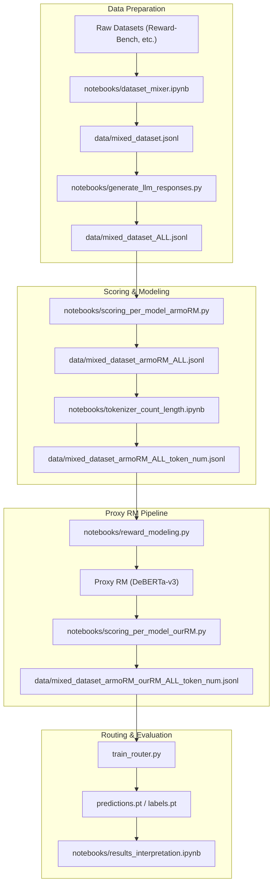
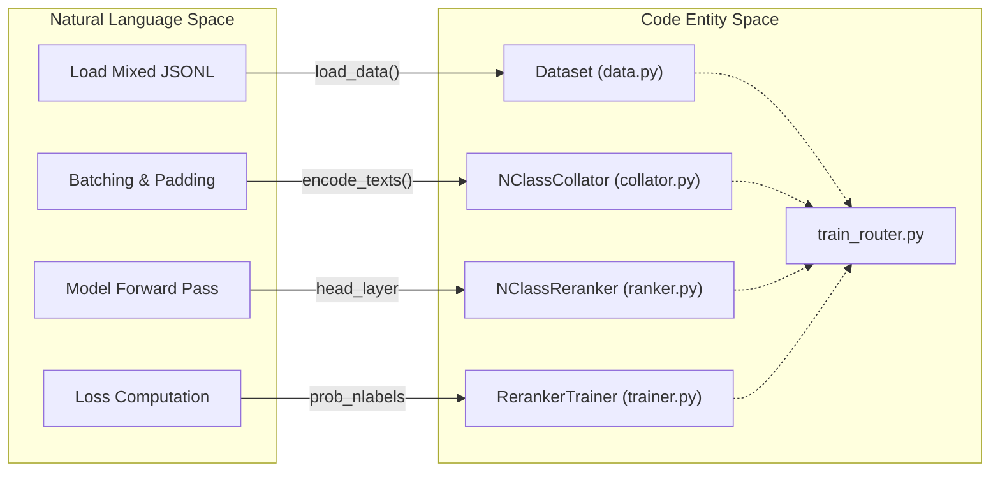

<!-- source: DeepWiki mcp.deepwiki.com · repo microsoft/best-route-llm · page 1.2 End-to-End Pipeline Overview · fetched 2026-10-26 -->

# End-to-End Pipeline Overview

Relevant source files

The following files were used as context for generating this wiki page:

- [README.md](README.md)
- [notebooks/dataset_mixer.ipynb](notebooks/dataset_mixer.ipynb)
- [notebooks/generate_llm_responses.py](notebooks/generate_llm_responses.py)
- [notebooks/reward_modeling.py](notebooks/reward_modeling.py)
- [notebooks/scoring_per_model_armoRM.py](notebooks/scoring_per_model_armoRM.py)
- [train_router.py](train_router.py)

This page describes the sequential pipeline of the BEST-Route and HybridLLM frameworks. The workflow spans from initial dataset construction to the final evaluation of routing strategies that balance LLM response quality against inference cost.

## High-Level Workflow

The pipeline is designed to transform raw prompts into a trained router capable of selecting the optimal model or sampling strategy (Best-of-N) for a given query. The process is divided into six major stages:

1.  **Data Preparation**: Mixing prompt sources and generating multiple LLM responses.
2.  **Oracle Scoring**: Using a high-capacity Reward Model (RM) to establish "ground truth" quality.
3.  **Cost Modeling**: Calculating token counts to estimate inference expenses.
4.  **Proxy RM Training**: Training a smaller, efficient RM (ourRM) to simulate test-time quality estimation.
5.  **Router Training**: Training the `NClassReranker` to predict the best routing path.
6.  **Evaluation**: Analyzing the performance-cost trade-off curves.

### System Data Flow Diagram

The following diagram illustrates the flow of data through the various scripts and notebooks in the repository.

**Data Flow: From Raw Prompts to Router Predictions**

**Sources:**
- [README.md:31-135]()
- [train_router.py:36-64]()

---

## Stage-by-Stage Implementation

### 1. Dataset Mixing and Response Generation
The pipeline begins by sampling prompts from diverse sources such as `reward-bench`, `CodeUltraFeedback`, and `BeaverTails` [notebooks/dataset_mixer.ipynb:30-135](). For each prompt, the system generates $N$ responses (typically $N=20$ for BEST-Route) using different models like `llama-31-8b` or `gpt-4o` [notebooks/generate_llm_responses.py:21-63]().

### 2. Reward Modeling (Oracle vs. Proxy)
A dual-reward system is used to train the router:
*   **Oracle RM**: The `ArmoRM-Llama3-8B-v0.1` model provides high-fidelity scores used as labels for the router [notebooks/scoring_per_model_armoRM.py:14-54]().
*   **Proxy RM**: A `DeBERTa-v3-large-v2` regressor is trained using `trl.RewardTrainer` on "min-max-mid" triplets to provide the router with features it would actually have access to at test time [notebooks/reward_modeling.py:59-118]().

### 3. Router Training Logic
The `train_router.py` script initializes an `NClassReranker` [hybrid_llm/pair_ranker/ranker.py](). It uses an `NClassCollator` to format prompts and candidate model responses into batches [hybrid_llm/pair_ranker/collator.py](). The router is trained to minimize a specific loss (e.g., `prob_nlabels`) which correlates proxy scores and token costs to the oracle's quality assessment [train_router.py:124-135]().

**Entity Mapping: Logic to Code**

**Sources:**
- [train_router.py:80-108]()
- [hybrid_llm/pair_ranker/ranker.py]()
- [hybrid_llm/pair_ranker/collator.py]()
- [hybrid_llm/pair_ranker/data.py]()

---

## Summary of Data Artifacts

| Stage | Output File | Key Fields Added |
| :--- | :--- | :--- |
| **Mixing** | `mixed_dataset.jsonl` | `id`, `prompt` |
| **Generation** | `mixed_dataset_ALL.jsonl` | `{model_name}: {"responses": [...]}` |
| **Oracle Scoring** | `mixed_dataset_armoRM_ALL.jsonl` | `armoRM_scores` |
| **Costing** | `..._token_num.jsonl` | `token_num_prompt`, `token_num_responses` |
| **Proxy Scoring** | `..._ourRM.jsonl` | `ourRM_scores` |
| **Routing** | `predictions.pt` | Model selection indices and probabilities |

**Sources:**
- [README.md:36-119]()
- [notebooks/generate_llm_responses.py:38-63]()
- [notebooks/scoring_per_model_armoRM.py:21-54]()

## Execution and Evaluation
The final stage involves running `results_interpretation.ipynb` to visualize the Pareto front of the routing policy. This notebook compares the router's performance (based on Oracle RM scores) against the cumulative inference cost, allowing developers to verify if the **BEST-Route** strategy successfully achieves higher quality at lower compute budgets compared to standard single-model baselines [README.md:136-140]().

---

