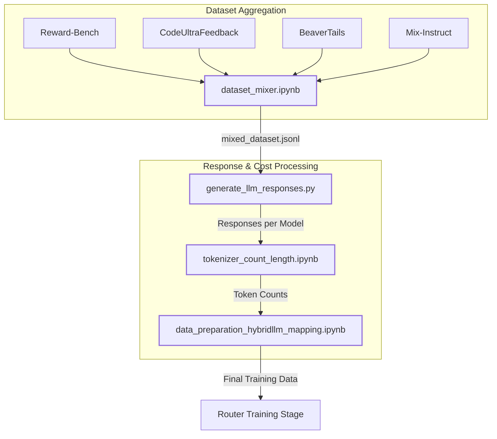
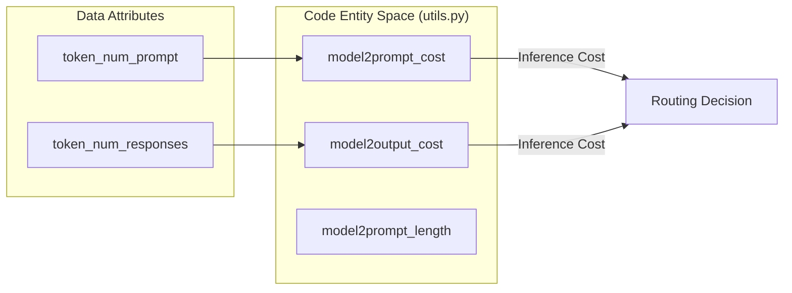

<!-- source: DeepWiki mcp.deepwiki.com · repo microsoft/best-route-llm · page 2 Data Preparation · fetched 2026-10-26 -->

# Data Preparation

Relevant source files

The following files were used as context for generating this wiki page:

- [notebooks/data_preparation_hybridllm_mapping.ipynb](notebooks/data_preparation_hybridllm_mapping.ipynb)
- [notebooks/dataset_mixer.ipynb](notebooks/dataset_mixer.ipynb)
- [notebooks/generate_llm_responses.py](notebooks/generate_llm_responses.py)
- [notebooks/tokenizer_count_length.ipynb](notebooks/tokenizer_count_length.ipynb)
- [notebooks/utils.py](notebooks/utils.py)

This section provides an overview of the data pipeline required to train and evaluate the BEST-Route and HybridLLM routers. The process involves aggregating prompts from diverse sources, generating multiple candidate responses per model, and calculating the associated token costs and lengths.

### Data Workflow Overview

The data preparation stage transforms raw instruction datasets into a structured format where each prompt is associated with multiple LLM outputs, their respective reward scores, and token counts. This structured data is essential for the router to learn the trade-offs between response quality and inference cost.

**Data Flow Architecture**

Sources: [notebooks/dataset_mixer.ipynb:150-158](), [notebooks/generate_llm_responses.py:38-41](), [notebooks/tokenizer_count_length.ipynb:34-42](), [notebooks/data_preparation_hybridllm_mapping.ipynb:51-78]()

---

### 2.1 Dataset Mixing and Prompt Collection
The first step involves sampling prompts from four primary open-source datasets to ensure a broad coverage of tasks, including general instructions, coding, and safety-related queries.

*   **Sources:** Data is pulled from `allenai/reward-bench`, `coseal/CodeUltraFeedback`, `llm-blender/mix-instruct`, and `PKU-Alignment/BeaverTails` [notebooks/dataset_mixer.ipynb:31-135]().
*   **Aggregation:** The `dataset_mixer.ipynb` notebook filters these sources (e.g., selecting harmful prompts from BeaverTails) and concatenates them into a unified `mixed_dataset.jsonl` [notebooks/dataset_mixer.ipynb:124-158]().
*   **HybridLLM Mapping:** Post-processing scripts map these prompts into the specific format required for Best-of-N (BoN) sampling, creating candidates that represent different sampling budgets [notebooks/data_preparation_hybridllm_mapping.ipynb:51-78]().

For details, see [Dataset Mixing and Prompt Collection](#2.1).

---

### 2.2 LLM Response Generation
Once prompts are collected, candidate responses are generated using a variety of LLMs. This creates the "candidates" pool that the router will eventually learn to rank.

*   **Generation Script:** `notebooks/generate_llm_responses.py` uses the `transformers.pipeline` to generate responses [notebooks/generate_llm_responses.py:26-32]().
*   **Sampling:** For BEST-Route, the script typically generates $N=20$ samples per prompt to allow for Best-of-N evaluation [notebooks/generate_llm_responses.py:21-21]().
*   **Models:** Supports various models defined in the `model2path` dictionary, such as `llama-31-8b` [notebooks/generate_llm_responses.py:17-19]().

For details, see [LLM Response Generation](#2.2).

---

### 2.3 Token Counting and Cost Modeling
To train a cost-aware router, the system must calculate the exact token usage for every prompt and response pair.

*   **Tokenization:** The `tokenizer_count_length.ipynb` notebook utilizes model-specific tokenizers (e.g., `tiktoken` for GPT models and `AutoTokenizer` for Llama/Mistral) to calculate `token_num_prompt` and `token_num_responses` [notebooks/tokenizer_count_length.ipynb:13-22]().
*   **Cost Constants:** Physical costs are modeled using `model2prompt_cost` and `model2output_cost` tables in `utils.py`, which define the price per token for each supported model [notebooks/utils.py:12-13]().

**Cost Entity Mapping**

Sources: [notebooks/utils.py:12-16](), [notebooks/tokenizer_count_length.ipynb:38-40]()

For details, see [Token Counting and Cost Modeling](#2.3).

---

