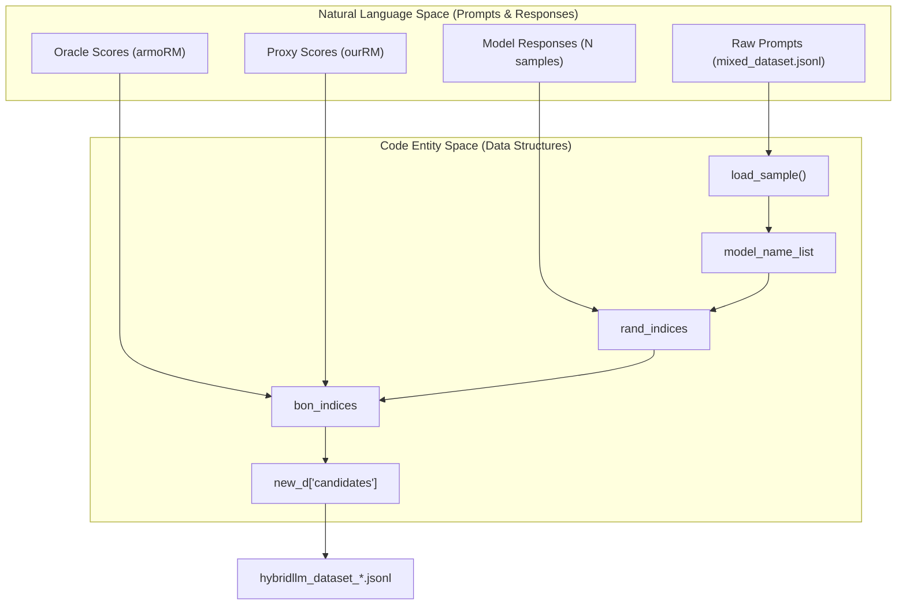
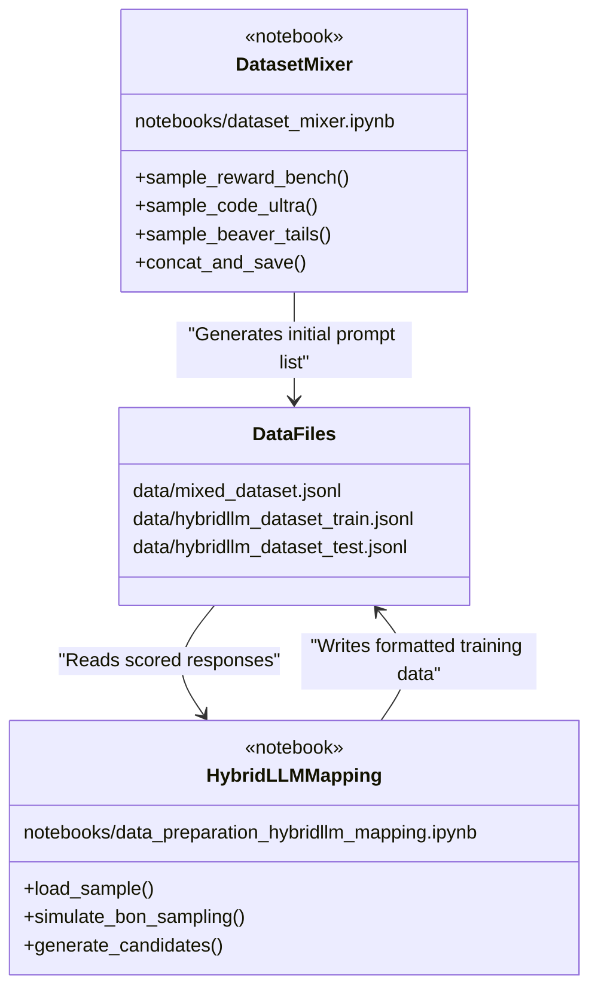

<!-- source: DeepWiki mcp.deepwiki.com · repo microsoft/best-route-llm · page 2.1 Dataset Mixing and Prompt Collection · fetched 2026-10-26 -->

# Dataset Mixing and Prompt Collection

Relevant source files

The following files were used as context for generating this wiki page:

- [notebooks/data_preparation_hybridllm_mapping.ipynb](notebooks/data_preparation_hybridllm_mapping.ipynb)
- [notebooks/dataset_mixer.ipynb](notebooks/dataset_mixer.ipynb)

This page details the initial stage of the BEST-Route / HybridLLM pipeline: the assembly of a diverse prompt dataset from multiple open-source repositories and its subsequent transformation into a format suitable for routing training. The process involves two primary steps: consolidating raw prompts into a unified file and mapping these prompts into a structured format that supports both single-model routing (HybridLLM) and Best-of-N sampling (BEST-Route).

## Prompt Collection and Consolidation

The initial dataset is created by sampling prompts from various domains, including safety (refusals, dangerous content), coding, and general instruction following. This logic is implemented in `notebooks/dataset_mixer.ipynb`.

### Data Sources
The following datasets are sampled and combined:

| Source Dataset | Selection Criteria / Subsets | Sampling Size |
| :--- | :--- | :--- |
| **allenai/reward-bench** | `xstest-`, `refusals-`, `donotanswer`, `hep-` [notebooks/dataset_mixer.ipynb:33-34]() | All matching |
| **coseal/CodeUltraFeedback** | Random sample of instructions [notebooks/dataset_mixer.ipynb:67-71]() | 1,016 |
| **llm-blender/mix-instruct** | Random sample from `train_data_prepared.jsonl` [notebooks/dataset_mixer.ipynb:87-92]() | 6,000 |
| **PKU-Alignment/BeaverTails** | Prompts flagged as harmful via `is_prompt_harmful` [notebooks/dataset_mixer.ipynb:124-135]() | 1,260 |

### Implementation Flow
The `dataset_mixer.ipynb` notebook performs the following operations:
1.  **Loading**: Uses `pandas.read_parquet` or `pd.read_json` to fetch data directly from HuggingFace Hub [notebooks/dataset_mixer.ipynb:32-88]().
2.  **Standardization**: Renames various instruction/input columns to a uniform `prompt` column and generates a unique `id` prefixed by the source name (e.g., `beaver_tails/123`) [notebooks/dataset_mixer.ipynb:133-134]().
3.  **Export**: Concatenates all samples into a single DataFrame and writes to `data/mixed_dataset.jsonl` using the `ndjson` library [notebooks/dataset_mixer.ipynb:151-157]().

**Sources:** `notebooks/dataset_mixer.ipynb`

## HybridLLM and Best-of-N Mapping

Once prompts are collected and responses have been generated and scored (see sections 2.2 and 3.1), the data must be mapped into a specific schema used by the `hybrid_llm` package. This occurs in `notebooks/data_preparation_hybridllm_mapping.ipynb`.

### The Mapping Logic
The goal of this step is to translate the `mixed_dataset` (which contains raw model outputs and scores) into a format where each entry represents a set of "candidates" that the router can choose from. 

For BEST-Route (Best-of-N), a "candidate" is not just a model, but a model combined with a specific sampling strategy (e.g., `gpt-4o_ourRM_bo3` representing GPT-4o with Best-of-3 sampling) [notebooks/data_preparation_hybridllm_mapping.ipynb:73-77]().

### Data Flow: From Mixed Dataset to HybridLLM Format

The following diagram illustrates how raw prompt data and model scores are transformed into the `candidates` structure required for router training.

**Natural Language to Code Entity Mapping: Dataset Transformation**

**Sources:** `notebooks/data_preparation_hybridllm_mapping.ipynb:14-20](), [notebooks/data_preparation_hybridllm_mapping.ipynb:34-37](), [notebooks/data_preparation_hybridllm_mapping.ipynb:61-78]()

### Best-of-N Simulation
The notebook simulates the Best-of-N process to generate training labels:
1.  **Random Sampling**: For a given $N$, it selects $N$ random indices from the available responses [notebooks/data_preparation_hybridllm_mapping.ipynb:67]().
2.  **Proxy Selection**: It identifies the "best" response among those $N$ based on the **Proxy Reward Model** (`ourRM_scores`) [notebooks/data_preparation_hybridllm_mapping.ipynb:68]().
3.  **Oracle Labeling**: It assigns the **Oracle Reward Model** score (`armoRM_scores`) of that selected response as the ground-truth quality for that candidate [notebooks/data_preparation_hybridllm_mapping.ipynb:69]().
4.  **Cost Aggregation**: It sums the token counts of all $N$ sampled responses to model the total inference cost [notebooks/data_preparation_hybridllm_mapping.ipynb:70]().

### Output Schema
The resulting JSONL files (train, validation, test) follow this structure:
*   `id`: Original prompt ID.
*   `input`: The prompt text.
*   `candidates`: A list of dictionaries, where each contains:
    *   `model`: Identifier string (e.g., `{model_name}_ourRM_bo{n}`) [notebooks/data_preparation_hybridllm_mapping.ipynb:73]().
    *   `scores`: Dictionary containing the `armoRM_scores` (Oracle quality) [notebooks/data_preparation_hybridllm_mapping.ipynb:75]().
    *   `token_num_prompt`: Length of the input.
    *   `token_num_responses`: Total tokens generated during the BoN process [notebooks/data_preparation_hybridllm_mapping.ipynb:77]().

**Sources:** `notebooks/data_preparation_hybridllm_mapping.ipynb:52-78](), [notebooks/data_preparation_hybridllm_mapping.ipynb:93-119](), [notebooks/data_preparation_hybridllm_mapping.ipynb:134-160]()

## System Entity Relationship

The following diagram maps the files and logical components involved in the dataset mixing and mapping process.

**System Entity Relationship Diagram**

**Sources:** `notebooks/dataset_mixer.ipynb:154-157](), [notebooks/data_preparation_hybridllm_mapping.ipynb:18-20](), [notebooks/data_preparation_hybridllm_mapping.ipynb:52-53]()

---

