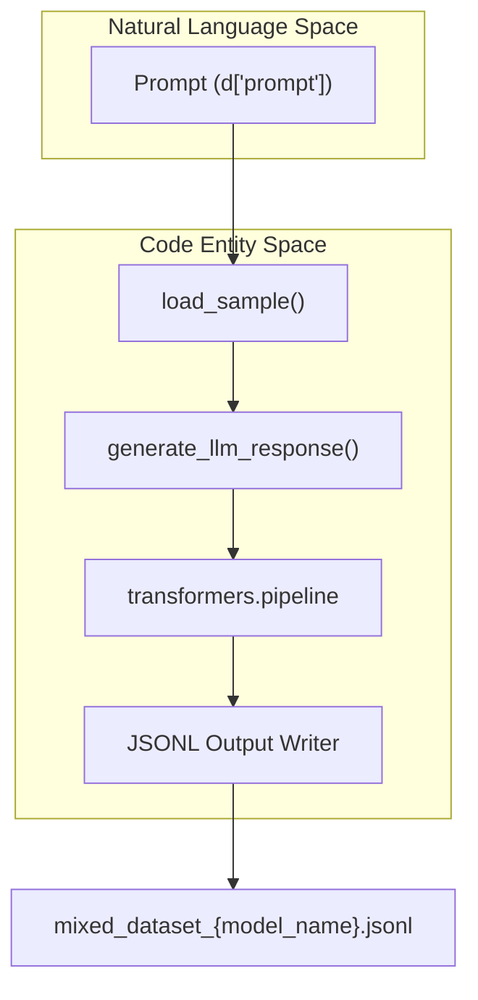
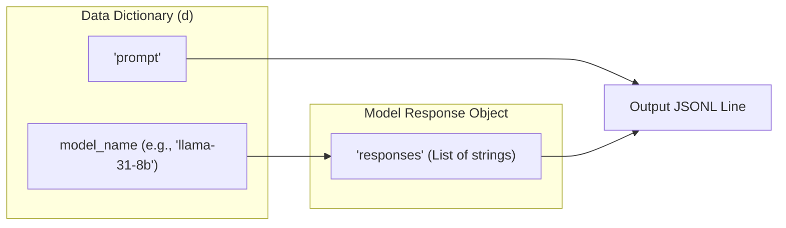

<!-- source: DeepWiki mcp.deepwiki.com · repo microsoft/best-route-llm · page 2.2 LLM Response Generation · fetched 2026-10-26 -->

# LLM Response Generation

<details>
<summary>Relevant source files</summary>

The following files were used as context for generating this wiki page:

- [notebooks/generate_llm_responses.py](notebooks/generate_llm_responses.py)
- [notebooks/utils.py](notebooks/utils.py)

</details>


The LLM Response Generation stage is responsible for producing the raw candidate pool required for both **HybridLLM** (single-sample) and **BEST-Route** (Best-of-N) routing strategies. This stage utilizes the `notebooks/generate_llm_responses.py` script to interface with HuggingFace Hub models, manage sampling parameters, and record outputs in a structured JSONL format.

## Execution Flow

The generation process follows a linear execution path from data loading to batch inference. The script `notebooks/generate_llm_responses.py` acts as the primary entry point, leveraging the `transformers` pipeline to handle model loading and tokenization.

### Data Flow Diagram: Generation Pipeline
This diagram illustrates the transition from raw prompt data to model-specific candidate responses.


**Sources:** [notebooks/generate_llm_responses.py:21-66](), [notebooks/utils.py:3-10]()

## Configuration and Authentication

### Model Endpoints
Models are mapped from internal identifiers to HuggingFace Hub repository IDs via the `model2path` dictionary. For example, `llama-31-8b` is mapped to `meta-llama/Meta-Llama-3.1-8B-Instruct` [notebooks/generate_llm_responses.py:17-19]().

### HuggingFace Authentication
The script requires a valid HuggingFace token to access gated models (like Llama 3.1). This is handled via the `login()` function within the generation loop [notebooks/generate_llm_responses.py:23]().

### Hardware Optimization
To prevent Out-of-Memory (OOM) errors during heavy sampling, the script configures PyTorch's CUDA memory allocator:
*   `PYTORCH_CUDA_ALLOC_CONF` is set to `expandable_segments:True` [notebooks/generate_llm_responses.py:14]().
*   Models are loaded using `torch.bfloat16` and `device_map="auto"` to distribute layers across available GPUs [notebooks/generate_llm_responses.py:29-30]().

## Sampling Logic (Best-of-N)

The core of the **BEST-Route** strategy is the generation of multiple candidate responses for a single prompt. This is controlled by the `num_sample` parameter.

| Parameter | Default Value | Description |
| :--- | :--- | :--- |
| `num_sample` | 20 | The number of independent completions generated per prompt. |
| `temperature` | 1 | Ensures diversity in sampling. |
| `top_p` | 1 | Nucleus sampling threshold. |
| `max_new_tokens` | 500 | Limit on response length. |

The script differentiates between the two routing paradigms through the sample count: Hybrid-LLM typically uses 10 samples, while BEST-Route extends this to 20 to provide a richer candidate pool for the router [notebooks/generate_llm_responses.py:57-72]().

**Sources:** [notebooks/generate_llm_responses.py:50-59]()

## Output Schema

The generation process produces a JSONL file where each line corresponds to a prompt and its associated responses. The results are stored in a model-specific key within the original data dictionary.

### Data Structure Mapping
This diagram shows how code entities populate the final JSONL schema.



### JSONL Schema Example
The output file is saved at `./outputs/mixed_dataset_{model_name}.jsonl` [notebooks/generate_llm_responses.py:38]().

```json
{
  "prompt": "Explain quantum entanglement.",
  "llama-31-8b": {
    "responses": [
      "Response sample 1...",
      "Response sample 2...",
      "...up to N samples"
    ]
  }
}
```
**Sources:** [notebooks/generate_llm_responses.py:61-63]()

## Key Functions

### `generate_llm_response(data, model_name, num_sample=20)`
*   **Role**: Orchestrates the inference loop.
*   **Implementation**: 
    1.  Initializes the `transformers.pipeline` for `text-generation` [notebooks/generate_llm_responses.py:26-32]().
    2.  Defines `terminators` to correctly handle model-specific end-of-turn tokens like `<|eot_id|>` [notebooks/generate_llm_responses.py:33-36]().
    3.  Iterates through the dataset, formatting each prompt into a chat-like structure [notebooks/generate_llm_responses.py:44-49]().
    4.  Extracts generated text from the pipeline output and updates the data dictionary [notebooks/generate_llm_responses.py:61-62]().

### `load_sample(fname, is_jsonl=True)`
*   **Role**: Utility to load input prompts from either standard JSON or JSONL formats [notebooks/utils.py:3-10]().

**Sources:** [notebooks/generate_llm_responses.py:21-67](), [notebooks/utils.py:3-10]()

---

