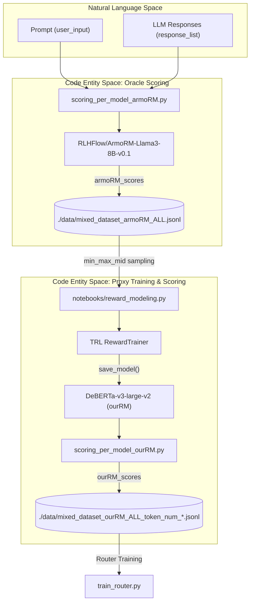
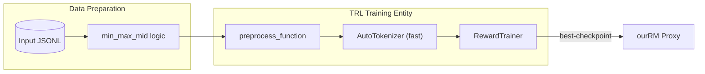

<!-- source: DeepWiki mcp.deepwiki.com · repo microsoft/best-route-llm · page 3 Reward Modeling · fetched 2026-10-26 -->

# Reward Modeling

Relevant source files

The following files were used as context for generating this wiki page:

- [notebooks/reward_modeling.py](notebooks/reward_modeling.py)
- [notebooks/scoring_per_model_armoRM.py](notebooks/scoring_per_model_armoRM.py)
- [notebooks/scoring_per_model_ourRM.py](notebooks/scoring_per_model_ourRM.py)

Reward modeling is a critical phase in the BEST-Route pipeline that converts qualitative LLM responses into quantitative scalar scores. These scores serve as the ground truth for training the router to select the highest-quality candidate among multiple LLM outputs. 

The system utilizes a two-tier approach:
1.  **Oracle Reward Model (armoRM):** A large, high-capacity model used to label the initial dataset with "gold standard" quality scores.
2.  **Proxy Reward Model (ourRM):** A smaller, more efficient regressor trained to mimic the Oracle's preferences, used for faster scoring or specialized routing tasks.

### Two-Tier Reward Architecture

The following diagram illustrates how the reward modeling components interact with the dataset and the subsequent routing stages.

**Reward Modeling Workflow**

**Sources:** [notebooks/scoring_per_model_armoRM.py:14-54](), [notebooks/reward_modeling.py:108-118](), [notebooks/scoring_per_model_ourRM.py:16-39]()

---

### Oracle Reward Model (armoRM)

The Oracle model, specifically `RLHFlow/ArmoRM-Llama3-8B-v0.1`, is used to generate the primary quality signals for the mixed dataset. The script `scoring_per_model_armoRM.py` processes prompts and their corresponding responses to produce scalar values stored in the `armoRM_scores` field.

Key characteristics of the Oracle phase:
*   **Model:** Uses a Llama-3 8B based reward model [notebooks/scoring_per_model_armoRM.py:16-18]().
*   **Batching & OOM Handling:** The script attempts to score responses in batches using `tokenizer.apply_chat_template` [notebooks/scoring_per_model_armoRM.py:35](). If a `torch.cuda.OutOfMemoryError` occurs, it automatically falls back to sequential scoring for that specific query [notebooks/scoring_per_model_armoRM.py:42-52]().
*   **Data Structure:** Appends a list of floats to each model entry in the JSONL file under the key `armoRM_scores` [notebooks/scoring_per_model_armoRM.py:41]().

For implementation details on model loading and chat template application, see [Oracle Reward Model (armoRM) Scoring](#3.1).

**Sources:** [notebooks/scoring_per_model_armoRM.py:14-54]()

---

### Proxy Reward Model (ourRM)

The Proxy Reward Model (`ourRM`) is a smaller regressor (typically based on DeBERTa-v3) trained to approximate the Oracle's scoring logic. This is useful for reducing the computational overhead of scoring during the routing development cycle.

The proxy lifecycle involves two main scripts:
1.  **Training (`notebooks/reward_modeling.py`):** Uses the `TRL RewardTrainer` to train a sequence classification model [notebooks/reward_modeling.py:108-115](). It expects a dataset of "chosen" and "rejected" pairs, often derived from the Oracle's `min`, `max`, and `mid` scores [notebooks/reward_modeling.py:82-91]().
2.  **Scoring (`scoring_per_model_ourRM.py`):** Applies the trained proxy to the dataset to generate `ourRM_scores` [notebooks/scoring_per_model_ourRM.py:31-37]().

**Proxy Training Data Flow**

**Sources:** [notebooks/reward_modeling.py:56-61](), [notebooks/reward_modeling.py:75-91](), [notebooks/reward_modeling.py:108-118]()

For details on the `RewardTrainer` configuration and the `min_max_mid` sampling strategy, see [Proxy Reward Model (ourRM) Training and Scoring](#3.2).

**Sources:** [notebooks/reward_modeling.py:32-61](), [notebooks/scoring_per_model_ourRM.py:16-43]()

---

### Summary Table: Reward Models Comparison

| Feature | Oracle (armoRM) | Proxy (ourRM) |
| :--- | :--- | :--- |
| **Base Model** | `ArmoRM-Llama3-8B-v0.1` | e.g., `DeBERTa-v3-large-v2` |
| **Primary Script** | `scoring_per_model_armoRM.py` | `reward_modeling.py` (Train) / `scoring_per_model_ourRM.py` (Score) |
| **Output Field** | `armoRM_scores` | `ourRM_scores` |
| **Input Format** | Chat Template (User/Assistant) | Concatenated String (`Human: ... Assistant: ...`) |
| **Training Method** | Pre-trained | `trl.RewardTrainer` |

**Sources:** [notebooks/scoring_per_model_armoRM.py:16-31](), [notebooks/scoring_per_model_ourRM.py:19-37](), [notebooks/reward_modeling.py:108-115]()

---

