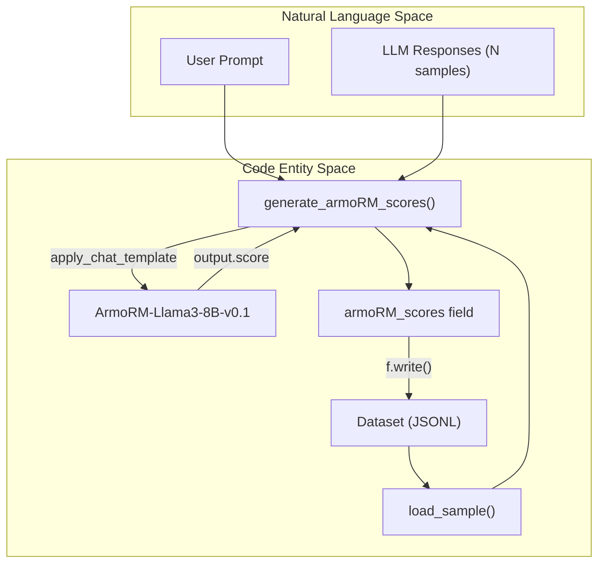
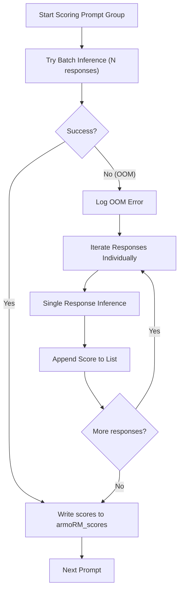

<!-- source: DeepWiki mcp.deepwiki.com · repo microsoft/best-route-llm · page 3.1 Oracle Reward Model (armoRM) Scoring · fetched 2026-10-26 -->

# Oracle Reward Model (armoRM) Scoring

<details>
<summary>Relevant source files</summary>

The following files were used as context for generating this wiki page:

- [notebooks/scoring_per_model_armoRM.py](notebooks/scoring_per_model_armoRM.py)
- [notebooks/utils.py](notebooks/utils.py)

</details>


The Oracle Reward Model (armoRM) scoring stage is a critical component of the BEST-Route pipeline. It uses a high-capacity reward model, `RLHFlow/ArmoRM-Llama3-8B-v0.1`, to generate "ground truth" quality scores for every LLM response in the dataset. These scores serve as the target labels for training the proxy reward models and the final routers.

## Implementation Overview

The scoring process is primarily implemented in `notebooks/scoring_per_model_armoRM.py`. The script loads a pre-trained `ArmoRM-Llama3-8B-v0.1` model and iterates through a dataset containing prompts and multiple candidate responses from different LLMs.

### Key Components

*   **Model Loading**: The model is loaded using `AutoModelForSequenceClassification` with `torch.bfloat16` precision to balance performance and memory usage [notebooks/scoring_per_model_armoRM.py:16-18]().
*   **Chat Templating**: The script uses the tokenizer's `apply_chat_template` to format the prompt and response pairs into the structure expected by the Llama-3-based reward model [notebooks/scoring_per_model_armoRM.py:35]().
*   **Batch Scoring**: For efficiency, the script attempts to score all responses for a given prompt in a single batch [notebooks/scoring_per_model_armoRM.py:35-41]().

### Data Flow and Code Entity Mapping

The following diagram illustrates how the scoring script interacts with the data and the underlying model entities.

**Diagram: ArmoRM Scoring Logic Flow**

Sources: [notebooks/scoring_per_model_armoRM.py:14-54](), [notebooks/utils.py:3-10]()

## OOM Handling and Fallback Strategy

A significant feature of `scoring_per_model_armoRM.py` is its robust handling of `torch.cuda.OutOfMemoryError`. Because the script attempts to process all $N$ responses for a prompt as a single batch, memory limits may be exceeded if responses are particularly long.

When an OOM occurs, the script catches the exception and falls back to a sequential scoring strategy:
1.  **Catch Exception**: The `try...except` block intercepts the OOM [notebooks/scoring_per_model_armoRM.py:42-43]().
2.  **Sequential Processing**: The script iterates through the `message_list` one message at a time [notebooks/scoring_per_model_armoRM.py:46]().
3.  **Individual Inference**: Each prompt-response pair is tokenized and scored individually, significantly reducing the peak memory footprint [notebooks/scoring_per_model_armoRM.py:47-52]().

**Diagram: Memory Management and OOM Recovery**

Sources: [notebooks/scoring_per_model_armoRM.py:34-53]()

## Output Schema

The results are written to a new JSONL file, typically named `mixed_dataset_armoRM_ALL.jsonl` [notebooks/scoring_per_model_armoRM.py:21](). For every model entry in the dataset, a new field `armoRM_scores` is appended.

| Field | Type | Description |
| :--- | :--- | :--- |
| `prompt` | `string` | The original user input [notebooks/scoring_per_model_armoRM.py:26](). |
| `[model_name]` | `dict` | Dictionary containing model-specific data [notebooks/scoring_per_model_armoRM.py:27](). |
| `[model_name]['responses']` | `list[str]` | The candidate responses generated by the LLM. |
| `[model_name]['armoRM_scores']` | `list[float]` | The scalar rewards assigned by the ArmoRM model [notebooks/scoring_per_model_armoRM.py:41](). |

Sources: [notebooks/scoring_per_model_armoRM.py:24-54]()

## Execution Details

The script is executed via CLI and requires the path to the dataset generated in previous steps and the list of models to be scored.

```python
# Example usage
# python scoring_per_model_armoRM.py --data_path ./data/mixed_dataset.jsonl --model_name_list gpt-4o phi-3-mini
```

The script utilizes `load_sample` from `utils.py` to ingest the data [notebooks/scoring_per_model_armoRM.py:66](). It also logs the average time per query to track progress [notebooks/scoring_per_model_armoRM.py:57]().

Sources: [notebooks/scoring_per_model_armoRM.py:60-67](), [notebooks/utils.py:3-10]()

---

