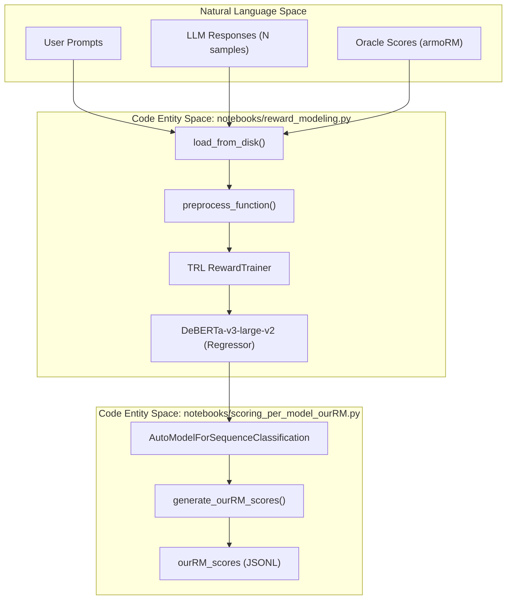
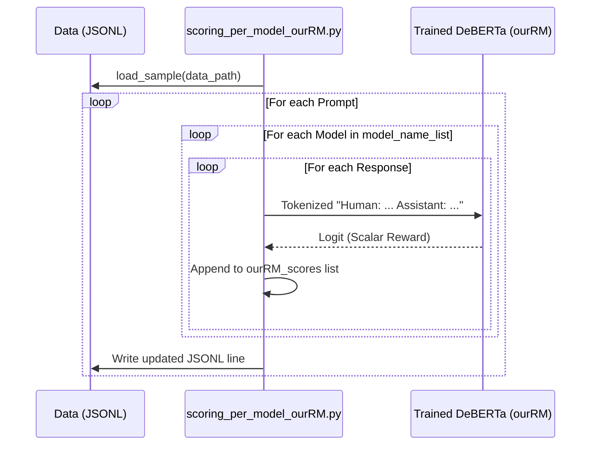

<!-- source: DeepWiki mcp.deepwiki.com · repo microsoft/best-route-llm · page 3.2 Proxy Reward Model (ourRM) Training and Scoring · fetched 2026-10-26 -->

# Proxy Reward Model (ourRM) Training and Scoring

Relevant source files

The following files were used as context for generating this wiki page:

- [notebooks/reward_modeling.py](notebooks/reward_modeling.py)
- [notebooks/scoring_per_model_ourRM.py](notebooks/scoring_per_model_ourRM.py)
- [notebooks/utils.py](notebooks/utils.py)

This page documents the implementation and execution of the **Proxy Reward Model (ourRM)**, a specialized regressor used to estimate response quality when the Oracle Reward Model (armoRM) is too computationally expensive for real-time routing or when a customized reward signal is required. The process involves training a DeBERTa-v3-large-v2 model using the `TRL` library and subsequently scoring LLM generations to produce the `ourRM_scores` field.

## Overview of ourRM Pipeline

The proxy reward model is designed to learn the preference rankings established by the Oracle RM. It uses a "min_max_mid" data preparation pattern where the model is trained on pairs of responses (chosen vs. rejected) to learn a scalar reward value.

### Data Flow and System Components

The following diagram illustrates the transition from the Natural Language Space (prompts and responses) to the Code Entity Space (training scripts and model outputs).

**Proxy RM Training and Scoring Workflow**

Sources: [notebooks/reward_modeling.py:32-122](), [notebooks/scoring_per_model_ourRM.py:16-43]()

---

## Proxy RM Training (reward_modeling.py)

The training script `notebooks/reward_modeling.py` utilizes the HuggingFace `trl` (Transformer Reinforcement Learning) library to fine-tune a sequence classification model as a reward regressor.

### Implementation Details
- **Model Architecture**: Typically uses `DeBERTa-v3-large-v2` initialized via `AutoModelForSequenceClassification` with `num_labels=1` [notebooks/reward_modeling.py:59-61]().
- **Data Pattern**: The script expects a dataset containing `chosen` and `rejected` text pairs. This is derived from the Oracle RM scores, where the highest-scoring response is "chosen" and lower-scoring ones are "rejected" (often following a min/max/mid selection strategy).
- **Preprocessing**: The `preprocess_function` tokenizes both the chosen and rejected strings, creating `input_ids_chosen` and `input_ids_rejected` for the `RewardTrainer` [notebooks/reward_modeling.py:75-91]().

### Training Configuration
The script uses `HfArgumentParser` to ingest `RewardConfig` and `ModelConfig`. Key features include:
- **Quantization**: Supports k-bit quantization for efficient training on smaller GPUs [notebooks/reward_modeling.py:50-55]().
- **PEFT/LoRA**: Integrates with Parameter-Efficient Fine-Tuning, requiring the `SEQ_CLS` task type [notebooks/reward_modeling.py:63-67]().
- **Checkpointing**: Saves the best performing model to a `checkpoint-best` folder within the output directory [notebooks/reward_modeling.py:117-118]().

Sources: [notebooks/reward_modeling.py:33-61](), [notebooks/reward_modeling.py:75-118]()

---

## Proxy Scoring (scoring_per_model_ourRM.py)

Once trained, the proxy model is used to score all candidate responses in the dataset. This is handled by `notebooks/scoring_per_model_ourRM.py`.

### Scoring Logic
The core logic resides in `generate_ourRM_scores`. It iterates through the dataset and applies the trained proxy model to every response generated by every LLM in the `model_name_list` [notebooks/scoring_per_model_ourRM.py:16-29]().

**Scoring Implementation**
| Component | Implementation Detail |
| :--- | :--- |
| **Input Format** | Formats the input as `Human: {user_input} Assistant: {_response}` [notebooks/scoring_per_model_ourRM.py:34](). |
| **Model Inference** | Uses `torch.no_grad()` to extract the scalar logit from the classification head [notebooks/scoring_per_model_ourRM.py:35-37](). |
| **Data Storage** | Appends the resulting float to a new list `ourRM_scores` under each model's entry [notebooks/scoring_per_model_ourRM.py:31-37](). |
| **Output** | Writes the updated dictionary to a new JSONL file [notebooks/scoring_per_model_ourRM.py:39](). |

### Execution Diagram
The diagram below shows how the scoring script interacts with the trained model and the dataset.

**Inference and Scoring Logic**

Sources: [notebooks/scoring_per_model_ourRM.py:26-42](), [notebooks/utils.py:3-10]()

---

## Data Preparation: The min_max_mid Pattern

The proxy model is trained to emulate the Oracle. To ensure the proxy learns the full distribution of quality, the training data is typically prepared using a "min_max_mid" strategy:
1. **Max**: The best response (highest Oracle score) is used as the `chosen` sample.
2. **Min**: The worst response (lowest Oracle score) is used as the `rejected` sample.
3. **Mid**: A response with a median score may be used to create additional pairs (e.g., Max vs. Mid, Mid vs. Min) to provide more granular ranking signals.

This preparation occurs prior to calling `reward_modeling.py`, ensuring the `raw_datasets` loaded at [notebooks/reward_modeling.py:72]() contain meaningful contrasts for the `RewardTrainer`.

Sources: [notebooks/reward_modeling.py:72-82](), [notebooks/scoring_per_model_ourRM.py:23]()

---

