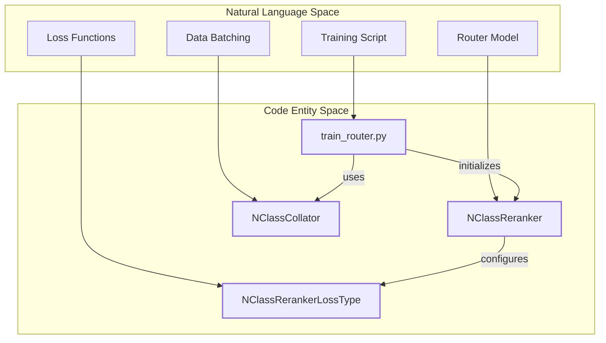
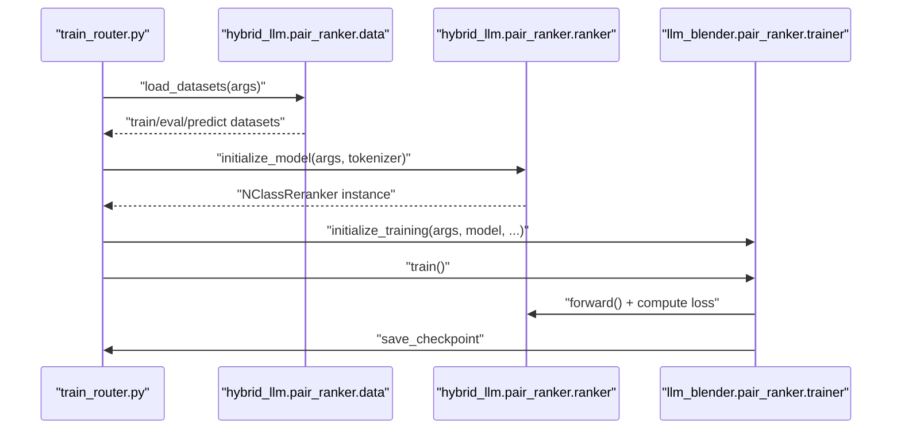

<!-- source: DeepWiki mcp.deepwiki.com · repo microsoft/best-route-llm · page 4 Router Training · fetched 2026-10-26 -->

# Router Training

Relevant source files

The following files were used as context for generating this wiki page:

- [hybrid_llm/__init__.py](hybrid_llm/__init__.py)
- [hybrid_llm/pair_ranker/__init__.py](hybrid_llm/pair_ranker/__init__.py)
- [train_router.py](train_router.py)

The router training system is the core component of the BEST-Route and HybridLLM architectures. It is responsible for training a proxy model to predict the optimal "route" for a given prompt—either by selecting the best model among several candidates (HybridLLM) or by ranking multiple samples from the same or different models (BEST-Route). This system is built on the `hybrid_llm` package and is orchestrated via the `train_router.py` script.

The training process leverages a specialized reranker architecture that can handle various loss functions and data configurations to optimize for both quality (reward scores) and efficiency (inference costs).

### System Overview

The router training pipeline integrates data loading, model architecture initialization, and a training loop based on the `transformers` and `llm-blender` libraries.

#### Natural Language to Code Entity Mapping

The following diagram illustrates how high-level training concepts map to specific classes and functions within the codebase.

**Router Training Entity Map**

**Sources:** [train_router.py:12-22](), [hybrid_llm/pair_ranker/ranker.py:1-20]()

### Training Workflow

The `train_router.py` script manages the end-to-end training lifecycle. It begins by setting up the execution environment, initializing the tokenizer via `llm_blender.pair_ranker.model_util.build_tokenizer` [train_router.py:52](), and loading the datasets.

**Training Execution Flow**

**Sources:** [train_router.py:36-64](), [train_router.py:111-180]()

### Key Components

#### 4.1 NClassReranker Model Architecture
The core model is the `NClassReranker` class [hybrid_llm/pair_ranker/ranker.py](). It extends standard transformer architectures to support multiple output heads for different routing tasks. It supports five distinct loss types (e.g., `det_ncls`, `prob_2cls`) to accommodate different training objectives, such as deterministic classification or probability distribution matching.
For details, see [NClassReranker Model Architecture](#4.1).

#### 4.2 Data Loading and Collation
The system uses a specialized `Dataset` class [hybrid_llm/pair_ranker/data.py:14]() to handle the complex structure of routing data, which includes prompts, candidate responses, reward scores, and inference costs. The `NClassCollator` [hybrid_llm/pair_ranker/collator.py:15]() prepares these inputs for the model, ensuring that the `SOURCE_PREFIX` is correctly applied and that candidate responses are properly encoded.
For details, see [Data Loading and Collation](#4.2).

#### 4.3 Training Configuration and Metrics
Training is governed by `NClassRankerConfig` [hybrid_llm/pair_ranker/config.py:13](), which inherits from the base reranker configuration. The `train_router.py` script maps specific loss types to their corresponding metric functions (e.g., Spearman correlation for labels or accuracy for classification) [train_router.py:28-33](). The system also supports advanced training features like DeepSpeed and fp16 precision [train_router.py:156-157]().
For details, see [Training Configuration and Metrics](#4.3).

### Summary Table of Training Parameters

| Component | Code Entity | Purpose |
| :--- | :--- | :--- |
| **Model** | `NClassReranker` | Multi-head model for ranking/classification |
| **Config** | `NClassRankerConfig` | Hyperparameters and architecture settings |
| **Collator** | `NClassCollator` | Handles prompt/candidate tokenization |
| **Trainer** | `RerankerTrainer` | Orchestrates the HuggingFace training loop |
| **Metrics** | `loss2metric` | Mapping of loss types to evaluation functions |

**Sources:** [train_router.py:13-33](), [train_router.py:170-178]()

---

