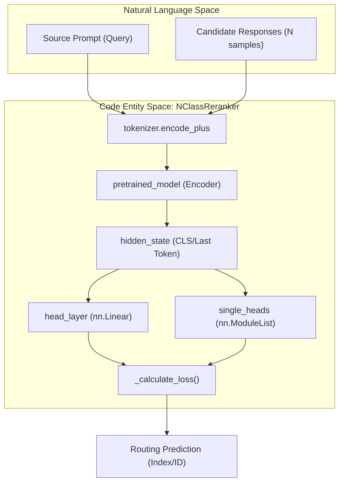
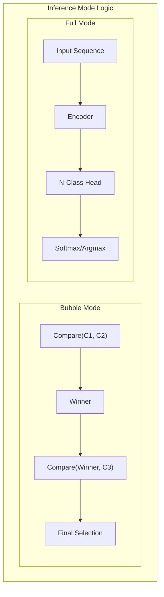

<!-- source: DeepWiki mcp.deepwiki.com · repo microsoft/best-route-llm · page 4.1 NClassReranker Model Architecture · fetched 2026-10-26 -->

# NClassReranker Model Architecture

Relevant source files

The following files were used as context for generating this wiki page:

- [hybrid_llm/pair_ranker/config.py](hybrid_llm/pair_ranker/config.py)
- [hybrid_llm/pair_ranker/model_util.py](hybrid_llm/pair_ranker/model_util.py)
- [hybrid_llm/pair_ranker/ranker.py](hybrid_llm/pair_ranker/ranker.py)

The `NClassReranker` is the core neural module responsible for making routing decisions within the BEST-Route and HybridLLM paradigms. It is implemented as a sequence-to-sequence or encoder-based classifier that evaluates a source prompt and its associated candidate responses to predict which model (or model group) will yield the best performance-to-cost trade-off.

## Overview and Purpose

The `NClassReranker` class, defined in [hybrid_llm/pair_ranker/ranker.py:24-24](), extends `nn.Module` to provide a flexible framework for multi-class and multi-label classification. Unlike standard rerankers that only score pairs, this architecture supports various loss functions that can handle probabilistic outcomes and multiple candidate models simultaneously.

### Key Components
*   **Base Model**: Typically a DeBERTa or RoBERTa encoder loaded via `build_pretrained_model` [hybrid_llm/pair_ranker/model_util.py:32-34]().
*   **Head Layers**: Uses a global `head_layer` for N-class classification [hybrid_llm/pair_ranker/ranker.py:61-64]() and a `ModuleList` of `single_heads` for specific task-based or candidate-based binary decisions [hybrid_llm/pair_ranker/ranker.py:68-76]().
*   **Loss Functions**: Implements five distinct loss types to support deterministic and probabilistic training [hybrid_llm/pair_ranker/ranker.py:16-21]().

## Architecture Logic Flow

The following diagram illustrates how natural language inputs are transformed into routing decisions through the `NClassReranker` entities.

### From Prompt to Routing Decision

**Sources:** [hybrid_llm/pair_ranker/ranker.py:24-77](), [hybrid_llm/pair_ranker/ranker.py:159-210]()

## Loss Types and Probability Calculation

The model supports five loss configurations via the `NClassRerankerLossType` enum [hybrid_llm/pair_ranker/ranker.py:16-21]().

| Loss Type | Implementation Logic | Use Case |
| :--- | :--- | :--- |
| `det_2cls` | Cross-entropy against a hard 0/1 label based on `score[0] >= score[1] - t`. | Binary choice between two models. |
| `prob_2cls` | Cross-entropy against a soft probability distribution derived from `_match_prob`. | Handling variance in LLM samples. |
| `det_ncls` | Argmax of scores across all candidates. | Picking the single best model from N. |
| `det_nlabels` | `BCEWithLogitsLoss` against all models that exceed a performance threshold. | Multi-label "good enough" selection. |
| `prob_nlabels` | Iterative cross-entropy for each candidate relative to a baseline. | Complex probabilistic multi-model routing. |

### The `_match_prob` Helper
To handle the "Best-of-N" nature of sampling, the `_match_prob` function [hybrid_llm/pair_ranker/ranker.py:79-96]() calculates the probability that a response from Model A is better than a response from Model B, given a threshold `t`.

$$P(\text{match}) = \frac{1}{|S|} \sum_{i \in S} \frac{\sum_{j \in L} \mathbb{I}(i \geq j - t)}{|L|}$$

**Sources:** [hybrid_llm/pair_ranker/ranker.py:16-21](), [hybrid_llm/pair_ranker/ranker.py:79-96](), [hybrid_llm/pair_ranker/ranker.py:122-153]()

## Inference Modes: Bubble vs. Full

The `NClassReranker` implements two primary inference strategies defined in the configuration [hybrid_llm/pair_ranker/config.py:79-81]().

### 1. Bubble Mode
In `bubble` mode, the model performs a sequential comparison. It starts with the first two candidates, predicts a winner, and then compares that winner against the next candidate in the list. This is computationally efficient for large candidate sets.

### 2. Full Mode
In `full` mode, the model processes all candidates through the `head_layer` simultaneously to produce a distribution or multi-label output.

**Sources:** [hybrid_llm/pair_ranker/config.py:79-81](), [hybrid_llm/pair_ranker/ranker.py:46-46]()

## Initialization and Configuration

The model is typically initialized using `build_nclass_ranker` [hybrid_llm/pair_ranker/model_util.py:14-37](), which:
1.  Loads a pretrained encoder (e.g., DeBERTa) [hybrid_llm/pair_ranker/model_util.py:32-34]().
2.  Resizes token embeddings to match the specific tokenizer used [hybrid_llm/pair_ranker/model_util.py:35-35]().
3.  Injects `NClassRankerConfig` parameters such as `n_candidates`, `loss_type`, and `dropout` [hybrid_llm/pair_ranker/config.py:9-84]().

If a checkpoint exists, `build_nclass_ranker_from_checkpoint` [hybrid_llm/pair_ranker/model_util.py:40-91]() handles the loading of `pytorch_model.bin` or `model.safetensors` files, ensuring all `single_heads` and the `head_layer` are correctly restored.

**Sources:** [hybrid_llm/pair_ranker/model_util.py:14-91](), [hybrid_llm/pair_ranker/config.py:9-84]()

---

