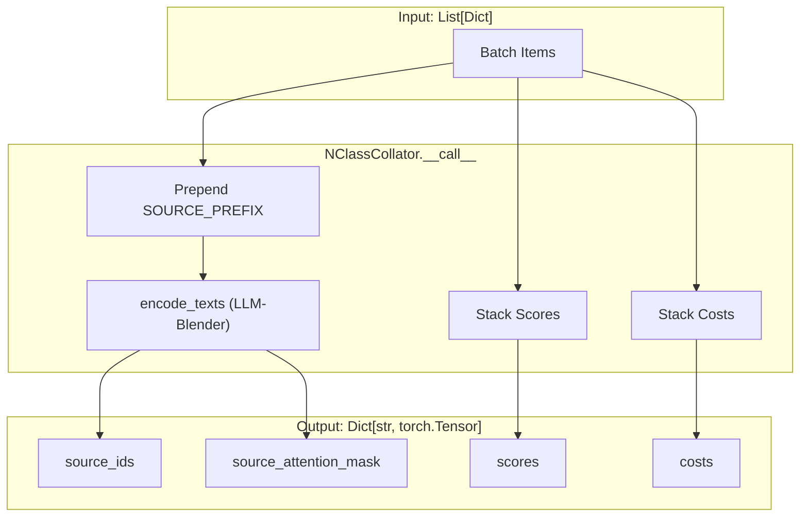
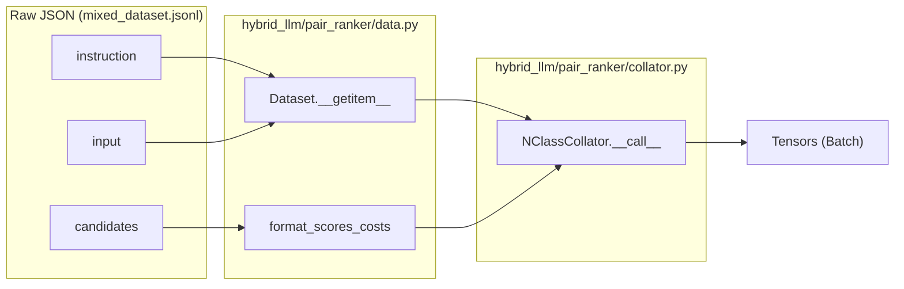

<!-- source: DeepWiki mcp.deepwiki.com · repo microsoft/best-route-llm · page 4.2 Data Loading and Collation · fetched 2026-10-26 -->

# Data Loading and Collation

Relevant source files

The following files were used as context for generating this wiki page:

- [hybrid_llm/pair_ranker/collator.py](hybrid_llm/pair_ranker/collator.py)
- [hybrid_llm/pair_ranker/data.py](hybrid_llm/pair_ranker/data.py)

This page documents the data processing pipeline for router training, specifically covering how raw JSONL datasets are loaded, filtered, and transformed into tensor batches for the `NClassReranker` model. The implementation resides primarily in `hybrid_llm/pair_ranker/data.py` and `hybrid_llm/pair_ranker/collator.py`.

## Overview of Data Flow

The data loading process transforms raw model responses and scores into a format suitable for routing. This involves calculating inference costs, upsampling specific model data to balance the training set, and tokenizing text with specialized control tokens.

### Data Preparation to Batching Pipeline
"Natural Language Space" (JSONL) is bridged to "Code Entity Space" (Tensors) through the following flow:

1.  **`load_data`**: Reads raw JSONL, filters candidates, and applies upsampling logic [[hybrid_llm/pair_ranker/data.py:69-75]]().
2.  **`Dataset` (Class)**: Inherits from `BlenderDataset` to handle indexing and item retrieval, concatenating instructions and inputs into a single `source` string [[hybrid_llm/pair_ranker/data.py:20-39]]().
3.  **`NClassCollator`**: Injected into the PyTorch `DataLoader`. It adds the `SOURCE_PREFIX` token, tokenizes the source text, and assembles scores/costs into batches [[hybrid_llm/pair_ranker/collator.py:13-53]]().

Sources: [hybrid_llm/pair_ranker/data.py:20-75](), [hybrid_llm/pair_ranker/collator.py:13-53]()

---

## Data Loading and Preprocessing

### Candidate Filtering and Formatting
The `load_data` function is the entry point for preparing the training set. It performs several critical transformations:

*   **`filter_candidates`**: Restricts the candidates for each prompt based on the provided arguments [[hybrid_llm/pair_ranker/data.py:102]]().
*   **`format_scores_costs`**: Standardizes scores and calculates costs. It handles both single-sample and Best-of-N scenarios by ensuring scores are represented as a list (window size of 10) [[hybrid_llm/pair_ranker/data.py:151-179]]().
*   **Cost Calculation**: Uses `model2prompt_cost` and `model2output_cost` dictionaries to compute the financial or computational cost of each candidate based on token counts [[hybrid_llm/pair_ranker/data.py:16-17,181-190]]().

### Upsampling Logic
To handle data imbalance (e.g., when one model significantly outperforms another), `load_data` supports upsampling the minority class.

| Function | Purpose |
| :--- | :--- |
| `get_minor_major_scores` | Identifies scores for the "major" and "minor" models being compared [[hybrid_llm/pair_ranker/data.py:126-148]](). |
| `upsample_minority` | Uses `sklearn.utils.resample` to balance the dataset based on which model provided a better response for a given prompt [[hybrid_llm/pair_ranker/data.py:9-10,119-123]](). |

Sources: [hybrid_llm/pair_ranker/data.py:16-19](), [hybrid_llm/pair_ranker/data.py:102-123](), [hybrid_llm/pair_ranker/data.py:126-148](), [hybrid_llm/pair_ranker/data.py:151-190]()

---

## Collation and Tokenization

The `NClassCollator` class prepares the final tensors for the model. It is responsible for text encoding and batch construction.

### The SOURCE_PREFIX Token
The router uses a specific prefix, `<|source|>`, to denote the beginning of the input prompt.
*   The prefix is defined as `SOURCE_PREFIX = "<|source|>"` [[hybrid_llm/pair_ranker/collator.py:10]]().
*   During initialization, the collator adds this token to the tokenizer's vocabulary and sets the `source_prefix_id` [[hybrid_llm/pair_ranker/collator.py:45-51]]().

### Batch Assembly Diagram
The following diagram illustrates how `NClassCollator.__call__` transforms a list of dataset items into a dictionary of tensors.

Title: NClassCollator Batch Construction

Sources: [hybrid_llm/pair_ranker/collator.py:53-88]()

### Key Implementation Details
*   **Text Encoding**: The collator utilizes `encode_texts` from the `llm_blender` package to convert strings into token IDs [[hybrid_llm/pair_ranker/collator.py:79-81]]().
*   **Separator Handling**: It automatically identifies the `sep_token` (or `eos_token`) and ensures the source text is cleaned of conflicting separators before prepending the prefix [[hybrid_llm/pair_ranker/collator.py:38-42,65-66]]().
*   **Max Length Logic**: The collator calculates a safe `max_length` based on the tokenizer's limits and the configured source/candidate lengths [[hybrid_llm/pair_ranker/collator.py:33-36]]().

Sources: [hybrid_llm/pair_ranker/collator.py:33-42](), [hybrid_llm/pair_ranker/collator.py:65-81]()

---

## Data Structures Bridge

This table bridges the JSON data format to the internal Python objects used during training.

| Code Entity | Source File | Role |
| :--- | :--- | :--- |
| `Dataset` | `hybrid_llm/pair_ranker/data.py` | Maps JSON keys like `instruction` and `input` to a single `source` string [[hybrid_llm/pair_ranker/data.py:39]](). |
| `model2prompt_cost` | `hybrid_llm/pair_ranker/data.py` | Mapping of model names (e.g., `gpt-4o`, `phi-3-mini`) to their input token costs [[hybrid_llm/pair_ranker/data.py:16]](). |
| `NClassCollator` | `hybrid_llm/pair_ranker/collator.py` | Converts text into `source_ids` and `source_attention_mask` tensors [[hybrid_llm/pair_ranker/collator.py:84-85]](). |

Title: Data Mapping Logic

Sources: [hybrid_llm/pair_ranker/data.py:16-17](), [hybrid_llm/pair_ranker/data.py:32-66](), [hybrid_llm/pair_ranker/collator.py:53-88]()

---

