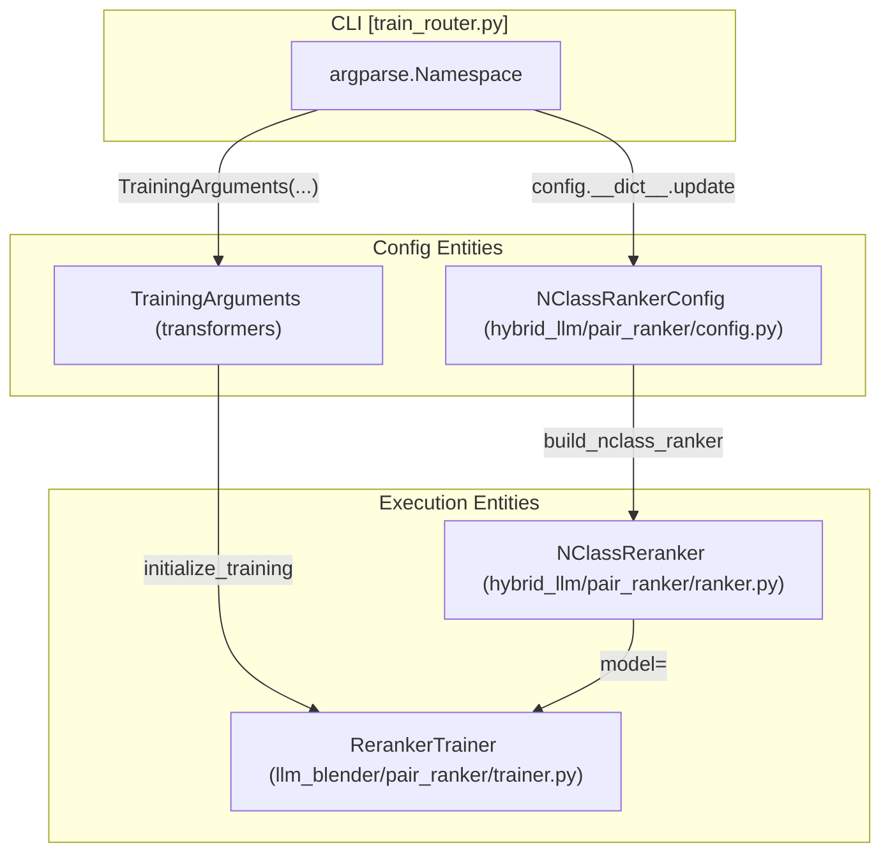
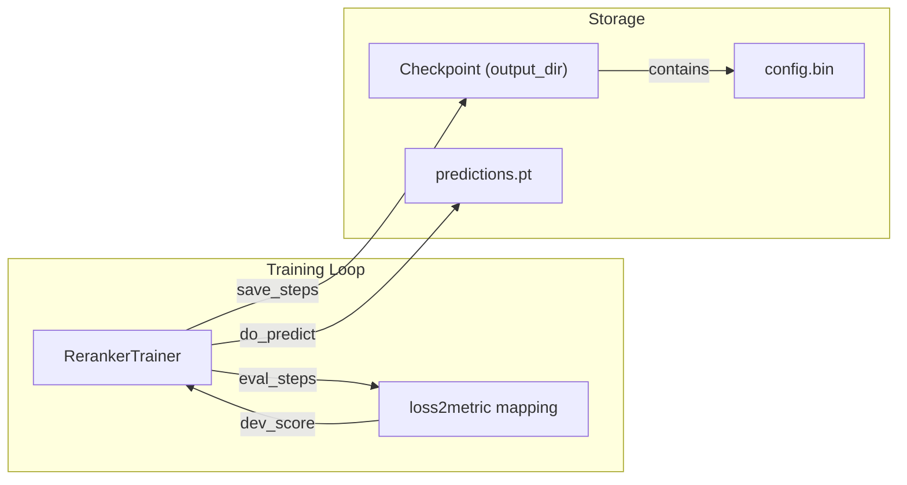

<!-- source: DeepWiki mcp.deepwiki.com · repo microsoft/best-route-llm · page 4.3 Training Configuration and Metrics · fetched 2026-10-26 -->

# Training Configuration and Metrics

Relevant source files

The following files were used as context for generating this wiki page:

- [hybrid_llm/pair_ranker/config.py](hybrid_llm/pair_ranker/config.py)
- [hybrid_llm/pair_ranker/trainer.py](hybrid_llm/pair_ranker/trainer.py)
- [train_router.py](train_router.py)

This page documents the configuration management and evaluation metrics for the router training system. The system relies on the `NClassRankerConfig` class for hyperparameter management and a set of specialized `compute_metrics` functions to evaluate different loss formulations (deterministic vs. probabilistic). The training process is orchestrated by `train_router.py`, which integrates HuggingFace `TrainingArguments` with custom logic for Best-of-N routing.

## NClassRankerConfig

The `NClassRankerConfig` class in `hybrid_llm/pair_ranker/config.py` defines the structural and behavioral parameters of the router. It extends beyond standard transformer configurations to include routing-specific logic such as candidate counts and inference modes.

### Key Hyperparameters

| Parameter | Type | Default | Description |
| :--- | :--- | :--- | :--- |
| `ranker_type` | `str` | `"nclass"` | Determines the architecture; currently supports "nclass" [hybrid_llm/pair_ranker/config.py:15-18](). |
| `loss_type` | `str` | `"det_2cls"` | The loss function used for training (e.g., `det_2cls`, `prob_2cls`) [hybrid_llm/pair_ranker/config.py:45-48](). |
| `n_candidates` | `int` | `-1` | Number of candidate models/responses the router considers [hybrid_llm/pair_ranker/config.py:39-41](). |
| `inference_mode` | `str` | `"bubble"` | Routing logic at inference: `bubble` (sequential comparison) or `full` (all-pair) [hybrid_llm/pair_ranker/config.py:79-81](). |
| `sub_sampling_mode` | `str` | `"all_pair"` | Strategy for pair selection: `top_bottom`, `all_pair`, `random`, or `uniform` [hybrid_llm/pair_ranker/config.py:68-71](). |
| `source_max_length` | `int` | `128` | Maximum tokens for the input prompt [hybrid_llm/pair_ranker/config.py:32-34](). |
| `candidate_max_length`| `int` | `128` | Maximum tokens for the candidate response [hybrid_llm/pair_ranker/config.py:35-37](). |

**Sources:**
- [hybrid_llm/pair_ranker/config.py:9-84]()

## CLI Arguments and Training Execution

The `train_router.py` script serves as the primary entry point. It merges command-line arguments into both the `NClassRankerConfig` and the HuggingFace `TrainingArguments`.

### Data Flow and Initialization
The script follows a sequential setup process:
1. **Device Setup**: Configures CUDA or CPU via `setup_device()` [train_router.py:66-77]().
2. **Tokenizer**: Loads the tokenizer corresponding to the base model (e.g., DeBERTa) [train_router.py:52]().
3. **Model Initialization**: `initialize_model` either builds a new `NClassReranker` or loads from a checkpoint [train_router.py:80-108]().
4. **Trainer Setup**: `initialize_training` maps the `loss_type` to a specific metric function and initializes the `RerankerTrainer` [train_router.py:111-180]().

### Configuration Mapping Diagram
The following diagram illustrates how CLI arguments are distributed across the system components.

"Configuration and Model Initialization Flow"

**Sources:**
- [train_router.py:36-64]()
- [train_router.py:80-108]()
- [train_router.py:111-180]()

## Evaluation Metrics

The system implements four distinct metric functions in `hybrid_llm/pair_ranker/trainer.py`, selected based on the `loss_type` provided in the configuration [train_router.py:28-33]().

### Metric Function Implementations

| Function | Associated Loss | Primary Metric | Implementation Detail |
| :--- | :--- | :--- | :--- |
| `compute_metrics_for_prob_2cls` | `prob_2cls` | Spearman Correlation | Calculates correlation between predicted score differences and ground truth score differences [hybrid_llm/pair_ranker/trainer.py:88-144](). |
| `compute_metrics_for_det_nclass` | `det_ncls` | Accuracy | Uses `torch.argmax` on predictions and labels to compute top-1 selection accuracy [hybrid_llm/pair_ranker/trainer.py:49-66](). |
| `compute_metrics_for_det_nlabel` | `det_nlabels` | MSE | Computes Mean Squared Error between sigmoid-activated predictions and binary labels [hybrid_llm/pair_ranker/trainer.py:68-85](). |
| `compute_metrics_for_prob_nlabel`| `prob_nlabels`| Spearman Correlation | Averages Spearman scores across task-specific score differences [hybrid_llm/pair_ranker/trainer.py:18-46](). |

### Selection Logic
For classification-based losses, the trainer uses `calculate_selections` to determine:
- `sel_acc`: Accuracy of the router's top-ranked choice compared to the Oracle's best choice [hybrid_llm/pair_ranker/trainer.py:184]().
- `avg_score`: The mean quality score (e.g., ArmoRM) of the responses selected by the router [hybrid_llm/pair_ranker/trainer.py:132]().

**Sources:**
- [hybrid_llm/pair_ranker/trainer.py:18-144]()
- [train_router.py:28-33]()

## Training Infrastructure

The router supports modern training optimizations through the HuggingFace `Trainer` integration.

### Checkpointing and Precision
- **FP16 Support**: Enabled via `args.fp16` in `TrainingArguments` [train_router.py:156]() and reflected in `NClassRankerConfig` [hybrid_llm/pair_ranker/config.py:83]().
- **DeepSpeed**: Integrated via the `deepspeed` argument, allowing for distributed training and memory optimization [train_router.py:157]().
- **Best Model Tracking**: Uses `load_best_model_at_end=True` and `metric_for_best_model` (typically `dev_score`) to ensure the optimal checkpoint is retained [train_router.py:152-153]().

### Checkpoint Loading
The `initialize_model` function in `train_router.py` handles checkpoint restoration by loading the `config.bin` and then invoking `build_nclass_ranker_from_checkpoint` [train_router.py:95-99]().

"Training and Checkpointing Architecture"

**Sources:**
- [train_router.py:95-108]()
- [train_router.py:130-168]()
- [hybrid_llm/pair_ranker/config.py:83]()

---

