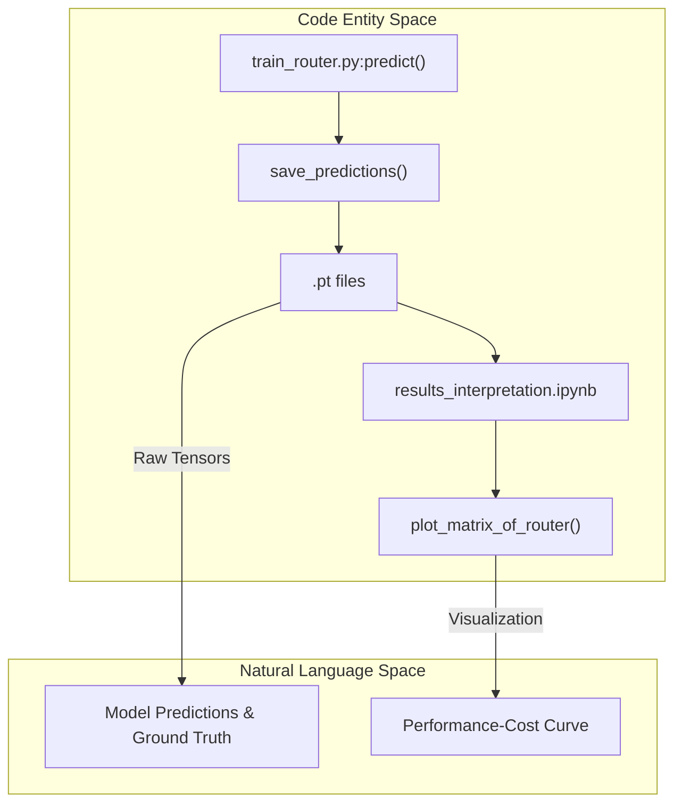
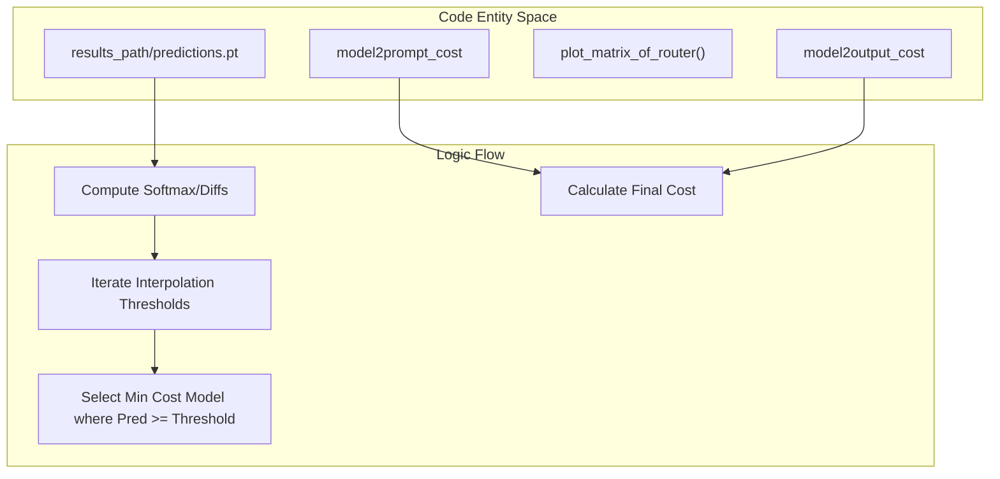

<!-- source: DeepWiki mcp.deepwiki.com · repo microsoft/best-route-llm · page 5 Evaluation and Results Interpretation · fetched 2026-10-26 -->

# Evaluation and Results Interpretation

Relevant source files

The following files were used as context for generating this wiki page:

- [README.md](README.md)
- [results_interpretation.ipynb](results_interpretation.ipynb)
- [train_router.py](train_router.py)

This section describes the post-training phase of the routing pipeline. After a router is trained using `train_router.py`, its performance must be evaluated against standalone LLM baselines and theoretical oracles. This involves interpreting the raw tensor outputs (predictions and labels) and visualizing the performance-cost trade-offs to determine if the routing strategy successfully achieves higher quality at lower compute costs.

### Overview of the Evaluation Flow

The evaluation process begins with the `predict` function in the training script, which generates scores for candidate models on a test set. These scores are then processed in a dedicated notebook to visualize the "Performance-Cost Curve."

#### Evaluation Pipeline Logic
The following diagram illustrates how the code moves from raw inference to visual analysis:

**Router Evaluation and Visualization Flow**

**Sources:** [train_router.py:62-63](), [train_router.py:228-233](), [results_interpretation.ipynb:61-65]()

---

### 5.1 Prediction Output Format
When the router runs in prediction mode (`--do_predict`), it generates two primary files in the output directory: `predictions.pt` and `labels.pt`. These files contain the raw logits produced by the `NClassReranker` and the corresponding ground-truth scores (usually from the Oracle Reward Model).

*   **predictions.pt**: Contains the model's predicted scores for each candidate in the routing pool.
*   **labels.pt**: Contains the actual rewards/scores associated with those candidates.

The `save_predictions` function handles the serialization of these tensors using `torch.save`. For details on how to load these tensors and map them back to specific model names or prompt IDs, see [Prediction Output Format](#5.1).

**Sources:** [train_router.py:228-245](), [results_interpretation.ipynb:137-139]()

---

### 5.2 Performance-Cost Curve Analysis
The ultimate goal of BEST-Route and HybridLLM is to shift the performance-cost boundary. This is analyzed in `results_interpretation.ipynb` by plotting the average reward (quality) against the total inference cost.

#### Cost Modeling and Selection
The notebook uses cost constants defined in `notebooks/utils.py` (e.g., `model2prompt_cost` and `model2output_cost`) combined with token counts to calculate the financial or compute cost of each routing decision. 

The selection logic simulates a threshold-based router:
1.  **Thresholding**: For various confidence thresholds, the router selects the cheapest model that meets the predicted quality bar.
2.  **Fallback**: If no model meets the bar, it defaults to the most capable (and expensive) model, such as `gpt-4o`.

The function `plot_matrix_of_router` iterates through these thresholds to generate the curve. For a deep dive into the plotting logic and how to compare different routing strategies, see [Performance-Cost Curve Analysis](#5.2).

**Selection Logic Mapping**

**Sources:** [results_interpretation.ipynb:16-17](), [results_interpretation.ipynb:43-46](), [results_interpretation.ipynb:61-114](), [results_interpretation.ipynb:144-160]()

---

### Summary Table: Evaluation Components

| Component | File/Function | Purpose |
| :--- | :--- | :--- |
| **Prediction Generator** | `train_router.py` / `predict()` | Executes inference on the test dataset. |
| **Data Saver** | `train_router.py` / `save_predictions()` | Writes `predictions.pt` and `labels.pt` to disk. |
| **Metrics Calculator** | `hybrid_llm/pair_ranker/trainer.py` | Computes Spearman correlation, MSE, and Accuracy during eval. |
| **Visualizer** | `results_interpretation.ipynb` | Plots the quality vs. cost trade-off curves. |
| **Cost Constants** | `notebooks/utils.py` | Provides the price-per-token for different LLM providers. |

**Sources:** [train_router.py:17-18](), [train_router.py:228-245](), [results_interpretation.ipynb:16-17](), [results_interpretation.ipynb:61-65]()

---

