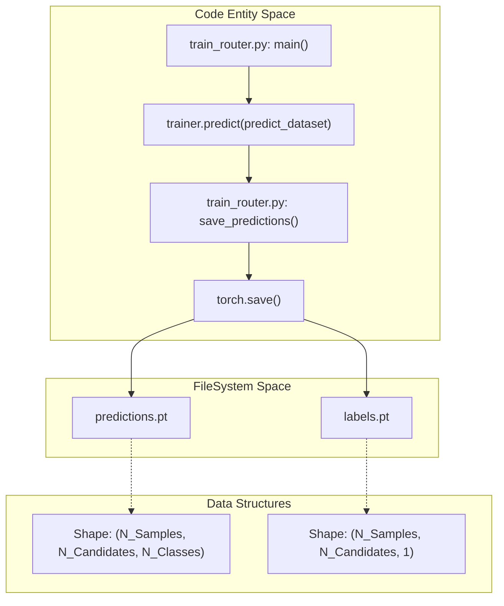

<!-- source: DeepWiki mcp.deepwiki.com · repo microsoft/best-route-llm · page 5.1 Prediction Output Format · fetched 2026-10-26 -->

# Prediction Output Format

<details>
<summary>Relevant source files</summary>

The following files were used as context for generating this wiki page:

- [results_interpretation.ipynb](results_interpretation.ipynb)
- [train_router.py](train_router.py)

</details>


This page details the structure and handling of the prediction outputs generated by the router training and evaluation pipeline. When the router is executed in prediction mode, it produces serialized PyTorch tensors that represent the model's confidence scores and the corresponding ground truth labels. These files are essential for subsequent performance-cost analysis and visualization.

## Overview of Output Files

During the execution of `train_router.py` with the `--do_predict` flag enabled, the system saves two primary files to the specified `--output_dir`: `predictions.pt` and `labels.pt` [train_router.py:46-48](). These files allow for offline evaluation without re-running the computationally expensive inference phase of the router.

| File | Type | Description |
| :--- | :--- | :--- |
| `predictions.pt` | `torch.Tensor` | Raw logits or probabilities output by the `NClassReranker`. |
| `labels.pt` | `torch.Tensor` | Ground truth scores (e.g., armoRM scores) for each candidate. |

### Data Flow: From Trainer to Disk

The following diagram illustrates how the `RerankerTrainer` (extending the HuggingFace `Trainer`) processes a `predict_dataset` and serializes the results.

**Router Prediction Data Flow**

Sources: [train_router.py:62-63](), [train_router.py:228-251]()

## Tensor Structures

### labels.pt
The labels tensor contains the ground truth quality scores used to evaluate the router. These are typically the scores assigned by the Oracle Reward Model (armoRM).
*   **Structure**: The tensor is usually saved with a shape of `(num_samples, num_candidates, 1)` [results_interpretation.ipynb:138-138]().
*   **Accessing**: In analysis scripts, the tensor is often squeezed to remove the trailing dimension: `labels.pt.squeeze(2)[..., 0]` [results_interpretation.ipynb:138-138]().

### predictions.pt
The predictions tensor contains the output of the `NClassReranker` head.
*   **Structure**: The shape depends on the `loss_type` configured during training. For `prob_2cls` (probability-based binary classification), the final dimension contains 2 values (typically representing the probability of "good" vs "bad" relative to a threshold) [results_interpretation.ipynb:80-82]().
*   **Transformation**: To derive a routing decision, the logits are typically passed through a softmax and then compared. For example, in `results_interpretation.ipynb`, the difference between the two class probabilities is calculated to determine the router's confidence in a candidate [results_interpretation.ipynb:80-82]().

## Implementation in `train_router.py`

The saving logic is encapsulated in the `save_predictions` function. It ensures that the output directory exists and uses `torch.save` to write the tensors.

```python
def save_predictions(args, predict_results):
    if not os.path.exists(args.output_dir):
        os.makedirs(args.output_dir)
    torch.save(torch.tensor(predict_results.predictions), 
               os.path.join(args.output_dir, "predictions.pt"))
    torch.save(torch.tensor(predict_results.label_ids), 
               os.path.join(args.output_dir, "labels.pt"))
```
Sources: [train_router.py:241-251]()

## Programmatic Inspection and Usage

To inspect these files, they must be loaded back into a PyTorch environment. The following diagram shows the relationship between the loaded tensors and the cost metadata used in the `results_interpretation.ipynb` notebook.

**Analysis Loading Logic**
```mermaid
graph TD
    subgraph "Natural Language Space"
        "Oracle Scores" -- "Extracted from" --> "Labels Tensor"
        "Model Confidence" -- "Extracted from" --> "Predictions Tensor"
        "Inference Cost" -- "Calculated from" --> "Metadata"
    end

    subgraph "Code Entity Space"
        L["labels.pt"] -->|torch.load| AL["all_labels"]
        P["predictions.pt"] -->|torch.load| AP["all_predictions"]
        D["hybridllm_dataset_...jsonl"] -->|load_sample| TD["test_data"]
        TD -->|model2prompt_cost| AC["all_cost"]
        
        AL & AP & AC --> PL["plot_matrix_of_router()"]
    end
```
Sources: [results_interpretation.ipynb:132-162](), [results_interpretation.ipynb:61-72]()

### Example: Loading and Processing Predictions
In the evaluation notebook, the predictions are processed to select the "best" model candidate based on a confidence threshold $t$:

1.  **Load Tensors**: Tensors are loaded using `torch.load` [results_interpretation.ipynb:138-139]().
2.  **Softmax Normalization**: Logits are converted to probabilities [results_interpretation.ipynb:80-80]().
3.  **Confidence Calculation**: For binary classification routers, the score is often `prob[0] - prob[1]` [results_interpretation.ipynb:82-82]().
4.  **Thresholding**: Candidates are filtered by whether their predicted confidence exceeds a threshold $t$, and the lowest-cost candidate satisfying that threshold is selected [results_interpretation.ipynb:91-94]().

Sources: [results_interpretation.ipynb:80-94]()

---

