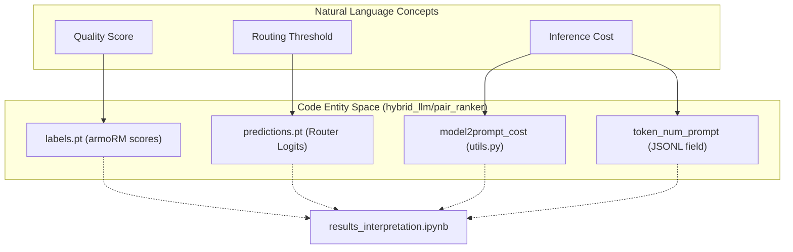
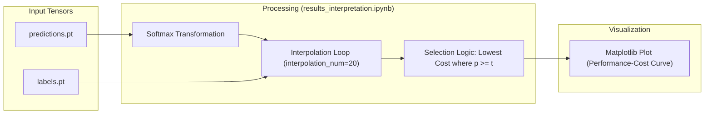

<!-- source: DeepWiki mcp.deepwiki.com · repo microsoft/best-route-llm · page 5.2 Performance-Cost Curve Analysis · fetched 2026-10-26 -->

# Performance-Cost Curve Analysis

<details>
<summary>Relevant source files</summary>

The following files were used as context for generating this wiki page:

- [figures/bestroute.png](figures/bestroute.png)
- [figures/hybridllm.png](figures/hybridllm.png)
- [results_interpretation.ipynb](results_interpretation.ipynb)

</details>


The final stage of the BEST-Route pipeline involves evaluating the router's ability to navigate the trade-off between model performance (quality) and inference cost. This analysis is primarily conducted using the `results_interpretation.ipynb` notebook, which processes the prediction tensors generated during the evaluation phase to visualize how the router performs against various baselines.

## Overview of Evaluation Data Flow

The evaluation process depends on two primary inputs: the test dataset containing token counts and the prediction outputs from the trained router.

1.  **Prediction Tensors**: During evaluation, `train_router.py` saves `predictions.pt` (the router's logits) and `labels.pt` (the ground truth scores) to the output directory [train_router.py:168-171]().
2.  **Cost Metadata**: The test dataset (e.g., `hybridllm_dataset_armoRM_ourRM_bo5_ALL_token_num_test.jsonl`) contains `token_num_prompt` and `token_num_responses` for every candidate model response [results_interpretation.ipynb:142-160]().
3.  **Cost Modeling**: Unit costs for different models (prompt vs. output) are retrieved from `model2prompt_cost` and `model2output_cost` dictionaries in `utils.py` [results_interpretation.ipynb:16-16]().

### Data Association Diagram
This diagram shows how high-level performance metrics are mapped to specific code entities and data structures.

"Natural Language Performance Concepts" to "Code Entity Space"

Sources: [results_interpretation.ipynb:12-16](), [results_interpretation.ipynb:138-140](), [results_interpretation.ipynb:148-151]()

## Plotting the Performance-Cost Curve

The core logic for generating the trade-off curve is implemented in the `plot_matrix_of_router` function within the `results_interpretation.ipynb` notebook.

### Implementation Logic
The notebook performs an interpolation over a range of probability thresholds to simulate different routing behaviors:

1.  **Logit Processing**: The raw predictions are converted to probabilities using a softmax. The difference between the first two classes (often representing "better" vs "worse" in a pair-ranking context) is calculated to determine a routing confidence [results_interpretation.ipynb:80-82]().
2.  **Threshold Sweeping**: The code iterates through `interpolation_num` (default 20) steps between the minimum and maximum predicted probability differences [results_interpretation.ipynb:87-88]().
3.  **Model Selection**: For each prompt and threshold `t`, the router selects the **lowest-cost model** that satisfies the confidence threshold `_p >= t` [results_interpretation.ipynb:94]().
4.  **Fallback**: If no model satisfies the threshold, the router defaults to the last model in the candidate list (typically the most expensive/powerful model) [results_interpretation.ipynb:96-97]().

### Visualizing Results
The resulting plot displays "Cost ($ / 1K queries)" on the X-axis and "armoRM scores (↑)" on the Y-axis [results_interpretation.ipynb:164-165]().

"Routing Decision and Plotting Pipeline"

Sources: [results_interpretation.ipynb:80-102](), [results_interpretation.ipynb:138-140]()

## Comparison Baselines

To interpret the effectiveness of BEST-Route, the curves are compared against several baselines:

| Baseline | Description |
| :--- | :--- |
| **Standalone Models** | Individual points representing fixed models (e.g., GPT-4o, Llama-3.1-8B) without routing. |
| **HybridLLM** | Routing between a cheap and an expensive model using a single sample each. |
| **BEST-Route** | Routing that considers Best-of-N (BoN) samples for candidate models, allowing for higher quality at the cost of more tokens [results_interpretation.ipynb:153-155](). |
| **Oracle** | An ideal router that always picks the best response regardless of cost (the upper bound). |

### Cost Calculation Details
The cost for a specific routing decision is calculated dynamically:
```python
cost = (c['token_num_prompt'] * model2prompt_cost[candidate_model] + 
        c['token_num_responses'] * model2output_cost[candidate_model])
```
[results_interpretation.ipynb:148-151]()

## Key Variables and Configuration
The notebook requires consistency with the training configuration:
*   **`bon`**: The number of samples (Best-of-N) used during data preparation (e.g., `bon = 5`) [results_interpretation.ipynb:25]().
*   **`candidate_model_list`**: Must match the `--candidate_model` argument used in `train_router.py` [results_interpretation.ipynb:134]().
*   **`results_path`**: The directory where `predictions.pt` and `labels.pt` are stored [results_interpretation.ipynb:137]().

Sources: [results_interpretation.ipynb:24-28](), [results_interpretation.ipynb:43-46](), [results_interpretation.ipynb:61-114](), [results_interpretation.ipynb:131-160]()

---

