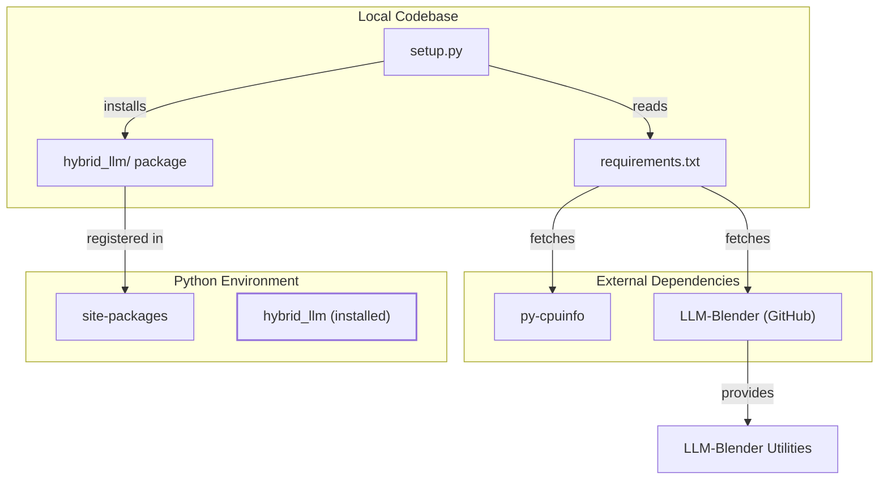
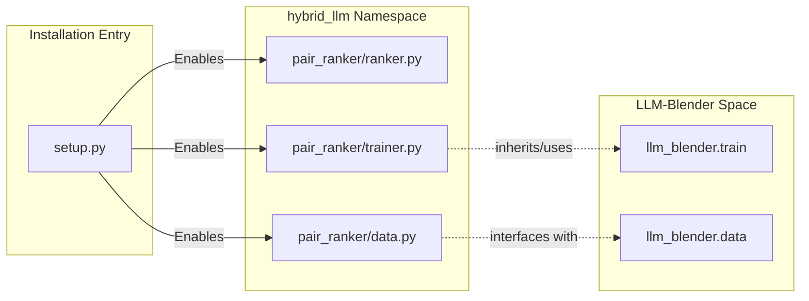

<!-- source: DeepWiki mcp.deepwiki.com · repo microsoft/best-route-llm · page 6.1 Core Package Installation · fetched 2026-10-26 -->

# Core Package Installation

<details>
<summary>Relevant source files</summary>

The following files were used as context for generating this wiki page:

- [hybrid_llm/__init__.py](hybrid_llm/__init__.py)
- [requirements.txt](requirements.txt)
- [setup.py](setup.py)

</details>


This page documents the installation and environment setup for the `hybrid_llm` package, which serves as the foundational library for the BEST-Route and HybridLLM routing frameworks. The package leverages `LLM-Blender` for its core ranking utilities and is structured to be installed as an editable or standard Python package.

## Package Structure and `setup.py`

The `hybrid_llm` package is defined as a standard Python package using `setuptools`. The `setup.py` file facilitates the installation of the local source code into a Python environment, allowing other scripts (like `train_router.py`) to import from `hybrid_llm` regardless of their directory depth.

| File | Role |
| :--- | :--- |
| `setup.py` | Entry point for `setuptools` to package the `hybrid_llm` directory [setup.py:1-7](). |
| `hybrid_llm/__init__.py` | Marks the directory as a Python package [hybrid_llm/__init__.py:1](). |

### Installation Process

To install the core package and its dependencies, users typically run:

```bash
pip install -e .
```

This command triggers `setuptools.setup()`, which reads the package configuration and installs the requirements specified in the environment [setup.py:6-6]().

**Sources:**
- [setup.py:1-7]()
- [hybrid_llm/__init__.py:1-1]()

## Dependency Management

The project relies on a specific set of external libraries to handle hardware introspection and large-scale language model ranking. These are defined in `requirements.txt`.

### Key Dependencies

| Dependency | Purpose |
| :--- | :--- |
| `py-cpuinfo` | Used for hardware detection and optimization during model training and inference [requirements.txt:1-1](). |
| `LLM-Blender` | The primary framework for the router's ranking logic, providing utilities for pair-wise ranking and data collation [requirements.txt:2-2](). |

### LLM-Blender Integration

The most critical dependency is `LLM-Blender`, which is installed directly from its GitHub repository to ensure access to specific sub-modules:
- `example`: For reference implementations.
- `train`: For training utilities utilized by the router.
- `data`: For data processing and prompt handling.
- `eval`: For evaluation metrics.

The installation string `llm-blender[example,train,data,eval] @ git+https://github.com/yuchenlin/LLM-Blender.git#egg=LLM-Blender` ensures that all necessary extras are included [requirements.txt:2-2]().

**Sources:**
- [requirements.txt:1-3]()

## Installation Flow and Data Space

The following diagram illustrates the relationship between the installation files and how they bridge the local `hybrid_llm` code with external dependencies and the Python environment.

### Installation Logic and Entity Mapping



**Sources:**
- [setup.py:4-6]()
- [requirements.txt:1-2]()

## Component Relationship

The `hybrid_llm` package is built to extend `LLM-Blender`. While `LLM-Blender` provides the generic infrastructure for ranking LLM outputs, `hybrid_llm` implements specific logic for the HybridLLM and BEST-Route paradigms, such as cost-aware routing and specific N-Class ranking heads.

### Code Entity Association

This diagram shows how the installation of `hybrid_llm` enables the use of internal modules alongside the `LLM-Blender` dependency.



**Sources:**
- [setup.py:6-6]()
- [requirements.txt:2-2]()
- [hybrid_llm/__init__.py:1-1]()

---

