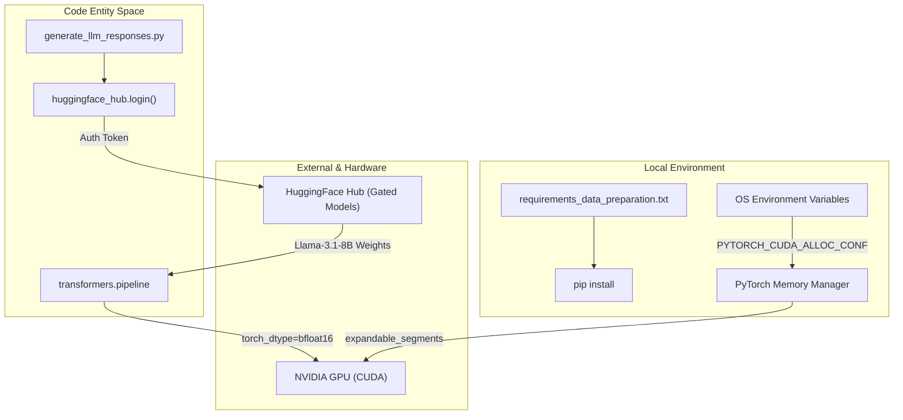
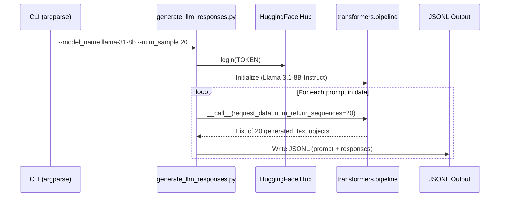

<!-- source: DeepWiki mcp.deepwiki.com · repo microsoft/best-route-llm · page 6.2 Notebook Environment Setup · fetched 2026-10-26 -->

# Notebook Environment Setup

<details>
<summary>Relevant source files</summary>

The following files were used as context for generating this wiki page:

- [.gitignore](.gitignore)
- [notebooks/generate_llm_responses.py](notebooks/generate_llm_responses.py)
- [notebooks/requirements_data_preparation.txt](notebooks/requirements_data_preparation.txt)

</details>


This page provides the technical requirements and configuration steps necessary to run the data preparation and reward modeling notebooks in the BEST-Route / HybridLLM project. The environment setup is specifically tailored to handle large-scale LLM response generation, reward model scoring, and dataset processing.

## Dependency Management

The project distinguishes between core package dependencies and the specific requirements needed for the data preparation pipeline. The notebook-specific dependencies are listed in `notebooks/requirements_data_preparation.txt`.

### Key Libraries and Roles

| Library | Version | Role in Pipeline |
| :--- | :--- | :--- |
| `transformers` | `4.44.0` | Model loading and inference for Llama 3.1 and ArmoRM. |
| `trl` | `0.10.1` | Used for training the Proxy Reward Model (ourRM) via `RewardTrainer`. |
| `accelerate` | Latest | Handles multi-GPU distribution and `device_map="auto"` logic. |
| `datasets` | Latest | Loading and manipulating JSONL files as HuggingFace Dataset objects. |
| `huggingface_hub` | Latest | Authentication for gated models (Llama 3.1). |
| `torch` | Latest | Underlying tensor operations and CUDA kernels. |

Sources: `[notebooks/requirements_data_preparation.txt:1-10]()`

## HuggingFace Hub Authentication

The project utilizes gated models, specifically **Llama-3.1-8B-Instruct**. Accessing these models requires a HuggingFace account, acceptance of the Meta license agreement, and a valid User Access Token.

In the generation script `notebooks/generate_llm_responses.py`, authentication is handled via the `login()` function from `huggingface_hub`. Users must replace the placeholder with their actual token to successfully initialize the model pipeline.

```python
# notebooks/generate_llm_responses.py:22-25
def generate_llm_response(data, model_name, num_sample=20):
    # login to Hugging Face Hub
    login('YOUR_HUGGINGFACE_TOKEN')

    model_id = model2path[model_name]
```

Sources: `[notebooks/generate_llm_responses.py:22-25]()`

## GPU and CUDA Configuration

To prevent Out-of-Memory (OOM) errors during heavy sampling (e.g., generating 20 samples per prompt), the environment utilizes specific CUDA memory management settings.

### Memory Allocation Tuning
The script sets `PYTORCH_CUDA_ALLOC_CONF` to `expandable_segments:True`. This setting helps reduce memory fragmentation by allowing PyTorch to use a more flexible segment allocation strategy, which is critical when using `num_return_sequences` with large values.

```python
# notebooks/generate_llm_responses.py:14
os.environ["PYTORCH_CUDA_ALLOC_CONF"] = "expandable_segments:True"
```

### Precision and Mapping
Models are loaded using `torch.bfloat16` to optimize memory usage without significant quality loss. The `device_map="auto"` parameter ensures that the `transformers.pipeline` efficiently distributes model layers across available GPUs.

Sources: `[notebooks/generate_llm_responses.py:14-32]()`

## Data Flow and Environment Interaction

The following diagram illustrates how the environment configuration enables the interaction between the local code, the HuggingFace Hub, and the GPU hardware.

### Environment Setup and Model Initialization

Sources: `[notebooks/generate_llm_responses.py:14-32]()`, `[notebooks/requirements_data_preparation.txt:1-7]()`

## Implementation Detail: Response Generation Pipeline

The generation script `notebooks/generate_llm_responses.py` acts as the primary entry point for creating the raw data needed for router training. It implements a specific logic for Llama 3.1 terminators and sampling.

### Model and Pipeline Mapping
The script maps model aliases to their official HuggingFace paths and configures the `text-generation` pipeline.

| Entity | Implementation |
| :--- | :--- |
| **Model ID** | `meta-llama/Meta-Llama-3.1-8B-Instruct` |
| **Data Loader** | `utils.load_sample` |
| **Terminators** | EOS token + `<|eot_id|>` |
| **Sampling Logic** | `temperature=1`, `top_p=1`, `do_sample=True` |

### Generation Sequence Diagram

Sources: `[notebooks/generate_llm_responses.py:17-66]()`, `[notebooks/generate_llm_responses.py:68-76]()`

---

