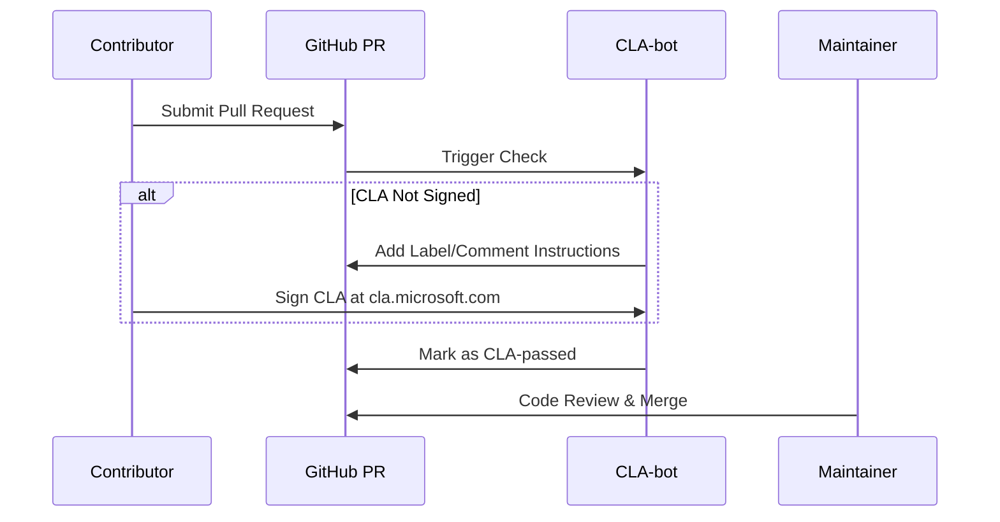

<!-- source: DeepWiki mcp.deepwiki.com · repo microsoft/best-route-llm · page 7 Project Governance · fetched 2026-10-26 -->

# Project Governance

<details>
<summary>Relevant source files</summary>

The following files were used as context for generating this wiki page:

- [CODE_OF_CONDUCT.md](CODE_OF_CONDUCT.md)
- [CONTRIBUTING.md](CONTRIBUTING.md)
- [LICENSE.md](LICENSE.md)
- [SECURITY.md](SECURITY.md)

</details>


This page provides an overview of the open-source governance framework for the `best-route-llm` repository. As a Microsoft-managed project, it adheres to standardized policies regarding licensing, community contributions, ethical conduct, and security vulnerability reporting.

### Governance Framework Overview

The project is governed by three primary pillars:
1.  **Legal & Licensing**: Use of the software is permitted under the MIT License.
2.  **Community Engagement**: Contributions are managed through a structured Pull Request (PR) workflow involving a Contributor License Agreement (CLA).
3.  **Security & Ethics**: The project follows Microsoft’s global standards for open-source conduct and coordinated vulnerability disclosure.

The following diagram illustrates the relationship between these governance entities and the codebase assets.

**Governance to Code Mapping**
```mermaid
graph TD
    subgraph "Natural Language Space (Policies)"
        "CLA_Requirement"["Contributor License Agreement"]
        "CoC"["Code of Conduct"]
        "CVD"["Coordinated Vulnerability Disclosure"]
    end

    subgraph "Code Entity Space (Files)"
        "CONTRIBUTING_MD"["CONTRIBUTING.md"]
        "LICENSE_MD"["LICENSE.md"]
        "CODE_OF_CONDUCT_MD"["CODE_OF_CONDUCT.md"]
        "SECURITY_MD"["SECURITY.md"]
    end

    "CLA_Requirement" --> "CONTRIBUTING_MD"
    "CoC" --> "CODE_OF_CONDUCT_MD"
    "CVD" --> "SECURITY_MD"
    "LICENSE_MD" -- "Defines Usage Rights" --> "CONTRIBUTING_MD"
```
Sources: [CONTRIBUTING.md:1-14](), [LICENSE.md:1-21](), [CODE_OF_CONDUCT.md:1-11](), [SECURITY.md:1-41]()

---

### Contributing and Licensing
The `best-route-llm` project is released under the **MIT License**, allowing for broad reuse, modification, and distribution [LICENSE.md:3-21](). 

To maintain the legal integrity of the codebase, all contributors must sign a **Contributor License Agreement (CLA)**. This process is automated via a `CLA-bot` that triggers when a Pull Request is submitted [CONTRIBUTING.md:8-10](). Additionally, all participants are expected to uphold the **Microsoft Open Source Code of Conduct** to ensure a welcoming and inclusive environment.

For details, see [Contributing and Licensing](#7.1).

**Contribution Workflow**

Sources: [CONTRIBUTING.md:3-10](), [CODE_OF_CONDUCT.md:1-11]()

---

### Security Policy and Vulnerability Reporting
Microsoft treats the security of the `best-route-llm` source code with high priority [SECURITY.md:3-5](). We follow the principle of **Coordinated Vulnerability Disclosure (CVD)** [SECURITY.md:39-39](). 

Security issues should **never** be reported via public GitHub issues. Instead, they must be submitted through the Microsoft Security Response Center (MSRC) portal or via encrypted email [SECURITY.md:11-15](). High-quality reports may be eligible for the Microsoft Bug Bounty program [SECURITY.md:31-31]().

For details, see [Security Policy and Vulnerability Reporting](#7.2).

| Reporting Channel | Method |
| :--- | :--- |
| **Primary Portal** | [MSRC Create Report](https://msrc.microsoft.com/create-report) |
| **Email** | secure@microsoft.com |
| **Encryption** | PGP Key (available via MSRC) |
| **Response SLA** | Typically within 24 hours |

Sources: [SECURITY.md:9-17](), [SECURITY.md:39-39]()

---

