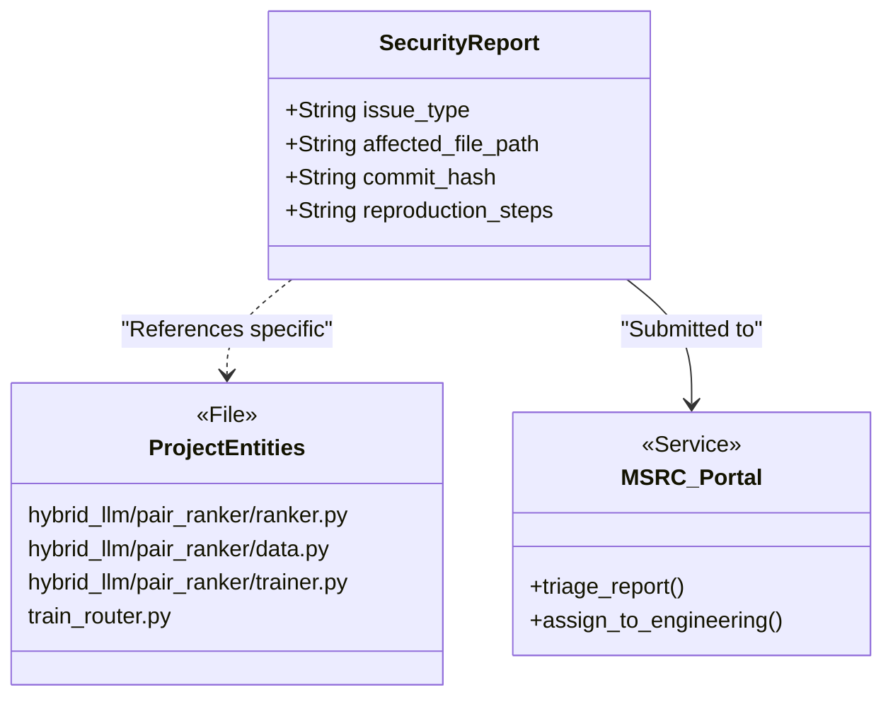

<!-- source: DeepWiki mcp.deepwiki.com · repo microsoft/best-route-llm · page 7.2 Security Policy and Vulnerability Reporting · fetched 2026-10-26 -->

# Security Policy and Vulnerability Reporting

<details>
<summary>Relevant source files</summary>

The following files were used as context for generating this wiki page:

- [SECURITY.md](SECURITY.md)

</details>


This page outlines the security protocols and vulnerability reporting mechanisms for the **BEST-Route** (HybridLLM) project. As a Microsoft-owned repository, this project adheres to corporate security standards regarding the identification, reporting, and mitigation of software vulnerabilities [SECURITY.md:1-7]().

## Vulnerability Reporting Channels

Microsoft provides two primary channels for reporting security concerns. To protect users of the software, researchers are instructed **not** to report security vulnerabilities through public GitHub issues [SECURITY.md:11-11]().

### 1. MSRC Reporting Portal
The preferred method for submission is the **Microsoft Security Response Center (MSRC)** portal. This platform allows for structured reporting and tracking of the triage process.
*   **URL:** [https://msrc.microsoft.com/create-report](https://msrc.microsoft.com/create-report) [SECURITY.md:13-13]()

### 2. Email Submission
For reporters who prefer not to use the web portal, security issues can be sent directly via email.
*   **Email:** [secure@microsoft.com](mailto:secure@microsoft.com) [SECURITY.md:15-15]()
*   **Encryption:** It is recommended to encrypt email communications using the MSRC PGP key, available at the [MSRC PGP Key page](https://aka.ms/security.md/msrc/pgp) [SECURITY.md:15-15]().

## Reporting Requirements

To facilitate rapid triage and remediation, reports should include technical specifics regarding the manifestation of the issue within the codebase.

### Technical Data Flow: Vulnerability Triage Process

The following diagram illustrates how a reported vulnerability moves from the researcher to the engineering team within the Microsoft ecosystem.

**Vulnerability Disclosure Data Flow**
```mermaid
graph TD
    subgraph "Researcher Space"
        A["Security Researcher"]
        B["Proof of Concept (PoC)"]
    end

    subgraph "Intake Layer"
        C["MSRC Portal / secure@microsoft.com"]
        D["PGP Encryption"]
    end

    subgraph "Triage & Remediation"
        E["MSRC Triage Team"]
        F["Engineering Team (BEST-Route)"]
        G["Coordinated Vulnerability Disclosure (CVD)"]
    end

    A -->| "Submit Report" | C
    B -->| "Attach Exploit" | C
    D -.->| "Secure Channel" | C
    C -->| "Initial Triage" | E
    E -->| "Verify Impact" | F
    F -->| "Patch Development" | G
    G -->| "Public Advisory" | A
```
**Sources:** [SECURITY.md:9-17](), [SECURITY.md:39-39]()

### Required Information
When submitting a report, the following technical details are requested to assist the `BEST-Route` maintainers:

| Information Category | Description |
| :--- | :--- |
| **Issue Type** | Classification (e.g., buffer overflow, insecure deserialization in model loading) [SECURITY.md:21-21]() |
| **Source File Paths** | Specific paths to affected files (e.g., `hybrid_llm/pair_ranker/ranker.py`) [SECURITY.md:22-22]() |
| **Code Location** | The specific branch, tag, or commit hash where the issue exists [SECURITY.md:23-23]() |
| **Reproduction Steps** | Detailed instructions and configuration required to trigger the issue [SECURITY.md:24-25]() |
| **Artifacts** | Proof-of-concept (PoC) or exploit code [SECURITY.md:26-26]() |
| **Impact Assessment** | Analysis of how an attacker might exploit the vulnerability [SECURITY.md:27-27]() |

**Sources:** [SECURITY.md:19-28]()

## Policies and Programs

### Coordinated Vulnerability Disclosure (CVD)
This project follows the principle of **Coordinated Vulnerability Disclosure (CVD)** [SECURITY.md:39-39](). Under this policy, researchers disclose vulnerabilities to Microsoft, and Microsoft commits to a timeline for remediation before the details are made public. This prevents "zero-day" exploitations while ensuring the community is eventually informed of risks.

### Microsoft Bug Bounty Program
Submissions related to this repository may be eligible for the **Microsoft Bug Bounty Program**. Higher-quality reports with complete technical documentation and PoCs typically contribute to higher bounty awards [SECURITY.md:31-31]().

### Communication Standards
*   **Response Time:** Microsoft aims to respond to initial reports within 24 hours [SECURITY.md:17-17]().
*   **Language:** All security-related communications must be conducted in English [SECURITY.md:35-35]().

## Code Entity Association

This section bridges the security reporting requirements with the specific entities found in the `BEST-Route` codebase.

**Security Reporting to Code Entity Mapping**

**Sources:** [SECURITY.md:13-13](), [SECURITY.md:22-23]()

---

