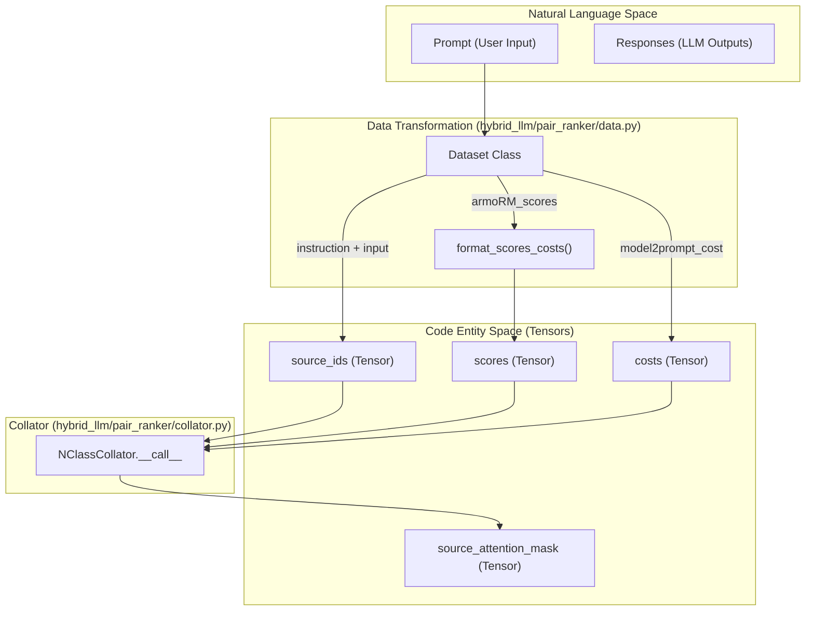
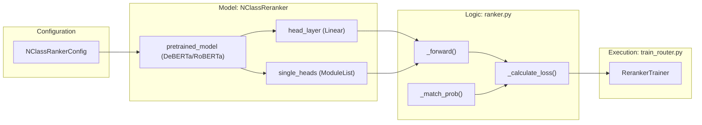

<!-- source: DeepWiki mcp.deepwiki.com · repo microsoft/best-route-llm · page 8 Glossary · fetched 2026-10-26 -->

# Glossary

Relevant source files

The following files were used as context for generating this wiki page:

- [README.md](README.md)
- [hybrid_llm/pair_ranker/collator.py](hybrid_llm/pair_ranker/collator.py)
- [hybrid_llm/pair_ranker/config.py](hybrid_llm/pair_ranker/config.py)
- [hybrid_llm/pair_ranker/data.py](hybrid_llm/pair_ranker/data.py)
- [hybrid_llm/pair_ranker/ranker.py](hybrid_llm/pair_ranker/ranker.py)
- [hybrid_llm/pair_ranker/trainer.py](hybrid_llm/pair_ranker/trainer.py)
- [notebooks/scoring_per_model_armoRM.py](notebooks/scoring_per_model_armoRM.py)
- [notebooks/scoring_per_model_ourRM.py](notebooks/scoring_per_model_ourRM.py)
- [notebooks/utils.py](notebooks/utils.py)
- [train_router.py](train_router.py)

This glossary provides definitions for the technical terms, architectural components, and domain-specific concepts used in the BEST-Route and HybridLLM codebase.

## Core Concepts

### HybridLLM
A routing strategy focused on the cost-quality trade-off for single-sample outputs [README.md:19-20](). It aims to route queries to the smallest (cheapest) model capable of providing an adequate response for a given task complexity [README.md:14-17]().

### BEST-Route
An adaptive routing strategy that extends HybridLLM by incorporating **Best-of-N (BoN)** sampling at test time [README.md:21-22](). It optimizes the performance-cost curve by deciding not only which model to use but also how many samples ($N$) to generate to achieve optimal compute [README.md:10-11]().

### Oracle Reward Model (armoRM)
The "ground truth" scoring mechanism used during the data preparation phase. It uses the `RLHFlow/ArmoRM-Llama3-8B-v0.1` model to provide high-quality scores for LLM responses [notebooks/scoring_per_model_armoRM.py:16-18](). These scores are used as targets to train the Proxy Reward Model and the Router [README.md:81-82]().

### Proxy Reward Model (ourRM)
A smaller, more efficient reward model trained to mimic the Oracle's scoring behavior. It is typically based on `DeBERTa-v3-large-v2` [README.md:91]() and trained using a "min_max_mid" data preparation pattern [README.md:86](). It provides the `ourRM_scores` used by the router at inference time [notebooks/scoring_per_model_ourRM.py:31-37]().

---

## Architectural Components

### NClassReranker
The core neural network module for the router, implemented as a `nn.Module` [hybrid_llm/pair_ranker/ranker.py:24](). It takes source text (prompts) and predicts which candidate model or BoN configuration is most likely to satisfy the query requirements.

*   **head_layer**: A linear layer that maps the hidden state to the number of candidates [hybrid_llm/pair_ranker/ranker.py:61-64]().
*   **single_heads**: A `ModuleList` of linear heads used for specific loss types like `prob_nlabels` [hybrid_llm/pair_ranker/ranker.py:68-76]().

### NClassCollator
Handles the preparation of batches for the router. It adds a special `SOURCE_PREFIX` (`<|source|>`) to the input tokens [hybrid_llm/pair_ranker/collator.py:10-13]() and encodes the source text using `llm_blender` utilities [hybrid_llm/pair_ranker/collator.py:79-81]().

### RerankerTrainer
A specialized trainer class inherited from `llm_blender` used to execute the training loop for the `NClassReranker` [train_router.py:170-178]().

### Data Flow: From Natural Language to Code Entities

The following diagram illustrates how natural language prompts and model responses are transformed into tensors for the Router.

**Natural Language to Tensor Mapping**

**Sources:** [hybrid_llm/pair_ranker/data.py:20-66](), [hybrid_llm/pair_ranker/collator.py:53-88](), [hybrid_llm/pair_ranker/data.py:151-180]()

---

## Technical Terms & Parameters

| Term | Definition | Code Pointer |
| :--- | :--- | :--- |
| `loss_type` | Defines the optimization objective (e.g., `det_ncls`, `prob_nlabels`). | [hybrid_llm/pair_ranker/ranker.py:16-21]() |
| `match_t` | A threshold ($t$) used to determine if a smaller model's score is "good enough" compared to a larger model. | [hybrid_llm/pair_ranker/ranker.py:41]() |
| `inference_mode` | Determines the routing logic; `bubble` (sequential check) or `full` (all candidates). | [hybrid_llm/pair_ranker/config.py:79-81]() |
| `model2prompt_cost` | Dictionary mapping model names to their input token costs. | [hybrid_llm/pair_ranker/data.py:16]() |
| `model2output_cost`| Dictionary mapping model names to their output token costs. | [hybrid_llm/pair_ranker/data.py:17]() |

### Loss Types (`NClassRerankerLossType`)
The router supports several loss functions for different routing behaviors [hybrid_llm/pair_ranker/ranker.py:119-155]():
*   **`det_2cls`**: Deterministic binary classification (Small vs. Large).
*   **`prob_2cls`**: Probabilistic binary classification based on `_match_prob`.
*   **`det_ncls`**: Deterministic multi-class classification to pick the best model.
*   **`prob_nlabels`**: Probabilistic multi-label approach comparing each candidate against the largest model.

---

## System Integration Diagram

This diagram shows the relationship between the configuration, the model architecture, and the training utility.

**Router Training Architecture**

**Sources:** [hybrid_llm/pair_ranker/ranker.py:24-78](), [hybrid_llm/pair_ranker/ranker.py:159-181](), [train_router.py:170-178]()

### Metrics and Evaluation
The system uses different metrics based on the selected `loss_type` [train_router.py:28-33]():
*   **Spearman Correlation**: Used for probabilistic losses (`prob_nlabels`, `prob_2cls`) to measure the relationship between predicted and actual score differences [hybrid_llm/pair_ranker/trainer.py:36-39]().
*   **Accuracy**: Used for deterministic classification (`det_ncls`) [hybrid_llm/pair_ranker/trainer.py:63]().
*   **MSE**: Used for multi-label regression (`det_nlabels`) [hybrid_llm/pair_ranker/trainer.py:82]().

**Sources:** [hybrid_llm/pair_ranker/trainer.py:18-85](), [train_router.py:28-33]()