# Page: Overview

# Overview

<details>
<summary>Relevant source files</summary>

The following files were used as context for generating this wiki page:

- [README.md](README.md)
- [figures/bestroute.png](figures/bestroute.png)
- [figures/hybridllm.png](figures/hybridllm.png)

</details>


The **Adaptive LLM Routing Strategies** project provides a framework for optimizing the performance-cost trade-offs of Large Language Models (LLMs). As LLMs range from expensive, high-capability models (e.g., GPT-4o) to smaller, cost-effective models (e.g., Phi-3, Llama-3.1-8B), this project implements intelligent routers that decide which model—or sampling strategy—to use for a given query.

The codebase supports two primary routing paradigms:
1.  **HybridLLM**: Routing a query to a single model selected from a pool of candidates to balance cost and quality [README.md:19-20]().
2.  **BEST-Route**: Routing a query to a small model and dynamically deciding the number of samples ($N$) to generate for Best-of-N sampling, optimizing test-time compute [README.md:21-22]().

### Core Routing Strategies

The project centers on moving beyond a "one-size-fits-all" approach to LLM inference. By using a router, the system can send simple queries to cheap models and reserve expensive models (or multiple samples) for complex tasks.

*   **HybridLLM**: Focuses on selecting the best single model for a prompt. For more details, see [Routing Strategies: HybridLLM and BEST-Route](#1.1).
*   **BEST-Route**: Focuses on "Test-Time Optimal Compute," where the router predicts if generating multiple responses from a small model will likely yield a high-quality result that surpasses a single expensive model call. For more details, see [Routing Strategies: HybridLLM and BEST-Route](#1.1).

### System Architecture

The following diagram illustrates how the high-level routing concepts map to specific code entities and data structures within the repository.

**Diagram: Routing Conceptual Map to Code Entities**
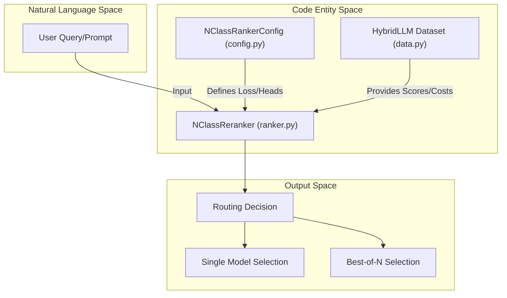
**Sources:** [hybrid_llm/pair_ranker/ranker.py:23-45](), [hybrid_llm/pair_ranker/config.py:10-30](), [hybrid_llm/pair_ranker/data.py:102-120]()

### The End-to-End Pipeline

The project follows a structured pipeline from raw data collection to a deployed router. This process involves multiple stages of data preparation, reward modeling (using both "Oracle" and "Proxy" models), and router training.

1.  **Data Preparation**: Mixing datasets and generating responses from various LLMs [README.md:31-55]().
2.  **Reward Modeling**: Scoring responses using an Oracle (ArmoRM) and training a local Proxy Reward Model (ourRM) [README.md:57-119]().
3.  **Router Training**: Training the `NClassReranker` to predict the best routing path based on predicted quality and cost [README.md:121-140]().

For a detailed walkthrough of these steps, see [End-to-End Pipeline Overview](#1.2).

**Diagram: Pipeline Execution Flow**
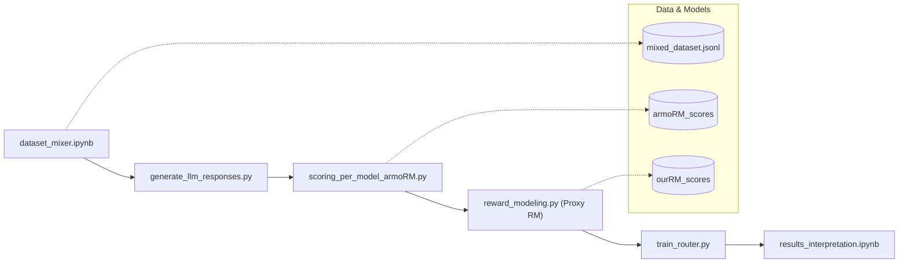
**Sources:** [README.md:31-140](), [notebooks/reward_modeling.py:89-111](), [train_router.py:126-140]()

### Key Components

| Component | Responsibility | Key File(s) |
| :--- | :--- | :--- |
| **Data Preparation** | Merging prompts, sampling LLM responses, and counting tokens. | `dataset_mixer.ipynb`, `generate_llm_responses.py` |
| **Reward Modeling** | Scoring LLM outputs using Oracle (ArmoRM) and training a Proxy RM. | `scoring_per_model_armoRM.py`, `reward_modeling.py` |
| **Router Model** | The `NClassReranker` class that performs the actual routing logic. | [hybrid_llm/pair_ranker/ranker.py]() |
| **Training Engine** | Orchestrates the training of routers using various loss functions. | `train_router.py`, `hybrid_llm/pair_ranker/trainer.py` |
| **Evaluation** | Visualizing the performance-cost curve. | `results_interpretation.ipynb` |

**Sources:** [README.md:1-140](), [hybrid_llm/pair_ranker/ranker.py:23-45]()

---
**Child Pages:**
*   [Routing Strategies: HybridLLM and BEST-Route](#1.1)
*   [End-to-End Pipeline Overview](#1.2)

---

# Page: Routing Strategies: HybridLLM and BEST-Route

# Routing Strategies: HybridLLM and BEST-Route

<details>
<summary>Relevant source files</summary>

The following files were used as context for generating this wiki page:

- [README.md](README.md)
- [figures/bestroute.png](figures/bestroute.png)
- [figures/hybridllm.png](figures/hybridllm.png)

</details>


This page details the two core routing paradigms supported by the codebase: **HybridLLM** and **BEST-Route**. These strategies address the fundamental trade-off between inference cost and response quality by intelligently distributing queries across a portfolio of Large Language Models (LLMs).

## Overview of Routing Paradigms

The repository implements two distinct approaches to adaptive computation:

1.  **HybridLLM**: A cost-efficient routing strategy that selects a single model (typically either a "Small" or "Large" model) to generate a single response for a given prompt.
2.  **BEST-Route**: An advanced routing strategy that leverages **Best-of-N (BoN)** sampling. It decides whether to sample multiple responses from a smaller model and select the best one using a reward model, or to route the query to a more expensive, high-performing model.

| Feature | HybridLLM | BEST-Route |
| :--- | :--- | :--- |
| **Primary Goal** | Single-sample cost/quality trade-off | Test-time optimal compute via BoN |
| **Decision Space** | Select Model $M_i$ | Select (Model $M_i$, Sample Count $N_j$) |
| **Inference Cost** | Fixed per model | Variable based on $N$ |
| **Code Implementation** | `HybridLLM` mapping in data prep | `NClassReranker` with multiple labels |

Sources: [README.md:9-22](), [README.md:126-134]()

---

## HybridLLM: Cost-Quality Trade-off

HybridLLM focuses on the observation that not all tasks require the reasoning capabilities of frontier models like GPT-4. Many queries can be answered adequately by smaller models (e.g., Phi-3, Llama-3-8B), significantly reducing costs.

### Data Flow and Logic
In the HybridLLM setup, the router acts as a classifier that predicts which model in a set of candidates $\{M_1, M_2, ... M_k\}$ will provide the best utility (a function of reward and cost).

**Key Components:**
*   **Dataset Mapping**: The script `data_preparation_hybridllm_mapping.ipynb` transforms raw LLM responses into a format where each prompt is associated with the performance of specific candidate models.
*   **Cost Modeling**: Uses `model2prompt_cost` and `model2output_cost` defined in `hybrid_llm/pair_ranker/data.py` to calculate the theoretical cost of routing to a specific model based on token counts.

### Implementation Details
The training data for HybridLLM is prepared by comparing the scores of different models (e.g., `gpt-4o` vs `llama-31-8b`) and assigning labels based on which model achieved a higher reward relative to its cost.

Sources: [README.md:19-20](), [README.md:123-123](), [hybrid_llm/pair_ranker/data.py:15-25]()

---

## BEST-Route: Adaptive Test-Time Compute

BEST-Route extends the routing concept by treating the number of samples ($N$) in a Best-of-N setup as a routable parameter. It aims to find the "Test-Time Optimal Compute" by determining if $N$ samples from a small model can outperform a single sample from a large model at a lower or similar cost.

### Implementation Architecture
The core of BEST-Route is the `NClassReranker` class. Unlike a standard binary classifier, it is designed to handle multiple "candidates," where each candidate is a unique (Model, $N$) pair.

#### Logic Diagram: BEST-Route Decision Flow
This diagram shows how a prompt is processed by the `NClassReranker` to select the optimal compute path.

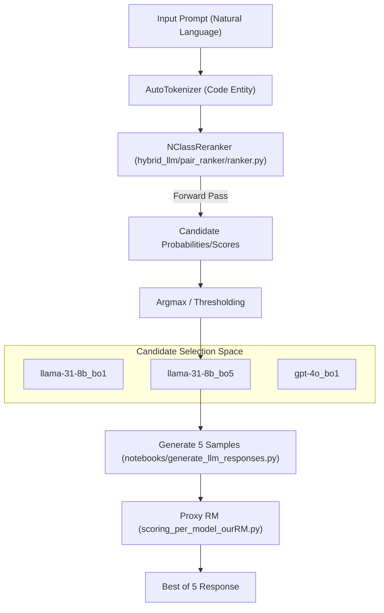
Sources: [hybrid_llm/pair_ranker/ranker.py:16-35](), [README.md:126-134]()

### The N-Class Reranker
The `NClassReranker` is a neural module that can be configured with different loss functions to optimize for ranking or classification.

*   **Class Definition**: `class NClassReranker(nn.Module)` in [hybrid_llm/pair_ranker/ranker.py:16-16]().
*   **Loss Types**: Supported types include `det_ncls` (deterministic N-class), `prob_nlabels` (probabilistic N-labels), and `det_2cls`.
*   **Architecture**:
    *   `self.head_layer`: A linear layer mapping the encoder hidden state to candidate scores [hybrid_llm/pair_ranker/ranker.py:33-35]().
    *   `_match_prob`: A helper function that calculates the probability of a candidate being the "best" [hybrid_llm/pair_ranker/ranker.py:113-128]().

---

## Technical Comparison: Code Entity Space

The following diagram bridges the conceptual strategies to the specific classes and data structures used in the implementation.

```mermaid
classDiagram
    class RouterTraining {
        <<Script>>
        train_router.py
    }
    class NClassReranker {
        +forward(input_ids, attention_mask)
        +compute_loss()
        -loss_type: str
    }
    class NClassCollator {
        +__call__(features)
        -encode_texts()
    }
    class HybridDataset {
        +load_data()
        +filter_candidates()
    }

    RouterTraining --> NClassReranker : initializes
    RouterTraining --> NClassCollator : uses for batching
    NClassCollator --> HybridDataset : processes items from
    
    style NClassReranker stroke-width:2px
    style HybridDataset stroke-width:2px
```
Sources: [train_router.py:155-180](), [hybrid_llm/pair_ranker/ranker.py:16-40](), [hybrid_llm/pair_ranker/collator.py:14-25](), [hybrid_llm/pair_ranker/data.py:65-80]()

### Key Differences in Configuration
When running the training script `train_router.py`, the strategy is determined by the `--candidate_model` argument.

*   **For HybridLLM**: You might pass `--candidate_model "llama-31-8b,gpt-4o"`.
*   **For BEST-Route**: You pass specific BoN candidates, e.g., `--candidate_model "llama-31-8b_ourRM_bo1,llama-31-8b_ourRM_bo5,gpt-4o_ourRM_bo1"` [README.md:132-132]().

## When to Use Which?

1.  **Use HybridLLM when**:
    *   Inference latency must be kept to a minimum (single sample only).
    *   The primary goal is to offload simple queries from a flagship model to a commodity model.
    *   You do not have a reliable Reward Model (RM) to perform selection at test time.

2.  **Use BEST-Route when**:
    *   You have a high-quality Reward Model available.
    *   You want to maximize the performance of smaller models through sampling.
    *   You are willing to trade off higher compute for the "small model" path to potentially avoid the "large model" path.

Sources: [README.md:19-23](), [README.md:126-134]()

---

# Page: End-to-End Pipeline Overview

# End-to-End Pipeline Overview

<details>
<summary>Relevant source files</summary>

The following files were used as context for generating this wiki page:

- [README.md](README.md)
- [notebooks/dataset_mixer.ipynb](notebooks/dataset_mixer.ipynb)
- [notebooks/generate_llm_responses.py](notebooks/generate_llm_responses.py)
- [notebooks/reward_modeling.py](notebooks/reward_modeling.py)
- [notebooks/scoring_per_model_armoRM.py](notebooks/scoring_per_model_armoRM.py)
- [train_router.py](train_router.py)

</details>


This page describes the sequential pipeline of the BEST-Route and HybridLLM frameworks. The workflow spans from initial dataset construction to the final evaluation of routing strategies that balance LLM response quality against inference cost.

## High-Level Workflow

The pipeline is designed to transform raw prompts into a trained router capable of selecting the optimal model or sampling strategy (Best-of-N) for a given query. The process is divided into six major stages:

1.  **Data Preparation**: Mixing prompt sources and generating multiple LLM responses.
2.  **Oracle Scoring**: Using a high-capacity Reward Model (RM) to establish "ground truth" quality.
3.  **Cost Modeling**: Calculating token counts to estimate inference expenses.
4.  **Proxy RM Training**: Training a smaller, efficient RM (ourRM) to simulate test-time quality estimation.
5.  **Router Training**: Training the `NClassReranker` to predict the best routing path.
6.  **Evaluation**: Analyzing the performance-cost trade-off curves.

### System Data Flow Diagram

The following diagram illustrates the flow of data through the various scripts and notebooks in the repository.

**Data Flow: From Raw Prompts to Router Predictions**

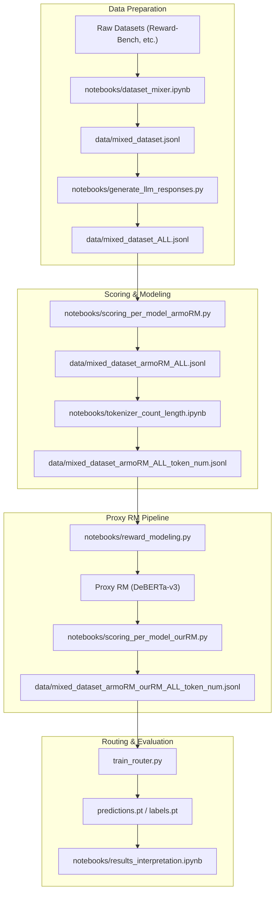

**Sources:**
- [README.md:31-135]()
- [train_router.py:36-64]()

---

## Stage-by-Stage Implementation

### 1. Dataset Mixing and Response Generation
The pipeline begins by sampling prompts from diverse sources such as `reward-bench`, `CodeUltraFeedback`, and `BeaverTails` [notebooks/dataset_mixer.ipynb:30-135](). For each prompt, the system generates $N$ responses (typically $N=20$ for BEST-Route) using different models like `llama-31-8b` or `gpt-4o` [notebooks/generate_llm_responses.py:21-63]().

### 2. Reward Modeling (Oracle vs. Proxy)
A dual-reward system is used to train the router:
*   **Oracle RM**: The `ArmoRM-Llama3-8B-v0.1` model provides high-fidelity scores used as labels for the router [notebooks/scoring_per_model_armoRM.py:14-54]().
*   **Proxy RM**: A `DeBERTa-v3-large-v2` regressor is trained using `trl.RewardTrainer` on "min-max-mid" triplets to provide the router with features it would actually have access to at test time [notebooks/reward_modeling.py:59-118]().

### 3. Router Training Logic
The `train_router.py` script initializes an `NClassReranker` [hybrid_llm/pair_ranker/ranker.py](). It uses an `NClassCollator` to format prompts and candidate model responses into batches [hybrid_llm/pair_ranker/collator.py](). The router is trained to minimize a specific loss (e.g., `prob_nlabels`) which correlates proxy scores and token costs to the oracle's quality assessment [train_router.py:124-135]().

**Entity Mapping: Logic to Code**

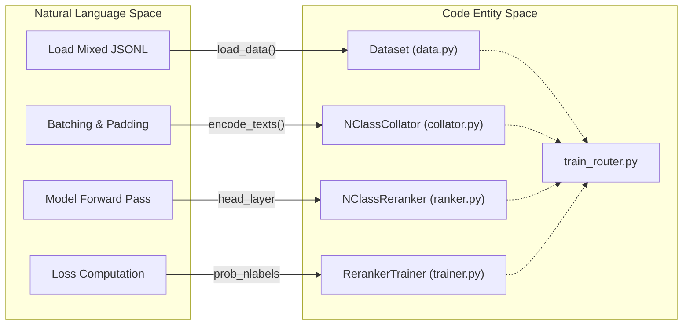

**Sources:**
- [train_router.py:80-108]()
- [hybrid_llm/pair_ranker/ranker.py]()
- [hybrid_llm/pair_ranker/collator.py]()
- [hybrid_llm/pair_ranker/data.py]()

---

## Summary of Data Artifacts

| Stage | Output File | Key Fields Added |
| :--- | :--- | :--- |
| **Mixing** | `mixed_dataset.jsonl` | `id`, `prompt` |
| **Generation** | `mixed_dataset_ALL.jsonl` | `{model_name}: {"responses": [...]}` |
| **Oracle Scoring** | `mixed_dataset_armoRM_ALL.jsonl` | `armoRM_scores` |
| **Costing** | `..._token_num.jsonl` | `token_num_prompt`, `token_num_responses` |
| **Proxy Scoring** | `..._ourRM.jsonl` | `ourRM_scores` |
| **Routing** | `predictions.pt` | Model selection indices and probabilities |

**Sources:**
- [README.md:36-119]()
- [notebooks/generate_llm_responses.py:38-63]()
- [notebooks/scoring_per_model_armoRM.py:21-54]()

## Execution and Evaluation
The final stage involves running `results_interpretation.ipynb` to visualize the Pareto front of the routing policy. This notebook compares the router's performance (based on Oracle RM scores) against the cumulative inference cost, allowing developers to verify if the **BEST-Route** strategy successfully achieves higher quality at lower compute budgets compared to standard single-model baselines [README.md:136-140]().

---

# Page: Data Preparation

# Data Preparation

<details>
<summary>Relevant source files</summary>

The following files were used as context for generating this wiki page:

- [notebooks/data_preparation_hybridllm_mapping.ipynb](notebooks/data_preparation_hybridllm_mapping.ipynb)
- [notebooks/dataset_mixer.ipynb](notebooks/dataset_mixer.ipynb)
- [notebooks/generate_llm_responses.py](notebooks/generate_llm_responses.py)
- [notebooks/tokenizer_count_length.ipynb](notebooks/tokenizer_count_length.ipynb)
- [notebooks/utils.py](notebooks/utils.py)

</details>


This section provides an overview of the data pipeline required to train and evaluate the BEST-Route and HybridLLM routers. The process involves aggregating prompts from diverse sources, generating multiple candidate responses per model, and calculating the associated token costs and lengths.

### Data Workflow Overview

The data preparation stage transforms raw instruction datasets into a structured format where each prompt is associated with multiple LLM outputs, their respective reward scores, and token counts. This structured data is essential for the router to learn the trade-offs between response quality and inference cost.

**Data Flow Architecture**
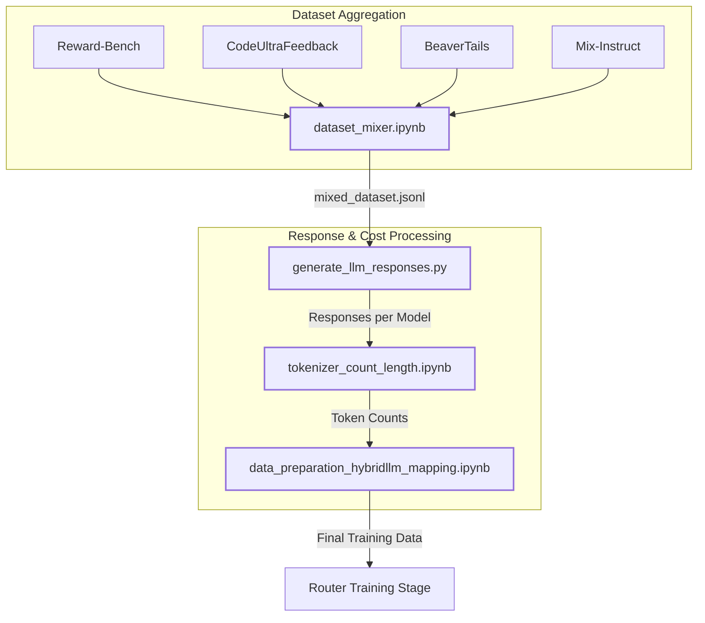
Sources: [notebooks/dataset_mixer.ipynb:150-158](), [notebooks/generate_llm_responses.py:38-41](), [notebooks/tokenizer_count_length.ipynb:34-42](), [notebooks/data_preparation_hybridllm_mapping.ipynb:51-78]()

---

### 2.1 Dataset Mixing and Prompt Collection
The first step involves sampling prompts from four primary open-source datasets to ensure a broad coverage of tasks, including general instructions, coding, and safety-related queries.

*   **Sources:** Data is pulled from `allenai/reward-bench`, `coseal/CodeUltraFeedback`, `llm-blender/mix-instruct`, and `PKU-Alignment/BeaverTails` [notebooks/dataset_mixer.ipynb:31-135]().
*   **Aggregation:** The `dataset_mixer.ipynb` notebook filters these sources (e.g., selecting harmful prompts from BeaverTails) and concatenates them into a unified `mixed_dataset.jsonl` [notebooks/dataset_mixer.ipynb:124-158]().
*   **HybridLLM Mapping:** Post-processing scripts map these prompts into the specific format required for Best-of-N (BoN) sampling, creating candidates that represent different sampling budgets [notebooks/data_preparation_hybridllm_mapping.ipynb:51-78]().

For details, see [Dataset Mixing and Prompt Collection](#2.1).

---

### 2.2 LLM Response Generation
Once prompts are collected, candidate responses are generated using a variety of LLMs. This creates the "candidates" pool that the router will eventually learn to rank.

*   **Generation Script:** `notebooks/generate_llm_responses.py` uses the `transformers.pipeline` to generate responses [notebooks/generate_llm_responses.py:26-32]().
*   **Sampling:** For BEST-Route, the script typically generates $N=20$ samples per prompt to allow for Best-of-N evaluation [notebooks/generate_llm_responses.py:21-21]().
*   **Models:** Supports various models defined in the `model2path` dictionary, such as `llama-31-8b` [notebooks/generate_llm_responses.py:17-19]().

For details, see [LLM Response Generation](#2.2).

---

### 2.3 Token Counting and Cost Modeling
To train a cost-aware router, the system must calculate the exact token usage for every prompt and response pair.

*   **Tokenization:** The `tokenizer_count_length.ipynb` notebook utilizes model-specific tokenizers (e.g., `tiktoken` for GPT models and `AutoTokenizer` for Llama/Mistral) to calculate `token_num_prompt` and `token_num_responses` [notebooks/tokenizer_count_length.ipynb:13-22]().
*   **Cost Constants:** Physical costs are modeled using `model2prompt_cost` and `model2output_cost` tables in `utils.py`, which define the price per token for each supported model [notebooks/utils.py:12-13]().

**Cost Entity Mapping**
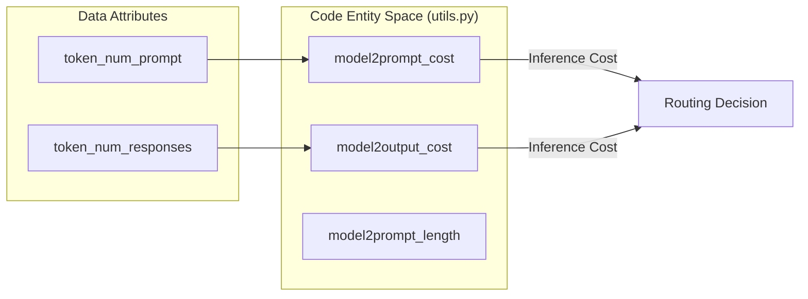
Sources: [notebooks/utils.py:12-16](), [notebooks/tokenizer_count_length.ipynb:38-40]()

For details, see [Token Counting and Cost Modeling](#2.3).

---

# Page: Dataset Mixing and Prompt Collection

# Dataset Mixing and Prompt Collection

<details>
<summary>Relevant source files</summary>

The following files were used as context for generating this wiki page:

- [notebooks/data_preparation_hybridllm_mapping.ipynb](notebooks/data_preparation_hybridllm_mapping.ipynb)
- [notebooks/dataset_mixer.ipynb](notebooks/dataset_mixer.ipynb)

</details>


This page details the initial stage of the BEST-Route / HybridLLM pipeline: the assembly of a diverse prompt dataset from multiple open-source repositories and its subsequent transformation into a format suitable for routing training. The process involves two primary steps: consolidating raw prompts into a unified file and mapping these prompts into a structured format that supports both single-model routing (HybridLLM) and Best-of-N sampling (BEST-Route).

## Prompt Collection and Consolidation

The initial dataset is created by sampling prompts from various domains, including safety (refusals, dangerous content), coding, and general instruction following. This logic is implemented in `notebooks/dataset_mixer.ipynb`.

### Data Sources
The following datasets are sampled and combined:

| Source Dataset | Selection Criteria / Subsets | Sampling Size |
| :--- | :--- | :--- |
| **allenai/reward-bench** | `xstest-`, `refusals-`, `donotanswer`, `hep-` [notebooks/dataset_mixer.ipynb:33-34]() | All matching |
| **coseal/CodeUltraFeedback** | Random sample of instructions [notebooks/dataset_mixer.ipynb:67-71]() | 1,016 |
| **llm-blender/mix-instruct** | Random sample from `train_data_prepared.jsonl` [notebooks/dataset_mixer.ipynb:87-92]() | 6,000 |
| **PKU-Alignment/BeaverTails** | Prompts flagged as harmful via `is_prompt_harmful` [notebooks/dataset_mixer.ipynb:124-135]() | 1,260 |

### Implementation Flow
The `dataset_mixer.ipynb` notebook performs the following operations:
1.  **Loading**: Uses `pandas.read_parquet` or `pd.read_json` to fetch data directly from HuggingFace Hub [notebooks/dataset_mixer.ipynb:32-88]().
2.  **Standardization**: Renames various instruction/input columns to a uniform `prompt` column and generates a unique `id` prefixed by the source name (e.g., `beaver_tails/123`) [notebooks/dataset_mixer.ipynb:133-134]().
3.  **Export**: Concatenates all samples into a single DataFrame and writes to `data/mixed_dataset.jsonl` using the `ndjson` library [notebooks/dataset_mixer.ipynb:151-157]().

**Sources:** `notebooks/dataset_mixer.ipynb`

## HybridLLM and Best-of-N Mapping

Once prompts are collected and responses have been generated and scored (see sections 2.2 and 3.1), the data must be mapped into a specific schema used by the `hybrid_llm` package. This occurs in `notebooks/data_preparation_hybridllm_mapping.ipynb`.

### The Mapping Logic
The goal of this step is to translate the `mixed_dataset` (which contains raw model outputs and scores) into a format where each entry represents a set of "candidates" that the router can choose from. 

For BEST-Route (Best-of-N), a "candidate" is not just a model, but a model combined with a specific sampling strategy (e.g., `gpt-4o_ourRM_bo3` representing GPT-4o with Best-of-3 sampling) [notebooks/data_preparation_hybridllm_mapping.ipynb:73-77]().

### Data Flow: From Mixed Dataset to HybridLLM Format

The following diagram illustrates how raw prompt data and model scores are transformed into the `candidates` structure required for router training.

**Natural Language to Code Entity Mapping: Dataset Transformation**
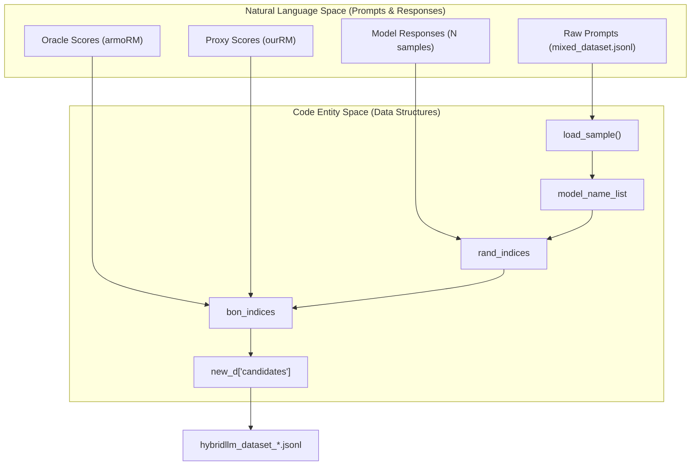
**Sources:** `notebooks/data_preparation_hybridllm_mapping.ipynb:14-20](), [notebooks/data_preparation_hybridllm_mapping.ipynb:34-37](), [notebooks/data_preparation_hybridllm_mapping.ipynb:61-78]()

### Best-of-N Simulation
The notebook simulates the Best-of-N process to generate training labels:
1.  **Random Sampling**: For a given $N$, it selects $N$ random indices from the available responses [notebooks/data_preparation_hybridllm_mapping.ipynb:67]().
2.  **Proxy Selection**: It identifies the "best" response among those $N$ based on the **Proxy Reward Model** (`ourRM_scores`) [notebooks/data_preparation_hybridllm_mapping.ipynb:68]().
3.  **Oracle Labeling**: It assigns the **Oracle Reward Model** score (`armoRM_scores`) of that selected response as the ground-truth quality for that candidate [notebooks/data_preparation_hybridllm_mapping.ipynb:69]().
4.  **Cost Aggregation**: It sums the token counts of all $N$ sampled responses to model the total inference cost [notebooks/data_preparation_hybridllm_mapping.ipynb:70]().

### Output Schema
The resulting JSONL files (train, validation, test) follow this structure:
*   `id`: Original prompt ID.
*   `input`: The prompt text.
*   `candidates`: A list of dictionaries, where each contains:
    *   `model`: Identifier string (e.g., `{model_name}_ourRM_bo{n}`) [notebooks/data_preparation_hybridllm_mapping.ipynb:73]().
    *   `scores`: Dictionary containing the `armoRM_scores` (Oracle quality) [notebooks/data_preparation_hybridllm_mapping.ipynb:75]().
    *   `token_num_prompt`: Length of the input.
    *   `token_num_responses`: Total tokens generated during the BoN process [notebooks/data_preparation_hybridllm_mapping.ipynb:77]().

**Sources:** `notebooks/data_preparation_hybridllm_mapping.ipynb:52-78](), [notebooks/data_preparation_hybridllm_mapping.ipynb:93-119](), [notebooks/data_preparation_hybridllm_mapping.ipynb:134-160]()

## System Entity Relationship

The following diagram maps the files and logical components involved in the dataset mixing and mapping process.

**System Entity Relationship Diagram**
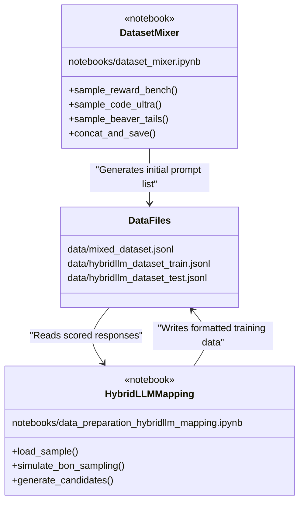
**Sources:** `notebooks/dataset_mixer.ipynb:154-157](), [notebooks/data_preparation_hybridllm_mapping.ipynb:18-20](), [notebooks/data_preparation_hybridllm_mapping.ipynb:52-53]()

---

# Page: LLM Response Generation

# LLM Response Generation

<details>
<summary>Relevant source files</summary>

The following files were used as context for generating this wiki page:

- [notebooks/generate_llm_responses.py](notebooks/generate_llm_responses.py)
- [notebooks/utils.py](notebooks/utils.py)

</details>


The LLM Response Generation stage is responsible for producing the raw candidate pool required for both **HybridLLM** (single-sample) and **BEST-Route** (Best-of-N) routing strategies. This stage utilizes the `notebooks/generate_llm_responses.py` script to interface with HuggingFace Hub models, manage sampling parameters, and record outputs in a structured JSONL format.

## Execution Flow

The generation process follows a linear execution path from data loading to batch inference. The script `notebooks/generate_llm_responses.py` acts as the primary entry point, leveraging the `transformers` pipeline to handle model loading and tokenization.

### Data Flow Diagram: Generation Pipeline
This diagram illustrates the transition from raw prompt data to model-specific candidate responses.

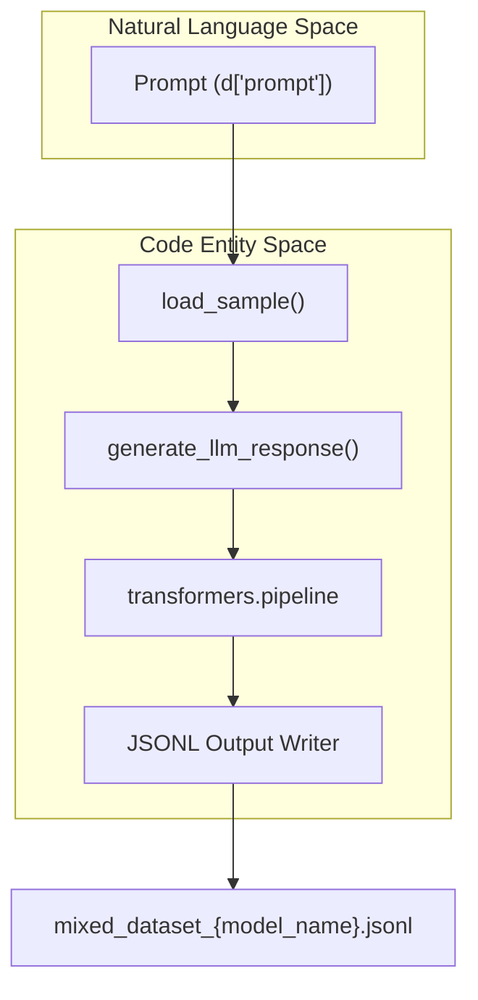
**Sources:** [notebooks/generate_llm_responses.py:21-66](), [notebooks/utils.py:3-10]()

## Configuration and Authentication

### Model Endpoints
Models are mapped from internal identifiers to HuggingFace Hub repository IDs via the `model2path` dictionary. For example, `llama-31-8b` is mapped to `meta-llama/Meta-Llama-3.1-8B-Instruct` [notebooks/generate_llm_responses.py:17-19]().

### HuggingFace Authentication
The script requires a valid HuggingFace token to access gated models (like Llama 3.1). This is handled via the `login()` function within the generation loop [notebooks/generate_llm_responses.py:23]().

### Hardware Optimization
To prevent Out-of-Memory (OOM) errors during heavy sampling, the script configures PyTorch's CUDA memory allocator:
*   `PYTORCH_CUDA_ALLOC_CONF` is set to `expandable_segments:True` [notebooks/generate_llm_responses.py:14]().
*   Models are loaded using `torch.bfloat16` and `device_map="auto"` to distribute layers across available GPUs [notebooks/generate_llm_responses.py:29-30]().

## Sampling Logic (Best-of-N)

The core of the **BEST-Route** strategy is the generation of multiple candidate responses for a single prompt. This is controlled by the `num_sample` parameter.

| Parameter | Default Value | Description |
| :--- | :--- | :--- |
| `num_sample` | 20 | The number of independent completions generated per prompt. |
| `temperature` | 1 | Ensures diversity in sampling. |
| `top_p` | 1 | Nucleus sampling threshold. |
| `max_new_tokens` | 500 | Limit on response length. |

The script differentiates between the two routing paradigms through the sample count: Hybrid-LLM typically uses 10 samples, while BEST-Route extends this to 20 to provide a richer candidate pool for the router [notebooks/generate_llm_responses.py:57-72]().

**Sources:** [notebooks/generate_llm_responses.py:50-59]()

## Output Schema

The generation process produces a JSONL file where each line corresponds to a prompt and its associated responses. The results are stored in a model-specific key within the original data dictionary.

### Data Structure Mapping
This diagram shows how code entities populate the final JSONL schema.

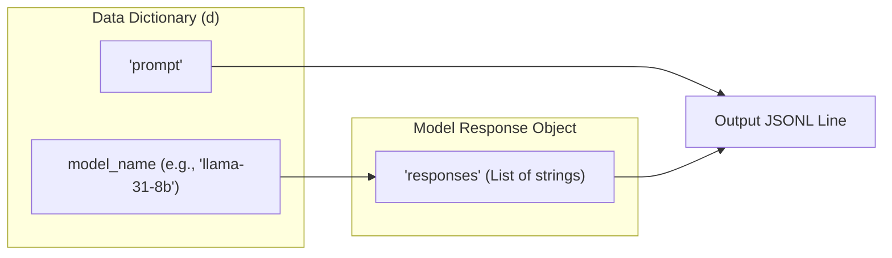

### JSONL Schema Example
The output file is saved at `./outputs/mixed_dataset_{model_name}.jsonl` [notebooks/generate_llm_responses.py:38]().

```json
{
  "prompt": "Explain quantum entanglement.",
  "llama-31-8b": {
    "responses": [
      "Response sample 1...",
      "Response sample 2...",
      "...up to N samples"
    ]
  }
}
```
**Sources:** [notebooks/generate_llm_responses.py:61-63]()

## Key Functions

### `generate_llm_response(data, model_name, num_sample=20)`
*   **Role**: Orchestrates the inference loop.
*   **Implementation**: 
    1.  Initializes the `transformers.pipeline` for `text-generation` [notebooks/generate_llm_responses.py:26-32]().
    2.  Defines `terminators` to correctly handle model-specific end-of-turn tokens like `<|eot_id|>` [notebooks/generate_llm_responses.py:33-36]().
    3.  Iterates through the dataset, formatting each prompt into a chat-like structure [notebooks/generate_llm_responses.py:44-49]().
    4.  Extracts generated text from the pipeline output and updates the data dictionary [notebooks/generate_llm_responses.py:61-62]().

### `load_sample(fname, is_jsonl=True)`
*   **Role**: Utility to load input prompts from either standard JSON or JSONL formats [notebooks/utils.py:3-10]().

**Sources:** [notebooks/generate_llm_responses.py:21-67](), [notebooks/utils.py:3-10]()

---

# Page: Token Counting and Cost Modeling

# Token Counting and Cost Modeling

<details>
<summary>Relevant source files</summary>

The following files were used as context for generating this wiki page:

- [hybrid_llm/pair_ranker/data.py](hybrid_llm/pair_ranker/data.py)
- [notebooks/tokenizer_count_length.ipynb](notebooks/tokenizer_count_length.ipynb)
- [notebooks/utils.py](notebooks/utils.py)

</details>


This section details how the BEST-Route system calculates token lengths and maps them to financial costs. These metrics are critical for the router to perform cost-aware selection between different LLM candidates, enabling the quality-cost trade-offs central to the HybridLLM and BEST-Route paradigms.

## Token Counting Workflow

The process begins with the `tokenizer_count_length.ipynb` notebook, which processes raw datasets to append token count metadata for every model in the candidate pool. Because different models use different tokenization schemes (e.g., Tiktoken for GPT-4o vs. SentencePiece/HuggingFace for Llama), counts must be calculated per model to ensure accurate cost modeling.

### Implementation Details
The notebook initializes a `tokenizer_dict` mapping model identifiers to their respective tokenizer instances `[notebooks/tokenizer_count_length.ipynb:13-22]()`. It then iterates through the dataset, encoding both the prompt and the generated responses to determine their lengths.

*   **Prompt Tokens**: Stored in the `token_num_prompt` field `[notebooks/tokenizer_count_length.ipynb:39-39]()`.
*   **Response Tokens**: Stored as a list in the `token_num_responses` field, corresponding to the $N$ samples generated for each prompt `[notebooks/tokenizer_count_length.ipynb:40-40]()`.

### Data Flow: Natural Language to Token Metadata
The following diagram illustrates how raw text from the mixed dataset is transformed into token-aware JSONL entries used by the router.

**Diagram: Tokenization Data Pipeline**
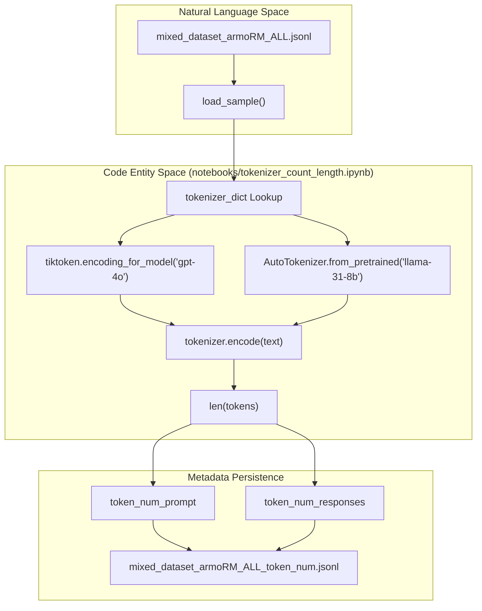
Sources: `[notebooks/tokenizer_count_length.ipynb:7-42]()`, `[notebooks/utils.py:3-10]()`

## Cost Modeling Tables

The system uses static cost tables to estimate the inference expense for each candidate. These tables are defined in both `notebooks/utils.py` and `hybrid_llm/pair_ranker/data.py` to support both data preparation and runtime training.

### Cost Configuration
The costs are represented as price-per-token for input (prompts) and output (completions).

| Model ID | Prompt Cost (per token) | Output Cost (per token) |
| :--- | :--- | :--- |
| `gpt-4o` | 5e-6 | 15e-6 |
| `gpt-35-turbo` | 3e-6 | 6e-6 |
| `llama-31-8b` | 0.3e-6 | 0.61e-6 |
| `phi-3-mini` | 0.3e-6 | 0.9e-6 |
| `mistral-7b` | 0.25e-6 | 0.25e-6 |

Sources: `[notebooks/utils.py:12-13]()`, `[hybrid_llm/pair_ranker/data.py:16-17]()`

## Cost Computation in Data Loading

During the training phase, the `hybrid_llm/pair_ranker/data.py` module consumes the token counts and applies the cost tables to generate a final `cost` value for every candidate response.

### The `format_scores_costs` Function
This function is responsible for normalizing scores and calculating the total cost for each candidate. It performs the following calculation:
$$\text{Total Cost} = (\text{Prompt Tokens} \times \text{Prompt Cost}) + (\text{Response Tokens} \times \text{Output Cost})$$

In the code, this is implemented within a loop that handles both single-sample (HybridLLM) and multi-sample (BEST-Route) scenarios by ensuring the cost list matches the `window_size` (default 10) `[hybrid_llm/pair_ranker/data.py:169-195]()`.

**Diagram: Cost Calculation Logic**
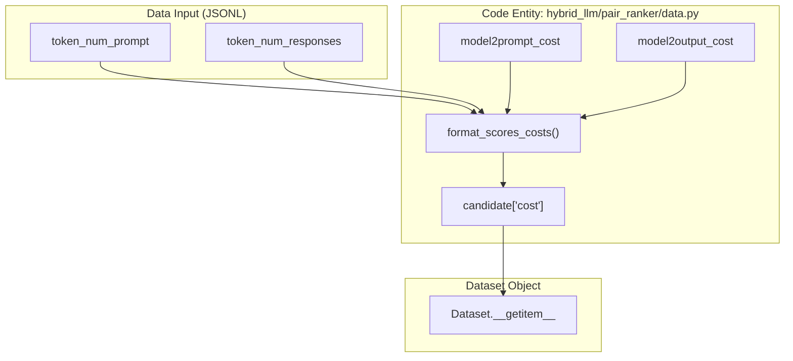
Sources: `[hybrid_llm/pair_ranker/data.py:16-17]()`, `[hybrid_llm/pair_ranker/data.py:151-195]()`

### Dataset Integration
The `Dataset` class (inheriting from `BlenderDataset`) extracts these calculated costs during item retrieval. The `__getitem__` method packages the `candidates_costs` alongside the source text and candidate scores, providing a complete training sample for the router `[hybrid_llm/pair_ranker/data.py:22-66]()`.

Sources: `[hybrid_llm/pair_ranker/data.py:20-66]()`, `[hybrid_llm/pair_ranker/data.py:101-104]()`

---

# Page: Reward Modeling

# Reward Modeling

<details>
<summary>Relevant source files</summary>

The following files were used as context for generating this wiki page:

- [notebooks/reward_modeling.py](notebooks/reward_modeling.py)
- [notebooks/scoring_per_model_armoRM.py](notebooks/scoring_per_model_armoRM.py)
- [notebooks/scoring_per_model_ourRM.py](notebooks/scoring_per_model_ourRM.py)

</details>


Reward modeling is a critical phase in the BEST-Route pipeline that converts qualitative LLM responses into quantitative scalar scores. These scores serve as the ground truth for training the router to select the highest-quality candidate among multiple LLM outputs. 

The system utilizes a two-tier approach:
1.  **Oracle Reward Model (armoRM):** A large, high-capacity model used to label the initial dataset with "gold standard" quality scores.
2.  **Proxy Reward Model (ourRM):** A smaller, more efficient regressor trained to mimic the Oracle's preferences, used for faster scoring or specialized routing tasks.

### Two-Tier Reward Architecture

The following diagram illustrates how the reward modeling components interact with the dataset and the subsequent routing stages.

**Reward Modeling Workflow**
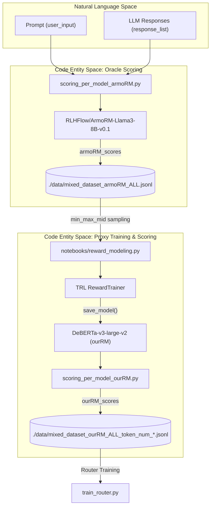
**Sources:** [notebooks/scoring_per_model_armoRM.py:14-54](), [notebooks/reward_modeling.py:108-118](), [notebooks/scoring_per_model_ourRM.py:16-39]()

---

### Oracle Reward Model (armoRM)

The Oracle model, specifically `RLHFlow/ArmoRM-Llama3-8B-v0.1`, is used to generate the primary quality signals for the mixed dataset. The script `scoring_per_model_armoRM.py` processes prompts and their corresponding responses to produce scalar values stored in the `armoRM_scores` field.

Key characteristics of the Oracle phase:
*   **Model:** Uses a Llama-3 8B based reward model [notebooks/scoring_per_model_armoRM.py:16-18]().
*   **Batching & OOM Handling:** The script attempts to score responses in batches using `tokenizer.apply_chat_template` [notebooks/scoring_per_model_armoRM.py:35](). If a `torch.cuda.OutOfMemoryError` occurs, it automatically falls back to sequential scoring for that specific query [notebooks/scoring_per_model_armoRM.py:42-52]().
*   **Data Structure:** Appends a list of floats to each model entry in the JSONL file under the key `armoRM_scores` [notebooks/scoring_per_model_armoRM.py:41]().

For implementation details on model loading and chat template application, see [Oracle Reward Model (armoRM) Scoring](#3.1).

**Sources:** [notebooks/scoring_per_model_armoRM.py:14-54]()

---

### Proxy Reward Model (ourRM)

The Proxy Reward Model (`ourRM`) is a smaller regressor (typically based on DeBERTa-v3) trained to approximate the Oracle's scoring logic. This is useful for reducing the computational overhead of scoring during the routing development cycle.

The proxy lifecycle involves two main scripts:
1.  **Training (`notebooks/reward_modeling.py`):** Uses the `TRL RewardTrainer` to train a sequence classification model [notebooks/reward_modeling.py:108-115](). It expects a dataset of "chosen" and "rejected" pairs, often derived from the Oracle's `min`, `max`, and `mid` scores [notebooks/reward_modeling.py:82-91]().
2.  **Scoring (`scoring_per_model_ourRM.py`):** Applies the trained proxy to the dataset to generate `ourRM_scores` [notebooks/scoring_per_model_ourRM.py:31-37]().

**Proxy Training Data Flow**
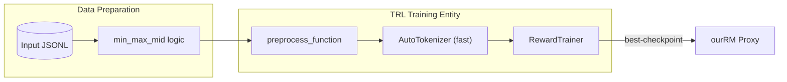
**Sources:** [notebooks/reward_modeling.py:56-61](), [notebooks/reward_modeling.py:75-91](), [notebooks/reward_modeling.py:108-118]()

For details on the `RewardTrainer` configuration and the `min_max_mid` sampling strategy, see [Proxy Reward Model (ourRM) Training and Scoring](#3.2).

**Sources:** [notebooks/reward_modeling.py:32-61](), [notebooks/scoring_per_model_ourRM.py:16-43]()

---

### Summary Table: Reward Models Comparison

| Feature | Oracle (armoRM) | Proxy (ourRM) |
| :--- | :--- | :--- |
| **Base Model** | `ArmoRM-Llama3-8B-v0.1` | e.g., `DeBERTa-v3-large-v2` |
| **Primary Script** | `scoring_per_model_armoRM.py` | `reward_modeling.py` (Train) / `scoring_per_model_ourRM.py` (Score) |
| **Output Field** | `armoRM_scores` | `ourRM_scores` |
| **Input Format** | Chat Template (User/Assistant) | Concatenated String (`Human: ... Assistant: ...`) |
| **Training Method** | Pre-trained | `trl.RewardTrainer` |

**Sources:** [notebooks/scoring_per_model_armoRM.py:16-31](), [notebooks/scoring_per_model_ourRM.py:19-37](), [notebooks/reward_modeling.py:108-115]()

---

# Page: Oracle Reward Model (armoRM) Scoring

# Oracle Reward Model (armoRM) Scoring

<details>
<summary>Relevant source files</summary>

The following files were used as context for generating this wiki page:

- [notebooks/scoring_per_model_armoRM.py](notebooks/scoring_per_model_armoRM.py)
- [notebooks/utils.py](notebooks/utils.py)

</details>


The Oracle Reward Model (armoRM) scoring stage is a critical component of the BEST-Route pipeline. It uses a high-capacity reward model, `RLHFlow/ArmoRM-Llama3-8B-v0.1`, to generate "ground truth" quality scores for every LLM response in the dataset. These scores serve as the target labels for training the proxy reward models and the final routers.

## Implementation Overview

The scoring process is primarily implemented in `notebooks/scoring_per_model_armoRM.py`. The script loads a pre-trained `ArmoRM-Llama3-8B-v0.1` model and iterates through a dataset containing prompts and multiple candidate responses from different LLMs.

### Key Components

*   **Model Loading**: The model is loaded using `AutoModelForSequenceClassification` with `torch.bfloat16` precision to balance performance and memory usage [notebooks/scoring_per_model_armoRM.py:16-18]().
*   **Chat Templating**: The script uses the tokenizer's `apply_chat_template` to format the prompt and response pairs into the structure expected by the Llama-3-based reward model [notebooks/scoring_per_model_armoRM.py:35]().
*   **Batch Scoring**: For efficiency, the script attempts to score all responses for a given prompt in a single batch [notebooks/scoring_per_model_armoRM.py:35-41]().

### Data Flow and Code Entity Mapping

The following diagram illustrates how the scoring script interacts with the data and the underlying model entities.

**Diagram: ArmoRM Scoring Logic Flow**
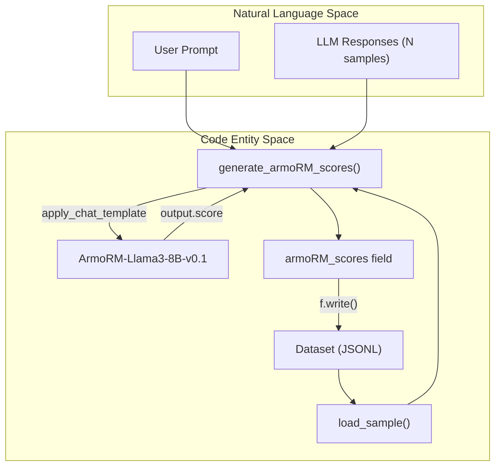
Sources: [notebooks/scoring_per_model_armoRM.py:14-54](), [notebooks/utils.py:3-10]()

## OOM Handling and Fallback Strategy

A significant feature of `scoring_per_model_armoRM.py` is its robust handling of `torch.cuda.OutOfMemoryError`. Because the script attempts to process all $N$ responses for a prompt as a single batch, memory limits may be exceeded if responses are particularly long.

When an OOM occurs, the script catches the exception and falls back to a sequential scoring strategy:
1.  **Catch Exception**: The `try...except` block intercepts the OOM [notebooks/scoring_per_model_armoRM.py:42-43]().
2.  **Sequential Processing**: The script iterates through the `message_list` one message at a time [notebooks/scoring_per_model_armoRM.py:46]().
3.  **Individual Inference**: Each prompt-response pair is tokenized and scored individually, significantly reducing the peak memory footprint [notebooks/scoring_per_model_armoRM.py:47-52]().

**Diagram: Memory Management and OOM Recovery**
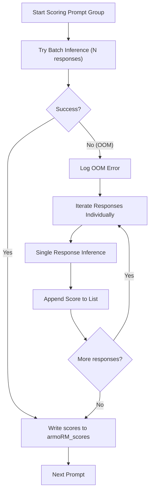
Sources: [notebooks/scoring_per_model_armoRM.py:34-53]()

## Output Schema

The results are written to a new JSONL file, typically named `mixed_dataset_armoRM_ALL.jsonl` [notebooks/scoring_per_model_armoRM.py:21](). For every model entry in the dataset, a new field `armoRM_scores` is appended.

| Field | Type | Description |
| :--- | :--- | :--- |
| `prompt` | `string` | The original user input [notebooks/scoring_per_model_armoRM.py:26](). |
| `[model_name]` | `dict` | Dictionary containing model-specific data [notebooks/scoring_per_model_armoRM.py:27](). |
| `[model_name]['responses']` | `list[str]` | The candidate responses generated by the LLM. |
| `[model_name]['armoRM_scores']` | `list[float]` | The scalar rewards assigned by the ArmoRM model [notebooks/scoring_per_model_armoRM.py:41](). |

Sources: [notebooks/scoring_per_model_armoRM.py:24-54]()

## Execution Details

The script is executed via CLI and requires the path to the dataset generated in previous steps and the list of models to be scored.

```python
# Example usage
# python scoring_per_model_armoRM.py --data_path ./data/mixed_dataset.jsonl --model_name_list gpt-4o phi-3-mini
```

The script utilizes `load_sample` from `utils.py` to ingest the data [notebooks/scoring_per_model_armoRM.py:66](). It also logs the average time per query to track progress [notebooks/scoring_per_model_armoRM.py:57]().

Sources: [notebooks/scoring_per_model_armoRM.py:60-67](), [notebooks/utils.py:3-10]()

---

# Page: Proxy Reward Model (ourRM) Training and Scoring

# Proxy Reward Model (ourRM) Training and Scoring

<details>
<summary>Relevant source files</summary>

The following files were used as context for generating this wiki page:

- [notebooks/reward_modeling.py](notebooks/reward_modeling.py)
- [notebooks/scoring_per_model_ourRM.py](notebooks/scoring_per_model_ourRM.py)
- [notebooks/utils.py](notebooks/utils.py)

</details>


This page documents the implementation and execution of the **Proxy Reward Model (ourRM)**, a specialized regressor used to estimate response quality when the Oracle Reward Model (armoRM) is too computationally expensive for real-time routing or when a customized reward signal is required. The process involves training a DeBERTa-v3-large-v2 model using the `TRL` library and subsequently scoring LLM generations to produce the `ourRM_scores` field.

## Overview of ourRM Pipeline

The proxy reward model is designed to learn the preference rankings established by the Oracle RM. It uses a "min_max_mid" data preparation pattern where the model is trained on pairs of responses (chosen vs. rejected) to learn a scalar reward value.

### Data Flow and System Components

The following diagram illustrates the transition from the Natural Language Space (prompts and responses) to the Code Entity Space (training scripts and model outputs).

**Proxy RM Training and Scoring Workflow**
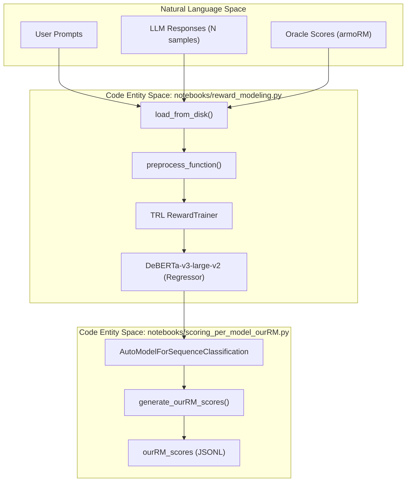
Sources: [notebooks/reward_modeling.py:32-122](), [notebooks/scoring_per_model_ourRM.py:16-43]()

---

## Proxy RM Training (reward_modeling.py)

The training script `notebooks/reward_modeling.py` utilizes the HuggingFace `trl` (Transformer Reinforcement Learning) library to fine-tune a sequence classification model as a reward regressor.

### Implementation Details
- **Model Architecture**: Typically uses `DeBERTa-v3-large-v2` initialized via `AutoModelForSequenceClassification` with `num_labels=1` [notebooks/reward_modeling.py:59-61]().
- **Data Pattern**: The script expects a dataset containing `chosen` and `rejected` text pairs. This is derived from the Oracle RM scores, where the highest-scoring response is "chosen" and lower-scoring ones are "rejected" (often following a min/max/mid selection strategy).
- **Preprocessing**: The `preprocess_function` tokenizes both the chosen and rejected strings, creating `input_ids_chosen` and `input_ids_rejected` for the `RewardTrainer` [notebooks/reward_modeling.py:75-91]().

### Training Configuration
The script uses `HfArgumentParser` to ingest `RewardConfig` and `ModelConfig`. Key features include:
- **Quantization**: Supports k-bit quantization for efficient training on smaller GPUs [notebooks/reward_modeling.py:50-55]().
- **PEFT/LoRA**: Integrates with Parameter-Efficient Fine-Tuning, requiring the `SEQ_CLS` task type [notebooks/reward_modeling.py:63-67]().
- **Checkpointing**: Saves the best performing model to a `checkpoint-best` folder within the output directory [notebooks/reward_modeling.py:117-118]().

Sources: [notebooks/reward_modeling.py:33-61](), [notebooks/reward_modeling.py:75-118]()

---

## Proxy Scoring (scoring_per_model_ourRM.py)

Once trained, the proxy model is used to score all candidate responses in the dataset. This is handled by `notebooks/scoring_per_model_ourRM.py`.

### Scoring Logic
The core logic resides in `generate_ourRM_scores`. It iterates through the dataset and applies the trained proxy model to every response generated by every LLM in the `model_name_list` [notebooks/scoring_per_model_ourRM.py:16-29]().

**Scoring Implementation**
| Component | Implementation Detail |
| :--- | :--- |
| **Input Format** | Formats the input as `Human: {user_input} Assistant: {_response}` [notebooks/scoring_per_model_ourRM.py:34](). |
| **Model Inference** | Uses `torch.no_grad()` to extract the scalar logit from the classification head [notebooks/scoring_per_model_ourRM.py:35-37](). |
| **Data Storage** | Appends the resulting float to a new list `ourRM_scores` under each model's entry [notebooks/scoring_per_model_ourRM.py:31-37](). |
| **Output** | Writes the updated dictionary to a new JSONL file [notebooks/scoring_per_model_ourRM.py:39](). |

### Execution Diagram
The diagram below shows how the scoring script interacts with the trained model and the dataset.

**Inference and Scoring Logic**
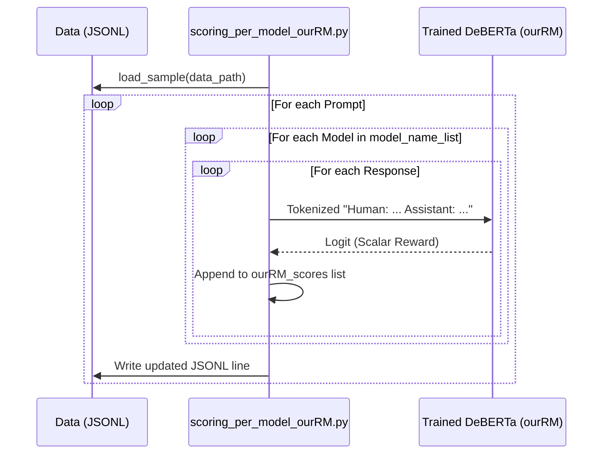
Sources: [notebooks/scoring_per_model_ourRM.py:26-42](), [notebooks/utils.py:3-10]()

---

## Data Preparation: The min_max_mid Pattern

The proxy model is trained to emulate the Oracle. To ensure the proxy learns the full distribution of quality, the training data is typically prepared using a "min_max_mid" strategy:
1. **Max**: The best response (highest Oracle score) is used as the `chosen` sample.
2. **Min**: The worst response (lowest Oracle score) is used as the `rejected` sample.
3. **Mid**: A response with a median score may be used to create additional pairs (e.g., Max vs. Mid, Mid vs. Min) to provide more granular ranking signals.

This preparation occurs prior to calling `reward_modeling.py`, ensuring the `raw_datasets` loaded at [notebooks/reward_modeling.py:72]() contain meaningful contrasts for the `RewardTrainer`.

Sources: [notebooks/reward_modeling.py:72-82](), [notebooks/scoring_per_model_ourRM.py:23]()

---

# Page: Router Training

# Router Training

<details>
<summary>Relevant source files</summary>

The following files were used as context for generating this wiki page:

- [hybrid_llm/__init__.py](hybrid_llm/__init__.py)
- [hybrid_llm/pair_ranker/__init__.py](hybrid_llm/pair_ranker/__init__.py)
- [train_router.py](train_router.py)

</details>


The router training system is the core component of the BEST-Route and HybridLLM architectures. It is responsible for training a proxy model to predict the optimal "route" for a given prompt—either by selecting the best model among several candidates (HybridLLM) or by ranking multiple samples from the same or different models (BEST-Route). This system is built on the `hybrid_llm` package and is orchestrated via the `train_router.py` script.

The training process leverages a specialized reranker architecture that can handle various loss functions and data configurations to optimize for both quality (reward scores) and efficiency (inference costs).

### System Overview

The router training pipeline integrates data loading, model architecture initialization, and a training loop based on the `transformers` and `llm-blender` libraries.

#### Natural Language to Code Entity Mapping

The following diagram illustrates how high-level training concepts map to specific classes and functions within the codebase.

**Router Training Entity Map**
```mermaid
graph TD
    subgraph "Natural Language Space"
        A["Training Script"]
        B["Router Model"]
        C["Data Batching"]
        D["Loss Functions"]
    end

    subgraph "Code Entity Space"
        A --> E["train_router.py"]
        B --> F["NClassReranker"]
        C --> G["NClassCollator"]
        D --> H["NClassRerankerLossType"]
    end

    E --> |"initializes"| F
    E --> |"uses"| G
    F --> |"configures"| H
    
    style E stroke-width:2px
    style F stroke-width:2px
    style G stroke-width:2px
    style H stroke-width:2px
```
**Sources:** [train_router.py:12-22](), [hybrid_llm/pair_ranker/ranker.py:1-20]()

### Training Workflow

The `train_router.py` script manages the end-to-end training lifecycle. It begins by setting up the execution environment, initializing the tokenizer via `llm_blender.pair_ranker.model_util.build_tokenizer` [train_router.py:52](), and loading the datasets.

**Training Execution Flow**
```mermaid
sequenceDiagram
    participant CLI as "train_router.py"
    participant Data as "hybrid_llm.pair_ranker.data"
    participant Model as "hybrid_llm.pair_ranker.ranker"
    participant Trainer as "llm_blender.pair_ranker.trainer"

    CLI->>Data: "load_datasets(args)"
    Data-->>CLI: "train/eval/predict datasets"
    CLI->>Model: "initialize_model(args, tokenizer)"
    Model-->>CLI: "NClassReranker instance"
    CLI->>Trainer: "initialize_training(args, model, ...)"
    CLI->>Trainer: "train()"
    Trainer->>Model: "forward() + compute loss"
    Trainer->>CLI: "save_checkpoint"
```
**Sources:** [train_router.py:36-64](), [train_router.py:111-180]()

### Key Components

#### 4.1 NClassReranker Model Architecture
The core model is the `NClassReranker` class [hybrid_llm/pair_ranker/ranker.py](). It extends standard transformer architectures to support multiple output heads for different routing tasks. It supports five distinct loss types (e.g., `det_ncls`, `prob_2cls`) to accommodate different training objectives, such as deterministic classification or probability distribution matching.
For details, see [NClassReranker Model Architecture](#4.1).

#### 4.2 Data Loading and Collation
The system uses a specialized `Dataset` class [hybrid_llm/pair_ranker/data.py:14]() to handle the complex structure of routing data, which includes prompts, candidate responses, reward scores, and inference costs. The `NClassCollator` [hybrid_llm/pair_ranker/collator.py:15]() prepares these inputs for the model, ensuring that the `SOURCE_PREFIX` is correctly applied and that candidate responses are properly encoded.
For details, see [Data Loading and Collation](#4.2).

#### 4.3 Training Configuration and Metrics
Training is governed by `NClassRankerConfig` [hybrid_llm/pair_ranker/config.py:13](), which inherits from the base reranker configuration. The `train_router.py` script maps specific loss types to their corresponding metric functions (e.g., Spearman correlation for labels or accuracy for classification) [train_router.py:28-33](). The system also supports advanced training features like DeepSpeed and fp16 precision [train_router.py:156-157]().
For details, see [Training Configuration and Metrics](#4.3).

### Summary Table of Training Parameters

| Component | Code Entity | Purpose |
| :--- | :--- | :--- |
| **Model** | `NClassReranker` | Multi-head model for ranking/classification |
| **Config** | `NClassRankerConfig` | Hyperparameters and architecture settings |
| **Collator** | `NClassCollator` | Handles prompt/candidate tokenization |
| **Trainer** | `RerankerTrainer` | Orchestrates the HuggingFace training loop |
| **Metrics** | `loss2metric` | Mapping of loss types to evaluation functions |

**Sources:** [train_router.py:13-33](), [train_router.py:170-178]()

---

# Page: NClassReranker Model Architecture

# NClassReranker Model Architecture

<details>
<summary>Relevant source files</summary>

The following files were used as context for generating this wiki page:

- [hybrid_llm/pair_ranker/config.py](hybrid_llm/pair_ranker/config.py)
- [hybrid_llm/pair_ranker/model_util.py](hybrid_llm/pair_ranker/model_util.py)
- [hybrid_llm/pair_ranker/ranker.py](hybrid_llm/pair_ranker/ranker.py)

</details>


The `NClassReranker` is the core neural module responsible for making routing decisions within the BEST-Route and HybridLLM paradigms. It is implemented as a sequence-to-sequence or encoder-based classifier that evaluates a source prompt and its associated candidate responses to predict which model (or model group) will yield the best performance-to-cost trade-off.

## Overview and Purpose

The `NClassReranker` class, defined in [hybrid_llm/pair_ranker/ranker.py:24-24](), extends `nn.Module` to provide a flexible framework for multi-class and multi-label classification. Unlike standard rerankers that only score pairs, this architecture supports various loss functions that can handle probabilistic outcomes and multiple candidate models simultaneously.

### Key Components
*   **Base Model**: Typically a DeBERTa or RoBERTa encoder loaded via `build_pretrained_model` [hybrid_llm/pair_ranker/model_util.py:32-34]().
*   **Head Layers**: Uses a global `head_layer` for N-class classification [hybrid_llm/pair_ranker/ranker.py:61-64]() and a `ModuleList` of `single_heads` for specific task-based or candidate-based binary decisions [hybrid_llm/pair_ranker/ranker.py:68-76]().
*   **Loss Functions**: Implements five distinct loss types to support deterministic and probabilistic training [hybrid_llm/pair_ranker/ranker.py:16-21]().

## Architecture Logic Flow

The following diagram illustrates how natural language inputs are transformed into routing decisions through the `NClassReranker` entities.

### From Prompt to Routing Decision
```mermaid
graph TD
    subgraph "Natural Language Space"
        A["Source Prompt (Query)"]
        B["Candidate Responses (N samples)"]
    end

    subgraph "Code Entity Space: NClassReranker"
        C["tokenizer.encode_plus"]
        D["pretrained_model (Encoder)"]
        E["hidden_state (CLS/Last Token)"]
        F["head_layer (nn.Linear)"]
        G["single_heads (nn.ModuleList)"]
        H["_calculate_loss()"]
    end

    A & B --> C
    C --> D
    D --> E
    E --> F
    E --> G
    F & G --> H
    H --> I["Routing Prediction (Index/ID)"]
```
**Sources:** [hybrid_llm/pair_ranker/ranker.py:24-77](), [hybrid_llm/pair_ranker/ranker.py:159-210]()

## Loss Types and Probability Calculation

The model supports five loss configurations via the `NClassRerankerLossType` enum [hybrid_llm/pair_ranker/ranker.py:16-21]().

| Loss Type | Implementation Logic | Use Case |
| :--- | :--- | :--- |
| `det_2cls` | Cross-entropy against a hard 0/1 label based on `score[0] >= score[1] - t`. | Binary choice between two models. |
| `prob_2cls` | Cross-entropy against a soft probability distribution derived from `_match_prob`. | Handling variance in LLM samples. |
| `det_ncls` | Argmax of scores across all candidates. | Picking the single best model from N. |
| `det_nlabels` | `BCEWithLogitsLoss` against all models that exceed a performance threshold. | Multi-label "good enough" selection. |
| `prob_nlabels` | Iterative cross-entropy for each candidate relative to a baseline. | Complex probabilistic multi-model routing. |

### The `_match_prob` Helper
To handle the "Best-of-N" nature of sampling, the `_match_prob` function [hybrid_llm/pair_ranker/ranker.py:79-96]() calculates the probability that a response from Model A is better than a response from Model B, given a threshold `t`.

$$P(\text{match}) = \frac{1}{|S|} \sum_{i \in S} \frac{\sum_{j \in L} \mathbb{I}(i \geq j - t)}{|L|}$$

**Sources:** [hybrid_llm/pair_ranker/ranker.py:16-21](), [hybrid_llm/pair_ranker/ranker.py:79-96](), [hybrid_llm/pair_ranker/ranker.py:122-153]()

## Inference Modes: Bubble vs. Full

The `NClassReranker` implements two primary inference strategies defined in the configuration [hybrid_llm/pair_ranker/config.py:79-81]().

### 1. Bubble Mode
In `bubble` mode, the model performs a sequential comparison. It starts with the first two candidates, predicts a winner, and then compares that winner against the next candidate in the list. This is computationally efficient for large candidate sets.

### 2. Full Mode
In `full` mode, the model processes all candidates through the `head_layer` simultaneously to produce a distribution or multi-label output.

```mermaid
graph LR
    subgraph "Inference Mode Logic"
        direction LR
        subgraph "Bubble Mode"
            B1["Compare(C1, C2)"] --> B2["Winner"]
            B2 --> B3["Compare(Winner, C3)"]
            B3 --> B4["Final Selection"]
        end
        subgraph "Full Mode"
            F1["Input Sequence"] --> F2["Encoder"]
            F2 --> F3["N-Class Head"]
            F3 --> F4["Softmax/Argmax"]
        end
    end
```
**Sources:** [hybrid_llm/pair_ranker/config.py:79-81](), [hybrid_llm/pair_ranker/ranker.py:46-46]()

## Initialization and Configuration

The model is typically initialized using `build_nclass_ranker` [hybrid_llm/pair_ranker/model_util.py:14-37](), which:
1.  Loads a pretrained encoder (e.g., DeBERTa) [hybrid_llm/pair_ranker/model_util.py:32-34]().
2.  Resizes token embeddings to match the specific tokenizer used [hybrid_llm/pair_ranker/model_util.py:35-35]().
3.  Injects `NClassRankerConfig` parameters such as `n_candidates`, `loss_type`, and `dropout` [hybrid_llm/pair_ranker/config.py:9-84]().

If a checkpoint exists, `build_nclass_ranker_from_checkpoint` [hybrid_llm/pair_ranker/model_util.py:40-91]() handles the loading of `pytorch_model.bin` or `model.safetensors` files, ensuring all `single_heads` and the `head_layer` are correctly restored.

**Sources:** [hybrid_llm/pair_ranker/model_util.py:14-91](), [hybrid_llm/pair_ranker/config.py:9-84]()

---

# Page: Data Loading and Collation

# Data Loading and Collation

<details>
<summary>Relevant source files</summary>

The following files were used as context for generating this wiki page:

- [hybrid_llm/pair_ranker/collator.py](hybrid_llm/pair_ranker/collator.py)
- [hybrid_llm/pair_ranker/data.py](hybrid_llm/pair_ranker/data.py)

</details>


This page documents the data processing pipeline for router training, specifically covering how raw JSONL datasets are loaded, filtered, and transformed into tensor batches for the `NClassReranker` model. The implementation resides primarily in `hybrid_llm/pair_ranker/data.py` and `hybrid_llm/pair_ranker/collator.py`.

## Overview of Data Flow

The data loading process transforms raw model responses and scores into a format suitable for routing. This involves calculating inference costs, upsampling specific model data to balance the training set, and tokenizing text with specialized control tokens.

### Data Preparation to Batching Pipeline
"Natural Language Space" (JSONL) is bridged to "Code Entity Space" (Tensors) through the following flow:

1.  **`load_data`**: Reads raw JSONL, filters candidates, and applies upsampling logic [[hybrid_llm/pair_ranker/data.py:69-75]]().
2.  **`Dataset` (Class)**: Inherits from `BlenderDataset` to handle indexing and item retrieval, concatenating instructions and inputs into a single `source` string [[hybrid_llm/pair_ranker/data.py:20-39]]().
3.  **`NClassCollator`**: Injected into the PyTorch `DataLoader`. It adds the `SOURCE_PREFIX` token, tokenizes the source text, and assembles scores/costs into batches [[hybrid_llm/pair_ranker/collator.py:13-53]]().

Sources: [hybrid_llm/pair_ranker/data.py:20-75](), [hybrid_llm/pair_ranker/collator.py:13-53]()

---

## Data Loading and Preprocessing

### Candidate Filtering and Formatting
The `load_data` function is the entry point for preparing the training set. It performs several critical transformations:

*   **`filter_candidates`**: Restricts the candidates for each prompt based on the provided arguments [[hybrid_llm/pair_ranker/data.py:102]]().
*   **`format_scores_costs`**: Standardizes scores and calculates costs. It handles both single-sample and Best-of-N scenarios by ensuring scores are represented as a list (window size of 10) [[hybrid_llm/pair_ranker/data.py:151-179]]().
*   **Cost Calculation**: Uses `model2prompt_cost` and `model2output_cost` dictionaries to compute the financial or computational cost of each candidate based on token counts [[hybrid_llm/pair_ranker/data.py:16-17,181-190]]().

### Upsampling Logic
To handle data imbalance (e.g., when one model significantly outperforms another), `load_data` supports upsampling the minority class.

| Function | Purpose |
| :--- | :--- |
| `get_minor_major_scores` | Identifies scores for the "major" and "minor" models being compared [[hybrid_llm/pair_ranker/data.py:126-148]](). |
| `upsample_minority` | Uses `sklearn.utils.resample` to balance the dataset based on which model provided a better response for a given prompt [[hybrid_llm/pair_ranker/data.py:9-10,119-123]](). |

Sources: [hybrid_llm/pair_ranker/data.py:16-19](), [hybrid_llm/pair_ranker/data.py:102-123](), [hybrid_llm/pair_ranker/data.py:126-148](), [hybrid_llm/pair_ranker/data.py:151-190]()

---

## Collation and Tokenization

The `NClassCollator` class prepares the final tensors for the model. It is responsible for text encoding and batch construction.

### The SOURCE_PREFIX Token
The router uses a specific prefix, `<|source|>`, to denote the beginning of the input prompt.
*   The prefix is defined as `SOURCE_PREFIX = "<|source|>"` [[hybrid_llm/pair_ranker/collator.py:10]]().
*   During initialization, the collator adds this token to the tokenizer's vocabulary and sets the `source_prefix_id` [[hybrid_llm/pair_ranker/collator.py:45-51]]().

### Batch Assembly Diagram
The following diagram illustrates how `NClassCollator.__call__` transforms a list of dataset items into a dictionary of tensors.

Title: NClassCollator Batch Construction
```mermaid
graph TD
    subgraph "Input: List[Dict]"
        B["Batch Items"]
    end

    subgraph "NClassCollator.__call__"
        P["Prepend SOURCE_PREFIX"]
        ET["encode_texts (LLM-Blender)"]
        SC["Stack Scores"]
        CO["Stack Costs"]
    end

    subgraph "Output: Dict[str, torch.Tensor]"
        SI["source_ids"]
        AM["source_attention_mask"]
        S["scores"]
        C["costs"]
    end

    B --> P
    P --> ET
    ET --> SI
    ET --> AM
    B --> SC
    B --> CO
    SC --> S
    CO --> C
```
Sources: [hybrid_llm/pair_ranker/collator.py:53-88]()

### Key Implementation Details
*   **Text Encoding**: The collator utilizes `encode_texts` from the `llm_blender` package to convert strings into token IDs [[hybrid_llm/pair_ranker/collator.py:79-81]]().
*   **Separator Handling**: It automatically identifies the `sep_token` (or `eos_token`) and ensures the source text is cleaned of conflicting separators before prepending the prefix [[hybrid_llm/pair_ranker/collator.py:38-42,65-66]]().
*   **Max Length Logic**: The collator calculates a safe `max_length` based on the tokenizer's limits and the configured source/candidate lengths [[hybrid_llm/pair_ranker/collator.py:33-36]]().

Sources: [hybrid_llm/pair_ranker/collator.py:33-42](), [hybrid_llm/pair_ranker/collator.py:65-81]()

---

## Data Structures Bridge

This table bridges the JSON data format to the internal Python objects used during training.

| Code Entity | Source File | Role |
| :--- | :--- | :--- |
| `Dataset` | `hybrid_llm/pair_ranker/data.py` | Maps JSON keys like `instruction` and `input` to a single `source` string [[hybrid_llm/pair_ranker/data.py:39]](). |
| `model2prompt_cost` | `hybrid_llm/pair_ranker/data.py` | Mapping of model names (e.g., `gpt-4o`, `phi-3-mini`) to their input token costs [[hybrid_llm/pair_ranker/data.py:16]](). |
| `NClassCollator` | `hybrid_llm/pair_ranker/collator.py` | Converts text into `source_ids` and `source_attention_mask` tensors [[hybrid_llm/pair_ranker/collator.py:84-85]](). |

Title: Data Mapping Logic
```mermaid
graph LR
    subgraph "Raw JSON (mixed_dataset.jsonl)"
        ID["instruction"]
        IN["input"]
        CAN["candidates"]
    end

    subgraph "hybrid_llm/pair_ranker/data.py"
        DS["Dataset.__getitem__"]
        FSC["format_scores_costs"]
    end

    subgraph "hybrid_llm/pair_ranker/collator.py"
        NCC["NClassCollator.__call__"]
    end

    ID & IN --> DS
    CAN --> FSC
    DS --> NCC
    FSC --> NCC
    NCC --> OUT["Tensors (Batch)"]
```
Sources: [hybrid_llm/pair_ranker/data.py:16-17](), [hybrid_llm/pair_ranker/data.py:32-66](), [hybrid_llm/pair_ranker/collator.py:53-88]()

---

# Page: Training Configuration and Metrics

# Training Configuration and Metrics

<details>
<summary>Relevant source files</summary>

The following files were used as context for generating this wiki page:

- [hybrid_llm/pair_ranker/config.py](hybrid_llm/pair_ranker/config.py)
- [hybrid_llm/pair_ranker/trainer.py](hybrid_llm/pair_ranker/trainer.py)
- [train_router.py](train_router.py)

</details>


This page documents the configuration management and evaluation metrics for the router training system. The system relies on the `NClassRankerConfig` class for hyperparameter management and a set of specialized `compute_metrics` functions to evaluate different loss formulations (deterministic vs. probabilistic). The training process is orchestrated by `train_router.py`, which integrates HuggingFace `TrainingArguments` with custom logic for Best-of-N routing.

## NClassRankerConfig

The `NClassRankerConfig` class in `hybrid_llm/pair_ranker/config.py` defines the structural and behavioral parameters of the router. It extends beyond standard transformer configurations to include routing-specific logic such as candidate counts and inference modes.

### Key Hyperparameters

| Parameter | Type | Default | Description |
| :--- | :--- | :--- | :--- |
| `ranker_type` | `str` | `"nclass"` | Determines the architecture; currently supports "nclass" [hybrid_llm/pair_ranker/config.py:15-18](). |
| `loss_type` | `str` | `"det_2cls"` | The loss function used for training (e.g., `det_2cls`, `prob_2cls`) [hybrid_llm/pair_ranker/config.py:45-48](). |
| `n_candidates` | `int` | `-1` | Number of candidate models/responses the router considers [hybrid_llm/pair_ranker/config.py:39-41](). |
| `inference_mode` | `str` | `"bubble"` | Routing logic at inference: `bubble` (sequential comparison) or `full` (all-pair) [hybrid_llm/pair_ranker/config.py:79-81](). |
| `sub_sampling_mode` | `str` | `"all_pair"` | Strategy for pair selection: `top_bottom`, `all_pair`, `random`, or `uniform` [hybrid_llm/pair_ranker/config.py:68-71](). |
| `source_max_length` | `int` | `128` | Maximum tokens for the input prompt [hybrid_llm/pair_ranker/config.py:32-34](). |
| `candidate_max_length`| `int` | `128` | Maximum tokens for the candidate response [hybrid_llm/pair_ranker/config.py:35-37](). |

**Sources:**
- [hybrid_llm/pair_ranker/config.py:9-84]()

## CLI Arguments and Training Execution

The `train_router.py` script serves as the primary entry point. It merges command-line arguments into both the `NClassRankerConfig` and the HuggingFace `TrainingArguments`.

### Data Flow and Initialization
The script follows a sequential setup process:
1. **Device Setup**: Configures CUDA or CPU via `setup_device()` [train_router.py:66-77]().
2. **Tokenizer**: Loads the tokenizer corresponding to the base model (e.g., DeBERTa) [train_router.py:52]().
3. **Model Initialization**: `initialize_model` either builds a new `NClassReranker` or loads from a checkpoint [train_router.py:80-108]().
4. **Trainer Setup**: `initialize_training` maps the `loss_type` to a specific metric function and initializes the `RerankerTrainer` [train_router.py:111-180]().

### Configuration Mapping Diagram
The following diagram illustrates how CLI arguments are distributed across the system components.

"Configuration and Model Initialization Flow"
```mermaid
graph TD
    subgraph "CLI [train_router.py]"
        A["argparse.Namespace"]
    end

    subgraph "Config Entities"
        B["NClassRankerConfig (hybrid_llm/pair_ranker/config.py)"]
        C["TrainingArguments (transformers)"]
    end

    subgraph "Execution Entities"
        D["NClassReranker (hybrid_llm/pair_ranker/ranker.py)"]
        E["RerankerTrainer (llm_blender/pair_ranker/trainer.py)"]
    end

    A -- "config.__dict__.update" --> B
    A -- "TrainingArguments(...)" --> C
    B -- "build_nclass_ranker" --> D
    C -- "initialize_training" --> E
    D -- "model=" --> E
```

**Sources:**
- [train_router.py:36-64]()
- [train_router.py:80-108]()
- [train_router.py:111-180]()

## Evaluation Metrics

The system implements four distinct metric functions in `hybrid_llm/pair_ranker/trainer.py`, selected based on the `loss_type` provided in the configuration [train_router.py:28-33]().

### Metric Function Implementations

| Function | Associated Loss | Primary Metric | Implementation Detail |
| :--- | :--- | :--- | :--- |
| `compute_metrics_for_prob_2cls` | `prob_2cls` | Spearman Correlation | Calculates correlation between predicted score differences and ground truth score differences [hybrid_llm/pair_ranker/trainer.py:88-144](). |
| `compute_metrics_for_det_nclass` | `det_ncls` | Accuracy | Uses `torch.argmax` on predictions and labels to compute top-1 selection accuracy [hybrid_llm/pair_ranker/trainer.py:49-66](). |
| `compute_metrics_for_det_nlabel` | `det_nlabels` | MSE | Computes Mean Squared Error between sigmoid-activated predictions and binary labels [hybrid_llm/pair_ranker/trainer.py:68-85](). |
| `compute_metrics_for_prob_nlabel`| `prob_nlabels`| Spearman Correlation | Averages Spearman scores across task-specific score differences [hybrid_llm/pair_ranker/trainer.py:18-46](). |

### Selection Logic
For classification-based losses, the trainer uses `calculate_selections` to determine:
- `sel_acc`: Accuracy of the router's top-ranked choice compared to the Oracle's best choice [hybrid_llm/pair_ranker/trainer.py:184]().
- `avg_score`: The mean quality score (e.g., ArmoRM) of the responses selected by the router [hybrid_llm/pair_ranker/trainer.py:132]().

**Sources:**
- [hybrid_llm/pair_ranker/trainer.py:18-144]()
- [train_router.py:28-33]()

## Training Infrastructure

The router supports modern training optimizations through the HuggingFace `Trainer` integration.

### Checkpointing and Precision
- **FP16 Support**: Enabled via `args.fp16` in `TrainingArguments` [train_router.py:156]() and reflected in `NClassRankerConfig` [hybrid_llm/pair_ranker/config.py:83]().
- **DeepSpeed**: Integrated via the `deepspeed` argument, allowing for distributed training and memory optimization [train_router.py:157]().
- **Best Model Tracking**: Uses `load_best_model_at_end=True` and `metric_for_best_model` (typically `dev_score`) to ensure the optimal checkpoint is retained [train_router.py:152-153]().

### Checkpoint Loading
The `initialize_model` function in `train_router.py` handles checkpoint restoration by loading the `config.bin` and then invoking `build_nclass_ranker_from_checkpoint` [train_router.py:95-99]().

"Training and Checkpointing Architecture"
```mermaid
graph LR
    subgraph "Training Loop"
        T["RerankerTrainer"]
        L["loss2metric mapping"]
    end

    subgraph "Storage"
        CKPT["Checkpoint (output_dir)"]
        CONF["config.bin"]
        PRED["predictions.pt"]
    end

    T -- "eval_steps" --> L
    L -- "dev_score" --> T
    T -- "save_steps" --> CKPT
    CKPT -- "contains" --> CONF
    T -- "do_predict" --> PRED
```

**Sources:**
- [train_router.py:95-108]()
- [train_router.py:130-168]()
- [hybrid_llm/pair_ranker/config.py:83]()

---

# Page: Evaluation and Results Interpretation

# Evaluation and Results Interpretation

<details>
<summary>Relevant source files</summary>

The following files were used as context for generating this wiki page:

- [README.md](README.md)
- [results_interpretation.ipynb](results_interpretation.ipynb)
- [train_router.py](train_router.py)

</details>


This section describes the post-training phase of the routing pipeline. After a router is trained using `train_router.py`, its performance must be evaluated against standalone LLM baselines and theoretical oracles. This involves interpreting the raw tensor outputs (predictions and labels) and visualizing the performance-cost trade-offs to determine if the routing strategy successfully achieves higher quality at lower compute costs.

### Overview of the Evaluation Flow

The evaluation process begins with the `predict` function in the training script, which generates scores for candidate models on a test set. These scores are then processed in a dedicated notebook to visualize the "Performance-Cost Curve."

#### Evaluation Pipeline Logic
The following diagram illustrates how the code moves from raw inference to visual analysis:

**Router Evaluation and Visualization Flow**
```mermaid
graph TD
    subgraph "Code Entity Space"
        A["train_router.py:predict()"] --> B["save_predictions()"]
        B --> C[".pt files"]
        C --> D["results_interpretation.ipynb"]
        D --> E["plot_matrix_of_router()"]
    end

    subgraph "Natural Language Space"
        C -- "Raw Tensors" --> F["Model Predictions & Ground Truth"]
        E -- "Visualization" --> G["Performance-Cost Curve"]
    end
```
**Sources:** [train_router.py:62-63](), [train_router.py:228-233](), [results_interpretation.ipynb:61-65]()

---

### 5.1 Prediction Output Format
When the router runs in prediction mode (`--do_predict`), it generates two primary files in the output directory: `predictions.pt` and `labels.pt`. These files contain the raw logits produced by the `NClassReranker` and the corresponding ground-truth scores (usually from the Oracle Reward Model).

*   **predictions.pt**: Contains the model's predicted scores for each candidate in the routing pool.
*   **labels.pt**: Contains the actual rewards/scores associated with those candidates.

The `save_predictions` function handles the serialization of these tensors using `torch.save`. For details on how to load these tensors and map them back to specific model names or prompt IDs, see [Prediction Output Format](#5.1).

**Sources:** [train_router.py:228-245](), [results_interpretation.ipynb:137-139]()

---

### 5.2 Performance-Cost Curve Analysis
The ultimate goal of BEST-Route and HybridLLM is to shift the performance-cost boundary. This is analyzed in `results_interpretation.ipynb` by plotting the average reward (quality) against the total inference cost.

#### Cost Modeling and Selection
The notebook uses cost constants defined in `notebooks/utils.py` (e.g., `model2prompt_cost` and `model2output_cost`) combined with token counts to calculate the financial or compute cost of each routing decision. 

The selection logic simulates a threshold-based router:
1.  **Thresholding**: For various confidence thresholds, the router selects the cheapest model that meets the predicted quality bar.
2.  **Fallback**: If no model meets the bar, it defaults to the most capable (and expensive) model, such as `gpt-4o`.

The function `plot_matrix_of_router` iterates through these thresholds to generate the curve. For a deep dive into the plotting logic and how to compare different routing strategies, see [Performance-Cost Curve Analysis](#5.2).

**Selection Logic Mapping**
```mermaid
graph TD
    subgraph "Code Entity Space"
        H["model2prompt_cost"]
        I["model2output_cost"]
        J["plot_matrix_of_router()"]
        K["results_path/predictions.pt"]
    end

    subgraph "Logic Flow"
        K --> L["Compute Softmax/Diffs"]
        L --> M["Iterate Interpolation Thresholds"]
        M --> N["Select Min Cost Model where Pred >= Threshold"]
        H & I --> O["Calculate Final Cost"]
    end
```
**Sources:** [results_interpretation.ipynb:16-17](), [results_interpretation.ipynb:43-46](), [results_interpretation.ipynb:61-114](), [results_interpretation.ipynb:144-160]()

---

### Summary Table: Evaluation Components

| Component | File/Function | Purpose |
| :--- | :--- | :--- |
| **Prediction Generator** | `train_router.py` / `predict()` | Executes inference on the test dataset. |
| **Data Saver** | `train_router.py` / `save_predictions()` | Writes `predictions.pt` and `labels.pt` to disk. |
| **Metrics Calculator** | `hybrid_llm/pair_ranker/trainer.py` | Computes Spearman correlation, MSE, and Accuracy during eval. |
| **Visualizer** | `results_interpretation.ipynb` | Plots the quality vs. cost trade-off curves. |
| **Cost Constants** | `notebooks/utils.py` | Provides the price-per-token for different LLM providers. |

**Sources:** [train_router.py:17-18](), [train_router.py:228-245](), [results_interpretation.ipynb:16-17](), [results_interpretation.ipynb:61-65]()

---

# Page: Prediction Output Format

# Prediction Output Format

<details>
<summary>Relevant source files</summary>

The following files were used as context for generating this wiki page:

- [results_interpretation.ipynb](results_interpretation.ipynb)
- [train_router.py](train_router.py)

</details>


This page details the structure and handling of the prediction outputs generated by the router training and evaluation pipeline. When the router is executed in prediction mode, it produces serialized PyTorch tensors that represent the model's confidence scores and the corresponding ground truth labels. These files are essential for subsequent performance-cost analysis and visualization.

## Overview of Output Files

During the execution of `train_router.py` with the `--do_predict` flag enabled, the system saves two primary files to the specified `--output_dir`: `predictions.pt` and `labels.pt` [train_router.py:46-48](). These files allow for offline evaluation without re-running the computationally expensive inference phase of the router.

| File | Type | Description |
| :--- | :--- | :--- |
| `predictions.pt` | `torch.Tensor` | Raw logits or probabilities output by the `NClassReranker`. |
| `labels.pt` | `torch.Tensor` | Ground truth scores (e.g., armoRM scores) for each candidate. |

### Data Flow: From Trainer to Disk

The following diagram illustrates how the `RerankerTrainer` (extending the HuggingFace `Trainer`) processes a `predict_dataset` and serializes the results.

**Router Prediction Data Flow**
```mermaid
graph TD
    subgraph "Code Entity Space"
        A["train_router.py: main()"] --> B["trainer.predict(predict_dataset)"]
        B --> C["train_router.py: save_predictions()"]
        C --> D["torch.save()"]
    end

    subgraph "FileSystem Space"
        D --> E["predictions.pt"]
        D --> F["labels.pt"]
    end

    subgraph "Data Structures"
        E -.-> G["Shape: (N_Samples, N_Candidates, N_Classes)"]
        F -.-> H["Shape: (N_Samples, N_Candidates, 1)"]
    end
```
Sources: [train_router.py:62-63](), [train_router.py:228-251]()

## Tensor Structures

### labels.pt
The labels tensor contains the ground truth quality scores used to evaluate the router. These are typically the scores assigned by the Oracle Reward Model (armoRM).
*   **Structure**: The tensor is usually saved with a shape of `(num_samples, num_candidates, 1)` [results_interpretation.ipynb:138-138]().
*   **Accessing**: In analysis scripts, the tensor is often squeezed to remove the trailing dimension: `labels.pt.squeeze(2)[..., 0]` [results_interpretation.ipynb:138-138]().

### predictions.pt
The predictions tensor contains the output of the `NClassReranker` head.
*   **Structure**: The shape depends on the `loss_type` configured during training. For `prob_2cls` (probability-based binary classification), the final dimension contains 2 values (typically representing the probability of "good" vs "bad" relative to a threshold) [results_interpretation.ipynb:80-82]().
*   **Transformation**: To derive a routing decision, the logits are typically passed through a softmax and then compared. For example, in `results_interpretation.ipynb`, the difference between the two class probabilities is calculated to determine the router's confidence in a candidate [results_interpretation.ipynb:80-82]().

## Implementation in `train_router.py`

The saving logic is encapsulated in the `save_predictions` function. It ensures that the output directory exists and uses `torch.save` to write the tensors.

```python
def save_predictions(args, predict_results):
    if not os.path.exists(args.output_dir):
        os.makedirs(args.output_dir)
    torch.save(torch.tensor(predict_results.predictions), 
               os.path.join(args.output_dir, "predictions.pt"))
    torch.save(torch.tensor(predict_results.label_ids), 
               os.path.join(args.output_dir, "labels.pt"))
```
Sources: [train_router.py:241-251]()

## Programmatic Inspection and Usage

To inspect these files, they must be loaded back into a PyTorch environment. The following diagram shows the relationship between the loaded tensors and the cost metadata used in the `results_interpretation.ipynb` notebook.

**Analysis Loading Logic**
```mermaid
graph TD
    subgraph "Natural Language Space"
        "Oracle Scores" -- "Extracted from" --> "Labels Tensor"
        "Model Confidence" -- "Extracted from" --> "Predictions Tensor"
        "Inference Cost" -- "Calculated from" --> "Metadata"
    end

    subgraph "Code Entity Space"
        L["labels.pt"] -->|torch.load| AL["all_labels"]
        P["predictions.pt"] -->|torch.load| AP["all_predictions"]
        D["hybridllm_dataset_...jsonl"] -->|load_sample| TD["test_data"]
        TD -->|model2prompt_cost| AC["all_cost"]
        
        AL & AP & AC --> PL["plot_matrix_of_router()"]
    end
```
Sources: [results_interpretation.ipynb:132-162](), [results_interpretation.ipynb:61-72]()

### Example: Loading and Processing Predictions
In the evaluation notebook, the predictions are processed to select the "best" model candidate based on a confidence threshold $t$:

1.  **Load Tensors**: Tensors are loaded using `torch.load` [results_interpretation.ipynb:138-139]().
2.  **Softmax Normalization**: Logits are converted to probabilities [results_interpretation.ipynb:80-80]().
3.  **Confidence Calculation**: For binary classification routers, the score is often `prob[0] - prob[1]` [results_interpretation.ipynb:82-82]().
4.  **Thresholding**: Candidates are filtered by whether their predicted confidence exceeds a threshold $t$, and the lowest-cost candidate satisfying that threshold is selected [results_interpretation.ipynb:91-94]().

Sources: [results_interpretation.ipynb:80-94]()

---

# Page: Performance-Cost Curve Analysis

# Performance-Cost Curve Analysis

<details>
<summary>Relevant source files</summary>

The following files were used as context for generating this wiki page:

- [figures/bestroute.png](figures/bestroute.png)
- [figures/hybridllm.png](figures/hybridllm.png)
- [results_interpretation.ipynb](results_interpretation.ipynb)

</details>


The final stage of the BEST-Route pipeline involves evaluating the router's ability to navigate the trade-off between model performance (quality) and inference cost. This analysis is primarily conducted using the `results_interpretation.ipynb` notebook, which processes the prediction tensors generated during the evaluation phase to visualize how the router performs against various baselines.

## Overview of Evaluation Data Flow

The evaluation process depends on two primary inputs: the test dataset containing token counts and the prediction outputs from the trained router.

1.  **Prediction Tensors**: During evaluation, `train_router.py` saves `predictions.pt` (the router's logits) and `labels.pt` (the ground truth scores) to the output directory [train_router.py:168-171]().
2.  **Cost Metadata**: The test dataset (e.g., `hybridllm_dataset_armoRM_ourRM_bo5_ALL_token_num_test.jsonl`) contains `token_num_prompt` and `token_num_responses` for every candidate model response [results_interpretation.ipynb:142-160]().
3.  **Cost Modeling**: Unit costs for different models (prompt vs. output) are retrieved from `model2prompt_cost` and `model2output_cost` dictionaries in `utils.py` [results_interpretation.ipynb:16-16]().

### Data Association Diagram
This diagram shows how high-level performance metrics are mapped to specific code entities and data structures.

"Natural Language Performance Concepts" to "Code Entity Space"
```mermaid
graph TD
    subgraph "Natural Language Concepts"
        A["Quality Score"]
        B["Inference Cost"]
        C["Routing Threshold"]
    end

    subgraph "Code Entity Space (hybrid_llm/pair_ranker)"
        D["labels.pt (armoRM scores)"]
        E["predictions.pt (Router Logits)"]
        F["model2prompt_cost (utils.py)"]
        G["token_num_prompt (JSONL field)"]
    end

    A --> D
    B --> F
    B --> G
    C --> E

    D -.-> H["results_interpretation.ipynb"]
    E -.-> H
    F -.-> H
    G -.-> H
```
Sources: [results_interpretation.ipynb:12-16](), [results_interpretation.ipynb:138-140](), [results_interpretation.ipynb:148-151]()

## Plotting the Performance-Cost Curve

The core logic for generating the trade-off curve is implemented in the `plot_matrix_of_router` function within the `results_interpretation.ipynb` notebook.

### Implementation Logic
The notebook performs an interpolation over a range of probability thresholds to simulate different routing behaviors:

1.  **Logit Processing**: The raw predictions are converted to probabilities using a softmax. The difference between the first two classes (often representing "better" vs "worse" in a pair-ranking context) is calculated to determine a routing confidence [results_interpretation.ipynb:80-82]().
2.  **Threshold Sweeping**: The code iterates through `interpolation_num` (default 20) steps between the minimum and maximum predicted probability differences [results_interpretation.ipynb:87-88]().
3.  **Model Selection**: For each prompt and threshold `t`, the router selects the **lowest-cost model** that satisfies the confidence threshold `_p >= t` [results_interpretation.ipynb:94]().
4.  **Fallback**: If no model satisfies the threshold, the router defaults to the last model in the candidate list (typically the most expensive/powerful model) [results_interpretation.ipynb:96-97]().

### Visualizing Results
The resulting plot displays "Cost ($ / 1K queries)" on the X-axis and "armoRM scores (↑)" on the Y-axis [results_interpretation.ipynb:164-165]().

"Routing Decision and Plotting Pipeline"
```mermaid
graph LR
    subgraph "Input Tensors"
        P["predictions.pt"]
        L["labels.pt"]
    end

    subgraph "Processing (results_interpretation.ipynb)"
        S["Softmax Transformation"]
        I["Interpolation Loop (interpolation_num=20)"]
        D["Selection Logic: Lowest Cost where p >= t"]
    end

    subgraph "Visualization"
        Plot["Matplotlib Plot (Performance-Cost Curve)"]
    end

    P --> S
    S --> I
    L --> I
    I --> D
    D --> Plot
```
Sources: [results_interpretation.ipynb:80-102](), [results_interpretation.ipynb:138-140]()

## Comparison Baselines

To interpret the effectiveness of BEST-Route, the curves are compared against several baselines:

| Baseline | Description |
| :--- | :--- |
| **Standalone Models** | Individual points representing fixed models (e.g., GPT-4o, Llama-3.1-8B) without routing. |
| **HybridLLM** | Routing between a cheap and an expensive model using a single sample each. |
| **BEST-Route** | Routing that considers Best-of-N (BoN) samples for candidate models, allowing for higher quality at the cost of more tokens [results_interpretation.ipynb:153-155](). |
| **Oracle** | An ideal router that always picks the best response regardless of cost (the upper bound). |

### Cost Calculation Details
The cost for a specific routing decision is calculated dynamically:
```python
cost = (c['token_num_prompt'] * model2prompt_cost[candidate_model] + 
        c['token_num_responses'] * model2output_cost[candidate_model])
```
[results_interpretation.ipynb:148-151]()

## Key Variables and Configuration
The notebook requires consistency with the training configuration:
*   **`bon`**: The number of samples (Best-of-N) used during data preparation (e.g., `bon = 5`) [results_interpretation.ipynb:25]().
*   **`candidate_model_list`**: Must match the `--candidate_model` argument used in `train_router.py` [results_interpretation.ipynb:134]().
*   **`results_path`**: The directory where `predictions.pt` and `labels.pt` are stored [results_interpretation.ipynb:137]().

Sources: [results_interpretation.ipynb:24-28](), [results_interpretation.ipynb:43-46](), [results_interpretation.ipynb:61-114](), [results_interpretation.ipynb:131-160]()

---

# Page: Setup and Dependencies

# Setup and Dependencies

<details>
<summary>Relevant source files</summary>

The following files were used as context for generating this wiki page:

- [.gitignore](.gitignore)
- [notebooks/requirements_data_preparation.txt](notebooks/requirements_data_preparation.txt)
- [requirements.txt](requirements.txt)
- [setup.py](setup.py)

</details>


The **BEST-Route** project (utilizing the `hybrid_llm` core package) requires a multi-stage environment setup. Because the project spans from data preparation and reward modeling in Jupyter notebooks to large-scale router training via CLI scripts, dependencies are split between core package requirements and specialized notebook environments.

This page provides a high-level overview of the installation process and dependency management.

### Environment Architecture

The following diagram illustrates how the different dependency files relate to the functional areas of the codebase.

**Dependency Mapping**
```mermaid
graph TD
    subgraph "Core Package Space"
        [setup.py] --> [hybrid_llm_package]
        [requirements.txt] --> [hybrid_llm_package]
        [hybrid_llm_package] -- "depends on" --> ["llm-blender (GitHub)"]
        [hybrid_llm_package] -- "depends on" --> ["py-cpuinfo"]
    end

    subgraph "Data & Modeling Space"
        [notebooks/requirements_data_preparation.txt] --> [Data_Prep_Env]
        [Data_Prep_Env] -- "includes" --> ["transformers"]
        [Data_Prep_Env] -- "includes" --> ["trl (RewardTrainer)"]
        [Data_Prep_Env] -- "includes" --> ["accelerate"]
    end

    [hybrid_llm_package] -- "Imported by" --> [train_router.py]
    [Data_Prep_Env] -- "Used by" --> [reward_modeling.ipynb]
    [Data_Prep_Env] -- "Used by" --> [generate_llm_responses.py]
```
Sources: [setup.py:1-7](), [requirements.txt:1-3](), [notebooks/requirements_data_preparation.txt:1-10]()

---

### 6.1 Core Package Installation

The core logic for routing and ranker architectures is housed in the `hybrid_llm` directory. This is managed as a standard Python package via `setup.py` [setup.py:1-7](). 

Key characteristics of the core installation:
*   **LLM-Blender Dependency**: The project relies heavily on a specific fork/version of `LLM-Blender`, installed directly from GitHub [requirements.txt:2-2](). This provides essential utilities for tokenization, training loops, and the base `pair_ranker` logic.
*   **Hardware Utility**: Includes `py-cpuinfo` for environment diagnostics [requirements.txt:1-1]().
*   **Installation**: Typically performed using `pip install -e .` to allow for development edits to the `hybrid_llm` source.

For detailed installation steps and a breakdown of the `LLM-Blender` integration, see **[Core Package Installation](#6.1)**.

---

### 6.2 Notebook Environment Setup

Data preparation, response generation, and proxy reward model training are conducted using scripts and notebooks that require a more extensive set of ML libraries than the core router.

*   **Model Handling**: Uses `transformers`, `datasets`, and `accelerate` for managing Large Language Models [notebooks/requirements_data_preparation.txt:1-5]().
*   **Reward Modeling**: Requires `trl` (Transformer Reinforcement Learning) specifically for the `RewardTrainer` used in training the proxy reward model [notebooks/requirements_data_preparation.txt:7-7]().
*   **Gated Access**: Requires `huggingface_hub` for authentication, particularly for accessing gated models like Llama 3.1 [notebooks/requirements_data_preparation.txt:4-4]().
*   **GPU Optimization**: Guidance is provided for managing memory via `PYTORCH_CUDA_ALLOC_CONF` to prevent Out-Of-Memory (OOM) errors during heavy inference tasks.

For details on configuring your GPU environment and authenticating for model access, see **[Notebook Environment Setup](#6.2)**.

---

### Dependency Interaction

The relationship between the code entities and the installed dependencies is summarized below:

**System-Code Association**
```mermaid
graph LR
    subgraph "Natural Language Space"
        "Router Training"
        "Proxy Reward Training"
        "Response Generation"
    end

    subgraph "Code Entity Space"
        "Router Training" --> [train_router.py]
        "Proxy Reward Training" --> [notebooks/reward_modeling.py]
        "Response Generation" --> [notebooks/generate_llm_responses.py]
        
        [train_router.py] -.-> ["hybrid_llm (setup.py)"]
        [notebooks/reward_modeling.py] -.-> ["trl (reqs_data_prep.txt)"]
        [notebooks/generate_llm_responses.py] -.-> ["transformers (reqs_data_prep.txt)"]
    end
```
Sources: [setup.py:1-7](), [notebooks/requirements_data_preparation.txt:1-10](), [requirements.txt:1-3]()

---

# Page: Core Package Installation

# Core Package Installation

<details>
<summary>Relevant source files</summary>

The following files were used as context for generating this wiki page:

- [hybrid_llm/__init__.py](hybrid_llm/__init__.py)
- [requirements.txt](requirements.txt)
- [setup.py](setup.py)

</details>


This page documents the installation and environment setup for the `hybrid_llm` package, which serves as the foundational library for the BEST-Route and HybridLLM routing frameworks. The package leverages `LLM-Blender` for its core ranking utilities and is structured to be installed as an editable or standard Python package.

## Package Structure and `setup.py`

The `hybrid_llm` package is defined as a standard Python package using `setuptools`. The `setup.py` file facilitates the installation of the local source code into a Python environment, allowing other scripts (like `train_router.py`) to import from `hybrid_llm` regardless of their directory depth.

| File | Role |
| :--- | :--- |
| `setup.py` | Entry point for `setuptools` to package the `hybrid_llm` directory [setup.py:1-7](). |
| `hybrid_llm/__init__.py` | Marks the directory as a Python package [hybrid_llm/__init__.py:1](). |

### Installation Process

To install the core package and its dependencies, users typically run:

```bash
pip install -e .
```

This command triggers `setuptools.setup()`, which reads the package configuration and installs the requirements specified in the environment [setup.py:6-6]().

**Sources:**
- [setup.py:1-7]()
- [hybrid_llm/__init__.py:1-1]()

## Dependency Management

The project relies on a specific set of external libraries to handle hardware introspection and large-scale language model ranking. These are defined in `requirements.txt`.

### Key Dependencies

| Dependency | Purpose |
| :--- | :--- |
| `py-cpuinfo` | Used for hardware detection and optimization during model training and inference [requirements.txt:1-1](). |
| `LLM-Blender` | The primary framework for the router's ranking logic, providing utilities for pair-wise ranking and data collation [requirements.txt:2-2](). |

### LLM-Blender Integration

The most critical dependency is `LLM-Blender`, which is installed directly from its GitHub repository to ensure access to specific sub-modules:
- `example`: For reference implementations.
- `train`: For training utilities utilized by the router.
- `data`: For data processing and prompt handling.
- `eval`: For evaluation metrics.

The installation string `llm-blender[example,train,data,eval] @ git+https://github.com/yuchenlin/LLM-Blender.git#egg=LLM-Blender` ensures that all necessary extras are included [requirements.txt:2-2]().

**Sources:**
- [requirements.txt:1-3]()

## Installation Flow and Data Space

The following diagram illustrates the relationship between the installation files and how they bridge the local `hybrid_llm` code with external dependencies and the Python environment.

### Installation Logic and Entity Mapping

```mermaid
graph TD
    subgraph "Local Codebase"
        SETUP["setup.py"]
        REQ["requirements.txt"]
        HYBRID_PKG["hybrid_llm/ package"]
    end

    subgraph "External Dependencies"
        CPUINFO["py-cpuinfo"]
        LLM_BLENDER["LLM-Blender (GitHub)"]
    end

    subgraph "Python Environment"
        SITE_PKGS["site-packages"]
        HYBRID_INSTALL["hybrid_llm (installed)"]
    end

    SETUP -->|reads| REQ
    SETUP -->|installs| HYBRID_PKG
    REQ -->|fetches| CPUINFO
    REQ -->|fetches| LLM_BLENDER
    HYBRID_PKG -->|registered in| SITE_PKGS
    LLM_BLENDER -->|provides| BLENDER_UTILS["LLM-Blender Utilities"]
    
    style HYBRID_INSTALL stroke-width:2px
```

**Sources:**
- [setup.py:4-6]()
- [requirements.txt:1-2]()

## Component Relationship

The `hybrid_llm` package is built to extend `LLM-Blender`. While `LLM-Blender` provides the generic infrastructure for ranking LLM outputs, `hybrid_llm` implements specific logic for the HybridLLM and BEST-Route paradigms, such as cost-aware routing and specific N-Class ranking heads.

### Code Entity Association

This diagram shows how the installation of `hybrid_llm` enables the use of internal modules alongside the `LLM-Blender` dependency.

```mermaid
graph LR
    subgraph "hybrid_llm Namespace"
        RANKER["pair_ranker/ranker.py"]
        DATA["pair_ranker/data.py"]
        TRAINER["pair_ranker/trainer.py"]
    end

    subgraph "LLM-Blender Space"
        BLENDER_TRAIN["llm_blender.train"]
        BLENDER_DATA["llm_blender.data"]
    end

    TRAINER -.->|inherits/uses| BLENDER_TRAIN
    DATA -.->|interfaces with| BLENDER_DATA
    
    subgraph "Installation Entry"
        SP["setup.py"]
    end

    SP -->|Enables| RANKER
    SP -->|Enables| DATA
    SP -->|Enables| TRAINER
```

**Sources:**
- [setup.py:6-6]()
- [requirements.txt:2-2]()
- [hybrid_llm/__init__.py:1-1]()

---

# Page: Notebook Environment Setup

# Notebook Environment Setup

<details>
<summary>Relevant source files</summary>

The following files were used as context for generating this wiki page:

- [.gitignore](.gitignore)
- [notebooks/generate_llm_responses.py](notebooks/generate_llm_responses.py)
- [notebooks/requirements_data_preparation.txt](notebooks/requirements_data_preparation.txt)

</details>


This page provides the technical requirements and configuration steps necessary to run the data preparation and reward modeling notebooks in the BEST-Route / HybridLLM project. The environment setup is specifically tailored to handle large-scale LLM response generation, reward model scoring, and dataset processing.

## Dependency Management

The project distinguishes between core package dependencies and the specific requirements needed for the data preparation pipeline. The notebook-specific dependencies are listed in `notebooks/requirements_data_preparation.txt`.

### Key Libraries and Roles

| Library | Version | Role in Pipeline |
| :--- | :--- | :--- |
| `transformers` | `4.44.0` | Model loading and inference for Llama 3.1 and ArmoRM. |
| `trl` | `0.10.1` | Used for training the Proxy Reward Model (ourRM) via `RewardTrainer`. |
| `accelerate` | Latest | Handles multi-GPU distribution and `device_map="auto"` logic. |
| `datasets` | Latest | Loading and manipulating JSONL files as HuggingFace Dataset objects. |
| `huggingface_hub` | Latest | Authentication for gated models (Llama 3.1). |
| `torch` | Latest | Underlying tensor operations and CUDA kernels. |

Sources: `[notebooks/requirements_data_preparation.txt:1-10]()`

## HuggingFace Hub Authentication

The project utilizes gated models, specifically **Llama-3.1-8B-Instruct**. Accessing these models requires a HuggingFace account, acceptance of the Meta license agreement, and a valid User Access Token.

In the generation script `notebooks/generate_llm_responses.py`, authentication is handled via the `login()` function from `huggingface_hub`. Users must replace the placeholder with their actual token to successfully initialize the model pipeline.

```python
# notebooks/generate_llm_responses.py:22-25
def generate_llm_response(data, model_name, num_sample=20):
    # login to Hugging Face Hub
    login('YOUR_HUGGINGFACE_TOKEN')

    model_id = model2path[model_name]
```

Sources: `[notebooks/generate_llm_responses.py:22-25]()`

## GPU and CUDA Configuration

To prevent Out-of-Memory (OOM) errors during heavy sampling (e.g., generating 20 samples per prompt), the environment utilizes specific CUDA memory management settings.

### Memory Allocation Tuning
The script sets `PYTORCH_CUDA_ALLOC_CONF` to `expandable_segments:True`. This setting helps reduce memory fragmentation by allowing PyTorch to use a more flexible segment allocation strategy, which is critical when using `num_return_sequences` with large values.

```python
# notebooks/generate_llm_responses.py:14
os.environ["PYTORCH_CUDA_ALLOC_CONF"] = "expandable_segments:True"
```

### Precision and Mapping
Models are loaded using `torch.bfloat16` to optimize memory usage without significant quality loss. The `device_map="auto"` parameter ensures that the `transformers.pipeline` efficiently distributes model layers across available GPUs.

Sources: `[notebooks/generate_llm_responses.py:14-32]()`

## Data Flow and Environment Interaction

The following diagram illustrates how the environment configuration enables the interaction between the local code, the HuggingFace Hub, and the GPU hardware.

### Environment Setup and Model Initialization
```mermaid
graph TD
    subgraph "Local Environment"
        REQ["requirements_data_preparation.txt"] --> PIP["pip install"]
        ENV["OS Environment Variables"] -- "PYTORCH_CUDA_ALLOC_CONF" --> TORCH["PyTorch Memory Manager"]
    end

    subgraph "Code Entity Space"
        GEN["generate_llm_responses.py"]
        LOGIN["huggingface_hub.login()"]
        PIPE["transformers.pipeline"]
    end

    subgraph "External & Hardware"
        HF["HuggingFace Hub (Gated Models)"]
        GPU["NVIDIA GPU (CUDA)"]
    end

    GEN --> LOGIN
    LOGIN -- "Auth Token" --> HF
    HF -- "Llama-3.1-8B Weights" --> PIPE
    PIPE -- "torch_dtype=bfloat16" --> GPU
    TORCH -- "expandable_segments" --> GPU
```
Sources: `[notebooks/generate_llm_responses.py:14-32]()`, `[notebooks/requirements_data_preparation.txt:1-7]()`

## Implementation Detail: Response Generation Pipeline

The generation script `notebooks/generate_llm_responses.py` acts as the primary entry point for creating the raw data needed for router training. It implements a specific logic for Llama 3.1 terminators and sampling.

### Model and Pipeline Mapping
The script maps model aliases to their official HuggingFace paths and configures the `text-generation` pipeline.

| Entity | Implementation |
| :--- | :--- |
| **Model ID** | `meta-llama/Meta-Llama-3.1-8B-Instruct` |
| **Data Loader** | `utils.load_sample` |
| **Terminators** | EOS token + `<|eot_id|>` |
| **Sampling Logic** | `temperature=1`, `top_p=1`, `do_sample=True` |

### Generation Sequence Diagram
```mermaid
sequenceDiagram
    participant User as CLI (argparse)
    participant Script as generate_llm_responses.py
    participant HF as HuggingFace Hub
    participant Pipe as transformers.pipeline
    participant File as JSONL Output

    User->>Script: --model_name llama-31-8b --num_sample 20
    Script->>HF: login(TOKEN)
    Script->>Pipe: Initialize (Llama-3.1-8B-Instruct)
    Loop For each prompt in data
        Script->>Pipe: __call__(request_data, num_return_sequences=20)
        Pipe-->>Script: List of 20 generated_text objects
        Script->>File: Write JSONL (prompt + responses)
    End
```
Sources: `[notebooks/generate_llm_responses.py:17-66]()`, `[notebooks/generate_llm_responses.py:68-76]()`

---

# Page: Project Governance

# Project Governance

<details>
<summary>Relevant source files</summary>

The following files were used as context for generating this wiki page:

- [CODE_OF_CONDUCT.md](CODE_OF_CONDUCT.md)
- [CONTRIBUTING.md](CONTRIBUTING.md)
- [LICENSE.md](LICENSE.md)
- [SECURITY.md](SECURITY.md)

</details>


This page provides an overview of the open-source governance framework for the `best-route-llm` repository. As a Microsoft-managed project, it adheres to standardized policies regarding licensing, community contributions, ethical conduct, and security vulnerability reporting.

### Governance Framework Overview

The project is governed by three primary pillars:
1.  **Legal & Licensing**: Use of the software is permitted under the MIT License.
2.  **Community Engagement**: Contributions are managed through a structured Pull Request (PR) workflow involving a Contributor License Agreement (CLA).
3.  **Security & Ethics**: The project follows Microsoft’s global standards for open-source conduct and coordinated vulnerability disclosure.

The following diagram illustrates the relationship between these governance entities and the codebase assets.

**Governance to Code Mapping**
```mermaid
graph TD
    subgraph "Natural Language Space (Policies)"
        "CLA_Requirement"["Contributor License Agreement"]
        "CoC"["Code of Conduct"]
        "CVD"["Coordinated Vulnerability Disclosure"]
    end

    subgraph "Code Entity Space (Files)"
        "CONTRIBUTING_MD"["CONTRIBUTING.md"]
        "LICENSE_MD"["LICENSE.md"]
        "CODE_OF_CONDUCT_MD"["CODE_OF_CONDUCT.md"]
        "SECURITY_MD"["SECURITY.md"]
    end

    "CLA_Requirement" --> "CONTRIBUTING_MD"
    "CoC" --> "CODE_OF_CONDUCT_MD"
    "CVD" --> "SECURITY_MD"
    "LICENSE_MD" -- "Defines Usage Rights" --> "CONTRIBUTING_MD"
```
Sources: [CONTRIBUTING.md:1-14](), [LICENSE.md:1-21](), [CODE_OF_CONDUCT.md:1-11](), [SECURITY.md:1-41]()

---

### Contributing and Licensing
The `best-route-llm` project is released under the **MIT License**, allowing for broad reuse, modification, and distribution [LICENSE.md:3-21](). 

To maintain the legal integrity of the codebase, all contributors must sign a **Contributor License Agreement (CLA)**. This process is automated via a `CLA-bot` that triggers when a Pull Request is submitted [CONTRIBUTING.md:8-10](). Additionally, all participants are expected to uphold the **Microsoft Open Source Code of Conduct** to ensure a welcoming and inclusive environment.

For details, see [Contributing and Licensing](#7.1).

**Contribution Workflow**
```mermaid
sequenceDiagram
    participant C as Contributor
    participant GH as GitHub PR
    participant B as CLA-bot
    participant M as Maintainer

    C->>GH: Submit Pull Request
    GH->>B: Trigger Check
    alt CLA Not Signed
        B->>GH: Add Label/Comment Instructions
        C->>B: Sign CLA at cla.microsoft.com
    end
    B->>GH: Mark as CLA-passed
    M->>GH: Code Review & Merge
```
Sources: [CONTRIBUTING.md:3-10](), [CODE_OF_CONDUCT.md:1-11]()

---

### Security Policy and Vulnerability Reporting
Microsoft treats the security of the `best-route-llm` source code with high priority [SECURITY.md:3-5](). We follow the principle of **Coordinated Vulnerability Disclosure (CVD)** [SECURITY.md:39-39](). 

Security issues should **never** be reported via public GitHub issues. Instead, they must be submitted through the Microsoft Security Response Center (MSRC) portal or via encrypted email [SECURITY.md:11-15](). High-quality reports may be eligible for the Microsoft Bug Bounty program [SECURITY.md:31-31]().

For details, see [Security Policy and Vulnerability Reporting](#7.2).

| Reporting Channel | Method |
| :--- | :--- |
| **Primary Portal** | [MSRC Create Report](https://msrc.microsoft.com/create-report) |
| **Email** | secure@microsoft.com |
| **Encryption** | PGP Key (available via MSRC) |
| **Response SLA** | Typically within 24 hours |

Sources: [SECURITY.md:9-17](), [SECURITY.md:39-39]()

---

# Page: Contributing and Licensing

# Contributing and Licensing

<details>
<summary>Relevant source files</summary>

The following files were used as context for generating this wiki page:

- [CODE_OF_CONDUCT.md](CODE_OF_CONDUCT.md)
- [CONTRIBUTING.md](CONTRIBUTING.md)
- [LICENSE.md](LICENSE.md)

</details>


This page outlines the legal and community framework governing the `best-route-llm` repository. It details the MIT License terms, the automated Contributor License Agreement (CLA) workflow for pull requests, and the Microsoft Open Source Code of Conduct.

## Licensing Terms

The BEST-Route codebase is released under the **MIT License**. This is a permissive free software license that allows for reuse within proprietary software provided that all copies of the software or its substantial portions include a copy of the MIT License terms and the copyright notice [LICENSE.md:1-13]().

### Key Provisions
| Provision | Description |
| :--- | :--- |
| **Copyright** | Copyright (c) Microsoft Corporation [LICENSE.md:1-1](). |
| **Permissions** | Granted for use, copying, modification, merging, publishing, distribution, sublicensing, and/or sale [LICENSE.md:5-9](). |
| **Warranty** | The software is provided "AS IS", without warranty of any kind, express or implied [LICENSE.md:15-17](). |
| **Liability** | Microsoft Corporation and the authors are not liable for any claims, damages, or other liability arising from the software [LICENSE.md:17-21](). |

**Sources:**
- [LICENSE.md:1-21]()

## Contribution Workflow

Microsoft welcomes contributions to this project, ranging from bug fixes to new routing strategy implementations. The contribution process is managed through GitHub Pull Requests and an automated licensing check.

### Contributor License Agreement (CLA)
Most contributions require the author to agree to a Contributor License Agreement (CLA). This document declares that the contributor has the right to grant Microsoft the rights to use the contribution [CONTRIBUTING.md:3-6]().

The verification process is handled by an automated **CLA-bot**:
1. **PR Submission**: When a developer submits a Pull Request, the CLA-bot evaluates the contributor's status [CONTRIBUTING.md:8-9]().
2. **Decoration**: The bot labels the PR and adds a comment indicating if a CLA is required [CONTRIBUTING.md:9-10]().
3. **Execution**: If required, the contributor follows the link provided by the bot to sign the agreement. This is a one-time requirement across all Microsoft repositories [CONTRIBUTING.md:10-10]().

### Data Flow: Contribution to Repository
The following diagram illustrates the interaction between a Contributor, the GitHub repository, and the CLA-bot during the submission process.

**Contributor Submission and Verification Flow**
```mermaid
sequenceDiagram
    participant C as "Contributor"
    participant GH as "GitHub / Pull Request"
    participant BOT as "CLA-bot"
    participant MS as "Microsoft / best-route-llm"

    C->>GH: "Submit Pull Request"
    GH->>BOT: "Trigger Check"
    alt "CLA not signed"
        BOT->>GH: "Apply 'cla-required' label"
        BOT->>GH: "Post instructions comment"
        C->>BOT: "Sign CLA at https://cla.microsoft.com"
        BOT->>GH: "Apply 'cla-signed' label"
    else "CLA already signed"
        BOT->>GH: "Apply 'cla-signed' label"
    end
    GH->>MS: "Ready for Maintainer Review"
```

**Sources:**
- [CONTRIBUTING.md:1-10]()

## Code of Conduct

To ensure a welcoming and inclusive environment, this project follows the **Microsoft Open Source Code of Conduct**. This policy governs all interactions within the project's digital spaces, including issue trackers and pull request discussions [CODE_OF_CONDUCT.md:1-3]().

### Enforcement and Reporting
Interaction standards are maintained through the following channels:
*   **General Questions**: Inquiries regarding the code of conduct can be sent to [opencode@microsoft.com](mailto:opencode@microsoft.com) [CODE_OF_CONDUCT.md:9-9]().
*   **Moderation Support**: Microsoft employees can access additional support via [aka.ms/opensource/moderation-support](https://aka.ms/opensource/moderation-support) [CODE_OF_CONDUCT.md:10-10]().
*   **FAQ**: Detailed information on conduct expectations is available in the [Microsoft Code of Conduct FAQ](https://opensource.microsoft.com/codeofconduct/faq/) [CODE_OF_CONDUCT.md:8-8]().

### Governance Entities Relationship
The following diagram bridges the project governance concepts to the specific entities and contact points defined in the repository documentation.

**Governance Entity Mapping**
```mermaid
graph TD
    subgraph "Project Governance Space"
        CONDUCT["Microsoft Open Source Code of Conduct"]
        LICENSE["MIT License"]
        CLA["Contributor License Agreement"]
    end

    subgraph "Code and Communication Entities"
        REPO["microsoft/best-route-llm"]
        EMAIL["opencode@microsoft.com"]
        BOT_ENTITY["CLA-bot"]
        FAQ_URL["https://opensource.microsoft.com/codeofconduct/faq/"]
    end

    CONDUCT -->|Managed via| EMAIL
    CONDUCT -->|Detailed in| FAQ_URL
    LICENSE -->|Applied to| REPO
    CLA -->|Enforced by| BOT_ENTITY
    BOT_ENTITY -->|Validates| REPO
```

**Sources:**
- [CODE_OF_CONDUCT.md:1-11]()
- [CONTRIBUTING.md:12-14]()

---

# Page: Security Policy and Vulnerability Reporting

# Security Policy and Vulnerability Reporting

<details>
<summary>Relevant source files</summary>

The following files were used as context for generating this wiki page:

- [SECURITY.md](SECURITY.md)

</details>


This page outlines the security protocols and vulnerability reporting mechanisms for the **BEST-Route** (HybridLLM) project. As a Microsoft-owned repository, this project adheres to corporate security standards regarding the identification, reporting, and mitigation of software vulnerabilities [SECURITY.md:1-7]().

## Vulnerability Reporting Channels

Microsoft provides two primary channels for reporting security concerns. To protect users of the software, researchers are instructed **not** to report security vulnerabilities through public GitHub issues [SECURITY.md:11-11]().

### 1. MSRC Reporting Portal
The preferred method for submission is the **Microsoft Security Response Center (MSRC)** portal. This platform allows for structured reporting and tracking of the triage process.
*   **URL:** [https://msrc.microsoft.com/create-report](https://msrc.microsoft.com/create-report) [SECURITY.md:13-13]()

### 2. Email Submission
For reporters who prefer not to use the web portal, security issues can be sent directly via email.
*   **Email:** [secure@microsoft.com](mailto:secure@microsoft.com) [SECURITY.md:15-15]()
*   **Encryption:** It is recommended to encrypt email communications using the MSRC PGP key, available at the [MSRC PGP Key page](https://aka.ms/security.md/msrc/pgp) [SECURITY.md:15-15]().

## Reporting Requirements

To facilitate rapid triage and remediation, reports should include technical specifics regarding the manifestation of the issue within the codebase.

### Technical Data Flow: Vulnerability Triage Process

The following diagram illustrates how a reported vulnerability moves from the researcher to the engineering team within the Microsoft ecosystem.

**Vulnerability Disclosure Data Flow**
```mermaid
graph TD
    subgraph "Researcher Space"
        A["Security Researcher"]
        B["Proof of Concept (PoC)"]
    end

    subgraph "Intake Layer"
        C["MSRC Portal / secure@microsoft.com"]
        D["PGP Encryption"]
    end

    subgraph "Triage & Remediation"
        E["MSRC Triage Team"]
        F["Engineering Team (BEST-Route)"]
        G["Coordinated Vulnerability Disclosure (CVD)"]
    end

    A -->| "Submit Report" | C
    B -->| "Attach Exploit" | C
    D -.->| "Secure Channel" | C
    C -->| "Initial Triage" | E
    E -->| "Verify Impact" | F
    F -->| "Patch Development" | G
    G -->| "Public Advisory" | A
```
**Sources:** [SECURITY.md:9-17](), [SECURITY.md:39-39]()

### Required Information
When submitting a report, the following technical details are requested to assist the `BEST-Route` maintainers:

| Information Category | Description |
| :--- | :--- |
| **Issue Type** | Classification (e.g., buffer overflow, insecure deserialization in model loading) [SECURITY.md:21-21]() |
| **Source File Paths** | Specific paths to affected files (e.g., `hybrid_llm/pair_ranker/ranker.py`) [SECURITY.md:22-22]() |
| **Code Location** | The specific branch, tag, or commit hash where the issue exists [SECURITY.md:23-23]() |
| **Reproduction Steps** | Detailed instructions and configuration required to trigger the issue [SECURITY.md:24-25]() |
| **Artifacts** | Proof-of-concept (PoC) or exploit code [SECURITY.md:26-26]() |
| **Impact Assessment** | Analysis of how an attacker might exploit the vulnerability [SECURITY.md:27-27]() |

**Sources:** [SECURITY.md:19-28]()

## Policies and Programs

### Coordinated Vulnerability Disclosure (CVD)
This project follows the principle of **Coordinated Vulnerability Disclosure (CVD)** [SECURITY.md:39-39](). Under this policy, researchers disclose vulnerabilities to Microsoft, and Microsoft commits to a timeline for remediation before the details are made public. This prevents "zero-day" exploitations while ensuring the community is eventually informed of risks.

### Microsoft Bug Bounty Program
Submissions related to this repository may be eligible for the **Microsoft Bug Bounty Program**. Higher-quality reports with complete technical documentation and PoCs typically contribute to higher bounty awards [SECURITY.md:31-31]().

### Communication Standards
*   **Response Time:** Microsoft aims to respond to initial reports within 24 hours [SECURITY.md:17-17]().
*   **Language:** All security-related communications must be conducted in English [SECURITY.md:35-35]().

## Code Entity Association

This section bridges the security reporting requirements with the specific entities found in the `BEST-Route` codebase.

**Security Reporting to Code Entity Mapping**
```mermaid
classDiagram
    class SecurityReport {
        +String issue_type
        +String affected_file_path
        +String commit_hash
        +String reproduction_steps
    }

    class ProjectEntities {
        <<File>>
        hybrid_llm/pair_ranker/ranker.py
        hybrid_llm/pair_ranker/data.py
        hybrid_llm/pair_ranker/trainer.py
        train_router.py
    }

    class MSRC_Portal {
        <<Service>>
        +triage_report()
        +assign_to_engineering()
    }

    SecurityReport ..> ProjectEntities : "References specific"
    SecurityReport --> MSRC_Portal : "Submitted to"
```
**Sources:** [SECURITY.md:13-13](), [SECURITY.md:22-23]()

---

# Page: Glossary

# Glossary

<details>
<summary>Relevant source files</summary>

The following files were used as context for generating this wiki page:

- [README.md](README.md)
- [hybrid_llm/pair_ranker/collator.py](hybrid_llm/pair_ranker/collator.py)
- [hybrid_llm/pair_ranker/config.py](hybrid_llm/pair_ranker/config.py)
- [hybrid_llm/pair_ranker/data.py](hybrid_llm/pair_ranker/data.py)
- [hybrid_llm/pair_ranker/ranker.py](hybrid_llm/pair_ranker/ranker.py)
- [hybrid_llm/pair_ranker/trainer.py](hybrid_llm/pair_ranker/trainer.py)
- [notebooks/scoring_per_model_armoRM.py](notebooks/scoring_per_model_armoRM.py)
- [notebooks/scoring_per_model_ourRM.py](notebooks/scoring_per_model_ourRM.py)
- [notebooks/utils.py](notebooks/utils.py)
- [train_router.py](train_router.py)

</details>


This glossary provides definitions for the technical terms, architectural components, and domain-specific concepts used in the BEST-Route and HybridLLM codebase.

## Core Concepts

### HybridLLM
A routing strategy focused on the cost-quality trade-off for single-sample outputs [README.md:19-20](). It aims to route queries to the smallest (cheapest) model capable of providing an adequate response for a given task complexity [README.md:14-17]().

### BEST-Route
An adaptive routing strategy that extends HybridLLM by incorporating **Best-of-N (BoN)** sampling at test time [README.md:21-22](). It optimizes the performance-cost curve by deciding not only which model to use but also how many samples ($N$) to generate to achieve optimal compute [README.md:10-11]().

### Oracle Reward Model (armoRM)
The "ground truth" scoring mechanism used during the data preparation phase. It uses the `RLHFlow/ArmoRM-Llama3-8B-v0.1` model to provide high-quality scores for LLM responses [notebooks/scoring_per_model_armoRM.py:16-18](). These scores are used as targets to train the Proxy Reward Model and the Router [README.md:81-82]().

### Proxy Reward Model (ourRM)
A smaller, more efficient reward model trained to mimic the Oracle's scoring behavior. It is typically based on `DeBERTa-v3-large-v2` [README.md:91]() and trained using a "min_max_mid" data preparation pattern [README.md:86](). It provides the `ourRM_scores` used by the router at inference time [notebooks/scoring_per_model_ourRM.py:31-37]().

---

## Architectural Components

### NClassReranker
The core neural network module for the router, implemented as a `nn.Module` [hybrid_llm/pair_ranker/ranker.py:24](). It takes source text (prompts) and predicts which candidate model or BoN configuration is most likely to satisfy the query requirements.

*   **head_layer**: A linear layer that maps the hidden state to the number of candidates [hybrid_llm/pair_ranker/ranker.py:61-64]().
*   **single_heads**: A `ModuleList` of linear heads used for specific loss types like `prob_nlabels` [hybrid_llm/pair_ranker/ranker.py:68-76]().

### NClassCollator
Handles the preparation of batches for the router. It adds a special `SOURCE_PREFIX` (`<|source|>`) to the input tokens [hybrid_llm/pair_ranker/collator.py:10-13]() and encodes the source text using `llm_blender` utilities [hybrid_llm/pair_ranker/collator.py:79-81]().

### RerankerTrainer
A specialized trainer class inherited from `llm_blender` used to execute the training loop for the `NClassReranker` [train_router.py:170-178]().

### Data Flow: From Natural Language to Code Entities

The following diagram illustrates how natural language prompts and model responses are transformed into tensors for the Router.

**Natural Language to Tensor Mapping**
```mermaid
graph TD
    subgraph "Natural Language Space"
        P["Prompt (User Input)"]
        R["Responses (LLM Outputs)"]
    end

    subgraph "Data Transformation (hybrid_llm/pair_ranker/data.py)"
        DS["Dataset Class"]
        FSC["format_scores_costs()"]
    end

    subgraph "Code Entity Space (Tensors)"
        SID["source_ids (Tensor)"]
        SAM["source_attention_mask (Tensor)"]
        SCR["scores (Tensor)"]
        CST["costs (Tensor)"]
    end

    P --> DS
    DS -- "instruction + input" --> SID
    DS -- "armoRM_scores" --> FSC
    FSC --> SCR
    DS -- "model2prompt_cost" --> CST
    
    subgraph "Collator (hybrid_llm/pair_ranker/collator.py)"
        NC["NClassCollator.__call__"]
    end
    
    SID --> NC
    SCR --> NC
    CST --> NC
    NC --> SAM
```
**Sources:** [hybrid_llm/pair_ranker/data.py:20-66](), [hybrid_llm/pair_ranker/collator.py:53-88](), [hybrid_llm/pair_ranker/data.py:151-180]()

---

## Technical Terms & Parameters

| Term | Definition | Code Pointer |
| :--- | :--- | :--- |
| `loss_type` | Defines the optimization objective (e.g., `det_ncls`, `prob_nlabels`). | [hybrid_llm/pair_ranker/ranker.py:16-21]() |
| `match_t` | A threshold ($t$) used to determine if a smaller model's score is "good enough" compared to a larger model. | [hybrid_llm/pair_ranker/ranker.py:41]() |
| `inference_mode` | Determines the routing logic; `bubble` (sequential check) or `full` (all candidates). | [hybrid_llm/pair_ranker/config.py:79-81]() |
| `model2prompt_cost` | Dictionary mapping model names to their input token costs. | [hybrid_llm/pair_ranker/data.py:16]() |
| `model2output_cost`| Dictionary mapping model names to their output token costs. | [hybrid_llm/pair_ranker/data.py:17]() |

### Loss Types (`NClassRerankerLossType`)
The router supports several loss functions for different routing behaviors [hybrid_llm/pair_ranker/ranker.py:119-155]():
*   **`det_2cls`**: Deterministic binary classification (Small vs. Large).
*   **`prob_2cls`**: Probabilistic binary classification based on `_match_prob`.
*   **`det_ncls`**: Deterministic multi-class classification to pick the best model.
*   **`prob_nlabels`**: Probabilistic multi-label approach comparing each candidate against the largest model.

---

## System Integration Diagram

This diagram shows the relationship between the configuration, the model architecture, and the training utility.

**Router Training Architecture**
```mermaid
graph LR
    subgraph "Configuration"
        Config["NClassRankerConfig"]
    end

    subgraph "Model: NClassReranker"
        PM["pretrained_model (DeBERTa/RoBERTa)"]
        HL["head_layer (Linear)"]
        SH["single_heads (ModuleList)"]
    end

    subgraph "Logic: ranker.py"
        FWD["_forward()"]
        LOSS["_calculate_loss()"]
        MP["_match_prob()"]
    end

    Config --> PM
    PM --> HL
    PM --> SH
    HL --> FWD
    SH --> FWD
    FWD --> LOSS
    MP --> LOSS
    
    subgraph "Execution: train_router.py"
        TR["RerankerTrainer"]
    end
    
    LOSS --> TR
```
**Sources:** [hybrid_llm/pair_ranker/ranker.py:24-78](), [hybrid_llm/pair_ranker/ranker.py:159-181](), [train_router.py:170-178]()

### Metrics and Evaluation
The system uses different metrics based on the selected `loss_type` [train_router.py:28-33]():
*   **Spearman Correlation**: Used for probabilistic losses (`prob_nlabels`, `prob_2cls`) to measure the relationship between predicted and actual score differences [hybrid_llm/pair_ranker/trainer.py:36-39]().
*   **Accuracy**: Used for deterministic classification (`det_ncls`) [hybrid_llm/pair_ranker/trainer.py:63]().
*   **MSE**: Used for multi-label regression (`det_nlabels`) [hybrid_llm/pair_ranker/trainer.py:82]().

**Sources:** [hybrid_llm/pair_ranker/trainer.py:18-85](), [train_router.py:28-33]()