# Page: Overview

# Overview

<details>
<summary>Relevant source files</summary>

The following files were used as context for generating this wiki page:

- [MODEL_CARD.md](MODEL_CARD.md)
- [README.md](README.md)

</details>


## Purpose and Scope

BioEmu (Biomolecular Emulator) is a deep learning model that samples from the approximated equilibrium distribution of structures for a protein monomer, given its amino acid sequence. BioEmu can efficiently generate diverse protein structures that emulate the thermodynamic ensemble, allowing for prediction of structural ensembles, folding free energies, and providing mechanistic hypotheses for protein behavior.

This overview page introduces the core components and architecture of BioEmu, outlining how the system transforms amino acid sequences into protein structure ensembles. For detailed installation instructions, see [Installation and Setup](#2), and for specific usage information, see [Core Functionality](#3).

Sources: [README.md:12-14](), [MODEL_CARD.md:14-16]()

## System Overview

BioEmu uses a combination of deep learning and molecular dynamics techniques to generate protein structure ensembles. The system consists of three primary components working in sequence:

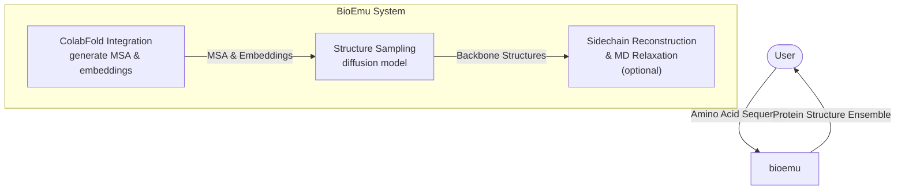

**Primary Components:**
1. **ColabFold Integration** - Generates multiple sequence alignments (MSA) and embeddings from the input amino acid sequence
2. **Structure Sampling** - Uses a diffusion model to generate diverse backbone structures
3. **Sidechain Reconstruction & MD Relaxation** - Optional post-processing to add sidechains and refine structures

Sources: [README.md:12-14](), [README.md:37-48](), [README.md:70-100]()

## Key Capabilities

BioEmu offers the following key capabilities:

| Capability | Description |
|------------|-------------|
| Efficient Structure Sampling | Generate thousands of statistically independent structures per hour on a single GPU |
| Conformational Diversity | Sample functionally relevant conformational changes, including cryptic pockets, local unfolding, and domain rearrangements |
| Thermodynamic Accuracy | Samples with relative free energy errors around 1 kcal/mol, validated against MD simulations and experimental data |
| Sidechain Reconstruction | Optional reconstruction of side-chains using HPacker |
| MD Relaxation | Optional molecular dynamics equilibration using OpenMM |

Sources: [MODEL_CARD.md:20-23](), [MODEL_CARD.md:90-94]()

## System Architecture

The following diagram shows the detailed architecture of BioEmu, including the main code components and their interactions:

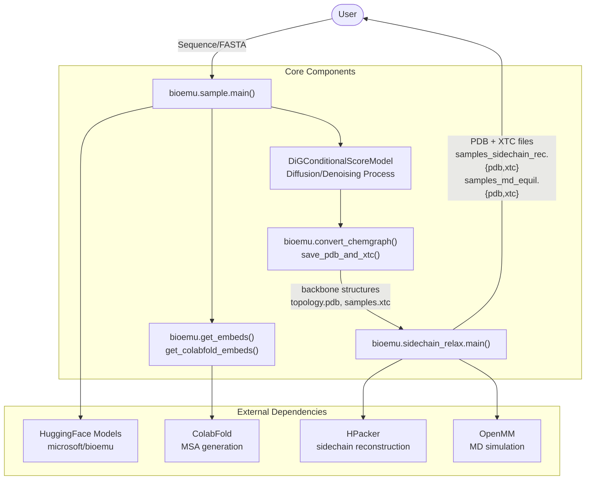

This diagram shows how user inputs flow through the system to generate protein structures. The system leverages multiple external dependencies and core processing components to transform amino acid sequences into protein structure ensembles.

Sources: [README.md:37-48](), [README.md:70-100]()

## Data Transformations

BioEmu transforms data through several key stages as illustrated below:

```mermaid
graph LR
    seq["Amino Acid Sequence"] --> msa["Multiple Sequence Alignment\nvia ColabFold"]
    msa --> embeds["MSA Embeddings"]
    embeds --> chemgraph["ChemGraph\nProtein Representation"]
    chemgraph --> |"Diffusion Process\nDPM/Heun Denoiser"| sampled["Sampled ChemGraph"]
    sampled --> backbone["Backbone Atom Positions\ntopology.pdb, samples.xtc"]
    backbone --> |"Optional"| sidechain["All-Heavy-Atom Structures\nsamples_sidechain_rec.{pdb,xtc}"]
    sidechain --> |"Optional"| relaxed["MD Relaxed Structures\nsamples_md_equil.{pdb,xtc}"]
```

This diagram shows the progression from an input amino acid sequence to final structure outputs, with optional sidechain reconstruction and MD relaxation steps.

Sources: [README.md:37-48](), [README.md:70-100]()

## Usage Interfaces

BioEmu provides two main interfaces for users:

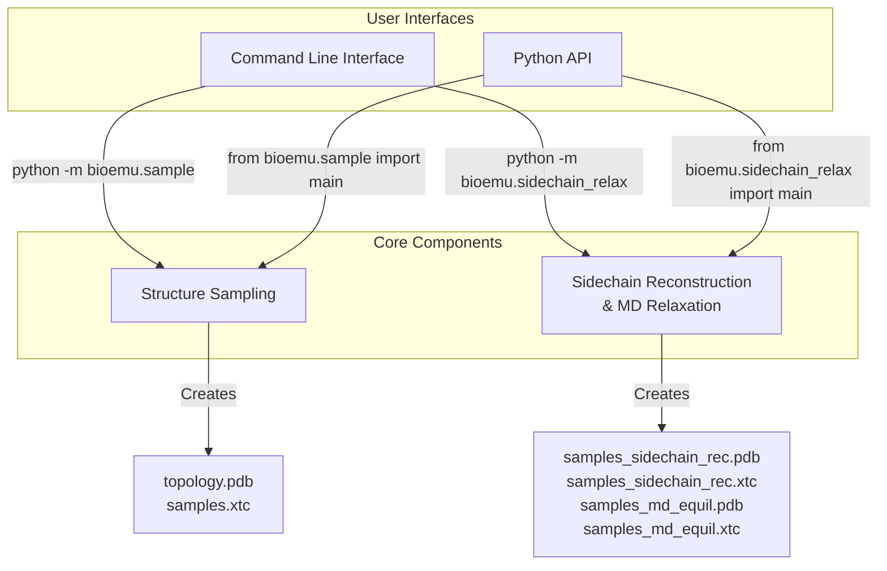

Users can interact with BioEmu through either a command-line interface or Python API. Both interfaces provide access to the core components of structure sampling and optional sidechain reconstruction/MD relaxation.

Sources: [README.md:37-48](), [README.md:70-100]()

## Performance Characteristics

BioEmu's performance varies with sequence length. The table below shows approximate sampling times for 1000 samples using an A100 GPU with 80GB VRAM:

| Sequence Length | Time (minutes) |
|----------------:|---------------:|
|             100 |              4 |
|             300 |             40 |
|             600 |            150 |

Sources: [README.md:52-58]()

## Limitations and Scope

BioEmu has the following limitations:

1. Only supports sampling structures of protein monomers
2. Limited support for multi-chain proteins or protein-protein interactions
3. Does not explicitly model interactions with other chemical entities like small molecules
4. Inherits biases from training data (AlphaFold2 predictions and molecular dynamics simulations)

Sources: [README.md:63](), [MODEL_CARD.md:136-139]()

## Model Architecture

BioEmu uses a DiG (Directed Graph) neural network architecture trained using a combination of:
- Denoising score matching on flexible protein structures from AlphaFold DB
- Property prediction fine-tuning to match experimental folding free energies
- Molecular dynamics data

The model parameters are automatically downloaded from HuggingFace (microsoft/bioemu) when first used.

Sources: [MODEL_CARD.md:102-103](), [README.md:50]()

---

# Page: Installation and Setup

# Installation and Setup

<details>
<summary>Relevant source files</summary>

The following files were used as context for generating this wiki page:

- [README.md](README.md)
- [pyproject.toml](pyproject.toml)

</details>


This page provides comprehensive instructions for installing BioEmu and setting up all required dependencies. BioEmu is a Linux-only Python package that generates protein structure ensembles from amino acid sequences. For information about using BioEmu after installation, see [Core Functionality](#3).

## System Requirements

Before installing BioEmu, ensure your system meets the following requirements:

- **Operating System**: Linux only (Not compatible with Windows or macOS)
- **Python Version**: 3.10 or higher
- **Memory**: Recommended minimum 16GB RAM (more for longer sequences)
- **GPU**: Recommended for efficient sampling of longer sequences
- **Disk Space**: ~5GB for dependencies and model weights

## Basic Installation

BioEmu is provided as a pip-installable package:

```bash
pip install bioemu
```

This installs the core functionality for structure sampling. For sidechain reconstruction and MD relaxation capabilities, install the optional dependencies:

```bash
pip install bioemu[md]
```

Sources: [README.md:26-31](), [README.md:76-80](), [pyproject.toml:1-36]()

## Installation Components

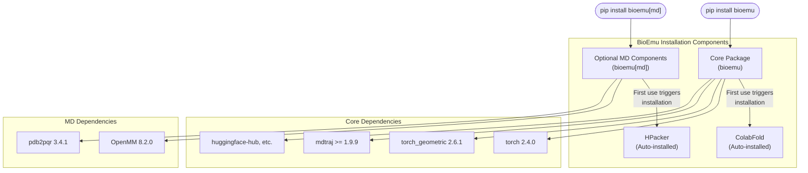

Sources: [pyproject.toml:12-36](), [README.md:26-80]()

## External Dependencies Setup

BioEmu relies on two main external tools that are automatically set up during first use:

### ColabFold Setup

ColabFold is used for Multiple Sequence Alignment (MSA) and embedding generation. It's installed automatically in a separate virtual environment when you first use BioEmu to sample structures.

- **Default installation location**: `~/.bioemu_colabfold`
- **Custom location**: Set the `BIOEMU_COLABFOLD_DIR` environment variable before first use
- **Installation trigger**: First use of `bioemu.sample` module

```bash
# Example of setting custom ColabFold location
export BIOEMU_COLABFOLD_DIR=/path/to/custom/location
python -m bioemu.sample --sequence GYDPETGTWG --num_samples 1
```

Sources: [README.md:33-34](), [README.md:60-61]()

### HPacker Setup

HPacker is used for sidechain reconstruction. It's installed automatically when you first use the sidechain reconstruction functionality.

- **Default installation**: Creates a conda environment named `hpacker`
- **Custom environment name**: Set the `HPACKER_ENVNAME` environment variable before first use
- **Installation trigger**: First use of `bioemu.sidechain_relax` module
- **Requirement**: A conda-based package manager (e.g., Conda, Mamba) must be in your PATH

```bash
# Example of setting custom HPacker environment name
export HPACKER_ENVNAME=my_custom_hpacker
python -m bioemu.sidechain_relax --pdb-path path/to/topology.pdb --xtc-path path/to/samples.xtc
```

Sources: [README.md:71-88]()

## Dependency Installation Workflow

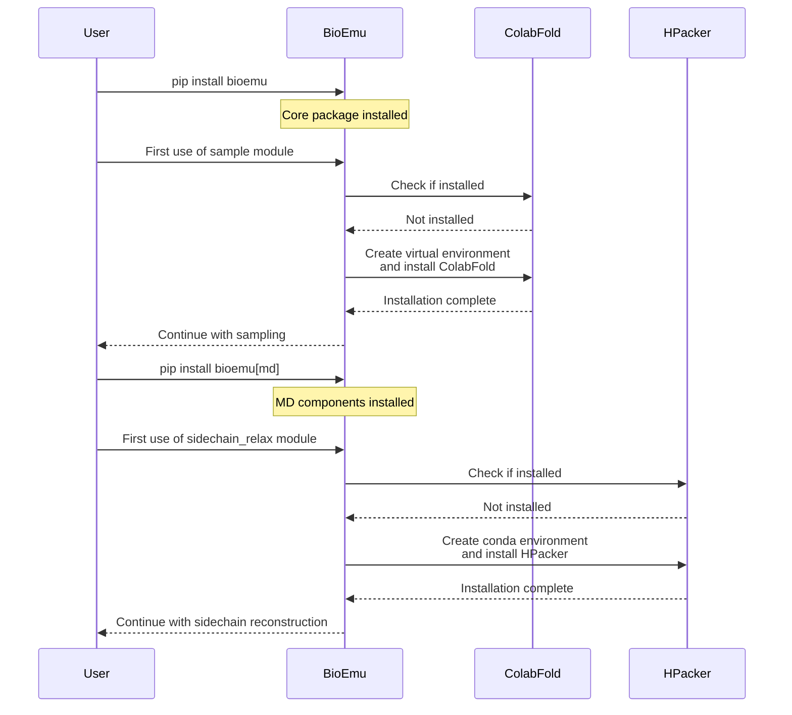

Sources: [README.md:33-34](), [README.md:76-88]()

## Directory Structure After Installation

After installation and first use, BioEmu creates the following directory structure:

```
$HOME/
├── .bioemu_colabfold/   # Default ColabFold installation directory
│   ├── bin/
│   ├── lib/
│   └── ... (virtual environment files)
├── .conda/
│   └── envs/
│       └── hpacker/     # Default HPacker conda environment
│           ├── bin/
│           ├── lib/
│           └── ... (conda environment files)
└── .cache/
    └── huggingface/     # Downloaded model weights from HuggingFace
        └── hub/
            └── models--microsoft--bioemu/
                └── ... (model files)
```

Sources: [README.md:33-34](), [README.md:76-88]()

## Model Weights

BioEmu automatically downloads model weights from HuggingFace when first used. The weights are stored in the HuggingFace cache directory (typically `~/.cache/huggingface/`).

Sources: [README.md:50]()

## Verifying Installation

To verify that BioEmu was installed correctly, run a small test sample:

```bash
python -m bioemu.sample --sequence GYDPETGTWG --num_samples 1 --output_dir ~/test-verification
```

If this command completes successfully and creates output files in the specified directory, your installation is working correctly.

Sources: [README.md:38-41]()

## Common Installation Issues

### ColabFold Installation Failures

If ColabFold installation fails, check:
- Internet connectivity (requires downloading packages)
- Python version compatibility
- Permissions to write to the installation directory

### HPacker Installation Failures

If HPacker installation fails, check:
- Conda is properly installed and in your PATH
- Internet connectivity
- Permissions to create conda environments

### GPU Availability

To check if your GPU is being detected by PyTorch:

```python
import torch
print(f"CUDA available: {torch.cuda.is_available()}")
print(f"Number of GPUs: {torch.cuda.device_count()}")
```

## Compatibility with Virtual Environments

BioEmu can be installed in a virtual environment (venv, conda, etc.). However, note that it will still create separate environments for ColabFold and HPacker as needed.

Sources: [README.md:33-34](), [README.md:76-88]()

## Optional Components

The core BioEmu package provides protein structure sampling functionality. For additional capabilities:

| Component | Installation Command | Features |
|-----------|----------------------|----------|
| Core Package | `pip install bioemu` | Structure sampling from amino acid sequences |
| MD Components | `pip install bioemu[md]` | Sidechain reconstruction and MD relaxation |
| Development Tools | `pip install bioemu[dev]` | Testing and development utilities |

Sources: [pyproject.toml:27-36]()

## Next Steps

After installing BioEmu, proceed to:
- [Protein Structure Sampling](#3.1) to learn how to generate protein structures
- [Sidechain Reconstruction and MD Relaxation](#3.3) for post-processing steps
- [Command Line Interface](#4.1) for command-line usage details

---

# Page: ColabFold Setup

# ColabFold Setup

<details>
<summary>Relevant source files</summary>

The following files were used as context for generating this wiki page:

- [README.md](README.md)
- [src/bioemu/colabfold_setup/batch.patch](src/bioemu/colabfold_setup/batch.patch)
- [src/bioemu/colabfold_setup/setup.sh](src/bioemu/colabfold_setup/setup.sh)

</details>


## Purpose and Scope

This document provides detailed instructions on how ColabFold is set up and used within BioEmu. ColabFold is a critical dependency that generates Multiple Sequence Alignments (MSAs) and embeddings required for protein structure prediction. This page covers the automatic installation process, configuration options, and technical details of the ColabFold integration. For information about using HPacker for sidechain reconstruction, see [HPacker Setup](#2.2).

Sources: [README.md:33-35](), [README.md:59-61]()

## Overview

ColabFold serves as the frontend for generating protein embeddings in BioEmu. It provides essential evolutionary information that the diffusion model uses to generate protein structure samples.

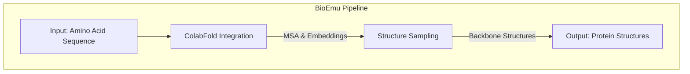

Sources: [README.md:34]()

## Automatic Installation Process

BioEmu automatically sets up ColabFold the first time you run the sampling functionality. The system follows these steps:

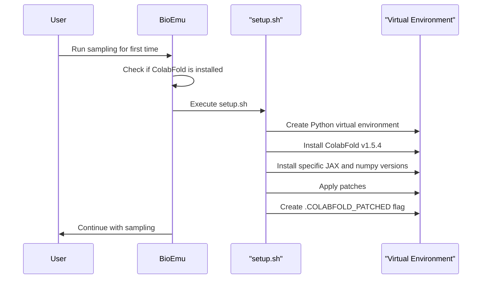

The setup script performs these specific actions:
1. Creates a Python virtual environment in the designated directory
2. Installs ColabFold v1.5.4 with 'alphafold-minus-jax' configuration
3. Forces reinstallation of specific JAX and numpy versions
4. Applies custom patches to the ColabFold installation
5. Marks the installation as complete

Sources: [src/bioemu/colabfold_setup/setup.sh:1-23](), [README.md:33-35]()

## Configuration Options

By default, BioEmu installs ColabFold in the `~/.bioemu_colabfold` directory. You can customize this location by setting the `BIOEMU_COLABFOLD_DIR` environment variable before running BioEmu for the first time.

```bash
# Example of customizing the ColabFold installation directory
export BIOEMU_COLABFOLD_DIR=/path/to/custom/colabfold
python -m bioemu.sample --sequence GYDPETGTWG --num_samples 10 --output_dir ~/test-output
```

Sources: [README.md:33-35]()

## Technical Implementation

### Integration with BioEmu

ColabFold is used as a separate tool that BioEmu interfaces with through a dedicated environment. This separation helps manage dependencies and ensures ColabFold's specific requirements don't conflict with BioEmu's.

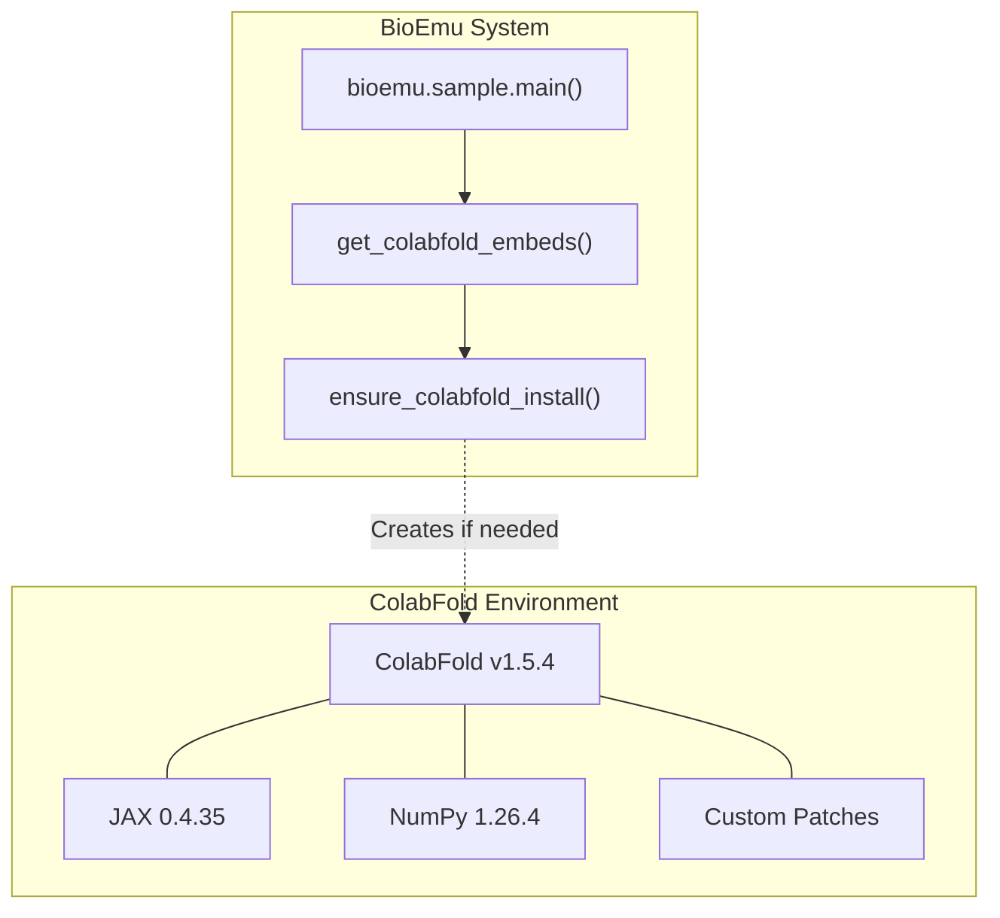

Sources: [src/bioemu/colabfold_setup/setup.sh:5-13]()

### Custom Patches

BioEmu applies two patches to ColabFold to enhance its functionality:

1. `modules.patch`: Modifies the AlphaFold modules implementation
2. `batch.patch`: Adds functionality to save single and pair representation evolutionary data

The batch.patch specifically adds code to save the evolutionary representations, which are crucial for BioEmu's structure sampling:

```
np.save(files.get("single_repr_evo", "npy"), result["representations_evo"]["single"])
np.save(files.get("pair_repr_evo", "npy"), result["representations_evo"]["pair"])
```

Sources: [src/bioemu/colabfold_setup/setup.sh:15-22](), [src/bioemu/colabfold_setup/batch.patch:1-5]()

## Using Custom MSA Files

If you prefer to use your own generated MSA instead of the ones retrieved via ColabFold, you can:

1. Pass an A3M file containing the query sequence as the first row to the `sequence` argument
2. Use the `msa_host_url` argument to override the default ColabFold MSA query server

Example:

```bash
# Using a custom MSA file
python -m bioemu.sample --sequence path/to/custom.a3m --output_dir ~/output
```

Sources: [README.md:59-61]()

## Data Flow with ColabFold

The following diagram illustrates how data flows through ColabFold within the BioEmu system:

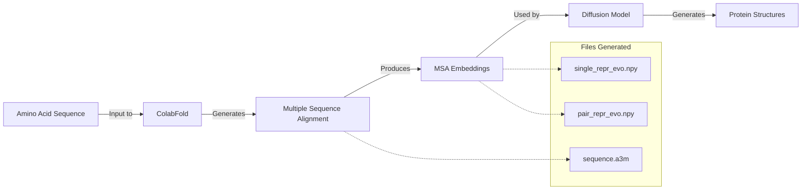

Sources: [README.md:38-41](), [src/bioemu/colabfold_setup/batch.patch:1-5]()

## Troubleshooting and Common Issues

If you encounter issues with ColabFold setup, consider these steps:

1. Check if the virtual environment was created properly in your specified directory
2. Ensure you have sufficient disk space for ColabFold dependencies
3. If you see any CUDA-related errors, verify that your CUDA installation is compatible with the JAX version being installed (CUDA 12 is used by default)
4. If necessary, you can manually trigger a reinstallation by removing the directory and running BioEmu again

Sources: [src/bioemu/colabfold_setup/setup.sh:5-23]()

---

# Page: HPacker Setup

# HPacker Setup

<details>
<summary>Relevant source files</summary>

The following files were used as context for generating this wiki page:

- [README.md](README.md)
- [src/bioemu/hpacker_setup/__init__.py](src/bioemu/hpacker_setup/__init__.py)
- [src/bioemu/hpacker_setup/setup_hpacker.py](src/bioemu/hpacker_setup/setup_hpacker.py)
- [src/bioemu/hpacker_setup/setup_sidechain_relax.sh](src/bioemu/hpacker_setup/setup_sidechain_relax.sh)

</details>


This document details the process of setting up HPacker within the BioEmu environment. HPacker is a third-party tool used for sidechain reconstruction of protein structures generated by BioEmu. For information about the overall installation process of BioEmu, see [Installation and Setup](#2), and for details on using the sidechain reconstruction functionality, see [Sidechain Reconstruction and MD Relaxation](#3.3).

## Overview

BioEmu outputs protein structures in backbone frame representation. HPacker is integrated as an optional component to reconstruct sidechains for these backbone-only structures, providing complete all-atom protein models.

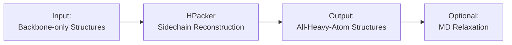

Sources: [README.md:71-72](), [README.md:96-97]()

## Installation Process

HPacker is installed as an optional dependency in BioEmu. The installation is managed through a conda-based package manager.

### Prerequisites

- A conda-based package manager (Conda, Miniconda, or Anaconda) must be installed and available in your PATH
- BioEmu must be installed with the MD extension: `pip install bioemu[md]`

Sources: [README.md:74-80]()

### Automatic Installation

When you first use the sidechain reconstruction functionality, BioEmu automatically:

1. Checks if the HPacker conda environment already exists
2. If not, clones the HPacker repository from GitHub
3. Creates a dedicated conda environment for HPacker
4. Installs all required dependencies
5. Installs HPacker in development mode

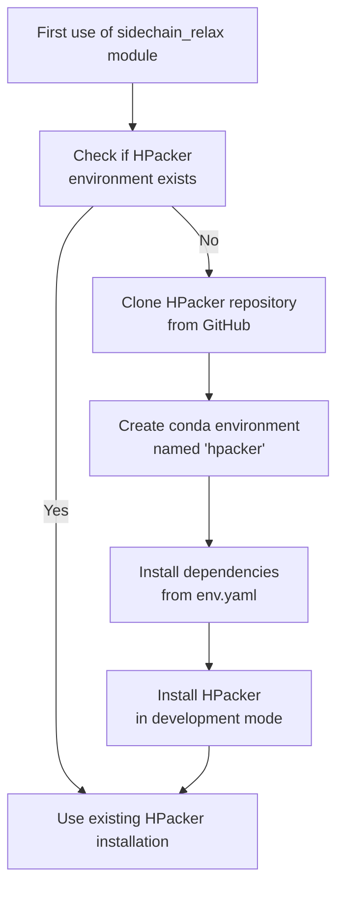

Sources: [src/bioemu/hpacker_setup/setup_hpacker.py:17-37](), [src/bioemu/hpacker_setup/setup_sidechain_relax.sh:1-17]()

## Configuration Options

HPacker setup can be customized with the following environment variables and function parameters:

| Configuration | Default Value | Description |
|---------------|---------------|-------------|
| `HPACKER_ENVNAME` | `"hpacker"` | Name of the conda environment for HPacker |
| `repo_dir` | `"~/.hpacker"` | Directory where HPacker repository is cloned |

Sources: [README.md:88](), [src/bioemu/hpacker_setup/setup_hpacker.py:10-11](), [src/bioemu/hpacker_setup/setup_hpacker.py:17-19]()

## Implementation Details

The HPacker setup process is implemented in two key files:

1. **setup_hpacker.py**: Contains the Python function `ensure_hpacker_install()` that checks if HPacker is already installed and runs the installation script if needed.

2. **setup_sidechain_relax.sh**: Bash script that performs the actual installation by:
   - Cloning the HPacker repository
   - Creating a conda environment
   - Installing dependencies from HPacker's env.yaml
   - Installing HPacker in development mode

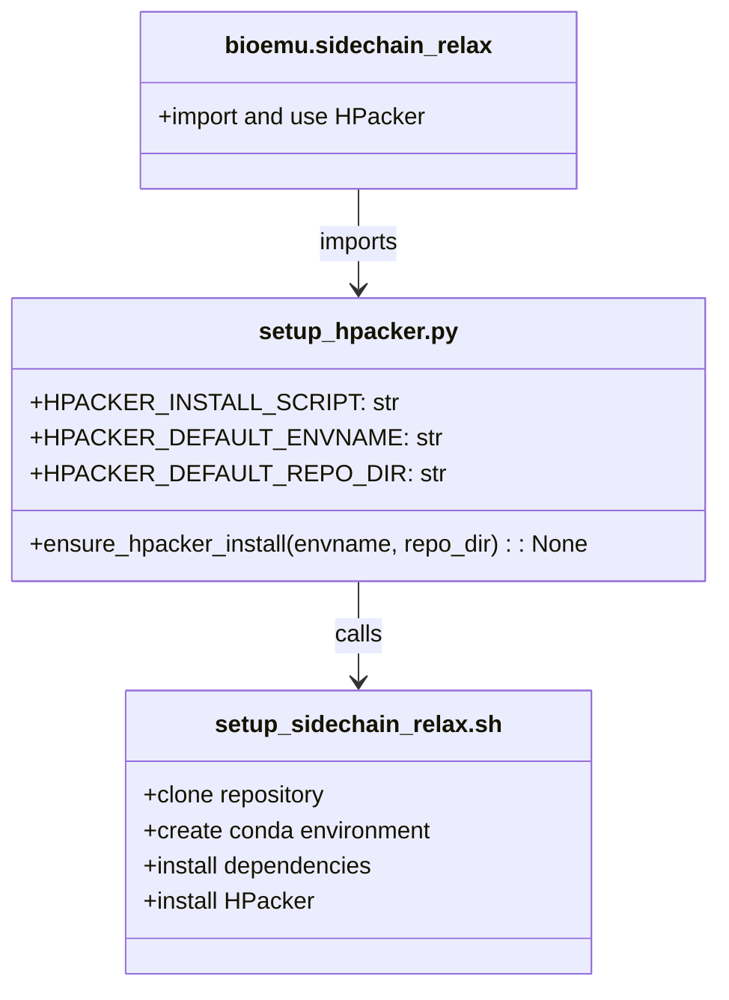

Sources: [src/bioemu/hpacker_setup/setup_hpacker.py:1-37](), [src/bioemu/hpacker_setup/setup_sidechain_relax.sh:1-17]()

## Integration with BioEmu

HPacker is integrated into BioEmu's workflow through the `bioemu.sidechain_relax` module:

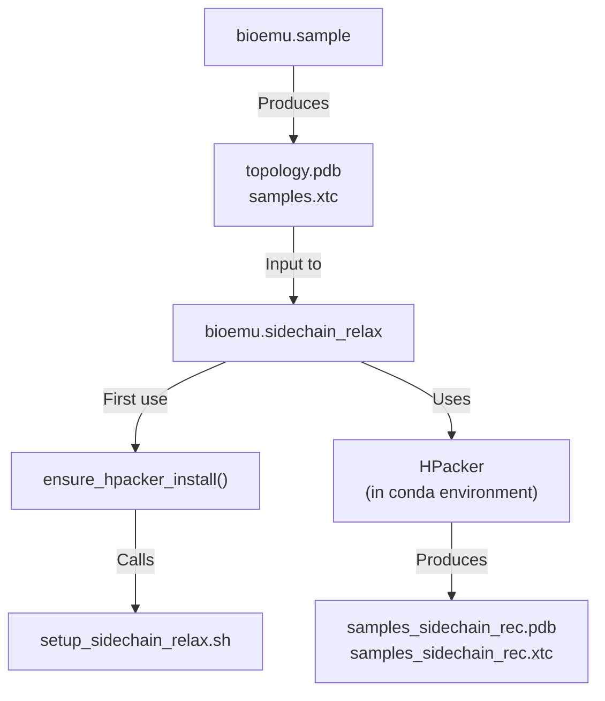

Usage of HPacker in BioEmu follows this pattern:

1. Generate protein structures with `bioemu.sample`
2. Run sidechain reconstruction with `bioemu.sidechain_relax`
3. During first use, HPacker is automatically set up
4. HPacker reconstructs sidechains for the backbone-only structures
5. Optionally, reconstructed structures can undergo MD relaxation

Sources: [README.md:82-100]()

## Troubleshooting

Common issues and solutions:

- **Conda not found**: Make sure conda is properly installed and in your PATH
- **Installation fails**: Check that you have write permissions to the default installation locations
- **HPacker environment conflicts**: Set a custom environment name using the `HPACKER_ENVNAME` environment variable

If HPacker installation fails, you can manually inspect the installation process by:
1. Setting detailed logging: `import logging; logging.basicConfig(level=logging.DEBUG)`
2. Running the setup function: `from bioemu.hpacker_setup.setup_hpacker import ensure_hpacker_install; ensure_hpacker_install()`

Sources: [src/bioemu/hpacker_setup/setup_hpacker.py:13-14](), [src/bioemu/hpacker_setup/setup_hpacker.py:35-37]()

---

# Page: Core Functionality

# Core Functionality

<details>
<summary>Relevant source files</summary>

The following files were used as context for generating this wiki page:

- [README.md](README.md)
- [src/bioemu/convert_chemgraph.py](src/bioemu/convert_chemgraph.py)
- [src/bioemu/sample.py](src/bioemu/sample.py)

</details>


This document provides a comprehensive overview of BioEmu's core functionality - the essential processes that enable the system to generate protein structure ensembles from amino acid sequences. BioEmu combines machine learning techniques with molecular modeling to produce physically realistic protein conformations that approximate the equilibrium distribution of structures.

For installation instructions, see [Installation and Setup](#2). For details about the underlying model architecture, see [Model Architecture](#5).

## 1. Main Workflow

BioEmu's core functionality consists of three main processes:

1. **Structure Sampling**: Generates backbone-only protein structures from an amino acid sequence
2. **Format Conversion**: Converts the internal representation to standard molecular formats (PDB, XTC)
3. **Post-Processing** (optional): Reconstructs sidechains and performs MD relaxation

The following diagram illustrates this workflow:

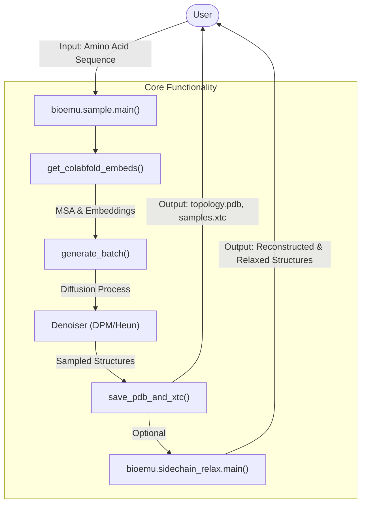

Sources: [src/bioemu/sample.py:66-201](), [README.md:37-43]()

## 2. Structure Sampling

The structure sampling process begins with an amino acid sequence and produces a set of probable backbone conformations using a diffusion model.

### 2.1 Entry Point and Configuration

The main entry point for sampling is the `main()` function in `bioemu.sample`, which accepts:
- An amino acid sequence or FASTA file
- The number of samples to generate
- Output directory and other configuration parameters

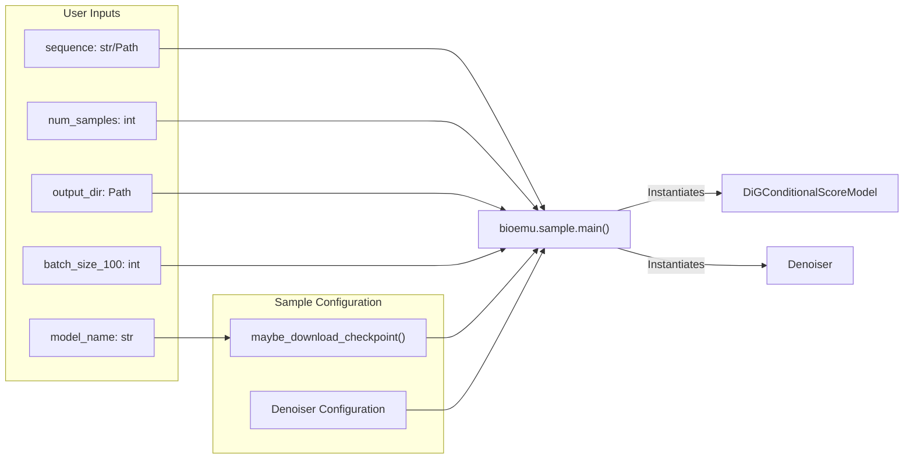

Sources: [src/bioemu/sample.py:66-101]()

### 2.2 Embedding Generation

For each sequence, BioEmu generates embeddings using ColabFold:

1. The sequence is passed to `get_colabfold_embeds()`
2. ColabFold creates a Multiple Sequence Alignment (MSA)
3. The MSA is converted to single-residue and pair-residue embeddings
4. Embeddings are cached for future use

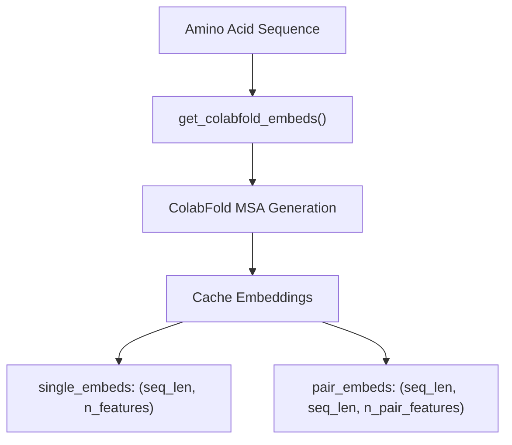

Sources: [src/bioemu/sample.py:229-246]()

### 2.3 Structure Generation

With embeddings in hand, BioEmu generates structures through:

1. Creating a `ChemGraph` representation with the embeddings
2. Running a diffusion model to sample protein backbones
3. Processing batches of samples with appropriate batch sizes based on sequence length

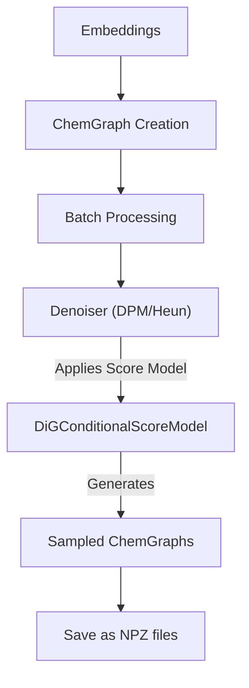

Sources: [src/bioemu/sample.py:203-277]()

## 3. Structure Conversion

After generating samples, BioEmu converts them to standard molecular formats:

### 3.1 ChemGraph to Backbone Atoms

The `ChemGraph` representation is converted to backbone atom positions:

1. Positions and orientations are extracted from sampled ChemGraphs
2. These are processed to generate 3D coordinates for N, CA, C, O, and CB backbone atoms
3. The backbone atom positions are saved in Angstroms

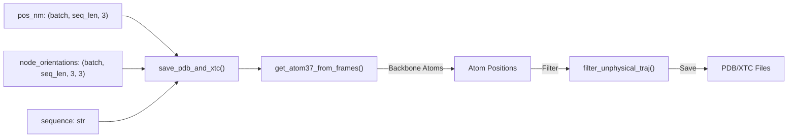

Sources: [src/bioemu/convert_chemgraph.py:398-458]()

### 3.2 Filtering Unphysical Structures

By default, BioEmu filters generated structures based on physical criteria:

1. Maximum CA-CA distance between sequential residues (< 4.5 Å)
2. Maximum C-N distance between sequential residues (< 2.0 Å)
3. Minimum distance between non-bonded atoms (> 1.0 Å)

Only structures that satisfy these criteria are included in the final output.

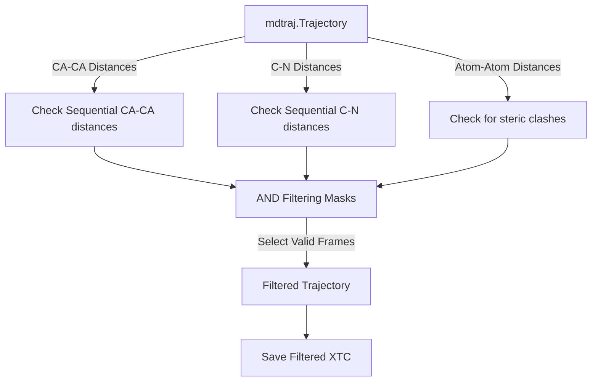

Sources: [src/bioemu/convert_chemgraph.py:296-395]()

## 4. Optional Post-Processing

BioEmu offers optional post-processing to enhance the generated structures:

### 4.1 Sidechain Reconstruction

After backbone generation, sidechains can be reconstructed using HPacker:

1. Takes the backbone-only PDB and XTC files as input
2. Uses HPacker to add sidechain heavy atoms
3. Outputs reconstructed all-heavy-atom structures

### 4.2 MD Relaxation

Optionally, structures can undergo molecular dynamics (MD) relaxation:

1. Energy minimization to resolve local clashes
2. Short NVT equilibration (if specified)
3. Outputs MD-equilibrated structures

```mermaid
flowchart LR
    pdb["topology.pdb"] --> sidechain["bioemu.sidechain_relax.main()"]
    xtc["samples.xtc"] --> sidechain
    
    subgraph "Post-Processing Options"
        direction TB
        sc["Sidechain Reconstruction"] --> min["Energy Minimization"]
        min --> nvt["Optional: NVT Equilibration"]
    end
    
    sidechain --> sc
    
    sc --> |"Output"| rec["samples_sidechain_rec.{pdb,xtc}"]
    nvt --> |"Output"| equil["samples_md_equil.{pdb,xtc}"]
```

Sources: [README.md:70-100]()

## 5. Data Flow Summary

The following diagram summarizes the data transformations that occur throughout BioEmu's core functionality:

```mermaid
graph LR
    subgraph "Input"
        seq["Amino Acid Sequence"]
    end
    
    subgraph "Embedding Generation"
        msa["Multiple Sequence Alignment"]
        embeds["MSA Embeddings"]
    end
    
    subgraph "Structure Sampling"
        chemgraph["ChemGraph"]
        diffusion["Diffusion Process"]
        sampled["Sampled ChemGraph"]
    end
    
    subgraph "Structure Conversion"
        backbone["Backbone Atom Positions"]
        filtering["Physical Filtering"]
        formats["PDB/XTC Files"]
    end
    
    subgraph "Optional Post-Processing"
        sidechain["Sidechain Reconstruction"]
        relaxed["MD Relaxation"]
    end
    
    seq --> msa
    msa --> embeds
    embeds --> chemgraph
    chemgraph --> diffusion
    diffusion --> sampled
    sampled --> backbone
    backbone --> filtering
    filtering --> formats
    formats --> sidechain
    sidechain --> relaxed
```

Sources: [src/bioemu/sample.py](), [src/bioemu/convert_chemgraph.py](), [README.md:70-100]()

## 6. Usage Examples

### Command Line Interface

```bash
python -m bioemu.sample --sequence GYDPETGTWG --num_samples 10 --output_dir ~/test-chignolin
```

### Python API

```python
from bioemu.sample import main as sample
sample(sequence='GYDPETGTWG', num_samples=10, output_dir='~/test_chignolin')
```

For sidechain reconstruction and MD relaxation:

```bash
python -m bioemu.sidechain_relax --pdb-path path/to/topology.pdb --xtc-path path/to/samples.xtc
```

Sources: [README.md:38-96]()

## 7. Performance Considerations

The sampling time depends on sequence length and available hardware. For reference, on an A100 GPU with 80GB VRAM:

| Sequence Length | Time (minutes) for 1000 samples |
|----------------:|--------------------------------:|
|             100 |                               4 |
|             300 |                              40 |
|             600 |                             150 |

Sources: [README.md:52-58]()

---

# Page: Protein Structure Sampling

# Protein Structure Sampling

<details>
<summary>Relevant source files</summary>

The following files were used as context for generating this wiki page:

- [src/bioemu/convert_chemgraph.py](src/bioemu/convert_chemgraph.py)
- [src/bioemu/sample.py](src/bioemu/sample.py)
- [tests/test_sample.py](tests/test_sample.py)

</details>


## Purpose and Scope

The Protein Structure Sampling module is a core component of BioEmu that generates protein backbone structure ensembles from amino acid sequences. It leverages a diffusion model to sample physically plausible protein backbone conformations. This document describes the structure sampling process, its inputs and outputs, and how to use it. For information about subsequent sidechain reconstruction and MD relaxation, see [Sidechain Reconstruction and MD Relaxation](#3.3).

Sources: [src/bioemu/sample.py:3-3]()

## Workflow Overview

The Protein Structure Sampling module takes an amino acid sequence as input and produces an ensemble of protein backbone structures as output. The process involves generating embeddings using ColabFold, using these embeddings as context for a conditional diffusion model, and converting the results to standard protein structure formats (PDB and XTC).

```mermaid
flowchart LR
    subgraph Input
        seq["Amino Acid Sequence"]
    end
    
    subgraph "Protein Structure Sampling"
        colabfold["get_colabfold_embeds()"]
        diffusion["Diffusion Model"]
        convert["save_pdb_and_xtc()"]
        
        seq --> colabfold
        colabfold --> |"MSA Embeddings"| diffusion
        diffusion --> |"ChemGraph Samples"| convert
    end
    
    subgraph Output
        pdb["topology.pdb"]
        xtc["samples.xtc"]
        
        convert --> pdb
        convert --> xtc
    end
```

Sources: [src/bioemu/sample.py:65-200](), [src/bioemu/sample.py:203-277]()

## Key Components

### Main Sampling Function

The primary entry point for protein structure sampling is the `main()` function in the `bioemu.sample` module. This function orchestrates the entire sampling process, from loading models to saving output files.

```mermaid
flowchart TD
    start["main()"] --> download["maybe_download_checkpoint()"]
    download --> parse["parse_sequence()"]
    parse --> loadModel["Load Score Model"]
    loadModel --> setupDenoiser["Setup Denoiser"]
    setupDenoiser --> genBatches["Generate Sample Batches"]
    genBatches --> convert["save_pdb_and_xtc()"]
    
    subgraph "For each batch"
        genBatch["generate_batch()"]
        getEmbeds["get_colabfold_embeds()"]
        createGraph["Create ChemGraph"]
        denoise["Apply Denoiser"]
        
        genBatch --> getEmbeds
        getEmbeds --> createGraph
        createGraph --> denoise
    end
    
    genBatches --> genBatch
```

Sources: [src/bioemu/sample.py:65-200]()

### Model Loading

BioEmu uses pre-trained diffusion models hosted on HuggingFace. The `maybe_download_checkpoint()` function fetches the model if a local path isn't provided.

```mermaid
flowchart LR
    input["Input Parameters"] --> check{"Local ckpt_path\nspecified?"}
    check -->|"Yes"| useLocal["Use local checkpoint"]
    check -->|"No"| download["Download from HuggingFace"]
    
    download --> returnPaths["Return checkpoint\nand config paths"]
    useLocal --> returnPaths
```

Sources: [src/bioemu/sample.py:39-62]()

### Batch Generation

The `generate_batch()` function handles the actual generation of protein structure samples using the diffusion model:

1. It first obtains embeddings for the sequence using ColabFold
2. Creates a ChemGraph representation with the embeddings
3. Applies the diffusion model using a denoiser
4. Returns the sampled structures

Sources: [src/bioemu/sample.py:203-277]()

### Format Conversion

The sampled structures are initially saved as NPZ files. After all batches are generated, they are converted to standard protein structure formats (PDB and XTC) using the `save_pdb_and_xtc()` function:

1. The first frame is saved as a PDB file, which contains the topology
2. All frames are saved as an XTC trajectory file
3. Optionally, unphysical samples are filtered out based on criteria like bond distances and steric clashes

Sources: [src/bioemu/convert_chemgraph.py:398-458]()

## Usage

The Protein Structure Sampling module can be used either through the command line interface or the Python API.

### Command Line Interface

```bash
python -m bioemu.sample <sequence> <num_samples> <output_dir> [options]
```

### Python API

```python
from bioemu.sample import main

main(
    sequence="ACDEFGHIKLMNPQRSTVWY",  # Amino acid sequence, FASTA file, or A3M file
    num_samples=10,                    # Number of samples to generate
    output_dir="./output",             # Directory to save results
    model_name="bioemu-v1.0",          # Pretrained model to use
    filter_samples=True                # Whether to filter unphysical samples
)
```

### Key Parameters

| Parameter | Description |
|-----------|-------------|
| `sequence` | Amino acid sequence, path to FASTA file, or path to A3M file with MSAs |
| `num_samples` | Number of samples to generate |
| `output_dir` | Directory to save the samples |
| `batch_size_100` | Batch size for a sequence of length 100 (default: 10) |
| `model_name` | Name of pretrained model to use (default: "bioemu-v1.0") |
| `ckpt_path` | Path to model checkpoint (overrides `model_name` if provided) |
| `denoiser_type` | Type of denoiser for sampling (options: "dpm", "heun") |
| `cache_embeds_dir` | Directory to store MSA embeddings |
| `filter_samples` | Whether to filter out unphysical samples (default: True) |

Sources: [src/bioemu/sample.py:65-99]()

## Implementation Details

### ChemGraph Representation

The internal representation of protein structures in BioEmu is the `ChemGraph` class, which stores:
- Node positions (`pos`): 3D coordinates of residue centers
- Node orientations (`node_orientations`): 3x3 rotation matrices representing the orientation of each residue
- Embeddings (`single_embeds` and `pair_embeds`): Context features from ColabFold

```mermaid
classDiagram
    class ChemGraph{
        edge_index: torch.Tensor
        pos: torch.Tensor
        node_orientations: torch.Tensor
        single_embeds: torch.Tensor
        pair_embeds: torch.Tensor
    }
```

### Diffusion Model Sampling

BioEmu uses a conditional score-based diffusion model (`DiGConditionalScoreModel`) to generate protein structures. The sampling process works as follows:

1. Start with a noisy structure sampled from a prior distribution
2. Iteratively denoise the structure using the score model
3. The score model is conditioned on the sequence embeddings (from ColabFold)
4. Two types of denoisers are supported: "dpm" and "heun", specified by the `denoiser_type` parameter

Sources: [src/bioemu/sample.py:146-146](), [src/bioemu/sample.py:270-270]()

### Output Files

The sampling process generates the following output files:

| File | Description |
|------|-------------|
| `sequence.fasta` | The input amino acid sequence in FASTA format |
| `batch_*.npz` | Intermediate files containing sample batches |
| `topology.pdb` | PDB file containing the topology of the sampled structures |
| `samples.xtc` | XTC trajectory file containing all sampled structures |

Sources: [src/bioemu/sample.py:198-199]()

## Sample Filtering

By default, BioEmu filters out "unphysical" protein structure samples based on the following criteria:

1. Maximum Cα-Cα distance between sequential residues (4.5 Å)
2. Maximum C-N distance between sequential residues (2.0 Å)
3. Minimum distance between any two atoms from different residues (1.0 Å)

This filtering can be disabled by setting `filter_samples=False`.

Sources: [src/bioemu/convert_chemgraph.py:371-395](), [src/bioemu/convert_chemgraph.py:452-455]()

## Integration with Other Components

The Protein Structure Sampling module is designed to work seamlessly with other components of BioEmu:

```mermaid
flowchart TD
    input["Amino Acid Sequence"] --> sample["bioemu.sample.main()"]
    sample --> |"backbone-only\nstructures"| output1["topology.pdb\nsamples.xtc"]
    
    output1 --> |"Optional"| sidechain["bioemu.sidechain_relax.main()"]
    sidechain --> output2["Full-atom structures\n+ MD relaxation"]
    
    subgraph "Protein Structure Sampling"
        sample
        output1
    end
    
    subgraph "Sidechain Reconstruction & MD Relaxation"
        sidechain
        output2
    end
```

The backbone structures generated by the Protein Structure Sampling module can be fed into the Sidechain Reconstruction and MD Relaxation module for further refinement.

Sources: [src/bioemu/sample.py:84-84]()

---

# Page: Embedding Generation

# Embedding Generation

<details>
<summary>Relevant source files</summary>

The following files were used as context for generating this wiki page:

- [src/bioemu/get_embeds.py](src/bioemu/get_embeds.py)
- [tests/test_embeds.py](tests/test_embeds.py)

</details>


## Purpose and Overview

This document describes how BioEmu generates and manages protein sequence embeddings, which are critical representations that capture evolutionary information needed for accurate protein structure prediction. The embedding generation process leverages ColabFold to create both single (per-residue) and pair (residue-residue interaction) representations from input amino acid sequences.

For information about how these embeddings are used in structure sampling, see [Protein Structure Sampling](#3.1).

## Embedding Generation Process

The embedding generation workflow consists of several steps, from receiving an input sequence to outputting numerical representations that can be used by the diffusion model.

```mermaid
flowchart LR
    seq["Amino Acid Sequence"] --> hash["SHA256 Hash Generation"]
    hash --> cache_check{"Cached\nEmbeddings\nExist?"}
    cache_check -->|"Yes"| load["Load Cached Embeddings"]
    cache_check -->|"No"| fasta["Convert to FASTA"]
    fasta --> cf["Run ColabFold"]
    cf --> save["Save Embeddings to Cache"]
    save --> emb["Return Embedding Paths"]
    load --> emb
```

Sources: [src/bioemu/get_embeds.py:127-203](). [src/bioemu/get_embeds.py:28-30]().

## Key Components and Technical Implementation

### Embedding Types

BioEmu generates and uses two types of embeddings:

1. **Single Representations**: Per-residue embeddings that capture information about each amino acid in the sequence
2. **Pair Representations**: Residue-residue interaction embeddings that capture information about how different positions in the sequence relate to each other

```mermaid
graph TD
    subgraph "Embedding Files"
        single["Single Representation\n{hash}_single.npy"]
        pair["Pair Representation\n{hash}_pair.npy"]
    end
    
    subgraph "Dimensionality"
        single --- dims1["Shape: (L, D)\nL = sequence length\nD = embedding dimension"]
        pair --- dims2["Shape: (L, L, D')\nL = sequence length\nD' = pair embedding dimension"]
    end
```

Sources: [src/bioemu/get_embeds.py:155-156](). [tests/test_embeds.py:27-28]().

### Caching Mechanism

BioEmu implements an efficient caching system to avoid redundant computation of embeddings:

```mermaid
flowchart TD
    input["Input: Protein Sequence"] --> hash["Generate SHA256 Hash"]
    hash --> paths["Generate Cache Paths"]
    paths --> check{"Check Cache\nExistence"}
    check -->|"Cache Exists"| return["Return Cached Paths"]
    check -->|"Cache Missing"| compute["Run ColabFold"]
    compute --> save["Save Embeddings to Cache"]
    save --> return
```

Sources: [src/bioemu/get_embeds.py:147-160](). [src/bioemu/get_embeds.py:83-85]().

The cache directory defaults to `~/.bioemu_embeds_cache` but can be customized when calling the embedding functions.

### ColabFold Integration

BioEmu integrates with ColabFold by:

1. Managing the ColabFold installation
2. Preparing input files in the required format
3. Executing ColabFold with appropriate parameters
4. Extracting and storing the resulting embeddings

```mermaid
graph TB
    subgraph "ColabFold Integration"
        install["ensure_colabfold_install()"]
        run["run_colabfold()"]
        extract["Extract Embeddings"]
    end
    
    subgraph "Key Parameters"
        model["--model-type alphafold2"]
        order["--model-order 3"]
        recycle["--num-recycle 0"]
        save["--save-single-representations\n--save-pair-representations"]
    end
    
    install --> run
    run --> extract
    model --- run
    order --- run
    recycle --- run
    save --- run
```

Sources: [src/bioemu/get_embeds.py:58-80](). [src/bioemu/get_embeds.py:88-124]().

## API Usage

### Primary Function: `get_colabfold_embeds`

The main API for generating embeddings is the `get_colabfold_embeds` function:

```
get_colabfold_embeds(
    seq: str,
    cache_embeds_dir: StrPath | None,
    msa_file: StrPath | None = None,
    msa_host_url: str | None = None
) -> tuple[StrPath, StrPath]
```

This function takes a protein sequence and returns paths to the single and pair embeddings.

| Parameter | Type | Description |
|-----------|------|-------------|
| `seq` | `str` | Protein sequence in one-letter amino acid code |
| `cache_embeds_dir` | `StrPath \| None` | Directory to store cached embeddings (defaults to `~/.bioemu_embeds_cache`) |
| `msa_file` | `StrPath \| None` | Optional path to a precomputed MSA file in A3M format |
| `msa_host_url` | `str \| None` | Optional URL for a custom MSA server |

**Return value**: A tuple of paths `(single_rep_file, pair_rep_file)` to the embedding files.

Sources: [src/bioemu/get_embeds.py:127-143](). [tests/test_embeds.py:32-54]().

### Input/Output File Structure

The embedding generation system uses several file types:

```mermaid
graph LR
    subgraph "Input Files"
        fasta[".fasta\nAmino Acid Sequence"]
        a3m[".a3m\nMultiple Sequence Alignment"]
    end
    
    subgraph "Output Files"
        single["{hash}_single.npy\nSingle Representation"]
        pair["{hash}_pair.npy\nPair Representation"]
        hash_fasta["{hash}.fasta\nReference Sequence"]
    end
    
    fasta --> process["get_colabfold_embeds()"]
    a3m -->|"Optional"| process
    process --> single
    process --> pair
    process --> hash_fasta
```

Sources: [src/bioemu/get_embeds.py:155-156](). [src/bioemu/get_embeds.py:201]().

## Implementation Details

### Sequence Hashing

BioEmu uses SHA-256 hashing to generate unique identifiers for protein sequences, which are used for embedding file naming and lookup:

```python
def shahexencode(s: str) -> str:
    """Simple sha256 string encoding"""
    return hashlib.sha256(s.encode()).hexdigest()
```

This ensures a deterministic mapping between sequences and their cached embeddings.

Sources: [src/bioemu/get_embeds.py:28-30]().

### ColabFold Configuration

The system runs ColabFold with specific parameters:

- Uses model 3 of AlphaFold2 for embedding generation
- Disables recycling for faster computation
- Explicitly saves both single and pair representations
- Allows customization of MSA server URLs

Sources: [src/bioemu/get_embeds.py:107-123]().

### Automated Installation

The system ensures ColabFold is properly installed before attempting to generate embeddings:

```mermaid
flowchart TD
    start["ensure_colabfold_install()"] --> check{"ColabFold\nInstalled?"}
    check -->|"Yes"| verify{"Properly\nPatched?"}
    check -->|"No"| install["Run Installation Script"]
    verify -->|"No"| fail["Assert Failure"]
    verify -->|"Yes"| return["Return ColabFold bin directory"]
    install --> return
```

Sources: [src/bioemu/get_embeds.py:58-80]().

### MSA Sources

BioEmu supports multiple sources for Multiple Sequence Alignments (MSAs):

1. **Default**: Uses ColabFold's remote MSA server
2. **Custom MSA server**: Allows specifying an alternative MSA server URL
3. **Precomputed MSA**: Accepts a3m files containing precomputed MSAs

Note: When using precomputed MSAs, the system warns that this might result in different distributions than those produced by the default ColabFold MSA server.

Sources: [src/bioemu/get_embeds.py:176-181]().

## Integration with BioEmu Pipeline

The embedding generation component integrates with the broader BioEmu system as follows:

```mermaid
flowchart LR
    subgraph "BioEmu Pipeline"
        input["Amino Acid Sequence"] --> embeds["Embedding Generation\nget_colabfold_embeds()"]
        embeds --> diffusion["Diffusion Model\nStructure Sampling"]
        diffusion --> output["Protein Structure Ensemble"]
    end
    
    subgraph "Data Flow"
        seq["Sequence (str)"] --> sha["SHA256 Hash"]
        sha --> cache["Cache Lookup"]
        cache --> |"Miss"| colabfold["ColabFold Processing"]
        colabfold --> numpy["Numpy Arrays\n{hash}_single.npy\n{hash}_pair.npy"]
        cache -->|"Hit"| numpy
        numpy --> tensors["PyTorch Tensors"]
    end
```

Sources: [src/bioemu/get_embeds.py:127-203]().

## Performance and Practical Considerations

- Embeddings are computed only once per unique sequence and cached for future use
- The first-time embedding generation can take several minutes depending on sequence length
- Cached embeddings load almost instantly
- MSA generation by ColabFold requires internet access unless a local MSA server or precomputed MSA is provided
- The embedding cache can grow large for many sequences, so consider monitoring disk usage

---

# Page: Sidechain Reconstruction and MD Relaxation

# Sidechain Reconstruction and MD Relaxation

<details>
<summary>Relevant source files</summary>

The following files were used as context for generating this wiki page:

- [src/bioemu/sidechain_relax.py](src/bioemu/sidechain_relax.py)
- [tests/test_mdrelax.py](tests/test_mdrelax.py)

</details>


## Purpose and Scope

This document details the sidechain reconstruction and molecular dynamics (MD) relaxation component of BioEmu. This component serves as an optional post-processing step that takes backbone-only protein structures generated by the Structure Sampling module (see [Protein Structure Sampling](#3.1)) and refines them by:

1. Reconstructing missing sidechain atoms
2. Optionally performing molecular dynamics simulations to relax the structures into more physically realistic conformations

The process transforms backbone-only protein structures into complete, all-atom protein models that have been energy-minimized and relaxed.

## System Overview

The sidechain reconstruction and MD relaxation workflow operates as the final stage in the BioEmu pipeline, taking backbone-only structures and producing refined, complete protein models.

```mermaid
flowchart TD
    backbone["Backbone-only Structures\n(PDB/XTC files)"] --> reconstruct["reconstruct_sidechains()"]
    reconstruct --> |"All-heavy-atom\nstructures"| md{{"MD Relaxation\nRequired?"}}
    md -->|"Yes"| protonation["get_propka_protonation()"]
    md -->|"No"| output1["Save PDB/XTC"]
    protonation -->|"Protonated structures"| runmd["run_all_md()"]
    runmd -->|"MD-relaxed structures"| output2["Save PDB/XTC"]
```

Sources: [src/bioemu/sidechain_relax.py:206-242]()

## Sidechain Reconstruction with HPacker

### Integration with HPacker

The system uses HPacker, an external tool, to reconstruct protein sidechains from backbone-only structures. HPacker installation and setup are managed automatically by the system.

```mermaid
flowchart TD
    input["Input: Backbone-only\nTrajectory"] --> slice["Extract Backbone Atoms\n(N, CA, C, O)"]
    slice --> loop["For each frame"]
    
    subgraph "Per-frame Processing"
        loop --> save["Save frame as temporary PDB"]
        save --> hpacker["_run_hpacker()\nCalls HPacker in dedicated environment"]
        hpacker --> load["Load reconstructed structure"]
    end
    
    load --> join["Join frames into single trajectory"]
    join --> output["Return complete\nheavy-atom trajectory"]
```

Sources: [src/bioemu/sidechain_relax.py:36-105]()

### Reconstruction Process

The `reconstruct_sidechains()` function processes each frame of the input trajectory:

1. Extracts only backbone atoms (N, CA, C, O) from the input structure, excluding CB atoms
2. For each frame:
   - Saves the backbone structure to a temporary PDB file
   - Calls HPacker via the `_run_hpacker()` function to add sidechains
   - Loads the reconstructed structure back into memory
3. Joins all reconstructed frames into a single trajectory
4. Handles errors if frames have inconsistent topologies

The `_run_hpacker()` function ensures HPacker is properly installed and runs it in a dedicated Conda environment to avoid dependency conflicts.

Sources: [src/bioemu/sidechain_relax.py:63-105]()

## Molecular Dynamics Relaxation

### MD Protocols

The system offers two MD protocols for structure relaxation:

| Protocol | Description | Performance | Use Case |
|----------|-------------|-------------|----------|
| `LOCAL_MINIMIZATION` | Only performs energy minimization without integration | Fast | For resolving local issues like steric clashes |
| `NVT_EQUIL` | Energy minimization plus short MD simulation | Slower but more thorough | For resolving more severe structural issues |

Sources: [src/bioemu/sidechain_relax.py:31-34](), [src/bioemu/sidechain_relax.py:218-224]()

### MD Simulation Details

```mermaid
flowchart TD
    input["Input: Single Structure Frame"] --> modeller["Create OpenMM Modeller\nwith Structure"]
    modeller --> solvate["Add Solvent\n(TIP3P water model)"]
    solvate --> system["Create Force Field System\n(amber99sb)"]
    system --> constraints["Add Backbone Constraints"]
    constraints --> minimize["Energy Minimization"]
    minimize --> md{{"Run MD?"}}
    md -->|"Yes"| integrate["Integration\n(Langevin dynamics)"]
    md -->|"No"| extract["Extract Final Positions"]
    integrate --> extract
    extract --> output["Return Relaxed Coordinates"]
```

Sources: [src/bioemu/sidechain_relax.py:108-165]()

The MD simulation uses the following settings:
- Force field: AMBER99SB for protein and TIP3P for water
- Solvation: 1.0 nm padding with 0.1 M ionic strength (Na+/Cl-)
- Periodic boundary conditions with Particle Mesh Ewald (PME)
- Constraints on backbone atoms (C, CA, N, O) with a force constant of 1000
- Langevin integrator at 300K with 2 fs timestep
- Energy minimization performed with 100 maximum iterations

For full MD simulation (`NVT_EQUIL`), the system runs for 0.1 ns by default, while for `LOCAL_MINIMIZATION`, only the energy minimization step is performed.

Sources: [src/bioemu/sidechain_relax.py:108-165]()

### Batch Processing

The `run_all_md()` function manages running MD on multiple structures:

1. Processes each frame in the input trajectory
2. Applies the selected MD protocol to each frame
3. Extracts heavy atoms from the relaxed structures
4. Compiles the results into a new trajectory
5. Gracefully handles frames that fail MD setup

Sources: [src/bioemu/sidechain_relax.py:168-203]()

## Command Line Interface

The module can be used directly from the command line:

```
python -m bioemu.sidechain_relax --xtc-path <XTC_FILE> --pdb-path <PDB_FILE> [options]
```

Key parameters include:
- `--xtc-path`: Path to XTC file containing backbone structures
- `--pdb-path`: Path to PDB file containing topology
- `--md-equil`: Flag to run MD equilibration (default: True)
- `--md-protocol`: MD protocol to use (`local_minimization` or `nvt_equil`)
- `--outpath`: Directory to save output files (default: current directory)
- `--prefix`: Prefix for output filenames (default: "samples")

Sources: [src/bioemu/sidechain_relax.py:206-242]()

## Output Files

The module produces the following output files:

| File | Description |
|------|-------------|
| `<prefix>_sidechain_rec.pdb` | PDB file with the first frame after sidechain reconstruction |
| `<prefix>_sidechain_rec.xtc` | XTC trajectory file with all frames after sidechain reconstruction |
| `<prefix>_md_equil.pdb` | PDB file with the first frame after MD relaxation (if enabled) |
| `<prefix>_md_equil.xtc` | XTC trajectory file with all frames after MD relaxation (if enabled) |

Sources: [src/bioemu/sidechain_relax.py:232-242]()

## Integration with BioEmu Pipeline

```mermaid
flowchart LR
    seq["Amino Acid Sequence"] --> colabfold["ColabFold\nEmbedding Generation"]
    colabfold --> sampling["Structure Sampling\nbioemu.sample"]
    sampling --> |"Backbone-only\nStructures"| sidechain["Sidechain Reconstruction\nbioemu.sidechain_relax"]
    sidechain --> |"Complete Structures\nwith Optional MD"| final["Final Protein\nEnsemble"]
```

The sidechain reconstruction and MD relaxation component is the final step in the BioEmu pipeline. It takes the backbone-only structures generated by the structure sampling module and transforms them into complete, relaxed protein structures.

In a typical workflow:
1. Users first run `bioemu.sample` to generate backbone structures from an amino acid sequence
2. Then run `bioemu.sidechain_relax` on those structures to add sidechains and relax them

Sources: [src/bioemu/sidechain_relax.py:206-242]()

## Protonation State Assignment

Before MD simulation, the system automatically assigns appropriate protonation states to the protein structures using PROPKA at pH 7.0. This ensures that the MD simulations use chemically accurate protonation states for histidines and other titratable residues.

Sources: [src/bioemu/sidechain_relax.py:237]()

---

# Page: API Reference

# API Reference

<details>
<summary>Relevant source files</summary>

The following files were used as context for generating this wiki page:

- [README.md](README.md)
- [src/bioemu/convert_chemgraph.py](src/bioemu/convert_chemgraph.py)
- [src/bioemu/sample.py](src/bioemu/sample.py)
- [src/bioemu/sidechain_relax.py](src/bioemu/sidechain_relax.py)

</details>


This page documents the primary interfaces for using BioEmu. It covers both the Python API and command-line interface that allow users to generate protein structure ensembles from amino acid sequences. For information about the underlying model architecture, see [Model Architecture](#5).

## API Components Overview

```mermaid
flowchart TD
    subgraph "Python API"
        bio_sample["bioemu.sample.main()"]
        bio_sidechain["bioemu.sidechain_relax.main()"]
    end
    
    subgraph "Command Line Interface"
        cli_sample["python -m bioemu.sample"]
        cli_sidechain["python -m bioemu.sidechain_relax"]
    end
    
    User([User]) --> cli_sample
    User --> cli_sidechain
    User --> bio_sample
    User --> bio_sidechain
    
    cli_sample --> bio_sample
    cli_sidechain --> bio_sidechain
    
    bio_sample --> |"topology.pdb\nsamples.xtc"| Files
    bio_sidechain --> |"samples_sidechain_rec.pdb\nsamples_sidechain_rec.xtc\nsamples_md_equil.pdb\nsamples_md_equil.xtc"| Files
```

Sources: [src/bioemu/sample.py](), [src/bioemu/sidechain_relax.py](), [README.md]()

## Sample Module

The Sample module is the primary entry point for generating protein structure ensembles from amino acid sequences.

### Python API

```python
from bioemu.sample import main as sample

sample(
    sequence='GYDPETGTWG',
    num_samples=10,
    output_dir='~/test_chignolin'
)
```

#### Function: `main()`

```mermaid
flowchart TD
    Start([User Input]) --> |"sequence, num_samples, etc."| sample["bioemu.sample.main()"]
    sample --> get_embeds["get_colabfold_embeds()"]
    get_embeds --> download[Download Model]
    sample --> setup[Initialize Model]
    setup --> noise[Generate Initial Noise]
    noise --> denoising[Apply Denoising Process]
    denoising --> convert["save_pdb_and_xtc()"]
    convert --> |"topology.pdb\nsamples.xtc"| Output
```

Sources: [src/bioemu/sample.py:66-200]()

**Parameters:**

| Parameter | Type | Description | Default |
| --- | --- | --- | --- |
| `sequence` | `str` or `Path` | Amino acid sequence, path to .fasta file, or path to .a3m file with MSAs | Required |
| `num_samples` | `int` | Number of samples to generate | Required |
| `output_dir` | `str` or `Path` | Directory to save samples | Required |
| `batch_size_100` | `int` | Batch size for a sequence of length 100 | 10 |
| `model_name` | `str` or `None` | Name of pretrained model to use | "bioemu-v1.0" |
| `ckpt_path` | `str` or `Path` or `None` | Path to model checkpoint | None |
| `model_config_path` | `str` or `Path` or `None` | Path to model config | None |
| `denoiser_type` | `Literal["dpm", "heun"]` or `None` | Denoiser type | "dpm" |
| `denoiser_config_path` | `str` or `Path` or `None` | Path to denoiser config | None |
| `cache_embeds_dir` | `str` or `Path` or `None` | Directory to cache MSA embeddings | None |
| `msa_host_url` | `str` or `None` | MSA server URL | None |
| `filter_samples` | `bool` | Filter out unphysical samples | True |

**Return Value:** None

**Description:**
Generates protein structure samples for the specified sequence using a trained model. The function performs the following steps:
1. Downloads model weights if needed
2. Generates or loads cached MSA embeddings using ColabFold
3. Initializes the scoring model and denoiser
4. Generates structure samples in batches
5. Saves the results as PDB and XTC files

Sources: [src/bioemu/sample.py:66-200]()

### Command Line Interface

```bash
python -m bioemu.sample --sequence GYDPETGTWG --num_samples 10 --output_dir ~/test-chignolin
```

The command-line interface accepts the same parameters as the Python API function with equivalent names.

Sources: [src/bioemu/sample.py:280-287](), [README.md:39-40]()

## Sidechain Reconstruction and MD Relaxation Module

This module allows users to reconstruct sidechains for backbone-only protein structures and optionally perform molecular dynamics relaxation.

### Python API

```python
from bioemu.sidechain_relax import main as sidechain_relax

sidechain_relax(
    pdb_path='topology.pdb',
    xtc_path='samples.xtc',
    md_equil=True,
    md_protocol='local_minimization',
    outpath='.',
    prefix='samples'
)
```

#### Function: `main()`

```mermaid
flowchart TD
    Start([User Input]) --> |"pdb_path, xtc_path, etc."| sidechain["bioemu.sidechain_relax.main()"]
    sidechain --> load["mdtraj.load_xtc()"]
    load --> reconstruct["reconstruct_sidechains()"]
    reconstruct --> hpacker["_run_hpacker()"]
    
    subgraph "Optional MD Relaxation"
        reconstruct --> |"if md_equil=True"| protonation["get_propka_protonation()"]
        protonation --> run_md["run_all_md()"]
    end
    
    reconstruct --> |"samples_sidechain_rec.pdb\nsamples_sidechain_rec.xtc"| OutputRec
    run_md --> |"samples_md_equil.pdb\nsamples_md_equil.xtc"| OutputMD
```

Sources: [src/bioemu/sidechain_relax.py:206-242]()

**Parameters:**

| Parameter | Type | Description | Default |
| --- | --- | --- | --- |
| `pdb_path` | `str` | Path to PDB file containing topology | Required |
| `xtc_path` | `str` | Path to XTC file containing samples | Required |
| `md_equil` | `bool` | Run MD equilibration | True |
| `md_protocol` | `MDProtocol` | MD protocol | "local_minimization" |
| `outpath` | `str` | Directory to save output files | "." |
| `prefix` | `str` | Prefix for output filenames | "samples" |

**Return Value:** None

**Description:**
Reconstructs sidechains for backbone-only protein structures and optionally performs molecular dynamics relaxation. The function performs the following steps:
1. Loads the trajectory from XTC and PDB files
2. Reconstructs sidechains using HPacker
3. If MD equilibration is enabled, assigns protonation states and runs MD simulation
4. Saves the results as PDB and XTC files

Sources: [src/bioemu/sidechain_relax.py:206-242]()

### Command Line Interface

```bash
python -m bioemu.sidechain_relax --pdb-path topology.pdb --xtc-path samples.xtc
```

The command-line interface accepts the same parameters as the Python API function with equivalent names.

Sources: [src/bioemu/sidechain_relax.py:245-246](), [README.md:84-85]()

## Additional Options

### MD Protocol Options

The `md_protocol` parameter in the sidechain_relax function supports two options:

| Option | Description |
| --- | --- |
| `local_minimization` | Only runs a local energy minimizer, which is fast but only resolves local issues like clashes |
| `nvt_equil` | Runs local energy minimizer followed by a short constrained MD equilibration, which is slower but might resolve more severe issues |

Sources: [src/bioemu/sidechain_relax.py:31-34](), [README.md:94-97]()

## Data Flow and Processing

```mermaid
flowchart LR
    Sequence["Amino Acid Sequence"] --> sample["bioemu.sample.main()"]
    sample --> |"MSA & Embeddings Generation"| colabfold["get_colabfold_embeds()"]
    colabfold --> |"MSA Embeddings"| sampling["Score Model & Denoising"]
    sampling --> |"ChemGraph with Positions\nand Orientations"| convert["save_pdb_and_xtc()"]
    convert --> |"topology.pdb\nsamples.xtc"| backbone["Backbone-only Structures"]
    
    backbone --> sidechain["bioemu.sidechain_relax.main()"]
    sidechain --> |"Sidechain Reconstruction"| hpacker["HPacker"]
    hpacker --> |"All-Heavy-Atom Structures"| all_atom["samples_sidechain_rec.pdb\nsamples_sidechain_rec.xtc"]
    
    all_atom --> |"Optional"| md["MD Relaxation"]
    md --> |"Energy-minimized Structures"| relaxed["samples_md_equil.pdb\nsamples_md_equil.xtc"]
```

Sources: [src/bioemu/sample.py](), [src/bioemu/sidechain_relax.py](), [src/bioemu/convert_chemgraph.py]()

## Output Files

BioEmu generates several output files during the sampling and sidechain reconstruction processes:

| File | Description |
| --- | --- |
| `topology.pdb` | PDB file containing the topology of the first sampled structure (backbone-only) |
| `samples.xtc` | XTC file containing all sampled structures (backbone-only) |
| `samples_sidechain_rec.pdb` | PDB file containing the topology of the first structure with reconstructed sidechains |
| `samples_sidechain_rec.xtc` | XTC file containing all structures with reconstructed sidechains |
| `samples_md_equil.pdb` | PDB file containing the topology of the first structure after MD equilibration |
| `samples_md_equil.xtc` | XTC file containing all structures after MD equilibration |

Sources: [src/bioemu/sample.py:193-198](), [src/bioemu/sidechain_relax.py:232-242](), [README.md:100]()

## Helper Functions

### Filtering Unphysical Structures

The `filter_unphysical_traj` function in the `convert_chemgraph` module filters out unphysical structures based on several criteria:

| Parameter | Default Value | Description |
| --- | --- | --- |
| `max_ca_seq_distance` | 4.5 Å | Maximum carbon alpha distance between any two contiguous residues |
| `max_cn_seq_distance` | 2.0 Å | Maximum carbon-nitrogen distance between any two contiguous residues |
| `clash_distance` | 1.0 Å | Minimum distance between any two atoms belonging to different residues |

This filtering is enabled by default but can be disabled with the `filter_samples=False` parameter.

Sources: [src/bioemu/convert_chemgraph.py:371-395](), [src/bioemu/sample.py:193-198]()

## MSA and Embedding Generation

By default, BioEmu uses ColabFold to generate Multiple Sequence Alignments (MSAs) and embeddings for the input sequence. The first time BioEmu is used, it will set up ColabFold in a separate virtual environment.

Users can also provide their own MSA file in A3M format instead of using ColabFold by passing the path to the A3M file to the `sequence` parameter.

Sources: [src/bioemu/sample.py:230-235](), [README.md:33-34](), [README.md:60-61]()

---

# Page: Command Line Interface

# Command Line Interface

<details>
<summary>Relevant source files</summary>

The following files were used as context for generating this wiki page:

- [README.md](README.md)
- [src/bioemu/convert_chemgraph.py](src/bioemu/convert_chemgraph.py)
- [src/bioemu/sample.py](src/bioemu/sample.py)
- [src/bioemu/sidechain_relax.py](src/bioemu/sidechain_relax.py)

</details>


This document describes the command-line interfaces (CLIs) provided by BioEmu for generating protein structure ensembles from amino acid sequences. BioEmu offers two primary command-line tools:

1. `bioemu.sample` - For generating protein backbone structure samples from amino acid sequences
2. `bioemu.sidechain_relax` - For reconstructing sidechains and optionally performing molecular dynamics relaxation on backbone samples

For information about the equivalent Python API, see [Python API](#4.2).

## Overview

```mermaid
flowchart TD
    User([User]) -->|"Input: AA Sequence"| SampleCLI["bioemu.sample CLI"]
    SampleCLI --> Sampling["Sample Backbone Structures"]
    Sampling -->|"Output: topology.pdb\nsamples.xtc"| User
    
    User -->|"Input: PDB/XTC files"| RelaxCLI["bioemu.sidechain_relax CLI"]
    RelaxCLI --> SidechainRec["Reconstruct Sidechains"]
    SidechainRec -->|"Optional"| MDRelax["MD Relaxation"]
    
    SidechainRec -->|"Output: samples_sidechain_rec.pdb\nsamples_sidechain_rec.xtc"| User
    MDRelax -->|"Output: samples_md_equil.pdb\nsamples_md_equil.xtc"| User
```

Sources: [src/bioemu/sample.py:66-200](), [src/bioemu/sidechain_relax.py:206-243]()

## Structure Sampling CLI

The `bioemu.sample` module provides the primary interface for generating protein structure samples from amino acid sequences.

### Usage

```bash
python -m bioemu.sample --sequence SEQUENCE --num_samples NUM_SAMPLES --output_dir OUTPUT_DIR [OPTIONS]
```

### Parameters

| Parameter | Type | Description | Default |
|-----------|------|-------------|---------|
| `--sequence` | str | Amino acid sequence, path to FASTA file, or path to A3M file with MSAs | Required |
| `--num_samples` | int | Number of samples to generate | Required |
| `--output_dir` | str | Directory to save samples | Required |
| `--batch_size_100` | int | Batch size for a sequence of length 100 (scales with sequence length) | 10 |
| `--model_name` | str | Name of pretrained model to use from Hugging Face | "bioemu-v1.0" |
| `--ckpt_path` | str | Path to model checkpoint (overrides `model_name`) | None |
| `--model_config_path` | str | Path to model config (required if `ckpt_path` is set) | None |
| `--denoiser_type` | str | Denoiser type ("dpm" or "heun") | "dpm" |
| `--denoiser_config_path` | str | Path to denoiser config | None |
| `--cache_embeds_dir` | str | Directory to cache MSA embeddings | None |
| `--msa_host_url` | str | MSA server URL for ColabFold | None |
| `--filter_samples` | bool | Filter out unphysical samples | True |

Sources: [src/bioemu/sample.py:66-200]()

### Output Files

The sampling CLI produces the following files in the specified output directory:

| File | Description |
|------|-------------|
| `sequence.fasta` | The input sequence in FASTA format |
| `topology.pdb` | PDB file containing the topology for the generated ensemble |
| `samples.xtc` | XTC trajectory file containing all generated samples |
| `batch_*.npz` | Intermediate files containing batches of samples (preserved for debugging) |

Sources: [src/bioemu/sample.py:147-199](), [src/bioemu/convert_chemgraph.py:398-458]()

### Examples

Basic usage with a short peptide sequence:

```bash
python -m bioemu.sample --sequence GYDPETGTWG --num_samples 10 --output_dir ~/test-chignolin
```

Using a FASTA file as input:

```bash
python -m bioemu.sample --sequence path/to/protein.fasta --num_samples 100 --output_dir ~/protein_samples
```

Using a custom MSA file:

```bash
python -m bioemu.sample --sequence path/to/custom.a3m --num_samples 50 --output_dir ~/custom_msa_samples
```

Using a different model checkpoint and configuration:

```bash
python -m bioemu.sample --sequence SEQUENCE --num_samples 10 --output_dir output \
    --ckpt_path path/to/checkpoint.ckpt --model_config_path path/to/config.yaml
```

Sources: [README.md:37-62]()

## Workflow Details

```mermaid
flowchart TD
    Input["Input Sequence/FASTA/A3M"] --> Sample["bioemu.sample.main()"]
    
    subgraph "Structure Sampling Process"
        Sample --> GetEmbeds["get_colabfold_embeds()"]
        GetEmbeds -->|"Creates MSA & Embeddings"| Denoiser["Denoiser (DPM/Heun)"]
        Denoiser -->|"Uses DiGConditionalScoreModel"| GenerateBatch["generate_batch()"]
        GenerateBatch --> Convert["save_pdb_and_xtc()"]
    end
    
    Convert -->|"1. Generate Atom Positions"| Atomize["get_atom37_from_frames()"]
    Convert -->|"2. Filter Samples"| Filter["filter_unphysical_traj()"]
    Convert -->|"3. Save Output"| Output["topology.pdb\nsamples.xtc"]
```

Sources: [src/bioemu/sample.py:147-201](), [src/bioemu/convert_chemgraph.py:398-458]()

### Generation Process

1. **Input Parsing**: The amino acid sequence is parsed from a string, FASTA file, or A3M file.
2. **Embedding Generation**: MSA embeddings are generated using ColabFold.
3. **Batch Generation**: Samples are generated in batches, with batch size scaled according to sequence length.
4. **Structure Conversion**: Sampled structures are converted from the internal ChemGraph representation to backbone atom positions.
5. **Sample Filtering**: Unphysical samples with issues like unrealistic bond distances or steric clashes are filtered out.
6. **Output Writing**: The final structures are saved as PDB and XTC files.

Sources: [src/bioemu/sample.py:66-200](), [src/bioemu/convert_chemgraph.py:398-458]()

## Sidechain Reconstruction and MD Relaxation CLI

The `bioemu.sidechain_relax` module provides functionality for reconstructing sidechains from backbone-only structures and optionally performing molecular dynamics relaxation.

### Prerequisites

This module requires additional dependencies:
- A conda-based package manager available in the system PATH
- Optional dependencies installed via `pip install bioemu[md]`

The first time this module is invoked, it will attempt to install HPacker and its dependencies into a separate conda environment.

Sources: [README.md:70-96]()

### Usage

```bash
python -m bioemu.sidechain_relax --pdb-path PDB_PATH --xtc-path XTC_PATH [OPTIONS]
```

### Parameters

| Parameter | Type | Description | Default |
|-----------|------|-------------|---------|
| `--pdb-path` | str | Path to PDB file containing topology | Required |
| `--xtc-path` | str | Path to XTC file containing samples | Required |
| `--md-equil` | bool | Run MD equilibration | True |
| `--md-protocol` | str | MD protocol ("local_minimization" or "nvt_equil") | "local_minimization" |
| `--outpath` | str | Path to write output files | "." (current directory) |
| `--prefix` | str | Prefix for output filenames | "samples" |
| `--no-md-equil` | flag | Skip MD equilibration (shorthand for `--md-equil=False`) | False |

Sources: [src/bioemu/sidechain_relax.py:206-243]()

### Output Files

The sidechain reconstruction and relaxation CLI produces the following files:

| File | Description |
|------|-------------|
| `{prefix}_sidechain_rec.pdb` | PDB file with reconstructed sidechains |
| `{prefix}_sidechain_rec.xtc` | XTC trajectory file with reconstructed sidechains |
| `{prefix}_md_equil.pdb` | PDB file with MD-equilibrated structures (if MD equilibration is enabled) |
| `{prefix}_md_equil.xtc` | XTC trajectory file with MD-equilibrated structures (if MD equilibration is enabled) |

Sources: [src/bioemu/sidechain_relax.py:229-242]()

### MD Protocols

Two MD protocols are available:

1. **Local Minimization** (`local_minimization`): Only performs energy minimization without full MD integration. This is faster but only resolves local issues like steric clashes.

2. **NVT Equilibration** (`nvt_equil`): Performs energy minimization followed by a short constrained MD equilibration. This is slower but can resolve more severe structural issues.

Sources: [src/bioemu/sidechain_relax.py:31-34](), [src/bioemu/sidechain_relax.py:108-165]()

### Examples

Basic usage with default options (includes MD local minimization):

```bash
python -m bioemu.sidechain_relax --pdb-path topology.pdb --xtc-path samples.xtc
```

Reconstruct sidechains without MD equilibration:

```bash
python -m bioemu.sidechain_relax --pdb-path topology.pdb --xtc-path samples.xtc --no-md-equil
```

Run full NVT equilibration:

```bash
python -m bioemu.sidechain_relax --pdb-path topology.pdb --xtc-path samples.xtc --md-protocol nvt_equil
```

Custom output location and file prefix:

```bash
python -m bioemu.sidechain_relax --pdb-path topology.pdb --xtc-path samples.xtc --outpath results --prefix protein_1
```

Sources: [README.md:82-100]()

## Workflow Details

```mermaid
flowchart TD
    Input["Input PDB/XTC Files"] --> SidechainRelax["bioemu.sidechain_relax.main()"]
    
    subgraph "Sidechain Reconstruction Process"
        SidechainRelax --> LoadTraj["mdtraj.load_xtc()"]
        LoadTraj --> Reconstruct["reconstruct_sidechains()"]
        Reconstruct --> HPacker["_run_hpacker()"]
    end
    
    Reconstruct --> SaveRecon["Save Reconstructed Structures"]
    SaveRecon --> |"samples_sidechain_rec.pdb\nsamples_sidechain_rec.xtc"| Output1["Output Files"]
    
    subgraph "MD Relaxation Process (Optional)"
        SaveRecon --> MDCheck{"MD Equilibration\nEnabled?"}
        MDCheck -->|"Yes"| Protonation["get_propka_protonation()"]
        Protonation --> RunMD["run_all_md()"]
        RunMD --> RunOneMD["run_one_md()"]
        MDCheck -->|"No"| SkipMD["Skip MD Relaxation"]
    end
    
    RunMD --> SaveMD["Save MD-Relaxed Structures"]
    SaveMD -->|"samples_md_equil.pdb\nsamples_md_equil.xtc"| Output2["Output Files"]
```

Sources: [src/bioemu/sidechain_relax.py:206-243](), [src/bioemu/sidechain_relax.py:63-105](), [src/bioemu/sidechain_relax.py:168-203]()

### Sidechain Reconstruction Process

1. **Load Trajectory**: The input PDB and XTC files are loaded using MDTraj.
2. **Extract Backbone**: The backbone atoms are extracted from the input structures.
3. **Run HPacker**: For each frame, HPacker is run to reconstruct sidechains based on the backbone structure.
4. **Combine Results**: The reconstructed structures are combined into a single trajectory.
5. **Save Output**: The reconstructed structures are saved as PDB and XTC files.

Sources: [src/bioemu/sidechain_relax.py:63-105]()

### MD Relaxation Process (Optional)

If MD equilibration is enabled:

1. **Protonation**: Protonation states are determined using propKa at pH 7.0.
2. **System Setup**: The system is set up with explicit solvent (TIP3P water model) and the AMBER99SB force field.
3. **Force Application**: Constraint forces are applied to backbone atoms to maintain the predicted structure.
4. **Minimization**: Energy minimization is performed to resolve steric clashes.
5. **Integration**: For NVT equilibration, molecular dynamics integration is performed for 0.1 ns.
6. **Save Output**: The MD-relaxed structures are saved as PDB and XTC files.

Sources: [src/bioemu/sidechain_relax.py:108-165](), [src/bioemu/sidechain_relax.py:168-203]()

## Common Workflows

### Complete Pipeline: From Sequence to Relaxed Structures

```mermaid
flowchart LR
    Sequence["Amino Acid Sequence"] -->|"python -m bioemu.sample"| Backbone["Backbone Structures\n(topology.pdb, samples.xtc)"]
    Backbone -->|"python -m bioemu.sidechain_relax"| Sidechain["Reconstructed Sidechains\n(samples_sidechain_rec.pdb/xtc)"]
    Sidechain -->|"Optional MD\n(--md-protocol nvt_equil)"| Relaxed["MD-Relaxed Structures\n(samples_md_equil.pdb/xtc)"]
```

Example complete workflow:

```bash
# Step 1: Generate backbone samples
python -m bioemu.sample --sequence GYDPETGTWG --num_samples 10 --output_dir ~/test-protein

# Step 2: Reconstruct sidechains and perform MD relaxation
python -m bioemu.sidechain_relax --pdb-path ~/test-protein/topology.pdb --xtc-path ~/test-protein/samples.xtc --md-protocol nvt_equil
```

Sources: [README.md:37-100]()

### Working with Subsets of Samples

For large proteins, it may be beneficial to work with a subset of samples, especially for sidechain reconstruction and MD relaxation which can be computationally expensive:

```bash
# Generate a large number of backbone samples
python -m bioemu.sample --sequence path/to/sequence.fasta --num_samples 1000 --output_dir ~/large-protein

# Extract a subset of frames using external tools (e.g., MDTraj)
# Then run sidechain reconstruction on the subset
python -m bioemu.sidechain_relax --pdb-path ~/large-protein/subset_topology.pdb --xtc-path ~/large-protein/subset_samples.xtc
```

Sources: [README.md:93-96]()

### Troubleshooting

If you encounter issues with HPacker installation:
- Ensure a conda-based package manager is in your PATH.
- Set the `HPACKER_ENVNAME` environment variable before first use to specify a different location for the HPacker conda environment.

If you need to use your own MSA instead of those generated by ColabFold:
- Prepare an A3M file with your custom MSA (the query sequence must be the first row).
- Pass the A3M file path to the `--sequence` argument.

Sources: [README.md:60-61](), [README.md:88-89]()

---

# Page: Python API

# Python API

<details>
<summary>Relevant source files</summary>

The following files were used as context for generating this wiki page:

- [src/bioemu/convert_chemgraph.py](src/bioemu/convert_chemgraph.py)
- [src/bioemu/get_embeds.py](src/bioemu/get_embeds.py)
- [src/bioemu/sample.py](src/bioemu/sample.py)
- [src/bioemu/seq_io.py](src/bioemu/seq_io.py)
- [src/bioemu/sidechain_relax.py](src/bioemu/sidechain_relax.py)
- [tests/test_seq_io.py](tests/test_seq_io.py)
- [tests/test_utils.py](tests/test_utils.py)

</details>


This page documents the Python API for BioEmu, a biomolecular emulator that generates protein structure ensembles from amino acid sequences. The API allows users to programmatically integrate BioEmu's functionality into their own Python applications or workflows. For command-line usage, see [Command Line Interface](#4.1).

## Overview

BioEmu's Python API provides functions to generate protein structure ensembles from amino acid sequences using diffusion models. The API supports:

1. Protein structure sampling from amino acid sequences
2. Sidechain reconstruction and molecular dynamics relaxation
3. Customization of sampling parameters and model selection

```mermaid
flowchart TD
    subgraph "BioEmu Python API"
        sample["bioemu.sample.main()"] --> generate["bioemu.sample.generate_batch()"]
        sample --> embeds["bioemu.get_embeds.get_colabfold_embeds()"]
        generate --> embeds
        sample --> convert["bioemu.convert_chemgraph.save_pdb_and_xtc()"]
        
        sidechain["bioemu.sidechain_relax.main()"] --> reconstruct["bioemu.sidechain_relax.reconstruct_sidechains()"]
        sidechain --> md["bioemu.sidechain_relax.run_all_md()"]
    end
    
    seq["Amino Acid Sequence"] --> sample
    sample --> |"PDB + XTC files\n(backbone only)"| sidechain
    sidechain --> |"PDB + XTC files\n(with sidechains)"| result["Final Ensemble"]
```

Sources: [src/bioemu/sample.py:66-200](), [src/bioemu/sidechain_relax.py:30-243]()

## Core Functions

BioEmu's Python API consists of two primary functions that correspond to the main workflows:

### 1. Structure Sampling with `bioemu.sample.main()`

```python
from bioemu.sample import main as sample_main

sample_main(
    sequence="GKMDENQ...",  # Amino acid sequence or path to FASTA/A3M file
    num_samples=10,         # Number of samples to generate
    output_dir="./results", # Directory to save results
    batch_size_100=10,      # Batch size calibrated for a sequence of length 100
    model_name="bioemu-v1.0" # Model to use
)
```

This function generates protein structure samples from an amino acid sequence and saves them as PDB and XTC files.

### 2. Sidechain Reconstruction with `bioemu.sidechain_relax.main()`

```python
from bioemu.sidechain_relax import main as sidechain_main

sidechain_main(
    xtc_path="./results/samples.xtc",   # Path to XTC file with backbone samples
    pdb_path="./results/topology.pdb",  # Path to PDB file with topology
    md_equil=True,                      # Whether to run MD equilibration
    md_protocol="local_minimization",   # MD protocol to use
    outpath="./results",                # Directory to save results
    prefix="samples"                    # Prefix for output files
)
```

This function reconstructs sidechains for backbone-only protein structures and optionally performs molecular dynamics relaxation.

Sources: [src/bioemu/sample.py:66-200](), [src/bioemu/sidechain_relax.py:206-243]()

## Typical Workflow

A typical workflow involves two steps: (1) generating backbone structures, and (2) reconstructing sidechains and optionally relaxing the structures.

```mermaid
sequenceDiagram
    participant User
    participant sample_main as "bioemu.sample.main()"
    participant get_embeds as "bioemu.get_embeds.get_colabfold_embeds()"
    participant denoiser as "Diffusion Denoiser"
    participant convert as "bioemu.convert_chemgraph.save_pdb_and_xtc()"
    participant sidechain_main as "bioemu.sidechain_relax.main()"
    
    User->>sample_main: sequence, num_samples, output_dir
    sample_main->>get_embeds: sequence
    get_embeds-->>sample_main: embeddings
    sample_main->>denoiser: embeddings
    denoiser-->>sample_main: sampled structures
    sample_main->>convert: save as PDB/XTC
    convert-->>sample_main: files saved
    sample_main-->>User: backbone structures in output_dir
    
    User->>sidechain_main: xtc_path, pdb_path
    sidechain_main-->>User: structures with sidechains
```

Sources: [src/bioemu/sample.py:66-200](), [src/bioemu/get_embeds.py:127-203](), [src/bioemu/sidechain_relax.py:206-243]()

## Detailed API Reference

### Structure Sampling Functions

#### `bioemu.sample.main()`

```python
def main(
    sequence: str | Path,
    num_samples: int,
    output_dir: str | Path,
    batch_size_100: int = 10,
    model_name: str | None = "bioemu-v1.0",
    ckpt_path: str | Path | None = None,
    model_config_path: str | Path | None = None,
    denoiser_type: Literal["dpm", "heun"] | None = "dpm",
    denoiser_config_path: str | Path | None = None,
    cache_embeds_dir: str | Path | None = None,
    msa_host_url: str | None = None,
    filter_samples: bool = True,
) -> None
```

Generates protein structure samples for a specified amino acid sequence.

Parameters:
- `sequence`: Amino acid sequence or path to a FASTA/A3M file
- `num_samples`: Number of samples to generate
- `output_dir`: Directory to save the samples
- `batch_size_100`: Batch size calibrated for a sequence of length 100
- `model_name`: Name of pretrained model to use (retrieved from HuggingFace)
- `ckpt_path`: Path to model checkpoint (if not using `model_name`)
- `model_config_path`: Path to model config (if using `ckpt_path`)
- `denoiser_type`: Type of denoiser to use ("dpm" or "heun")
- `denoiser_config_path`: Path to denoiser config
- `cache_embeds_dir`: Directory to cache embeddings
- `msa_host_url`: MSA server URL for ColabFold
- `filter_samples`: Whether to filter out unphysical samples

Returns:
- None (samples are saved to `output_dir`)

Output:
- `topology.pdb`: PDB file with the topology
- `samples.xtc`: XTC file with the sampled structures

Sources: [src/bioemu/sample.py:66-200]()

#### `bioemu.sample.generate_batch()`

```python
def generate_batch(
    score_model: torch.nn.Module,
    sequence: str,
    sdes: dict[str, SDE],
    batch_size: int,
    seed: int,
    denoiser: Callable,
    cache_embeds_dir: str | Path | None,
    msa_file: str | Path | None = None,
    msa_host_url: str | None = None,
) -> dict[str, torch.Tensor]
```

Generates a batch of samples, using GPU if available. This is a lower-level function that's used by `main()`.

Returns:
- Dictionary with keys "pos" and "node_orientations" containing the sampled structures

Sources: [src/bioemu/sample.py:203-277]()

### Embedding Generation

#### `bioemu.get_embeds.get_colabfold_embeds()`

```python
def get_colabfold_embeds(
    seq: str,
    cache_embeds_dir: StrPath | None,
    msa_file: StrPath | None = None,
    msa_host_url: str | None = None,
) -> tuple[StrPath, StrPath]
```

Uses ColabFold to retrieve embeddings for a given sequence, with caching for efficiency.

Parameters:
- `seq`: Protein sequence to query
- `cache_embeds_dir`: Directory to cache embeddings
- `msa_file`: MSA A3M file to use as input (optional)
- `msa_host_url`: MSA host URL (optional)

Returns:
- Tuple of paths to single and pair embeddings

Sources: [src/bioemu/get_embeds.py:127-203]()

### Sidechain Reconstruction and Relaxation

#### `bioemu.sidechain_relax.main()`

```python
def main(
    xtc_path: str,
    pdb_path: str,
    md_equil: bool = True,
    md_protocol: MDProtocol = MDProtocol.LOCAL_MINIMIZATION,
    outpath: str = ".",
    prefix: str = "samples",
) -> None
```

Reconstructs sidechains for backbone-only samples and optionally performs MD relaxation.

Parameters:
- `xtc_path`: Path to XTC file with samples
- `pdb_path`: Path to PDB file with topology
- `md_equil`: Whether to run MD equilibration
- `md_protocol`: MD protocol to use (options are `LOCAL_MINIMIZATION` or `NVT_EQUIL`)
- `outpath`: Directory to save results
- `prefix`: Prefix for output filenames

Output:
- `{prefix}_sidechain_rec.pdb`: PDB file with sidechains
- `{prefix}_sidechain_rec.xtc`: XTC file with sidechains
- `{prefix}_md_equil.pdb`: PDB file after MD (if `md_equil=True`)
- `{prefix}_md_equil.xtc`: XTC file after MD (if `md_equil=True`)

Sources: [src/bioemu/sidechain_relax.py:206-243]()

#### `bioemu.sidechain_relax.reconstruct_sidechains()`

```python
def reconstruct_sidechains(traj: mdtraj.Trajectory) -> mdtraj.Trajectory
```

Reconstructs sidechains from backbone-only samples using HPacker.

Parameters:
- `traj`: Trajectory with backbone-only samples

Returns:
- Trajectory with reconstructed sidechains

Sources: [src/bioemu/sidechain_relax.py:63-105]()

#### `bioemu.sidechain_relax.run_all_md()`

```python
def run_all_md(
    samples_all: list[mdtraj.Trajectory], 
    md_protocol: MDProtocol
) -> mdtraj.Trajectory
```

Runs molecular dynamics for a set of protonated samples.

Parameters:
- `samples_all`: List of mdtraj objects with protonated samples
- `md_protocol`: MD protocol to use

Returns:
- Trajectory with relaxed structures

Sources: [src/bioemu/sidechain_relax.py:168-203]()

### Utility Functions

#### `bioemu.convert_chemgraph.save_pdb_and_xtc()`

```python
def save_pdb_and_xtc(
    pos_nm: torch.Tensor,
    node_orientations: torch.Tensor,
    sequence: str,
    topology_path: str | Path,
    xtc_path: str | Path,
    filter_samples: bool = True,
) -> None
```

Converts a batch of coarse-grained structures to backbone atom positions and saves them as PDB and XTC files.

Sources: [src/bioemu/convert_chemgraph.py:398-458]()

#### Sequence I/O Functions

```python
from bioemu.seq_io import parse_sequence, write_fasta, read_fasta

# Parse a sequence from a FASTA/A3M file or a string
sequence = parse_sequence("path/to/file.fasta")

# Write sequences to a FASTA file
write_fasta([sequence], "output.fasta")

# Read sequences from a FASTA file
sequences = read_fasta("input.fasta")
```

Sources: [src/bioemu/seq_io.py:24-52]()

## Example Usage

Here's a complete example of using the BioEmu Python API to generate protein structure ensembles:

```python
from bioemu.sample import main as sample_main
from bioemu.sidechain_relax import main as sidechain_main

# Step 1: Generate backbone structures
sample_main(
    sequence="GKMDENQVVTATDSDGNIHMTITGDKDASGNVPFHASSETLPASWQARNRLGFKVALLTGVPVGEEEPDSDAPF",
    num_samples=10,
    output_dir="./protein_samples",
    batch_size_100=10,
    model_name="bioemu-v1.0"
)

# Step 2: Reconstruct sidechains and relax structures
sidechain_main(
    xtc_path="./protein_samples/samples.xtc",
    pdb_path="./protein_samples/topology.pdb",
    md_equil=True,
    md_protocol="local_minimization",
    outpath="./protein_samples",
    prefix="samples"
)
```

The resulting output will include:
- `./protein_samples/topology.pdb`: Backbone topology
- `./protein_samples/samples.xtc`: Backbone samples
- `./protein_samples/samples_sidechain_rec.pdb`: Sidechain reconstructed structure
- `./protein_samples/samples_sidechain_rec.xtc`: Sidechain reconstructed samples
- `./protein_samples/samples_md_equil.pdb`: MD-relaxed structure
- `./protein_samples/samples_md_equil.xtc`: MD-relaxed samples

## Data Flow in BioEmu's Python API

```mermaid
flowchart TD
    subgraph "Data Flow"
        aa["Amino Acid Sequence"] --> |"bioemu.get_embeds.get_colabfold_embeds()"| msaEmb["MSA Embeddings"]
        msaEmb --> |"bioemu.sample.generate_batch()"| bb["Backbone Structures"]
        bb --> |"bioemu.convert_chemgraph.save_pdb_and_xtc()"| bbFiles["PDB/XTC Files\n(backbone only)"]
        bbFiles --> |"bioemu.sidechain_relax.reconstruct_sidechains()"| sc["Structures with Sidechains"]
        sc --> |"bioemu.sidechain_relax.run_all_md()"| md["MD-Relaxed Structures"]
    end
```

Sources: [src/bioemu/sample.py:66-200](), [src/bioemu/get_embeds.py:127-203](), [src/bioemu/sidechain_relax.py:63-105](), [src/bioemu/sidechain_relax.py:168-203]()

## File Formats and Data Types

BioEmu's Python API primarily works with these file formats and data types:

| Format/Type | Description | API Functions |
|-------------|-------------|---------------|
| FASTA | Text format containing amino acid sequences | `parse_sequence()`, `write_fasta()`, `read_fasta()` |
| A3M | MSA format for protein families | Used as input to `get_colabfold_embeds()` |
| PDB | 3D protein structure format | Output of sampling and sidechain reconstruction |
| XTC | Trajectory format for multiple structures | Output of sampling and sidechain reconstruction |
| `torch.Tensor` | PyTorch tensor for internal structure representation | Used in `generate_batch()` and most internal functions |
| `mdtraj.Trajectory` | MDTraj trajectory object for manipulation | Used in sidechain reconstruction and MD relaxation |

Sources: [src/bioemu/seq_io.py:24-52](), [src/bioemu/sample.py:66-200](), [src/bioemu/sidechain_relax.py:63-105]()

## Advanced Usage

### Using Custom Models

You can use custom models by providing the `ckpt_path` and `model_config_path` parameters:

```python
from bioemu.sample import main as sample_main

sample_main(
    sequence="GKMDENQ...",
    num_samples=10,
    output_dir="./results",
    ckpt_path="./path/to/checkpoint.ckpt",
    model_config_path="./path/to/config.yaml",
)
```

### Custom Denoising Process

You can customize the denoising process by choosing between "dpm" and "heun" denoisers or providing a custom denoiser config:

```python
from bioemu.sample import main as sample_main

sample_main(
    sequence="GKMDENQ...",
    num_samples=10,
    output_dir="./results",
    denoiser_type="heun",  # or provide denoiser_config_path
)
```

### Using a Custom MSA File

You can provide your own MSA file in A3M format:

```python
from bioemu.sample import main as sample_main

sample_main(
    sequence="path/to/msa.a3m",  # A3M file containing the MSA
    num_samples=10,
    output_dir="./results",
)
```

Sources: [src/bioemu/sample.py:66-200](), [src/bioemu/get_embeds.py:127-203]()

---

# Page: Model Architecture

# Model Architecture

<details>
<summary>Relevant source files</summary>

The following files were used as context for generating this wiki page:

- [MODEL_CARD.md](MODEL_CARD.md)
- [src/bioemu/config/denoiser/dpm.yaml](src/bioemu/config/denoiser/dpm.yaml)
- [src/bioemu/config/denoiser/heun.yaml](src/bioemu/config/denoiser/heun.yaml)
- [src/bioemu/models.py](src/bioemu/models.py)

</details>


This document provides a technical overview of the neural network architecture and diffusion model that powers BioEmu - a deep learning system for generating protein equilibrium structure ensembles. This page focuses specifically on the model architecture itself, including the neural network components, diffusion process, and how these components interact to produce protein structure ensembles.

For information about the overall system workflow, see [Core Functionality](#3).

## Overview

BioEmu uses the Distributional Graphormer (DiG) architecture trained with a combination of denoising score matching and property prediction fine-tuning (PPFT). The model has approximately 31 million parameters and generates protein structures through a diffusion-based process.

```mermaid
flowchart TD
    subgraph "BioEmu Model Architecture"
        direction LR
        input["Input:\nAmino Acid Sequence\n+ MSA Embeddings"]
        diffusion["Diffusion Model"]
        scoremodel["DiGConditionalScoreModel"]
        denoiser["Denoiser\n(DPM-Solver or Heun)"]
        output["Output:\nProtein Structure\nEnsemble"]

        input --> diffusion
        diffusion --> |"Forward Process\n(Add Noise)"| scoremodel
        scoremodel --> |"Score Prediction"| denoiser
        denoiser --> |"Reverse Process\n(Remove Noise)"| output
    end
```

Sources: [MODEL_CARD.md:100-102]()

## DiG Model Architecture

The core of BioEmu is based on the Distributional Graphormer (DiG) architecture, which is specifically designed to model protein structures while respecting their geometric constraints. The architecture consists of several key components that work together to generate physically plausible protein conformations.

```mermaid
flowchart TD
    subgraph "DiGConditionalScoreModel Architecture"
        input["ChemGraph Input\n(Protein Data)"]
        wrapper["DiGConditionalScoreModel"]
        dig["DistributionalGraphormer"]
        pos["Position Scores"]
        rot["Rotation Scores"]
        output["Updated ChemGraph"]
        
        input --> wrapper
        wrapper --> |"Processes inputs"| dig
        dig --> |"Predicts translation"| pos
        dig --> |"Predicts rotation"| rot
        pos --> output
        rot --> output
    end
```

Sources: [src/bioemu/models.py:326-384]()

### Key Components

The `DiGConditionalScoreModel` is a wrapper that converts between ChemGraph objects (the protein representation used throughout BioEmu) and the position/rotation tensors needed by the underlying DistributionalGraphormer neural network.

```mermaid
classDiagram
    class DiGConditionalScoreModel {
        +model_nn: DistributionalGraphormer
        +forward(ChemGraph, t) ChemGraph
    }
    
    class DistributionalGraphormer {
        +d_model: int
        +step_emb: SinusoidalPositionEmbedder
        +x1d_proj: Sequential
        +x2d_proj: Sequential
        +rp_proj: RelativePositionBias
        +st_module: StructureModule
        +forward(x, node_orientations, batch_index, t, context)
    }
    
    class SinusoidalPositionEmbedder {
        +dim: int
        +forward(time) Tensor
    }
    
    class RelativePositionBias {
        +num_buckets: int
        +max_distance: int
        +forward(relative_position) Tensor
    }
    
    class StructureModule {
        +forward()
    }
    
    DiGConditionalScoreModel --> DistributionalGraphormer
    DistributionalGraphormer --> SinusoidalPositionEmbedder
    DistributionalGraphormer --> RelativePositionBias
    DistributionalGraphormer --> StructureModule
```

Sources: [src/bioemu/models.py:19-384]()

#### DistributionalGraphormer

The core neural network is the `DistributionalGraphormer`, which uses a transformer-like architecture specifically adapted for protein structures:

1. **Time Embedding**: Uses `SinusoidalPositionEmbedder` to encode diffusion timesteps into a high-dimensional representation
2. **Representation Projections**: Projects 1D node features and 2D edge features to the model's dimensions
3. **Relative Position Encoding**: Uses `RelativePositionBias` to encode relative positions between residues
4. **Structure Module**: Processes the inputs to predict translation and rotation scores

The default configuration uses:
- Model dimension: 512
- Pair dimension: 256
- Number of layers: 8
- Number of heads: 32
- Hidden dimension: 1024

Sources: [src/bioemu/models.py:148-324]()

#### Embedding Components

The model uses several specialized embedding components:

1. **SinusoidalPositionEmbedder**: Encodes diffusion timesteps using sinusoidal functions, similar to positional encodings in transformers. This helps the model understand where in the diffusion process it's operating.

2. **RelativePositionBias**: Creates learned embeddings based on the relative positions between residues in the sequence. The resolution of the distance buckets decreases the further you go from the diagonal, providing more detail for nearby residues.

Sources: [src/bioemu/models.py:19-145]()

## Diffusion Model

BioEmu uses a diffusion-based approach to generate protein structures. The diffusion process involves:

1. **Forward Process**: Adding noise to a protein structure according to a predefined schedule
2. **Score Function**: Learning to predict the gradient of the log probability density (score)
3. **Reverse Process**: Using the score function to gradually denoise and generate samples

```mermaid
flowchart LR
    subgraph "BioEmu Diffusion Process"
        direction LR
        x0["Protein Structure\n(x₀)"]
        xt["Noisy Structure\n(xₜ)"]
        score["Score Prediction\n(∇ log p(xₜ))"]
        xnew["Updated Structure\n(xₜ₋₁)"]
        
        x0 -->|"Forward Process\n(Add Noise)"| xt
        xt -->|"Input to Score Model"| score
        score -->|"Denoising Step"| xnew
        xnew -->|"Repeat until t=0"| score
    end
```

Sources: [MODEL_CARD.md:102-103](), [src/bioemu/config/denoiser/dpm.yaml](), [src/bioemu/config/denoiser/heun.yaml]()

### Denoising Algorithms

BioEmu supports two main denoising algorithms for the reverse process:

#### DPM-Solver

A differential equation solver approach that can generate high-quality samples with fewer steps:
- Default steps: 30
- Epsilon time: 0.001
- Max time: 0.99

Sources: [src/bioemu/config/denoiser/dpm.yaml]()

#### Heun Denoiser

A second-order method that provides more accurate denoising:
- Default steps: 100
- Epsilon time: 0.001
- Max time: 0.99
- Noise parameter: 0.5

Sources: [src/bioemu/config/denoiser/heun.yaml]()

## Model Inputs and Outputs

The model operates on protein structures represented as `ChemGraph` objects:

### Inputs
- **Amino acid sequence**: The primary input defining the protein
- **MSA embeddings**: Evolutionary information derived from multiple sequence alignment
  - Node features: 384-dimensional (EVOFORMER_NODE_DIM)
  - Edge features: 128-dimensional (EVOFORMER_EDGE_DIM)
- **Diffusion time (t)**: Controls the noise level in the diffusion process

### Outputs
- **Position scores**: Translation vectors that are equivariant to global rotations
- **Rotation scores**: Invariant rotation updates in axis-angle representation

These scores are used by the denoising process to iteratively refine the protein structure.

```mermaid
flowchart TD
    subgraph "Data Flow Through Model"
        amino["Amino Acid Sequence"]
        msa["Multiple Sequence Alignment"]
        embeds["MSA Embeddings"]
        chemgraph["ChemGraph Representation"]
        noisy["Noisy ChemGraph"]
        score["Score Predictions"]
        denoised["Denoised Structure"]
        ensemble["Structure Ensemble"]
        
        amino --> msa
        msa --> embeds
        embeds --> chemgraph
        chemgraph --> |"Add Noise"| noisy
        noisy --> |"DiGConditionalScoreModel"| score
        score --> |"Denoising Step"| denoised
        denoised --> |"Multiple Samples"| ensemble
    end
```

Sources: [src/bioemu/models.py:15-17](), [src/bioemu/models.py:359-384]()

## Model Training Objectives

BioEmu's model is trained using a combination of two main objectives:

1. **Denoising Score Matching**: Trains the model to predict the gradient of the log probability density of protein structures. This objective is applied to:
   - Structures from the AlphaFold Database (AFDB)
   - Molecular dynamics simulation data

2. **Property Prediction Fine-Tuning (PPFT)**: An additional objective that helps the model match experimental folding free energies.

This dual training approach allows BioEmu to generate structurally diverse ensembles that match the thermodynamic properties of real proteins.

Sources: [MODEL_CARD.md:41-42](), [MODEL_CARD.md:102-103]()

## SE(3) Equivariance Properties

The model architecture is designed with specific equivariance properties to handle 3D protein structures correctly:

- Translation scores are equivariant to global rotations
- Rotation scores are invariant to global rotations and translations

This ensures that the model's predictions respect the physical symmetries of protein structures and are independent of the coordinate frame.

```mermaid
flowchart LR
    subgraph "Equivariance Properties"
        direction LR
        frame1["Input Frame 1"]
        score1["Score Prediction 1"]
        
        frame2["Input Frame 2\n(Rotated)"]
        score2["Score Prediction 2\n(Transformed)"]
        
        frame1 --> |"Model"| score1
        frame2 --> |"Model"| score2
        
        frame1 --> |"Rotation R"| frame2
        score1 --> |"Transform by R"| score2
    end
```

Sources: [src/bioemu/models.py:178-184](), [src/bioemu/models.py:305-306]()

## Summary

BioEmu's model architecture combines the Distributional Graphormer (DiG) with diffusion-based generative modeling to produce protein structure ensembles that accurately represent the thermodynamic equilibrium. The architecture's key strengths include:

1. Effective representation of protein structures through specialized embeddings
2. SE(3) equivariance properties that respect physical symmetries
3. Combination of denoising score matching and property prediction objectives
4. Support for multiple denoising algorithms with different speed/quality tradeoffs

This architecture enables BioEmu to efficiently generate thousands of structurally diverse protein conformations per hour on a single GPU, while maintaining high physical accuracy.

Sources: [MODEL_CARD.md:22-24](), [MODEL_CARD.md:100-103]()

---

# Page: Utilities and Helper Functions

# Utilities and Helper Functions

<details>
<summary>Relevant source files</summary>

The following files were used as context for generating this wiki page:

- [src/bioemu/seq_io.py](src/bioemu/seq_io.py)
- [src/bioemu/utils.py](src/bioemu/utils.py)
- [tests/test_seq_io.py](tests/test_seq_io.py)
- [tests/test_utils.py](tests/test_utils.py)

</details>


This page documents the utility functions and helper modules in the BioEmu codebase. These utilities provide supporting functionality for the core components of BioEmu, focusing on file management, sequence I/O operations, and environment configuration.

For information about the main workflows and functionality, see [Core Functionality](#3).

## Utility Module Organization

BioEmu includes several dedicated utility modules that provide helper functions used throughout the codebase:

```mermaid
graph TD
    subgraph "Utility Modules"
        utils["utils.py"]
        seq_io["seq_io.py"]
    end

    subgraph "Functionality"
        utils --> |"Provides"| npz["Sample File Management"]
        utils --> |"Provides"| conda["Environment Detection"]
        seq_io --> |"Provides"| fasta["FASTA File Handling"]
        seq_io --> |"Provides"| seq_parse["Sequence Parsing"]
    end

    subgraph "Core Components"
        sample["bioemu.sample"]
        embeds["bioemu.get_embeds"]
        sidechain["bioemu.sidechain_relax"]
    end

    npz -.-> sample
    conda -.-> embeds
    fasta -.-> embeds
    seq_parse -.-> sample
```

Sources: [src/bioemu/utils.py](), [src/bioemu/seq_io.py]()

## Sample Management Utilities

BioEmu includes utilities for managing sampled protein structure files and tracking batches of samples.

### NPZ File Management

The `utils.py` module provides functions for handling NPZ files containing protein structure samples:

```mermaid
flowchart LR
    subgraph "NPZ File Utilities"
        format["format_npz_samples_filename()"]
        count["count_samples_in_output_dir()"]
    end

    input[/"Input: start_id, num_samples"/] --> format
    format --> |"Returns"| filename[/"Formatted filename:\nbatch_0000001_0000010.npz"/]
    
    dir[/"Input: output_dir"/] --> count
    count --> |"Scans files"| parse["Parse batch_*.npz filenames"]
    parse --> |"Extract IDs"| calculate["Calculate sample counts"]
    calculate --> |"Returns"| total[/"Total sample count"/]
```

Sources: [src/bioemu/utils.py:7-22]()

These functions follow specific conventions:

- `format_npz_samples_filename`: Creates standardized filenames for batch sample files using the pattern `batch_{start_id:07d}_{start_id + num_samples:07d}.npz` where IDs are zero-padded to 7 digits.
- `count_samples_in_output_dir`: Counts the total number of samples across all NPZ files in a directory by parsing the numeric portions of filenames.

### Environment Detection

The `get_conda_prefix()` function in `utils.py` helps locate the root Conda folder, which is necessary for certain dependencies:

```mermaid
flowchart TD
    start["get_conda_prefix()"] --> check_root["Check CONDA_ROOT env var"]
    check_root --> has_root{"Exists?"}
    has_root -->|"Yes"| return_root["Return CONDA_ROOT value"]
    
    has_root -->|"No"| check_default["Check CONDA_DEFAULT_ENV"]
    check_default --> is_base{"Is base env?"}
    is_base -->|"Yes"| check_prefix["Get CONDA_PREFIX"]
    is_base -->|"No"| check_prefix1["Get CONDA_PREFIX_1"]
    
    check_prefix --> has_prefix{"Exists?"}
    check_prefix1 --> has_prefix
    
    has_prefix -->|"Yes"| return_prefix["Return prefix value"]
    has_prefix -->|"No"| error["Raise assertion error:\nconda not installed"]
    
    return_root --> finish["Return conda path"]
    return_prefix --> finish
```

Sources: [src/bioemu/utils.py:28-41]()

## Sequence I/O Utilities

The `seq_io.py` module provides utilities for handling protein sequences and FASTA files:

### Sequence Handling Functions

```mermaid
flowchart TD
    subgraph "Public API"
        write_fasta["write_fasta()"]
        read_fasta["read_fasta()"]
        parse_sequence["parse_sequence()"]
    end
    
    subgraph "Helper Functions"
        ensure_records["_ensure_seq_records()"]
    end
    
    subgraph "Input/Output"
        seqs[/"Input: sequences"/]
        path[/"Input: file path"/]
        result[/"Output: sequences"/]
    end
    
    seqs --> write_fasta
    write_fasta --> ensure_records
    ensure_records --> |"Creates directory"| save["Save to FASTA file"]
    
    path --> read_fasta
    read_fasta --> |"Parse FASTA format"| result
    
    input_seq[/"Input: sequence or path"/] --> parse_sequence
    parse_sequence --> is_file{"Is file?"}
    is_file -->|"Yes"| read_fasta
    is_file -->|"No"| return_str["Return as string"]
    read_fasta --> extract["Extract sequence"]
    extract --> result
    return_str --> result
```

Sources: [src/bioemu/seq_io.py:14-52]()

The module provides the following key functionality:

1. **FASTA File Handling**
   - `write_fasta()`: Writes protein sequences to a FASTA file, accepting both raw strings and BioPython `SeqRecord` objects
   - `read_fasta()`: Reads sequences from a FASTA file, returning a list of `SeqRecord` objects

2. **Sequence Parsing**
   - `parse_sequence()`: A versatile function that can extract a protein sequence from:
     - A raw string sequence (returned as-is)
     - A FASTA file path (extracts the first sequence)
     - An a3m file path (extracts the first sequence)
   - Includes error handling for filenames that are too long

3. **Helper Functions**
   - `_ensure_seq_records()`: Internal helper that converts a mixed list of strings and `SeqRecord` objects to a uniform list of `SeqRecord` objects

## Usage in BioEmu Workflows

The utilities are integrated into BioEmu's main workflows in several ways:

```mermaid
flowchart LR
    subgraph "User Input"
        input[/"Amino Acid Sequence\nor FASTA file"/]
    end
    
    subgraph "Sequence Processing"
        parse["parse_sequence()"]
        fasta["write_fasta()"]
    end
    
    subgraph "Sample Generation"
        generate["Generate Samples"]
        format["format_npz_samples_filename()"]
        count["count_samples_in_output_dir()"]
    end
    
    subgraph "Environment Setup"
        conda["get_conda_prefix()"]
        setup["Setup dependencies"]
    end
    
    input --> parse
    parse --> fasta
    fasta --> generate
    
    generate --> format
    format --> save["Save batch samples"]
    
    count --> check["Check completed samples"]
    check --> generate
    
    conda --> setup
    setup --> generate
```

Sources: [src/bioemu/utils.py](), [src/bioemu/seq_io.py]()

## Data Types and Error Handling

### Custom Type Definitions

The codebase defines custom type hints to improve code readability:

```python
StrPath = str | os.PathLike  # Used for file path parameters
```

### Error Handling

The utility functions handle several error cases:

1. **File System Errors**
   - `parse_sequence()` catches `OSError` exceptions that can occur with overly long filenames
   - `write_fasta()` creates parent directories if they don't exist, preventing file write errors

2. **Environment Configuration Errors**
   - `get_conda_prefix()` includes assertions to provide clear error messages when Conda is not properly installed

## Integration with External Libraries

The utility modules integrate with several external libraries:

1. **BioPython**
   - Used in `seq_io.py` for handling FASTA files and sequence records
   - Provides the `SeqRecord` and `Seq` classes for structured sequence representation

2. **Standard Library**
   - `pathlib.Path` for file path handling
   - `os` module for environment variable access and path manipulation

Sources: [src/bioemu/seq_io.py:7-9](), [src/bioemu/utils.py:3-4]()

## Testing

The utility functions are covered by dedicated test modules:

- `tests/test_utils.py`: Tests for NPZ file naming and sample counting
- `tests/test_seq_io.py`: Tests for sequence parsing and FASTA file operations

These tests verify both normal operation and edge cases, such as handling long sequence names and different batch sizes for sample files.

Sources: [tests/test_utils.py](), [tests/test_seq_io.py]()

---

# Page: Development Guide

# Development Guide

<details>
<summary>Relevant source files</summary>

The following files were used as context for generating this wiki page:

- [.github/workflows/ci.yml](.github/workflows/ci.yml)
- [.github/workflows/codeql.yml](.github/workflows/codeql.yml)
- [pyproject.toml](pyproject.toml)

</details>


This guide provides information for developers who want to contribute to BioEmu. It covers development environment setup, coding standards, testing procedures, and the release workflow. For information about using BioEmu as an end-user, see [Core Functionality](#3).

## Development Environment Setup

Setting up a development environment for BioEmu requires a few steps to ensure all dependencies are properly installed and configured.

```mermaid
flowchart TD
    A["Clone Repository"] --> B["Set Up Python Environment"]
    B --> C["Install Dev Dependencies"]
    C --> D["Configure Pre-commit Hooks"]
    D --> E["Verify Installation"]

    subgraph "Environment Setup Steps"
        B
        C
        D
    end
```

### Prerequisites

- Python 3.10 or newer
- Git
- Conda or Mamba (recommended for environment management)

### Step 1: Clone the Repository

```bash
git clone https://github.com/microsoft/bioemu
cd bioemu
```

### Step 2: Set Up Python Environment

Using conda/mamba (recommended):

```bash
conda create -n bioemu python=3.10
conda activate bioemu
```

### Step 3: Install Development Dependencies

Install BioEmu with development dependencies:

```bash
pip install -e ".[dev,md]"
```

This installs BioEmu in development mode with all dev dependencies including:
- pytest and pytest-cov for testing
- pre-commit for code quality checks
- openmm and other MD-related packages

### Step 4: Set Up Pre-commit Hooks

Initialize pre-commit hooks to ensure code quality checks run automatically before each commit:

```bash
pre-commit install
```

Sources: [pyproject.toml:27-36](), [.github/workflows/ci.yml:32-46]()

## Code Structure

BioEmu's codebase is organized into several key modules that work together to generate protein structure ensembles.

```mermaid
graph TD
    subgraph "BioEmu Package Structure"
        bioemu["bioemu/"]
        sample["bioemu.sample"]
        get_embeds["bioemu.get_embeds"]
        diffusion["bioemu.diffusion"]
        sidechain["bioemu.sidechain_relax"]
        convert["bioemu.convert_chemgraph"]
        utils["bioemu.utils"]
    end

    bioemu --> sample
    bioemu --> get_embeds
    bioemu --> diffusion
    bioemu --> sidechain
    bioemu --> convert
    bioemu --> utils

    sample --> |"uses"| get_embeds
    sample --> |"uses"| diffusion
    diffusion --> |"outputs to"| convert
    convert --> |"inputs to"| sidechain
```

Sources: System architecture diagrams provided

## Coding Standards and Quality

BioEmu uses several tools to maintain code quality and consistency.

```mermaid
flowchart LR
    subgraph "Code Quality Tools"
        A["pre-commit"]
        B["Black"]
        C["isort"]
        D["Ruff"]
        E["mypy"]
    end

    A --> B
    A --> C
    A --> D
    A --> E
```

### Code Formatting

- **Black**: Automatically formats Python code to a consistent style
  - Line length is set to 100 characters
  - Configuration in `pyproject.toml`

- **isort**: Sorts imports automatically
  - Configured to be compatible with Black
  - Groups imports into first-party (bioemu) and third-party

### Linting and Type Checking

- **Ruff**: Fast Python linter that enforces style and catches common errors
  - Configured to enforce various rules including:
    - pycodestyle (E, W)
    - Pyflakes (F)
    - pyupgrade (UP)
    - pylint error rules (PLE)

- **mypy**: Optional static type checker
  - Various third-party modules are configured to ignore missing imports

### Using Pre-commit

Pre-commit runs all quality checks before allowing commits:

```bash
# Run on all files
pre-commit run --all-files

# Run automatically on staged files during commit
git commit -m "Your commit message"
```

Sources: [pyproject.toml:38-160]()

## Testing Framework

BioEmu uses pytest for testing. The test suite validates functionality and ensures changes don't break existing features.

```mermaid
flowchart TD
    A["Write Tests"] --> B["Run Tests Locally"]
    B -- "Tests Pass" --> C["Submit PR"]
    B -- "Tests Fail" --> A
    C --> D["CI Runs Tests"]
    D -- "CI Passes" --> E["Code Review"]
    D -- "CI Fails" --> A
```

### Running Tests

To run the test suite:

```bash
# Run all tests
pytest tests/

# Run with coverage
coverage run --source=bioemu -m pytest tests/
coverage report
```

### Coverage Reports

Generate coverage reports to identify untested code:

```bash
# Generate HTML report
coverage html

# Generate XML report
coverage xml
```

Sources: [.github/workflows/ci.yml:47-55]()

## Continuous Integration

BioEmu uses GitHub Actions for continuous integration to automatically test changes and enforce code quality.

```mermaid
flowchart TD
    A["Push to Branch"] --> B["GitHub Actions"]
    subgraph "CI Pipeline"
        B --> C["Set Up Environment"]
        C --> D["Install Dependencies"]
        D --> E["Run Pre-commit"]
        E --> F["Run Tests"]
        F --> G["Generate Coverage"]
    end
    G --> H["PR Comment with Coverage"]
```

### CI Workflow

The CI pipeline runs the following steps:
1. Sets up a Python 3.10 environment using conda
2. Installs BioEmu with development dependencies
3. Runs pre-commit checks on all files
4. Runs the test suite with coverage
5. Generates coverage reports
6. Posts coverage summary as a PR comment (for PRs from internal branches)

### CodeQL Analysis

A separate workflow runs CodeQL analysis to identify security vulnerabilities and code quality issues.

Sources: [.github/workflows/ci.yml:14-72](), [.github/workflows/codeql.yml:1-96]()

## Release Process

The release process for BioEmu involves several steps to ensure proper versioning and packaging.

```mermaid
flowchart LR
    A["Update Version"] --> B["Run Tests"]
    B --> C["Update Changelog"]
    C --> D["Create Tag"]
    D --> E["Build Package"]
    E --> F["Publish to PyPI"]
```

### Version Management

Version numbers are maintained in `pyproject.toml`. When preparing a release:

1. Update the version number following semantic versioning principles (MAJOR.MINOR.PATCH)
2. Ensure all tests pass with the updated version
3. Create a git tag matching the version number
4. Build the package using `python -m build`
5. Publish to PyPI (when applicable)

The current version scheme uses semver format as seen in `pyproject.toml`: 0.1.6

Sources: [pyproject.toml:6-7]()

## Contributing Guidelines

When contributing to BioEmu, follow these general guidelines:

1. **Create a branch**: Create a branch from `main` for your changes
2. **Make targeted changes**: Keep changes focused on a single feature or bug fix
3. **Write tests**: Add tests for new functionality
4. **Ensure code quality**: Run pre-commit checks before submitting
5. **Submit a PR**: Create a pull request with a clear description of changes
6. **Address feedback**: Be responsive to code review feedback

### Pull Request Process

```mermaid
flowchart TD
    A["Fork Repository"] --> B["Create Branch"]
    B --> C["Make Changes"]
    C --> D["Write Tests"]
    D --> E["Run Quality Checks"]
    E -- "Checks Pass" --> F["Submit PR"]
    E -- "Checks Fail" --> C
    F --> G["CI Runs"]
    G -- "CI Passes" --> H["Code Review"]
    G -- "CI Fails" --> C
    H -- "Changes Requested" --> C
    H -- "Approved" --> I["Merge to Main"]
```

## Advanced Development Tasks

### Adding Dependencies

To add new dependencies to BioEmu:

1. Add the dependency to the appropriate section in `pyproject.toml`:
   - Main dependencies in the `dependencies` list
   - Development dependencies in the `dev` optional group
   - MD-related dependencies in the `md` optional group

2. Update your local environment:
   ```bash
   pip install -e ".[dev,md]"
   ```

3. Update the CI configuration if needed

Sources: [pyproject.toml:12-36]()

### Environment Management

For development with conda/mamba, use the following commands for environment management:

```bash
# Create environment
conda create -n bioemu python=3.10

# Activate environment
conda activate bioemu

# Install package with dev dependencies
pip install -e ".[dev,md]"
```

This development setup matches the CI environment and ensures consistent behavior between local and CI testing.

Sources: [.github/workflows/ci.yml:32-40]()

---

# Page: Testing

# Testing

<details>
<summary>Relevant source files</summary>

The following files were used as context for generating this wiki page:

- [tests/test_embeds.py](tests/test_embeds.py)
- [tests/test_mdrelax.py](tests/test_mdrelax.py)
- [tests/test_sample.py](tests/test_sample.py)

</details>


This page documents BioEmu's testing infrastructure, framework, and procedures. It provides developers with information on how to run existing tests and how to write new tests when contributing to the codebase. For information about releasing the software, see [Release Process](#7.2).

## Overview of Testing Infrastructure

BioEmu uses Python's standard `unittest` framework along with mocking capabilities to test its various components. Tests are organized by functional area, with dedicated test files for different subsystems within the project.

```mermaid
graph TD
    subgraph "Testing Framework"
        unittest["unittest Module"]
        mocking["unittest.mock"]
        pytest["pytest Runner"]
    end
    
    subgraph "Test Categories"
        unit["Unit Tests"]
        integration["Integration Tests"]
    end
    
    subgraph "Test Files"
        test_embeds["test_embeds.py"]
        test_sample["test_sample.py"]
        test_mdrelax["test_mdrelax.py"]
    end
    
    unittest --> unit
    mocking --> unit
    pytest --> |"Discovers & Runs"| test_embeds
    pytest --> |"Discovers & Runs"| test_sample
    pytest --> |"Discovers & Runs"| test_mdrelax
    
    test_embeds --> |"Tests"| embeds["get_colabfold_embeds()"]
    test_sample --> |"Tests"| sample["generate_batch()"]
    test_mdrelax --> |"Tests"| mdrelax["sidechain_relax.main()"]
```

Sources: [tests/test_embeds.py:1-55](), [tests/test_sample.py:1-55](), [tests/test_mdrelax.py:1-54]()

## Test Categories

BioEmu's test suite includes both unit tests and integration tests:

### Unit Tests

Unit tests focus on testing individual functions or components in isolation. The tests for embedding generation and structure sampling are primarily unit tests.

### Integration Tests

Integration tests verify interactions between different components. The MD relaxation tests include integration testing to ensure the entire pipeline functions correctly.

## Major Test Components

### Embedding Generation Tests

Tests in `test_embeds.py` validate the functionality for generating and caching protein sequence embeddings using ColabFold.

```mermaid
flowchart LR
    subgraph "test_embeds.py"
        test_func["test_get_colabfold_embeds()"]
        mock_func["mock_run_colabfold()"]
    end
    
    subgraph "Testing Flow"
        input["Input: TEST_SEQ"]
        patch["Patch run_colabfold\nwith mock implementation"]
        execute["Execute get_colabfold_embeds()"]
        verify["Verify output files\nand caching behavior"]
    end
    
    test_func --> input
    test_func --> patch
    mock_func --> patch
    patch --> execute
    execute --> verify
```

Key aspects tested:
- Proper function of `get_colabfold_embeds()`
- Creation of cached embedding files
- Proper handling of the embedding cache

Sources: [tests/test_embeds.py:11-55]()

### Structure Sampling Tests

Tests in `test_sample.py` validate the structure generation functionality.

```mermaid
flowchart LR
    subgraph "test_sample.py"
        test_func["test_generate_batch()"]
        mock_model["mock_score_model()"]
    end
    
    subgraph "Testing Flow"
        setup["Set up SDE models\nand denoiser config"]
        patch["Patch embedding\ngeneration functions"]
        execute["Execute generate_batch()\nwith mock score model"]
        verify["Verify output batch\nshape and contents"]
    end
    
    test_func --> setup
    test_func --> patch
    mock_model --> execute
    setup --> execute
    patch --> execute
    execute --> verify
```

Key aspects tested:
- Batch generation functionality
- Integration with the score model
- Proper shape of output tensors

Sources: [tests/test_sample.py:15-55]()

### MD Relaxation Tests

Tests in `test_mdrelax.py` verify the molecular dynamics relaxation pipeline.

```mermaid
flowchart LR
    subgraph "test_mdrelax.py"
        test_func["test_mdrelax_integration()"]
        mock_hpacker["_run_hpacker_mock()"]
        mock_md["run_one_md_nointegration()"]
    end
    
    subgraph "Testing Flow"
        setup["Set up sample structure\nfrom test data"]
        patch["Patch HPacker and MD\nwith mock implementations"]
        execute["Execute sidechain_relax.main()"]
        verify["Verify structure doesn't\ndiverge significantly"]
    end
    
    test_func --> setup
    mock_hpacker --> patch
    mock_md --> patch
    setup --> execute
    patch --> execute
    execute --> verify
```

Key aspects tested:
- End-to-end sidechain reconstruction and relaxation
- Structure stability during the process
- Proper integration of MD components

Sources: [tests/test_mdrelax.py:1-54]()

## Mock Testing Framework

BioEmu extensively uses mocking to isolate components during testing. This approach is particularly important given the dependencies on external tools like ColabFold and computational complexity of running full molecular dynamics simulations during tests.

### Key Mock Components

| Mock Component | Purpose | Used In |
|----------------|---------|---------|
| `mock_run_colabfold()` | Creates synthetic embeddings without running actual ColabFold | Embedding and sampling tests |
| `mock_score_model()` | Provides synthetic score model outputs | Structure sampling tests |
| `_run_hpacker_mock()` | Uses pre-computed test data instead of running HPacker | MD relaxation tests |
| `run_one_md_nointegration()` | Performs minimization only without full MD simulation | MD relaxation tests |

Sources: [tests/test_embeds.py:14-29](), [tests/test_sample.py:17-22](), [tests/test_mdrelax.py:12-26]()

## Running Tests

Tests can be run using the pytest framework. The typical command to run all tests is:

```
python -m pytest tests/
```

To run specific test files:

```
python -m pytest tests/test_embeds.py
python -m pytest tests/test_sample.py
python -m pytest tests/test_mdrelax.py
```

### Test Data

The test suite includes pre-computed test data files in the `tests/test_data/` directory, which are used to mock external dependencies and provide consistent input for integration tests.

## Writing New Tests

When contributing to BioEmu, new features should be accompanied by appropriate tests. Follow these guidelines:

1. **Naming Conventions**: Test files should be named `test_*.py` and test functions should start with `test_`.

2. **Test File Organization**: Place tests in the `tests/` directory, organizing them to match the structure of the source code.

3. **Mocking External Dependencies**: Use `unittest.mock` to patch external dependencies and avoid actual execution of computationally expensive operations.

4. **Test Data**: If tests require sample data, add it to the `tests/test_data/` directory.

5. **Assertions**: Use clear assertions to verify expected outcomes and include helpful error messages.

```mermaid
graph TD
    subgraph "Test Development Process"
        identify["Identify Component\nto Test"]
        mock["Determine Required\nMock Components"]
        data["Prepare Test Data\nif Needed"]
        implement["Implement Test\nFunction"]
        assert["Add Clear\nAssertions"]
        run["Run and Verify\nTest Results"]
    end
    
    identify --> mock
    mock --> data
    data --> implement
    implement --> assert
    assert --> run
```

## Continuous Integration

BioEmu's test suite is integrated with CI workflows to ensure all tests pass before changes are merged. Tests are automatically run on pull requests and commits to the main branch.

---

# Page: Release Process

# Release Process

<details>
<summary>Relevant source files</summary>

The following files were used as context for generating this wiki page:

- [.github/workflows/publish.yml](.github/workflows/publish.yml)
- [pyproject.toml](pyproject.toml)
- [src/bioemu/colabfold_setup/__init__.py](src/bioemu/colabfold_setup/__init__.py)
- [src/bioemu/colabfold_setup/modules.patch](src/bioemu/colabfold_setup/modules.patch)

</details>


This document outlines the procedures and automation for releasing new versions of BioEmu to the Python Package Index (PyPI). It covers version management, release preparation, and the automated publication process using GitHub Actions.

For information about testing, which should be performed before any release, see [Testing](#7.1).

## Version Management

BioEmu follows semantic versioning (`MAJOR.MINOR.PATCH`) with the version number specified in the `pyproject.toml` file.

```
version = "0.1.6"  # Current version as of this documentation
```

Sources: [pyproject.toml:7]()

## Release Workflow Overview

The release process follows a well-defined workflow that combines manual preparation with automated publication:

```mermaid
flowchart TD
    versionUpdate["Update Version in pyproject.toml"] --> commitChanges["Commit Changes"]
    commitChanges --> createTag["Create Git Tag"]
    createTag --> createRelease["Create GitHub Release"]
    createRelease --> workflowTrigger["GitHub Actions Workflow Triggered"]
    workflowTrigger --> buildPackage["Build Package"]
    buildPackage --> publishPyPI["Publish to PyPI"]
```

Sources: [pyproject.toml:5-7](), [.github/workflows/publish.yml:3-5]()

## Release Preparation

Before initiating a release, ensure:

1. All tests pass successfully
2. Documentation is up-to-date
3. Code changes are reviewed and merged
4. The version number in `pyproject.toml` is updated

Update the version number in `pyproject.toml`:

```python
[project]
name = "bioemu"
version = "X.Y.Z"  # Update this line with new version
```

Commit this change with a message like "Bump version to X.Y.Z".

Sources: [pyproject.toml:5-7]()

## GitHub Release Creation

To create a new release:

1. Go to the BioEmu GitHub repository
2. Navigate to the "Releases" section
3. Click "Create a new release"
4. Select or create a tag matching the version in `pyproject.toml` (e.g., `v0.1.6`)
5. Add a title and description summarizing the changes
6. Click "Publish release"

Publishing the release automatically triggers the GitHub Actions workflow that builds and publishes the package to PyPI.

Sources: [.github/workflows/publish.yml:3-5]()

## Automated Publication with GitHub Actions

BioEmu uses GitHub Actions to automate the build and publication process. The workflow is defined in `.github/workflows/publish.yml` and is triggered when a GitHub release is published.

```mermaid
flowchart TD
    releasePublished["GitHub Release Published"] --> workflowTrigger["Actions Workflow Triggered"]
    workflowTrigger --> checkoutCode["Checkout Code"]
    checkoutCode --> fetchTags["Fetch Git Tags"]
    fetchTags --> setupPython["Setup Python 3.10"]
    setupPython --> installDeps["Install Build Dependencies"]
    installDeps --> buildPackage["Build Package"]
    buildPackage --> convertWheel["Convert to manylinux Wheel"]
    convertWheel --> publishPyPI["Publish to PyPI via Trusted Publisher"]
```

The workflow performs the following steps:

1. Checks out the repository code:
   ```yaml
   uses: actions/checkout@v2
   ```

2. Fetches all Git tags to ensure proper version detection:
   ```yaml
   git fetch --prune --unshallow --tags
   ```

3. Sets up Python 3.10:
   ```yaml
   uses: actions/setup-python@v2
   with:
     python-version: "3.10"
   ```

4. Installs build dependencies:
   ```yaml
   python -m pip install --upgrade pip
   python -m pip install --upgrade build twine wheel
   ```

5. Builds the package and converts wheels to manylinux format:
   ```yaml
   python -m build
   python -m wheel tags --platform-tag manylinux1_x86_64 dist/*any.whl
   rm dist/*any.whl
   ```

6. Publishes to PyPI using the PyPA's trusted publisher action:
   ```yaml
   uses: pypa/gh-action-pypi-publish@release/v1
   ```

Sources: [.github/workflows/publish.yml:12-40]()

## Package Building Configuration

The package building process uses the configuration in `pyproject.toml`, which includes:

### Build System
```toml
[build-system]
requires = ["setuptools", "wheel"]
build-backend = "setuptools.build_meta"
```

### Package Configuration
```toml
[project]
name = "bioemu"
version = "0.1.6"
description = "Biomolecular emulator"
# Additional configuration...
```

### Setuptools Configuration
```toml
[tool.setuptools]
include-package-data = true

[tool.setuptools.packages.find]
where = ["src"]

[tool.setuptools.package-data]
"*" = ["*.patch", "*.sh", "*.md"]
```

Sources: [pyproject.toml:1-4](), [pyproject.toml:5-25](), [pyproject.toml:162-169]()

## Version Flow Through the System

The following diagram illustrates how the version number flows through the release process:

```mermaid
flowchart LR
    pyprojectVersion["pyproject.toml Version"] --> gitTag["Git Tag"]
    gitTag --> githubRelease["GitHub Release"]
    githubRelease --> pypiVersion["PyPI Package Version"]
```

This ensures consistency across all platforms and interfaces.

Sources: [pyproject.toml:7](), [.github/workflows/publish.yml:19-21]()

## Post-Release Tasks

After a successful release:

1. Verify the package is correctly listed on PyPI
2. Confirm the package can be installed with pip: `pip install bioemu==X.Y.Z`
3. Update the version in the main branch to the next development version (optional)
4. Close related GitHub issues and pull requests
5. Communicate the release to users and contributors

## Troubleshooting

### Failed GitHub Actions Workflow

If the GitHub Actions workflow fails:

1. Check the workflow logs for specific errors
2. Verify GitHub repository permissions are correct
3. Ensure the PyPI trusted publisher connection is properly configured

### Package Build Issues

To diagnose package build issues:

1. Run the build process locally:
   ```bash
   pip install build
   python -m build
   ```
2. Check for errors in the output

### Version Conflicts

If encountering version conflicts:

1. Ensure the version in `pyproject.toml` doesn't already exist on PyPI
2. Verify that the Git tag matches the version in the configuration file

Sources: [.github/workflows/publish.yml:12-40](), [pyproject.toml:7]()

## Dependencies and Compatibility

BioEmu specifies its dependencies and Python compatibility in `pyproject.toml`:

| Requirement | Specification |
|-------------|---------------|
| Python Version | >=3.10 |
| Core Dependencies | mdtraj, torch_geometric, torch, etc. |
| Optional: Development | pytest, pytest-cov, pre-commit |
| Optional: MD Simulation | openmm, pdb2pqr |

Sources: [pyproject.toml:11-36]()