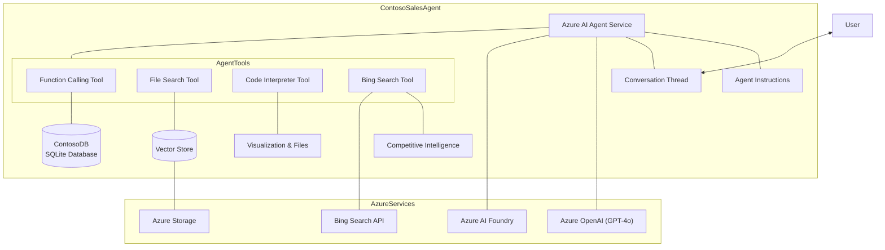
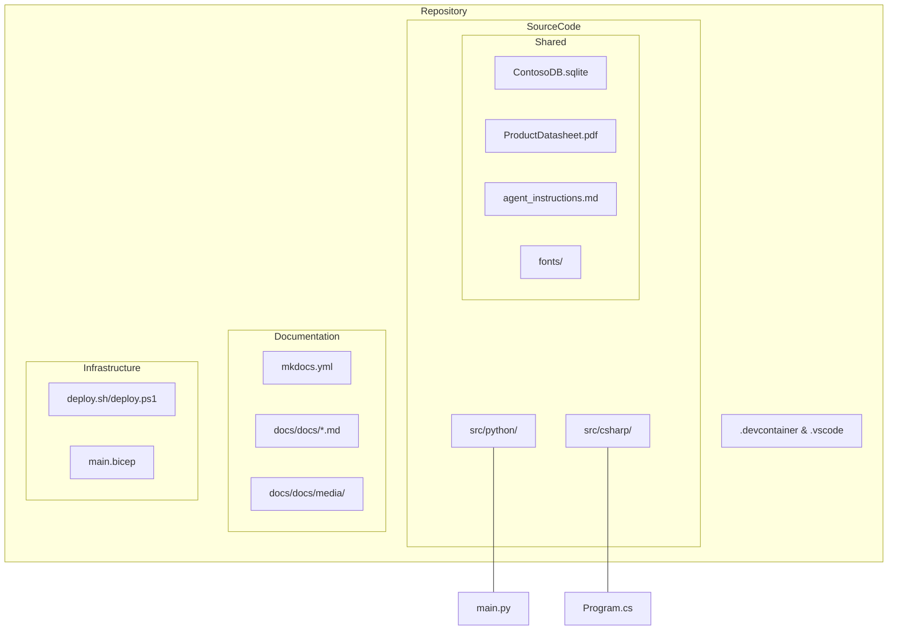
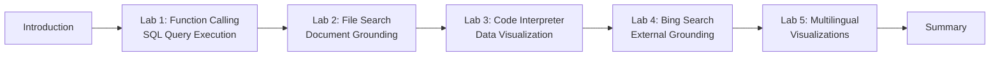
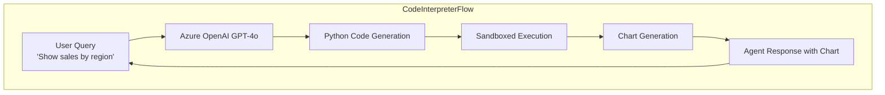
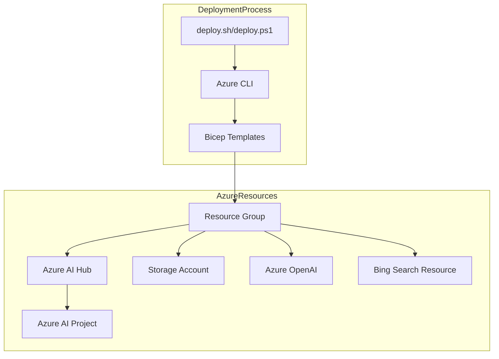

<!-- source: DeepWiki mcp.deepwiki.com · repo microsoft/build-your-first-agent-with-azure-ai-agent-service-workshop · page 1 Overview · fetched 2026-10-26 -->

# Overview

Relevant source files

The following files were used as context for generating this wiki page:

- [.devcontainer/Dockerfile](.devcontainer/Dockerfile)
- [CODE_OF_CONDUCT.md](CODE_OF_CONDUCT.md)
- [README.md](README.md)
- [docs/README.md](docs/README.md)
- [docs/docs/architecture.md](docs/docs/architecture.md)
- [docs/docs/index.md](docs/docs/index.md)
- [docs/docs/media/ai-foundry-home.png](docs/docs/media/ai-foundry-home.png)
- [docs/docs/security.md](docs/docs/security.md)
- [docs/docs/summary.md](docs/docs/summary.md)

This document provides a comprehensive overview of the Azure AI Agent Service Workshop repository, which demonstrates how to build a conversational AI agent using the Azure AI Agent Service. The workshop guides participants through creating a Contoso Sales Agent that can analyze sales data, generate visualizations, and provide business insights through natural language interactions.

## Purpose and Scope

The "Build your code-first agent with Azure AI Foundry" workshop is a 75-minute interactive learning experience designed to teach how to develop, deploy, and extend an LLM-powered agent that can:

- Answer questions about sales data using natural language
- Generate data visualizations and charts
- Execute dynamic SQL queries
- Perform document grounding
- Integrate with external knowledge sources
- Support multilingual interactions

The workshop is implemented in both Python and C#, providing parallel code paths for developers with different language preferences.

Sources: [README.md:5-11](), [docs/docs/index.md:1-7]()

## System Architecture Overview

The Contoso Sales Agent integrates several key components of the Azure AI Agent Service to create a powerful, context-aware conversational assistant.

Sources: [docs/docs/architecture.md:1-24](), [docs/docs/index.md:9-34]()

## Repository Organization

The repository is structured to support both Python and C# implementations, sharing common resources and documentation.

Sources: [.devcontainer/Dockerfile:1-14](), [docs/README.md:1-36]()

## Workshop Structure

The workshop is structured as a series of progressive labs, each introducing a new capability of the Azure AI Agent Service.

Each lab builds on the previous one, gradually adding features to the Contoso Sales Agent:

| Lab | Focus | Key Capability | Implementation |
|-----|-------|----------------|----------------|
| 1 | Function Calling | SQL query execution | Dynamic database query generation |
| 2 | File Search | Document grounding | Vector search of product information |
| 3 | Code Interpreter | Data visualization | Chart and table generation |
| 4 | Bing Search | External knowledge | Competitive intelligence |
| 5 | Multilingual | Font management | Localized visualizations |

Sources: [docs/docs/summary.md:1-37]()

## Core Capabilities

### Function Calling with Database Integration

The agent uses function calling to interact with a SQLite database containing Contoso's sales data. This allows it to:
- Dynamically generate SQL queries based on user questions
- Execute read-only queries against the database
- Format and present results back to the user

The database contains 40,000 rows of synthetic sales data that provides the foundation for analysis and visualization.

Sources: [docs/docs/architecture.md:21-24](), [docs/docs/security.md:1-12]()

### Document Grounding with File Search

The File Search tool enables the agent to ground its responses in specific product information stored in a PDF file. Using vector search, the agent can:
- Locate relevant portions of documents
- Provide accurate product specifications
- Answer detailed questions about product features

This capability leverages Azure AI's vector store for semantic search functionality.

Sources: [docs/docs/architecture.md:11-14]()

### Data Visualization with Code Interpreter

The Code Interpreter tool allows the agent to generate dynamic visualizations and data files, including:
- Charts and graphs (pie charts, bar charts, etc.)
- Formatted tables
- Downloadable files (Excel, CSV, JSON)

This capability runs in a sandboxed execution environment to ensure security.

Sources: [docs/docs/summary.md:14-19](), [docs/docs/security.md:13-16]()

### External Knowledge with Bing Search

The Bing Search integration allows the agent to access external information beyond its internal database and documents. This enables:
- Competitive product analysis
- Market trend information
- Up-to-date pricing comparisons

This capability extends the agent's knowledge beyond its internal resources.

Sources: [docs/docs/summary.md:20-23]()

### Multilingual Support

The agent includes support for multiple languages, with special attention to proper rendering of non-Latin characters in visualizations. This involves:
- Custom font management for visualizations
- Localized formatting of dates and numbers
- Support for multiple writing systems

Sources: [docs/docs/summary.md:29-31]()

## Development and Deployment

The workshop provides multiple development options:

1. **GitHub Codespaces**: Zero setup option with pre-configured environment
2. **Development Container**: Local containerized development using Docker
3. **Local Setup**: Manual installation of required dependencies

Deployment leverages Azure resources through infrastructure-as-code:

The deployment scripts automate the creation of all necessary Azure resources for running the agent.

Sources: [README.md:19-25]()

## Security Considerations

The workshop implementation includes several security measures:

- **Read-only database access**: The SQLite database is configured as read-only to prevent data manipulation
- **Sandboxed code execution**: The Code Interpreter runs in a secure sandbox environment
- **Managed service security**: Leverages Azure security features for resource isolation

These measures help mitigate common risks like SQL injection and unauthorized data access.

Sources: [docs/docs/security.md:1-16](), [README.md:27-35]()

## Related Pages

For more detailed information on specific aspects of the system:
- For system architecture details, see [System Architecture](#1.1)
- For development environment setup, see [Development Environment](#2)
- For details on Azure AI Agent Service, see [Azure AI Agent Service](#3)
- For deployment instructions, see [Infrastructure and Deployment](#9)

---

