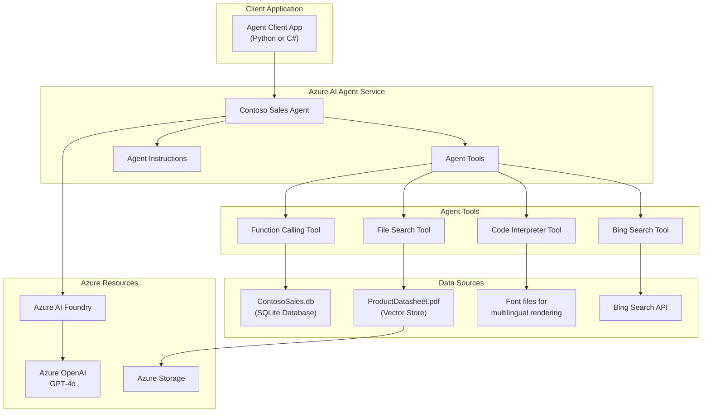
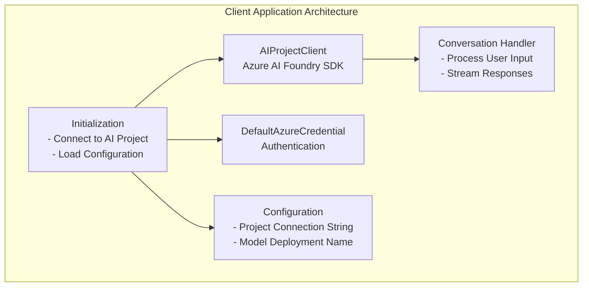
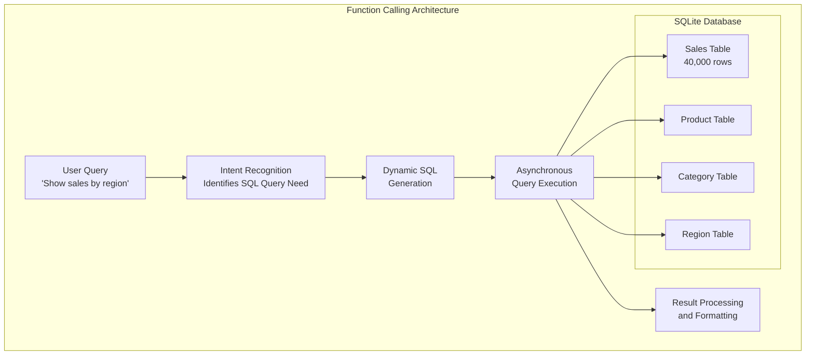
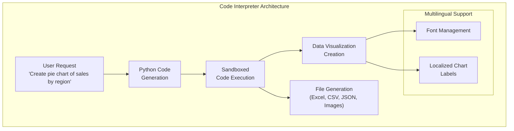
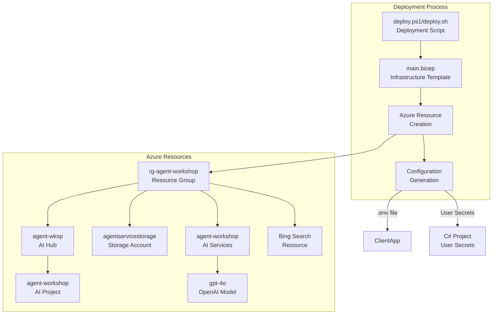

<!-- source: DeepWiki mcp.deepwiki.com · repo microsoft/build-your-first-agent-with-azure-ai-agent-service-workshop · page 1.1 System Architecture · fetched 2026-10-26 -->

# System Architecture

Relevant source files

The following files were used as context for generating this wiki page:

- [docs/docs/architecture.md](docs/docs/architecture.md)
- [docs/docs/index.md](docs/docs/index.md)
- [docs/docs/media/ai-foundry-home.png](docs/docs/media/ai-foundry-home.png)
- [docs/docs/security.md](docs/docs/security.md)
- [docs/docs/summary.md](docs/docs/summary.md)
- [infra/deploy.ps1](infra/deploy.ps1)
- [src/csharp/workshop/AgentWorkshop.Client/Program.cs](src/csharp/workshop/AgentWorkshop.Client/Program.cs)

This document describes the high-level architecture of the Contoso Sales Agent system built in this workshop. The system architecture illustrates how the various components interact to create an AI-powered sales analysis agent capable of answering questions, generating visualizations, and providing data insights.

For information about how the workshop labs are structured, see [Workshop Structure](#1.2).

## System Overview

The Contoso Sales Agent is a conversational AI agent built on Azure AI Agent Service. It enables sales managers to analyze sales data, generate visualizations, and export data for further analysis through natural language conversations.

### High-Level Architecture

Sources: [docs/docs/architecture.md:1-38](), [docs/docs/index.md:1-38](), [docs/docs/summary.md:1-38]()

## Core Components

### Client Application

The Contoso Sales Agent client application is the entry point that initializes the agent, handles user interactions, and manages the conversation flow. It's implemented in both Python and C# to demonstrate language flexibility.

Sources: [src/csharp/workshop/AgentWorkshop.Client/Program.cs:1-18]()

### Azure AI Agent Service

At the core of the architecture is the Azure AI Agent Service, which provides the foundation for building the conversational agent. It integrates with the Azure OpenAI GPT-4o model to power the agent's natural language understanding and generation capabilities.

Key components of the service include:

| Component | Description |
|-----------|-------------|
| Agent Instructions | Defines the agent's behavior, capabilities, and limitations |
| Conversation Context Management | Maintains context across multiple interactions |
| Tool Orchestration | Coordinates the execution of various tools based on user intent |
| Token Streaming | Improves user experience by reducing perceived response times |

Sources: [docs/docs/architecture.md:11-24](), [docs/docs/index.md:18-33]()

## Agent Capabilities and Tools

The Contoso Sales Agent implements four primary capabilities through specialized tools:

### 1. Function Calling with SQLite Database

The Function Calling tool enables the agent to execute dynamic SQL queries against the Contoso Sales Database, a read-only SQLite database with 40,000 rows of synthetic data. At startup, the application reads the database schema and incorporates this metadata into the agent's instructions.

Sources: [docs/docs/architecture.md:21-23](), [docs/docs/summary.md:5-7](), [docs/docs/security.md:5-11]()

### 2. File Search with Vector Store

The File Search tool provides document grounding capabilities, allowing the agent to reference product information stored in PDF files. The system uses the Azure AI Agent Service file search tool to find relevant portions of documents using vector search and provide them to the agent as context.

Sources: [docs/docs/architecture.md:13-14](), [docs/docs/summary.md:9-11]()

### 3. Code Interpreter for Visualizations

The Code Interpreter tool enables the agent to generate data visualizations and create downloadable files. It executes dynamically generated Python code in a sandboxed environment to ensure security. The system also supports multilingual visualizations through font management.

Sources: [docs/docs/summary.md:14-19](), [docs/docs/security.md:13-15]()

### 4. Bing Search Grounding

The Bing Search tool extends the agent's knowledge beyond internal data by enabling it to perform grounded searches for competitive product analysis and external information.

Sources: [docs/docs/summary.md:21-23]()

## Deployment Architecture

The deployment architecture uses Azure Bicep templates to provision the necessary Azure resources, including AI Hub, AI Project, Storage Account, AI Services, and Bing Search resources. The deployment script generates configuration files for both Python and C# implementations.

Sources: [infra/deploy.ps1:1-87]()

## Security Considerations

The architecture includes several security considerations:

1. **Read-Only Database Access**: The SQLite database is configured as read-only to prevent malicious SQL operations.
2. **Sandboxed Code Execution**: Code generated by the agent runs in a sandboxed environment to prevent unauthorized actions.
3. **Azure Authentication**: The system uses Azure's authentication mechanisms through DefaultAzureCredential.

For more detailed security information, see [Security Concerns](#security).

Sources: [docs/docs/security.md:1-15]()

## Extensibility

The Contoso Sales Agent architecture is designed to be extensible and adaptable to various business scenarios. The core components can be modified to address different use cases by:

1. Replacing the SQLite database with other data sources
2. Updating the agent instructions to focus on different domains
3. Adding new tools or capabilities to the agent toolkit
4. Integrating with different front-end interfaces

Sources: [docs/docs/architecture.md:25-27](), [docs/docs/summary.md:33-35]()

## Conclusion

The Contoso Sales Agent architecture demonstrates a practical implementation of the Azure AI Agent Service for business intelligence and data analysis. The system leverages multiple Azure services and agent capabilities to create a powerful, conversational interface to sales data, enabling users to gain insights through natural language queries.

---

