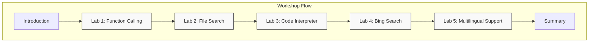

<!-- source: DeepWiki mcp.deepwiki.com · repo microsoft/build-your-first-agent-with-azure-ai-agent-service-workshop · page 1.2 Workshop Structure · fetched 2026-10-26 -->

# Workshop Structure

<details>
<summary>Relevant source files</summary>

The following files were used as context for generating this wiki page:

- [docs/docs/_lab-6-instrumentation.md](docs/docs/_lab-6-instrumentation.md)
- [docs/docs/index.md](docs/docs/index.md)
- [docs/docs/js/custom-nav.js](docs/docs/js/custom-nav.js)
- [docs/docs/media/ai-foundry-home.png](docs/docs/media/ai-foundry-home.png)
- [docs/docs/resources.md](docs/docs/resources.md)
- [docs/docs/security.md](docs/docs/security.md)
- [docs/docs/summary.md](docs/docs/summary.md)

</details>


This page outlines the sequential organization of the Azure AI Agent Service workshop, detailing the labs, their progression, and the capabilities demonstrated in each. For information about the high-level system architecture, see [System Architecture](#1.1).

## Workshop Overview

The workshop is designed as a 75-minute interactive hands-on experience where participants build a Contoso Sales Analysis Agent incrementally. The agent helps sales managers analyze data, find trends, and make informed business decisions through natural language interactions. 

Each lab builds upon the previous one, gradually increasing the agent's capabilities by adding new Azure AI Agent Service tools and features. The workshop can be completed using either Python or C# implementations.

Sources: [docs/docs/index.md:3-7](), [docs/docs/summary.md:1-3]()

## Lab Progression

The workshop follows a structured progression through five main labs, each introducing a new Azure AI Agent Service capability:



Sources: [docs/docs/js/custom-nav.js:3-16](), [docs/docs/summary.md:5-35]()

## Lab Capabilities and Skills

Each lab focuses on a specific capability of the Azure AI Agent Service, building upon knowledge from previous labs:

```mermaid
flowchart TD
    subgraph "Skills Development Journey"
        direction TB
        
        subgraph "Lab 1: Function Calling"
            function["Function Calling"] --> sql["Dynamic SQL Query Generation"]
            sql --> db[(SQLite Database Integration)]
        end
        
        subgraph "Lab 2: File Search"
            fileSearch["File Search Tool"] --> vector["Vector Store"]
            vector --> document["Document Grounding"]
        end
        
        subgraph "Lab 3: Code Interpreter"
            codeInt["Code Interpreter Tool"] --> viz["Data Visualization"]
            viz --> files["File Generation"]
        end
        
        subgraph "Lab 4: Bing Search"
            bing["Bing Search Tool"] --> ext["External Knowledge"]
            ext --> competitive["Competitive Intelligence"]
        end
        
        subgraph "Lab 5: Multilingual"
            multi["Multilingual Support"] --> fonts["Font Management"]
            fonts --> locViz["Localized Visualizations"]
        end
        
        "Lab 1: Function Calling" --> "Lab 2: File Search"
        "Lab 2: File Search" --> "Lab 3: Code Interpreter"
        "Lab 3: Code Interpreter" --> "Lab 4: Bing Search"
        "Lab 4: Bing Search" --> "Lab 5: Multilingual"
    end
```

Sources: [docs/docs/summary.md:5-35](), [docs/docs/index.md:25-33]()

## Detailed Lab Content

### Lab 1: Function Calling and Dynamic SQL Queries

The first lab introduces the core functionality of the Azure AI Agent Service with focus on:

- Function calling to execute dynamic SQL queries against a SQLite database
- Context management for natural language interactions
- Reading and interpreting sales data from a database

By the end of this lab, participants can create an agent that answers basic sales data questions.

### Lab 2: File Search (Document Grounding)

This lab enhances the agent with vector-based file search capabilities:

- Integrating the File Search tool
- Setting up a vector store for efficient document retrieval
- Grounding responses in product documentation and other files

### Lab 3: Code Interpreter

This lab adds data visualization and file generation:

- Using the Code Interpreter tool to execute Python code on demand
- Generating visualizations like charts and tables based on SQL query results
- Creating downloadable files in various formats (Excel, CSV, JSON, images)

### Lab 4: Bing Search Grounding

This lab extends the agent's knowledge beyond internal data:

- Integrating Bing Search for external knowledge
- Performing competitive product analysis
- Maintaining context while incorporating external information

### Lab 5: Multilingual Visualizations

The final lab adds language support features:

- Supporting interactions in multiple languages
- Configuring custom fonts for non-Latin character rendering in visualizations
- Creating localized visual outputs

Sources: [docs/docs/summary.md:5-35](), [docs/docs/security.md:1-15](), [docs/docs/_lab-6-instrumentation.md:1-9]()

## Implementation Paths

The workshop provides parallel implementations in two programming languages:

| Language | Key Files | Environment |
|----------|-----------|------------|
| Python | main.py | Python environment with required packages |
| C# | Program.cs | .NET environment with required packages |

Both implementations share common resources, including:
- Product datasheets and documentation
- Sales database (SQLite)
- Multilingual font resources
- Agent instructions

Participants can choose either implementation path based on their language preference and existing skills.

## Security Considerations

Throughout the labs, security best practices are emphasized:

- SQL injection prevention through read-only database access
- Sandboxed code execution in the Code Interpreter
- Proper permissions and access control

For detailed security information, see the [Security Concerns](#security) section of the documentation.

Sources: [docs/docs/security.md:1-15]()

## Additional Resources

The workshop includes references to additional learning resources, including:

- Microsoft Learn documentation on Azure AI Agent Service
- Sample applications demonstrating advanced concepts
- Documentation on tracing using Application Insights for debugging

For a complete list of resources, see the [Resources](#resources) section.

Sources: [docs/docs/resources.md:1-24]()

---

