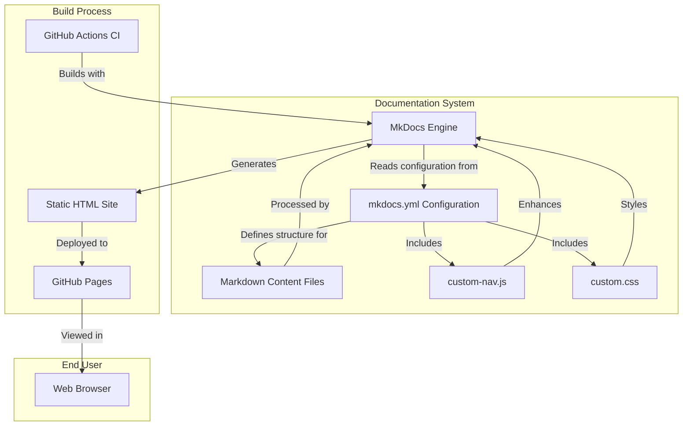
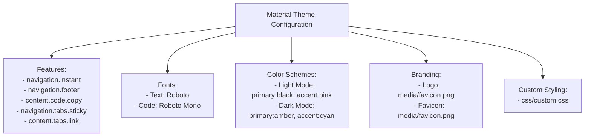
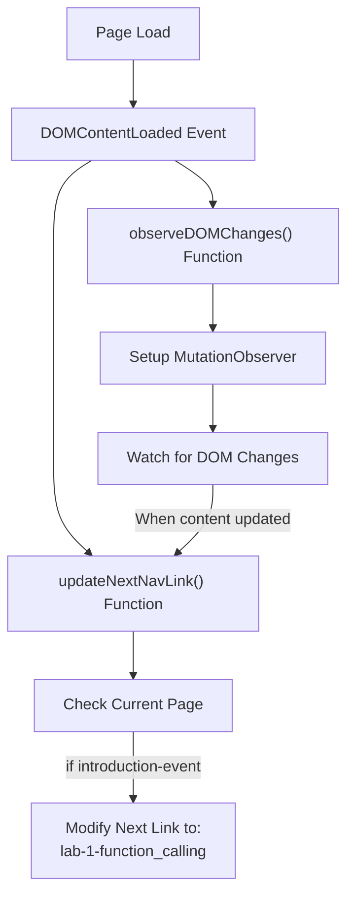
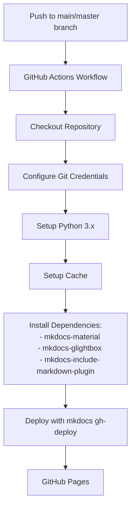
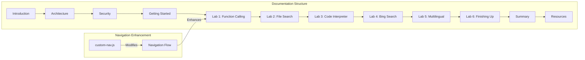

<!-- source: DeepWiki mcp.deepwiki.com · repo microsoft/build-your-first-agent-with-azure-ai-agent-service-workshop · page 10 Documentation System · fetched 2026-10-26 -->

# Documentation System

Relevant source files

The following files were used as context for generating this wiki page:

- [.github/workflows/ci.yml](.github/workflows/ci.yml)
- [docs/docs/js/custom-nav.js](docs/docs/js/custom-nav.js)
- [docs/mkdocs.yml](docs/mkdocs.yml)

## Purpose and Scope

This document describes the documentation system used in the "Build your first agent with Azure AI Agent Service Workshop" repository. It covers the MkDocs-based documentation architecture, configuration, theming, custom components, and the automated deployment process. The documentation system is responsible for generating and presenting the workshop content, labs, and supporting materials in a user-friendly format.

## Documentation Architecture

The workshop uses a documentation system based on MkDocs with the Material theme. This architecture provides a modern, responsive documentation site with advanced features for code highlighting, navigation, and content organization.

Sources: [docs/mkdocs.yml](), [.github/workflows/ci.yml]()

## MkDocs Configuration

The MkDocs configuration is defined in the `mkdocs.yml` file, which specifies the site structure, plugins, theme settings, and extensions.

### Site Structure and Navigation

The workshop content is organized into a logical progression through introductory materials and labs, as defined in the navigation section of the configuration file.

```mermaid
graph TD
    root["Workshop Documentation Root"] --> intro["Introduction index.md"]
    root --> arch["Solution Architecture architecture.md"]
    root --> security["Security Considerations security.md"]
    root --> gettingStarted["Getting Started getting-started.md"]
    root --> lab1["Lab 1 Function Calling lab-1-function_calling.md"]
    root --> lab2["Lab 2 Grounding with Documents lab-2-file_search.md"]
    root --> lab3["Lab 3 Intro to Code Interpreter lab-3-code_interpreter.md"]
    root --> lab4["Lab 4 Grounding with Bing Search lab-4-bing_search.md"]
    root --> lab5["Lab 5 Multilingual Visualizations lab-5-multilingual.md"]
    root --> lab6["Lab 6 Finishing Up finishing-up.md"]
    root --> summary["Summary summary.md"]
    root --> resources["Resources resources.md"]
```

Sources: [docs/mkdocs.yml:3-18]()

### Plugins and Extensions

The documentation system uses several plugins and markdown extensions to enhance functionality:

| Plugin/Extension | Purpose |
|-----------------|---------|
| glightbox | Image lightbox and gallery features |
| include-markdown | Include content from other markdown files |
| admonition | Add note, warning, and info boxes |
| pymdownx.details | Collapsible content sections |
| pymdownx.superfences | Enhanced code blocks |
| pymdownx.tabbed | Tabbed content (used for language-specific instructions) |
| pymdownx.tasklist | Checkboxes in lists |
| attr_list | Add attributes to markdown elements |
| md_in_html | Allow markdown content in HTML elements |

Sources: [docs/mkdocs.yml:23-74]()

## Theme and Styling

The documentation uses the Material for MkDocs theme with customizations for colors, fonts, and features.

### Theme Configuration

Sources: [docs/mkdocs.yml:27-79]()

## Custom JavaScript Functionality

The documentation includes custom JavaScript to enhance navigation, particularly for workshop flow.

### Navigation Customization

The `custom-nav.js` file modifies the default navigation behavior to customize the flow between pages, especially for workshop participants following specific paths.

The script handles two main functions:
1. `updateNextNavLink()`: Modifies the "next" navigation link for specific pages
2. `observeDOMChanges()`: Sets up a MutationObserver to detect content changes and update navigation links accordingly

Sources: [docs/docs/js/custom-nav.js:1-40]()

## Continuous Integration and Deployment

The documentation is automatically built and deployed using GitHub Actions whenever changes are pushed to the main branch.

### Deployment Workflow

The deployment process:
1. Triggers on pushes to the main or master branch
2. Sets up the required environment with Python and dependencies
3. Builds the documentation using the MkDocs configuration
4. Deploys the generated static site to GitHub Pages

Sources: [.github/workflows/ci.yml:1-32]()

## File Organization

The documentation system files are organized as follows:

| Directory/File | Description |
|----------------|-------------|
| `docs/mkdocs.yml` | Main MkDocs configuration file |
| `docs/docs/` | Directory containing markdown content files |
| `docs/docs/js/` | JavaScript files for custom functionality |
| `docs/docs/css/` | CSS files for custom styling |
| `docs/docs/media/` | Images, diagrams, and other media files |

Sources: [docs/mkdocs.yml](), [docs/docs/js/custom-nav.js]()

## Integration with Workshop Flow

The documentation system is designed to support the workshop's progressive learning structure, with each lab building on the previous one.

The documentation seamlessly guides users through the workshop, with each page providing necessary context and instructions for the corresponding lab or concept.

Sources: [docs/mkdocs.yml:3-18](), [docs/docs/js/custom-nav.js:1-40]()

## Conclusion

The documentation system serves as a critical component of the workshop experience, providing a structured, user-friendly interface for participants to follow along with the labs and understand the concepts presented. The use of MkDocs with the Material theme, along with custom enhancements, creates a polished, professional documentation experience that supports both self-guided learning and instructor-led workshops.