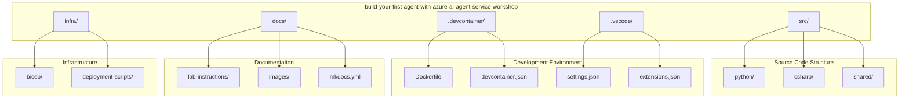
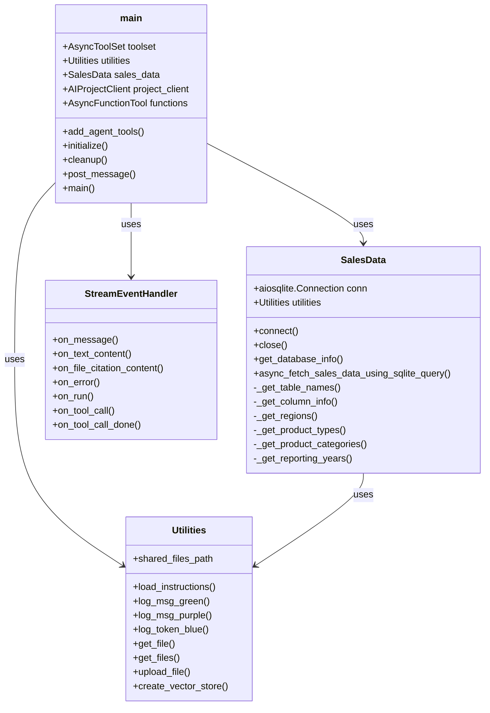
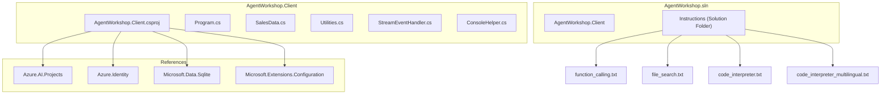
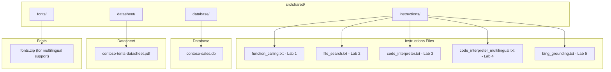
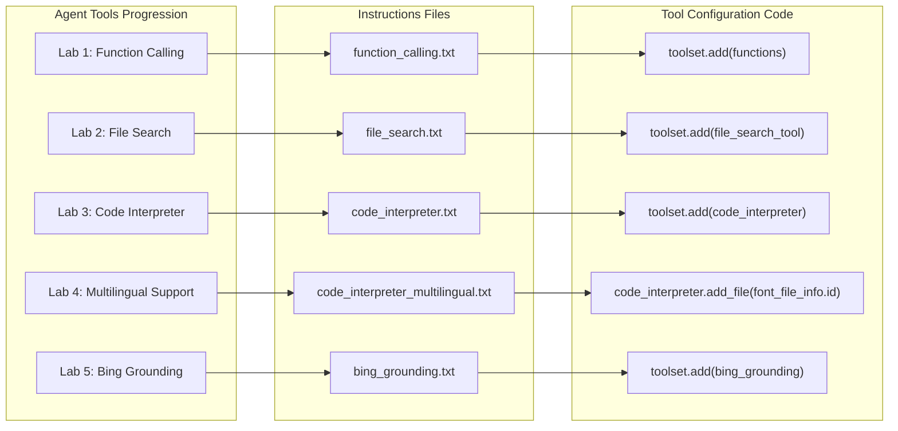
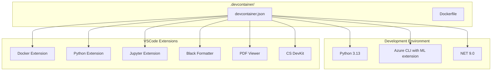
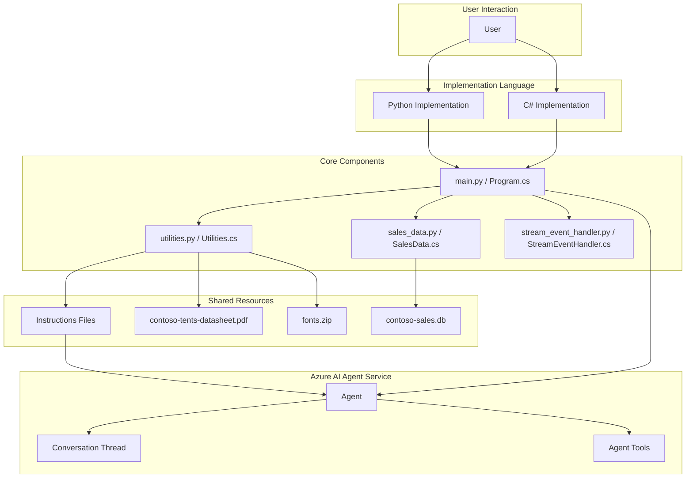

<!-- source: DeepWiki mcp.deepwiki.com · repo microsoft/build-your-first-agent-with-azure-ai-agent-service-workshop · page 2.1 Repository Structure · fetched 2026-10-26 -->

# Repository Structure

<details>
<summary>Relevant source files</summary>

The following files were used as context for generating this wiki page:

- [.devcontainer/devcontainer.json](.devcontainer/devcontainer.json)
- [src/csharp/workshop/AgentWorkshop.Client/AgentWorkshop.Client.csproj](src/csharp/workshop/AgentWorkshop.Client/AgentWorkshop.Client.csproj)
- [src/csharp/workshop/AgentWorkshop.sln](src/csharp/workshop/AgentWorkshop.sln)
- [src/python/workshop/main.py](src/python/workshop/main.py)
- [src/python/workshop/requirements.txt](src/python/workshop/requirements.txt)
- [src/python/workshop/sales_data.py](src/python/workshop/sales_data.py)
- [src/python/workshop/utilities.py](src/python/workshop/utilities.py)

</details>


This document describes the organization of files and directories in the Azure AI Agent Service Workshop repository. It provides a comprehensive overview of how the codebase is structured, where to find key components, and how the different parts of the system relate to each other.

For information about setting up the development environment itself, see [Development Environment](#2).

## Repository Overview

The Azure AI Agent Service Workshop repository is organized to support parallel implementations in Python and C#, with shared resources used by both. The repository follows a structured layout to separate source code, documentation, infrastructure, and development setup.



Sources: [.devcontainer/devcontainer.json:1-29]()

## Source Code Organization

The `src/` directory contains two parallel implementations of the same agent functionality - one in Python and one in C#. Both implementations share common resources like database files, documents, and instruction templates.

```mermaid
graph TD
    subgraph "src/"
        python["python/"]
        csharp["csharp/"]
        shared["shared/"]
    end
    
    subgraph "Python Implementation"
        python --> pythonWorkshop["workshop/"]
        pythonWorkshop --> mainPy["main.py"]
        pythonWorkshop --> utilitiesPy["utilities.py"]
        pythonWorkshop --> salesDataPy["sales_data.py"]
        pythonWorkshop --> streamEventHandlerPy["stream_event_handler.py"]
        pythonWorkshop --> terminalColorsPy["terminal_colors.py"]
        pythonWorkshop --> requirementsTxt["requirements.txt"]
    end
    
    subgraph "C# Implementation"
        csharp --> csharpWorkshop["workshop/"]
        csharpWorkshop --> agentWorkshopSln["AgentWorkshop.sln"]
        csharpWorkshop --> clientProj["AgentWorkshop.Client/"]
        clientProj --> programCs["Program.cs"]
        clientProj --> salesDataCs["SalesData.cs"]
        clientProj --> utilitiesCs["Utilities.cs"]
        clientProj --> csproj["AgentWorkshop.Client.csproj"]
    end
    
    subgraph "Shared Resources"
        shared --> instructions["instructions/"]
        shared --> database["database/"]
        shared --> datasheet["datasheet/"]
        shared --> fonts["fonts/"]
    end
    
    instructions --> functionCallingTxt["function_calling.txt"]
    instructions --> fileSearchTxt["file_search.txt"]
    instructions --> codeInterpreterTxt["code_interpreter.txt"]
    instructions --> codeInterpreterMultilingualTxt["code_interpreter_multilingual.txt"]
    instructions --> bingGroundingTxt["bing_grounding.txt"]
    
    database --> contosoSalesDb["contoso-sales.db"]
    datasheet --> contosoTentsDatasheet["contoso-tents-datasheet.pdf"]
    fonts --> fontsZip["fonts.zip"]
```



Sources: [src/python/workshop/main.py:1-215](), [src/python/workshop/utilities.py:1-101](), [src/python/workshop/sales_data.py:1-130](), [src/csharp/workshop/AgentWorkshop.sln:1-43](), [src/csharp/workshop/AgentWorkshop.Client/AgentWorkshop.Client.csproj:1-20]()

## Python Implementation Structure

The Python implementation is organized as a package with multiple modules, each handling specific aspects of the agent functionality.



Sources: [src/python/workshop/main.py:1-215](), [src/python/workshop/utilities.py:1-101](), [src/python/workshop/sales_data.py:1-130]()

### Key Python Files and Their Purpose

| File | Purpose |
|------|---------|
| `main.py` | Entry point for the Python implementation. Sets up the agent with tools, handles conversation flow. |
| `utilities.py` | Helper functions for file operations, logging, and shared resources access. |
| `sales_data.py` | Handles database connections and provides methods to query the Contoso sales database. |
| `stream_event_handler.py` | Manages events from the agent streaming API. |
| `terminal_colors.py` | Provides terminal color formatting for better user experience. |
| `requirements.txt` | Lists all the Python package dependencies. |

Sources: [src/python/workshop/main.py:1-215](), [src/python/workshop/utilities.py:1-101](), [src/python/workshop/sales_data.py:1-130](), [src/python/workshop/requirements.txt:1-9]()

## C# Implementation Structure

The C# implementation is structured as a Visual Studio solution with one project.



Sources: [src/csharp/workshop/AgentWorkshop.sln:1-43](), [src/csharp/workshop/AgentWorkshop.Client/AgentWorkshop.Client.csproj:1-20]()

### Key C# Files and Their Purpose

| File | Purpose |
|------|---------|
| `Program.cs` | Main entry point for the C# implementation. Similar to `main.py` in the Python implementation. |
| `SalesData.cs` | Handles SQLite database connections and queries. Equivalent to `sales_data.py`. |
| `Utilities.cs` | Helper functions for file operations and resource management. Equivalent to `utilities.py`. |
| `StreamEventHandler.cs` | Handles the events from the streaming API. Equivalent to `stream_event_handler.py`. |
| `ConsoleHelper.cs` | Provides console formatting. Equivalent to `terminal_colors.py`. |

Sources: [src/csharp/workshop/AgentWorkshop.Client/AgentWorkshop.Client.csproj:1-20]()

## Shared Resources

Both implementations use the same set of shared resources, which are stored in the `src/shared/` directory.



Sources: [src/python/workshop/utilities.py:9-14](), [src/python/workshop/main.py:29-30](), [src/python/workshop/sales_data.py:11](), [src/csharp/workshop/AgentWorkshop.sln:8-15]()

### Shared Resources Usage

The `shared_files_path` property in the `Utilities` class determines how both implementations access these shared resources:

```python
@property
def shared_files_path(self) -> Path:
    """Get the path to the shared files directory."""
    return Path(__file__).parent.parent.parent.resolve() / "shared"
```

This resolves to `src/shared/` from either the Python or C# implementation.

Sources: [src/python/workshop/utilities.py:9-14]()

## Agent Tool Configuration

The repository is structured to progressively enable different agent capabilities through the workshop labs. This is managed by uncommenting different sections in the `main.py` file.

### Progression of Agent Tools



Sources: [src/python/workshop/main.py:59-63](), [src/python/workshop/main.py:70-93]()

## Development Environment

The repository includes a development container configuration to ensure a consistent development environment. The development container is defined in the `.devcontainer` directory.



Sources: [.devcontainer/devcontainer.json:1-29]()

## Relationship Between Repository Components

This diagram illustrates how the different components of the repository interact with each other:



Sources: [src/python/workshop/main.py:1-215](), [src/python/workshop/utilities.py:1-101](), [src/python/workshop/sales_data.py:1-130]()

## Repository File Structure Summary

Here's a summary table of the main directories and their contents:

| Directory | Contents | Purpose |
|-----------|----------|---------|
| `src/python/workshop/` | Python implementation files | Contains the Python version of the agent implementation |
| `src/csharp/workshop/` | C# solution and project files | Contains the C# version of the agent implementation |
| `src/shared/` | Shared resources | Contains resources used by both implementations |
| `src/shared/instructions/` | Agent instruction files | Different instruction sets for each lab |
| `src/shared/database/` | SQLite database | Contains the Contoso sales data |
| `src/shared/datasheet/` | PDF document | Product information used for file search grounding |
| `src/shared/fonts/` | Font files | Support for multilingual visualizations |
| `.devcontainer/` | Development container config | Ensures consistent development environment |
| `docs/` | Documentation files | Workshop instructions and images |
| `infra/` | Infrastructure files | Deployment scripts and templates |

Sources: [src/python/workshop/utilities.py:9-14](), [src/python/workshop/main.py:29-30](), [src/python/workshop/sales_data.py:11](), [.devcontainer/devcontainer.json:1-29]()

This structure allows for a consistent experience across both Python and C# implementations while sharing common resources, making it easy to follow the workshop regardless of preferred programming language.

---

