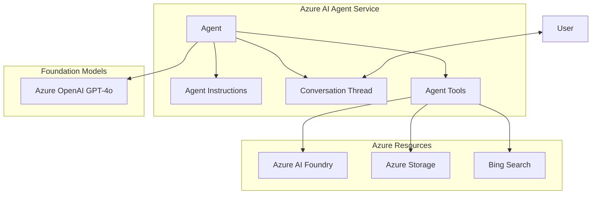
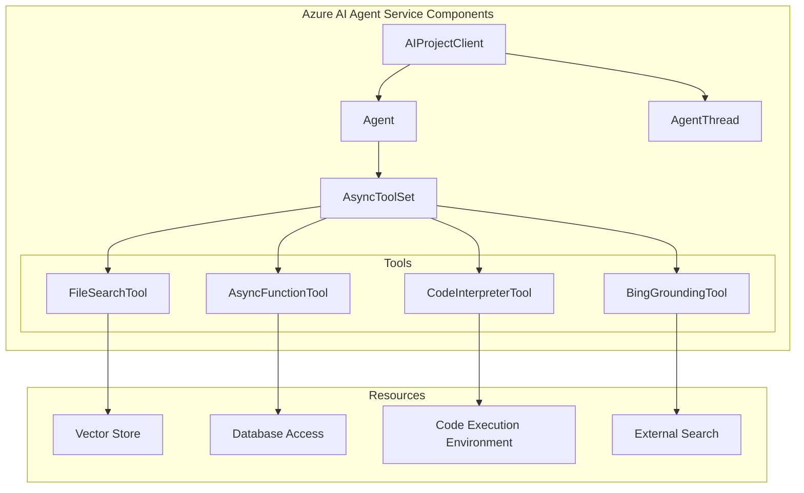
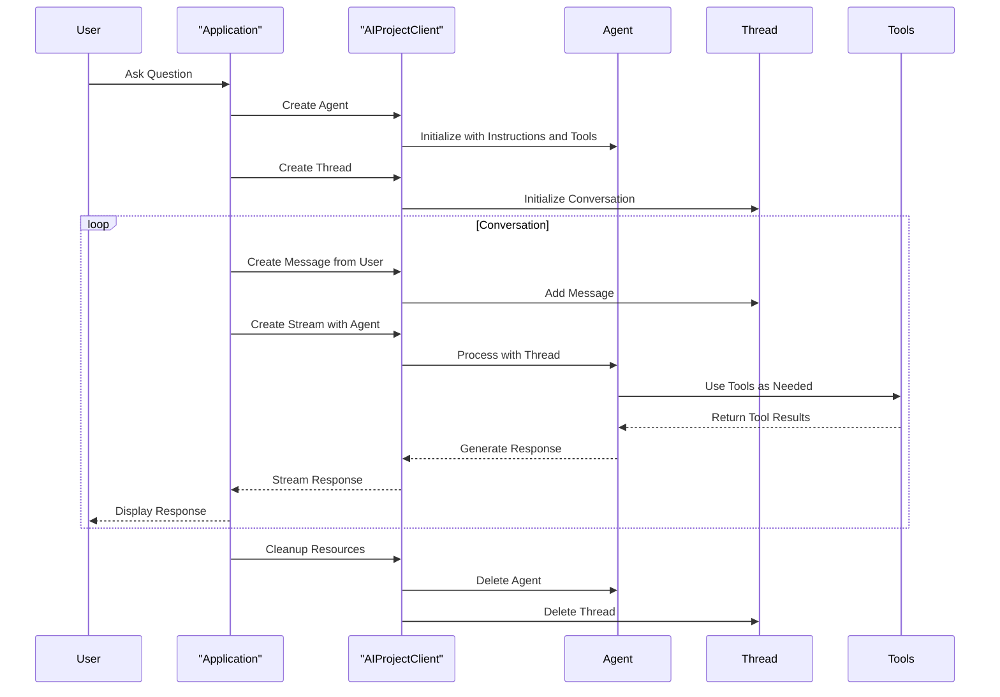

<!-- source: DeepWiki mcp.deepwiki.com · repo microsoft/build-your-first-agent-with-azure-ai-agent-service-workshop · page 3 Azure AI Agent Service · fetched 2026-10-26 -->

# Azure AI Agent Service

<details>
<summary>Relevant source files</summary>

The following files were used as context for generating this wiki page:

- [docs/docs/architecture.md](docs/docs/architecture.md)
- [docs/docs/index.md](docs/docs/index.md)
- [docs/docs/media/ai-foundry-home.png](docs/docs/media/ai-foundry-home.png)
- [docs/docs/security.md](docs/docs/security.md)
- [docs/docs/summary.md](docs/docs/summary.md)
- [src/python/workshop/main.py](src/python/workshop/main.py)
- [src/python/workshop/requirements.txt](src/python/workshop/requirements.txt)
- [src/python/workshop/sales_data.py](src/python/workshop/sales_data.py)
- [src/python/workshop/utilities.py](src/python/workshop/utilities.py)

</details>


This document provides a comprehensive overview of the Azure AI Agent Service, a fully managed cloud service for building conversational AI agents. For information about how this service is specifically used in the workshop labs, see [Function Calling](#4), [File Search](#5), [Code Interpreter](#6), [Bing Search Integration](#7), and [Multilingual Support](#8).

## Overview

Azure AI Agent Service is a managed service that simplifies creating AI agents with advanced capabilities. It offers SDKs for Python and C# that enable developers to build agents with integrated tools for various tasks. In this workshop, the service powers a Contoso Sales Agent that can analyze sales data, generate visualizations, and provide insights.



Sources: [docs/docs/index.md:17-34](), [docs/docs/architecture.md:7-15]()

## Core Components

The Azure AI Agent Service architecture consists of several key components that work together to provide a comprehensive agent experience:



Sources: [src/python/workshop/main.py:5-14](), [src/python/workshop/main.py:43-47](), [src/python/workshop/main.py:53-57]()

### AIProjectClient

The entry point to the Azure AI Agent Service. It provides methods to create and manage agents, threads, and tools. The client is initialized with a connection string and credential.

```python
project_client = AIProjectClient.from_connection_string(
    credential=DefaultAzureCredential(),
    conn_str=PROJECT_CONNECTION_STRING,
)
```

Sources: [src/python/workshop/main.py:47-51]()

### Agent

Represents an agent instance with specific instructions, tools, and parameters. Agents are created with a specified model, name, instructions, and toolset. The agent processes user requests and generates responses.

```python
agent = await project_client.agents.create_agent(
    model=API_DEPLOYMENT_NAME,
    name=AGENT_NAME,
    instructions=instructions,
    toolset=toolset,
    temperature=TEMPERATURE,
    headers={"x-ms-enable-preview": "true"},
)
```

Sources: [src/python/workshop/main.py:121-128]()

### AgentThread

Represents a conversation thread between a user and an agent. Each thread maintains the conversation history and context.

```python
thread = await project_client.agents.create_thread()
```

Sources: [src/python/workshop/main.py:131-132]()

### Tools

The Azure AI Agent Service provides several tools that extend agent capabilities:

1. **AsyncFunctionTool**: Enables the agent to call external functions
2. **FileSearchTool**: Allows the agent to search through files using a vector store
3. **CodeInterpreterTool**: Provides code execution capabilities for data analysis and visualization
4. **BingGroundingTool**: Enables the agent to perform web searches for external knowledge

Sources: [src/python/workshop/main.py:53-57](), [src/python/workshop/main.py:66-95]()

## Workflow

The typical workflow for using the Azure AI Agent Service follows these steps:



Sources: [src/python/workshop/main.py:98-146](), [src/python/workshop/main.py:149-174](), [src/python/workshop/main.py:177-214]()

## Agent Initialization

Creating an agent involves these key steps:

1. Initialize the client
2. Set up tools
3. Load instructions
4. Create an agent with instructions and tools
5. Create a thread for conversation

```python
# 1. Initialize the client
project_client = AIProjectClient.from_connection_string(
    credential=DefaultAzureCredential(),
    conn_str=PROJECT_CONNECTION_STRING,
)

# 2. Set up tools
toolset = AsyncToolSet()
functions = AsyncFunctionTool({sales_data.async_fetch_sales_data_using_sqlite_query})
toolset.add(functions)

# 3. Load instructions
instructions = utilities.load_instructions(INSTRUCTIONS_FILE)
instructions = instructions.replace("{database_schema_string}", database_schema_string)

# 4. Create an agent
agent = await project_client.agents.create_agent(
    model=API_DEPLOYMENT_NAME,
    name=AGENT_NAME,
    instructions=instructions,
    toolset=toolset,
    temperature=TEMPERATURE,
)

# 5. Create a thread
thread = await project_client.agents.create_thread()
```

Sources: [src/python/workshop/main.py:98-146]()

## Message Processing

The workflow for processing messages involves:

1. Creating a user message in the thread
2. Generating a response with the agent
3. Streaming the response back to the user

```python
async def post_message(thread_id: str, content: str, agent: Agent, thread: AgentThread) -> None:
    # Create a user message
    await project_client.agents.create_message(
        thread_id=thread_id,
        role="user",
        content=content,
    )

    # Generate a response with the agent
    stream = await project_client.agents.create_stream(
        thread_id=thread.id,
        agent_id=agent.id,
        event_handler=StreamEventHandler(
            functions=functions, project_client=project_client, utilities=utilities),
        max_completion_tokens=MAX_COMPLETION_TOKENS,
        max_prompt_tokens=MAX_PROMPT_TOKENS,
        temperature=TEMPERATURE,
        top_p=TOP_P,
        instructions=agent.instructions,
    )

    # Stream the response
    async with stream as s:
        await s.until_done()
```

Sources: [src/python/workshop/main.py:149-174]()

## Tool Integration

The Azure AI Agent Service supports several tools that extend agent capabilities:

### Function Calling

Enables the agent to execute external functions, such as database queries. In this workshop, it's used to query the Contoso sales database.

```python
functions = AsyncFunctionTool(
    {
        sales_data.async_fetch_sales_data_using_sqlite_query,
    }
)
toolset.add(functions)
```

The function implementation:

```python
async def async_fetch_sales_data_using_sqlite_query(self: "SalesData", sqlite_query: str) -> str:
    """
    This function is used to answer user questions about Contoso sales data by executing SQLite queries against the database.
    """
    # Execute the query and return results as JSON
    async with self.conn.execute(sqlite_query) as cursor:
        rows = await cursor.fetchall()
        columns = [description[0] for description in cursor.description]

    data = pd.DataFrame(rows, columns=columns)
    return data.to_json(index=False, orient="split")
```

Sources: [src/python/workshop/main.py:53-57](), [src/python/workshop/sales_data.py:103-129]()

### File Search

Allows the agent to search through files using vector embeddings. The workshop uses it to search through product information.

```python
vector_store = await utilities.create_vector_store(
    project_client,
    files=[TENTS_DATA_SHEET_FILE],
    vector_store_name="Contoso Product Information Vector Store",
)
file_search_tool = FileSearchTool(vector_store_ids=[vector_store.id])
toolset.add(file_search_tool)
```

Vector store creation:

```python
async def create_vector_store(self, project_client: AIProjectClient, files: list[str], vector_store_name: str):
    file_ids = []
    # Upload the files
    for file in files:
        file_path = prefix / file
        file_info = await self.upload_file(project_client, file_path=file_path, purpose="assistants")
        file_ids.append(file_info.id)

    # Create a vector store
    vector_store = await project_client.agents.create_vector_store_and_poll(
        file_ids=file_ids, name=vector_store_name
    )
    return vector_store
```

Sources: [src/python/workshop/main.py:73-80](), [src/python/workshop/utilities.py:78-100]()

### Code Interpreter

Provides a secure Python execution environment for data analysis and visualization.

```python
code_interpreter = CodeInterpreterTool()
toolset.add(code_interpreter)

# Add multilingual support with fonts
font_file_info = await utilities.upload_file(project_client, utilities.shared_files_path / FONTS_ZIP)
code_interpreter.add_file(file_id=font_file_info.id)
```

Sources: [src/python/workshop/main.py:83-88]()

### Bing Search

Enables the agent to search the web for external information.

```python
bing_connection = await project_client.connections.get(connection_name=BING_CONNECTION_NAME)
bing_grounding = BingGroundingTool(connection_id=bing_connection.id)
toolset.add(bing_grounding)
```

Sources: [src/python/workshop/main.py:91-93]()

## Key Capabilities

The Azure AI Agent Service offers several key capabilities that make it well-suited for building sophisticated conversational agents:

| Capability | Description | Implementation in Workshop |
|------------|-------------|----------------------------|
| **Function Calling** | Allows the agent to execute external functions | SQL query execution against sales database |
| **Document Grounding** | Enables the agent to reference documents for context | Vector search through product information |
| **Code Interpreter** | Provides code execution capabilities | Data analysis and visualization generation |
| **Web Search** | Allows the agent to search the web for external information | Competitive product analysis via Bing Search |
| **Multilingual Support** | Supports multiple languages | Font management for multilingual visualizations |
| **Conversation Management** | Maintains conversation context across turns | Thread-based conversation model |

Sources: [docs/docs/summary.md:3-37](), [docs/docs/index.md:24-33]()

## Agent Instructions

The Azure AI Agent Service uses natural language instructions to define the agent's behavior, knowledge, and constraints. Instructions can include information about the agent's purpose, available data sources, and how to handle specific types of queries.

In the workshop, instructions are loaded from files and dynamically updated with database schema information:

```python
instructions = utilities.load_instructions(INSTRUCTIONS_FILE)
# Replace the placeholder with the database schema string
instructions = instructions.replace(
    "{database_schema_string}", database_schema_string)

if font_file_info:
    # Replace the placeholder with the font file ID
    instructions = instructions.replace(
        "{font_file_id}", font_file_info.id)
```

Sources: [src/python/workshop/main.py:110-118]()

## Advantages of Azure AI Agent Service

The Azure AI Agent Service offers several advantages for building conversational agents:

1. **Simplified Development**: Reduces complex tasks to a few lines of code
2. **Scalability**: Designed to handle varying user loads
3. **Managed Infrastructure**: Fully managed service that handles the infrastructure
4. **Integration with Azure Ecosystem**: Seamless integration with other Azure services
5. **Built-in Tools**: Pre-built tools for common use cases
6. **Conversation State Management**: Automatically maintains conversation context

Sources: [docs/docs/index.md:24-33]()

## Conclusion

The Azure AI Agent Service provides a powerful platform for building conversational AI agents with advanced capabilities. In this workshop, it's used to create a Contoso Sales Agent that can answer questions about sales data, generate visualizations, and provide insights using various tools like function calling, file search, code interpreter, and Bing search.

Sources: [docs/docs/summary.md:3-37]()

---

