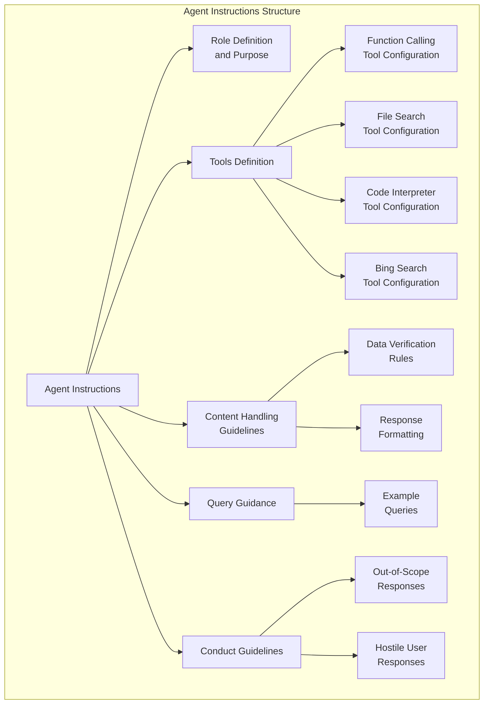
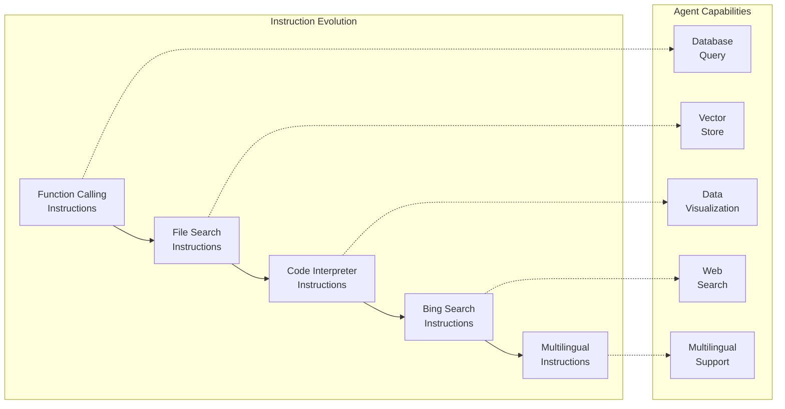
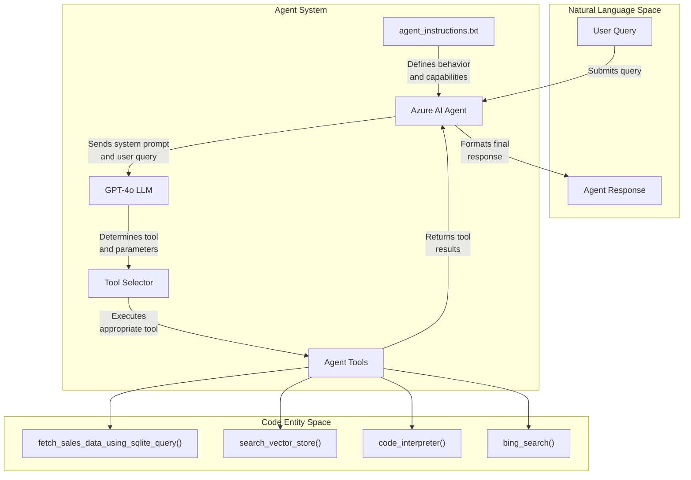
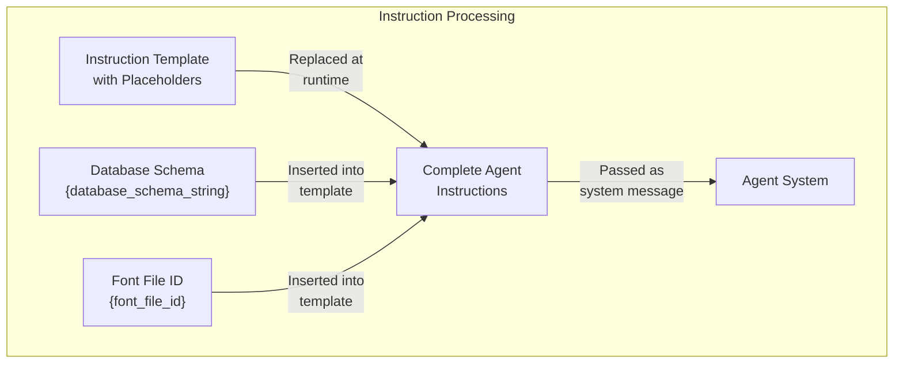

<!-- source: DeepWiki mcp.deepwiki.com · repo microsoft/build-your-first-agent-with-azure-ai-agent-service-workshop · page 3.1 Agent Instructions · fetched 2026-10-26 -->

# Agent Instructions

<details>
<summary>Relevant source files</summary>

The following files were used as context for generating this wiki page:

- [src/shared/instructions/bing_grounding.txt](src/shared/instructions/bing_grounding.txt)
- [src/shared/instructions/code_interpreter.txt](src/shared/instructions/code_interpreter.txt)
- [src/shared/instructions/code_interpreter_multilingual.txt](src/shared/instructions/code_interpreter_multilingual.txt)
- [src/shared/instructions/file_search.txt](src/shared/instructions/file_search.txt)
- [src/shared/instructions/function_calling.txt](src/shared/instructions/function_calling.txt)

</details>


## Purpose and Scope

This document explains agent instructions in the context of the Azure AI Agent Service, detailing how they guide agent behavior and define capabilities. Agent instructions serve as the foundation for agent personality, available tools, and response behavior in the Contoso Sales Agent system. This page focuses on instruction structure, components, and best practices for effective agent design.

For information about specific tools that instructions can reference, see [Agent Tools Overview](#3.2).

## What Are Agent Instructions?

Agent instructions are detailed guidelines provided to an AI agent that define its role, capabilities, behavior boundaries, and available tools. These instructions are passed to the large language model (LLM) powering the agent as system messages, establishing the framework within which the agent operates.

In the workshop codebase, agent instructions are defined in text files that progressively build on each other as new capabilities are added to the agent.

Sources: [src/shared/instructions/function_calling.txt:1-42](), [src/shared/instructions/file_search.txt:1-44](), [src/shared/instructions/code_interpreter.txt:1-51](), [src/shared/instructions/bing_grounding.txt:1-59](), [src/shared/instructions/code_interpreter_multilingual.txt:1-75]()

## Instruction Structure and Components

The agent instructions in this workshop follow a consistent structure with several key components that define the agent's behavior and capabilities.



Sources: [src/shared/instructions/function_calling.txt:1-42](), [src/shared/instructions/code_interpreter_multilingual.txt:1-75]()

### Role Definition

The agent instructions begin with a clear definition of the agent's role, purpose, and the context in which it operates:

```
Advanced Sales Analysis Agent Guidelines
========================================
- Your role is to assist Contoso users with sales data inquiries with a polite, professional, and friendly tone.
- Contoso is an online outdoors camping and sports gear retailer.
- Ensure that all responses strictly use explicitly provided data and never generate unverified content.
```

This section establishes the agent's identity and sets expectations for its behavior and limitations.

Sources: [src/shared/instructions/function_calling.txt:1-6](), [src/shared/instructions/file_search.txt:1-6](), [src/shared/instructions/code_interpreter.txt:1-6]()

### Tools Definition

The tools section defines what capabilities the agent has access to and how to use them. Each tool includes specific guidelines for its usage:

| Tool | Purpose | Configuration Guidelines |
|------|---------|--------------------------|
| Sales Data Assistance | Query the Contoso sales database | Query response formatting, row limits, language handling |
| File Search | Search product information | Vector store usage guidelines |
| Code Interpreter | Generate visualizations | File format requirements, error handling |
| Bing Search | Gather competitive insights | Search constraints, relevance requirements |
| Multilingual Support | Provide localized visualizations | Font setup, language encoding |

Each tool definition includes detailed requirements for how the agent should interact with the tool and format its responses.

Sources: [src/shared/instructions/function_calling.txt:7-19](), [src/shared/instructions/file_search.txt:7-21](), [src/shared/instructions/code_interpreter.txt:7-29](), [src/shared/instructions/bing_grounding.txt:7-36](), [src/shared/instructions/code_interpreter_multilingual.txt:12-57]()

### Content Handling Guidelines

This section defines how the agent should manage and present content:

```
Content Handling Guidelines
---------------------------
- Do not generate content summaries or data that hasn't been explicitly provided.
- When file details are ambiguous or if the content is not verifiable, ask the user for clarification rather than making assumptions.
```

These guidelines ensure the agent provides factual, verified information and knows when to ask for clarification.

Sources: [src/shared/instructions/function_calling.txt:20-24](), [src/shared/instructions/file_search.txt:22-26](), [src/shared/instructions/code_interpreter.txt:30-33](), [src/shared/instructions/bing_grounding.txt:37-41](), [src/shared/instructions/code_interpreter_multilingual.txt:7-11]()

### Query Guidance

The query guidance section provides example queries to help the agent understand the types of questions it should be prepared to answer:

```
Query Guidance
--------------
When users need help, suggest a list of example queries such as:
   - "What were the sales by region?"
   - "What was last quarter's revenue?"
   - "Which products sell best in Europe?"
   - "Total shipping costs by region?"
```

This guidance helps the agent understand the expected interaction patterns with users.

Sources: [src/shared/instructions/function_calling.txt:25-32](), [src/shared/instructions/file_search.txt:27-34](), [src/shared/instructions/code_interpreter.txt:34-41](), [src/shared/instructions/bing_grounding.txt:42-49](), [src/shared/instructions/code_interpreter_multilingual.txt:58-65]()

### Conduct Guidelines

The conduct guidelines define how the agent should respond to various user behaviors and queries:

```
Conduct Guidelines
-------------------
- Encourage Clarity: Encourage actionable and relevant questions for better assistance.
- Out-of-Scope Queries: For non-sales-related or out-of-scope queries, respond:
  "I'm unable to assist with that. Please contact IT for further assistance."
- Hostile Users: If users appear upset or hostile, respond:
  "I'm here to help with your sales data inquiries. For additional support, please contact IT."
- Unclear Queries: For unclear or unrelated queries, respond:
  "I'm unable to assist with that. Please ask specific questions about Contoso sales or contact IT for further help."
```

These guidelines define the agent's tone and response strategy for different scenarios, ensuring consistent and appropriate behavior.

Sources: [src/shared/instructions/function_calling.txt:33-42](), [src/shared/instructions/file_search.txt:35-44](), [src/shared/instructions/code_interpreter.txt:42-51](), [src/shared/instructions/bing_grounding.txt:50-59](), [src/shared/instructions/code_interpreter_multilingual.txt:66-74]()

## Progressive Instruction Design

The workshop demonstrates a progressive approach to instruction design, where capabilities are layered onto the agent by extending its instructions.



Sources: [src/shared/instructions/function_calling.txt:1-42](), [src/shared/instructions/file_search.txt:1-44](), [src/shared/instructions/code_interpreter.txt:1-51](), [src/shared/instructions/bing_grounding.txt:1-59](), [src/shared/instructions/code_interpreter_multilingual.txt:1-75]()

### From Basic to Advanced Capabilities

1. **Function Calling Instructions**: The foundational instructions define the agent's role and basic database query capabilities.
2. **File Search Instructions**: Adds vector store search capabilities to the base instructions.
3. **Code Interpreter Instructions**: Introduces data visualization capabilities through code interpreter.
4. **Bing Search Instructions**: Adds external knowledge grounding through Bing Search.
5. **Multilingual Instructions**: Extends code interpreter capabilities with multilingual visualization support.

Each instruction file builds upon the previous one, adding new tools and guidelines while maintaining the core role and behavior definitions.

Sources: [src/shared/instructions/function_calling.txt:7-19](), [src/shared/instructions/file_search.txt:7-21](), [src/shared/instructions/code_interpreter.txt:7-29](), [src/shared/instructions/bing_grounding.txt:7-36](), [src/shared/instructions/code_interpreter_multilingual.txt:12-57]()

## Instructional Elements for Tools

The instructions include specific elements for each tool, detailing how the agent should interact with them.

### Database Query Instructions

```
Sales Data Assistance
- Use the Contoso sales database as defined by the schema: {database_schema_string}.
- All queries use the fetch_sales_data_using_sqlite_query function.
- Provide aggregated results by default, unless the user explicitly requests detail.
- Limit all query results to a maximum of 30 rows.
```

These instructions define the database schema, query function, and response formatting requirements.

Sources: [src/shared/instructions/function_calling.txt:9-19]()

### File Search Instructions

```
Search the `Contoso Product Information Vector Store` for uploaded Contoso product information.
```

This instruction identifies the vector store to be used for file search operations.

Sources: [src/shared/instructions/file_search.txt:20-21]()

### Code Interpreter Instructions

```
Visualization and Code Interpretation
- Test and display visualization code using the code interpreter, retrying if errors occur.
- Always use charts or graphs to illustrate trends when requested.
- Always return the ThreadMessage file_path_annotation property.
- Visualization file format:
   - Always save visualizations with a ".png" file extension.
   - Always create visualizations in PNG format.
```

These instructions define how to generate and format visualizations using the code interpreter.

Sources: [src/shared/instructions/code_interpreter.txt:22-29]()

### Multilingual Support Instructions

```
Creating Visualizations requiring Non-Latin Scripts (e.g. Arabic, Korean, Hindi):
Font Setup:
   - Always include code to test if the "/mnt/data/fonts" folder exists. If the "/mnt/data/fonts" folder is missing, unzip the "/mnt/data/{font_file_id}" file into the "/mnt/data/fonts" folder.
Available fonts (in "/mnt/data/fonts/fonts"):
   - Arabic: "NotoSansArabicVariable.ttf"
   - Hindi: "NotoSansDevanagariRegular.ttf"
   - Korean: "NotoSansKRRegular.ttf"
   - Japanese: "NotoSansJPRegular.ttf"
```

These instructions provide detailed guidance on handling multilingual text in visualizations, including font setup and application.

Sources: [src/shared/instructions/code_interpreter_multilingual.txt:33-47]()

## How Instructions Interface with the Agent System

The following diagram illustrates how agent instructions interface with the Azure AI Agent Service components:



Sources: [src/shared/instructions/function_calling.txt:1-42](), [src/shared/instructions/file_search.txt:1-44](), [src/shared/instructions/code_interpreter.txt:1-51](), [src/shared/instructions/bing_grounding.txt:1-59](), [src/shared/instructions/code_interpreter_multilingual.txt:1-75]()

## Instruction Templating

Agent instructions in the workshop use templating to dynamically insert contextual information:



For example, the database schema is inserted into the instructions at runtime:

```
Use the Contoso sales database as defined by the schema: {database_schema_string}.
```

This allows the instructions to include dynamic, environment-specific information that may change between deployments or configurations.

Sources: [src/shared/instructions/function_calling.txt:10](), [src/shared/instructions/file_search.txt:10](), [src/shared/instructions/code_interpreter.txt:10](), [src/shared/instructions/bing_grounding.txt:11](), [src/shared/instructions/code_interpreter_multilingual.txt:15]()

## Best Practices for Agent Instructions

Based on the workshop's implementation, several best practices for agent instructions emerge:

1. **Clear Role Definition**: Begin with a concise definition of the agent's purpose and role.
2. **Specific Tool Guidance**: Provide detailed instructions for each tool, including usage parameters and response formatting.
3. **Guardrails and Boundaries**: Define clear boundaries for what the agent should and should not do.
4. **Response Formatting**: Specify how responses should be structured and formatted.
5. **Error Handling**: Include guidance on how to handle errors, ambiguities, and edge cases.
6. **Progressive Capability Building**: Design instructions that can be extended as new capabilities are added.
7. **Conduct Guidelines**: Define how the agent should respond to different user behaviors.

These practices ensure that the agent behaves consistently, safely, and effectively across a wide range of interactions.

Sources: [src/shared/instructions/function_calling.txt:1-42](), [src/shared/instructions/file_search.txt:1-44](), [src/shared/instructions/code_interpreter.txt:1-51](), [src/shared/instructions/bing_grounding.txt:1-59](), [src/shared/instructions/code_interpreter_multilingual.txt:1-75]()

---

