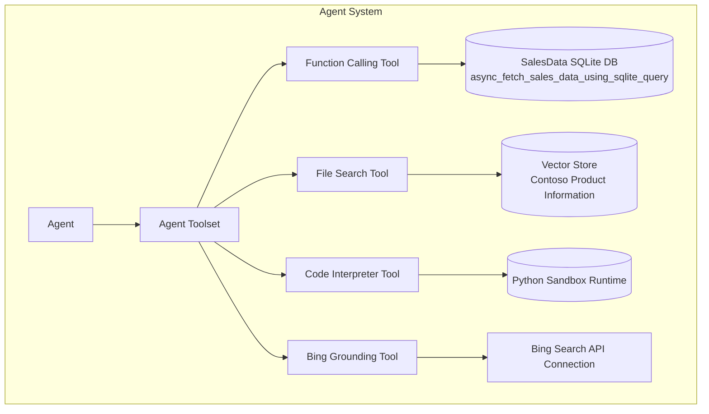
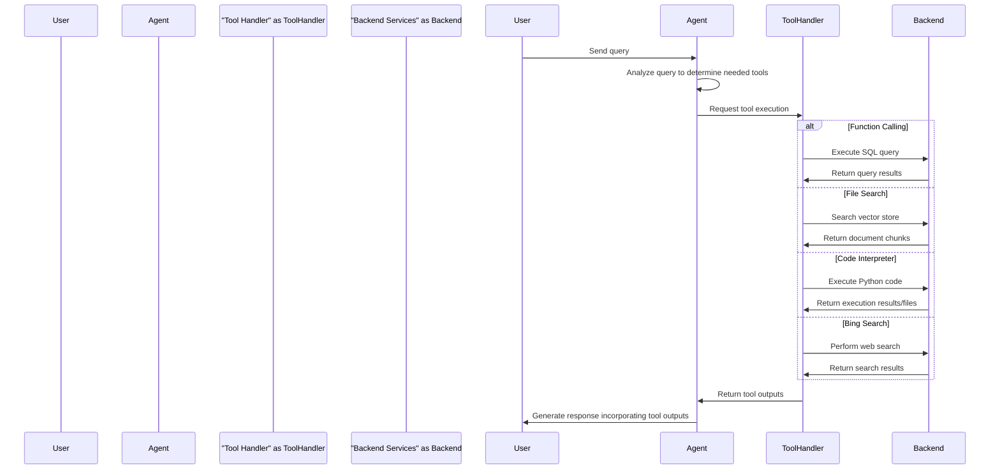
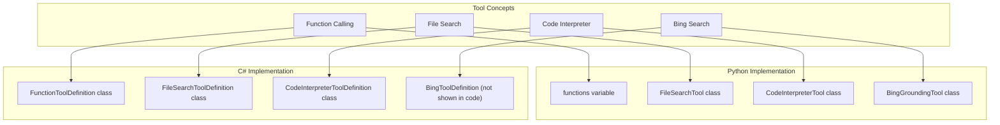

<!-- source: DeepWiki mcp.deepwiki.com · repo microsoft/build-your-first-agent-with-azure-ai-agent-service-workshop · page 3.2 Agent Tools Overview · fetched 2026-10-26 -->

# Agent Tools Overview

<details>
<summary>Relevant source files</summary>

The following files were used as context for generating this wiki page:

- [docs/docs/lab-2-file_search.md](docs/docs/lab-2-file_search.md)
- [docs/docs/lab-3-code_interpreter.md](docs/docs/lab-3-code_interpreter.md)
- [src/csharp/workshop/AgentWorkshop.Client/Lab.cs](src/csharp/workshop/AgentWorkshop.Client/Lab.cs)
- [src/csharp/workshop/AgentWorkshop.Client/Lab2.cs](src/csharp/workshop/AgentWorkshop.Client/Lab2.cs)
- [src/csharp/workshop/AgentWorkshop.Client/Lab3.cs](src/csharp/workshop/AgentWorkshop.Client/Lab3.cs)

</details>


This document provides a technical overview of the tools available in the Azure AI Agent Service and their implementation in the workshop codebase. Agent tools extend the capabilities of AI agents beyond text generation, allowing them to perform specific operations like database queries, document searching, code execution, and web searches.

For information about agent instructions that guide agent behavior, see [Agent Instructions](#3.1).

## Tool Types

The Azure AI Agent Service supports various tool types that enhance an agent's capabilities. This workshop demonstrates four primary tool types:

1. **Function Calling Tool**: Executes predefined functions, particularly SQL queries against a sales database
2. **File Search Tool**: Searches through documents stored in a vector store for document grounding
3. **Code Interpreter Tool**: Generates and executes Python code for data analysis and visualization
4. **Bing Search Tool**: Searches the web for external knowledge grounding

### Tool Architecture Diagram



Sources: [docs/docs/lab-2-file_search.md:59-66](), [docs/docs/lab-3-code_interpreter.md:54-55]()

## Tool Implementation

### Python Implementation

In Python, tools are instantiated as objects and added to a toolset:

```python
# Function Calling Tool
toolset.add(functions)

# File Search Tool
vector_store = await utilities.create_vector_store(
    project_client,
    files=[TENTS_DATA_SHEET_FILE],
    vector_store_name="Contoso Product Information Vector Store",
)
file_search_tool = FileSearchTool(vector_store_ids=[vector_store.id])
toolset.add(file_search_tool)

# Code Interpreter Tool
code_interpreter = CodeInterpreterTool()
toolset.add(code_interpreter)
```

Sources: [docs/docs/lab-2-file_search.md:59-66](), [docs/docs/lab-3-code_interpreter.md:54-55]()

### C# Implementation

In C#, tools are defined using tool definition classes and added through the `IntialiseLabTools()` method:

```csharp
// Function Calling Tool (Base Lab class)
private IEnumerable<ToolDefinition> InitialiseTools() => [
    new FunctionToolDefinition(
        name: nameof(SalesData.FetchSalesDataAsync),
        description: "This function is used to answer user questions about Contoso sales data by executing SQLite queries against the database.",
        parameters: /* Parameter definition */
    ),
    ..IntialiseLabTools()
];

// File Search Tool (Lab2 class)
public override IEnumerable<ToolDefinition> IntialiseLabTools() =>
    [new FileSearchToolDefinition()];

// Code Interpreter Tool (Lab3 class)
public override IEnumerable<ToolDefinition> IntialiseLabTools() =>
    [new CodeInterpreterToolDefinition()];
```

Sources: [src/csharp/workshop/AgentWorkshop.Client/Lab.cs:31-48](), [src/csharp/workshop/AgentWorkshop.Client/Lab2.cs:11-12](), [src/csharp/workshop/AgentWorkshop.Client/Lab3.cs:9-10]()

## Tool Execution Flow

The following diagram illustrates the execution flow when a user interacts with an agent that uses tools:



Sources: [src/csharp/workshop/AgentWorkshop.Client/Lab.cs:143-193](), [src/csharp/workshop/AgentWorkshop.Client/Lab.cs:221-247]()

## Function Calling Tool

The Function Calling Tool allows the agent to execute predefined functions in response to user queries. In this workshop, it primarily executes SQL queries against a SQLite database containing Contoso sales data.

### Implementation Details

In C#, function handling is implemented in the `HandleActionAsync` method:

```csharp
FetchSalesDataArgs salesDataArgs = JsonSerializer.Deserialize<FetchSalesDataArgs>(
    requiredActionUpdate.FunctionArguments, options);
string result = await SalesData.FetchSalesDataAsync(salesDataArgs.Query);
toolOutputUpdate = agentClient.SubmitToolOutputsToStreamAsync(
    requiredActionUpdate.Value,
    new List<ToolOutput>([new ToolOutput(requiredActionUpdate.ToolCallId, result)])
);
```

Sources: [src/csharp/workshop/AgentWorkshop.Client/Lab.cs:235-241]()

## File Search Tool

The File Search Tool enables document grounding by searching through text in documents stored in a vector store. In this workshop, it searches through the Contoso Tents Data Sheet to answer product-related queries.

### Implementation Details

In C#, the vector store is initialized and configured in `Lab2.cs`:

```csharp
protected override async Task InitialiseLabAsync(AgentsClient agentClient)
{
    string datasheet = Path.Combine(SharedPath, "datasheet", "contoso-tents-datasheet.pdf");
    AgentFile file = await agentClient.UploadFileAsync(
        filePath: datasheet,
        purpose: AgentFilePurpose.Agents
    );
    vectorStore = await agentClient.CreateVectorStoreAsync(
        fileIds: [file.Id],
        name: "Contoso Product Information Vector Store"
    );
}

protected override ToolResources? InitialiseToolResources()
{
    return new ToolResources
    {
        FileSearch = new FileSearchToolResource([vectorStore.Id], null)
    };
}
```

Sources: [src/csharp/workshop/AgentWorkshop.Client/Lab2.cs:14-45]()

## Code Interpreter Tool

The Code Interpreter Tool enables the agent to generate and execute Python code for data analysis and visualization. It runs in a secure sandbox environment with a restricted subset of Python to ensure safe execution.

### Capabilities

The Code Interpreter Tool allows the agent to:

- Generate Python code based on user queries
- Execute code in a secure sandbox environment
- Create visualizations such as charts and graphs 
- Export data as CSV or other formats
- Save output files to the file system

### Implementation Example

```python
# Create and add the Code Interpreter tool
code_interpreter = CodeInterpreterTool()
toolset.add(code_interpreter)
```

Sources: [docs/docs/lab-3-code_interpreter.md:1-3](), [docs/docs/lab-3-code_interpreter.md:54-55]()

## Bing Search Tool

The Bing Search Tool allows the agent to search the web for external knowledge, enabling up-to-date information and competitive intelligence capabilities.

### Implementation Example

```python
# Create and add the Bing Search tool
bing_connection = await project_client.connections.get(
    connection_name=BING_CONNECTION_NAME
)
bing_grounding = BingGroundingTool(connection_id=bing_connection.id)
toolset.add(bing_grounding)
```

## Code-to-Tool Mapping

The following diagram maps the natural language concepts of agent tools to their specific code implementations:



Sources: [src/csharp/workshop/AgentWorkshop.Client/Lab.cs:31-48](), [src/csharp/workshop/AgentWorkshop.Client/Lab2.cs:11-12](), [src/csharp/workshop/AgentWorkshop.Client/Lab3.cs:9-10]()

## Tool Processing Lifecycle

When a user interacts with the agent, the following tool processing steps occur:

1. The agent receives the user query and determines which tool(s) to use
2. The agent formulates parameters for the selected tool(s)
3. The tool executes its specific functionality (SQL query, document search, code execution, web search)
4. Results are returned to the agent
5. The agent incorporates the tool results into its response

This process is handled by the `HandleStreamingUpdateAsync` and `HandleActionAsync` methods in the C# implementation.

| Tool Type | Primary Function | Data Source | Output Format |
|-----------|-----------------|-------------|--------------|
| Function Calling | Execute SQL queries | SQLite database | JSON |
| File Search | Search documents | Vector store | Text chunks |
| Code Interpreter | Execute Python code | Generated code + data | Visualizations, CSV, text |
| Bing Search | Search web | Bing API | Search results |

Sources: [src/csharp/workshop/AgentWorkshop.Client/Lab.cs:143-193](), [src/csharp/workshop/AgentWorkshop.Client/Lab.cs:221-247]()

## Summary

The Azure AI Agent Service tools significantly enhance an agent's capabilities by enabling it to:

1. Access and query structured data through function calling
2. Ground responses in document knowledge through file search
3. Generate visualizations and analysis through code interpreter
4. Access up-to-date external knowledge through Bing search

These tools transform a basic text completion model into a powerful agent capable of solving complex, multi-step problems using various data sources and computational capabilities.

---

