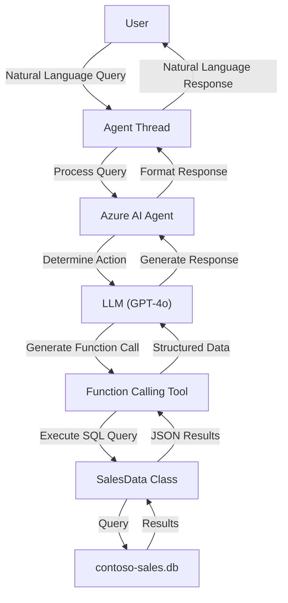
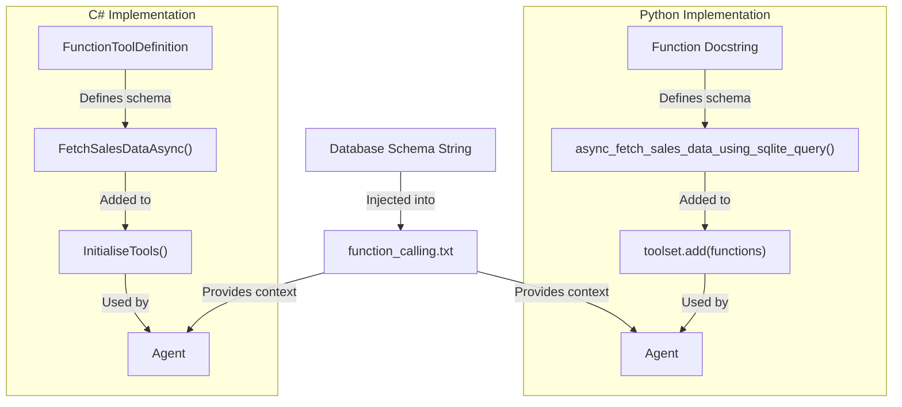
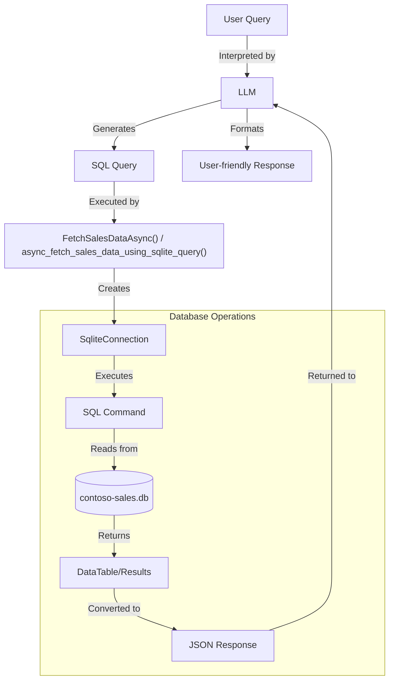
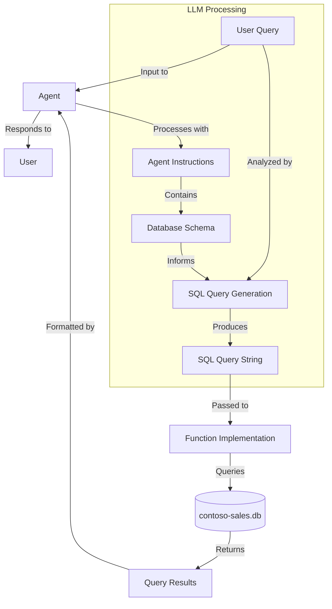

<!-- source: DeepWiki mcp.deepwiki.com · repo microsoft/build-your-first-agent-with-azure-ai-agent-service-workshop · page 4 Function Calling · fetched 2026-10-26 -->

# Function Calling

<details>
<summary>Relevant source files</summary>

The following files were used as context for generating this wiki page:

- [.gitignore](.gitignore)
- [docs/docs/lab-1-function_calling.md](docs/docs/lab-1-function_calling.md)
- [src/csharp/workshop/AgentWorkshop.Client/Lab.cs](src/csharp/workshop/AgentWorkshop.Client/Lab.cs)
- [src/csharp/workshop/AgentWorkshop.Client/SalesData.cs](src/csharp/workshop/AgentWorkshop.Client/SalesData.cs)
- [src/shared/datasheet/contoso-tents-datasheet.pdf](src/shared/datasheet/contoso-tents-datasheet.pdf)

</details>


Function Calling is a core capability in the Azure AI Agent Service that enables Large Language Models (LLMs) to interact with external systems. This document explains how Function Calling is implemented in the workshop, specifically focusing on how the agent uses this capability to execute SQL queries against a SQLite database containing Contoso sales data.

For information about other agent tools like File Search, see [File Search](#5).

## What is Function Calling?

Function Calling is a mechanism that allows LLMs to determine when to invoke predefined functions based on user prompts and function definitions. The LLM generates structured data that can be used by the application to call an actual function implementation. 

In this workshop, Function Calling enables the agent to:

1. Interpret natural language questions about sales data
2. Dynamically generate appropriate SQL queries
3. Execute these queries against a SQLite database
4. Format the results in a user-friendly manner

**Function Calling Architecture**



Sources: [docs/docs/lab-1-function_calling.md:1-50]()

## Implementation Details

The Function Calling capability is implemented differently in Python and C#, but both serve the same purpose - defining a function schema that the LLM can understand and use to generate the appropriate function calls.

**Function Definition Comparison**



Sources: [docs/docs/lab-1-function_calling.md:9-53](), [src/csharp/workshop/AgentWorkshop.Client/Lab.cs:31-47]()

### Python Implementation

In Python, the function schema is defined directly within the Python function's docstring. This approach keeps the definition and implementation together, making the code more maintainable and readable.

The docstring specifies:
- Function purpose
- Parameter descriptions
- Return type and format

When the function tool is added to the agent's toolset (`toolset.add(functions)`), the SDK parses the docstring to generate the callable function for the LLM.

Sources: [docs/docs/lab-1-function_calling.md:13-29]()

### C# Implementation

In C#, the function schema is defined explicitly when adding the function to the agent. This is done in the `InitialiseTools` method of the `Lab` class:

```
FunctionToolDefinition(
    name: nameof(SalesData.FetchSalesDataAsync),
    description: "This function is used to answer user questions about Contoso sales data by executing SQLite queries against the database.",
    parameters: BinaryData.FromObjectAsJson(...)
)
```

The `FunctionToolDefinition` includes:
- Function name
- Description
- Parameter specifications (type, description, requirements)

Sources: [src/csharp/workshop/AgentWorkshop.Client/Lab.cs:31-47]()

## SQLite Database Integration

The Contoso sales data is stored in a SQLite database. The agent uses Function Calling to dynamically generate and execute SQL queries against this database.

**Database Integration Flow**



Sources: [src/csharp/workshop/AgentWorkshop.Client/SalesData.cs:72-116]()

### Database Connection

The database connection is managed by the `SalesData` class (in C#) or equivalent Python implementation. The constructor initializes a connection to the SQLite database:

```csharp
connection = new SqliteConnection($"Data Source={databasePath};Mode=ReadOnly");
```

The database is opened when a query needs to be executed and closed afterward to manage resources efficiently.

Sources: [src/csharp/workshop/AgentWorkshop.Client/SalesData.cs:10-22]()

### Query Execution

When a function call is made, the implementation:

1. Opens the database connection
2. Creates and executes the SQL command
3. Loads the results into a data structure
4. Converts the results to JSON format
5. Returns the JSON to the agent
6. Closes the database connection

Error handling is included to capture and report any issues with the query execution.

Sources: [src/csharp/workshop/AgentWorkshop.Client/SalesData.cs:77-116]()

## Dynamic SQL Generation

A key aspect of the Function Calling implementation is the LLM's ability to generate appropriate SQL queries based on natural language user requests.

**SQL Generation Process**



Sources: [docs/docs/lab-1-function_calling.md:55-58](), [docs/docs/lab-1-function_calling.md:134-169]()

### Database Schema Incorporation

When the application starts, it incorporates the database schema and key data into the instructions for the Azure AI Agent Service:

1. The `GetDatabaseInfoAsync` method retrieves the database schema
2. This schema is then injected into the agent instructions by replacing the `{database_schema_string}` placeholder
3. The LLM uses this schema information to understand the database structure and generate appropriate queries

This approach provides the LLM with the context it needs to generate valid SQL queries without having to infer the database structure.

Sources: [src/csharp/workshop/AgentWorkshop.Client/SalesData.cs:29-70](), [src/csharp/workshop/AgentWorkshop.Client/Lab.cs:124-139]()

## Function Calling Workflow

When a user asks a question, the following process occurs:

1. The user submits a natural language query (e.g., "What are the sales by region?")
2. The agent processes this query and determines a function call is needed
3. The LLM generates a SQL query based on the user's question (e.g., `SELECT region, SUM(revenue) AS total_revenue FROM sales_data GROUP BY region;`)
4. The agent app calls the appropriate function with the generated SQL query
5. The function executes the query against the SQLite database
6. The results are returned to the LLM in JSON format
7. The LLM formats the results into a user-friendly response (often as a Markdown table)
8. The formatted response is presented to the user

This entire process happens seamlessly, allowing users to query complex data without needing to know SQL or understand the underlying database structure.

Sources: [docs/docs/lab-1-function_calling.md:222-233]()

## Handling Action Updates

In the C# implementation, the `HandleActionAsync` method in the `Lab` class handles the function calls from the LLM:

1. It receives a `RequiredActionUpdate` when the LLM determines a function call is needed
2. It checks if the function name matches `FetchSalesDataAsync`
3. It deserializes the function arguments (the SQL query)
4. It calls the `FetchSalesDataAsync` method with the query
5. It submits the results back to the LLM using `SubmitToolOutputsToStreamAsync`

This process enables the back-and-forth communication between the LLM and the database.

Sources: [src/csharp/workshop/AgentWorkshop.Client/Lab.cs:221-247]()

## Summary

Function Calling is a fundamental capability that enables the Contoso Sales Agent to answer questions about sales data using natural language. By leveraging the LLM's ability to generate SQL queries dynamically, the agent provides a powerful and flexible interface to the underlying data without requiring users to have technical database knowledge.

This capability forms the foundation of the workshop, which progressively builds upon it by adding additional tools like File Search, Code Interpreter, and Bing Search in subsequent labs.

---

